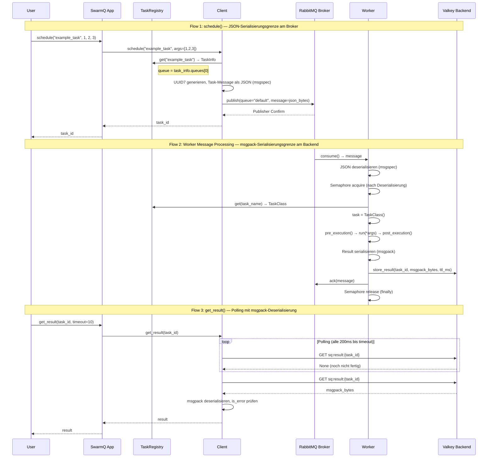

# feat: Phase 0+1 — Projektstruktur und minimaler Task-Roundtrip

## Overview

SwarmQ wird von Grund auf aufgebaut: Erst die Projektstruktur (Phase 0), dann der minimale Task-Roundtrip (Phase 1). Am Ende dieser Phase kann ein Task definiert, gescheduled, von einem Worker ausgeführt und das Ergebnis abgerufen werden — End-to-End mit echtem RabbitMQ und Valkey.

## Problem Frame

SwarmQ ist vollständig spezifiziert (~970 Zeilen in `aufgabe.md`) und durch ~23.000 Zeilen Recherche-Dokumentation untermauert. Es existiert noch kein Produktionscode. Die Implementierung erfolgt strikt nach TDD (definiert in `AGENTS.md`). Phase 0+1 legt das Fundament für alle weiteren Phasen.

(see origin: `docs/brainstorms/implementation-order-requirements.md`)

## Requirements Trace

- R0.1. `pyproject.toml` mit Dependencies, Extras, Entry-Point, Tool-Konfiguration
- R0.2. Verzeichnisstruktur: `src/swarmq/`, `tests/unit/`, `tests/integration/`, `tests/e2e/`
- R0.3. `docker-compose.yml` mit RabbitMQ 4.x + Valkey 8.x
- R0.4. conftest.py Hierarchie (3 Ebenen)
- R0.5. pytest-Konfiguration (asyncio_mode="auto", Marker, Timeouts)
- R1.1. Exception-Hierarchie (Phase-1-Subset)
- R1.2. Konfigurationsklasse mit Env-Var-Auflösung
- R1.3. Serialisierung (msgspec JSON + msgpack Results)
- R1.4. Task-Basisklasse mit TaskInfo und Auto-Registration
- R1.5. TaskRegistry (register/get, Duplikat-Erkennung)
- R1.6. RabbitMQ Broker (connect_robust, Publisher Confirms, 3-Queue-Topologie)
- R1.7. Valkey Backend (BlockingConnectionPool, store_result, get_result)
- R1.8. Worker (Consumer-Loop, Lifecycle, Fehlerbehandlung)
- R1.9. Client-API (schedule, get_result, run)
- R1.10. SwarmQ App-Klasse (Broker + Backend + Config + Registry)

## Scope Boundaries

- Kein CLI (Phase 3, R3.10)
- Kein Retry-System (Phase 2, R2.2)
- Kein DLQ-Routing (Phase 2, R2.3 — aber Queue-Topologie wird in R1.6 vorbereitet)
- Kein structlog-Setup (Phase 2, R2.6 — Phase 1 nutzt stdlib logging)
- Kein Graceful Shutdown (Phase 2, R2.5)
- Kein ProcessManager/Multiprocessing (Phase 4, R4.6 — Phase 1 ist Single-Process)
- Keine Delivery Modes (Phase 2, R2.1 — Phase 1 nutzt nur AT_LEAST_ONCE)
- Keine abstrakte Broker/Backend-Basisklasse (kommt wenn zweiter Broker/Backend nötig wird)

### Deferred to Separate Tasks

- Retry + DLQ: Phase 2 Plan
- Graceful Shutdown: Phase 2 Plan
- Structured Logging: Phase 2 Plan

## Context & Research

### Relevant Code and Patterns

- `prototypes/worker_prototype.py` — Referenz für Signal-Handling und Worker-Lifecycle (Phase 2+4 relevant, Phase 1 nutzt vereinfachten Single-Process-Worker)
- `docs/recherche-deepening-broker-lifecycle.md` Abschnitt 1 — 3-Queue-Topologie ({queue}, {queue}.DQ, {queue}.XQ) mit DLX-Bindings
- `docs/recherche-aio-pika-rabbitmq.md` — `connect_robust()`, `channel.set_qos()`, `queue.consume()`, Publisher Confirms
- `docs/recherche-valkey-py.md` — `BlockingConnectionPool`, `SET PX`, `register_script()`
- `docs/recherche-deepening-internals.md` — Serialisierung (msgspec JSON + msgpack), Config-Dataclass, Registry-Design, Exception-Hierarchie
- `docs/recherche-tdd.md` — TDD-Zyklus, pytest-asyncio Auto-Mode, conftest-Hierarchie

### Institutional Learnings

- Kein `docs/solutions/` vorhanden (Greenfield-Projekt)

### External References

- Lokale Recherche-Dokumentation ist umfassend — kein externer Research nötig

## Key Technical Decisions

- **Single-Process Worker in Phase 1:** Kein ProcessManager, kein Multiprocessing. Ein Worker = ein Prozess mit einem Event-Loop. Vereinfacht Phase 1 erheblich, ProcessManager kommt in Phase 4 (R4.6).
- **Konkrete Klassen statt Abstraktion:** `RabbitMQBroker` und `ValkeyBackend` direkt, keine ABC. Abstraktion wird eingeführt wenn ein zweiter Broker/Backend gebraucht wird.
- **3-Queue-Topologie sofort deklarieren:** Auch wenn Phase 1 nur die Main-Queue nutzt, werden DQ und XQ in R1.6 mitdeklariert. Das vermeidet späteres Re-Deklarieren und macht die Topologie testbar.
- **msgspec für Messages, msgpack für Results:** JSON (msgspec) für Broker-Messages (sprachübergreifend, debuggbar), msgpack für Backend-Results (kompakt, type-safe über Ext-Types).
- **TaskInfo als frozen dataclass:** Immutable nach Erstellung. Phase-1-Felder: name, queues, soft_timeout, hard_timeout, delivery, result_ttl. Weitere Felder in späteren Phasen.
- **Auto-Registration via `__init_subclass__` statt Metaclass:** Die Spec sagt "Metaklasse", aber `__init_subclass__` ist funktional äquivalent und belegt nicht den Metaclass-Slot — kein `TypeError: metaclass conflict` wenn User andere Metaclasses kombinieren (z.B. ABCMeta). Decorator wurde abgelehnt weil er Registration explizit statt automatisch macht (widerspricht Spec Abschnitt 5.1).
- **TaskInfo als `frozen dataclass` statt `msgspec.Struct`:** msgspec.Struct wäre schneller, koppelt aber die öffentliche API an eine Serialisierungsbibliothek. `attrs` wäre eine unnötige neue Dependency. frozen dataclass: Zero Dependencies, Standard-Python, ausreichend für Config-Objekte die einmal pro Task-Klasse erstellt werden. Konsistent mit dem "minimale Abhängigkeiten"-Prinzip (Spec 2.1).
- **Separate Client-Klasse (intern) + SwarmQ als Fassade:** Client besitzt Message-Konstruktion und Result-Polling (Single Responsibility). SwarmQ besitzt Lifecycle-Orchestrierung und delegiert. Ermöglicht den Client-Modus (Spec 2.6) ohne Worker/Registry-Abhängigkeiten.
- **Queue-Routing: Client-interne Auflösung mit optionaler Registry:** `Client.schedule()` löst die Queue intern auf: (1) expliziter `queue`-Parameter hat Vorrang, (2) wenn Registry vorhanden → `task_info.queues[0]`, (3) weder queue noch Registry → Fehler. Im Client-Modus (Spec 2.6, ohne Registry) muss `queue` explizit angegeben werden. Multi-Queue-Tasks: Phase 1 nutzt `queues[0]` (erste/primäre Queue). Semantik für multiple Queues ist Spec-Lücke (siehe Open Questions).
- **2-Tier Config-Auflösung in Phase 1:** Env-Var → Programmatisch → Default. CLI-Tier kommt in Phase 3 (R3.10).
- **AT_LEAST_ONCE als einziger Delivery Mode in Phase 1:** Ack nach post_execution() + Result-Write. FIRE_AND_FORGET kommt in Phase 2 (R2.1).
- **stdlib logging in Phase 1:** structlog-Setup kommt in Phase 2 (R2.6). Phase 1 nutzt Python's `logging` direkt, um Abhängigkeiten im Kern minimal zu halten.

## Open Questions

### Resolved During Planning

- **aio-pika Python 3.14 Kompatibilität:** aio-pika nutzt `asyncio.get_running_loop()` (nicht das deprecated `get_event_loop()`). Kein Problem mit Python 3.14. Integration-Test in R0.4 Fixtures als Smoke-Test aufnehmen.
- **Quorum Queues vs. Classic Queues:** Quorum Queues (RabbitMQ 4.x Default). Vorteile: repliziert, durable by default, delivery-limit. Nachteile: kein globales QoS (prefetch per channel). Entscheidung: Quorum Queues verwenden, prefetch_count explizit setzen.
- **Connection Pool Size Valkey:** `valkey.asyncio.BlockingConnectionPool(max_connections=20, timeout=10)` — blockiert statt sofortigem Fehler bei Pool-Erschöpfung.

### Deferred to Implementation

- Exakte conftest-Fixture-Signaturen: Ergeben sich aus den konkreten Test-Anforderungen während der TDD-Zyklen
- Genaue Queue-Argumente (delivery-limit, TTL): Die Recherche gibt Richtwerte vor, exakte Werte werden bei der Implementierung finalisiert

### Deferred to Spec / Future Phase

- **Multi-Queue-Semantik bei Publishing:** `TaskInfo.queues` ist `list[str]`, aber die Spec definiert nicht was multiple Queues beim Publishing bedeuten (Round-Robin? Fan-Out? Routing-Key-basiert?). Phase 1 nutzt `queues[0]` (erste Queue). Diese Lücke sollte in der Spec geklärt werden bevor Phase 3+ Multi-Queue-Routing implementiert.

## Output Structure

```
src/
  swarmq/
    __init__.py
    exceptions.py
    config.py
    serialization.py
    task.py
    registry.py
    broker/
      __init__.py
      rabbitmq.py
    backend/
      __init__.py
      valkey.py
    worker.py
    client.py
    app.py
tests/
  __init__.py
  conftest.py
  unit/
    __init__.py
    conftest.py
    test_exceptions.py
    test_config.py
    test_serialization.py
    test_task.py
    test_registry.py
    broker/
      __init__.py
      test_rabbitmq.py
    backend/
      __init__.py
      test_valkey.py
    test_worker.py
    test_client.py
    test_app.py
  integration/
    __init__.py
    conftest.py
  e2e/
    __init__.py
pyproject.toml
docker-compose.yml
```

## High-Level Technical Design

> *This illustrates the intended approach and is directional guidance for review, not implementation specification. The implementing agent should treat it as context, not code to reproduce.*



**Wesentliche Designgrenzen:**
- **JSON (msgspec)** am Broker: Sprachübergreifend, debuggbar, für Task-Messages
- **msgpack** am Backend: Kompakt, type-safe über Ext-Types, für Results
- **Queue-Routing** geschieht im Client (Registry-Lookup wenn Registry vorhanden, sonst expliziter queue-Parameter)

## Implementation Units

### Phase 0 — Projektstruktur

- [x] **Unit 0.1: pyproject.toml und Verzeichnisstruktur**

**Goal:** Projekt-Scaffolding mit allen Dependencies, Extras, Entry-Point und Tool-Konfiguration. Alle Verzeichnisse und `__init__.py` Dateien.

**Requirements:** R0.1, R0.2

**Dependencies:** Keine

**Files:**
- Create: `pyproject.toml`
- Create: `src/swarmq/__init__.py`
- Create: `src/swarmq/broker/__init__.py`
- Create: `src/swarmq/backend/__init__.py`
- Create: `tests/__init__.py`
- Create: `tests/unit/__init__.py`
- Create: `tests/unit/broker/__init__.py`
- Create: `tests/unit/backend/__init__.py`
- Create: `tests/integration/__init__.py`
- Create: `tests/e2e/__init__.py`

**Approach:**
- `pyproject.toml` mit `[build-system]` (hatchling oder setuptools), `[project]` Metadaten, Dependencies: `msgspec`, `msgpack`, `structlog`, `aio-pika`, `valkey[libvalkey]`
- Extras: `[fast]` → orjson, `[metrics]` → prometheus_client, `[test]` → pytest, pytest-asyncio, pytest-timeout, pytest-cov, mypy, ruff
- Entry-Point: `[project.scripts] swarmq = "swarmq.cli:main"` (CLI-Modul kommt in Phase 3, Entry-Point schon definieren)
- pytest-Konfiguration: `asyncio_mode = "auto"`, Marker (unit, integration, e2e, slow), Timeout-Defaults
- mypy: strict mode, src-Layout
- ruff: Standard-Regeln

**Patterns to follow:**
- `docs/recherche-tdd.md` Abschnitt 19 (pytest-Konfiguration)
- `aufgabe.md` Abschnitt 2.2 (Dependencies), 2.3 (Package-Struktur)

**Test expectation: none — reine Konfigurationsdateien und leere `__init__.py`**

**Verification:**
- `pip install -e ".[test]"` installiert erfolgreich
- `pytest --collect-only` läuft ohne Fehler
- `mypy src/` läuft ohne Fehler (leere Module)

---

- [x] **Unit 0.2: docker-compose.yml**

**Goal:** RabbitMQ 4.x und Valkey 8.x als lokale Entwicklungsinfrastruktur.

**Requirements:** R0.3

**Dependencies:** Keine

**Files:**
- Create: `docker-compose.yml`

**Approach:**
- RabbitMQ 4.x mit Management-Plugin, Health Check (`rabbitmq-diagnostics -q ping`), Port 5672 + 15672
- Valkey 8.x mit Health Check (`valkey-cli ping`), Port 6379
- Benannte Volumes für Persistenz
- Netzwerk für Service-Discovery

**Patterns to follow:**
- `docs/recherche-rabbitmq-server.md` Abschnitt 9
- `docs/recherche-valkey-server.md` Abschnitt 8

**Test expectation: none — reine Infrastruktur-Konfiguration**

**Verification:**
- `docker compose up -d` startet beide Services
- `docker compose ps` zeigt beide als healthy
- RabbitMQ Management UI auf localhost:15672 erreichbar
- Valkey CLI `valkey-cli ping` antwortet PONG

---

- [x] **Unit 0.3: conftest.py Hierarchie und pytest-Setup**

**Goal:** Test-Infrastruktur mit 3 conftest-Ebenen und Basis-Fixtures.

**Requirements:** R0.4, R0.5

**Dependencies:** Unit 0.1, Unit 0.2

**Files:**
- Create: `tests/conftest.py`
- Create: `tests/unit/conftest.py`
- Create: `tests/integration/conftest.py`

**Approach:**
- `tests/conftest.py`: Gemeinsame Fixtures (z.B. `event_loop_policy` wenn nötig), Auto-Marker basierend auf Pfad (`tests/unit/` → unit, etc.)
- `tests/unit/conftest.py`: Mock-Factories für Broker/Backend, Dummy-Task-Klassen, autouse Fixture das `Task._registered_tasks` zwischen Tests zurücksetzt (verhindert Test-Pollution durch `__init_subclass__`)
- `tests/integration/conftest.py`: Echte RabbitMQ/Valkey-Connections als Fixtures, Skip-Marker wenn Docker nicht läuft, Cleanup nach jedem Test (Queues löschen, Valkey flushen)
- Smoke-Test Fixture: aio-pika Connection zu RabbitMQ aufbauen und schließen (verifiziert Python 3.14 Kompatibilität)

**Execution note:** Fixtures werden iterativ erweitert während die Phase-1 Units implementiert werden. Starte mit minimalen Fixtures und erweitere bei Bedarf.

**Patterns to follow:**
- `docs/recherche-tdd.md` Abschnitt 20.2 (conftest-Hierarchie)
- `AGENTS.md` (Drei conftest.py Ebenen)

**Test scenarios:**
- Happy path: `pytest --collect-only` findet alle Test-Verzeichnisse
- Happy path: Unit-Tests laufen ohne Docker (Mocks)
- Integration: Smoke-Test-Fixture verbindet sich erfolgreich zu RabbitMQ und Valkey

**Verification:**
- `pytest tests/ --collect-only` sammelt Tests aus allen Verzeichnissen
- `pytest tests/unit/ -x` läuft (auch wenn noch keine Tests existieren)
- Integration-Fixtures verbinden sich zu Docker-Services

---

### Phase 1 — Foundation

- [x] **Unit 1.1: Exception-Hierarchie**

**Goal:** Phase-1-Exceptions als Basis für Fehlerbehandlung im gesamten System.

**Requirements:** R1.1

**Dependencies:** Unit 0.1

**Files:**
- Create: `src/swarmq/exceptions.py`
- Test: `tests/unit/test_exceptions.py`

**Execution note:** Test-first. Starte mit dem einfachsten Test (Instanziierung der Basis-Exception), dann Triangulation über die Hierarchie.

**Approach:**
- `SwarmQError(Exception)` als Basis
- `ConfigurationError(SwarmQError)` — ungültige Config
- `BrokerConnectionError(SwarmQError)` — Broker nicht erreichbar
- `BackendConnectionError(SwarmQError)` — Backend nicht erreichbar
- `TaskNotFoundError(SwarmQError)` — Task nicht in Registry
- `ResultNotReadyError(SwarmQError)` — Ergebnis noch nicht verfügbar
- `ResultExpiredError(SwarmQError)` — Ergebnis-TTL abgelaufen
- `ResultSerializationError(SwarmQError)` — Serialisierungsfehler
- `TaskError(SwarmQError)` — generischer Task-Fehler für Remote-Error-Results im Client (nicht in R1.1 gelistet, aber durch Flow-Analyse als notwendig identifiziert: Client braucht typisierten Fehler wenn `get_result()` ein Error-Result erhält)
- `Retry(SwarmQError)` mit `delay: float | None` — expliziter Retry-Trigger
- `NoRetry(SwarmQError)` mit `reason: str` — explizit kein Retry

**Patterns to follow:**
- `aufgabe.md` Abschnitt 15 (Exception-Hierarchie)
- `docs/recherche-deepening-internals.md` Abschnitt 4

**Test scenarios:**
- Happy path: Jede Exception ist instanziierbar mit passenden Argumenten
- Happy path: Vererbungshierarchie korrekt (`isinstance(ConfigurationError(), SwarmQError)`)
- Happy path: `TaskError("remote error")` speichert Message
- Happy path: `Retry(delay=60)` speichert delay-Attribut
- Happy path: `NoRetry(reason="bad input")` speichert reason-Attribut
- Edge case: Alle Exceptions sind mit `except SwarmQError` fangbar

**Verification:**
- Alle Exception-Klassen existieren und sind korrekt verkettet
- `from swarmq.exceptions import *` exportiert alle Phase-1-Exceptions

---

- [x] **Unit 1.2: Konfigurationsklasse**

**Goal:** Zentrale Konfiguration mit Env-Var-Auflösung und Validierung.

**Requirements:** R1.2

**Dependencies:** Unit 1.1

**Files:**
- Create: `src/swarmq/config.py`
- Test: `tests/unit/test_config.py`

**Execution note:** Test-first. Beginne mit Default-Werten, dann Env-Var-Override, dann Validierung.

**Approach:**
- `SwarmQConfig` als dataclass
- Phase-1-Felder: `broker_url` (str), `backend_url` (str), `result_ttl` (int, default 86400), `queues` (list[str], default ["default"]), `concurrency` (int, default 10), `log_level` (str, default "INFO")
- Env-Var-Mapping: `SWARMQ_BROKER_URL`, `SWARMQ_BACKEND_URL`, `SWARMQ_RESULT_TTL`, `SWARMQ_CONCURRENCY`, `SWARMQ_QUEUES` (kommasepariert), `SWARMQ_LOG_LEVEL`
- Auflösung: Env-Var → Programmatisch → Default
- Validierung beim Erstellen: `result_ttl >= 0`, `concurrency >= 1`, `log_level` in erlaubten Werten, URLs nicht leer
- Bei Validierungsfehler: `ConfigurationError` mit klarer Fehlermeldung

**Patterns to follow:**
- `aufgabe.md` Abschnitt 14 (Konfiguration)
- `docs/recherche-deepening-internals.md` Abschnitt 3

**Test scenarios:**
- Happy path: Config mit Default-Werten erstellen
- Happy path: Config mit expliziten Werten erstellen
- Happy path: Env-Var überschreibt Default (z.B. `SWARMQ_RESULT_TTL=3600`)
- Happy path: Programmatischer Wert überschreibt Default
- Happy path: Env-Var überschreibt programmatischen Wert
- Happy path: `SWARMQ_QUEUES="a,b,c"` wird zu `["a", "b", "c"]` geparsed
- Error path: `result_ttl=-1` → `ConfigurationError`
- Error path: `concurrency=0` → `ConfigurationError`
- Error path: `log_level="INVALID"` → `ConfigurationError`
- Edge case: Leere Env-Var wird ignoriert (nicht als leerer String behandelt)

**Verification:**
- Config lässt sich mit und ohne Env-Vars erstellen
- Ungültige Werte werden sofort abgelehnt

---

- [x] **Unit 1.3: Serialisierung (JSON + msgpack)**

**Goal:** JSON-Serialisierung für Broker-Messages und msgpack-Serialisierung für Results.

**Requirements:** R1.3

**Dependencies:** Unit 1.1

**Files:**
- Create: `src/swarmq/serialization.py`
- Test: `tests/unit/test_serialization.py`

**Execution note:** Test-first. Starte mit einfachen JSON-Roundtrips, dann Type-Hooks, dann msgpack.

**Approach:**
- **JSON (msgspec):**
  - `encode_json(obj) -> bytes` und `decode_json(data: bytes, type_hint) -> obj`
  - Type-Hooks für: `datetime` (ISO 8601), `bytes` (base64), `Decimal` (string), `UUID` (string), `Enum` (value)
  - msgspec.json.Encoder/Decoder mit enc_hook/dec_hook
- **msgpack:**
  - `encode_result(obj) -> bytes` und `decode_result(data: bytes, type_hint) -> obj`
  - Ext-Types: datetime (code 1), date (code 2), time (code 3), Decimal (code 4), UUID (code 5), set (code 6), frozenset (code 7)
  - `None` Results → msgpack nil
- Beide: `ResultSerializationError` bei Fehlern
- Kein orjson in Phase 1 (kommt als optionale Alternative in Phase 4)

**Patterns to follow:**
- `aufgabe.md` Abschnitt 3 (Message-Formate)
- `docs/recherche-deepening-internals.md` Abschnitt 1 (Serialisierung)

**Test scenarios:**
- Happy path: JSON-Roundtrip mit primitiven Typen (str, int, float, bool, None, list, dict)
- Happy path: JSON-Roundtrip mit datetime → ISO 8601 → datetime
- Happy path: JSON-Roundtrip mit UUID → string → UUID
- Happy path: JSON-Roundtrip mit Decimal → string → Decimal
- Happy path: JSON-Roundtrip mit bytes → base64 → bytes
- Happy path: JSON-Roundtrip mit Enum → value → Enum
- Happy path: msgpack-Roundtrip mit primitiven Typen
- Happy path: msgpack-Roundtrip mit datetime (Ext-Type 1)
- Happy path: msgpack-Roundtrip mit UUID (Ext-Type 5)
- Happy path: msgpack-Roundtrip mit Decimal (Ext-Type 4)
- Happy path: msgpack-Roundtrip mit set/frozenset (Ext-Types 6/7)
- Happy path: msgpack None-Result → nil → None
- Error path: Nicht-serialisierbarer Typ → `ResultSerializationError`
- Edge case: Leeres dict/list serialisiert korrekt
- Edge case: Verschachtelte Strukturen (dict mit datetime-Werten)

**Verification:**
- JSON und msgpack Roundtrips sind verlustfrei für alle unterstützten Typen
- Fehlerhafte Eingaben produzieren `ResultSerializationError`

---

- [x] **Unit 1.4: Task-Basisklasse und TaskInfo**

**Goal:** Task-Basisklasse mit Lifecycle-Hooks und TaskInfo als frozen dataclass.

**Requirements:** R1.4

**Dependencies:** Unit 1.1

**Files:**
- Create: `src/swarmq/task.py`
- Test: `tests/unit/test_task.py`

**Execution note:** Test-first. Starte mit TaskInfo-Validierung, dann Task-Basisklasse, dann Auto-Registration.

**Approach:**
- `TaskInfo` als frozen dataclass:
  - `name: str` (max 255, Pflicht)
  - `queues: list[str]` (Pflicht, mindestens 1)
  - `soft_timeout: int | None` (Default: None)
  - `hard_timeout: int | None` (Default: None)
  - `delivery: DeliveryMode` (Default: AT_LEAST_ONCE)
  - `result_ttl: int | None` (Default: None → globaler Default)
- `DeliveryMode` als Enum: `AT_LEAST_ONCE`, `FIRE_AND_FORGET`
- `Task` Basisklasse:
  - Klassenattribut `task_info: TaskInfo` (muss von Subklasse definiert werden)
  - `async def pre_execution(self) -> None` (Default: pass)
  - `async def run(self, *args, **kwargs)` (abstrakt)
  - `async def post_execution(self) -> None` (Default: pass)
- Auto-Registration via `__init_subclass__`: Sammelt Task-Klassen in einer Klassen-Variable (wird von Registry beim Start ausgelesen). Guard: Subklassen ohne `task_info` Attribut (z.B. abstrakte Zwischenklassen) werden übersprungen.
- Validierung: `hard_timeout > soft_timeout` wenn beide gesetzt, `name` nicht leer, `queues` nicht leer

**Patterns to follow:**
- `aufgabe.md` Abschnitt 4 (Task-Definition)
- `docs/recherche-deepening-internals.md` Abschnitt 2

**Test scenarios:**
- Happy path: TaskInfo mit allen Feldern erstellen
- Happy path: TaskInfo mit nur Pflichtfeldern (Defaults korrekt)
- Happy path: Task-Subklasse definieren mit task_info und run()
- Happy path: DeliveryMode.AT_LEAST_ONCE und FIRE_AND_FORGET existieren
- Happy path: pre_execution() und post_execution() sind aufrufbar (Default: no-op)
- Happy path: Auto-Registration sammelt Task-Subklasse
- Error path: TaskInfo mit leerem name → Validierungsfehler
- Error path: TaskInfo mit leerer queues-Liste → Validierungsfehler
- Error path: TaskInfo mit hard_timeout < soft_timeout → Validierungsfehler
- Edge case: TaskInfo ist immutable (frozen dataclass)
- Edge case: Mehrere Task-Subklassen werden alle registriert
- Edge case: Abstrakte Zwischenklasse ohne task_info wird NICHT registriert (Guard)
- Edge case: `Task._registered_tasks` Collection ist zurücksetzbar (für Test-Isolation)

**Verification:**
- Task-Subklassen lassen sich definieren und werden automatisch gesammelt
- TaskInfo validiert bei Erstellung

---

- [x] **Unit 1.5: TaskRegistry**

**Goal:** Registry für Task-Klassen mit Duplikat-Erkennung und Lookup.

**Requirements:** R1.5

**Dependencies:** Unit 1.4

**Files:**
- Create: `src/swarmq/registry.py`
- Test: `tests/unit/test_registry.py`

**Execution note:** Test-first. Starte mit register/get, dann Duplikat-Erkennung.

**Approach:**
- `TaskRegistry` als Klasse (nicht Singleton — wird von SwarmQ App instanziiert)
- `register(task_class)` — registriert Task-Klasse unter `task_info.name`
- `get(task_name) -> type[Task]` — gibt Task-Klasse zurück oder `TaskNotFoundError`
- `get_all() -> dict[str, type[Task]]` — alle registrierten Tasks
- `has(task_name) -> bool` — prüft ob Task registriert ist
- Duplikat-Erkennung: `register()` mit bereits existierendem Namen → `ConfigurationError`
- Cached TaskInfo-Daten pro Task: name, queues, return-type annotation, delivery mode, timeouts
- Auto-Discovery (`discover()`) kommt in Phase 3 (R3.10)

**Patterns to follow:**
- `aufgabe.md` Abschnitt 5 (Registry)
- `docs/recherche-deepening-internals.md` Abschnitt 2

**Test scenarios:**
- Happy path: Task registrieren und per Name abrufen
- Happy path: Mehrere Tasks registrieren
- Happy path: `get_all()` gibt alle registrierten Tasks zurück
- Happy path: `has()` gibt True/False korrekt zurück
- Happy path: Return-Type Annotation wird gecacht
- Error path: `get("unknown")` → `TaskNotFoundError`
- Error path: Doppelter Task-Name → `ConfigurationError`
- Edge case: Registry ist initial leer

**Verification:**
- Tasks lassen sich registrieren, abrufen und auf Duplikate prüfen

---

### Phase 1 — Broker & Backend

- [x] **Unit 1.6: RabbitMQ Broker**

**Goal:** RabbitMQ-Broker mit Connection-Management, Queue-Deklaration (3-Queue-Topologie), Publish und Consume.

**Requirements:** R1.6

**Dependencies:** Unit 1.1, Unit 1.3

**Files:**
- Create: `src/swarmq/broker/rabbitmq.py`
- Test: `tests/unit/broker/test_rabbitmq.py`

**Execution note:** Test-first. Unit-Tests mit Mocks für aio-pika. Integration-Tests in separater Datei (Unit 1.6b).

**Approach:**
- `RabbitMQBroker` Klasse:
  - `__init__(url: str)` — speichert URL, keine Connection bei Init
  - `async connect()` — `aio_pika.connect_robust(url)`, Channel für Publishing, Channel für Consuming
  - `async close()` — Connection schließen
  - `async declare_queue(queue_name: str)` — 3-Queue-Topologie deklarieren:
    - `{queue}` — Main Queue (quorum, durable, DLX → `{queue}.XQ`)
    - `{queue}.DQ` — Delay Queue (quorum, durable, DLX → `{queue}`)
    - `{queue}.XQ` — Dead-Letter Queue (quorum, durable)
  - `async publish(queue_name: str, message: bytes, **kwargs)` — Message an Main Queue publizieren, Publisher Confirms
  - `async consume(queue_name: str, callback, prefetch_count: int)` — Consumer starten, `prefetch_count` wird vom Worker übergeben (= `config.concurrency`)
  - `async ack(message)` — Message bestätigen
  - `async nack(message, requeue: bool)` — Message ablehnen
- Separate Channels für Publish und Consume (Isolation)
- `delivery_mode=PERSISTENT` für alle Messages

**Patterns to follow:**
- `docs/recherche-aio-pika-rabbitmq.md` (connect_robust, channel, QoS)
- `docs/recherche-deepening-broker-lifecycle.md` Abschnitt 1 (3-Queue-Topologie)

**Test scenarios:**
- Happy path: Broker instanziieren (kein Connect bei Init)
- Happy path: connect() erstellt Connection und Channels
- Happy path: declare_queue() erstellt 3 Queues mit korrekten Argumenten
- Happy path: publish() sendet Message an korrekte Queue
- Happy path: consume() startet Consumer mit Callback und übergebenem prefetch_count
- Happy path: ack()/nack() delegieren an aio-pika Message
- Error path: connect() mit ungültiger URL → `BrokerConnectionError`
- Edge case: close() ist idempotent (mehrfach aufrufbar)
- Edge case: Queue-Argumente enthalten quorum-type und DLX-Settings

**Verification:**
- Alle Broker-Operationen sind über Mocks testbar
- Queue-Topologie-Argumente sind korrekt (DLX-Bindings, quorum-type)

---

- [x] **Unit 1.6b: RabbitMQ Broker Integration-Tests**

**Goal:** Integration-Tests die den Broker mit echtem RabbitMQ verifizieren.

**Requirements:** R1.6

**Dependencies:** Unit 1.6, Unit 0.2, Unit 0.3

**Files:**
- Create: `tests/integration/broker/test_rabbitmq.py`
- Create: `tests/integration/broker/__init__.py`

**Approach:**
- Fixtures aus `tests/integration/conftest.py` für echte RabbitMQ-Connection
- Skip wenn Docker nicht läuft
- Queue-Cleanup nach jedem Test

**Patterns to follow:**
- `docs/recherche-tdd.md` Abschnitt 20.2 (Integration-Fixtures)

**Test scenarios:**
- Integration: Connect/Disconnect Roundtrip
- Integration: Queue-Deklaration → RabbitMQ Management API verifiziert 3 Queues
- Integration: Publish → Consume → Ack Roundtrip
- Integration: Publish → Consume → Nack(requeue=True) → erneutes Consume
- Integration: Python 3.14 Smoke-Test (Connection aufbauen und schließen)

**Verification:**
- Alle Integration-Tests bestehen mit laufendem RabbitMQ

---

- [x] **Unit 1.7: Valkey Backend**

**Goal:** Valkey-Backend mit Connection-Management, Result-Storage und Result-Retrieval.

**Requirements:** R1.7

**Dependencies:** Unit 1.1, Unit 1.3

**Files:**
- Create: `src/swarmq/backend/valkey.py`
- Test: `tests/unit/backend/test_valkey.py`

**Execution note:** Test-first. Unit-Tests mit Mocks für valkey-py.

**Approach:**
- `ValkeyBackend` Klasse:
  - `__init__(url: str)` — speichert URL, erstellt Connection Pool
  - `async connect()` — Client erstellen mit `valkey.asyncio.BlockingConnectionPool(max_connections=20, timeout=10)`
  - `async close()` — Pool schließen
  - `async store_result(task_id: str, result_data: bytes, ttl_ms: int)` — `SET sq:result:{task_id} {data} PX {ttl_ms}`
  - `async get_result(task_id: str) -> bytes | None` — `GET sq:result:{task_id}`
  - `async delete_result(task_id: str)` — `DEL sq:result:{task_id}`
- Key-Schema: `sq:result:{task_id}` (Präfix `sq:` für SwarmQ-Namespace)
- Kein Lua-Script-Loading in Phase 1

**Patterns to follow:**
- `docs/recherche-valkey-py.md` (BlockingConnectionPool, SET PX)

**Test scenarios:**
- Happy path: Backend instanziieren
- Happy path: connect()/close() Lifecycle
- Happy path: store_result() mit TTL → SET PX aufgerufen
- Happy path: get_result() → gespeicherte Daten zurück
- Happy path: get_result() für nicht-existierenden Key → None
- Happy path: delete_result() → DEL aufgerufen
- Error path: connect() mit ungültiger URL → `BackendConnectionError`
- Edge case: close() ist idempotent
- Edge case: Key-Format korrekt (`sq:result:{task_id}`)

**Verification:**
- Alle Backend-Operationen sind über Mocks testbar
- Key-Schema stimmt mit Spezifikation überein

---

- [x] **Unit 1.7b: Valkey Backend Integration-Tests**

**Goal:** Integration-Tests die das Backend mit echtem Valkey verifizieren.

**Requirements:** R1.7

**Dependencies:** Unit 1.7, Unit 0.2, Unit 0.3

**Files:**
- Create: `tests/integration/backend/test_valkey.py`
- Create: `tests/integration/backend/__init__.py`

**Approach:**
- Fixtures für echte Valkey-Connection, Cleanup per FLUSHDB nach jedem Test
- Skip wenn Docker nicht läuft

**Test scenarios:**
- Integration: Connect/Disconnect Roundtrip
- Integration: store_result() → get_result() Roundtrip
- Integration: TTL wird korrekt gesetzt (TTL-Check via Valkey PTTL)
- Integration: get_result() für nicht-existierenden Key → None
- Integration: delete_result() entfernt Key

**Verification:**
- Alle Integration-Tests bestehen mit laufendem Valkey

---

### Phase 1 — Application

- [x] **Unit 1.8: Worker (Consumer-Loop)**

**Goal:** Einzelner Worker-Prozess der Tasks aus RabbitMQ empfängt, ausführt und Ergebnisse in Valkey speichert.

**Requirements:** R1.8

**Dependencies:** Unit 1.3, Unit 1.4, Unit 1.5, Unit 1.6, Unit 1.7

**Files:**
- Create: `src/swarmq/worker.py`
- Test: `tests/unit/test_worker.py`

**Execution note:** Test-first. Starte mit dem Happy Path (Task empfangen → ausführen → Result speichern → Ack), dann Fehlerbehandlung.

**Approach:**
- `Worker` Klasse:
  - `__init__(broker, backend, registry, config)` — Dependencies injiziert
  - `async start()` — Broker connect, Backend connect, Queues deklarieren, Consumer starten
  - `async stop()` — Consumer stoppen, Connections schließen
  - `async _on_message(message)` — Callback für eingehende Messages:
    1. Message deserialisieren (JSON)
    2. Task in Registry nachschlagen
    3. Task-Instanz erstellen
    4. `pre_execution()` aufrufen
    5. `run(*args, **kwargs)` aufrufen
    6. `post_execution()` aufrufen
    7. Result serialisieren (msgpack) und in Backend speichern
    8. Message acken
  - Fehlerbehandlung:
    - `pre_execution()` oder `run()` Exception: Error-Result speichern (is_error=True, error_message), Message acken, Error loggen. `post_execution()` wird bei `pre_execution()`-Fehler NICHT aufgerufen.
    - `post_execution()` Exception: Error-Result speichern (überschreibt Success-Result), Message acken, Error loggen.
    - Result-Serialisierung fehlgeschlagen (`ResultSerializationError`): Error-Result speichern (is_error=True, "ResultSerializationError: ..."), Message acken. NICHT nack+requeue (würde Endlosschleife verursachen da der Return-Wert nie serialisierbar wird).
    - `TaskNotFoundError`: nack ohne requeue, Error loggen
    - Backend-Ausfall (`BackendConnectionError`): nack mit requeue=True. **Bekannte Limitation Phase 1:** Ohne Idempotency-Keys wird der Task bei Redelivery erneut ausgeführt.
    - result_ttl=0: store_result() wird komplett übersprungen
  - Message-Deserialisierungsfehler (ungültiges JSON oder fehlende Pflichtfelder wie `task.name`): nack(requeue=False), Error loggen
- Concurrency: `asyncio.Semaphore(config.concurrency)`. **prefetch_count MUSS gleich config.concurrency sein** um Message-Amplifikation zu vermeiden. Semaphore wird NACH Deserialisierung acquired und im `finally`-Block released.
- Result-Message-Format: `{"task": {"id", "queue", "name"}, "is_error": bool, "error_message": str, "result": bytes}`

**Patterns to follow:**
- `aufgabe.md` Abschnitt 7 (Worker)
- `aufgabe.md` Abschnitt 3.2 (Result Message Format)
- `docs/recherche-deepening-broker-lifecycle.md` Abschnitt 2

**Test scenarios:**
- Happy path: Message empfangen → Task ausführen → Result in Backend → Ack
- Happy path: Task mit Return-Wert → Result korrekt serialisiert
- Happy path: pre_execution() und post_execution() werden aufgerufen
- Happy path: Concurrency-Semaphore begrenzt parallele Ausführungen
- Happy path: Task mit result_ttl=0 → store_result() wird übersprungen, Message geackt
- Error path: Task wirft Exception → Error-Result gespeichert, is_error=True, Message geackt
- Error path: pre_execution() wirft Exception → Error-Result gespeichert, post_execution() NICHT aufgerufen, Message geackt
- Error path: post_execution() wirft Exception → Error-Result überschreibt Success-Result, Message geackt
- Error path: Result-Serialisierung fehlgeschlagen → Error-Result gespeichert (nicht nack+requeue), Message geackt
- Error path: Task nicht in Registry → nack(requeue=False), Error geloggt
- Error path: Backend nicht erreichbar → nack(requeue=True)
- Error path: Message-Deserialisierung fehlgeschlagen (ungültiges JSON) → nack(requeue=False)
- Error path: Message mit fehlenden Pflichtfeldern (kein task.name) → nack(requeue=False)
- Edge case: Task mit None-Return → Result als msgpack nil gespeichert
- Edge case: Semaphore wird nach Deserialisierung acquired und im finally released

**Verification:**
- Worker verarbeitet Messages korrekt im Happy Path und bei Fehlern
- Concurrency wird durch Semaphore begrenzt

---

- [x] **Unit 1.9: Client-API**

**Goal:** Client-API zum Einreihen von Tasks und Abrufen von Ergebnissen.

**Requirements:** R1.9

**Dependencies:** Unit 1.3, Unit 1.5 (optional), Unit 1.6, Unit 1.7

**Files:**
- Create: `src/swarmq/client.py`
- Test: `tests/unit/test_client.py`

**Execution note:** Test-first. Starte mit schedule() (mit explizitem queue-Param), dann get_result(), dann run(), dann Registry-basierte Queue-Auflösung.

**Approach:**
- `Client` Klasse mit **zwei Modi** (mit und ohne Registry):
  - `__init__(broker, backend, registry=None)` — Registry ist optional (Client-Modus ohne Registry, Spec 2.6)
  - `async schedule(task_name: str, *args, queue: str | None = None, **kwargs) -> str`:
    - Queue-Auflösung: expliziter `queue` Param → Registry-Lookup (`task_info.queues[0]`) → Fehler wenn weder queue noch Registry
    - UUID7 generieren, Task-Message als JSON serialisieren, an Broker publizieren
    - Wenn Registry vorhanden: Task-Name gegen Registry validieren (Spec 5.2), `TaskNotFoundError` wenn nicht registriert
    - Ohne Registry: keine Validierung (Spec 2.6: "nur Task-Namen als Strings")
  - `async get_result(task_id: str, timeout: float = 10, polling: float = 0.2) -> Any` — Backend pollen bis Result vorhanden oder Timeout. Result deserialisieren (msgpack). Bei is_error: `TaskError(error_message)` werfen. Bei Timeout: `ResultNotReadyError`
  - `async run(task_name: str, *args, queue: str | None = None, timeout: float = 10, polling: float = 0.2, **kwargs) -> Any` — schedule() + get_result() kombiniert
- Task-Message-Format: `{"task": {"id": "UUID7", "queue": "default", "name": "example_task"}, "args": [...], "kwargs": {...}}`
- UUID7 für chronologisch sortierbare Task-IDs

**Patterns to follow:**
- `aufgabe.md` Abschnitt 6.1 (Client API)
- `aufgabe.md` Abschnitt 3.1 (Task Message Format)
- `aufgabe.md` Abschnitt 2.6 (Client-Modus)

**Test scenarios:**
- Happy path: schedule() mit explizitem queue-Param generiert UUID7, publiziert Message
- Happy path: schedule() mit Registry löst Queue aus TaskInfo.queues[0] auf
- Happy path: get_result() findet Result im Backend, deserialisiert korrekt
- Happy path: run() kombiniert schedule() und get_result()
- Happy path: Task-Message hat korrektes JSON-Format mit queue-Feld
- Error path: schedule() ohne queue und ohne Registry → Fehler
- Error path: schedule() mit Registry aber unbekanntem Task-Name → `TaskNotFoundError`
- Error path: get_result() Timeout → `ResultNotReadyError`
- Error path: get_result() mit Error-Result → wirft `TaskError(error_message)`
- Edge case: get_result() pollt mehrfach bevor Result verfügbar
- Edge case: schedule() mit leeren args/kwargs
- Edge case: get_result(timeout=0) → prüft einmal, gibt sofort `ResultNotReadyError` wenn nicht vorhanden
- Edge case: Client-Modus ohne Registry — keine Task-Validierung, explizites queue nötig

**Verification:**
- Client kann Tasks einreihen und Ergebnisse abrufen
- Message-Format stimmt mit Spezifikation überein

---

- [x] **Unit 1.10: SwarmQ App-Klasse**

**Goal:** Zentrale App-Klasse die Broker, Backend, Config und Registry zusammenbringt.

**Requirements:** R1.10

**Dependencies:** Unit 1.2, Unit 1.5, Unit 1.6, Unit 1.7, Unit 1.8, Unit 1.9

**Files:**
- Create: `src/swarmq/app.py`
- Modify: `src/swarmq/__init__.py`
- Test: `tests/unit/test_app.py`

**Execution note:** Test-first. Starte mit Konstruktor und Context-Manager, dann Client-Delegation, dann Worker-Start.

**Approach:**
- `SwarmQ` Klasse:
  - `__init__(broker, backend, **config_kwargs)` — Config erstellen, Registry erstellen, Tasks aus `__init_subclass__`-Sammlung registrieren, Client erstellen mit `Client(broker, backend, registry=registry)`
  - `async __aenter__()` — Broker und Backend connecten
  - `async __aexit__()` — Broker und Backend schließen
  - `async schedule(task_name, *args, **kwargs) -> str` — delegiert an Client (Client löst Queue intern über die injizierte Registry auf)
  - `async get_result(task_id, timeout, polling) -> Any` — delegiert an Client
  - `async run(task_name, *args, **kwargs) -> Any` — delegiert an Client
  - `async start_worker()` — Worker starten (Consumer-Loop blockiert)
- `__init__.py`: Öffentliche API exportieren: `SwarmQ`, `Task`, `TaskInfo`, `DeliveryMode`, `RabbitMQBroker`, `ValkeyBackend`, alle Exceptions

**Patterns to follow:**
- `aufgabe.md` Abschnitt 2.6 (Client-Modus)
- `aufgabe.md` Abschnitt 14.1 (Konfiguration)

**Test scenarios:**
- Happy path: SwarmQ instanziieren mit Broker und Backend
- Happy path: Context-Manager öffnet/schließt Connections
- Happy path: schedule() delegiert an Client (Client hat Registry für Queue-Auflösung)
- Happy path: get_result() delegiert an Client
- Happy path: run() delegiert an Client
- Happy path: Auto-Discovery registriert Task-Subklassen in Registry
- Error path: Config-Validierungsfehler → `ConfigurationError`
- Edge case: Doppelter `__aexit__` ist safe

**Verification:**
- SwarmQ lässt sich als Client und als Worker nutzen
- Öffentliche API ist über `import swarmq` erreichbar

---

- [x] **Unit 1.E2E: End-to-End Roundtrip**

**Goal:** Vollständiger End-to-End Test: Task definieren → schedule → Worker ausführen → Result abrufen.

**Requirements:** R1.1-R1.10 (alle Phase-1 Requirements)

**Dependencies:** Alle vorherigen Units

**Files:**
- Create: `tests/e2e/test_roundtrip.py`

**Approach:**
- Test definiert einen simplen Task (z.B. `AddTask` das zwei Zahlen addiert)
- SwarmQ App erstellen mit echtem RabbitMQ + Valkey (Docker)
- Task schedulen
- Worker in separatem asyncio.Task starten
- Result abrufen und prüfen
- Worker stoppen

**Test scenarios:**
- Integration: Vollständiger Roundtrip: schedule("add", 2, 3) → Worker verarbeitet → get_result() == 5
- Integration: Task mit Fehler: schedule("fail_task") → Worker verarbeitet → get_result() wirft Exception
- Integration: Task mit None-Return → get_result() == None

**Verification:**
- Ein Task kann End-to-End definiert, gescheduled, ausgeführt und das Ergebnis abgerufen werden
- Entspricht dem Success Criterion für Phase 1 aus dem Origin-Dokument

## System-Wide Impact

- **Interaction graph:** In Phase 1 linear: Client → Broker → Worker → Backend. Keine Middleware, keine Signals, kein Scheduler.
- **Error propagation:** Task-Exceptions → Error-Result in Backend. Backend-Ausfall → nack(requeue). Broker-Ausfall → `BrokerConnectionError`.
- **State lifecycle risks:** Kein Retry in Phase 1 — bei Task-Fehler wird Error-Result gespeichert und Message geackt. **Bekannte Limitation:** Bei Backend-Ausfall nach erfolgreicher Task-Ausführung wird nack(requeue=True) gesendet, was den Task ohne Idempotency-Schutz erneut ausführt. Idempotency kommt in Phase 3 (R3.5).
- **API surface parity:** Client-API (`schedule`, `get_result`, `run`) ist die einzige öffentliche Schnittstelle. Kein CLI.
- **Integration coverage:** E2E-Test (Unit 1.E2E) deckt den vollständigen Roundtrip ab.
- **Unchanged invariants:** 3-Queue-Topologie wird deklariert aber DQ/XQ nicht aktiv genutzt — Phase 2 baut darauf auf.

## Risks & Dependencies

| Risk | Mitigation |
|------|------------|
| aio-pika Python 3.14 Inkompatibilität | Smoke-Test in Integration-Fixtures (Unit 0.3). aio-pika nutzt `get_running_loop()` — kein bekanntes Problem. |
| valkey-py Breaking Changes | valkey-py ist redis-py Fork mit identischer API. Pinned Version in pyproject.toml. |
| Quorum Queue Verhalten anders als erwartet | Integration-Tests mit echtem RabbitMQ (Unit 1.6b) verifizieren Topologie und Verhalten. |
| Docker nicht verfügbar auf CI | Integration/E2E-Tests mit Skip-Marker wenn Docker nicht läuft. Unit-Tests funktionieren ohne Docker. |

## Sources & References

- **Origin document:** [docs/brainstorms/implementation-order-requirements.md](docs/brainstorms/implementation-order-requirements.md)
- **Spezifikation:** [aufgabe.md](aufgabe.md) — Abschnitte 2-7, 14-15
- **TDD-Regeln:** [AGENTS.md](AGENTS.md)
- **Recherche Broker:** [docs/recherche-aio-pika-rabbitmq.md](docs/recherche-aio-pika-rabbitmq.md), [docs/recherche-deepening-broker-lifecycle.md](docs/recherche-deepening-broker-lifecycle.md)
- **Recherche Backend:** [docs/recherche-valkey-py.md](docs/recherche-valkey-py.md)
- **Recherche Internals:** [docs/recherche-deepening-internals.md](docs/recherche-deepening-internals.md)
- **Recherche TDD:** [docs/recherche-tdd.md](docs/recherche-tdd.md)
- **Worker-Architektur:** [docs/worker-architecture.md](docs/worker-architecture.md)
- **Worker-Prototyp:** [prototypes/worker_prototype.py](prototypes/worker_prototype.py)
