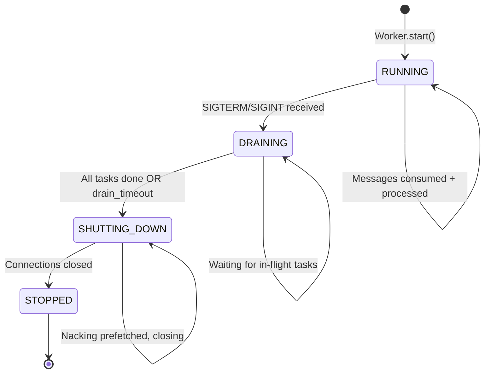
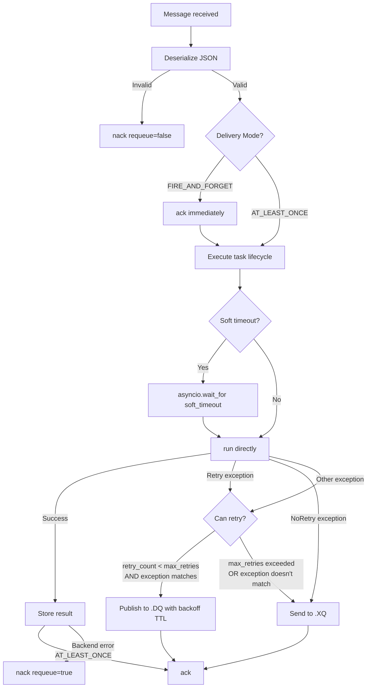

# feat: Phase 2 — Produktionsfähiger Kern

## Overview

Phase 2 macht SwarmQ produktionsfähig: Tasks werden bei Fehler automatisch retried mit konfigurierbarem Backoff, nach max_retries in die DLQ verschoben, FIRE_AND_FORGET Delivery Mode funktioniert, Timeouts verhindern hängende Tasks, der Worker fährt bei SIGTERM sauber herunter, und alle Aktionen sind strukturiert geloggt. Phase 1 hat die Hooks bereits vorbereitet — Phase 2 aktiviert sie.

## Problem Frame

Phase 1 liefert einen funktionalen Roundtrip, ist aber nicht produktionsfähig: keine Retries, keine Timeouts, kein sauberes Shutdown, kein strukturiertes Logging. Tasks die fehlschlagen werden als Error-Result gespeichert und fertig. In Produktion bedeutet das: transiente Fehler führen zu permanentem Task-Verlust, hängende Tasks blockieren Semaphore-Slots dauerhaft, Worker-Restart verliert prefetched Messages, und Debugging ist ohne strukturierte Logs unmöglich.

(see origin: `docs/brainstorms/implementation-order-requirements.md`)

## Requirements Trace

- R2.1. Delivery Modes: AT_LEAST_ONCE (Ack nach post_execution + Result-Write) und FIRE_AND_FORGET (Ack sofort bei Empfang)
- R2.2. Retry-System: Backoff-Strategien (exponential/linear/fixed), Jitter, retry_exceptions Filter, Retry/NoRetry Exceptions, Message-Header-basierter Retry-State
- R2.3. DLQ: 3-Queue-Topologie aktivieren — fehlgeschlagene Tasks nach max_retries in {queue}.XQ verschieben
- R2.4. Soft/Hard Timeouts: Soft via asyncio.wait_for (fangbar, löst Retry aus), Hard via separaten Watchdog (cancel, nack+requeue)
- R2.5. Graceful Shutdown: 4-Zustandsmaschine (RUNNING→DRAINING→SHUTTING_DOWN→STOPPED), SIGTERM/SIGINT Handler
- R2.6. structlog Logging: QueueHandler + QueueListener (non-blocking), contextvars, JSON-Output, Startup-Report
- R2.7. Result-TTL: Globaler Default + Task-spezifisch (bereits in Phase 1 implementiert, Integration mit Delivery Modes)

## Scope Boundaries

- Kein CLI (Phase 3, R3.10)
- Kein Middleware-System (Phase 3, R3.1)
- Kein Signal/Event-System (Phase 3, R3.2)
- Kein Rate Limiting, Locking, Deduplication (Phase 3, R3.3-R3.5)
- Kein Scheduler (Phase 3, R3.9)
- Kein ProcessManager/Multiprocessing (Phase 4, R4.6 — Phase 2 ist Single-Process)
- Keine Idempotency Keys (Phase 3, R3.5)
- Keine verzögerte Ausführung (Phase 3, R3.8)

### Deferred to Separate Tasks

- Circuit Breaker (Spec 2.5.1): Separate Implementierung nach Phase 2, baut auf den hier geschaffenen Connection-Error-Pfaden auf
- Credential-Sanitierung (Spec 13.7): Separater Task, kann nach Logging-Setup ergänzt werden

## Context & Research

### Relevant Code and Patterns

- `src/swarmq/worker.py` — Worker mit _on_message/_handle_message Pattern, Semaphore-Concurrency, Error-Handling. Phase 2 erweitert _handle_message um Delivery-Mode-Branching, Retry-Logik und Timeout-Enforcement.
- `src/swarmq/broker/rabbitmq.py` — 3-Queue-Topologie bereits deklariert (main, .DQ, .XQ mit DLX-Bindings). Phase 2 nutzt .DQ für Retry-Delays und .XQ für DLQ.
- `src/swarmq/task.py` — TaskInfo hat `delivery`, `soft_timeout`, `hard_timeout` bereits definiert aber ungenutzt. Phase 2 aktiviert sie.
- `src/swarmq/exceptions.py` — `Retry(delay)` und `NoRetry(reason)` bereits definiert aber unbehandelt. Phase 2 verdrahtet sie.
- `src/swarmq/config.py` — Muss um Retry- und Logging-Felder erweitert werden.

### Institutional Learnings

- `docs/solutions/logic-errors/swarmq-async-semaphore-deadlock-and-error-wrapping-2026-04-15.md` — aio-pika Callbacks müssen sofort returnen (asyncio.create_task Pattern). Relevant für Shutdown-Signaling und Timeout-Watchdog-Design.

### External References

- Lokale Recherche-Dokumentation ist umfassend — kein externer Research nötig:
  - `docs/recherche-retry-dlq.md` — Retry-Strategien, Backoff-Formeln, Jitter, DLQ-Pattern
  - `docs/recherche-deepening-broker-lifecycle.md` — Delivery Modes, Graceful Shutdown Sequenz, Ack-Timing
  - `docs/recherche-logging.md` — structlog Setup, QueueHandler, contextvars, ProcessorFormatter
  - `docs/recherche-deepening-internals.md` — Timeout-Enforcement via asyncio.wait_for

## Key Technical Decisions

- **Logging ZUERST (R2.6):** structlog-Setup ist Infrastruktur die alle anderen Phase-2-Features nutzen. Ohne Logging sind Retry-Zyklen, Timeout-Events und Shutdown-Schritte unsichtbar.
- **Retry-State in Message-Headers:** Kein externer State-Store nötig. Retry-Count, Traceback und Backoff-Info werden als aio-pika Message-Headers mitgeführt (Dramatiq-Pattern). Atomar mit der Message, keine Race-Conditions.
- **Retry via Delay Queue (.DQ):** Retry-Message wird in {queue}.DQ publiziert mit per-message TTL (= Backoff-Delay). RabbitMQ DLX routet sie nach TTL-Ablauf zurück in die Main-Queue. Kein Polling, kein Scheduler nötig.
- **Exponential Backoff mit Full Jitter als Default:** `delay = base * (2^attempt) * random(1.0, 2.0)`. Verhindert Thundering Herd nach Massenfehlern. `secrets.SystemRandom()` für kryptographisch sichere Jitter-Werte (verhindert synchronized Retries über Worker hinweg).
- **Soft-Timeout via asyncio.wait_for:** Wirft `asyncio.TimeoutError`, wird vom Worker als SoftTimeoutError behandelt und löst Retry aus. Task kann im Timeout-Handler aufräumen.
- **Hard-Timeout via separaten Watchdog-Task:** `asyncio.create_task` mit `asyncio.sleep(hard_timeout)` + `task.cancel()`. Kann nicht gefangen werden (CancelledError propagiert). **Hard-Timeout routed durch den Retry-Pfad** (retry_count inkrementieren, Backoff, DLQ nach max_retries) statt blindem nack(requeue=True) — verhindert Endlosschleifen bei Tasks die immer > hard_timeout brauchen.
- **FIRE_AND_FORGET Guard:** Gesamter Retry/Nack-Block ist explizit mit `if delivery == AT_LEAST_ONCE:` gegated. Bei FIRE_AND_FORGET: Exceptions nur loggen, kein Broker-Call auf bereits geackte Message. Hard-Timeout-Watchdog bei FIRE_AND_FORGET: nur cancel, kein nack.
- **post_execution wird bei Soft-Timeout NICHT aufgerufen:** `asyncio.wait_for` cancelled die innere Coroutine. Task-Autoren müssen `try/finally` in `run()` für kritisches Cleanup verwenden. Dies ist ein dokumentiertes API-Constraint.
- **Backoff-Cap:** `retry_max_delay: float = 3600.0` (1 Stunde) in Config. Exponential Backoff wird bei diesem Wert gekappt.
- **Graceful Shutdown als 4-Zustandsmaschine:** RUNNING→DRAINING→SHUTTING_DOWN→STOPPED. Signal-Handler setzt Event, Worker stoppt Consumer, wartet auf laufende Tasks (mit Drain-Timeout), nacked prefetched Messages, schließt Connections.
- **In-flight Task-Tracking via `_active_tasks: set[asyncio.Task]`:** `_on_message` speichert den `create_task`-Return in einem Set, `add_done_callback(discard)` entfernt fertige Tasks. Drain nutzt `asyncio.wait(self._active_tasks, timeout)` statt Semaphore-Tracking. Semaphore bleibt für Concurrency-Control, aber das Task-Set ist der autoritative Tracker für Shutdown.
- **TaskInfo-Felder für Retry erweitern:** `max_retries` (default 0), `retry_backoff` (default "exponential"), `retry_exceptions` (default None = alle), `retry_base_delay` (default 1.0s). Diese Felder existieren noch NICHT in task.py — sie werden in Unit 2.2+2.3 hinzugefügt. Die Spezifikation (aufgabe.md Abschnitt 4.1) definiert sie bereits.
- **Result-TTL=0 bei FIRE_AND_FORGET erzwingen:** Wenn delivery=FIRE_AND_FORGET und result_ttl nicht explizit gesetzt, wird result_ttl=0 als Default verwendet (kein Result-Storage). Konsistent mit der Spec.

## Open Questions

### Resolved During Planning

- **Hard-Timeout Implementierung:** asyncio-basierter Watchdog (separater Task) statt OS-Signal. OS-Signale (SIGALRM) funktionieren nicht mit asyncio Event-Loops und sind per-process (nicht per-task). Der Watchdog-Pattern ist sicher im Single-Process-Modell.
- **Retry-Count-Persistenz:** In aio-pika Message-Headers als `x-retry-count` und `x-retry-traceback`. Headers überleben die Delay-Queue-Redelivery.
- **Shutdown Drain-Timeout:** Konfigurierbarer Wert (Default 30s). Nach Ablauf werden laufende Tasks gecancelled.

### Deferred to Implementation

- Exakte structlog Processor-Pipeline: Konfiguration der Processor-Chain hängt von der Laufzeit-Interaction mit aio-pika/valkey-py Logs ab
- Genaues Backoff-Verhalten bei retry_backoff="fixed": Delay ist konstant (retry_base_delay), kein Multiplikator. Trivial zu implementieren.

## High-Level Technical Design

> *This illustrates the intended approach and is directional guidance for review, not implementation specification. The implementing agent should treat it as context, not code to reproduce.*

## Implementation Units

- [x] **Unit 2.6: structlog Logging Setup**

**Goal:** Non-blocking strukturiertes Logging mit contextvars für Task-Kontext und JSON-Output.

**Requirements:** R2.6

**Dependencies:** Keine (wird ZUERST implementiert)

**Files:**
- Create: `src/swarmq/logging.py`
- Modify: `src/swarmq/worker.py`
- Modify: `src/swarmq/app.py`
- Modify: `src/swarmq/config.py`
- Test: `tests/unit/test_logging.py`

**Execution note:** Test-first für die Setup-Funktion und Log-Output-Verifikation.

**Approach:**
- `setup_logging(log_level, json_output)` Funktion: structlog konfigurieren mit QueueHandler+QueueListener, ProcessorFormatter, cache_logger_on_first_use
- contextvars für task_id, task_name, worker_id, queue, attempt — gebunden in Worker._handle_message
- Startup-Report bei Worker.start() (PID, Python-Version, Broker/Backend-URLs sanitiert, Queues, Concurrency, registrierte Tasks)
- Config erweitern: `log_json: bool = True` Feld hinzufügen
- Alle bestehenden print/logging Aufrufe durch structlog ersetzen

**Patterns to follow:**
- `docs/recherche-logging.md` (QueueHandler Pattern, ProcessorFormatter, contextvars)
- `docs/recherche-deepening-internals.md` Abschnitt 5 (Credential-Sanitierung — URLs bereinigen)

**Test scenarios:**
- Happy path: setup_logging() konfiguriert structlog korrekt (verify log output is JSON)
- Happy path: contextvars werden in Worker._handle_message gebunden (task_id, task_name in Log-Output)
- Happy path: Startup-Report enthält erwartete Felder (PID, Queues, etc.)
- Edge case: Log-Level-Filtering — DEBUG-Messages bei INFO-Level werden nicht ausgegeben
- Edge case: URLs in Logs sind sanitiert (Passwörter durch *** ersetzt)

**Verification:**
- Alle Log-Ausgaben sind JSON-formatiert
- Task-Kontext (task_id, task_name) erscheint automatisch in Logs innerhalb von _handle_message

---

- [x] **Unit 2.1: Delivery Modes (AT_LEAST_ONCE + FIRE_AND_FORGET)**

**Goal:** FIRE_AND_FORGET Mode: Ack sofort bei Empfang, vor der Ausführung. AT_LEAST_ONCE bleibt wie bisher (Ack nach Execution + Result-Write).

**Requirements:** R2.1, R2.7 (Result-TTL Integration)

**Dependencies:** Unit 2.6 (Logging)

**Files:**
- Modify: `src/swarmq/worker.py`
- Modify: `src/swarmq/task.py` (result_ttl Default für FIRE_AND_FORGET)
- Test: `tests/unit/test_worker.py`

**Execution note:** Test-first — schreibe zuerst Tests für FIRE_AND_FORGET Ack-Timing.

**Approach:**
- In _handle_message: nach Registry-Lookup prüfe `task_info.delivery`
- FIRE_AND_FORGET: sofort ack, dann execute. Bei Fehler: nur loggen, kein Error-Result (result_ttl=0 Default). Keine Retry-Logik.
- AT_LEAST_ONCE: bestehendes Verhalten (Ack nach Result-Write)
- result_ttl Default für FIRE_AND_FORGET: 0 (kein Result-Storage) wenn nicht explizit gesetzt

**Patterns to follow:**
- `docs/recherche-deepening-broker-lifecycle.md` Abschnitt 2 (Delivery Modes)

**Test scenarios:**
- Happy path: FIRE_AND_FORGET → Message wird sofort geackt, dann Task ausgeführt
- Happy path: AT_LEAST_ONCE → Ack erst nach post_execution + Result-Write (bestehendes Verhalten)
- Happy path: FIRE_AND_FORGET mit explizitem result_ttl → Result wird gespeichert
- Happy path: FIRE_AND_FORGET ohne explizites result_ttl → kein Result-Storage
- Error path: FIRE_AND_FORGET Task wirft Exception → nur geloggt, kein nack (Message bereits geackt)
- Edge case: DeliveryMode.AT_LEAST_ONCE ist Default (Rückwärtskompatibilität)

**Verification:**
- FIRE_AND_FORGET Tasks werden sofort geackt
- AT_LEAST_ONCE Verhalten ist unverändert

---

- [x] **Unit 2.2+2.3: Retry-System und DLQ-Routing**

**Goal:** Tasks mit Retry-Konfiguration werden bei Fehler automatisch mit Backoff retried. Nach max_retries → DLQ ({queue}.XQ). Retry/NoRetry Exceptions werden korrekt behandelt.

**Requirements:** R2.2, R2.3

**Dependencies:** Unit 2.1 (Delivery Modes — Retry nur für AT_LEAST_ONCE)

**Files:**
- Modify: `src/swarmq/worker.py`
- Modify: `src/swarmq/broker/rabbitmq.py` (publish_to_delay_queue Methode)
- Modify: `src/swarmq/task.py` (TaskInfo Retry-Felder)
- Modify: `src/swarmq/config.py` (globale Retry-Defaults)
- Test: `tests/unit/test_worker.py`
- Test: `tests/unit/broker/test_rabbitmq.py`

**Execution note:** Test-first — beginne mit dem einfachsten Retry-Szenario (ein Retry, fixed Backoff), dann Triangulation.

**Approach:**
- **TaskInfo erweitern:** `max_retries: int = 0`, `retry_backoff: str = "exponential"`, `retry_exceptions: list[type] | None = None`, `retry_base_delay: float = 1.0`
- **Config erweitern:** `retry_max_delay: float = 3600.0` (globaler Backoff-Cap, 1 Stunde)
- **Retry-State in Message-Headers:** `x-swarmq-retry-count` (int), `x-swarmq-original-queue` (str). Beim Publish initial auf 0 setzen.
- **Worker Retry-Logik in _handle_message:**
  1. Exception fangen
  2. Wenn `isinstance(exc, NoRetry)` → direkt DLQ, kein Retry
  3. Wenn `isinstance(exc, Retry)` → Retry mit `exc.delay` (überschreibt Backoff), respektiert max_retries
  4. Wenn `retry_exceptions` gesetzt und Exception matcht NICHT → DLQ
  5. Wenn `retry_count >= max_retries` → DLQ
  6. Sonst → Retry: Backoff berechnen, Message in .DQ publizieren mit TTL = Backoff-Delay
- **Backoff-Berechnung:** `calculate_backoff(attempt, strategy, base_delay)` als reine Funktion
  - exponential: `base * 2^attempt * jitter(1.0, 2.0)`
  - linear: `base * (attempt + 1) * jitter(1.0, 2.0)`
  - fixed: `base`
- **Broker.publish_to_delay_queue(queue_name, message, delay_ms):** Publiziert in {queue}.DQ mit per-message TTL (`expiration` Header). RabbitMQ DLX routet nach Ablauf zurück in Main-Queue.
- **DLQ-Routing:** Für DLQ-Messages: Error-Result mit Traceback speichern, dann Message explizit in {queue}.XQ publizieren und Original-Message acken. Explizites Publish statt nack(requeue=false) weil: (a) die DLX-Routing auf der Main-Queue zeigt auf .XQ, was bei Retry-Messages die aus .DQ kommen nicht greift, und (b) explizites Publish gibt volle Kontrolle über die DLQ-Message-Headers (Traceback, Original-Queue, Retry-Count).
- **SoftTimeoutError** wird in Unit 2.4 definiert (nicht hier — wird erst dort verwendet)

**Patterns to follow:**
- `docs/recherche-retry-dlq.md` (Backoff-Formeln, Header-basierter State)
- `docs/recherche-deepening-broker-lifecycle.md` Abschnitt 4 (Retry via DQ)

**Test scenarios:**
- Happy path: Task mit max_retries=3 und erstem Fehler → Message in .DQ mit korrektem TTL publiziert
- Happy path: Retry-Count wird inkrementiert (Header x-swarmq-retry-count)
- Happy path: Nach max_retries → Error-Result gespeichert, Message geackt (DLX routet zu .XQ)
- Happy path: exponential Backoff berechnet korrekt (2^0*base, 2^1*base, 2^2*base)
- Happy path: linear Backoff berechnet korrekt
- Happy path: fixed Backoff ist konstant
- Happy path: Jitter ist im Bereich [1.0, 2.0] Multiplikator
- Happy path: `raise Retry(delay=60)` → Retry mit 60s Delay (überschreibt Backoff)
- Happy path: `raise NoRetry(reason="bad input")` → direkt DLQ, kein Retry
- Error path: retry_exceptions==[ConnectionError] und ValueError raised → DLQ (kein Retry)
- Error path: retry_exceptions==[ConnectionError] und ConnectionError raised → Retry
- Error path: max_retries=0 (Default) → kein Retry, Error-Result speichern
- Edge case: FIRE_AND_FORGET Tasks werden NICHT retried
- Edge case: Retry(delay=60) respektiert max_retries (kein unendlicher Retry)

**Verification:**
- Fehlgeschlagene Tasks werden automatisch retried bis max_retries
- DLQ-Messages enthalten Error-Information
- Backoff-Delays sind korrekt berechnet

---

- [x] **Unit 2.4: Soft/Hard Timeouts**

**Goal:** Soft-Timeout unterbricht Task mit fangbarer Exception (löst Retry aus). Hard-Timeout cancelt Task unkonditionell (nack + requeue).

**Requirements:** R2.4

**Dependencies:** Unit 2.2+2.3 (Retry-System — Soft-Timeout löst Retry aus)

**Files:**
- Modify: `src/swarmq/worker.py`
- Modify: `src/swarmq/exceptions.py` (SoftTimeoutError hinzufügen)
- Test: `tests/unit/test_worker.py`

**Execution note:** Test-first — beginne mit Soft-Timeout-Test (asyncio.wait_for).

**Approach:**
- **SoftTimeoutError** zu exceptions.py hinzufügen als `SoftTimeoutError(SwarmQError)`
- **Soft-Timeout:** Wenn `task_info.soft_timeout` gesetzt: `await asyncio.wait_for(task.run(*args, **kwargs), timeout=soft_timeout)`. Fängt `asyncio.TimeoutError`, wirft `SoftTimeoutError`. Worker behandelt SoftTimeoutError wie eine retry-fähige Exception.
- **Hard-Timeout:** Wenn `task_info.hard_timeout` gesetzt: Separater Watchdog-Task `asyncio.create_task(self._hard_timeout_watchdog(task_coro, hard_timeout))`. Nach hard_timeout: `task_coro.cancel()`. Worker fängt CancelledError → **routed durch den Retry-Pfad** (retry_count inkrementieren, DLQ nach max_retries) statt blindem nack(requeue=True). Verhindert Endlosschleifen bei permanent-timeouting Tasks.
- **FIRE_AND_FORGET + Hard-Timeout:** Watchdog cancelt den Task, aber kein nack (Message bereits geackt). Nur loggen.
- **Beide Timeouts parallel:** Soft-Timeout läuft im asyncio.wait_for, Hard-Timeout als separater Watchdog. Soft löst vor Hard aus (wenn beide gesetzt, ist hard > soft per TaskInfo-Validierung).
- **Nur run() wird timed:** pre_execution und post_execution haben keine Timeout-Begrenzung (sind für Setup/Cleanup gedacht).

**Patterns to follow:**
- `docs/recherche-deepening-broker-lifecycle.md` Abschnitt 5 (Timeout-Enforcement)

**Test scenarios:**
- Happy path: Task mit soft_timeout=1s und run() dauert 2s → SoftTimeoutError
- Happy path: SoftTimeoutError löst Retry aus (wenn max_retries > 0)
- Happy path: Task mit hard_timeout=2s und run() dauert 3s → CancelledError → Retry-Pfad (retry_count inkrementiert)
- Happy path: Task ohne Timeouts → kein Timeout-Verhalten (Rückwärtskompatibilität)
- Happy path: Soft-Timeout fängt und Task kann aufräumen (pre_execution → run timeout → post_execution NICHT aufgerufen)
- Error path: Hard-Timeout bei einem Task der Soft-Timeout ignoriert → unkonditioneller Cancel
- Edge case: Soft < Hard → Soft feuert zuerst, Hard wird abgebrochen wenn Task durch Retry-Logic endet
- Edge case: Nur hard_timeout gesetzt (kein soft) → nur Hard-Timeout aktiv
- Edge case: Hard-Timeout nach max_retries erschöpft → DLQ (nicht Endlosschleife)
- Edge case: FIRE_AND_FORGET + Hard-Timeout → Task gecancelt, nur geloggt, kein nack

**Verification:**
- Hängende Tasks werden durch Timeouts unterbrochen
- Soft-Timeout löst Retry-Logik aus
- Hard-Timeout cancelt unkonditionell

---

- [x] **Unit 2.5: Graceful Shutdown**

**Goal:** Worker fährt bei SIGTERM/SIGINT sauber herunter — laufende Tasks abschließen, prefetched Messages zurückgeben, Connections schließen.

**Requirements:** R2.5

**Dependencies:** Unit 2.6 (Logging)

**Files:**
- Modify: `src/swarmq/worker.py`
- Modify: `src/swarmq/app.py`
- Test: `tests/unit/test_worker.py`

**Execution note:** Test-first — Signal-Handler mit asyncio.Event testen.

**Approach:**
- **4-Zustandsmaschine** als Enum: `WorkerState.RUNNING`, `DRAINING`, `SHUTTING_DOWN`, `STOPPED`
- **Signal-Handler:** `loop.add_signal_handler(SIGTERM, ...)` und `loop.add_signal_handler(SIGINT, ...)` in Worker.start(). Handler setzt `_shutdown_event: asyncio.Event`.
- **Shutdown-Sequenz:**
  1. RUNNING → DRAINING: Consumer stoppen (broker.cancel_consume), keine neuen Messages
  2. DRAINING: Warten auf laufende Tasks mit Drain-Timeout (config.shutdown_timeout, Default 30s). `asyncio.wait(self._active_tasks, timeout=shutdown_timeout)` — Task-Set ist der autoritative Tracker (nicht Semaphore allein).
  3. DRAINING → SHUTTING_DOWN: Drain-Timeout abgelaufen → verbleibende Tasks in `_active_tasks` canceln via `task.cancel()`
  4. SHUTTING_DOWN: Prefetched aber unbearbeitete Messages nack(requeue=True). Broker close, Backend close.
  5. SHUTTING_DOWN → STOPPED: Cleanup fertig.
- **Config erweitern:** `shutdown_timeout: int = 30`
- **Broker erweitern:** `cancel_consume()` Methode die Consumer-Tags cancelt
- **Worker.start() wird blockierend:** Wartet auf _shutdown_event, führt dann Shutdown-Sequenz aus

**Patterns to follow:**
- `docs/recherche-deepening-broker-lifecycle.md` Abschnitt 3 (Graceful Shutdown 7-Schritte Sequenz)
- `prototypes/worker_prototype.py` (Signal-Handling Referenz)
- `docs/solutions/logic-errors/swarmq-async-semaphore-deadlock-and-error-wrapping-2026-04-15.md` (async Callback-Pattern)

**Test scenarios:**
- Happy path: SIGTERM → Worker wechselt zu DRAINING, wartet auf laufende Tasks, dann STOPPED
- Happy path: Laufende Tasks werden sauber abgeschlossen vor Shutdown
- Happy path: Prefetched Messages werden nack(requeue=True) bei Shutdown
- Happy path: Broker und Backend werden geschlossen
- Error path: Drain-Timeout abgelaufen → laufende Tasks werden gecancellt
- Edge case: Doppeltes SIGTERM/SIGINT → idempotent (Shutdown läuft bereits)
- Edge case: Shutdown während kein Task läuft → sofort STOPPED
- Integration: Worker.start() blockiert bis Shutdown-Event und returned dann

**Verification:**
- Worker fährt bei SIGTERM/SIGINT sauber herunter
- Keine Messages gehen verloren (requeue bei Shutdown)
- Connections werden geschlossen

---

- [x] **Unit 2.E2E: Phase 2 End-to-End Tests**

**Goal:** E2E-Verifikation aller Phase-2-Features mit echtem RabbitMQ + Valkey.

**Requirements:** R2.1-R2.7 (alle Phase-2 Requirements)

**Dependencies:** Alle vorherigen Units

**Files:**
- Create: `tests/e2e/test_phase2.py`

**Approach:**
- Tests mit echtem RabbitMQ + Valkey
- Einzigartige Queue-Namen pro Test

**Test scenarios:**
- Integration: FIRE_AND_FORGET Task → sofort geackt, Result nicht gespeichert
- Integration: Task mit max_retries=2 → nach 2 Fehlern in DLQ
- Integration: Retry mit Backoff → Message taucht nach Delay wieder auf (verifiziere via Consume-Timing)
- Integration: Soft-Timeout → Task wird retried
- Integration: Graceful Shutdown → SIGTERM, laufender Task wird fertig, Worker stoppt sauber

**Verification:**
- Entspricht den Success Criteria für Phase 2 aus dem Origin-Dokument

## System-Wide Impact

- **Interaction graph:** Worker._handle_message wird erheblich erweitert: Delivery-Mode-Branching → Retry/DLQ-Routing → Timeout-Enforcement. Alle Pfade nutzen structlog. Graceful Shutdown greift in Worker.start() ein.
- **Error propagation:** Erweitert: Task-Exception → Retry-Check → Backoff-Publish zu .DQ ODER DLQ zu .XQ ODER Error-Result. SoftTimeoutError wird wie retry-fähige Exception behandelt.
- **State lifecycle risks:** Retry-Count in Message-Headers: bei Broker-Restart gehen laufende Retry-Ketten verloren (Messages in .DQ bleiben erhalten, aber neue Retry-Attempts starten bei 0). Akzeptabel für Phase 2. **Shutdown-Interaktion:** Wenn Shutdown zwischen publish-to-DQ und ack-of-original passiert, wird die Original-Message requeued → ein zusätzlicher Attempt über max_retries hinaus. At-least-once-konsistent, kein Datenverlust.
- **API surface parity:** TaskInfo bekommt neue Felder (max_retries, retry_backoff, etc.). Rückwärtskompatibel da alle Defaults beibehalten werden (max_retries=0 = kein Retry).
- **Integration coverage:** E2E-Tests (Unit 2.E2E) verifizieren Retry-Timing, DLQ-Routing und Shutdown-Verhalten.
- **Unchanged invariants:** Client-API (schedule, get_result, run) ändert sich NICHT. Phase-1 Public API bleibt vollständig kompatibel.

## Risks & Dependencies

| Risk | Mitigation |
|------|------------|
| Retry via .DQ + TTL ist timing-abhängig | Integration-Tests mit realistischen Delays (500ms-1s). RabbitMQ TTL-Genauigkeit ist ±1ms. |
| Hard-Timeout via asyncio.cancel() kann CancelledError in unerwarteten Stellen auslösen | Hard-Timeout nur auf den run()-Task anwenden, nicht auf pre/post_execution. Genau wie asyncio.wait_for() nur den inneren Task cancelt. |
| Graceful Shutdown + Semaphore: Shutdown während Semaphore-Wait → Task startet nie | Shutdown-Event in _handle_message prüfen nach Semaphore-Acquire. Wenn gesetzt: Message nack(requeue=True) und return. |
| structlog QueueListener Thread: Kann Log-Messages verlieren bei abruptem Prozess-Kill | QueueListener.stop() in Shutdown-Sequenz aufrufen (drains die Queue). Bei SIGKILL unvermeidbar. |

## Sources & References

- **Origin document:** [docs/brainstorms/implementation-order-requirements.md](docs/brainstorms/implementation-order-requirements.md)
- **Phase 1 Plan:** [docs/plans/2026-04-15-001-feat-phase0-phase1-roundtrip-plan.md](docs/plans/2026-04-15-001-feat-phase0-phase1-roundtrip-plan.md)
- **Spezifikation:** [aufgabe.md](aufgabe.md) — Abschnitte 4.2, 7.4, 11, 13, 15
- **Recherche Retry/DLQ:** [docs/recherche-retry-dlq.md](docs/recherche-retry-dlq.md)
- **Recherche Broker-Lifecycle:** [docs/recherche-deepening-broker-lifecycle.md](docs/recherche-deepening-broker-lifecycle.md)
- **Recherche Logging:** [docs/recherche-logging.md](docs/recherche-logging.md)
- **Worker-Prototyp:** [prototypes/worker_prototype.py](prototypes/worker_prototype.py) (Signal-Handling Referenz)
- **Institutional Learning:** [docs/solutions/logic-errors/swarmq-async-semaphore-deadlock-and-error-wrapping-2026-04-15.md](docs/solutions/logic-errors/swarmq-async-semaphore-deadlock-and-error-wrapping-2026-04-15.md)
