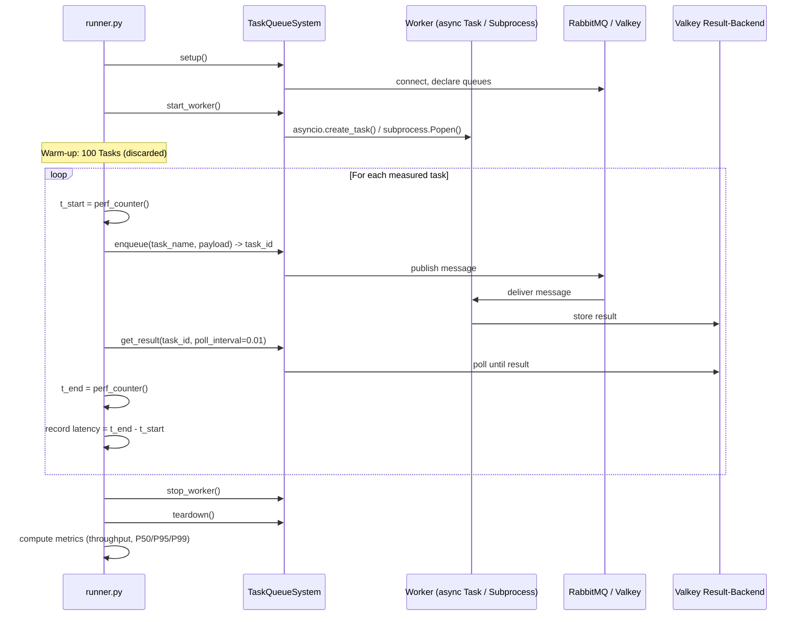

# feat: Build benchmark comparison suite

## Overview

Aufbau einer fairen Benchmark-Suite, die SwarmQ gegen TaskIQ (Phase 1), Celery und Dramatiq (Phase 2) vergleicht. Ziel ist internes Entwicklungs-Feedback mit konkreten Entscheidungsregeln — keine Marketing-Benchmarks.

## Problem Frame

SwarmQ v2 ist eine neue async-native Task Queue ohne Produktions-Track-Record. Um Architektur- und Optimierungsentscheidungen fundiert treffen zu können (ProcessPoolExecutor priorisieren? Polling-Architektur überdenken? Quorum-Queue-Kosten akzeptabel?), braucht es ehrliche Vergleichsdaten. (see origin: `docs/brainstorms/benchmark-suite-requirements.md`)

## Requirements Trace

- R1. Phase 1: SwarmQ vs. TaskIQ auf Preferred-Broker (Cross-Broker, richtungsweisend)
- R2. 4 Kern-Szenarien: No-op Throughput, I/O-bound, Latenz unter Last, Concurrency-Skalierung
- R3. 3 SwarmQ-spezifische Szenarien: Quorum vs. Classic, Semaphore-Skalierung, Polling-Intervall
- R4. Metriken: Throughput, P50/P95/P99 Latenz, Total Duration, Memory Peak
- R5. Aggregation: 3+ Durchläufe, Median + Min/Max, 100 Tasks Warm-up
- R6. Fairness: Kein async-Bias, natives Worker-Modell, identisches Hardware-Budget (4 CPU / 2GB)
- R7. Phase 2: + Celery + Dramatiq mit Subprocess-basiertem Worker-Modell
- R8. Verbleibende Szenarien (Phase 2): CPU-bound, Payload, Retry, Memory
- R9. Entscheidungsregeln mit konkreten Schwellenwerten (see origin: Sektion 1)
- R10. Quorum-Queue-Type konfigurierbar machen (minimale SwarmQ-Änderung für 3.9.1)

## Scope Boundaries

- Nur Ebene B (Preferred Broker) — kein Redis-Broker-Adapter für SwarmQ
- Kein arq (Maintenance-Only, kein Multi-Worker)
- Keine Code-Optimierung an SwarmQ vor dem Benchmark (Ausnahme: R10 queue-type konfigurierbar)
- Kein visuelles Dashboard — tabellarischer JSON/Text-Output
- Kein reusable Benchmarking-Framework

### Deferred to Separate Tasks

- Ebene A (Controlled Broker, alle auf Redis): Erfordert SwarmQ Redis-Broker-Adapter — separates Feature-Projekt
- arq-Integration: Nur falls Phase 1+2 spezifische Fragen aufwerfen

## Context & Research

### Relevant Code and Patterns

- `benchmarks/bench.py`: `BenchResult` dataclass mit P50/P95/P99-Berechnung, `argparse`-CLI, uvloop
- `benchmarks/bench_realistic.py`: Semaphore-gated worker simulation, Concurrency-Skalierung
- `benchmarks/run.sh`: Docker-Compose-Start, Healthcheck-Wait, venv-Setup
- `tests/e2e/test_roundtrip.py`: Separate Broker/Backend-Instanzen für Worker, `asyncio.create_task()` für Worker-Start, `worker_task.cancel()` für Shutdown
- `tests/conftest.py`: `_reset_task_registry` Fixture (verhindert Cross-Test-Pollution durch `__init_subclass__`)
- `src/swarmq/broker/rabbitmq.py:31,40,53`: `x-queue-type: "quorum"` hardcoded

### Institutional Learnings

- aio-pika Consumer-Callbacks dürfen NICHT auf Semaphore awaiten — immer `asyncio.create_task()` dispatchen
- `connect()` muss idempotent sein — Guard mit `if self._connection is not None: return`
- Valkey-Exceptions müssen in `BackendConnectionError` gewrapped werden

## Key Technical Decisions

- **Kein einheitliches async-ABC**: Sync-Libraries (Celery, Dramatiq) werden als Subprozesse gesteuert. Die `TaskQueueSystem`-Schnittstelle ist minimal und erlaubt Library-native Implementierung. Begründung: async-Wrapper für sync-Libraries fügen ~50-200μs Overhead pro Call hinzu — systematischer Bias.
- **Zwei separate SwarmQ-Apps**: Der Benchmark erstellt ZWEI `SwarmQ`-Instanzen — eine Client-App (für `schedule()`/`get_result()`) und eine Worker-App (für `start_worker()`). Jede App hat eigene `RabbitMQBroker`/`ValkeyBackend`-Instanzen. Dies ist das bewährte Pattern aus `tests/e2e/test_roundtrip.py`. `SwarmQ.start_worker()` erstellt den Worker intern als lokale Variable und gibt ihn nicht zurück — ein direkter Zugriff auf `Worker._request_shutdown()` ist nicht möglich. Shutdown erfolgt via `worker_task.cancel()` + manuellem Connection-Close.
- **Identische Docker-Limits**: 4 CPU / 2GB für alle Libraries. Single-Process async-Libraries nutzen nur 1 Core — das ist ein fairer Nachteil ihres Modells. Celery nutzt 4 Cores via prefork.
- **10ms Polling für Latenz-Szenarien**: Kompromiss zwischen Granularität und CPU-Overhead. 1ms würde ~1M Backend-Reads/s erzeugen.
- **50ms Retry-Backoff-Basis**: Macht Retry-Mechanismus-Overhead sichtbar statt Backoff-Timer zu messen.
- **`x-queue-type` konfigurierbar**: Minimaler Eingriff in `RabbitMQBroker` — ein Parameter in `__init__()` statt hardcoded String.

## Open Questions

### Resolved During Planning

- **Python 3.14-Kompatibilität**: Muss vor Phase 2 verifiziert werden. Phase 1 nutzt nur SwarmQ (3.14+) und TaskIQ (3.10+, wahrscheinlich kompatibel). Falls Celery/Dramatiq nicht auf 3.14 laufen, werden sie mit der neuesten kompatiblen Version getestet und der Unterschied dokumentiert.
- **Valkey als Redis-Ersatz**: Valkey ist wire-kompatibel. Celery/TaskIQ/Dramatiq Redis-Clients funktionieren gegen Valkey. Kein separater Redis-Server nötig.
- **Worker-Readiness-Detection**: SwarmQ hat kein "ready"-Signal. Bestehende E2E-Tests nutzen `asyncio.sleep(0.5)` — der Benchmark nutzt dasselbe Pattern, da es für den Messzeitraum irrelevant ist (Warm-up fängt es auf).

### Deferred to Implementation

- Exakte Concurrency-Konfiguration pro Library pro Szenario-Stufe (z.B. wie viele Celery-Worker bei "Concurrency 50")
- Ob TaskIQ's `ListQueueBroker` oder `PubSubBroker` für Ergebnis-Benachrichtigung genutzt wird
- Timing-Genauigkeit von `time.perf_counter()` bei Subprozess-gesteuerten Libraries (Cross-Prozess Timestamp-Drift)

## Output Structure

```
benchmarks/comparison/
├── docker-compose.yml
├── requirements.txt
├── runner.py
├── report.py
├── results/                    # .gitignore'd
├── scenarios/
│   ├── base.py
│   ├── noop.py
│   ├── io_bound.py
│   ├── cpu_bound.py
│   ├── latency.py
│   ├── payload.py
│   ├── scaling.py
│   ├── retry.py
│   ├── memory.py
│   ├── quorum_classic.py
│   ├── semaphore_scale.py
│   └── polling_interval.py
├── systems/
│   ├── base.py
│   ├── swarmq_sys.py
│   ├── celery_sys.py
│   ├── taskiq_sys.py
│   └── dramatiq_sys.py
└── workers/
    ├── swarmq_worker.py
    ├── celery_worker.py
    ├── taskiq_worker.py
    └── dramatiq_worker.py
```

## High-Level Technical Design

> *This illustrates the intended approach and is directional guidance for review, not implementation specification. The implementing agent should treat it as context, not code to reproduce.*



## Implementation Units

### Phase 1: SwarmQ vs. TaskIQ (Kern)

- [ ] **Unit 1: SwarmQ queue-type konfigurierbar machen**

  **Goal:** `x-queue-type` in `RabbitMQBroker.declare_queue()` per Konstruktor-Parameter steuerbar machen. Ermöglicht Szenario 3.9.1.

  **Requirements:** R10

  **Dependencies:** Keine

  **Files:**
  - Modify: `src/swarmq/broker/rabbitmq.py`
  - Test: `tests/unit/broker/test_rabbitmq_queue_type.py`

  **Approach:**
  - `RabbitMQBroker.__init__()` bekommt optionalen Parameter `queue_type: str = "quorum"`
  - Die 3 Stellen in `declare_queue()` (Zeilen ~31, 40, 53) referenzieren `self._queue_type` statt hardcoded `"quorum"`
  - Default bleibt `"quorum"` — kein Breaking Change

  **Patterns to follow:**
  - Bestehender Konstruktor-Stil in `rabbitmq.py` (minimale Klasse, kein Config-Objekt)

  **Test scenarios:**
  - Happy path: `RabbitMQBroker(url, queue_type="classic")` → `declare_queue()` erstellt Classic Queues (verify via Arguments)
  - Happy path: Default-Konstruktor → weiterhin Quorum Queues
  - Edge case: `queue_type="quorum"` explizit → identisches Verhalten wie Default

  **Verification:**
  - Bestehende Integration-Tests laufen weiter (Default unverändert)
  - Neue Unit-Tests für queue_type-Parameter bestehen

- [ ] **Unit 2: Docker-Infrastruktur und Dependencies**

  **Goal:** Docker-Compose und Python-Dependencies für den Benchmark aufsetzen.

  **Requirements:** R6 (identische Ressourcen)

  **Dependencies:** Keine

  **Files:**
  - Create: `benchmarks/comparison/docker-compose.yml`
  - Create: `benchmarks/comparison/requirements.txt`
  - Create: `benchmarks/comparison/.gitignore`

  **Approach:**
  - Docker-Compose: RabbitMQ (4-management-alpine, Port 5682) + Valkey (8-alpine, Port 6389) — andere Ports als Haupt-docker-compose, damit Benchmark parallel laufen kann
  - Beide Services: `cpus: 4, mem_limit: 2g`, Healthchecks
  - requirements.txt: `swarmq` (editable install via `../..`), `taskiq[redis]`, `aio-pika`, `valkey`, `uvloop`
  - .gitignore: `results/`, `.venv/`

  **Patterns to follow:**
  - `benchmarks/docker-compose.yml` für Service-Definitionen
  - `benchmarks/run.sh` für Healthcheck-Pattern

  **Test expectation:** none — reine Infrastruktur

  **Verification:**
  - `docker compose up -d` startet beide Services
  - `pip install -r requirements.txt` installiert alle Dependencies
  - Services antworten auf Healthchecks

- [ ] **Unit 3: Metriken-Framework und System-Basis**

  **Goal:** Gemeinsame Datenstrukturen für Benchmark-Ergebnisse, abstrakte System-Schnittstelle, und Szenario-Basis.

  **Requirements:** R4 (Metriken), R5 (Aggregation)

  **Dependencies:** Unit 2

  **Files:**
  - Create: `benchmarks/comparison/scenarios/base.py`
  - Create: `benchmarks/comparison/systems/base.py`

  **Approach:**
  - `BenchmarkResult` dataclass: `system_name`, `scenario_name`, `params`, `throughput`, `latencies` (list[float]), `total_duration`, `memory_peak_mb`. Computed properties für `p50`, `p95`, `p99` (Pattern aus `benchmarks/bench.py`)
  - `TaskQueueSystem` als `typing.Protocol` (strukturelles Subtyping, kein ABC — konsistent mit "kein reusable Framework"): `name`, `setup()`, `teardown()`, `start_worker()`, `stop_worker()`, `enqueue(task_name, payload) -> str`, `get_result(task_id, timeout, poll_interval) -> Any`
  - Szenario-Helper-Funktionen (kein BaseScenario-Klasse): `run_warm_up(system, task_name, n=100)` — enqueued UND awaited 100 Warm-up-Tasks vollständig, bevor die Messung beginnt. `run_timed_batch(system, task_name, payloads) -> list[float]` — Timing-Loop. `aggregate_runs(results) -> AggregatedResult` — Median + Min/Max über 3+ Läufe

  **Patterns to follow:**
  - `benchmarks/bench.py` `BenchResult` für Percentil-Berechnung
  - `benchmarks/bench_realistic.py` für Timing-Pattern (`time.perf_counter()`)

  **Test scenarios:**
  - Happy path: `BenchmarkResult` mit 1000 Latenzen → korrekte P50/P95/P99 Berechnung
  - Edge case: Leere Latenz-Liste → graceful handling
  - Happy path: Multi-Run-Aggregation mit 3 Results → Median/Min/Max korrekt

  **Verification:**
  - Percentil-Berechnung unit-getestet und korrekt
  - ABC ist importierbar und definiert das erwartete Interface

- [ ] **Unit 4: SwarmQ System-Adapter**

  **Goal:** `TaskQueueSystem`-Implementierung für SwarmQ mit separaten Worker-Connections.

  **Requirements:** R1, R6

  **Dependencies:** Unit 3

  **Files:**
  - Create: `benchmarks/comparison/systems/swarmq_sys.py`
  - Create: `benchmarks/comparison/workers/swarmq_worker.py`

  **Approach:**
  - Zwei separate `SwarmQ`-Instanzen: `client_app` (für schedule/get_result) und `worker_app` (für start_worker). Jede mit eigenen `RabbitMQBroker`/`ValkeyBackend`-Instanzen.
  - `setup()`: Erstellt beide Apps, öffnet Client-App via `async with client_app`
  - `start_worker()`: Startet `worker_app.start_worker()` als `asyncio.Task`. Worker registriert SIGTERM/SIGINT-Handler — der Benchmark-Adapter sichert die vorherigen Signal-Handler und stellt sie nach Worker-Stop wieder her.
  - `stop_worker()`: `worker_task.cancel()` + `suppress(CancelledError)` + manuelles `worker_broker.close()` / `worker_backend.close()`. Graceful drain ist nicht möglich ohne Zugriff auf den internen Worker — CancelledError bei `_shutdown_event.wait()` überspringt `_execute_shutdown()`. Unique Queue-Namen sorgen dafür, dass unacked Messages nachfolgende Runs nicht beeinflussen.
  - `enqueue()`: Nutzt `client_app.schedule(task_name, **payload)`
  - `get_result()`: Nutzt `client_app.get_result(task_id, polling=poll_interval)`
  - `teardown()`: Client-App via `__aexit__`, Worker-Connections manuell geschlossen
  - Worker-Datei definiert Task-Klassen (NoopTask, IoTask, CpuTask, FailingTask) als `Task`-Subklassen mit `task_info`
  - Unique Queue-Namen pro Benchmark-Run (UUID-Prefix, Pattern aus E2E-Tests)
  - **Task-Registry-Isolation:** `Task._registered_tasks` wird vor und nach jedem Adapter-Setup gesichert/restored (Pattern aus `tests/conftest.py:_reset_task_registry`). Da der Benchmark kein pytest nutzt, implementiert der Adapter dies als Kontextmanager.

  **Patterns to follow:**
  - `tests/e2e/test_roundtrip.py`: Separate Connections, `asyncio.create_task()`, `_unique_queue()`
  - `tests/conftest.py`: `_reset_task_registry` Pattern

  **Test scenarios:**
  - Integration: `setup()` → `start_worker()` → `enqueue("noop", {})` → `get_result()` → `stop_worker()` → `teardown()` kompletter Lifecycle
  - Happy path: No-op Task wird ausgeführt, Ergebnis abrufbar
  - Happy path: I/O-Task mit 10ms Sleep funktioniert
  - Error path: `get_result()` mit kurzem Timeout → TimeoutError

  **Verification:**
  - Ein vollständiger Roundtrip (schedule → execute → result) funktioniert
  - Worker shutdown schließt nur Worker-Connections, Orchestrator-Connections bleiben offen

- [ ] **Unit 5: TaskIQ System-Adapter**

  **Goal:** `TaskQueueSystem`-Implementierung für TaskIQ mit Redis ListQueueBroker.

  **Requirements:** R1

  **Dependencies:** Unit 3

  **Files:**
  - Create: `benchmarks/comparison/systems/taskiq_sys.py`
  - Create: `benchmarks/comparison/workers/taskiq_worker.py`

  **Approach:**
  - TaskIQ ist async-native → Worker läuft als asyncio.Task (wie SwarmQ)
  - `ListQueueBroker` als Broker, `RedisAsyncResultBackend` als Result-Backend
  - Worker-Datei definiert Tasks via `@broker.task` Dekorator
  - `enqueue()`: `await task.kiq(*args)` → gibt `TaskiqResult` zurück
  - `get_result()`: `await result.wait_result(timeout=timeout)` — TaskIQ hat nativen Result-Wait
  - Valkey-Verbindung auf db=1 (Isolation, see origin: Sektion 2)

  **Patterns to follow:**
  - TaskIQ-Dokumentation für `ListQueueBroker` + Result-Backend Setup

  **Test scenarios:**
  - Integration: Vollständiger Lifecycle wie Unit 4
  - Happy path: No-op Task wird ausgeführt und Ergebnis abgerufen
  - Happy path: I/O-Task mit 10ms Sleep
  - Edge case: Mehrere Tasks parallel enqueued → alle Ergebnisse korrekt

  **Verification:**
  - TaskIQ-Worker startet, Tasks werden verarbeitet, Ergebnisse abrufbar

- [ ] **Unit 6: Kern-Szenarien (No-op, I/O-bound, Latenz, Scaling)**

  **Goal:** Die 4 Phase-1-Szenarien implementieren.

  **Requirements:** R2, R4, R5

  **Dependencies:** Unit 3, Unit 4, Unit 5

  **Files:**
  - Create: `benchmarks/comparison/scenarios/noop.py`
  - Create: `benchmarks/comparison/scenarios/io_bound.py`
  - Create: `benchmarks/comparison/scenarios/latency.py`
  - Create: `benchmarks/comparison/scenarios/scaling.py`

  **Approach:**
  - **noop.py**: Parametrisch (N=1000/5000/10000). Enqueue → Get-Result Loop. Kein Task-Payload.
  - **io_bound.py**: Parametrisch (work_ms=10/50/100, concurrency=10/50/100). Enqueue-Batch → concurrent `get_result()` mit `asyncio.gather()`. Task-Payload: `{"sleep_ms": N}`.
  - **latency.py**: Sustained-Load-Pattern: Rate-Limiter (`asyncio.sleep(1/rate)`) für Enqueue, Background-Poller für Results. Parametrisch (rate=100/500/1000 tasks/s, duration=30s). 10ms Polling-Intervall.
  - **scaling.py**: Gleiche 1000 Tasks, variierende Concurrency (1/5/10/25/50/100). Für SwarmQ: Concurrency-Parameter an `SwarmQConfig`. Für TaskIQ: Worker-Concurrency-Config.
  - Alle Szenarien erben von `BaseScenario` und nutzen dessen Warm-up und Metriken-Aggregation.

  **Patterns to follow:**
  - `benchmarks/bench_realistic.py`: Rate-Limiting-Pattern, Concurrency-Variation

  **Test scenarios:**
  - Happy path: noop-Szenario mit N=100 (kleiner Test) → BenchmarkResult mit plausiblen Werten
  - Happy path: io_bound mit 10ms/concurrency=10 → Throughput > 50 tasks/s (10 concurrent × 100 tasks/s theoretical)
  - Happy path: latency mit rate=100 → 3000 Tasks in ~30s, P50 Latenz < 500ms
  - Edge case: scaling mit concurrency=1 → sequenziell, Throughput ~1/(task_time + overhead)

  **Verification:**
  - Jedes Szenario produziert valide `BenchmarkResult` mit plausiblen Metriken
  - Parametrische Variation funktioniert (verschiedene N, Concurrency, Rate)

- [ ] **Unit 7: SwarmQ-spezifische Szenarien**

  **Goal:** Die 3 Architektur-Analyse-Szenarien implementieren.

  **Requirements:** R3, R10

  **Dependencies:** Unit 1 (queue-type), Unit 4 (SwarmQ-Adapter), Unit 6 (noop-Szenario als Basis)

  **Files:**
  - Create: `benchmarks/comparison/scenarios/quorum_classic.py`
  - Create: `benchmarks/comparison/scenarios/semaphore_scale.py`
  - Create: `benchmarks/comparison/scenarios/polling_interval.py`

  **Approach:**
  - **quorum_classic.py**: Erstellt zwei SwarmQ-Adapter — einen mit `queue_type="quorum"`, einen mit `queue_type="classic"`. Läuft noop-Szenario (10000 Tasks) gegen beide. Vergleicht Throughput und Latenz.
  - **semaphore_scale.py**: SwarmQ mit Concurrency-Werten 1/5/10/25/50/100/200. 5000 Tasks mit 10ms Sleep pro Stufe. Identifiziert Sättigungspunkt.
  - **polling_interval.py**: SwarmQ get_result() mit Polling 1ms/10ms/50ms/200ms. 1000 Tasks mit 10ms Sleep. Misst Latenz und CPU-Overhead pro Intervall.

  **Patterns to follow:**
  - Unit 6 Szenarien-Muster für Parametrierung und Metriken-Sammlung

  **Test scenarios:**
  - Happy path: quorum_classic → zwei BenchmarkResults mit unterschiedlichem `system_name` ("swarmq-quorum", "swarmq-classic")
  - Happy path: semaphore_scale → 7 BenchmarkResults, Throughput steigt mit Concurrency (bis Sättigung)
  - Happy path: polling_interval → 4 BenchmarkResults, Latenz sinkt mit kleinerem Intervall

  **Verification:**
  - Quorum/Classic-Vergleich zeigt messbaren Unterschied
  - Semaphore-Skalierung zeigt Sättigungskurve
  - Polling-Analyse zeigt Latenz/CPU-Tradeoff

- [ ] **Unit 8: Runner und Report**

  **Goal:** CLI-Orchestrator für Benchmark-Ausführung und tabellarischer Report-Generator.

  **Requirements:** R5 (Aggregation, Durchläufe), R9 (Entscheidungsregeln)

  **Dependencies:** Unit 3, Unit 6

  **Files:**
  - Create: `benchmarks/comparison/runner.py`
  - Create: `benchmarks/comparison/report.py`

  **Approach:**
  - **runner.py**: `argparse`-basiert. `--scenario` (comma-separated oder "all"), `--systems` (comma-separated oder "all"), `--runs` (default 3). Statisches Registry-Dict (`SCENARIOS = {"noop": run_noop, ...}`, `SYSTEMS = {"swarmq": SwarmQSystem, ...}`) — kein dynamischer Import, konsistent mit "kein reusable Framework". Pro Kombination: N Durchläufe, Ergebnis als JSON in `results/`. Namensschema: `{scenario}_{system}_{timestamp}.json`.
  - **report.py**: Liest `results/`-Verzeichnis. Gruppiert nach Szenario. Gibt tabellarischen Vergleich aus (System | Throughput | P50 | P95 | P99 | Duration | Memory). Median + Min/Max über Durchläufe. Kennzeichnet Cross-Broker-Vergleiche als "nicht direkt vergleichbar". Optional: Entscheidungsregeln-Check gegen die definierten Schwellenwerte.

  **Patterns to follow:**
  - `benchmarks/bench.py`: `argparse`-Pattern, Tabellen-Output
  - `benchmarks/run.sh`: Ausführungs-Flow

  **Test scenarios:**
  - Happy path: `runner.py --scenario noop --systems swarmq --runs 1` → JSON-Datei in results/
  - Happy path: `report.py results/` → tabellarischer Output mit korrekten Spalten
  - Edge case: Leeres results/-Verzeichnis → hilfreiche Fehlermeldung

  **Verification:**
  - End-to-End: Docker up → Runner → Results-JSON → Report-Tabelle

### Phase 2: + Celery + Dramatiq (Erweiterung)

- [ ] **Unit 9: Celery System-Adapter**

  **Goal:** Subprocess-basierter Celery-Adapter mit prefork Worker.

  **Requirements:** R7

  **Dependencies:** Unit 3, Unit 2

  **Files:**
  - Create: `benchmarks/comparison/systems/celery_sys.py`
  - Create: `benchmarks/comparison/workers/celery_worker.py`

  **Approach:**
  - Worker-Datei: Celery-App mit RabbitMQ-Broker, Redis/Valkey-Backend (db=2). Tasks via `@app.task`.
  - Adapter: `start_worker()` startet `celery -A workers.celery_worker worker --concurrency=4 --pool=prefork` als `asyncio.subprocess`
  - `enqueue()`: Via `asyncio.to_thread(task.delay, *args)` — Celery-Client ist synchron
  - `get_result()`: Via `asyncio.to_thread(result.get, timeout=timeout)` — Celery hat nativen Result-Wait
  - `stop_worker()`: `SIGTERM` an Subprocess → graceful shutdown

  **Patterns to follow:**
  - Celery-Dokumentation für `app.task`, `result.get()`

  **Test scenarios:**
  - Integration: Vollständiger Lifecycle mit Subprocess-Worker
  - Happy path: No-op Task über Celery → Ergebnis korrekt
  - Error path: Worker-Subprocess crasht → `stop_worker()` handled gracefully

  **Verification:**
  - Celery-Worker startet als Subprocess, verarbeitet Tasks, Ergebnisse abrufbar

- [ ] **Unit 10: Dramatiq System-Adapter**

  **Goal:** Subprocess-basierter Dramatiq-Adapter mit Thread-Pool.

  **Requirements:** R7

  **Dependencies:** Unit 3, Unit 2

  **Files:**
  - Create: `benchmarks/comparison/systems/dramatiq_sys.py`
  - Create: `benchmarks/comparison/workers/dramatiq_worker.py`

  **Approach:**
  - Worker-Datei: Dramatiq-Actors mit RabbitMQ-Broker, Redis-Result-Backend (db=3). Tasks via `@dramatiq.actor`.
  - Adapter: `start_worker()` startet `dramatiq workers.dramatiq_worker` als `asyncio.subprocess`
  - `enqueue()`: Via `asyncio.to_thread(actor.send, *args)`
  - `get_result()`: Dramatiq hat `dramatiq.results.Results` Middleware — result via `message.get_result(timeout=timeout)`
  - `stop_worker()`: `SIGTERM` an Subprocess

  **Patterns to follow:**
  - Dramatiq-Dokumentation für Results-Middleware

  **Test scenarios:**
  - Integration: Vollständiger Lifecycle
  - Happy path: No-op Task über Dramatiq → Ergebnis korrekt

  **Verification:**
  - Dramatiq-Worker startet als Subprocess, verarbeitet Tasks, Ergebnisse abrufbar

- [ ] **Unit 11: Phase-2-Szenarien (CPU, Payload, Retry, Memory)**

  **Goal:** Verbleibende Szenarien implementieren.

  **Requirements:** R8

  **Dependencies:** Unit 9, Unit 10, Unit 6

  **Files:**
  - Create: `benchmarks/comparison/scenarios/cpu_bound.py`
  - Create: `benchmarks/comparison/scenarios/payload.py`
  - Create: `benchmarks/comparison/scenarios/retry.py`
  - Create: `benchmarks/comparison/scenarios/memory.py`

  **Approach:**
  - **cpu_bound.py**: SHA-256 Iterationen (10k/100k/1M). Kein `run_in_executor()` für async-Libraries.
  - **payload.py**: JSON-Payload-Generierung (100B/1KB/10KB/100KB). Misst Serialisierungs-Overhead.
  - **retry.py**: 50ms Backoff-Basis, deterministische Failure-Pattern. Separate Retry-Latenz-Messung (Zeit von Exception bis Redelivery exkl. Backoff).
  - **memory.py**: `/proc/[pid]/status` VmRSS-Tracking. Integriert in noop/io_bound als Messmethode (kein eigenständiges Szenario). Für Single-Process: RSS des Worker-Prozesses. Für Multi-Process (Celery/Dramatiq): PID-Discovery via `psutil.Process(pid).children(recursive=True)`, Summe RSS + per-Worker RSS. `psutil` in requirements.txt aufnehmen.

  **Test scenarios:**
  - Happy path: cpu_bound mit 10k Iterationen → messbare Ausführungszeit
  - Happy path: payload 100B vs 100KB → messbarer Throughput-Unterschied
  - Happy path: retry → deterministisches Failure-Pattern produziert erwartete Retry-Anzahl
  - Happy path: memory → VmRSS > 0 für alle Systeme

  **Verification:**
  - Alle Szenarien produzieren valide BenchmarkResults

## System-Wide Impact

- **Interaction graph:** Der Benchmark nutzt SwarmQ als Black-Box (Public API only). Einzige Code-Änderung an SwarmQ: `queue_type`-Parameter in `RabbitMQBroker` (Unit 1).
- **Error propagation:** Benchmark-Fehler (Timeouts, Connection-Fehler) werden geloggt und das betroffene System als "failed" im Report markiert — kein Abbruch des gesamten Benchmark-Laufs.
- **State lifecycle risks:** Redis-Datenbank-Isolation (db=1/2/3) + FLUSHDB zwischen Läufen verhindert State-Leaks. Unique Queue-Namen pro Run verhindern RabbitMQ-Kollisionen.
- **Unchanged invariants:** SwarmQ Public API bleibt unverändert. Default queue-type bleibt "quorum".

## Risks & Dependencies

| Risk | Mitigation |
|------|------------|
| Python 3.14 Inkompatibilität bei Celery | Vor Phase 2 prüfen. Falls inkompatibel: mit älterer Python-Version testen (dokumentiert) oder ausschließen |
| Valkey-Inkompatibilität mit Redis-Clients | Frühzeitig in Unit 5 (TaskIQ) testen — TaskIQ nutzt Redis-Client gegen Valkey |
| Docker-Port-Konflikte mit Haupt-docker-compose | Benchmark nutzt andere Ports (5682/6389 statt 5672/6379) |
| Cross-Broker-Vergleiche werden überinterpretiert | Jedes Szenario dokumentiert explizit welche Vergleiche aussagekräftig sind |
| Benchmark-Overhead des Orchestrators verfälscht Messungen | Warm-up (100 Tasks) + 3 Durchläufe + Median-Aggregation reduzieren systematische Fehler |

## Sources & References

- **Origin document:** [docs/brainstorms/benchmark-suite-requirements.md](docs/brainstorms/benchmark-suite-requirements.md)
- Related code: `benchmarks/bench.py`, `benchmarks/bench_realistic.py`
- Related code: `src/swarmq/broker/rabbitmq.py` (queue-type hardcoded)
- Related code: `tests/e2e/test_roundtrip.py` (Worker-Lifecycle-Pattern)
- Related learning: `docs/solutions/logic-errors/swarmq-async-semaphore-deadlock-and-error-wrapping-2026-04-15.md`
