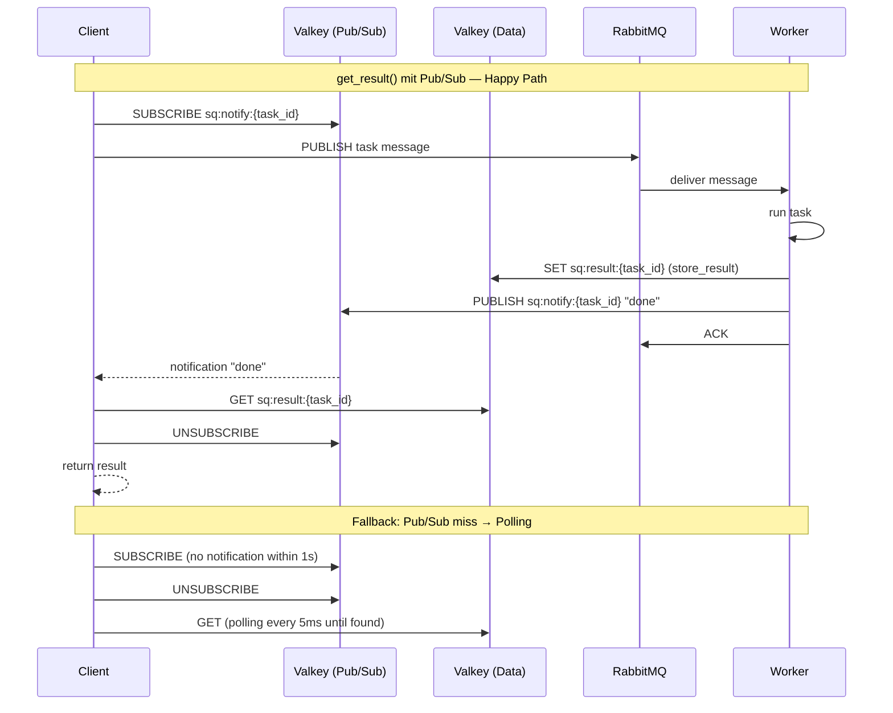

# feat: Pub/Sub Result-Notification, Batch-APIs und Queue-Type-Konfiguration

## Overview

Die Polling-basierte Result-Abholung (79% der Roundtrip-Latenz) wird durch Valkey Pub/Sub Notifications ersetzt. Zusätzlich kommen Batch-APIs (`schedule_many`, `get_results`) und konfigurierbare Queue-Types (Quorum/Classic). Ziel: P50-Latenz von 12.5ms auf <3ms, Throughput von 78 auf >300 tasks/s.

## Problem Frame

SwarmQ's `get_result()` pollt Valkey alle 200ms. Bei einem No-op Task der <2ms dauert, wartet der Client im Schnitt 100ms auf das nächste Poll-Intervall. Pub/Sub eliminiert diese Wartezeit: der Worker signalisiert dem Client sofort wenn das Result bereit ist.

(see origin: `docs/brainstorms/performance-optimization-requirements.md`)

## Requirements Trace

- R1. Worker publisht Notification auf `sq:notify:{task_id}` nach `store_result()`
- R2. Client subscribed auf `sq:notify:{task_id}` zu Beginn von `get_result()`, VOR dem Initial-Check. Subscribe-before-enqueue gilt nur für `run()` (das intern schedule+get_result kombiniert). Bei separatem schedule()+get_result() ist Subscribe nach Enqueue — der 50ms Initial-Check fängt dieses Race-Window ab.
- R2b. 50ms Initial-Check nach Subscribe (Race-Window Auflösung für schnelle Tasks)
- R3. 1s Fallback-Timeout → automatisches Polling (5ms Intervall)
- R4. `get_result()` API bleibt signatur-kompatibel
- R5. Worker-Publish ist fire-and-forget (Warning-Log bei Fehler)
- R6. Result-Delivery-Garantie unverändert (Valkey SET ist Source of Truth)
- R7. Valkey-Reconnect → automatischer Polling-Fallback
- R8. Worker-Crash nach store aber vor publish → Polling-Fallback findet Result
- R9. `schedule_many()` für Bulk-Publishing
- R10. `get_results()` mit MGET
- R11. Einzeltask-APIs bleiben unverändert
- R12. `queue_type` Config-Feld (Default: "quorum")
- R13. Default bleibt "quorum" — kein Breaking Change
- R14. Docstring warnt: Classic Queues verlieren Messages bei Broker-Crash

## Scope Boundaries

- Keine Änderung am Worker-Concurrency-Modell
- Keine Änderung der Serialisierungsstrategie
- Kein Multi-Worker/Process-Manager
- Keine Änderung an DLX-basierter Retry-Architektur
- Per-Queue queue_type deferred

## Context & Research

### Relevant Code and Patterns

- `src/swarmq/client.py` — `get_result()` Polling-Loop (Zeile 73-93). Muss durch Pub/Sub+Fallback ersetzt werden.
- `src/swarmq/worker.py` — `_handle_message()` ruft `store_result()` auf. Danach muss Pub/Sub-Notification folgen.
- `src/swarmq/backend/valkey.py` — `store_result()` / `get_result()`. Braucht `publish_notification()` und `get_results_batch()` Methoden.
- `src/swarmq/broker/rabbitmq.py` — Konstruktor hat bereits `queue_type` Parameter. `declare_queue()` setzt `x-queue-type`.
- `src/swarmq/config.py` — Muss `queue_type` Feld bekommen.

### Institutional Learnings

- `docs/solutions/logic-errors/swarmq-async-semaphore-deadlock-and-error-wrapping-2026-04-15.md` — Fire-and-forget Pattern im Worker: Pub/Sub-Publish darf nie den Ack blockieren.

### External References

- `docs/recherche-valkey-py.md` — Valkey Pub/Sub API: `subscribe()`, `get_message(timeout)`, `publish()`, `unsubscribe()`, `aclose()`. Dedizierte Pub/Sub-Connection nötig.

## Key Technical Decisions

- **Pub/Sub als Hint, nicht Transport:** Valkey SET bleibt Source of Truth. Pub/Sub sagt nur "jetzt abholen". Verpasste Notifications → Polling. Kein Sicherheitsverlust.
- **Pro-Task-ID Channels:** `sq:notify:{task_id}`. Zero Noise, zero Filtering. Channels sind billig (kein Storage).
- **Client-seitige Subscribe-Connection:** Client (nicht Backend) braucht die dedizierte Pub/Sub-Connection. Worker publiziert über normale Backend-Connection.
- **50ms Initial-Check:** Subscribe → Enqueue → 50ms GET-Check → Pub/Sub Wait (bis 1s) → Polling. Löst häufigstes Race-Window sofort.
- **`get_results()` mit MGET-Polling, kein Pub/Sub:** MGET holt N Results in einem Roundtrip. Poll-Intervall 5ms (konsistent mit Pub/Sub-Fallback). Kein Pub/Sub für Batch weil N Subscribe-Channels N dedizierte TCP-Connections erzeugen → Skalierungsproblem bei großen Batches.
- **`schedule_many()` via asyncio.gather:** Nutzt existierenden `publish()` Pfad parallel. Keine neue Broker-Methode nötig.
- **Pub/Sub-Connection pro get_result()-Aufruf:** Jeder `create_pubsub()` öffnet eine dedizierte TCP-Connection. Bei N parallelen `get_result()` Aufrufen → N Connections. Known Limitation für hohe Parallelität.
- **_send_to_dlq published Notification:** DLQ-Error-Results erzeugen ebenfalls eine Pub/Sub-Notification, damit Clients schnell über Fehler informiert werden.
- **queue_type als Config-String:** "quorum" (Default) oder "classic". Durch Config/Env-Var steuerbar.

## Open Questions

### Resolved During Planning

- **Channel-Naming:** Pro-Task-ID (`sq:notify:{task_id}`) — resolved im Brainstorm-Review.
- **Pub/Sub-Connection Ownership:** Client besitzt Subscribe-Connection, Worker publiziert normal — resolved im Brainstorm-Review.
- **schedule_many Implementierung:** `asyncio.gather` auf existierendem `publish()` — einfachster Ansatz, kann bei Bedarf durch Broker-Pipeline ersetzt werden.

### Deferred to Implementation

- Exakte `pubsub.get_message()` Timeout-Granularität: hängt von valkey-py's async Pub/Sub Implementierung ab
- Ob `schedule_many` atomisch sein muss (bei Teilfehler): Entscheidung bei Implementation

## High-Level Technical Design

> *This illustrates the intended approach and is directional guidance for review, not implementation specification.*

## Implementation Units

- [x] **Unit 1: ValkeyBackend Pub/Sub Publish + Batch-GET**

**Goal:** Backend bekommt `publish_notification(task_id)` und `get_results_batch(task_ids)` Methoden.

**Requirements:** R1, R5, R10

**Dependencies:** Keine

**Files:**
- Modify: `src/swarmq/backend/valkey.py`
- Test: `tests/unit/backend/test_valkey.py`

**Execution note:** Test-first.

**Approach:**
- `publish_notification(task_id: str)` → `PUBLISH sq:notify:{task_id} "done"`. Fire-and-forget: Exception fangen + loggen (WARNING), nie re-raisen.
- `get_results_batch(task_ids: list[str]) -> list[bytes | None]` → Valkey `MGET sq:result:{id1} sq:result:{id2} ...`. Returns list aligned mit task_ids (None für fehlende).
- Beide nutzen die existierende `_client` Connection (kein Pub/Sub Subscribe-Mode nötig für PUBLISH).

**Patterns to follow:**
- Bestehende `store_result()` / `get_result()` in `backend/valkey.py`
- Error-Wrapping Pattern: `(ValkeyError, OSError)` → `BackendConnectionError`

**Test scenarios:**
- Happy path: `publish_notification("task-123")` → PUBLISH auf korrektem Channel aufgerufen
- Happy path: `get_results_batch(["a", "b", "c"])` → MGET mit korrekten Keys, Results aligned
- Happy path: `get_results_batch([])` → leere Liste zurück
- Error path: `publish_notification` bei Valkey-Fehler → nur geloggt, keine Exception
- Edge case: `get_results_batch` mit Mix aus vorhandenen und fehlenden Keys → None für fehlende

**Verification:**
- Worker kann Notifications publishen ohne den Ack-Flow zu blockieren
- Batch-GET holt N Results in einem Roundtrip

---

- [x] **Unit 2: Worker Notification nach store_result**

**Goal:** Worker publisht `sq:notify:{task_id}` nach jedem erfolgreichen `store_result()`.

**Requirements:** R1, R5, R8

**Dependencies:** Unit 1

**Files:**
- Modify: `src/swarmq/worker.py`
- Test: `tests/unit/test_worker.py`

**Approach:**
- Nach `store_result()` in `_handle_message()`: `await self._backend.publish_notification(task_id)`. Nur wenn result_ttl > 0 (kein Publish wenn kein Result gespeichert wurde).
- Fire-and-forget: `publish_notification` fängt Exceptions intern. Kein extra try/except im Worker nötig.
- Auch für Error-Results (is_error=True) publishen — der Client will auch Fehler-Ergebnisse schnell.
- **Auch in `_send_to_dlq`:** DLQ-Error-Results speichern jetzt im Backend (Phase 2 Fix). Danach muss ebenfalls `publish_notification(task_id)` aufgerufen werden, damit Clients schnell über DLQ-Fehler informiert werden.

**Patterns to follow:**
- Bestehendes `store_result()` Pattern im Worker

**Test scenarios:**
- Happy path: Nach erfolgreichem Task → `publish_notification(task_id)` aufgerufen
- Happy path: Nach Error-Task → `publish_notification(task_id)` aufgerufen (Error-Result notification)
- Happy path: Nach DLQ-Routing → `publish_notification(task_id)` aufgerufen
- Happy path: Bei result_ttl=0 → `publish_notification` NICHT aufgerufen
- Error path: `publish_notification` schlägt fehl → Task-Ack nicht blockiert, Warning geloggt

**Verification:**
- Jeder Task mit Result erzeugt eine Pub/Sub-Notification

---

- [x] **Unit 3a: ValkeyBackend Pub/Sub Subscribe-Lifecycle**

**Goal:** Backend bekommt Pub/Sub Subscribe-Methoden die den Connection-Lifecycle kapseln.

**Requirements:** R2, R7

**Dependencies:** Unit 1

**Files:**
- Modify: `src/swarmq/backend/valkey.py`
- Test: `tests/unit/backend/test_valkey.py`

**Execution note:** Test-first.

**Approach:**
- `create_pubsub() -> valkey.asyncio.PubSub` — Factory die ein neues Pub/Sub-Objekt über den Client erstellt
- `subscribe_and_wait(channel: str, timeout: float) -> bool` — Helper der subscribe, get_message(timeout), unsubscribe, aclose kapselt. Returns True wenn Notification empfangen, False bei Timeout. In try/finally: unsubscribe+aclose garantiert.
- Bei Valkey-Connection-Fehler (ValkeyError, OSError) → False returnen (= Polling-Fallback), nicht Exception
- CancelledError muss durch finally propagieren (nicht schlucken)

**Patterns to follow:**
- `docs/recherche-valkey-py.md` Pub/Sub Patterns
- Bestehendes Error-Wrapping in `backend/valkey.py`

**Test scenarios:**
- Happy path: subscribe_and_wait empfängt Notification → True
- Happy path: Timeout → False
- Error path: Valkey-Fehler → False (Fallback), keine Exception
- Edge case: CancelledError propagiert durch finally
- Edge case: unsubscribe+aclose werden immer aufgerufen (auch bei Fehler)

**Verification:**
- Pub/Sub-Lifecycle ist sauber gekapselt
- Keine Connection-Leaks bei Fehlern oder Cancellation

---

- [x] **Unit 3b: Client Pub/Sub get_result Flow**

**Goal:** `get_result()` nutzt Pub/Sub als primären Notification-Mechanismus mit Polling-Fallback.

**Requirements:** R2, R2b, R3, R4, R6, R7

**Dependencies:** Unit 3a

**Files:**
- Modify: `src/swarmq/client.py`
- Test: `tests/unit/test_client.py`

**Execution note:** Test-first — beginne mit dem Happy-Path (Pub/Sub Notification kommt sofort).

**Approach:**
- Neuer `get_result()` Flow:
  1. timeout=0 → ein GET-Check (bestehendes Verhalten, kein Pub/Sub)
  2. Subscribe via `backend.subscribe_and_wait()` vorbereiten
  3. 50ms Initial-Check: `GET sq:result:{task_id}` — falls schon da, return
  4. Wait auf Pub/Sub via `subscribe_and_wait(channel, timeout=1.0)`
  5. Wenn True: `GET sq:result:{task_id}` und return
  6. Wenn False (Timeout oder Fehler): Fallback auf Polling (5ms Intervall) bis Gesamt-Timeout
- API bleibt signatur-kompatibel: `get_result(task_id, timeout=10, polling=0.2)`
- `get_result()` ist per `asyncio.CancelledError` abbrechbar — finally in subscribe_and_wait räumt auf

**Patterns to follow:**
- Bestehender `get_result()` Polling-Loop als Fallback-Pfad

**Test scenarios:**
- Happy path: Pub/Sub Notification kommt → Result sofort geholt
- Happy path: Result schon in Valkey vor Subscribe → Initial-Check findet es in 50ms
- Happy path: Pub/Sub miss → Polling-Fallback nach 1s, findet Result
- Happy path: Error-Result → TaskError geworfen (wie bisher)
- Happy path: timeout=0 → ein GET-Check, keine Pub/Sub (bestehendes Verhalten)
- Error path: Timeout → ResultNotReadyError (wie bisher)
- Error path: Pub/Sub Subscription fehlgeschlagen → sofortiger Polling-Fallback
- Edge case: CancelledError während Pub/Sub-Wait → sauberes Cleanup
- Integration: Schedule → Worker → Pub/Sub Notification → get_result returns

**Verification:**
- get_result() mit Pub/Sub ist signifikant schneller als reines Polling
- API-Signatur unverändert
- Alle bestehenden Client-Tests bestehen weiterhin

---

- [x] **Unit 4: Batch-APIs (schedule_many + get_results)**

**Goal:** Neue APIs für effizientes Bulk-Scheduling und Batch-Result-Retrieval.

**Requirements:** R9, R10, R11

**Dependencies:** Unit 1 (get_results_batch), Unit 3 (Pub/Sub-basiertes get_result)

**Files:**
- Modify: `src/swarmq/client.py`
- Modify: `src/swarmq/app.py` (delegation)
- Test: `tests/unit/test_client.py`

**Approach:**
- `schedule_many(tasks: list[tuple[str, tuple, dict]]) -> list[str]`:
  - Für jeden Task: UUID7 generieren, Message bauen
  - `asyncio.gather(*[broker.publish(queue, msg) for ...])` für paralleles Publishing
  - Queue-Auflösung wie bei `schedule()` — per Task aus Registry wenn vorhanden
  - Returns: Liste der task_ids in gleicher Reihenfolge
- `get_results(task_ids: list[str], timeout: float = 10, poll_interval: float = 0.005) -> list[Any]`:
  - Nutzt `backend.get_results_batch()` (MGET) zum Polling mit 5ms Intervall (konsistent mit Pub/Sub-Fallback)
  - Pollt bis alle Results da oder Timeout
  - Bei partiellen Results: wirft ResultNotReadyError mit Info welche fehlen
  - Kein Pub/Sub für Batch (N Channels = N TCP-Connections → Skalierungsproblem)
- `SwarmQ.schedule_many()` und `SwarmQ.get_results()` delegieren an Client

**Patterns to follow:**
- Bestehendes `schedule()` / `get_result()` Pattern im Client

**Test scenarios:**
- Happy path: `schedule_many(10 tasks)` → 10 task_ids zurück, alle publiziert
- Happy path: `get_results(["a","b","c"])` → alle 3 Results in einer Liste
- Happy path: `schedule_many([])` → leere Liste
- Error path: `get_results` Timeout bei fehlenden Results → TimeoutError
- Edge case: `schedule_many` mit Mix aus Queue-per-Task und Default-Queue

**Verification:**
- Batch-Scheduling ist messbar schneller als N × schedule()
- get_results holt N Results in weniger Roundtrips als N × get_result

---

- [x] **Unit 5: Queue-Type Konfiguration**

**Goal:** `queue_type` als Config-Feld mit Wiring zum Broker.

**Requirements:** R12, R13, R14

**Dependencies:** Keine

**Files:**
- Modify: `src/swarmq/config.py`
- Modify: `src/swarmq/app.py` (queue_type an Broker durchreichen)
- Modify: `src/swarmq/broker/rabbitmq.py` (queue_type aus Config statt Konstruktor-Default)
- Test: `tests/unit/test_config.py`

**Approach:**
- `SwarmQConfig.queue_type: str = "quorum"` mit `SWARMQ_QUEUE_TYPE` Env-Var
- Validierung: muss in {"quorum", "classic"} sein → ConfigurationError
- `SwarmQ.__init__` übergibt `config.queue_type` an `RabbitMQBroker`
- Broker's `declare_queue()` nutzt `self._queue_type` statt hardcoded "quorum"

**Test scenarios:**
- Happy path: Config mit queue_type="classic" → Broker deklariert Classic Queues
- Happy path: Default "quorum" → Rückwärtskompatibel
- Error path: queue_type="invalid" → ConfigurationError
- Happy path: Env-Var SWARMQ_QUEUE_TYPE überschreibt Default

**Test expectation: none — für Docstring-Warning (R14), reine Dokumentation**

**Verification:**
- Queues werden mit korrektem Type deklariert
- Default-Verhalten unverändert

---

- [x] **Unit 6: E2E Performance-Tests**

**Goal:** Verifiziere dass Pub/Sub die Latenz tatsächlich reduziert und Batch-APIs funktionieren.

**Requirements:** Alle Success Criteria

**Dependencies:** Alle vorherigen Units

**Files:**
- Create: `tests/e2e/test_performance.py`

**Approach:**
- Test mit echtem RabbitMQ + Valkey
- Messe Roundtrip-Latenz mit Pub/Sub vs reinem Polling
- Verifiziere Batch-Schedule + Batch-Result-Retrieval

**Test scenarios:**
- Integration: Pub/Sub get_result → Latenz unter 50ms (vs ~200ms mit reinem Polling)
- Integration: Polling-Fallback funktioniert wenn Pub/Sub Channel nicht existiert
- Integration: schedule_many(100 tasks) → alle Results abrufbar
- Integration: get_results([ids]) → alle Results in einem Call

**Verification:**
- P50-Latenz messbar besser als mit reinem Polling
- Batch-APIs funktionieren End-to-End

## System-Wide Impact

- **Interaction graph:** Worker._handle_message → publish_notification (nach store_result). Client.get_result → Pub/Sub Subscribe → GET → Unsubscribe.
- **Error propagation:** Pub/Sub-Fehler werden geschluckt (fire-and-forget im Worker, Polling-Fallback im Client). Keine neue Fehlerquelle die den Happy-Path stört.
- **State lifecycle risks:** Pub/Sub-Connection im Client muss sauber geschlossen werden (unsubscribe + aclose in try/finally). Bei CancelledError: finally muss CancelledError propagieren. N parallele get_result()-Aufrufe erzeugen N TCP-Connections (Known Limitation). Shutdown während get_result(): Client wartet bis Pub/Sub-Timeout (1s) + Polling-Timeout, dann ResultNotReadyError — kein Datenverlust aber langsame Fehlererkennung.
- **FIRE_AND_FORGET + get_result():** Bekanntes Verhalten — kein Result gespeichert, keine Notification. Client wartet bis Timeout (bis zu 11s). Dokumentiert als API-Constraint.
- **API surface parity:** `schedule_many()` und `get_results()` sind neue APIs auf SwarmQ + Client. Bestehende APIs bleiben unverändert (R4, R11).
- **Unchanged invariants:** Task-Lifecycle (Retry, DLQ, Timeouts, Shutdown) wird nicht verändert. Pub/Sub ist rein additiv nach store_result.

## Risks & Dependencies

| Risk | Mitigation |
|------|------------|
| Pub/Sub-Connection-Leak bei Client-Fehler | Pub/Sub-Subscribe in try/finally mit unsubscribe+aclose. |
| Pub/Sub-Latenz bei vielen Channels | Pro-Task-ID Channels sind O(1) Subscribe/Unsubscribe. Kein Skalierungsproblem bis Tausende gleichzeitige get_result Aufrufe. |
| asyncio.gather bei schedule_many: ein Publish-Fehler cancelt alle | asyncio.gather(return_exceptions=True): Fehler einzeln behandeln, nicht alles canceln. |
| Classic Queues: Message-Verlust bei Broker-Crash | Docstring-Warning (R14). Quorum bleibt Default. |

## Sources & References

- **Origin document:** [docs/brainstorms/performance-optimization-requirements.md](docs/brainstorms/performance-optimization-requirements.md)
- **Valkey Pub/Sub:** [docs/recherche-valkey-py.md](docs/recherche-valkey-py.md)
- **Benchmark-Analyse:** [docs/benchmark-broker-results.md](docs/benchmark-broker-results.md)
- **Existing Code:** `src/swarmq/client.py`, `src/swarmq/worker.py`, `src/swarmq/backend/valkey.py`, `src/swarmq/broker/rabbitmq.py`
