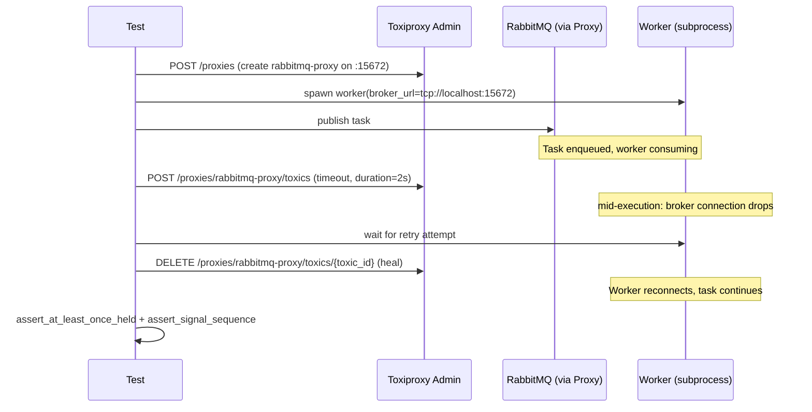

## Overview

Implementiert die im Brainstorm spezifizierte deterministische e2e-Test-Suite
für 31 hand-gepickte Feature-Kombinationen auf einer einzelnen SwarmQ-Task,
mit Tier-3 Failure-Injection (Task-Exception → Broker/Backend mid-op drops →
Worker SIGKILL → Cross-Process). Organisation nach Approach A: 4 Test-Files
nach Risk-Kategorie unter `tests/e2e/combinations/`, Tier 2+3 via
`@pytest.mark.chaos` für Nightly-Gate.

**Drei plan-spezifische Scoping-Entscheidungen vorab:**
1. **Toxiproxy** als Failure-Injection-Stack (validiert durch Spike `docs/solutions/spikes/2026-04-17-toxiproxy-reconnect-spike.md` — der `httpx.AsyncClient`-Pattern + 25-LoC-Compose wird wiederverwendet).
2. **Hybrid-Invarianten**: 4 universelle Helper-Funktionen plus Combo-spezifische Assertions; aufgebaut auf den 4 Regression-Tests aus dem FAF-Pipeline-learning.
3. **CI-Split via pytest-Marker**: Tier 1 ohne Marker (PR-Gate `tests/e2e/`), Tier 2+3 mit `@pytest.mark.chaos` (Nightly, Toxiproxy hochgefahren via `docker-compose.chaos.yml`).

---

## Problem Frame

Die existierende e2e-Suite (`tests/e2e/`, ~6075 LoC über 16 Files) ist
**Feature-First** organisiert. Es fehlt systematische Coverage der
Kombinationen zwischen Features — z.B. *retry + unique*, *lock + cancel*,
*cron + catchup + rate_limit*. Diese Combos haben echte
Interaktions-Surface (geteilter Backend-State, sequenzielle Race-Conditions,
Failure-Cascades), bekannte Bug-Patterns aus learnings (`release-after-ack`,
FAF-Pipeline-Stage-Ack-Ordering, Pub/Sub-Re-Subscribe), und sind heute
nur durch zufällige Single-Feature-Tests indirekt abgedeckt.

**Anlass:** Vorsorge, kein konkreter Production-Bug.

---

## Scope Boundaries

### In Scope
- 31 Combos aus 6 Risk-Heuristiken (siehe Brainstorm §4)
- 3 Failure-Tiers: Task-Exception, Broker/Backend mid-op Drops via Toxiproxy, Worker SIGKILL + Cross-Process
- 4 neue Test-Files unter `tests/e2e/combinations/`
- Universal-Invariants als Helper-Modul
- Toxiproxy-Infrastructure (`docker-compose.chaos.yml`)
- CI-Workflow-Anpassung (PR-Gate filter, Nightly-Job-Erweiterung)
- Dokumentierter Skip-Pfad wenn Docker/Toxiproxy nicht verfügbar

### Deferred for later (aus Brainstorm)
- Property-based / Hypothesis-Suite — möglicher Followup-Plan
- Task-zu-Task Chains / Workflows — kein SwarmQ-Feature
- Pipeline-Stationen einer Single-Feature-Task — durch existing Suite abgedeckt
- Performance-Regression-Tests — andere Suite

### Deferred to Follow-Up Work
- Falls Toxiproxy-Setup im CI-Service-Container flaky wird: Migration zu eigenem Test-Harness-Container (separater Plan).
- Falls Tier-3-Tests >15min werden: Parallel-Pytest mit `pytest-xdist` evaluieren.

### Outside this product's identity
- Test-Suite für externe Consumer (z.B. Customer-Application gegen SwarmQ-API). Out of scope, würde ein eigenes Verifications-Framework brauchen.

---

## Requirements Trace

| ID | Requirement | Satisfied by |
|---|---|---|
| R-1 | Alle 31 Risk-Combos haben mind. Happy-Path-Test | U4-U7 |
| R-2 | Pro Combo mind. 1 Failure-Mode-Test (Tier 1/2/3) | U4-U7 |
| R-3 | Universal-Invariants als wiederverwendbare Helpers | U3 |
| R-4 | Toxiproxy-Integration für Mid-Op-Drops | U1, U2 |
| R-5 | Worker-SIGKILL-Tests aufbauend auf bestehendem Pattern | U2, U7 |
| R-6 | Signal-Sequence-Assertions wo emit-Order kritisch (Combos 9, 17, 18) | U3 (helper), U4-U6 |
| R-7 | Test-Lauf-Zeit ≤ 15min auf Standard-Dev-Maschine | U7 (parallelize wenn nötig), U8 |
| R-8 | Skip-Pfad wenn Docker/Toxiproxy unavailable | U2 (autouse fixture analog zu existing `check_docker`) |
| R-9 | CI: Tier-1 im PR-Gate, Tier-2+3 nightly | U8 |

---

## Key Technical Decisions

### KTD-1: Toxiproxy als Tier-2 Failure-Injection-Stack
**Entscheidung:** RabbitMQ + Valkey werden in Tier-2-Tests durch Toxiproxy-Proxies geroutet. Tests rufen die Toxiproxy Admin-REST-API via `httpx.AsyncClient` an, um Connection-Drops, Latency, oder Bandwidth-Limits präzise zu injizieren.
**Begründung:** Spike vom 2026-04-17 hat den Stack validiert — keine externe Python-Lib nötig, ~25 LoC Compose-Setup. Alternative wäre eine `FaultyConnection`-Wrapper-Klasse, die aber SwarmQ-internal Patches braucht und nicht das echte Network-Failure-Verhalten testet.
**Konsequenz:** `docker-compose.chaos.yml` ergänzt das existing `docker-compose.yml` um den Toxiproxy-Service. Tests deklarieren Proxies via Fixture (`@pytest.fixture broker_with_toxiproxy`).

### KTD-2: Universal-Invariants als Helper-Modul (Hybrid-Schema)
**Entscheidung:** Vier wiederverwendbare Assertion-Helper in `tests/e2e/combinations/_invariants.py`:
- `assert_signal_sequence(dispatcher, expected_order)` — verifiziert Signal-Emit-Reihenfolge
- `assert_no_deadlock(backend, timeout_s)` — pollt Lock-Keys, schlägt fehl wenn nach Timeout noch held
- `assert_no_data_loss(broker, expected_count)` — zählt Messages über alle Queues + DLQ
- `assert_at_least_once_held(handler_calls, expected_min)` — verifiziert delivery-Garantie

Plus pro Combo combo-spezifische Assertions.
**Begründung:** FAF-Pipeline-learning gibt 4 Regression-Tests pro Broker/Backend-Drop-Combo (Stage None fallthrough, Backend-Fault → nack(requeue), FAF+Fault → nack-no-silent-drop, Requeue-Counter). Diese 4 sind Universalmuster, nicht combo-spezifisch.
**Konsequenz:** Tests sind kürzer und konsistenter. Bei neuer Combo: helpers wiederverwenden + 1-3 Combo-Assertions hinzufügen.

### KTD-3: CI-Split via pytest-Marker statt Verzeichnis-Split
**Entscheidung:** Alle Combo-Tests in `tests/e2e/combinations/`. Tier 2+3 mit `@pytest.mark.chaos` markiert. PR-Gate: `pytest tests/e2e -m "not chaos"`. Nightly: `pytest tests/e2e -m chaos` plus separate Toxiproxy-Service-Container.
**Begründung:** Eine Hierarchie hält Combos zusammen, was der Risk-Kategorie-Organisation entspricht. Marker geben CI-Filter ohne Duplikation. Existing `chaos`-Marker in `pyproject.toml` ist bereits definiert.
**Alternative verworfen:** Split zu `tests/chaos/combinations/` würde Combo `lock + cancel (Tier 1)` und `lock + cancel + SIGKILL (Tier 3)` in zwei verschiedene Dateien zwingen — schlechter für Maintainer-Mental-Model.
**Konsequenz:** Nightly-Job in `.github/workflows/nightly.yml` muss Toxiproxy-Service ergänzen.

### KTD-4: Subprocess-Worker-Pattern aus existing test_worker_shutdown_load.py liften
**Entscheidung:** `_spawn_worker`, `_wait_for_worker_started`, `_kill_subprocess` werden aus `tests/e2e/test_worker_shutdown_load.py` extrahiert nach `tests/e2e/combinations/_subprocess.py` und sowohl von der Combos-Suite als auch retrofit von test_worker_shutdown_load.py importiert.
**Begründung:** Die Helpers sind ausgereift (SIGKILL-Recovery, between-scenario cleanup); duplizieren ist Wartungs-Schuld.
**Konsequenz:** Eine kleine Refactor-Welle in U2 — test_worker_shutdown_load.py wechselt zu Import statt File-Local-Definition.

### KTD-5: Reader-Task-Leak nach SIGKILL explizit verifizieren
**Entscheidung:** Tier-3-Tests, die SIGKILL involvieren, prüfen between-scenario cleanup explizit — Task-Count-Assert oder SIGUSR1-Faulthandler-Dump, nicht `is_closed`.
**Begründung:** Learning `aiormq-reader-leak-and-stale-connection-recovery-2026-04-16.md` warnt: `is_closed` lügt nach SIGKILL.
**Konsequenz:** U3 enthält `assert_no_reader_leak`-Helper. SIGKILL-Tests in U7 verwenden ihn.

---

## High-Level Technical Design

### Toxiproxy-Setup (Sequence)



Dieses Diagramm illustriert die geplante Verwendung des Toxiproxy-Stacks
und ist directional guidance for review, not implementation specification.
Der implementing agent sollte es als Kontext, nicht als Code-Vorlage
behandeln.

### Test-Class-Schablone

```python
@pytest.mark.timeout(30)
class TestLockCancelCombo:
    """Combo #2: lock + cancel — does cancel guarantee lock release?"""

    async def test_happy_path(self, swarmq_app, ...):
        # arrange: task with lock + cancellable
        # act: schedule, set cancel mid-run
        # assert: cancel succeeded, lock released, signal TASK_CANCELLED emitted
        ...

    async def test_cancel_during_run_releases_lock(self, swarmq_app, ...):
        ...

    @pytest.mark.chaos
    async def test_sigkill_during_lock_held_recovery(self, swarmq_app, toxiproxy, ...):
        # spawn subprocess worker, SIGKILL while lock held,
        # spin up successor, verify lock recovery via lock-TTL
        ...
```

Wieder: directional, kein Implementation-Template.

---

## Output Structure

```
tests/e2e/combinations/
  __init__.py
  conftest.py                       # shared fixtures: app, dispatcher, toxiproxy, subprocess worker
  _subprocess.py                    # spawn_worker, wait_for_started, kill_subprocess (lifted from test_worker_shutdown_load.py)
  _toxiproxy.py                     # ToxiproxyClient wrapper (httpx-based REST), context-manager fixtures
  _invariants.py                    # assert_signal_sequence, assert_no_deadlock, assert_no_data_loss,
                                    #   assert_at_least_once_held, assert_no_reader_leak
  test_state_sharing.py             # Combos 1-6: retry+unique, lock+cancel/retry/timeout, progress+cancel, result_ttl+retry
  test_timing_order.py              # Combos 7-14: cron+catchup+unique/rate-limit, timeout+cancel race, etc.
  test_failure_cascades.py          # Combos 15-20: DLQ+unique, middleware-raise+retry/signals, broker/backend-drops
  test_concurrency_lifecycle.py     # Combos 21-31: max_concurrency+retry/lock/rate_limit, shutdown/reload/burst,
                                    #   worker SIGKILL + lock, scheduler-failover, autoscale shrink

docker-compose.chaos.yml             # Toxiproxy service (additive, not replacing docker-compose.yml)

.github/workflows/ci.yml             # PR-Gate filter: -m "not chaos"
.github/workflows/nightly.yml        # Combinations chaos job: -m chaos + toxiproxy service
```

Die Tree ist eine Scope-Deklaration; per-Unit `**Files:**` Sektionen sind
autoritativ.

---

## Implementation Units

### U1. Toxiproxy-Infrastructure

**Goal:** Toxiproxy-Service als optional aktivierbarer Docker-Compose-Stack, additiv zum existing `docker-compose.yml`.
**Requirements:** R-4
**Dependencies:** none
**Files:**
- `docker-compose.chaos.yml` (NEU)

**Approach:**
- Toxiproxy-Service auf `:8474` (Admin-API) und konfigurierbaren Proxy-Ports (`:15672` für RabbitMQ-Proxy, `:16379` für Valkey-Proxy)
- Toxiproxy-Image `ghcr.io/shopify/toxiproxy:latest` mit pinned tag (commit-hash-pin nach Validierung)
- `network_mode` kompatibel mit existing compose: gleiche Network-ID, sodass Toxiproxy mit RabbitMQ + Valkey Containern reden kann
- Health-Check: `wget -O- localhost:8474/proxies` returns 200 mit leerem JSON `{}` direkt nach Start

**Patterns to follow:**
- Existing `docker-compose.yml` für service-Naming + network-Definition
- Spike-Doc `docs/solutions/spikes/2026-04-17-toxiproxy-reconnect-spike.md` für Konfigurations-Werte
- README-Erweiterung: kurzer "Tier-2/3 Tests lokal laufen lassen"-Block (`docker compose -f docker-compose.yml -f docker-compose.chaos.yml up`)

**Test scenarios:** none — Infrastructure-Datei.
- `Test expectation: none -- pure Docker-Compose-Definition; verification via U2 fixture smoke-test.`

**Verification:**
- `docker compose -f docker-compose.yml -f docker-compose.chaos.yml up -d` startet alle drei Services ohne Port-Konflikt
- `curl localhost:8474/proxies` returnt `{}` nach Start
- `docker compose -f docker-compose.yml -f docker-compose.chaos.yml down` stoppt sauber

---

### U2. Combinations-Modul + Subprocess + Toxiproxy-Fixtures

**Goal:** Foundation für alle Combo-Tests — geteilte Fixtures, Subprocess-Worker-Helper, Toxiproxy-Client.
**Requirements:** R-4, R-5, R-8
**Dependencies:** U1
**Files:**
- `tests/e2e/combinations/__init__.py` (NEU, leer)
- `tests/e2e/combinations/conftest.py` (NEU)
- `tests/e2e/combinations/_subprocess.py` (NEU)
- `tests/e2e/combinations/_toxiproxy.py` (NEU)
- `tests/e2e/test_worker_shutdown_load.py` (MODIFY — Import statt File-local helpers)

**Approach:**
- `_subprocess.py`: extrahiert `_spawn_worker`, `_wait_for_worker_started`, `_kill_subprocess`, `_ensure_fixture_registered` aus `test_worker_shutdown_load.py`. test_worker_shutdown_load.py importiert nach Refactor von dort.
- `_toxiproxy.py`: `ToxiproxyClient`-Klasse mit `httpx.AsyncClient` gegen `localhost:8474`. Methoden: `create_proxy(name, listen_port, upstream)`, `add_toxic(proxy_name, type, **params)`, `remove_toxic(proxy_name, toxic_id)`, `reset()`. Context-Manager `async with ToxiproxyClient() as tp:` für automatic cleanup.
- `conftest.py`:
  - `toxiproxy` fixture (function-scope, skips wenn Toxiproxy nicht erreichbar via `_port_is_open`)
  - `rabbitmq_proxied_url` fixture (Toxiproxy-routet auf RabbitMQ)
  - `valkey_proxied_url` fixture (Toxiproxy-routet auf Valkey)
  - `swarmq_app` fixture (clean SwarmQ-Instance mit unique queue)
  - `signal_recorder` fixture (SignalDispatcher mit emit-Order-Tracking für Universal-Invariants)
  - autouse `_combinations_cleanup` (between-test cleanup von subprocess-Workers + Toxiproxy state)

**Patterns to follow:**
- Existing `tests/e2e/conftest.py` für Skip-Guard-Pattern (`pytest.skip` wenn Service nicht erreichbar)
- `test_worker_shutdown_load.py` für Subprocess-Worker-Pattern
- Spike-Doc für `httpx`-Calls gegen Toxiproxy-Admin-API

**Execution note:** Refactor von `test_worker_shutdown_load.py` ist breaking-test-risk — vor U2-Commit `pytest tests/e2e/test_worker_shutdown_load.py -v` grün haben.

**Test scenarios:**
- `test_toxiproxy_client_create_proxy_smoke` — happy path Proxy-Erzeugung + Cleanup
- `test_toxiproxy_client_add_remove_toxic` — Toxic-Lifecycle
- `test_combinations_skip_when_toxiproxy_down` — Skip-Behavior verifizieren
- `test_subprocess_worker_helpers_still_work_after_lift` — Regression-Test für test_worker_shutdown_load.py
- Edge: `test_toxiproxy_reset_idempotent` — `reset()` darf ohne Toxics aufgerufen werden

**Verification:**
- 5 fixture-smoke Tests grün
- `pytest tests/e2e/test_worker_shutdown_load.py` unverändert grün
- `pytest tests/e2e/combinations/ -v --collect-only` zeigt fixture-Hierarchie korrekt

---

### U3. Universal-Invariants Helper-Modul

**Goal:** Vier wiederverwendbare Assertion-Helper plus Reader-Leak-Detector als Foundation für alle Combo-Tests.
**Requirements:** R-3, R-6
**Dependencies:** U2
**Files:**
- `tests/e2e/combinations/_invariants.py` (NEU)
- `tests/e2e/combinations/test__invariants.py` (NEU, eigene Test-Datei für Helpers)

**Approach:**

```python
# Signatures (directional, nicht Implementation):
async def assert_signal_sequence(
    recorder: SignalRecorder,
    expected: list[Signal],
    *, timeout_s: float = 5.0,
    strict_order: bool = True,
) -> None:
    """Wait until all signals in `expected` are recorded; assert order matches.
    Used for Combos 9, 17, 18 where emit-Order critical."""

async def assert_no_deadlock(
    backend: ValkeyBackend,
    lock_keys: list[str],
    *, max_wait_s: float = 10.0,
) -> None:
    """Poll backend; fail if any lock_key still held after max_wait_s.
    Lock-TTL-based recovery should release within configured TTL."""

async def assert_no_data_loss(
    broker: RabbitMQBroker,
    expected_message_count: int,
    *, include_dlq: bool = True,
) -> None:
    """Sum messages across main queue + DQ + DLQ; assert >= expected_count
    (at-least-once) or == expected_count (at-most-once depending on TaskInfo)."""

async def assert_at_least_once_held(
    handler_call_count: int,
    *, expected_min: int = 1,
) -> None:
    """Asserts handler ran at least N times — protects against silent-drop bugs.
    Tier-1 invariant for any failure-injected Combo."""

async def assert_no_reader_leak(
    process: subprocess.Popen,
    *, max_reader_tasks: int = 0,
) -> None:
    """Send SIGUSR1, parse faulthandler dump, assert aiormq._reader task count
    below threshold. Learning: is_closed lies after SIGKILL."""
```

- FAF-4-Tests-Template: bei jedem Broker/Backend-Drop-Test sollen die 4 Stage-Regeln (None-fallthrough, Backend-Fault → nack(requeue), FAF+Fault → nack-no-silent-drop, Requeue-Counter) als Sub-Assertions getriggert werden — als Combinator-Helper `assert_faf_stage_invariants(broker, scenario_kind)`.

**Patterns to follow:**
- Existing `tests/e2e/test_signal_catalog.py` für Signal-Recording-Pattern
- Learning `docs/solutions/logic-errors/worker-pipeline-stage-ack-ordering-2026-04-16.md` für FAF-4-Template

**Execution note:** Test-first — schreibe `test__invariants.py` vor `_invariants.py`. Jeder Helper hat positive + negative Cases (happy assert succeeds, fail-fast-Case).

**Test scenarios:**
- `test_signal_sequence_happy_path` — recorder emits expected, assert passes
- `test_signal_sequence_wrong_order` — recorder emits out-of-order, assert fails with diff
- `test_signal_sequence_timeout` — expected nie emitted, assert fails after timeout
- `test_no_deadlock_releases_in_ttl` — lock with 2s TTL is released within max_wait_s=5
- `test_no_deadlock_held_too_long` — lock without TTL, assert fails
- `test_no_data_loss_at_least_once` — task delivered 3×, expected_min=1, passes
- `test_no_data_loss_count_mismatch` — task delivered 0×, expected_min=1, fails
- `test_at_least_once_held_zero_calls` — handler_call_count=0, asserts fails
- `test_no_reader_leak_clean_subprocess` — fresh worker, 0 reader tasks
- `test_no_reader_leak_after_sigkill_detected` — kill worker, spawn successor, original's reader tasks gone (or warning)
- `test_faf_stage_invariants_happy_path` — all 4 sub-assertions pass for a clean scenario
- `test_faf_stage_invariants_silent_drop_detected` — Broker-Fault + no nack → fails

**Verification:**
- ~12 invariant-Tests grün
- Helpers werden in U4-U7 wiederverwendet (Cross-Reference-Check via grep)

---

### U4. test_state_sharing.py — Combos 1-6

**Goal:** Test-Coverage für 6 State-Sharing-Combos.
**Requirements:** R-1, R-2
**Dependencies:** U2, U3
**Files:**
- `tests/e2e/combinations/test_state_sharing.py` (NEU)

**Combos (siehe Brainstorm §4.1 für Details):**
1. `retry + unique_for`
2. `lock + cancel`
3. `lock + retry`
4. `lock + hard_timeout`
5. `progress + cancel`
6. `result_ttl + retry`

**Approach:**
- Eine `TestClass` pro Combo (z.B. `TestRetryUniqueCombo`)
- Pro TestClass:
  - `test_happy_path` (Tier 1, unmarked) — beide Features funktionieren zusammen
  - `test_failure_<station>` (Tier 1, unmarked) — eine Station throws Exception
  - `test_failure_<infrastructure>` (Tier 2, `@pytest.mark.chaos`) — Toxiproxy injiziert Drop
  - Tier-3-Tests nur wo Combo durch SIGKILL non-trivial verändert wird (z.B. #4 `lock + hard_timeout`)
- Lock+Unique Combos verifizieren explizit "release after ack" (Pattern aus learning)
- Signal-Sequence-Assertions wo emit-Order matters

**Patterns to follow:**
- `tests/e2e/test_locking.py`, `tests/e2e/test_unique_tasks.py` für single-feature-Pattern
- `tests/e2e/test_cancellation.py` für Cancel-Race-Pattern

**Test scenarios (Auszug — vollständig pro Combo in der Datei):**

*Combo #2 lock + cancel:*
- `test_happy_path` — Task läuft mit lock, cancel mid-run releases lock, next task acquires
- `test_cancel_before_lock_acquired` — cancel vor Lock-Acquire: Lock nie acquired
- `test_cancel_during_run_releases_lock` — cancel mid-run: TASK_CANCELLED emitted, lock released
- `test_sigkill_during_lock_held_recovery` (`@pytest.mark.chaos`) — worker SIGKILL mit Lock, successor wartet TTL, acquires
- Covers signal-sequence: `TASK_STARTED → TASK_CANCELLED` (kein TASK_COMPLETED)

*Combo #1 retry + unique_for:*
- `test_happy_path` — retry-during-unique-window: zweite identische Task geblockt
- `test_unique_released_after_retry_exhausted` — max_retries erschöpft → DLQ → unique released?
- `test_failure_backend_drop_mid_retry` (`@pytest.mark.chaos`) — Toxiproxy drops backend zwischen Retries, verifying release-after-ack
- Covers FAF-4-Stages für Backend-Drop-Scenario

**Verification:**
- ~25 Tests (4-5 pro Combo × 6 Combos), Tier-Mix
- PR-Gate-Subset (`pytest tests/e2e/combinations/test_state_sharing.py -m "not chaos"`) ≤ 90s

---

### U5. test_timing_order.py — Combos 7-14

**Goal:** Test-Coverage für 8 Timing/Order-Combos.
**Requirements:** R-1, R-2, R-6
**Dependencies:** U2, U3
**Files:**
- `tests/e2e/combinations/test_timing_order.py` (NEU)

**Combos (Brainstorm §4.2):**
7. `cron + catchup + unique_for`
8. `cron + catchup + rate_limit`
9. `soft_timeout + cancel` (Signal-Race!)
10. `hard_timeout + retry`
11. `max_age + scheduler`
12. `rate_limit + retry + retry_backoff`
13. `priority + lock`
14. `unique_until=start + retry`

**Approach:**
- Race-Combos (#9, #14) brauchen monkeypatched Time oder controlled sleep für deterministische Reproduktion
- Scheduler-Combos (#7, #8, #11) brauchen leadership-injected scheduler — Pattern aus `tests/e2e/test_scheduler.py`
- `soft_timeout + cancel`-Race verifiziert WELCHES Signal gewinnt (Plan-Decision: Test pinnt aktuelles Verhalten, nicht eine Soll-Vorschrift)

**Patterns to follow:**
- `tests/e2e/test_scheduler.py` für catchup-Tests
- `tests/e2e/test_rate_limiting.py` für rate-limit + retry-Backoff-Patterns

**Test scenarios (Auszug):**

*Combo #9 soft_timeout + cancel (Race):*
- `test_cancel_wins_when_set_before_timeout` — set_cancel_flag 0.5s vor soft_timeout → `TASK_CANCELLED`
- `test_timeout_wins_when_set_after_timeout` — set_cancel_flag 0.5s nach soft_timeout → `TASK_FAILED`
- `test_simultaneous_emit_pins_current_behavior` — beide 0.0s, asserts WELCHES Signal — dokumentiert echtes Verhalten

*Combo #7 cron + catchup + unique:*
- `test_catchup_with_unique_blocks_duplicates` — Scheduler down 10min → catchup queued 10 fires → 9 von unique geblockt, 1 läuft
- `test_catchup_without_unique_runs_all` — control: kein unique → alle 10 laufen (sanity)

**Verification:**
- ~30 Tests (3-4 pro Combo × 8 Combos)
- Race-Tests sind deterministisch reproduzierbar (kein flaky-mark nötig)

---

### U6. test_failure_cascades.py — Combos 15-20

**Goal:** Test-Coverage für 6 Failure-Cascade-Combos.
**Requirements:** R-1, R-2, R-4
**Dependencies:** U2, U3
**Files:**
- `tests/e2e/combinations/test_failure_cascades.py` (NEU)

**Combos (Brainstorm §4.3):**
15. `DLQ + unique_for`
16. `DLQ + retry erschöpft + result_ttl`
17. `middleware raise (pre_execute) + signal-handler`
18. `middleware raise (post_execute) + retry`
19. `broker-reconnect mid-publish + at-most-once delivery`
20. `backend-down + result-store`

**Approach:**
- Tier 2-Combos (#19, #20) sind Toxiproxy-Pflicht
- Middleware-Combos (#17, #18) testen Signal-Sequence-Erwartungen (was wird emittiert wenn middleware throws)
- DLQ-Combos (#15, #16) verifizieren state-cleanup nach DLQ-Move

**Patterns to follow:**
- `tests/e2e/test_middleware_chains.py` für Middleware-Test-Pattern
- `tests/e2e/test_dlq_cli.py` für DLQ-Inspection-Pattern
- Learning `worker-pipeline-stage-ack-ordering-2026-04-16.md` für FAF-4-Template (kritisch für #19, #20)

**Test scenarios (Auszug):**

*Combo #19 broker-reconnect mid-publish + at-most-once:*
- `test_at_most_once_drops_message_on_broker_drop` (`@pytest.mark.chaos`) — Toxiproxy drops Broker zwischen publisher_confirm und ack: Message verloren (expected for at-most-once)
- `test_at_least_once_redelivers_on_broker_drop` (`@pytest.mark.chaos`) — gleiches Setup mit at-least-once: Message delivered nach Reconnect
- Covers FAF-4: silent-drop-detection-Sub-Assertion

*Combo #18 middleware raise (post_execute) + retry:*
- `test_post_execute_throw_triggers_retry` — post_execute middleware throws → task retried? Or marked completed? (Test pinnt aktuelles Verhalten, dokumentiert mögliche zweite-Ausführung)
- Covers signal-sequence: `TASK_STARTED → TASK_COMPLETED → TASK_RETRYING` (oder `TASK_FAILED`)

**Verification:**
- ~22 Tests
- Toxiproxy-Tests nur in chaos-Mark, nicht im PR-Gate

---

### U7. test_concurrency_lifecycle.py — Combos 21-31

**Goal:** Test-Coverage für 11 Concurrency + Lifecycle + Cross-Process-Combos. Größte Datei, höchste Tier-3-Dichte.
**Requirements:** R-1, R-2, R-5, R-7
**Dependencies:** U2, U3
**Files:**
- `tests/e2e/combinations/test_concurrency_lifecycle.py` (NEU)

**Combos (Brainstorm §4.4):**
21. `max_concurrency=1 + retry`
22. `lock + max_concurrency`
23. `rate_limit + max_concurrency`
24. `graceful shutdown + in-flight + retry`
25. `hot-reload + in-flight + lock`
26. `burst-mode exit + retry pending`
27. `worker SIGKILL + lock + at-least-once`
28. `scheduler-leader-failover + mid-fire`
29. `process_manager + worker crash + lock acquired`
30. `autoscale shrink + currently-running`
31. `hot-reload + scheduler-leader`

**Approach:**
- **Mehrheit Tier-3** (SIGKILL, multi-worker, scheduler-failover) — alle mit `@pytest.mark.chaos`
- Multi-worker-Combos brauchen 2-3 subprocess-Workers gleichzeitig (Pattern aus test_worker_shutdown_load.py extension)
- Scheduler-Failover (#28, #31) brauchen leader-election manipulation: kill leader-worker, neuer übernimmt
- ProcessManager-Combos (#29, #30) brauchen `swarmq.process_manager`-spawn-Pfad

**Patterns to follow:**
- `tests/e2e/test_worker_shutdown_load.py` als Master-Vorlage für SIGKILL + at-least-once
- `tests/e2e/test_scheduler.py` für Leadership-Election
- existing process_manager-Tests (wenn vorhanden)

**Test scenarios (Auszug):**

*Combo #27 worker SIGKILL + lock + at-least-once:*
- `test_sigkill_with_lock_held_redelivers_after_ttl` (`@pytest.mark.chaos`)
  - spawn worker A, schedule task with lock + 5s sleep + at-least-once
  - SIGKILL worker A at 1s (lock still held in backend)
  - spawn worker B
  - assert: B waits for lock-TTL (e.g. 30s), then acquires, completes task
  - assert_no_data_loss (1× delivered)
  - assert_no_reader_leak on B

*Combo #28 scheduler-leader-failover + mid-fire:*
- `test_failover_during_fire_does_not_double_execute` (`@pytest.mark.chaos`)
  - 2 scheduler workers, A is leader
  - schedule cron task firing at t=2s
  - at t=1.9s, SIGKILL worker A
  - worker B detects leader loss, takes over
  - assert: task fires exactly once (verify via signal_recorder count)

**Performance Note:** Diese Datei wird die langsamste — TTL-Waits + multi-worker-Spawns. Falls Suite-Zeit explodiert: aufteilen in `test_concurrency_lifecycle_fast.py` (Combos 21-23) + `test_concurrency_lifecycle_slow.py` (Combos 24-31).

**Verification:**
- ~35-45 Tests
- chaos-Subset einzeln aufrufbar: `pytest tests/e2e/combinations/test_concurrency_lifecycle.py -m chaos`
- Suite-Zeit-Messung: <= 8min für Tier 2+3-Subset

---

### U8. CI-Workflow-Integration

**Goal:** PR-Gate filtert chaos-Mark raus, Nightly-Job führt chaos-Suite mit Toxiproxy-Service aus.
**Requirements:** R-7, R-9
**Dependencies:** U1-U7 (Tests müssen existieren)
**Files:**
- `.github/workflows/ci.yml` (MODIFY)
- `.github/workflows/nightly.yml` (MODIFY)
- `README.md` (MODIFY — kurzes "running combinations tests"-Snippet)

**Approach:**

`ci.yml` — Job `integration-and-e2e`:
- Pytest-Command ändern: `pytest tests/e2e -m "not chaos" -q --tb=short`
- Erwartete Konsequenz: Combinations Tier-1-Tests laufen mit, ~30s zusätzlich

`nightly.yml` — Neuer Job oder Erweiterung von `chaos`:
- Service-Block: RabbitMQ + Valkey + **Toxiproxy** (Port 8474)
- Step: Pytest mit `pytest tests/e2e -m chaos --reruns 2 --reruns-delay 5`
- Timeout: 25min
- Env: `SWARMQ_TEST_TOXIPROXY_HOST=localhost`, `SWARMQ_TEST_TOXIPROXY_PORT=8474`

README:
- Sektion "Running combinations tests": local instructions für `docker compose -f docker-compose.yml -f docker-compose.chaos.yml up -d` und `pytest tests/e2e/combinations/`

**Patterns to follow:**
- Existing `ci.yml` `services:` block für RabbitMQ + Valkey
- Existing `nightly.yml` `chaos`-Job für `--reruns`-Pattern

**Test scenarios:** keine eigenen pytest-Tests; Verification via CI-Run.
- `Test expectation: none -- CI-Config; verification via .github/workflows test run.`

**Verification:**
- PR-CI-Lauf auf einem dummy-Branch zeigt: combinations Tier-1-Tests laufen mit, chaos-Mark filtered raus, Total-Zeit ≤ 7 min
- Nightly-Run zeigt: chaos-Tests laufen, Toxiproxy-Service up, ≤ 25 min
- README-Snippet ist copy-paste-runnable

---

## Test Strategy Summary

| Tier | Mechanismus | pytest-Filter | CI |
|---|---|---|---|
| 1 | Task-Exception | unmarked | PR-Gate |
| 2 | Toxiproxy mid-op drops | `@pytest.mark.chaos` | Nightly |
| 3 | Worker SIGKILL, Cross-Process | `@pytest.mark.chaos` | Nightly |

**Universal-Invariants (U3) werden pro Combo aufgerufen wo passend.** Combo-spezifische Assertions ergänzen die Helpers.

**Geschätzte Test-Counts (rough):**
- U4 state-sharing: ~25 Tests
- U5 timing-order: ~30 Tests
- U6 failure-cascades: ~22 Tests
- U7 concurrency-lifecycle: ~35-45 Tests
- U3 invariant-Tests: ~12 Tests
- U2 fixture-smoke: ~5 Tests
- **Total: ~130-140 Tests**

PR-Gate-Subset (Tier 1): ~50-60 Tests, geschätzt ≤ 2 min.
Nightly-Subset (Tier 2+3): ~70-80 Tests, geschätzt ≤ 12 min.

---

## Risk Analysis

| Risk | Severity | Mitigation |
|---|---|---|
| Toxiproxy-Setup im CI flaky (Network-Service-Race) | Mittel | `--reruns 2` im chaos-Job (existing Pattern), `wait_for_toxiproxy_ready` Helper mit Timeout |
| Tier-3-Tests SIGKILL-Recovery hängt 30s+ pro Lock-TTL | Hoch (Suite-Zeit) | Lock-TTL für Combo-Tests auf 5s reduzieren via TaskInfo-Override; parallel-pytest erwägen wenn Total > 15min |
| Race-Condition-Tests (#9, #14) sind nondeterministisch flaky | Mittel | controlled-time-Fixtures (monkeypatched `time.monotonic`) für deterministische Reproduktion |
| FAF-4-Pattern wird inkonsistent angewandt | Niedrig | Helper-Funktion `assert_faf_stage_invariants` macht es zur One-Liner-Pflicht |
| `is_closed` lügt nach SIGKILL — falsche Annahme in Cleanup | Mittel | `assert_no_reader_leak` Helper aus U3 wird in jedem SIGKILL-Test aufgerufen |
| Pub/Sub Re-Subscribe wird vergessen → Progress-Assertions still falsch positiv | Hoch | `signal_recorder` Fixture (U2) implementiert explicit re-subscribe nach jedem Reconnect-Event |
| Combo #4 `lock + hard_timeout` involves SIGKILL — Tier 3 ohne klare TTL-Strategie | Mittel | Plan-Decision: lock-TTL = 2× hard_timeout; explicit Test-Case mit Lock-TTL-Recovery-Path |

---

## Definition of Done

- [ ] U1 gelandet: `docker-compose.chaos.yml` startet Toxiproxy-Service ohne Port-Konflikt
- [ ] U2 gelandet: 5 Fixture-Smoke-Tests grün, `test_worker_shutdown_load.py` unverändert grün nach Helper-Lift
- [ ] U3 gelandet: ~12 Invariant-Tests grün, alle 5 Helper-Funktionen + `assert_faf_stage_invariants` exportiert
- [ ] U4 gelandet: alle 6 State-Sharing-Combos haben Happy-Path + mind. 1 Failure-Test
- [ ] U5 gelandet: alle 8 Timing/Order-Combos abgedeckt, Race-Combos deterministisch
- [ ] U6 gelandet: alle 6 Failure-Cascade-Combos abgedeckt, FAF-4-Pattern in #19+#20 angewandt
- [ ] U7 gelandet: alle 11 Concurrency-Lifecycle-Combos abgedeckt, SIGKILL-Tests nutzen `assert_no_reader_leak`
- [ ] U8 gelandet: PR-CI-Lauf < 7 min mit Tier-1-Subset, Nightly-Run < 25 min mit chaos-Subset
- [ ] Test-Suite-Zähler: ~130-140 Tests insgesamt
- [ ] Lokal: `pytest tests/e2e/combinations/ -m "not chaos"` grün in < 3 min
- [ ] Lokal: `pytest tests/e2e/combinations/ -m chaos` grün in < 12 min (nach `docker compose -f ... -f docker-compose.chaos.yml up`)
- [ ] README ergänzt um "Running combinations tests"-Snippet
- [ ] Keine flaky-Marker auf Race-Tests (deterministisch via Time-Control)
- [ ] Origin-Brainstorm-Status aktualisiert auf `status: implemented`

---

## Next Steps

→ `/ce-work` mit diesem Plan als Argument startet die Implementierung Unit-by-Unit (U1 → U8).
