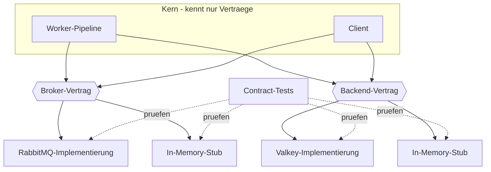
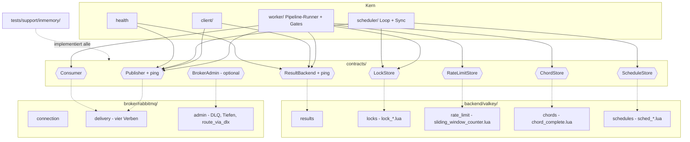
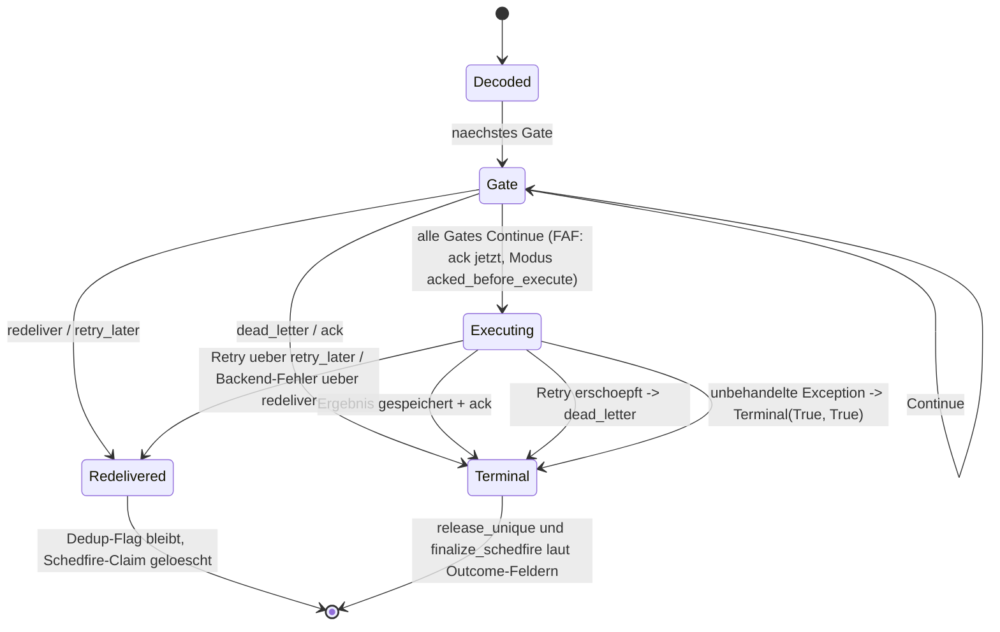

# SwarmQ 0.2.0 Restrukturierung - Plan

## Goal Capsule

- **Objective:** SwarmQ strukturell auf 0.2.0 heben — explizite Broker-/Backend-Verträge, Zerlegung der Großmodule und gebündelte API-Brüche in 0.2.0; projektweites mypy strict und kuratierte Kommentare spätestens in 0.2.x (R16). Das Laufzeitverhalten (Delivery, Retry, Dedup, Cancel, Workflow) bleibt semantisch unverändert (R9); nur die Public-API-Oberfläche darf brechen (R14).
- **Product authority:** Der Product Contract dieses Dokuments; Prozessdisziplin gemäß `AGENTS.md`. Alle Schlüsselentscheidungen wurden im Scoping-Dialog vom Maintainer getroffen. Bei Widerspruch gewinnt das R auf Produktverhalten, das KTD auf Implementierungsmechanismus.
- **Execution profile:** Deep, in sechs Phasen (F1). Jede Implementation Unit ist ein eigener MR gegen main; jeder MR ist test-first (`AGENTS.md`) und hält die CI-Gates grün (Verification Contract). Phase 2 endet mit dem Checkpoint aus R16.
- **Stop conditions:** Checkpoint oder Zeitbox-Ablauf mit unerfüllten R1–R6/R9 (R16); Nachweis, dass eine session-settled Entscheidung nicht umsetzbar ist; ein Contract-Test, der nur gegen den Stub, aber nicht gegen RabbitMQ oder Valkey grün wird (Vertrag ist dann falsch geschnitten, zurück zu U3).
- **Tail ownership:** Der Maintainer merged jeden MR, trifft die Checkpoint-Entscheidung (protokolliert unter „Checkpoint-Protokoll" im Planning Contract) und führt das 0.2.0-Release aus (U16).
- **Open blockers:** Keine.

---

## Product Contract

### Summary

SwarmQ wird in einem Restrukturierungsprogramm auf 0.2.0 gehoben: Broker-/Backend-Schnittstellen mit In-Memory-Stub und Contract-Tests bilden das Rückgrat, die Großmodule werden entlang dieser Verträge inkrementell zerlegt, Public-API-Brüche werden gebündelt am Schluss umgesetzt; projektweites mypy strict und die Kommentar-Kuration landen in 0.2.0 oder spätestens 0.2.x. Während des Programms gilt Release-Freeze; der Abschluss ist das 0.2.0-Release auf PyPI.

### Problem Frame

Der Code ist seit dem letzten Refactoring-Anlauf von ~2,7 kLOC auf ~16 kLOC gewachsen (Phasen 1–5 plus zwei Härtungsrunden). Vier Module überschreiten 1000 Zeilen — `src/swarmq/worker.py` (2808), `src/swarmq/client.py` (1262), `src/swarmq/scheduler.py` (1176), `src/swarmq/process_manager.py` (1145) — und die tragenden Invarianten (Ack-Ordering, Terminal-Flags, Owner-Checks, publish-then-mark) leben überwiegend in Kommentaren statt in Struktur.

Die Spezifikation (`aufgabe.md` §2.1, §2.4) nennt austauschbare Broker und Backends als Kernprinzip, implementiert sind aber konkrete Klassen ohne gemeinsames Interface: `RabbitMQBroker` und `ValkeyBackend` werden in Worker, Client und App direkt als Typen referenziert, und die Worker-Pipeline hängt in Signaturen und Semantik an aio_pika. Der Worker reicht zudem den rohen Valkey-Client an Rate-Limiter, Lock-Manager, Chord-Manager und Schedule-Store durch, deren Semantik in neun Lua-Skripten unter `src/swarmq/lua/` lebt. Der phasenweise mypy-strict-Rollout steht bei 7 strict-Modulen gegen 17 `ignore_errors`-Override-Einträge (inklusive `swarmq.cli.*`, rund zwei Dutzend Module); `process_manager` und mehrere Ops-Module stehen in keinem Override und werden nur auf Default-Niveau geprüft.

Ein Refactoring-Brainstorm vom 2026-04-16 wurde bewusst vertagt — Wiederbesuch „nach Phase 4, wenn die Worker-Architektur stabil ist". Diese Bedingung ist erfüllt: Workflows, DI-Integration und Härtung sind gemergt, die Feature-Roadmap pausiert. Es gibt keinen akuten Schmerz, aber die nächsten Ausbaustufen (R4.2 Bulk-Fast-Path, spätere Broker) würden auf der heutigen Struktur aufsetzen und ein späteres Umbauen weiter verteuern.

### Key Decisions

- **Pre-1.0-Freiheit: Public-API-Brüche sind erlaubt, Zielrelease 0.2.0.** (session-settled: user-directed — chosen over „strikt verhaltenserhaltend" und „API stabil, intern frei": Designverbesserung schlägt Kompatibilität; kein bekannter Produktionsnutzer.) Governs R14, R15.
- **Die Broker-/Backend-Austauschbarkeit wird vorbereitet.** (session-settled: user-directed — chosen over „bewusst konkret bleiben" und „nur Grenzen schärfen": die Spezifikation verspricht sie, und die Weichenstellung ist jetzt günstiger als nach weiteren Features.) Governs R1–R3.
- **Release-Freeze bis 0.2.0.** (session-settled: user-directed — chosen over „main bleibt releasebar": einfachste Regel; das Hotfix-Risiko fängt der 0.1.x-Branch-Pfad aus R12/R13 ab.) Governs R12, R13, R16.
- **Hybrid-Vorgehen: Interface-first-Rückgrat, inkrementelle Extraktions-MRs, API-Brüche vorab als Doku-Entwurf.** (session-settled: user-approved — empfohlen gegenüber den Reinformen Interface-first, Strangler-Fig und Zielbild-first.) Governs F1, R14.
- **Zeitboxter Architektur-Entwurf statt Audit-Phase.** Lehre aus dem vertagten Brainstorm 2026-04-16: Audit-/Loop-Infrastruktur wurde dort als Overkill bewertet, und der Codebestand ist gut vermessen. (session-settled: user-approved — Bestandteil des angenommenen Hybrid-Vorschlags.) Governs F1.
- **Zieldimensionen: Feature-Velocity, menschliche Wartbarkeit, strukturelle Robustheit.** (session-settled: user-directed — Agent-Bearbeitbarkeit ist bewusst kein eigenständiges Ziel, profitiert aber mit.) Governs R4–R6.

**Product Contract preservation:** restructured, no scope change — die vier „Deferred to Planning"-Fragen (Metrik-Schwellen, Modulschnitt und Extraktionsreihenfolge, Backend-Vertragsschnitt, Zeitbox) sind in KTD4, KTD6, KTD7 und KTD13 aufgelöst; R-, F- und AE-IDs sind unverändert.

<!-- ce-section: work-relationships -->
### How This Work Fits Together

Dieser Plan besitzt die 0.2.0-Restrukturierung als Ganzes. Die umliegenden Vorhaben sind aktueller Kenntnisstand, keine committete Roadmap:

- **Enables:** Valkey/Redis als zweiter Broker (`aufgabe.md` §2.4) — wird durch R1–R3 andockbar, ist aber ein eigenes späteres Vorhaben und hier nicht aktiver Scope.
- **Enables:** R4.2 Bulk-Throughput-Fast-Path (`docs/brainstorms/implementation-order-requirements.md`) — startet erst nach 0.2.0 und baut auf der neuen Modulstruktur auf.
- **Still to decide:** Ob nach 0.2.0 ein Stabilisierungsfenster vor R4.2 sinnvoll ist — entscheidet sich am Ausgang dieses Programms.

### Requirements

**Abstraktion (Rückgrat)**

- R1. Broker und Backend sind über explizite Verträge (Protocol- oder ABC-Schnittstellen) angebunden; Worker- und Client-Kern programmieren ausschließlich gegen diese Verträge — keine aio_pika- oder valkey-Typen in deren Signaturen und keine direkten Implementierungs-Imports im Kern. Das Vokabular der Verträge enthält keine transport- oder store-spezifischen Konzepte (delivery_tag, Requeue-Flag, x-death, Prefetch, Lua-Skript-Namen, Key-Layouts); jede Vertragsmethode ist als fachliche Zusage formuliert, und der Architektur-Entwurf in Phase 0 legt pro Methode dar, wie der in `aufgabe.md` §2.4 genannte Valkey/Redis-Broker sie erfüllen würde, und zeigt für R4.2 (`schedule_many` mit Batch-Publish, Publisher-Confirms-Pipeline und gepipelinten Result-Writes), an welcher Vertragsstelle die Batch-Operationen andocken, ohne den Vertrag nach 0.2.0 zu brechen.
- R2. Ein In-Memory-Stub für Broker und Backend existiert als dauerhafte Test-Fixture in der Suite; er implementiert dieselben Verträge und dient als Litmus-Test der Abstraktion.
- R3. Eine Contract-Test-Suite prüft jede Vertragsimplementierung (Stub, RabbitMQ, Valkey) gegen dieselben, broker-neutral formulierten Verhaltenszusagen — insbesondere Zustellung, Bestätigung, Wiederzustellung nach Ausfall, TTL-Verhalten und Owner-Checks; AMQP-spezifische Konzepte (Nack, Requeue) liegen in einer RabbitMQ-Erweiterung, nicht im Kernvertrag. Die Rate-Limit-Rückstellung ist eine Kernmethode; ihr Contract-Test wird in der broker-neutralen Suite geschrieben, bevor die RabbitMQ-Erweiterung entsteht.



**Modulstruktur**

- R4. Die vier Großmodule (`src/swarmq/worker.py`, `src/swarmq/client.py`, `src/swarmq/scheduler.py`, `src/swarmq/process_manager.py`) sind entlang der Pipeline-Stufen bzw. Verträge in kohärente Module zerlegt; für Modul- und Funktionsgröße gelten projektweite, CI-prüfbare Obergrenzen (Schwellenwerte: KTD7).
- R5. Es gibt keine zyklischen Imports; Modulgrenzen folgen Verantwortlichkeiten (eine Pipeline-Stufe, ein Modul), nicht der historischen Entstehungsreihenfolge.
- R6. Für jede der tragenden Invarianten — Ack-Ordering, Terminal-Flags (`_unique_release_pending`/`_schedfire_terminal`-Klasse), Owner-Checks, publish-then-mark — legt der Architektur-Entwurf (Phase 0) fest, durch welchen Mechanismus sie strukturell erzwungen wird (Kapselung, Typzustand, Contract-Test), oder dokumentiert begründet, warum sie kommentiert bleibt; am Programmende gibt es keine Invariante ohne diese Zuordnung.

**Typisierung**

- R7. mypy strict gilt projektweit: die globale Konfiguration steht auf `strict = true`, der `ignore_errors`-Override-Block in `pyproject.toml` (heute 17 Einträge, rund zwei Dutzend Module) und der modulweise strict-Override sind abgebaut, und auch die heute in keinem Override geführten Module (`process_manager`, `dishka`, `hot_reload`, `health`, `_http`, `metrics`, `agent_spec`, `lua`) sind strict-clean. Neu geschriebene Module sind von Beginn an strict-clean; Module, die aus einem `ignore_errors`-Modul extrahiert werden, dürfen dessen Override vorübergehend erben — die Extraktions-MR enthält keine Typ-Reparaturen, der Abbau erfolgt gesammelt in Phase 3.

**Tests**

- R8. Die Test-Suite spiegelt die neue Modulstruktur nach der `AGENTS.md`-Konvention (`src/swarmq/<modul>.py` → `tests/unit/test_<modul>.py`); doppelte Fixtures und Helper sind konsolidiert.
- R9. Verhaltensparität: e2e-, Chaos- und Property-Suiten laufen nach dem Umbau semantisch unverändert grün — Anpassungen betreffen nur Namen und Struktur, nie das erwartete Delivery-, Retry-, Dedup-, Cancel- oder Workflow-Verhalten. Da die Chaos-Suite in der Standard-CI nicht blockierend läuft, wird sie vor dem Merge jedes MR, der Worker-Pipeline, Broker- oder Backend-Implementierung berührt, manuell getriggert und muss grün sein — zusätzlich am Ende jeder Phase.

**Kommentare und Doku**

- R10. Kommentar-Kuration: Invarianten-Erklärungen bleiben im Code; Review-Provenance-Historie (P0-/REV-/ce-review-/Härtungs-Verweise) wandert in `docs/solutions/`; reine Redundanz entfällt.
- R11. `README.md`, `website/` (deutsche und englische Varianten), die generierten Agent-Spec-Artefakte und der Changelog spiegeln die 0.2.0-API vollständig; die Spec-Sync-Tests (`python -m swarmq.agent_spec`) sind grün.

**Prozess und Release**

- R12. Vor dem ersten Umbau-Commit wird `v0.1.2` auf den aktuellen Release-Stand getaggt, damit ein Hotfix-Absprungpunkt für einen 0.1.x-Branch existiert.
- R13. Release-Freeze: zwischen Programmstart und 0.2.0 erfolgt kein PyPI-Release von main; main darf brechende Zwischenzustände enthalten, jeder einzelne MR hält jedoch die CI-Gates grün. Ausgenommen sind Hotfix-Releases 0.1.x, die von einem Branch ab `v0.1.2` gebaut und getaggt werden und keine Umbau-Commits von main enthalten. Jeder 0.1.x-Hotfix wird vor seinem Tag als eigener Forward-Port-MR test-first auf main geführt; die dabei geänderten oder neuen e2e-Erwartungen sind eine dokumentierte Ausnahme von R9/AE2 und stehen im 0.2.0-Changelog als Bugfix.
- R14. Public-API-Brüche werden vor ihrer Umsetzung als Doku-Entwurf aus Nutzerperspektive formuliert und als gebündelte Schlussphase umgesetzt, nicht verstreut über das Programm.
- R15. Der Abschluss ist das 0.2.0-Release auf PyPI mit einem Changelog, der jeden Bruch benennt.
- R16. Das Programm hat eine Gesamt-Zeitbox (Wert: KTD13). Nach Phase 2 gibt es einen Checkpoint: Sind R1–R6 und R9 erfüllt, wird main so konsolidiert, dass 0.2.0 ohne die Restposten aus Phase 3 (R7-Sweep, R10-Kuration) releasebar wäre; Phase 4 (R14, R11) und R15 bleiben Release-Pflicht, damit die API-Brüche in genau einem Release landen, und nicht abgeschlossene Phase-3-Reste wandern nach 0.2.x. Sind R1–R6/R9 am Checkpoint oder bei Ablauf der Zeitbox nicht erfüllt, entscheidet der Maintainer protokolliert im Plan zwischen genau einer begrenzten Verlängerung der Zeitbox und dem Abbruch des Programms (main wird auf den Stand `v0.1.2` zurückgesetzt). Mit dem 0.2.0-Release endet der Freeze; verschobene Phase-3-Reste laufen danach als normale, nicht brechende MRs.

### Key Flows

- F1. Programmablauf (Hybrid)
  - **Phase 0 — Fundament:** Tag `v0.1.2` setzen (R12); zeitboxter Architektur-Entwurf legt Ziel-Modulschnitt und Vertragsskizze fest (U1, U2).
  - **Phase 1 — Rückgrat:** Verträge, In-Memory-Stub und Contract-Tests entstehen (R1–R3; U3–U5, U17, U18).
  - **Phase 2 — Zerlegung:** Inkrementelle Extraktions-MRs gegen die Verträge, jede Extraktion eigenständig grün — inklusive manuell getriggertem Chaos-Lauf bei Pipeline-Berührung (R4–R6, R8, R9; U6–U11, U19–U21).
  - **Checkpoint nach Phase 2:** Releasebarkeit von 0.2.0 ohne Phase-3-Reste prüfen (Phase 4 bleibt Pflicht); bei Nichterfüllung protokollierte Entscheidung zwischen einmaliger Verlängerung und Abbruch (R16).
  - **Phase 3 — Aufräumen:** mypy-strict-Sweep über die verbliebenen Legacy-Module (R7; U12); Kommentar-Kuration (R10; U13).
  - **Phase 4 — Brüche und Doku:** API-Brüche als Doku-Entwurf, dann gebündelte Umsetzung (R14; U14, U15); Doku-Refresh (R11; U15).
  - **Phase 5 — Abschluss:** 0.2.0-Release (R15; U16).
  - **Durchgängiges Gate:** Verhaltensparität (R9) gilt in jeder Phase, nicht erst am Ende.

### Acceptance Examples

- AE1. **Covers R1–R3.** Given der Phase-0-Vertragsentwurf, when er gegen die Semantik des in `aufgabe.md` §2.4 genannten Ziel-Brokers (Valkey Streams: XACK/XCLAIM, kein Nack/Requeue) durchgespielt wird, then liegt ein Durchspiel-Dokument unter `docs/` vor, das jede Kernvertragsmethode als „mit XACK/XCLAIM erfüllbar" oder „nur über Erweiterung" klassifiziert — die Zahl der Kernmethoden in der zweiten Klasse ist null, die Rate-Limit-Rückstellung ist als Kernmethode klassifiziert, und kein Methodenname oder Parameter verweist auf AMQP- oder Valkey-Primitive; when der Entwurf gegen R4.2 durchgespielt wird, then existiert für Batch-Publish und Batch-Result-Write je eine Vertragsmethode oder eine benannte Erweiterungsstelle; when anschließend der In-Memory-Stub als Vertragsimplementierung angelegt wird, then besteht er die Contract-Test-Suite, ohne dass Worker- oder Client-Module angefasst werden.
- AE2. **Covers R9.** Given die abgeschlossene Zerlegung, when die e2e-Suite gegen echtes RabbitMQ und Valkey läuft, then bestehen alle Tests mit unverändertem erwartetem Verhalten — im Testcode wurden nur Importe und Namen angepasst.
- AE3. **Covers R13, R14.** Given ein MR mitten im Programm bricht die Public API, when er auf main gemergt wird, then bleibt die CI grün, es erfolgt kein PyPI-Release, und der Bruch steht im 0.2.0-Changelog-Entwurf.
- AE4. **Covers R7.** Given der strict-Sweep ist abgeschlossen, when mypy über das Projekt läuft, then steht in `[tool.mypy]` global `strict = true`, es existiert weder ein `ignore_errors`- noch ein modulweiser strict-Override-Block in `pyproject.toml` (nur noch `ignore_missing_imports` für Drittanbieter-Stubs), und der Lauf ist fehlerfrei.
- AE5. **Covers R6.** Given die abgeschlossene Zerlegung, when für jede in Phase 0 als strukturell erzwungen klassifizierte Invariante ein Test sie verletzt — Beispiel publish-then-mark: ein Workflow-Schritt wird als abgeschlossen markiert, bevor der Nachfolgeschritt publiziert wurde —, then scheitert das bereits an der Struktur (Typ oder Zustandsobjekt), nicht erst im e2e-Verhalten.

### Scope Boundaries

- Kein zweiter produktiver Broker oder Backend (Valkey-als-Broker o. ä.) — nur der In-Memory-Stub als Test-Fixture.
- Keine neuen Features während des Programms; R4.2 und alle weiteren Roadmap-Punkte starten erst nach 0.2.0.
- Keine Performance-Optimierung; `benchmarks/`, `prototypes/` und `.context/` bleiben unangetastet.
- CI-Pipelines (GitLab, GitHub) werden an neue Pfade und Kommandos angepasst, aber nicht neu entworfen.
- Die Chaos-/Toxiproxy-Suite bleibt RabbitMQ-spezifisch — broker-agnostische Chaos-Tests sind kein Ziel.

#### Deferred to Follow-Up Work

- Auslieferung des In-Memory-Stubs als öffentliches Paket `swarmq.testing` für Nutzer-Tests (KTD11 hält ihn in der Suite).
- Implementierung der R4.2-Batch-Operationen — dieser Plan definiert nur ihre Andockstelle im Vertrag (R1).
- Ablösung von `ignore_errors` durch weichere Legacy-Flags vor Phase 3 — bewusst nicht gezogen, der Sweep in U12 räumt komplett auf.
- Funktionsgrößen-Verstöße (`PLR0915`/`C901`) in Modulen, die keine Unit U5–U21 zerlegt (`config.py`, `task.py`, `serialization.py`, `metrics.py`, `cli/*`): in U2 als `# noqa: … Follow-Up 0.2.x` markiert, Zerlegung nach 0.2.0.
- Vereinheitlichung der Dead-Letter-Fallbacks je Aufrufstelle (KTD3): U14 entscheidet nur *ob und wann*; die Umsetzung ist ein 0.2.x-Vorhaben, kein Teil dieses Programms.
- Entscheidung über die GitHub-Workflows (`.github/workflows/`): das Repo hat nur einen GitLab-Remote, die Workflows laufen nirgends; Löschen oder Behalten ist ein eigener kleiner Maintainer-Entscheid nach 0.2.0.

### Dependencies / Assumptions

- Die TDD-Disziplin aus `AGENTS.md` gilt unverändert: Struktur-Refactorings verhaltenserhaltend unter grüner Suite, API-Brüche test-first. Der „rote Test" einer reinen Extraktion ist der Struktur-Guard (KTD7), nicht ein Verhaltenstest (KTD14).
- Annahme: Es gibt keine externen Produktionsnutzer von 0.1.x (README: „not yet production-tested by anyone but the author") — Brüche ohne Deprecation-Pfad sind vertretbar. Das Paket ist seit 2026-06-07 öffentlich; „unbekannt" ist nicht „keiner", deshalb der Hotfix-Pfad (R13) und die Kompatibilitätsauflage (KTD12).
- `tests/unit/test_cli_module_surface.py` pinnt die heutige CLI-Oberfläche als Whitelist; bewusste Whitelist-Updates gehören zur API-Bruch-Phase (R14) und sind kein Testversagen.
- Docker (RabbitMQ 4, Valkey 8, Toxiproxy) ist lokal verfügbar; die Integrations-, e2e- und Chaos-Läufe der Verification Contract setzen den Compose-Stack voraus.

### Outstanding Questions

**Deferred to Implementation**

- Exakte Methodennamen der Verträge und ob das Zustellungsobjekt sein Broker-Handle selbst trägt oder der Broker eine Zuordnung hält — entscheidet sich beim Schreiben der Contract-Tests in U3.
- Ob Phase 4 als ein MR oder als wenige zusammenhängende MRs landet — der Freeze verdeckt Zwischenzustände, die Wahl hat kein Produktrisiko.
- Wie der In-Memory-Stub Zeit modelliert (Fake-Clock für TTL, Verzögerung und Sliding-Window) — bestimmt sich aus den ersten Contract-Tests zu TTL-Verhalten.

### Sources / Research

- `aufgabe.md` §2.1 (austauschbare Broker/Backends als Kernprinzip), §2.4 (Valkey/Redis als spätere Broker).
- `docs/brainstorms/2026-04-16-iterative-refactor-loop-requirements.md` — vertagter Vorläufer; Lehren: Single-Pass statt Loop-Ceremony, messbare statt unmessbarer Stopp-Kriterien, Wiederbesuch nach Phase 4.
- `pyproject.toml` — mypy-Konfiguration mit strict-Override (7 Module) und `ignore_errors`-Override (17 Einträge, rund zwei Dutzend Module).
- `docs/brainstorms/implementation-order-requirements.md` — Roadmap-Stand, R4.2 als nächstes offenes Feature.
- `AGENTS.md` — verbindliche TDD-Regeln und Test-Dateikonvention.
- `docs/solutions/logic-errors/worker-pipeline-stage-ack-ordering-2026-04-16.md` — die vier Regeln jeder Pre-Execute-Stufe (vor FAF-Ack, try/except um publish+ack, Requeue-Zähler-Header, ein `_try_apply_*`-Helper mit bool-Rückgabe); Vorlage für den Gate-Vertrag (KTD5).
- `docs/solutions/patterns/r3-5-unique-tasks-implementation-learnings-2026-04-17.md` und `docs/solutions/logic-errors/schedfire-retry-dedup-collision-silent-drop-2026-06-02.md` — die beiden Terminal-Flags werden heute nur per `grep -c`-Konvention synchron gehalten; Begründung für das typisierte Zustellungs-Ergebnis (KTD5).
- `docs/solutions/logic-errors/nack-requeue-false-routes-via-dlx-not-data-loss-2026-04-16.md` — Requeue-Flag kodiert transient vs. permanent; der Stub muss Dead-Letter inspizierbar machen (KTD2, KTD9).
- `docs/solutions/logic-errors/swarmq-async-semaphore-deadlock-and-error-wrapping-2026-04-15.md` — Exception-Wrapping in `BackendConnectionError`, Double-Connect-Schutz, kein Await im Consume-Callback: Contract-Test-Pflichten (KTD9).
- `docs/solutions/patterns/worker-cancel-safe-teardown-detached-tasks-2026-06-01.md` — Detached-Shield-Idiom, das U9 unverändert übernimmt.
- `docs/solutions/patterns/sunset-cli-surface-whitelist-kp2-2026-12-31.md` — vertagte CLI-Surface-Kürzung; wird ins 0.2.0-Bruch-Inventar gezogen (U14).
- `docs/recherche-issues-taskiq.md` — argumentiert aus TaskIQs `AckableMessage`-Problem, dass negative Bestätigung erstklassig sein muss; deckt sich mit den TaskIQ-Issues #322/#578 (nur-ack-Vertrag bereut) und Dramatiqs Broker/Consumer-Trennung (externe Recherche, Grundlage von KTD2/KTD3).
- Externe Recherche (Redis/Valkey-Streams-Dokumentation, mypy-Protocol-Dokumentation, pytest-Parametrisierung): XACK/XCLAIM/XAUTOCLAIM als Zustell-Primitive, kein natives Dead-Lettering und keine Per-Message-TTL (KTD3); `runtime_checkable` prüft nur Member-Präsenz, nicht Async-Signaturen (KTD1); geteilte Test-Klasse mit Fixture-Injektion als Contract-Test-Muster (KTD9); Override-Patterns `paket.*` bei Modul-zu-Paket-Splits (KTD8).
- Verifizierte Ausgangslage (2026-08-26): Modulgrößen per `wc -l`; keine Protocol-/ABC-Definitionen für Broker/Backend; keine Git-Tags; direkte aio_pika-Kopplung in vier `worker.py`-Signaturen; 37 ack/nack-Aufrufe laufen über den Broker, 23 davon mit `requeue`-Flag; acht von neun Lua-Skripten werden außerhalb von `backend/` besessen; nur ein GitLab-Remote.

---

## Planning Contract

### Key Technical Decisions

- KTD1. **Verträge als `typing.Protocol`, nicht als ABC.** Strukturelle Typisierung lässt Stub, RabbitMQ- und Valkey-Implementierung ohne gemeinsame Basisklasse gegen dieselbe Form prüfen; mypy strict verifiziert dabei auch die Async-Signaturen, `@runtime_checkable` dient nur als Smoke-Check (es prüft keine Signaturen). Weil `tests/` heute nicht unter mypy steht und die erste vertragstypisierte Zuweisung sonst erst in U15 entsteht, trägt jede Implementierung ab ihrer Unit einen positiven Konformitäts-Anker unter `TYPE_CHECKING` — eine Zuweisung der Klasse an eine mit dem Protocol annotierte Variable (`_conforms_broker: type[Broker] = RabbitMQBroker`) —, und `tests/support/` sowie `tests/contracts/` laufen unter demselben strict-Gate wie `src/swarmq` (U4). Gemeinsame Logik lebt in expliziten Mixins, nie in Protocol-Default-Bodies. Protocols sind neues Vokabular im Repo — bisher sind Nahtstellen Callable-Injektion (`WorkflowAdvancer`, `QueueDepthFn`, Middleware-Factory) und TypedDicts; U3 setzt den Präzedenzfall. Governs R1.
- KTD2. **Broker-Kernvokabular aus vier Verben auf einem Zustellungsobjekt mit Queue.** `Delivery` trägt `headers`, `body` und `queue` (die Queue, aus der zugestellt wurde, inklusive Prioritäts-Suffix — heute liest der Worker die Queue aus dem Body, sodass ein Retry aus `tasks.high` über `tasks.DQ` in `tasks` landet und sein Band verliert). Dass `retry_later` das Band erhält, ist eine bewusste, benannte Verhaltenskorrektur: wirksam ab U8, mit e2e-Test, im U14-Inventar und im U16-Changelog unter „Verhalten" — die einzige zugelassene Ausnahme von R9/KTD14 in Phase 2. Die Verben: `ack` (erledigt); `redeliver` (transient, sofort erneut zustellen — heute `nack(requeue=True)`); `retry_later(delivery, delay, headers)` (Body und Header an das Verzögerungsziel der Zustellungs-Queue veröffentlichen, dann das Original bestätigen — heute Delay-Queue-Publish plus ack); `dead_letter(delivery, headers)` (Body und Header an das Dead-Letter-Ziel veröffentlichen, dann bestätigen — heute DLQ-Publish plus ack). Schlägt die Veröffentlichung in `retry_later`/`dead_letter` fehl, wirft das Verb `BrokerConnectionError` und lässt das Original unbestätigt; der Aufrufer entscheidet den Fallback (KTD3). `Publisher.publish` gibt einen `PublishReceipt` zurück. Publish-Seite (`Publisher`) und Consume-Seite (`Consumer`) sind getrennte Protocols; `Broker` ist ihre Vereinigung, der Client braucht nur den `Publisher`. (session-settled: user-approved — chosen over einem ack/nack(requeue)-Vertrag: das Requeue-Flag kodiert heute transient-vs-permanent und hat in Valkey Streams kein Äquivalent; TaskIQ bereut den nur-ack-Vertrag öffentlich.) Governs R1, R3.
- KTD3. **RabbitMQ-Erweiterungsvertrag `BrokerAdmin` und der DLX-Fallback.** DLQ-Auflisten/-Inspizieren/-Retry/-Purge, Queue-Tiefen, Per-Message-TTL, Prioritäts-Suffix-Queues und `x-death`-Auswertung leben in einem optionalen Protocol, das nur `swarmq dlq`, der Metrics-Sampler und Health konsumieren. Dazu gehört `route_via_dlx(delivery)` — das heutige `nack(requeue=False)`, das eine Nachricht ohne Diagnose-Header über die Broker-Konfiguration nach `{queue}.XQ` leitet. Es ist der Fallback der Lock-Pfade, wenn `dead_letter` scheitert, und der terminale Pfad für nicht dekodierbare oder unbekannte Tasks; Retry- und Expiry-Pfade fallen dagegen auf `redeliver` zurück — die heutigen, je Aufrufstelle verschiedenen Fallbacks bleiben in Phase 2 unverändert (R9) und werden in U14 als Kandidaten für eine Vereinheitlichung inventarisiert. Der Kern referenziert `BrokerAdmin` nie; ein Broker ohne diese Fähigkeit ist vertragskonform. Governs R1, R3.
- KTD4. **Backend als schmaler Kernvertrag plus vier Koordinationsverträge.** `ResultBackend` umfasst Ergebnisse (Speichern, Lesen, Batch, „auf Ergebnis warten" und „Fortschritt beobachten" als Ersatz für das heute geleakte Pub/Sub-Objekt), Fortschritt, Cancel-Flags, Workflow-Zustand und Dedup-Flags. `LockStore`, `RateLimitStore`, `ChordStore` und `ScheduleStore` sind eigene Protocols; `ScheduleStore` arbeitet auf einem vertragsseitigen Datensatz (Bytes plus Fire-Zeitpunkt), damit `backend/` nicht `scheduler.definition` importiert, und bietet `exists`, damit `remove_schedule` keinen rohen Client mehr braucht. Beide Kernverträge (`Broker`, `ResultBackend`) bieten `ping`, damit Health gegen Verträge statt gegen `_client`/`_connection` prüft. Die Valkey-Implementierung jedes Vertrags besitzt ihr Lua-Skript; der Stub implementiert alle fünf im Speicher. Die `ValkeyBackend`-Fassade stellt die Koordinationsobjekte als nicht-optionale Properties `.locks`, `.rate_limit`, `.chords`, `.schedules` bereit, die vor `connect()` `BackendConnectionError` werfen (kein `Optional` in den Gates); der Worker baut sie nicht mehr aus dem rohen Client. Konkrete Klassen behalten bis U15 ihre heutigen Namen (`LockManager`, `RateLimiter`, `ChordManager`; die Valkey-Schedule-Implementierung heißt `ValkeyScheduleStore` mit Alias `ScheduleStore` in `swarmq.scheduler`), damit über dreißig bestehende Test-Importe gültig bleiben. (session-settled: user-approved — chosen over einem breiten Einzelvertrag: acht von neun Lua-Skripten gehören heute Komponenten außerhalb von `backend/`, ein Einzelvertrag würde entweder den Kern mit Lua-Semantik beladen oder den Client durchleaken.) Governs R1–R3.
- KTD5. **Invarianten-Mechanismen: typisiertes Zustellungs-Ergebnis, Runner-Modus und Token-Typen.** Jede Pipeline-Stufe ist ein `Gate`, das ein `DeliveryOutcome` zurückgibt: `Continue`, `Redelivered` oder `Terminal(release_unique, finalize_schedfire)` — die zwei Felder ersetzen die heutigen Booleans und erfassen die drei terminalen Varianten (Freigabe im `finally`; bereits nach dem Ack freigegeben; nie freigeben, wie heute der Expiry-Pfad). Der Pipeline-Runner führt die Gates in fester Reihenfolge aus, bestätigt erst nach dem letzten Gate und liest im `finally` das Outcome; für FIRE_AND_FORGET schaltet er nach den Gates in den Modus `acked_before_execute`, in dem kein späterer Ausgang ein Broker-Verb auslöst. Eine unbehandelte Exception aus der Ausführung ergibt `Terminal(True, True)` — das heutige Verhalten. Owner-Checks laufen über einen `LockToken`, den nur `acquire` ausgibt; publish-then-mark über den `PublishReceipt` aus `publish`, den `mark_enqueued` verlangt. Phase 0 bestätigt oder ersetzt diese Zuordnung pro Invariante (R6). Governs R6.
- KTD6. **Ziel-Modulschnitt.** Vier Pakete ersetzen die vier Großmodule (Output Structure): `worker/` (Pipeline-Runner, Gates, Ausführung, Retry/DLQ, Ergebnis-Tail, Lifecycle), `client/` (Schedule, Ergebnisse, Workflows), `scheduler/` (Definition, Loop, Cron-Sync) und `process_manager/` (Supervisor, Konfiguration, Subprocess-Entry, Sampler, Check, Run). Die Valkey-gebundenen Klassen aus `limits.py`, `locking.py`, `workflow_orchestration.py` und `scheduler.py` wandern samt der heutigen Schedule-/Schedfire-Primitive des Backends nach `backend/valkey/`; `SCHEDULER_LOCK_NAME`/`SCHEDULER_LOCK_KEY` ziehen nach `swarmq/locking.py` neben `lock_key` (reine Ableitung ohne Valkey-Semantik) und werden von `scheduler/` und `backend/valkey/` dort importiert, womit die Lazy-Kante `backend.valkey → scheduler` verschwindet, ohne die Import-Reinheit von `scheduler/` zu verletzen. Reine Funktionen (`parse_rate_limit`, `compute_lock_ttl_ms`) bleiben, wo sie sind. Importpfade `swarmq.worker.Worker`, `swarmq.backend.valkey.ValkeyBackend` und `swarmq.broker.rabbitmq.RabbitMQBroker` bleiben durch Paket-`__init__` gültig; Fassaden re-exportieren keine Namen, die Tests heute patchen (`logger`, `decode_json`, `asyncio`, `os`, `setup_logging`), damit veraltete Patch-Pfade laut scheitern statt still zu passieren. Extraktionsreihenfolge: Paket und Outcome-Typ, dann Runner, dann Gates, dann Ausführung/Retry, dann Ergebnis-Tail, zuletzt Lifecycle (U6, U19, U7, U8, U20, U9). Governs R4, R5.
- KTD7. **Struktur-Guards als pytest-Test plus ruff.** `tests/unit/test_architecture_guards.py` prüft: kein Modul unter `src/swarmq/` über 800 Zeilen; keine Import-Zyklen über alle Import-Anweisungen (auch verschachtelte und `TYPE_CHECKING`-Importe, AST-basiert) mit einer Allowlist auf Paketebene für die heute bekannten Lazy-Kanten (`process_manager.entry → cli`, `cli → process_manager`, `process_manager → broker.rabbitmq` bis U21, `swarmq ↔ app`); Import-Reinheit der Kernpakete `contracts/`, `worker/`, `client/`, `scheduler/`: kein `aio_pika`, kein `valkey` und kein `swarmq.backend.valkey`/`swarmq.broker.rabbitmq` — auch nicht unter `TYPE_CHECKING`, geprüft über die transitive Import-Hülle des Pakets (nicht nur direkte Importe) und über Literal-Strings in `import_module`/`__import__`-Aufrufen; eine Alias-Modul-Liste (`swarmq.limits`, `swarmq.locking`, `swarmq.workflow_orchestration`, `swarmq.scheduler`-Kompatibilitätsmodul) wird in der Hülle bis U15 ignoriert, weil ihre Re-Exports nach KTD10 transitiv Implementierungen ziehen — U15 leert die Liste; die Prüfung ist je Paket über eine Aktivierungsliste geschaltet (`contracts/` ab U3, `scheduler/` ab U11, `client/` und `worker/` ab U15, weil deren Konstruktoren bis Phase 4 `TYPE_CHECKING`-Annotationen der Implementierungen tragen); ein existierendes Kernpaket ohne Aktivierungseintrag ist ab U15 ein Guard-Fehler; jeder `ignore_errors`-Override-Eintrag matcht ein existierendes Modul; kein Test patcht einen gepunkteten Pfad in ein bereits aufgeteiltes Modul (`patch("swarmq.worker.` usw.); Contract-Bindings (Klassen, die von `tests.contracts.*`-Basisklassen ableiten) definieren oder überschreiben keine `test_*`-Methoden, tragen kein `skip`/`xfail`, und alle Bindings derselben Basisklasse sammeln dieselbe Fallzahl. Funktionsgröße über ruff `PLR0915` (`max-statements = 60`) und `C901` (`max-complexity = 12`). Die Limits sind Rauchmelder: ein Modul unter dem Limit mit mehr als einer Pipeline-Stufe gilt als nicht zerlegt (R5 hat Vorrang). Governs R4, R5.
- KTD8. **mypy-Migration in umgekehrter Richtung.** Phase 1: `swarmq.contracts.*`, `swarmq.backend.valkey.*`, `swarmq.broker.rabbitmq.*` und alle neuen Module kommen in den strict-Override. Phase 2: extrahierte Pakete erben den `ignore_errors`-Eintrag ihres Ursprungsmoduls als `paket.*`-Pattern (R7). Phase 3 (U12): globales `strict = true`, beide Override-Blöcke entfallen, `warn_unused_ignores = true` kommt hinzu; nur `ignore_missing_imports` für `croniter.*` und `msgpack.*` bleibt. Governs R7.
- KTD9. **Contract-Test-Suite als geteilte Klassen mit Fixture-Injektion.** `tests/contracts/` hält je eine Testklasse pro Vertrag; `tests/unit/` bindet sie an den Stub (immer aktiv), `tests/integration/` an RabbitMQ und Valkey (Skip ohne erreichbare Dienste, über die in U4 konsolidierten Service-Fixtures). Die Tests werden aus der schriftlichen Semantik des Phase-0-Entwurfs geschrieben, bevor der Stub existiert, und enthalten die Pflichtfälle: Dead-Letter landet inspizierbar mit allen Original-Headern, `redeliver` liefert dieselbe Zustellung erneut, `retry_later` hält die Verzögerung ein und veröffentlicht an das Verzögerungsziel der Zustellungs-Queue, `dead_letter`/`retry_later` werfen bei Publish-Fehler und lassen das Original unbestätigt, Treiberfehler kommen als `BackendConnectionError`/`BrokerConnectionError` an, doppeltes `connect` ist idempotent, `ping` vor `connect` wirft. („Kein Ack vor Abschluss aller Gates" ist Worker-Verhalten und wird in U19 getestet, nicht hier.) Bindings dürfen Fälle weder überschreiben noch mit `skip`/`xfail` ausblenden; der Struktur-Guard erzwingt das (KTD7). Governs R2, R3.
- KTD10. **Alte Backend-Methodennamen und Klassennamen bleiben bis Phase 4 als Aliase.** Die Verträge nutzen sofort broker-neutrale Namen; `ValkeyBackend` behält die heutigen Methodennamen (`zadd_schedule`, `setnx_unique`, `create_pubsub`, …) als dünne, mit Deprecation-Kommentar versehene Weiterleitungen, und die verschobenen Klassen bleiben unter ihren alten Importpfaden erreichbar (`swarmq.limits.RateLimiter`, `swarmq.locking.LockManager`, `swarmq.workflow_orchestration.ChordManager`, `swarmq.scheduler.ScheduleStore`); U15 entfernt beides gebündelt. (session-settled: user-approved — chosen over sofortiger Umbenennung: R14 verlangt gebündelte Brüche, Aliase kosten wenige Zeilen.) Governs R14.
- KTD11. **Der In-Memory-Stub lebt in der Test-Suite** unter `tests/support/inmemory/`, nicht als ausgeliefertes Paket. `tests/support/` ist die eine bewusste Abweichung von der Konvention „Unterstrich-Helfer neben dem Test", weil Stub und Service-Fixtures von allen Test-Tiers geteilt werden. (session-settled: user-approved — chosen over einem öffentlichen `swarmq.testing`: R2 verlangt eine Fixture, ein Nutzer-Feature wäre Scope-Erweiterung.) Governs R2.
- KTD12. **Daten- und Wire-Kompatibilität 0.1.2 → 0.2.0 ist eine Phase-0-Auflage mit Golden-Fixtures.** Unverändert bleiben: Valkey-Key-Namen, -Typen und Hash-Tags (`{sched}`, `{task_name}`), Value-Encodings (msgpack-Ext-Codes 1–7, JSON-Feldnamen von Workflow-Zustand und Schedule-Definition, HASH-Felder des Fortschritts, `"1"`-Flags, STRING-vs-ZSET-Lock-Modus), Pub/Sub-Kanalnamen und -Payload, Lua-KEYS/ARGV-Arität und Slot-Gleichheit der Mehrschlüssel-Skripte, RabbitMQ-Deklarationsargumente (inklusive bedingtem `x-delivery-limit`) und die Verzögerung über Per-Message-`expiration`, Message-Body und `x-swarmq-*`-Header. Sechs committete Golden-Fixtures in `tests/integration/backend/golden/` halten das prüfbar (`keys.json`, `values/`, `channels.txt`, `queue_args.json`, `headers.txt`, `lua_contract.txt`), erzeugt mit festen IDs und eingefrorener Uhr. Eine Abweichung ist ein benannter Bruch mit Migrationshinweis im Changelog (R15). Governs R9, R15.
- KTD13. **Zeitbox und Checkpoint-Protokoll.** Phase 0 dauert eine Woche und endet mit einem Entwurfs-MR; das Gesamtprogramm hat zwölf Wochen ab dem Tag `v0.1.2`. Die Checkpoint-Entscheidung (R16) wird als Abschnitt „Checkpoint-Protokoll" in diesem Plan-Dokument festgehalten — die Git-Historie ist der Audit-Trail, es entsteht kein zweites Dokument. Beim Abbruch (Rücksetzen auf `v0.1.2`) gibt es für externe Nutzer nichts aufzuräumen, weil kein Release erfolgte; Entwicklungs-Stacks flushen Valkey und löschen die Queue-Tripel, falls ein Zwischenstand Deklarationsargumente verändert hat. (session-settled: user-approved — chosen over unbestimmter Laufzeit: der Brainstorm vom 2026-04-16 scheiterte an unmessbaren Kriterien.) Governs R16.
- KTD14. **Extraktions-MR- und Hotfix-Disziplin.** Jede Extraktion beginnt mit einem roten Struktur-Guard (KTD7: Ausnahmeliste-Eintrag streichen, Import-Reinheit, Patch-Pfad-Guard), verschiebt Code und die zugehörigen Unit-Tests gemeinsam, aktualisiert im selben MR gepunktete Patch-Pfade und enthält keine Verhaltensänderung — auch nicht in Fallback-Pfaden (KTD3); einzige benannte Ausnahme ist der Band-Erhalt beim Retry (KTD2, U8). Ein anstehender Hotfix-Forward-Port (R13) hat Vorrang: Extraktions-MRs werden erst nach seinem Merge gemergt. Ein Hotfix darf `headers.py`, Key-Builder, Lua-Skripte und `declare_queue` nicht ändern, sofern nicht eine KTD12-Ausnahme benannt ist; die Golden-Fixtures laufen auch auf dem Hotfix-Branch. Governs R4, R8, R9, R13.
- KTD15. **Chaos-Gate als CI-Regel statt Prozessnorm.** Der GitLab-Job `chaos-tests` erhält eine zusätzliche `rules`-Variante für Branch-Pipelines — `.gitlab-ci.yml` unterdrückt Merge-Request-Pipelines über `workflow: rules`, eine MR-Regel würde nie ausgewertet: `if: $CI_COMMIT_BRANCH && $CI_COMMIT_BRANCH != $CI_DEFAULT_BRANCH` mit `changes: {paths: [src/swarmq/worker/**, src/swarmq/broker/**, src/swarmq/backend/**, src/swarmq/contracts/**], compare_to: refs/heads/main}` → `when: manual`, `allow_failure: false`; das Job-Level-`allow_failure: true` entfällt, sonst überstimmt es die Regel. Die Pipeline des Feature-Branches blockiert bis zum manuellen grünen Lauf; die Schedule-Variante bleibt. Voraussetzung: der Job läuft vor der Aktivierung einmal auf dem dind-Runner grün (er trägt heute noch den Vermerk „allow_failure until validated"). Governs R9.
- KTD16. **Public-API-Definition für das Bruch-Inventar.** Public sind: die eager- und lazy-Oberfläche von `swarmq/__init__.py`, CLI-Kommandos, -Flags und -Exit-Codes, `SWARMQ_*`-Umgebungsvariablen, die Wire-Formate (Task-Message, Result-Envelope, `x-swarmq-*`-Header), das Valkey-Key-Layout und die Agent-Spec-Artefakte. Interne Modulpfade und die `swarmq.cli`-Façade-Re-Exports sind nicht public; ihre Änderung ist trotzdem im Changelog erwähnt, weil die Surface-Whitelist sie heute pinnt. Governs R14, R15.

### High-Level Technical Design

Ziel-Topologie der Verträge und Implementierungen (ergänzt das Diagramm im Product Contract um die Backend-Aufteilung aus KTD4):



Zustellungs-Zustandsmaschine des Pipeline-Runners (KTD5). Jedes Gate liefert genau einen Ausgang; der Runner bestätigt erst nach `Continue` aus allen Gates. Im FIRE_AND_FORGET-Modus bestätigt der Runner nach dem letzten Gate und löst danach kein Verb mehr aus:



Abhängigkeiten der Implementation Units (Reihenfolge der MRs):

```mermaid
flowchart LR
  U1 --> U2 --> U3 --> U4 --> U5 --> U17 --> U18
  U18 --> U6 --> U19 --> U7 --> U8 --> U20 --> U9
  U18 --> U10
  U18 --> U11
  U18 --> U21
  U9 --> CP{Checkpoint R16}
  U10 --> CP
  U11 --> CP
  U21 --> CP
  CP --> U12
  CP --> U13
  CP --> U14 --> U15 --> U16
  U12 -.optional vor 0.2.0.-> U15
  U13 -.optional vor 0.2.0.-> U15
```

### Output Structure

Erwartete Paketstruktur nach Phase 2 (Scope-Deklaration; U-Einheiten sind für die Dateilisten autoritativ):

```text
src/swarmq/
  contracts/
    __init__.py            re-exportiert alle Protocols
    message.py             Delivery (headers, body, queue), PublishReceipt
    broker.py              Publisher, Consumer, Broker, BrokerAdmin
    backend.py             ResultBackend
    coordination.py        LockStore, LockToken, RateLimitStore, ChordStore, ScheduleStore
  broker/rabbitmq/
    __init__.py            RabbitMQBroker (Fassade, Importpfad bleibt)
    connection.py          connect/close/ping, Channel-Recreate, injizierte Pools
    delivery.py            Publish/Consume, die vier Verben, Delay-/DLQ-Ziele
    admin.py               DLQ-Operationen, Queue-Tiefen, route_via_dlx (BrokerAdmin)
  backend/valkey/
    __init__.py            ValkeyBackend (Fassade mit .locks/.rate_limit/.chords/.schedules, Aliase)
    connection.py          Client-Aufbau, Retry, Socket-Timeouts, ping, gebündelter op_timeout-Wrapper
    results.py             Ergebnisse, Benachrichtigung/Warten, Fortschritt, Cancel, Workflow-Zustand, Dedup
    locks.py               LockManager (lock_acquire/release/renew.lua)
    rate_limit.py          RateLimiter (sliding_window_counter.lua)
    chords.py              ChordManager (chord_complete.lua)
    schedules.py           ValkeyScheduleStore, Schedfire-Marker (sched_*.lua)
  worker/
    __init__.py            Worker (Fassade, Importpfad bleibt; keine Re-Exports gepatchter Namen)
    outcome.py             DeliveryOutcome
    pipeline.py            Runner: Decode, Gates in Reihenfolge, Ack-Ordering, FAF-Modus
    gates/
      __init__.py          Gate-Protocol
      schedfire.py         Schedfire-Dedup + Finalisierung
      cancel.py            Pre-Start-Cancel
      expiry.py            max_age
      rate_limit.py        Rate-Limit-Rückstellung
      lock.py              Lock-Render, Acquire, Konflikt-Backoff
    execution.py           Task-Lifecycle, Watchdog, Cancel-Monitor, Middleware-Hooks
    retry.py               Retry-Bewertung, Dead-Letter
    results.py             Ergebnis speichern, Benachrichtigung, Workflow-Advance-Seam
    lifecycle.py           start/stop/teardown, Burst-Monitor, Metrics-Sampler, Health via Verträge
  client/
    __init__.py            Client (Fassade)
    schedule.py            schedule, schedule_many, deferred, Dedup-Claim
    results.py             get_result(s), Progress
    workflows.py           apply, workflow
  scheduler/
    __init__.py            Re-Exports (ScheduleDefinition, SchedulerLoop, Alias ScheduleStore)
    definition.py          ScheduleDefinition, schedfire-Key
    loop.py                SchedulerLoop (Election, Poll, Fire)
    sync.py                sync_taskinfo_crons
  process_manager/
    __init__.py            Re-Exports
    config.py              WorkerInfo, WorkerConfig
    supervisor.py          ProcessManager
    entry.py               worker_subprocess_entry
    sampler.py             Queue-Tiefen-Sampler (BrokerAdmin-Factory injiziert)
    check.py               check_worker_config
    run.py                 run_multi_process_worker
  limits.py, locking.py    bleiben: reine Funktionen (parse_rate_limit, compute_lock_ttl_ms, lock_key, SCHEDULER_LOCK_KEY) plus Aliase bis U15
tests/
  contracts/               geteilte Contract-Basisklassen (publisher_consumer.py, result_backend.py, coordination.py — kein test_-Präfix)
  support/inmemory/        Stub-Broker und -Backend
  support/services.py      Service-Fixtures (Ports, Erreichbarkeit) für Integration und e2e
  unit/test_architecture_guards.py
  unit/typing/             negative mypy-Fixtures (AE5), laufen im Unit-Gate
  unit/worker/, unit/client/, unit/scheduler/, unit/process_manager/, unit/backend/, unit/broker/
  integration/test_contracts_rabbitmq.py, test_contracts_valkey.py
  integration/backend/golden/   sechs Golden-Fixtures (KTD12)
```

### Checkpoint-Protokoll

Wird am Checkpoint nach Phase 2 vom Maintainer ausgefüllt (R16, KTD13): Datum, Stand von R1–R6 und R9, Entscheidung (0.2.0 mit Phase 4 fortsetzen / einmalige Verlängerung bis Datum / Abbruch mit Rücksetzen auf `v0.1.2`), Begründung.

**Checkpoint 2026-08-27** (Phase 0–2 komplett; alle Units U1–U11, U17–U21 gemergt: MR !13–!28, jede mit grünem Chaos-Lauf):

- **R1 (Verträge) — erfüllt im Phase-2-Umfang.** Alle Protocols existieren (`contracts/`: Publisher/Consumer/Broker, BrokerAdmin, Batch-Andockstellen, ResultBackend, LockStore/RateLimitStore/ChordStore/ScheduleStore); die Kernlogik spricht Verträge: Gates/Retry/Results über die vier Broker-Verben (U7/U8/U20), SchedulerLoop über LockStore/Publisher/`claim_unique` (U11), Sampler über die BrokerAdmin-Factory (U21), HealthChecker über `ping` (U9). Vertragsvokabular broker-neutral (AE1-Lesung ohne Befund, U1). **Offener, geplanter Rest für U15:** Konstruktor-Annotationen der Fassaden (`Client`, `Worker`, `SwarmQ`) nennen noch `RabbitMQBroker`/`ValkeyBackend` (TYPE_CHECKING), KTD10-Aliase aktiv; Reinheits-Guard für `client/`/`worker/` schaltet planmäßig erst U15 scharf.
- **R2 (In-Memory-Stub) — erfüllt.** `tests/support/inmemory/` (FakeClock, InMemoryBroker, InMemoryBackend) als dauerhafte Fixture; Stub läuft gegen dieselben Contract-Klassen wie RabbitMQ/Valkey.
- **R3 (Contract-Suite) — erfüllt.** `tests/contracts/` broker-neutral formuliert; gebunden gegen Stub (Unit-Gate), RabbitMQ (`test_contracts_rabbitmq.py`) und Valkey (`test_contracts_valkey.py`, 54 Fälle inkl. vier Koordinationsverträge); Rate-Limit-Rückstellung als Kernmethode getestet; Contract-Binding-Guard aktiv.
- **R4 (Zerlegung + Grenzen) — erfüllt.** Alle vier Großmodule sind Pakete (worker 7+5 Module, client 3, scheduler 3, process_manager 6); **die LOC-Ausnahmeliste des Guards ist leer** (≤ 800 Zeilen projektweit), ruff-Komplexitätsregeln aktiv (Bestandsverstöße per noqa mit Unit-/Follow-Up-Verweis).
- **R5 (keine Zyklen) — erfüllt.** AST-Zyklen-Guard grün; Allowlist enthält nur dokumentierte Lazy-/Alias-Kanten (PEP-562-Aliase locking/limits bis U15, cli↔process_manager, cli↔cli als 0.2.x-Follow-Up); die Implementierungs-Kante `process_manager → broker.rabbitmq` ist seit U21 gestrichen.
- **R6 (Invarianten strukturell) — erfüllt.** Ack-Ordering: Outcome-Gates + Ordnungstests (U7/U19); Terminal-Flags: `DeliveryOutcome`/`Terminal` ersetzt die Flag-Paare (U19); Owner-Checks: LockToken-/`claim_unique`-Verträge + Contract-Tests (U18); publish-then-mark: `PublishReceipt` als Pflichtargument von `mark_enqueued` (mypy + Laufzeit-TypeError, U20). Zuordnungstabelle im Entwurf (U1) vollständig.
- **R9 (Verhaltensparität) — erfüllt.** e2e (210), Chaos (je MR manuell getriggert, alle grün), Property (33) semantisch unverändert; einzige benannte Verhaltenskorrektur ist der Band-Erhalt beim Retry (KTD2, U8) mit eigenem e2e-Test; die Golden-Fixtures (KTD12) pinnen Key-Layout, Lua-Arität, Header, Queue-Argumente und Channels unverändert.

**Releasebarkeit:** main ist ohne die Phase-3-Reste (R7-Sweep U12, R10-Kuration U13) releasebar; Phase 4 (U14/U15, API-Brüche + Doku) und R15 bleiben Release-Pflicht vor U16. Zeitbox (12 Wochen ab v0.1.2, KTD13): Tag 1 — weit innerhalb.

**Entscheidung (Maintainer, 2026-08-27):** Fortsetzen mit Phase 3 und Phase 4 (0.2.0 inklusive R7-Sweep und R10-Kuration). Begründung: alle Checkpoint-Kriterien erfüllt, Zeitbox weit innerhalb (Tag 1 von 12 Wochen); erneute Rückfrage vor U16 (Release) vereinbart.

### Risks & Dependencies

| Risiko | Wirkung | Mitigation |
|---|---|---|
| Contract-Tests werden zusammen mit dem Stub geschrieben und spiegeln nur dessen Verhalten | Verträge bleiben RabbitMQ-/Valkey-förmig, Litmus-Test wertlos | KTD9: Tests vor dem Stub aus dem Phase-0-Entwurf; dieselbe Klasse muss unverändert gegen RabbitMQ/Valkey grün werden; AE1-Durchspiel-Dokument |
| Extraktion vereinheitlicht die heute je Aufrufstelle verschiedenen Dead-Letter-Fallbacks (`requeue=True` in Retry/Expiry, `requeue=False` in Lock-Pfaden) | Stiller Verhaltenswechsel, nur unter Broker-Fehlern sichtbar — die e2e-Suite sieht ihn nicht | KTD3 hält die Fallbacks je Pfad; U5 pinnt sie per Characterization-Test; U14 entscheidet nur über den Zeitpunkt einer Vereinheitlichung, die Umsetzung liegt nach 0.2.0 |
| `DeliveryOutcome` verliert die Expiry-Eigenheit „Dedup-Flag nie freigeben" oder gibt in Lock-Pfaden doppelt frei | Dedup-Korrektheit bricht | KTD5 modelliert `Terminal(release_unique, finalize_schedfire)`; U19-Tests je terminale Variante |
| Ein Zyklus-Guard, der nur Top-Level-Importe sieht, ist zwölf Wochen lang inert | Falsche Sicherheit | KTD7 analysiert alle Import-Anweisungen; Allowlist auf Paketebene |
| Pub/Sub-Kanalnamen oder Value-Encodings ändern sich beim Neuschnitt — für einen Key-Snapshot unsichtbar | Cross-Version-Wartende wachen nie auf; 0.1.2-Ergebnisse unlesbar | KTD12 Golden-Fixtures für Kanäle, Encodings, Lua-Arität |
| Deklarationsargumente der Queues driften | `PRECONDITION_FAILED` beim ersten 0.2.0-Start auf jedem bestehenden vhost, keine automatische Erholung | KTD12 `queue_args.json`; U16-Rollout-Hinweis |
| Chaos-Lauf pro pipeline-berührender MR ist teuer und flaky (`--reruns 2` nur auf GitHub) | Druck zu großen, seltenen MRs; Reibung | KTD15 macht das Gate maschinell; Extraktionen sind auf U5–U21 kohärent geschnitten; lokaler Compose-Stack für Vorab-Läufe |
| `tests/unit/conftest.py` hält die Logger-Module als festes Tupel; neue Submodule fallen still heraus | Unit-Tests verlieren Isolation ohne Fehler | U2 macht die Fixture dynamisch |
| Pinning-Tests brechen bei jeder Extraktion (Surface-Whitelist, Import-Laziness, Agent-Spec, gepunktete Patches) | MRs werden rot aus Strukturgründen, nicht aus Verhaltensgründen | KTD14: Patch-Pfade im selben MR; Whitelist und Spec-Regeneration nur in U15; Laziness bleibt durch Paket-`__init__` gewahrt |
| Hotfix-Forward-Port kollidiert mit verschobenem Code | Cherry-Pick scheitert, Fix geht in 0.2.0 verloren | R13 + KTD14: Forward-Port hat Merge-Vorrang, test-first gegen die neue Struktur, Golden-Fixtures auf dem Hotfix-Branch |
| Zeitbox reißt, Freeze läuft unbegrenzt | Kein Release, kein Rückweg | R16 Fehlerfall, KTD13 Protokoll, Checkpoint im Unit-DAG |
| Ein Maintainer, ein Programm von zwölf Wochen | Kontextverlust zwischen Sessions | Jede Unit ist ein abgeschlossener MR; dieses Dokument ist die einzige Fortschrittsquelle neben Git |

### System-Wide Impact

- **CI:** `.gitlab-ci.yml` erhält die Chaos-Branch-Regel (KTD15), den neuen blockierenden Job `lint-and-types` (ruff + mypy, U2) und angepasste Pfade; `lock-check` bleibt (uv.lock-Drift ist bei den vielen `pyproject.toml`-Berührungen ein bekanntes Risiko, siehe `docs/solutions/tooling-decisions/uv-lock-drift-from-pyproject-optional-extras.md`). GitHub-Workflows laufen ohne Remote nicht (Deferred to Follow-Up Work).
- **Test-Infrastruktur:** neue Verzeichnisse `tests/contracts/`, `tests/support/`, `tests/integration/backend/golden/`; Unit-Tests in Unterordner gespiegelt; Integrations- und e2e-Conftest teilen die Service-Fixtures.
- **Doku und Spec:** `website/reference/` (de/en), `README.md`, `website/reference/agent/spec/*.json`, `website/llms.txt` werden in U15 regeneriert bzw. überarbeitet.
- **Paket:** `pyproject.toml` (mypy-Overrides in U3/U5/U17/U18/U12, ruff-Regeln in U2, Version in U16); `hatchling` nimmt neue Pakete automatisch auf (`packages = ["src/swarmq"]`).
- **Valkey/RabbitMQ-Daten:** unverändert (KTD12) — jede Ausnahme ist ein Changelog-Eintrag. Rollout 0.2.0: gleiche Version im gesamten Worker-Fleet, keine Valkey-Migration, in-flight 0.1.2-Nachrichten bleiben gültig; Rollback ist ein Redeploy von 0.1.2.

---

## Implementation Units

| U-ID | Titel | Kern-Dateien | Depends on |
|---|---|---|---|
| U1 | Tag, Architektur-Entwurf und Durchspiel-Dokument | `docs/design/2026-09-0-2-0-vertraege-und-modulschnitt.md` | — |
| U2 | Struktur-Guards, ruff-Limits, Chaos-CI-Regel, dynamische Logger-Fixture | `tests/unit/test_architecture_guards.py`, `pyproject.toml`, `.gitlab-ci.yml`, `tests/unit/conftest.py` | U1 |
| U3 | Verträge und rote Contract-Tests | `src/swarmq/contracts/*`, `tests/contracts/*` | U2 |
| U4 | In-Memory-Stub, Contract-Tests grün, Test-Helfer konsolidiert | `tests/support/*`, `tests/unit/test_contracts_inmemory.py` | U3 |
| U5 | RabbitMQ-Paket erfüllt die Verträge | `src/swarmq/broker/rabbitmq/*`, `tests/integration/test_contracts_rabbitmq.py` | U4 |
| U17 | Valkey-Kern erfüllt `ResultBackend`; Golden-Fixtures | `src/swarmq/backend/valkey/{__init__,connection,results}.py`, `tests/integration/backend/golden/*` | U5 |
| U18 | Koordinationsverträge nach `backend/valkey/`; Aliase | `src/swarmq/backend/valkey/{locks,rate_limit,chords,schedules}.py`, Re-Export-Aliase | U17 |
| U6 | Worker-Paket und `DeliveryOutcome` | `src/swarmq/worker/{__init__,outcome,pipeline}.py` | U18 |
| U19 | Pipeline-Runner mit Ack-Ordering und FAF-Modus | `src/swarmq/worker/pipeline.py` | U6 |
| U7 | Gates extrahieren | `src/swarmq/worker/gates/*` | U19 |
| U8 | Ausführung und Retry/Dead-Letter | `src/swarmq/worker/{execution,retry}.py` | U7 |
| U20 | Ergebnis-Tail und `PublishReceipt` | `src/swarmq/worker/results.py`, `src/swarmq/workflow_orchestration.py` | U8 |
| U9 | Worker-Lifecycle und Health über Verträge | `src/swarmq/worker/lifecycle.py`, `src/swarmq/health.py` | U20 |
| U10 | Client-Paket | `src/swarmq/client/*` | U18 |
| U11 | Scheduler-Paket | `src/swarmq/scheduler/*` | U18 |
| U21 | ProcessManager-Paket | `src/swarmq/process_manager/*` | U18 |
| U12 | mypy-strict-Sweep | `pyproject.toml`, alle Legacy-Module | Checkpoint |
| U13 | Kommentar-Kuration | `src/swarmq/**`, `docs/solutions/**` | Checkpoint |
| U14 | Bruch-Inventar und Doku-Entwurf | `docs/design/2026-…-0-2-0-api-brueche.md`, `website/reference/*.md` | Checkpoint |
| U15 | Brüche umsetzen, Doku und Agent-Spec regenerieren | `src/swarmq/__init__.py`, `src/swarmq/cli/__init__.py`, `website/**`, `README.md`, `tests/unit/test_cli_module_surface.py` | U14 |
| U16 | Release 0.2.0 | `pyproject.toml`, `website/reference/changelog*.md` | U15 |

### Phase 0 — Fundament

### U1. Tag, Architektur-Entwurf und Durchspiel-Dokument

- **Goal:** Den Release-Stand als `v0.1.2` taggen und den zeitboxten Architektur-Entwurf als Dokument festhalten: Vertragsvokabular, Modulschnitt, Invarianten-Zuordnung, Durchspiel gegen Valkey Streams und R4.2, Kompatibilitätsauflage.
- **Requirements:** R1, R6, R12, R16; F1 Phase 0; AE1 (Durchspiel-Teil).
- **Dependencies:** —
- **Files:** `docs/design/2026-09-0-2-0-vertraege-und-modulschnitt.md` (neu); Git-Tag `v0.1.2` auf dem Commit `2c622b7`.
- **Approach:**
  1. Tag setzen und pushen — Referenzpunkt für den Hotfix-Branch (R13).
  2. Entwurf schreiben mit den Abschnitten: Vertragsmethoden pro Protocol (KTD2–KTD4) mit je einer Zeile „RabbitMQ-Erfüllung" und „Valkey-Streams-Erfüllung: XACK/XCLAIM erfüllbar | nur Erweiterung"; R4.2-Andockstellen (Batch-Publish, Batch-Result-Write); Invarianten-Tabelle (KTD5) mit Mechanismus oder begründeter Ausnahme pro Invariante; Ziel-Modulschnitt (KTD6) mit Extraktionsreihenfolge; Kompatibilitätsauflage (KTD12); Liste der heutigen Dead-Letter-Fallbacks je Aufrufstelle (KTD3) und der `x-death`-Differenz für nicht dekodierbare Nachrichten.
  3. Entwurf als eigener MR reviewen; die Zeitbox (KTD13) endet mit dem Merge.
- **Execution note:** Zeitbox eine Woche; das Dokument ist das Artefakt, kein Code.
- **Patterns to follow:** Aufbau von `docs/solutions/spikes/2026-04-17-toxiproxy-reconnect-spike.md` (Frage, Befund, Konsequenz); Vokabular aus `docs/recherche-issues-taskiq.md`.
- **Test scenarios:** Test expectation: none -- reines Dokument. AE1 wird gegen das Dokument gelesen: Anzahl der Kernmethoden in der Klasse „nur Erweiterung" ist null; Rate-Limit-Rückstellung ist als Kernmethode klassifiziert; keine AMQP-/Valkey-Primitive in Methodennamen.
- **Verification:** Tag `v0.1.2` existiert und zeigt auf den 0.1.2-Release-Commit; Entwurfs-MR gemergt; AE1-Lesung ohne Befund.

### U2. Struktur-Guards, ruff-Limits, Chaos-CI-Regel, dynamische Logger-Fixture

- **Goal:** Die CI-prüfbaren Grenzen und das Chaos-Gate anlegen, bevor die erste Extraktion beginnt, und die still-partielle Logger-Fixture reparieren.
- **Requirements:** R4, R5, R9; KTD7, KTD15.
- **Dependencies:** U1
- **Files:** `tests/unit/test_architecture_guards.py` (neu), `pyproject.toml` (ruff `select` + `PLR0915`, `C901`, `pylint.max-statements`, `mccabe.max-complexity`), `.gitlab-ci.yml` (Chaos-Branch-Regel; neuer Job `lint-and-types`), `tests/unit/conftest.py` (dynamische Modulsuche).
- **Approach:**
  1. Guard-Test mit sechs Prüfungen nach KTD7: Modul-LOC ≤ 800; Import-Zyklen über alle Import-Anweisungen mit Paket-Allowlist; Import-Reinheit der Kernpakete über die transitive Hülle inklusive `TYPE_CHECKING`-Importen und `import_module`-Literalen (Aktivierungsliste je Paket: `contracts/` ab U3, `scheduler/` ab U11, `client/`/`worker/` ab U15; Alias-Modul-Liste bis U15); Override-Einträge matchen existierende Module; kein `patch("swarmq.<aufgeteiltes Modul>.`-Pfad in `tests/` (Liste der aufgeteilten Module wächst pro Extraktion); Contract-Bindings überschreiben keine `test_*`-Methoden, tragen kein `skip`/`xfail` und sammeln je Basisklasse dieselbe Fallzahl (greift ab U4).
  2. Heute überschreiten vier Module das LOC-Limit — der Guard trägt sie in einer Ausnahmeliste mit Verweis auf die Unit, die sie auflöst; die Liste schrumpft pro Extraktions-MR auf null.
  3. ruff-Regeln aufnehmen; bestehende Verstöße per `# noqa` markieren, nicht reparieren: mit Unit-Verweis, wenn eine Unit U5–U21 das Modul zerlegt; mit `Follow-Up 0.2.x`, wenn keine Unit es berührt (heute u. a. `config.py::__post_init__` mit Komplexität 46, `task.py`, `serialization.py`, `metrics.py`, `cli/*`).
  4. Chaos-Job: zusätzliche Branch-`rules`-Variante nach KTD15; vorher ein manueller Validierungslauf auf dem dind-Runner, erst danach `allow_failure: false`.
  4a. Neuer GitLab-Job `lint-and-types` (Stage `test`, blockierend, gleiche `uv`-Image-Basis wie `unit-tests`): `uv run --extra test ruff check src/ tests/` und `uv run --extra test mypy src/swarmq tests/support tests/contracts` — die Verzeichnisse existieren ab U3/U4, mypy toleriert ihr Fehlen nicht, daher zunächst nur `src/swarmq`, Erweiterung in U4.
  5. Logger-Fixture: statt des festen Tupels alle geladenen `swarmq.*`-Module durchgehen und Logger-Attribute zurücksetzen.
- **Execution note:** Der Guard-Test ist zunächst grün mit Ausnahmeliste; jede spätere Extraktions-MR beginnt damit, ihren Eintrag zu streichen (roter Test) — das ist die TDD-Disziplin für reine Verschiebungen (KTD14).
- **Patterns to follow:** `tests/unit/test_cli_import_laziness.py` (Subprozess-Import-Prüfung), `tests/unit/test_cli_module_surface.py` (Whitelist mit Wartungsanleitung im Docstring).
- **Test scenarios:**
  - Ein synthetisches Modulpaar mit Zyklus nur über einen Funktions-lokalen Import (Fixture unter `tmp_path`) lässt die Zyklusprüfung fehlschlagen; dieselbe Kante in der Allowlist lässt sie passieren.
  - Ein `TYPE_CHECKING`-Import von `swarmq.backend.valkey` in einem als Kern gelisteten Modul schlägt fehl; ebenso ein nur transitiver Import über ein Zwischenmodul und ein `import_module("swarmq.backend.valkey")`-Literal; dasselbe Zwischenmodul in der Alias-Modul-Liste lässt die Prüfung passieren.
  - Ein Kernpaket, das existiert, aber in der Aktivierungsliste fehlt, schlägt fehl, sobald das Flag „U15 gemergt" gesetzt ist.
  - Eine Binding-Klasse mit eigener `test_*`-Methode oder `@pytest.mark.skip` schlägt fehl; zwei Bindings derselben Basisklasse mit unterschiedlicher Fallzahl schlagen fehl (synthetische Testmodule unter `tmp_path`).
  - Ein Modul mit 801 Zeilen außerhalb der Ausnahmeliste schlägt fehl; mit Eintrag in der Ausnahmeliste passiert es.
  - Ein Override-Eintrag für ein nicht existierendes Modul schlägt fehl.
  - Ein `patch("swarmq.worker.logger")` in einer Testdatei schlägt fehl, sobald `swarmq.worker` in der Liste der aufgeteilten Module steht.
  - Die Logger-Fixture setzt den Cache eines erst im Test importierten `swarmq.*`-Moduls zurück (heute nicht der Fall).
  - `ruff check` meldet keinen Verstoß gegen `PLR0915`/`C901` ohne `# noqa`-Begründung.
- **Verification:** Unit-Suite grün; `ruff check src/ tests/` grün; ein Test-Branch, der `src/swarmq/worker.py` berührt, zeigt den Chaos-Job in seiner Branch-Pipeline als blockierend-manuell, ein Branch ohne Pipeline-Berührung nicht; `lint-and-types` läuft blockierend auf jedem Branch.

### Phase 1 — Rückgrat

### U3. Verträge und rote Contract-Tests

- **Goal:** Das Paket `contracts/` mit allen Protocols und Token-Typen anlegen und die geteilten Contract-Testklassen aus dem Phase-0-Entwurf schreiben — ohne Implementierung, also rot.
- **Requirements:** R1, R3; KTD1–KTD5, KTD9; AE1.
- **Dependencies:** U2
- **Files:** `src/swarmq/contracts/__init__.py`, `message.py`, `broker.py`, `backend.py`, `coordination.py` (alle neu); `tests/contracts/__init__.py`, `publisher_consumer.py`, `result_backend.py`, `coordination.py` (neu, als importierbare Basisklassen ohne `test_`-Präfix, damit `testpaths` sie nicht sammelt); `tests/unit/typing/__init__.py`, `tests/unit/typing/test_contract_shapes.py` (neu, negative mypy-Fixtures — im Unit-Tier, damit das Gate sie ausführt; mypy als Subprozess mit eigenem `--cache-dir` unter `tmp_path_factory`, Marker `timeout(120)`); `pyproject.toml` (strict-Override für `swarmq.contracts.*`).
- **Approach:**
  1. Protocols nach KTD2–KTD4; `Delivery` trägt `headers`, `body`, `queue`; `LockToken` und `PublishReceipt` als kleine frozen Dataclasses; `Publisher.publish` gibt `PublishReceipt` zurück; `Broker` und `ResultBackend` bieten `ping`; `ScheduleStore` arbeitet auf Bytes plus Fire-Zeitpunkt und bietet `exists`. `DeliveryOutcome` gehört zu U6, nicht hierher.
  2. Contract-Testklassen erwarten ein Fixture `impl` und einen `clock`-Hook für zeitabhängige Fälle; sie sammeln nicht selbst (kein `test_`-Modulname für die Basisklassen); Bindings importieren das Modul (`from tests.contracts import coordination`) und leiten `class TestLockStoreInMemory(coordination.LockStoreContract)` ab, statt die Basisklasse per Namen in den Modul-Namespace zu importieren — sonst sammelt pytest sie doppelt. Bindings kommen in U4/U5/U17/U18.
  3. Pflichtfälle aus KTD9 als Tests formulieren.
- **Execution note:** Test-first im strengen Sinn — die Basisklassen entstehen aus dem Entwurfsdokument, nicht aus einer Implementierung.
- **Patterns to follow:** `swarmq/workflow_orchestration.py` (strict-typisiertes Modul mit injizierten Kollaborateuren) als Stilvorlage; pytest-Parametrisierung über Fixtures.
- **Test scenarios:**
  - `isinstance(obj, Publisher)` mit `@runtime_checkable` ist wahr für ein Objekt mit den Methoden und falsch ohne — als Smoke, nicht als Vertragsbeweis.
  - mypy strict meldet einen Fehler, wenn eine Implementierung `ack` synchron statt async definiert (negativer Fixture-Test mit erwarteter Fehlermeldung).
  - Die Contract-Basisklassen enthalten je einen Test für: ack entfernt die Zustellung; redeliver stellt dieselbe Zustellung erneut zu; retry_later stellt nicht vor Ablauf der Verzögerung zu und veröffentlicht an das Verzögerungsziel der Zustellungs-Queue; dead_letter ist inspizierbar und trägt alle Original-Header; retry_later/dead_letter werfen bei Publish-Fehler und lassen das Original unbestätigt; Treiberfehler kommen gewrappt an; connect ist idempotent; ping vor connect wirft; Ergebnis speichern/lesen mit TTL-Ablauf; „auf Ergebnis warten" wacht bei Benachrichtigung auf und fällt sonst auf Polling zurück; Dedup-Flag Owner-Check; Lock-Token-Owner-Check; Rate-Limit-Rückstellung meldet Restwartezeit; Chord-Fan-in idempotent bei doppelter Meldung; Schedule-Store Commit mit Owner-Check und `exists`.
- **Verification:** `mypy src/swarmq/contracts` strict-clean; Contract-Basisklassen importierbar; noch keine gebundene Implementierung (U4 macht sie grün).

### U4. In-Memory-Stub, Contract-Tests grün, Test-Helfer konsolidiert

- **Goal:** Den In-Memory-Stub für alle fünf Verträge bauen, die Contract-Tests im Unit-Lauf gegen ihn binden, die kopierten Service-Fixtures von Integration und e2e zusammenführen und die fünf kopierten `_make_message`-Helper durch einen gemeinsamen Helfer ersetzen.
- **Requirements:** R2, R3, R8; KTD9, KTD11; AE1 (Stub-Teil).
- **Dependencies:** U3
- **Files:** `tests/support/__init__.py`, `tests/support/inmemory/__init__.py`, `broker.py`, `backend.py`, `clock.py`, `tests/support/services.py`, `tests/support/messages.py` (neu); `tests/unit/test_contracts_inmemory.py` (neu); `pyproject.toml` (mypy `files` um `tests/support`, `tests/contracts` erweitert, strict-Override dafür); `.gitlab-ci.yml` (`lint-and-types` erhält die beiden Verzeichnisse); `tests/integration/conftest.py`, `tests/e2e/conftest.py` (Fixtures aus `services.py` beziehen); `tests/unit/test_worker.py`, `test_worker_timeouts.py`, `test_graceful_shutdown.py`, `test_worker_dishka.py`, `test_task_expiry.py` (Helper ersetzen); `tests/unit/test_workflow_advancer.py` (`FakeBackend` durch Stub ersetzen).
- **Approach:**
  1. Stub-Broker hält Queues als Listen, Zustellungen mit Zustand (in flight / acked / dead-lettered / delayed bis Zeitpunkt); eine injizierbare Fake-Clock steuert `retry_later` und TTLs.
  2. Stub-Backend implementiert `ResultBackend` und die vier Koordinationsverträge mit Dictionaries; Owner-Checks über die Token-Typen; Sliding-Window und Lock-TTL rechnen mit der Fake-Clock.
  3. Bindings-Modul sammelt die Basisklassen aus U3 mit dem Stub als `impl`.
  4. `tests/support/services.py` vereint `_port_is_open`, Host-/Port-Konstanten, `check_docker`, `rabbitmq_url`, `valkey_url`; beide Conftests importieren sie.
  5. Stub-Broker und Stub-Backend tragen Konformitäts-Anker für alle Protocols (KTD1); mypy läuft strict über `tests/support` und `tests/contracts`.
  6. `tests/support/messages.py::make_message` ersetzt die fünf Kopien (inklusive der abweichenden Variante mit `enqueued_at`); bis U6 bleibt der Helfer aio_pika-förmig (`body`, `headers`, `ack`, `nack`), damit der noch ungeteilte Worker ihn konsumieren kann.
- **Execution note:** Der Stub darf nur so viel implementieren, wie die Contract-Tests verlangen — erweitert wird er über neue Contract-Tests, nicht ad hoc.
- **Patterns to follow:** `tests/unit/test_workflow_advancer.py::FakeBackend` (einzige bestehende echte Fake-Klasse); Fixture-Layer aus `tests/unit/conftest.py`.
- **Test scenarios:**
  - Alle Contract-Basisklassen aus U3 laufen grün gegen den Stub.
  - Fake-Clock: `retry_later(5s)` liefert nach Vorstellen um 4 s nichts, nach 5 s die Zustellung mit erhaltenen Headern in derselben Queue.
  - Dead-Letter-Zustellungen sind über den Stub-Admin auflistbar und tragen Grund und Original-Header.
  - Die fünf umgestellten Worker-Testdateien laufen unverändert grün (nur Helper-Import geändert).
  - Integrations- und e2e-Suite laufen mit den geteilten Service-Fixtures unverändert (Skip-Verhalten ohne Docker identisch).
- **Verification:** `uv run --extra test pytest tests/unit -q` grün; `mypy src/swarmq tests/support tests/contracts` fehlerfrei; kein `_make_message` und kein doppeltes `_port_is_open` mehr außerhalb von `tests/support/`.

### U5. RabbitMQ-Paket erfüllt die Verträge

- **Goal:** `broker/rabbitmq.py` in ein Paket aufteilen, das `Broker` und `BrokerAdmin` erfüllt, die vier Verben auf AMQP abbilden und die Contract-Tests in der Integration binden — bei unverändertem Fallback-Verhalten je Aufrufstelle.
- **Requirements:** R1, R3, R4, R9; KTD2, KTD3, KTD12; AE1.
- **Dependencies:** U4
- **Files:** `src/swarmq/broker/rabbitmq/__init__.py`, `connection.py`, `delivery.py`, `admin.py` (aus `broker/rabbitmq.py`); `tests/integration/test_contracts_rabbitmq.py`, `tests/integration/broker/test_rabbitmq_fallbacks.py` (neu); `tests/unit/broker/test_rabbitmq.py` (verschoben; Patches `swarmq.broker.rabbitmq.aio_pika.connect_robust` → `connection`); `pyproject.toml` (strict-Override `swarmq.broker.rabbitmq.*`).
- **Approach:**
  1. Abbildung: `redeliver` → `nack(requeue=True)`; `retry_later` → Delay-Queue-Publish mit Per-Message-`expiration` plus `ack`; `dead_letter` → DLQ-Publish mit Diagnose-Headern plus `ack`; beide werfen `BrokerConnectionError`, wenn der Publish scheitert, und lassen das Original unbestätigt. `route_via_dlx` → `nack(requeue=False)` im Admin-Vertrag.
  2. Publisher-Confirms, Channel-Recreate, Pool-Injektion und QoS-Wiederanwendung unverändert übernehmen; `publish` gibt `PublishReceipt` zurück; `ping` prüft `connection.ready()`; Konformitäts-Anker für `Broker` und `BrokerAdmin` unter `TYPE_CHECKING` (KTD1).
  3. Der Worker bleibt in diesem Schritt auf den alten Methoden; die Verben werden erst in U7/U8 konsumiert. Die heutigen Fallbacks je Aufrufstelle (Retry/Expiry → `redeliver`, Lock-Pfade → `route_via_dlx`) werden als Characterization-Tests festgeschrieben.
- **Execution note:** Roter Guard zuerst (Ausnahmeliste); Verhalten unverändert; Chaos-Lauf vor Merge.
- **Patterns to follow:** `docs/solutions/logic-errors/aiormq-reader-leak-and-stale-connection-recovery-2026-04-16.md` für Channel-Close-Semantik; `docs/solutions/logic-errors/nack-requeue-false-routes-via-dlx-not-data-loss-2026-04-16.md`.
- **Test scenarios:**
  - Contract-Basisklassen grün gegen RabbitMQ (Skip ohne erreichbaren Dienst).
  - `dead_letter` landet in `{queue}.XQ` mit allen Original-Headern; `swarmq dlq retry` entfernt weiterhin `x-swarmq-retry-count`.
  - `retry_later(delay)` setzt Per-Message-`expiration`, nicht `x-message-ttl`; die Nachricht kommt nach Ablauf über `{queue}.DQ` zurück in dieselbe Queue (auch für ein Prioritäts-Band).
  - `dead_letter` mit injiziertem Publish-Fehler wirft `BrokerConnectionError` und lässt die Zustellung unbestätigt (nachweisbar über erneute Zustellung nach Consumer-Cancel). Der Fehler wird über die injizierte Publish-Channel-Factory erzeugt (Channel, dessen `publish` `aiormq.exceptions.ChannelInvalidStateError` wirft) — ein bloß geschlossener Channel reicht nicht, weil `_ensure_publish_channel` ihn transparent neu erzeugt und der Fall gegen RabbitMQ sonst fälschlich grün wäre.
  - `route_via_dlx` leitet über die Broker-Konfiguration nach `{queue}.XQ` und trägt `x-death`, aber keine `x-swarmq-*`-Diagnose-Header.
  - Import-Laziness-Test: `import swarmq` lädt weiterhin kein `aio_pika`.
- **Verification:** Integrations-, e2e- und Chaos-Suite grün; Guard: `broker/rabbitmq.py` aus der Ausnahmeliste gestrichen; `mypy` strict für `swarmq.broker.rabbitmq.*`.

### U17. Valkey-Kern erfüllt `ResultBackend`; Golden-Fixtures

- **Goal:** `backend/valkey.py` zum Paket machen, den Kernvertrag in `results.py` erfüllen, den fünfzehnfach wiederholten `op_timeout`-Wrapper bündeln und die sechs Golden-Fixtures anlegen.
- **Requirements:** R1, R3, R4, R9; KTD4, KTD12; AE1.
- **Dependencies:** U5
- **Files:** `src/swarmq/backend/valkey/__init__.py`, `connection.py`, `results.py` (aus `backend/valkey.py`); `src/swarmq/client.py` (Resubscribe-/Pub/Sub-Logik wandert ins Backend); `tests/unit/test_client.py` (Patch-Pfade der Pub/Sub-Logik); `tests/integration/test_contracts_valkey.py`, `tests/integration/backend/test_golden_fixtures.py`, `tests/integration/backend/golden/{keys.json,values/,channels.txt,queue_args.json,headers.txt,lua_contract.txt}` (neu); `tests/unit/backend/test_valkey.py` (verschoben; Patches `valkey.asyncio.Valkey.from_url` → `connection`); `pyproject.toml` (strict-Override `swarmq.backend.valkey.*`).
- **Approach:**
  1. `connection.py`: Client-Aufbau, Retry, Socket-Timeouts, `ping`, ein gebündelter Wrapper für `op_timeout` (heute fünfzehn gleichartige Blöcke).
  2. `results.py`: Ergebnisse, „auf Ergebnis warten" und „Fortschritt beobachten" (die heutige Pub/Sub-Logik samt Resubscribe aus `client.py` wandert hierher), Fortschritt, Cancel-Flags, Workflow-Zustand, Dedup-Flags. Die Schedule-/Schedfire-Primitive bleiben in diesem Schritt in der Fassade und ziehen in U18 nach `schedules.py`.
  3. Fassade behält Konstruktor (URL/Client/Pool), `_owns_client` und alle heutigen Methodennamen als Aliase (KTD10); `create_pubsub` bleibt als Alias; Konformitäts-Anker für `ResultBackend` (KTD1).
  4. Golden-Fixtures nach KTD12 mit festen IDs und eingefrorener Uhr erzeugen; Test prüft Gleichheit (nicht Teilmenge) und beide Richtungen (Fixture dekodieren, feste Eingabe kodieren).
- **Execution note:** Roter Guard zuerst; Verhalten unverändert; Chaos-Lauf vor Merge (Backend-Pfad).
- **Patterns to follow:** Lifecycle-Muster „registrierte Lua-Skripte brauchen den verbundenen Client"; bestehende Integrationstests unter `tests/integration/backend/`.
- **Test scenarios:**
  - Contract-Basisklasse `ResultBackend` grün gegen Valkey (Skip ohne Dienst).
  - Golden: `KEYS *` plus Typen entsprechen `keys.json`; ein `sq:result` mit allen sieben Ext-Typen ist byte-identisch zur Fixture; Workflow-Zustand und Schedule-Definition dekodieren feldgleich; die drei Kanalnamen und das Payload `done` entsprechen `channels.txt`; Header-Liste entspricht `headers.txt`.
  - Slot-Gleichheit: alle Keys, die `sched_commit`, `sched_disable`, `sched_poll` und `sliding_window_counter` in einem EVAL erhalten, hashen auf denselben Cluster-Slot.
  - „Auf Ergebnis warten" wacht nach Benachrichtigung auf, fällt bei Pub/Sub-Fehler auf Polling zurück und meldet den Deadline-Ablauf als `ResultNotReadyError`.
  - Aliase: alte Methodennamen liefern dasselbe Ergebnis wie die neuen (parametrisiert über die Alias-Tabelle).
- **Verification:** Integrations-, e2e- und Chaos-Suite grün; Guard: `backend/valkey.py` aus der Ausnahmeliste gestrichen; Golden-Fixtures committet; `mypy` strict für `swarmq.backend.valkey.*`.

### U18. Koordinationsverträge nach `backend/valkey/`; Aliase

- **Goal:** `LockManager`, `RateLimiter`, `ChordManager` und den Schedule-Store samt Schedfire-Markern nach `backend/valkey/` verschieben, `SCHEDULER_LOCK_KEY` nach `locking.py` ziehen, als nicht-optionale Fassaden-Properties anbieten und die alten Importpfade als Aliase erhalten.
- **Requirements:** R1, R3, R5; KTD4, KTD6, KTD10; AE1.
- **Dependencies:** U17
- **Files:** `src/swarmq/backend/valkey/locks.py` (aus `locking.py::LockManager`), `rate_limit.py` (aus `limits.py::RateLimiter`), `chords.py` (aus `workflow_orchestration.py::ChordManager`), `schedules.py` (aus `scheduler.py::ScheduleStore` plus Schedule-/Schedfire-Primitive der Fassade); `src/swarmq/limits.py`, `locking.py`, `workflow_orchestration.py`, `scheduler.py` (Re-Export-Aliase; `locking.py` nimmt zusätzlich `SCHEDULER_LOCK_NAME`/`SCHEDULER_LOCK_KEY` aus `scheduler.py` auf); `src/swarmq/worker.py` (`Worker.start` bezieht die Objekte über die Fassade); `tests/unit/backend/test_valkey_locks.py` (aus `tests/unit/test_locking.py`, nur der `LockManager`-Teil), `tests/unit/backend/test_valkey_schedules.py` (Store-Teil aus `test_scheduler_store.py`); `tests/integration/test_lock_lua_scripts.py`, `test_rate_limit_lua.py`, `test_chord_lua_scripts.py`, `test_sched_lua_scripts.py`, `test_locking_manager.py`, `test_rate_limiter_integration.py` (Importpfade; Lua-Aufrufe bleiben mit literalen Keys); `tests/unit/test_architecture_guards.py` (Allowlist-Eintrag `backend.valkey → scheduler` streichen).
- **Approach:**
  1. Klassen verbatim verschieben, Namen behalten (KTD4), je ein Konformitäts-Anker für `LockStore`, `RateLimitStore`, `ChordStore`, `ScheduleStore` (KTD1); `ValkeyScheduleStore` arbeitet auf Bytes plus Fire-Zeitpunkt, die msgspec-Kodierung der `ScheduleDefinition` bleibt in `scheduler/`.
  2. Fassaden-Properties `.locks`, `.rate_limit`, `.chords`, `.schedules` werfen vor `connect()` `BackendConnectionError`.
  3. `remove_schedule` nutzt `exists` statt `_client.hexists`; `Worker.start` und `Client._ensure_schedule_store` greifen nicht mehr auf `_client`.
- **Execution note:** Roter Guard zuerst (Import-Reinheit von `scheduler.py` gegenüber `backend.valkey` ist noch nicht gefordert; der Allowlist-Eintrag wird rot gestrichen); Verhalten unverändert; Chaos-Lauf vor Merge.
- **Patterns to follow:** `docs/solutions/logic-errors/lock-ttl-shorter-than-hard-timeout-duplicate-execution-2026-06-02.md` (Invarianten-Test für die TTL-Formel bleibt in `tests/unit/test_locking.py`).
- **Test scenarios:**
  - Contract-Basisklassen `LockStore`, `RateLimitStore`, `ChordStore`, `ScheduleStore` grün gegen Valkey.
  - Zugriff auf `backend.locks` vor `connect()` wirft `BackendConnectionError`.
  - Alte Importpfade liefern identische Objekte (`swarmq.locking.LockManager is swarmq.backend.valkey.locks.LockManager`).
  - Lua-Integrationstests laufen mit literalen Keys unverändert grün; Golden `lua_contract.txt` unverändert.
  - `grep` findet keinen `_client`-Zugriff mehr außerhalb von `backend/valkey/`.
- **Verification:** Alle Suiten grün; Guard ohne Allowlist-Eintrag `backend.valkey → scheduler`; `mypy` strict für `swarmq.backend.valkey.*`.

### Phase 2 — Zerlegung

### U6. Worker-Paket und `DeliveryOutcome`

- **Goal:** `worker.py` verhaltensneutral in ein Paket überführen und den Outcome-Typ einführen, ohne den Runner schon umzubauen.
- **Requirements:** R4, R5; KTD5, KTD6, KTD14; AE2.
- **Dependencies:** U18
- **Files:** `src/swarmq/worker/__init__.py`, `outcome.py`, `pipeline.py` (neu; `pipeline.py` enthält zunächst den unveränderten Inhalt von `worker.py`); `tests/unit/worker/test_outcome.py` (neu); `tests/unit/worker/` (bestehende Worker-Tests verschoben: `test_worker.py`, `test_worker_timeouts.py`, `test_worker_dishka.py`, `test_worker_autowire.py`, `test_graceful_shutdown.py`, `test_burst_mode.py`, `test_task_expiry.py`, `TestWorkerPriorityDeclaration` aus `test_priorities.py`); `pyproject.toml` (Override `swarmq.worker.*` erbt `ignore_errors`).
- **Approach:**
  1. `DeliveryOutcome` als Summe `Continue | Redelivered | Terminal(release_unique, finalize_schedfire)` mit Konstruktoren für die drei terminalen Varianten.
  2. Paket-Fassade behält Konstruktor und `start()`; sie re-exportiert weder `logger` noch `decode_json`. Patches `swarmq.worker.logger`/`swarmq.worker.decode_json` werden auf `swarmq.worker.pipeline.*` umgestellt und `swarmq.worker` kommt in die Liste der aufgeteilten Module des Guards.
- **Execution note:** Roter Struktur-Guard zuerst (`worker.py` aus der Ausnahmeliste streichen — `pipeline.py` kommt vorübergehend hinein); Verhalten unverändert; Chaos-Lauf vor Merge.
- **Patterns to follow:** `swarmq/__init__.py` (PEP-562-Fassade mit Identitätserhalt).
- **Test scenarios:**
  - `Terminal(True, True)`, `Terminal(False, True)`, `Terminal(False, False)` sind unterscheidbar und gleichheitsvergleichbar; `Continue`/`Redelivered` sind Singletons.
  - `swarmq.worker.Worker is swarmq.worker.pipeline.Worker`; `hasattr(swarmq.worker, "logger")` ist falsch.
  - Ein Test mit `patch("swarmq.worker.logger")` schlägt über den Guard fehl.
  - Alle verschobenen Worker-Tests laufen grün.
- **Verification:** Alle Suiten grün; Guard grün mit `pipeline.py` als einzigem Ausnahmeeintrag.

### U19. Pipeline-Runner mit Ack-Ordering und FAF-Modus

- **Goal:** `_handle_message` zu einem Runner umbauen, dessen Stufen `DeliveryOutcome` zurückgeben und der erst nach dem letzten Gate bestätigt — die Gates bleiben in diesem Schritt noch Methoden im selben Modul.
- **Requirements:** R6; KTD5; AE2.
- **Dependencies:** U6
- **Files:** `src/swarmq/worker/pipeline.py`; `tests/unit/worker/test_pipeline.py` (neu).
- **Approach:**
  1. Die acht Flag-Reset-Stellen werden zu Rückgabewerten; das `finally` verzweigt auf den Outcome-Feldern.
  2. FIRE_AND_FORGET: nach dem letzten Gate `ack`, Modus `acked_before_execute`; danach kein Broker-Verb mehr.
  3. Unbehandelte Exception aus der Ausführung → `Terminal(True, True)`.
- **Execution note:** Roter Test zuerst: Ordnungstest und die drei terminalen Varianten; `tests/e2e/test_unique_tasks.py` und `test_scheduler.py` sind die Characterization; Chaos-Lauf vor Merge.
- **Patterns to follow:** `docs/solutions/logic-errors/worker-pipeline-stage-ack-ordering-2026-04-16.md`; Terminal-Flag-Semantik aus den Unique-/Schedfire-Learnings.
- **Test scenarios:**
  - `Redelivered` führt zu keinem Ack und keiner Dedup-Freigabe; die Schedfire-Finalisierung löscht den In-Flight-Key statt den Completed-Marker zu schreiben.
  - `Terminal(True, True)` gibt das Dedup-Flag nach dem Ack frei und schreibt den Completed-Marker; `Terminal(False, True)` (Lock-Pfad, bereits freigegeben) gibt nicht erneut frei; `Terminal(False, False)` (Expiry) lässt das Flag stehen — wie heute.
  - Ordnungstest: Schedfire → Cancel → Semaphore → Expiry → Rate-Limit → Lock → Dedup-Start-Release → FAF-Ack; vertauschte Reihenfolge schlägt fehl.
  - Kein Broker-Verb, bevor das letzte Gate `Continue` liefert (Aufrufreihenfolge auf dem Stub).
  - FAF: genau ein `ack` vor der Ausführung; ein späterer Fehler löst weder `dead_letter` noch `redeliver` aus.
  - Unbehandelte Exception aus `run()` endet in `Terminal(True, True)`.
- **Verification:** Alle Suiten grün; kein `_unique_release_pending`/`_schedfire_terminal` mehr im Code.

### U7. Gates extrahieren

- **Goal:** Die fünf Pre-Execute-Stufen als eigenständige Gate-Module herauslösen, jedes mit eigener Unit-Testdatei.
- **Requirements:** R4, R5, R6, R8; KTD3, KTD5, KTD6; AE2.
- **Dependencies:** U19
- **Files:** `src/swarmq/worker/gates/__init__.py`, `schedfire.py`, `cancel.py`, `expiry.py`, `rate_limit.py`, `lock.py` (neu); `tests/unit/worker/gates/test_*.py` (neu, aus `tests/unit/worker/test_worker.py` — Klassen `TestWorkerRateLimiting`, `TestWorkerLocking`, `TestWorkerPreStartCancelCheck`, `TestSchedfireDedup` — und `tests/unit/worker/test_task_expiry.py`).
- **Approach:**
  1. Gate-Protocol: `apply(delivery, ctx) -> DeliveryOutcome`; Kontext trägt Task-Info, Registry-Eintrag, Handler-ID.
  2. Lock-Gate nutzt `LockToken`; Rate-Limit-Gate nutzt `retry_later`; Cancel- und Schedfire-Gate nutzen die Backend-Kernmethoden; Fallbacks bleiben je Gate wie heute (KTD3): Expiry → `redeliver` bei Publish-Fehler, Lock-Cap und Render-Fehler → `route_via_dlx`.
  3. Jedes Gate kapselt seine Fehlerbehandlung (Backend-Fehler → `Redelivered` via `redeliver`) — der Runner kennt keine Gate-Spezialfälle.
- **Execution note:** Ein MR pro Gate ist erlaubt; jeder beginnt mit dem roten Guard (LOC von `pipeline.py`).
- **Patterns to follow:** Die heutigen `_try_apply_*`-Helper (bool-Rückgabe → Outcome-Rückgabe); Header-Zähler `x-swarmq-rate-limit-count`, `x-swarmq-lock-conflict-count` unverändert.
- **Test scenarios:**
  - Rate-Limit-Gate: erlaubt → `Continue`; limitiert → `Redelivered` mit `retry_later(retry_after_ms)` und erhöhtem Zähler-Header; Backend-Fehler → `Redelivered` via `redeliver`, kein Ack.
  - Lock-Gate: Erwerb → `Continue` mit registriertem Token; Konflikt unter dem Cap → `Redelivered` mit exponentiellem Delay; Konflikt am Cap → `Terminal(False, True)` via `dead_letter` mit `x-swarmq-lock-name`, bei Publish-Fehler `route_via_dlx`; Render-Fehler und leerer Render → `Terminal(False, True)`.
  - Expiry-Gate: fehlender oder defekter Header → `Continue`; abgelaufen → Fehler-Ergebnis gespeichert, `Terminal(False, False)`, Signal `TASK_EXPIRED`; Publish-Fehler → `redeliver`.
  - Cancel-Gate: Flag gesetzt → Cancel-Ergebnis, Flag gelöscht, `Terminal(True, True)`; Workflow-Cancel → dasselbe ohne Überschreiben eines vorhandenen Ergebnisses.
  - Schedfire-Gate: Completed-Marker → `Terminal` ohne Ausführung; In-Flight verloren → `Terminal`; gewonnen → `Continue` mit Claim; TTL wächst mit `hard_timeout`.
- **Verification:** Alle Suiten grün; `pipeline.py` ohne Gate-Logik; jedes Gate-Modul unter 300 Zeilen.

### U8. Ausführung und Retry/Dead-Letter

- **Goal:** Task-Ausführung (Watchdog, Cancel-Monitor, Middleware, Signale) und Retry-Bewertung mit Dead-Letter in eigene Module ziehen.
- **Requirements:** R4, R8; KTD3, KTD6; AE2.
- **Dependencies:** U7
- **Files:** `src/swarmq/worker/execution.py`, `retry.py` (neu); `tests/unit/worker/test_execution.py`, `test_retry.py` (neu, aus `test_worker.py`, `test_worker_timeouts.py`).
- **Approach:**
  1. `execution.py`: Lifecycle `pre_execution → run → post_execution` mit Soft-/Hard-Timeout, Cancel-Reason-Box, Dishka-Scope; gibt ein Ausführungsergebnis (Wert, Fehler, Cancelled) zurück.
  2. `retry.py`: `NoRetry`/Retry-Filter/Erschöpfung → `retry_later` oder `dead_letter`; Middleware- und Signal-Hooks in derselben Reihenfolge; Fallback bei Publish-Fehler bleibt `redeliver` (KTD3). Mit dem Wechsel auf `retry_later(delivery, …)` erhält der Retry das Prioritäts-Band — die benannte Verhaltenskorrektur aus KTD2, abgesichert durch ein neues e2e-Szenario.
- **Execution note:** Roter Guard zuerst; die Timeout-Tests sind die Characterization für `execution.py`; e2e-Test „Retry aus `tasks.high` landet nach der Verzögerung wieder in `tasks.high`" (neu in `tests/e2e/test_priorities.py` oder `test_retry.py`) rot vor dem Umbau, grün danach; Chaos-Lauf vor Merge.
- **Patterns to follow:** Cancel-Reason-Box und Watchdog-Reihenfolge aus dem heutigen Runner; `_send_to_dlq` (Ergebnis vor Publish, Freigabe nach Ack, Signal nach Ack).
- **Test scenarios:**
  - Soft-Timeout → `SoftTimeoutError` als Fehlerergebnis; Hard-Timeout → Cancel mit Grund `timeout`; Nutzer-Cancel → `is_cancelled` ohne Fehlerpfad.
  - Retry: `max_retries=0` geht sofort nach Dead-Letter mit gespeichertem Fehlerergebnis und Signal `TASK_DLQ`; `Retry(delay=…)` überschreibt den Backoff; nicht gelistete Exception geht nach Dead-Letter; Publish-Fehler → `redeliver`.
  - Late-Cancel nach Ausführung unterdrückt den Retry.
- **Verification:** Alle Suiten grün; `pipeline.py` enthält weder Ausführungs- noch Retry-Logik.

### U20. Ergebnis-Tail und `PublishReceipt`

- **Goal:** Ergebnis speichern, benachrichtigen, Cancel-Flag löschen und den Workflow-Advance-Seam in `results.py` ziehen; publish-then-mark über `PublishReceipt` strukturell absichern.
- **Requirements:** R4, R6, R8; KTD5, KTD6; AE2, AE5.
- **Dependencies:** U8
- **Files:** `src/swarmq/worker/results.py` (neu); `src/swarmq/workflow_orchestration.py` (`WorkflowAdvancer` verlangt Receipt); `tests/unit/worker/test_results.py` (neu); `tests/unit/test_workflow_advancer.py`; `tests/unit/typing/test_contract_shapes.py` (negativer Fixture-Test für AE5).
- **Approach:**
  1. `results.py`: `result_ttl`-Auflösung, Serialisierung mit Fehler-Fallback, Speichern, Benachrichtigung, Cancel-Flag löschen, Workflow-Advance-Aufruf; Backend-Fehler → `Redelivered`.
  2. `WorkflowAdvancer._enqueue_node` erhält vom `Publisher` den `PublishReceipt` und ruft `mark_enqueued(receipt)`; die Markierung ohne vorherige Veröffentlichung ist ein Typfehler (AE5).
- **Execution note:** Roter Guard zuerst; `tests/e2e/test_workflows.py` ist die Characterization; Chaos-Lauf vor Merge.
- **Patterns to follow:** `workflow_orchestration.py` (publish-then-mark-Kommentar über `chord_complete.lua`).
- **Test scenarios:**
  - `result_ttl=0` speichert nichts und markiert FAF-Workflow-Schritte als fehlgeschlagen; Backend-Fehler beim Speichern → `Redelivered`.
  - **Covers AE5.** Aufruf von `mark_enqueued` mit einem selbstgebauten Objekt statt `PublishReceipt` schlägt bei mypy fehl und zur Laufzeit mit `TypeError`.
  - Workflow-Advance nach Broker-Fehler → `Redelivered`, kein Fail-Mark; nach unerwartetem Fehler → Fail-Mark und Ack.
  - Property-Suite `tests/property/test_workflow_advancer_properties.py` grün.
- **Verification:** Alle Suiten grün; `pipeline.py` enthält nur noch Orchestrierung.

### U9. Worker-Lifecycle und Health über Verträge

- **Goal:** Start, Stop, graceful Shutdown, Crash-Teardown, Burst-Monitor und Metrics-Sampler in `lifecycle.py` ziehen — mit unverändertem Detached-Shield-Idiom — und Health auf `ping` der Verträge umstellen.
- **Requirements:** R1, R4, R8; KTD4, KTD6; AE2.
- **Dependencies:** U20
- **Files:** `src/swarmq/worker/lifecycle.py` (neu); `src/swarmq/worker/__init__.py` (Fassade delegiert); `src/swarmq/health.py` (`ping` statt `_client`/`_connection`); `tests/unit/worker/test_lifecycle.py` (aus `test_graceful_shutdown.py`, `test_burst_mode.py`, `test_worker_autowire.py`); `tests/unit/test_health.py`.
- **Approach:**
  1. Start bezieht Koordinationsobjekte über die Fassaden-Properties; Metrics/Health-Autowire und Rollback bei Teilstart bleiben.
  2. Shutdown-Sequenz und `_teardown_on_exit`/`_abort_teardown` wörtlich übernehmen; „eigene vs. geliehene Verbindung" bleibt dokumentiert.
  3. `HealthChecker` prüft `broker.ping()`/`backend.ping()` mit Timeout; damit ist Health gegen den Stub testbar.
- **Execution note:** Roter Guard zuerst; `tests/e2e/test_worker_cancel_teardown.py` und `test_worker_shutdown_load.py` sind die Characterization; Chaos-Lauf vor Merge.
- **Patterns to follow:** `docs/solutions/patterns/worker-cancel-safe-teardown-detached-tasks-2026-06-01.md`.
- **Test scenarios:**
  - Cancel von `start()` während des Wartens räumt Scheduler-Subtasks auf und schließt Broker/Backend nicht (geliehen).
  - Shutdown wartet auf detached Lock-Freigaben, bevor das Backend schließt.
  - Teilstart mit belegtem Health-Port rollt Metrics-Server und Scheduler zurück.
  - Burst-Modus beendet nach Idle-Timeout ohne aktive Tasks.
  - Metrics-Sampler übersteht eine fehlende Queue (0-Tiefe) und einen Broker-Fehler pro Iteration.
  - `/ready` liefert 503 mit sanitisiertem Fehler, wenn `ping` des Stub-Backends wirft.
- **Verification:** Alle Suiten grün; `worker/__init__.py` unter 200 Zeilen; `health.py` ohne `_client`/`_connection`.

### U10. Client-Paket

- **Goal:** `client.py` in Schedule, Ergebnisse/Fortschritt und Workflows aufteilen; Ergebnis-Warten und Fortschritt laufen über die Vertragsmethoden aus U17.
- **Requirements:** R1, R4, R8; KTD4, KTD6; AE2.
- **Dependencies:** U18
- **Files:** `src/swarmq/client/__init__.py`, `schedule.py`, `results.py`, `workflows.py` (neu, aus `client.py`); `src/swarmq/app.py` (Importe); `tests/unit/client/test_schedule.py`, `test_results.py`, `test_workflows.py` (aus `test_client.py` und `TestClientPriorityRouting` in `test_priorities.py`); `pyproject.toml` (Override `swarmq.client.*`).
- **Approach:**
  1. `get_result`/`get_results`/`watch_progress` rufen die Vertragsmethoden; die Pub/Sub-Logik ist seit U17 im Backend.
  2. Dedup-Claim/Rollback-Helfer bleiben in `schedule.py`; `_MISSING`-Sentinel wird aus `client/__init__.py` re-exportiert, damit `app.py` unverändert importiert; `_ensure_schedule_store` nutzt `backend.schedules`.
- **Execution note:** Roter Guard zuerst; `tests/e2e/test_progress.py` und `test_roundtrip.py` sind die Characterization; `swarmq.client.asyncio.sleep`-Patches auf das neue Modul umstellen (KTD14).
- **Patterns to follow:** Rollback-Reihenfolge aus `docs/solutions/patterns/r3-5-unique-tasks-implementation-learnings-2026-04-17.md`.
- **Test scenarios:**
  - `get_result` liefert bei sofort vorhandenem Ergebnis ohne Warten; bei hängendem Backend `ResultNotReadyError` zum Deadline-Zeitpunkt.
  - `schedule_many` mit einem Publish-Fehler rollt nur die betroffenen Dedup-Flags zurück und emittiert `TASK_ENQUEUED` für die erfolgreichen.
  - `apply` mit Teil-Frontier-Fehler markiert den Workflow als fehlgeschlagen.
  - Kein `valkey`-Typ und kein `swarmq.backend.valkey`-Import in `swarmq.client.*` außer der `TYPE_CHECKING`-Konstruktor-Annotation, die U15 durch die Verträge ersetzt (Guard für `client/` ab U15 aktiv, KTD7).
- **Verification:** Unit/Integration/e2e grün; Guard grün ohne Ausnahme für `client.py`.

### U11. Scheduler-Paket

- **Goal:** `scheduler.py` in Definition, Loop und Cron-Sync aufteilen; der Loop spricht `Publisher`, `LockStore` und `ScheduleStore`.
- **Requirements:** R4, R5, R8; KTD4, KTD6; AE2.
- **Dependencies:** U18
- **Files:** `src/swarmq/scheduler/__init__.py`, `definition.py`, `loop.py`, `sync.py` (neu); `src/swarmq/cli/schedule_cmd.py` (Importe); `tests/unit/scheduler/test_loop.py`, `test_sync.py`, `test_definition.py` (aus `test_scheduler_loop.py`, Definitions-Teil aus `test_scheduler_store.py`); `pyproject.toml` (Override `swarmq.scheduler.*`).
- **Approach:**
  1. `definition.py` kodiert/dekodiert `ScheduleDefinition` und übergibt Bytes an `ScheduleStore`; `SCHEDULER_LOCK_KEY` wird aus `swarmq.locking` importiert (KTD6).
  2. `swarmq.scheduler.logger`-Patch auf `swarmq.scheduler.loop.logger` umstellen (KTD14).
- **Execution note:** Roter Guard zuerst; `tests/e2e/test_scheduler.py` ist die Characterization.
- **Patterns to follow:** `docs/solutions/logic-errors/scheduler-cron-sync-clobber-test-flake-2026-06-01.md` (Sync-Timing in Tests).
- **Test scenarios:**
  - Election: Acquire → `SCHEDULER_LEADER` bzw. `SCHEDULER_LEADER_FAILOVER` je nach Handover-Marker; Renew-Fehler über dem Limit → Standby.
  - Fire: Duplikat-Erkennung committet trotzdem den nächsten Fire-Zeitpunkt; Publish-Fehler committet nicht.
  - Cron-Sync: CLI-Eintrag schattet statische Cron mit Warnung; geänderte Cron behält `disabled`.
  - `swarmq.scheduler.*` importiert kein `swarmq.backend.valkey`, auch nicht transitiv — der Reinheits-Guard ist für `scheduler/` ab dieser Unit aktiv (KTD7); `swarmq.locking` steht bis U15 in der Alias-Modul-Liste des Guards.
- **Verification:** Unit/Integration/e2e grün; Guard grün ohne Ausnahme für `scheduler.py`.

### U21. ProcessManager-Paket

- **Goal:** `process_manager.py` in Supervisor, Konfiguration, Entry, Sampler, Check und Run aufteilen; der Sampler erhält eine `BrokerAdmin`-Factory aus der CLI.
- **Requirements:** R4, R5, R8; KTD3, KTD6; AE2.
- **Dependencies:** U18
- **Files:** `src/swarmq/process_manager/__init__.py`, `config.py`, `supervisor.py`, `entry.py`, `sampler.py`, `check.py`, `run.py` (neu); `src/swarmq/cli/__init__.py`, `cli/check_cmd.py` (Importe, Factory-Übergabe); `tests/unit/process_manager/test_supervisor.py`, `test_config.py`, `test_entry.py`, `test_check.py`, `test_run.py` (aus `test_process_manager.py`, `test_cli_multiprocess.py`); `tests/unit/test_architecture_guards.py` (Allowlist-Eintrag `process_manager → broker.rabbitmq` streichen).
- **Approach:**
  1. `sampler.py` nimmt `Callable[[], BrokerAdmin]`; die CLI baut die Factory aus der URL — `process_manager` importiert keine Broker-Implementierung mehr.
  2. Patches `swarmq.process_manager.os.*` und `.setup_logging` auf `supervisor`/`run` umstellen (KTD14).
- **Execution note:** Roter Guard zuerst; `tests/integration/test_cli_worker.py` und der Chaos-Test `tests/chaos/test_worker_crash.py` sind die Characterization.
- **Patterns to follow:** Injektions-Muster `QueueDepthFn` (bereits Callable-injiziert).
- **Test scenarios:**
  - Supervisor: Restart-Limit erschöpft → Slot exhausted, alle erschöpft → Exit 1; SIGHUP → execvpe mit eingefrorenem argv/env.
  - Sampler: Timeout nach `SAMPLE_TIMEOUT_S`; nicht existierende Queue zählt 0; die Factory wird pro Sample genau einmal aufgerufen.
  - `check_worker_config` unverändert (JSON-Kontrakt der `--check`-Ausgabe).
  - Guard: `swarmq.process_manager.*` importiert kein `swarmq.broker.rabbitmq`.
- **Verification:** Unit/Integration/e2e grün; Guard grün; Ausnahmeliste des Guards ist leer.

### Phase 3 — Aufräumen

### U12. mypy-strict-Sweep

- **Goal:** Globales `strict = true`, beide Override-Blöcke entfernen, alle verbliebenen Module strict-clean machen.
- **Requirements:** R7; KTD8; AE4.
- **Dependencies:** Checkpoint nach Phase 2
- **Files:** `pyproject.toml`; alle Module unter `src/swarmq/` mit verbliebenen Typfehlern (Erwartung: `cli/*`, `app.py`, `config.py`, `task.py`, `registry.py`, `serialization.py`, `logging.py`, `middleware.py`, `dishka.py`, `hot_reload.py`, `health.py`, `_http.py`, `metrics.py`, `agent_spec.py`, `lua/__init__.py`, Reste in den neuen Paketen).
- **Approach:**
  1. Reihenfolge nach Import-Tiefe: Blattmodule zuerst (`serialization`, `config`, `registry`), dann `task`, `app`, `cli/*`.
  2. `warn_unused_ignores = true`; jede verbleibende `# type: ignore` trägt einen Fehlercode.
  3. Ein MR pro Modulgruppe; kein Verhaltenswechsel — Typfehler, die einen Bug aufdecken, werden als eigener Fix-MR mit Test behandelt.
- **Execution note:** Rein typisierend; Verifikation ist `mypy`, nicht neue Verhaltenstests. Verschiebbar nach 0.2.x (R16).
- **Patterns to follow:** Die sieben heute strict-clean Module (`progress`, `headers`, `exceptions`, `backoff`, `signals`, `workflow`, `workflow_orchestration`).
- **Test scenarios:** Test expectation: none -- keine Verhaltensänderung. **Covers AE4:** `mypy src/swarmq` mit globalem `strict = true` und ohne Override-Blöcke ist fehlerfrei; Guard-Test „Override-Einträge matchen Module" wird trivial.
- **Verification:** `uv run --extra test mypy src/swarmq` fehlerfrei; `pyproject.toml` enthält nur noch `ignore_missing_imports` für `croniter.*`, `msgpack.*`.

### U13. Kommentar-Kuration

- **Goal:** Provenance-Verweise aus dem Code in `docs/solutions/` überführen, Invarianten-Erklärungen behalten, Redundanz streichen.
- **Requirements:** R10.
- **Dependencies:** Checkpoint nach Phase 2
- **Files:** `src/swarmq/**` (Kommentare); `docs/solutions/logic-errors/*.md`, `docs/solutions/patterns/*.md` (Ergänzungen); neu `docs/solutions/patterns/invarianten-der-worker-pipeline-2026-10.md` als Sammelstelle der vier Invarianten mit ihrem Mechanismus aus U19, U7, U20.
- **Approach:**
  1. Kommentare mit Tokens `P0-`, `P1-`, `P2-`, `REV-`, `ce-review`, `Härtung R2`, `2026-06-02 audit` auflisten; pro Kommentar entscheiden: Invariante (bleibt, ohne Review-Zitat) / Historie (wandert) / Redundanz (fällt).
  2. Modul-Docstrings behalten die Warum-Erklärung; Was-Erklärungen zu offensichtlichem Code fallen.
- **Execution note:** Ein MR pro Paket; keine Codeänderung außer Kommentaren und Docstrings.
- **Patterns to follow:** Frontmatter-Konvention der bestehenden `docs/solutions/`-Einträge.
- **Test scenarios:** Test expectation: none -- keine Verhaltensänderung; Suite bleibt grün.
- **Verification:** `grep -rE 'ce-review|REV-P|Härtung R2|audit P[0-9]' src/swarmq` liefert null Treffer; neue Sammelstelle existiert; Suite grün.

### Phase 4 — Brüche und Doku

### U14. Bruch-Inventar und Doku-Entwurf

- **Goal:** Alle Public-API-Brüche (KTD16) als Nutzerdokumentation entwerfen, bevor Code geändert wird.
- **Requirements:** R14; KTD3, KTD10, KTD16; AE3.
- **Dependencies:** Checkpoint nach Phase 2
- **Files:** `docs/design/2026-…-0-2-0-api-brueche.md` (neu, Inventar mit Migrationshinweisen); `website/reference/api.md`, `api.de.md`, `configuration*.md`, `cli*.md`, `changelog*.md` (Entwurfsfassungen).
- **Approach:**
  1. Inventar mindestens: Entfernen der Backend-Methoden-Aliase und Klassen-Re-Exports (KTD10) sowie des öffentlichen `create_pubsub`; Konstruktor `Worker(broker, backend, registry, config)` gegen Verträge typisiert; `swarmq.cli`-Façade-Re-Exports und Surface-Whitelist gekürzt inklusive der vertagten Sunset-Entscheidung (`docs/solutions/patterns/sunset-cli-surface-whitelist-kp2-2026-12-31.md`); Entscheidung, *ob und wann* die Dead-Letter-Fallbacks vereinheitlicht werden und wie mit der `x-death`-Differenz für nicht dekodierbare Nachrichten umzugehen ist (KTD3) — die Umsetzung ist kein Teil von 0.2.0 (Deferred to Follow-Up Work); Dead-Letter-Routing ist nach KTD16 nicht public, es genügt ein Changelog-Satz statt eines Migrationshinweises; Kompatibilitätsabweichungen aus den Golden-Fixtures (KTD12), falls vorhanden; Band-Erhalt beim Retry als Verhaltenskorrektur (KTD2).
  2. Pro Bruch: alt → neu, Migrationsschritt, ob Verhalten oder nur Name.
- **Execution note:** Dokumentarbeit; Verifikation ist Vollständigkeit gegen KTD16.
- **Patterns to follow:** `website/reference/changelog.md` (bestehende Struktur, de/en).
- **Test scenarios:** Test expectation: none -- reines Dokument. Prüfliste: jeder in U17/U18 angelegte Alias und jeder Whitelist-Eintrag, der fällt, steht im Inventar.
- **Verification:** Inventar gemergt; jeder KTD16-Public-Eintrag hat einen Migrationshinweis, jeder interne Eintrag einen Changelog-Satz; kein Eintrag beauftragt eine Verhaltensänderung, die nicht bereits als KTD2-Ausnahme benannt ist.

### U15. Brüche umsetzen, Doku und Agent-Spec regenerieren

- **Goal:** Das Inventar umsetzen, Whitelist und Spec regenerieren, Website (de/en) und README auf 0.2.0 bringen.
- **Requirements:** R11, R14; KTD10, KTD16; AE3.
- **Dependencies:** U14
- **Files:** `src/swarmq/__init__.py`, `src/swarmq/cli/__init__.py`, `src/swarmq/backend/valkey/__init__.py` (Aliase entfernen), `src/swarmq/limits.py`, `locking.py`, `workflow_orchestration.py`, `scheduler/__init__.py` (Re-Exports entfernen), `src/swarmq/worker/__init__.py`, `src/swarmq/client/__init__.py` (Konstruktoren gegen Verträge typisiert, `TYPE_CHECKING`-Importe der Implementierungen entfernt), `tests/unit/test_architecture_guards.py` (Aktivierungsliste um `client/`, `worker/` ergänzt; Alias-Modul-Liste geleert), `tests/unit/test_cli_module_surface.py` (Whitelist regeneriert), `website/reference/agent/spec/*.json`, `website/llms.txt` (regeneriert), `website/**/*.md`, `README.md`.
- **Approach:**
  1. Brüche test-first: pro entferntem Symbol ein Test, der `AttributeError`/`ImportError` erwartet, dann Entfernung.
  2. `python -m swarmq.agent_spec` regenerieren; Spec-Sync-Test grün.
  3. Website-Seiten anhand des U14-Entwurfs finalisieren; Architektur-Seite (`website/explanation/architecture*.md`) zeigt Verträge und Pakete.
  4. Roter Guard zuerst: Aktivierungsliste um `client/` und `worker/` ergänzen und Alias-Modul-Liste leeren, dann Konstruktoren typisieren und Aliase entfernen, bis der Guard grün ist (KTD7).
- **Execution note:** Ein oder wenige MRs; Freeze verdeckt Zwischenzustände. Chaos-Lauf vor Merge (Pipeline-Pfade berührt).
- **Patterns to follow:** Whitelist-Wartungsanleitung im Docstring von `tests/unit/test_cli_module_surface.py`.
- **Test scenarios:**
  - Alte Backend-Methodennamen und Klassen-Re-Exports existieren nicht mehr (parametrisiert über die Alias-Tabelle aus U17/U18).
  - `dir(swarmq.cli)` entspricht der regenerierten Whitelist.
  - Spec-Sync-Test `tests/unit/test_agent_spec.py::test_committed_spec_files_match_generators` grün.
  - **Covers AE3:** die Changelog-Datei nennt jeden Eintrag des Inventars.
  - `mkdocs build --strict` (falls installiert) ohne Warnungen; ansonsten Linkprüfung der geänderten Seiten.
- **Verification:** Alle Suiten grün; Inventar vollständig umgesetzt; Doku-Seiten de/en konsistent.

### Phase 5 — Abschluss

### U16. Release 0.2.0

- **Goal:** Version heben, Changelog mit Rollout-Hinweis finalisieren, bauen, veröffentlichen, taggen; Freeze beenden.
- **Requirements:** R13, R15, R16; KTD12.
- **Dependencies:** U15
- **Files:** `pyproject.toml` (Version), `website/reference/changelog.md`, `changelog.de.md`; Git-Tag `v0.2.0`.
- **Approach:**
  1. Version `0.2.0`; Changelog mit Abschnitten Brüche/Migration, Verhalten (Band-Erhalt beim Retry, KTD2), Neu (Verträge, Stub), Intern (Zerlegung, strict), Verschoben (falls Phase-3-Reste) und Rollout: gleiche Version im gesamten Worker-Fleet, keine Valkey-Migration, in-flight 0.1.2-Nachrichten bleiben gültig, Rollback ist ein Redeploy von 0.1.2.
  2. Build und Publish wie bei 0.1.2 (kein CI-Publish-Job).
  3. Tag `v0.2.0`; danach gelten normale MR-Regeln.
- **Execution note:** Manuell durch den Maintainer; Smoke-Verifikation statt Unit-Tests.
- **Patterns to follow:** Release-Commits `2c622b7`, `eed5903` (0.1.1/0.1.2).
- **Test scenarios:** Test expectation: none -- Release-Vorgang. Smoke: `pip install swarmq==0.2.0` in frischer Umgebung, `python -c "import swarmq; swarmq.Task"`, `swarmq --version` zeigt 0.2.0; sdist enthält nur `src/`; ein Worker startet gegen einen vhost mit von 0.1.2 deklarierten Queues ohne `PRECONDITION_FAILED`.
- **Verification:** PyPI zeigt 0.2.0; Tag existiert; Changelog benennt jeden Bruch (R15) und den Rollout-Hinweis.

---

## Verification Contract

| Gate | Kommando | Gilt für | Bestanden wenn |
|---|---|---|---|
| Unit + Guards | `uv run --extra test pytest tests/unit -q` | jede Unit | grün, unter 30 s |
| Property + Parser-Fuzz | `uv run --extra test pytest tests/property -m property -q` und `... tests/fuzz/test_parser_fuzz.py -m fuzz -q` | U3–U11, U17–U21, U15 | grün |
| Integration | `uv run --extra test pytest tests/integration -q` (Compose-Stack) | U5–U11, U17–U21, U15 | grün; Contract-Klassen gegen RabbitMQ/Valkey laufen (kein Skip); Golden-Fixtures unverändert |
| e2e | `uv run --extra test pytest tests/e2e -q` (Compose-Stack) | U5–U11, U17–U21, U15 | grün; Diff der Testdateien enthält nur Importe/Namen (AE2) |
| Chaos | `docker compose -f docker-compose.yml -f docker-compose.chaos.yml up -d` dann `uv run --extra test pytest tests/chaos -m chaos -q` | jede MR mit Pipeline-/Broker-/Backend-/Contracts-Berührung (KTD15) und am Phasenende | grün, manuell getriggert, Pipeline nicht mehr blockiert |
| Typen | `uv run --extra test mypy src/swarmq tests/support tests/contracts` (GitLab-Job `lint-and-types`, blockierend) | jede Unit; U12 mit globalem strict | fehlerfrei — inklusive der Konformitäts-Anker (KTD1) |
| Lint | `uv run --extra test ruff check src/ tests/` (GitLab-Job `lint-and-types`, blockierend) | jede Unit | keine unbegründeten `PLR0915`/`C901`-Verstöße |
| Lock-Drift | `uv lock --check` (`UV_FROZEN=0`) | jede Unit mit `pyproject.toml`-Änderung | grün |
| Spec-Sync | `uv run --extra test pytest tests/unit/test_agent_spec.py -q` | U15 | grün nach Regeneration |
| Release-Smoke | frische venv, `pip install swarmq==0.2.0`, `swarmq --version`, Worker-Start gegen 0.1.2-Queues | U16 | 0.2.0, kein `PRECONDITION_FAILED` |

Das Chaos-Gate läuft auf GitLab in der Branch-Pipeline als manueller, nicht überspringbarer Job (KTD15; MR-Pipelines sind per `workflow: rules` unterdrückt). Typen und Lint laufen im neuen blockierenden Job `lint-and-types` (U2) — heute existieren sie nur in den toten GitHub-Workflows; alle anderen Gates sind die bestehenden blockierenden Tiers aus `.gitlab-ci.yml`.

---

## Definition of Done

**Global**

- Alle Requirements R1–R16 erfüllt; AE1–AE5 nachgewiesen (AE1 gegen das Entwurfsdokument, AE2 per Diff-Review der e2e-Tests, AE3 per Changelog, AE4 per mypy, AE5 per Typ-Fixture-Test).
- Struktur-Guard läuft ohne Ausnahmeliste; kein Modul unter `src/swarmq/` über 800 Zeilen; keine Import-Zyklen außerhalb der Allowlist; Kernpakete importieren keine Implementierungen.
- Contract-Test-Klassen laufen unverändert gegen Stub, RabbitMQ und Valkey grün.
- Golden-Fixtures unverändert oder jede Abweichung im Changelog mit Migrationshinweis.
- 0.2.0 auf PyPI, Tag `v0.2.0`, Freeze beendet; verschobene Phase-3-Reste als Einträge unter „Deferred to Follow-Up Work" nachgetragen.
- Aufräum-Kriterium: kein toter Code aus verworfenen Ansätzen (Aliase, Ausnahmelisten, `# noqa`-Marker mit Unit-Verweis, Allowlist-Einträge, Alias-Modul-Liste des Guards) verbleibt; `# noqa`-Marker mit `Follow-Up 0.2.x` bleiben zulässig und sind unter „Deferred to Follow-Up Work" gelistet; das Checkpoint-Protokoll ist ausgefüllt.

**Pro Unit**

| Unit | Done wenn |
|---|---|
| U1 | Tag gesetzt; Entwurfs-MR gemergt; AE1-Lesung ohne Befund |
| U2 | Guard-Test (sechs Prüfungen) und ruff-Regeln aktiv; Chaos-Branch-Regel greift; `lint-and-types` blockierend; Logger-Fixture dynamisch |
| U3 | Protocols strict-clean; Contract-Basisklassen vollständig und rot (keine Implementierung) |
| U4 | Contract-Klassen grün gegen Stub; Message-Helper, `FakeBackend` und doppelte Service-Fixtures entfernt |
| U5 | Contract-Klassen grün gegen RabbitMQ; Fallback-Characterization committet; `broker/rabbitmq.py` aus der Ausnahmeliste |
| U17 | `ResultBackend` grün gegen Valkey; sechs Golden-Fixtures committet; Aliase vorhanden; `backend/valkey.py` aus der Ausnahmeliste |
| U18 | Vier Koordinationsverträge grün gegen Valkey; Properties werfen vor `connect()`; kein `_client`-Zugriff außerhalb von `backend/valkey/`; Allowlist ohne `backend.valkey → scheduler` |
| U6 | Worker-Paket mit `DeliveryOutcome`; Fassade ohne gepatchte Re-Exports; `worker.py` aus der Ausnahmeliste |
| U19 | Runner liest Outcome-Felder; Ordnungstest, FAF-Modus und Default-Outcome getestet; keine Terminal-Flags mehr |
| U7 | Fünf Gate-Module mit eigenen Tests; `pipeline.py` ohne Gate-Logik |
| U8 | Ausführungs- und Retry-Module mit eigenen Tests |
| U20 | `PublishReceipt` erzwingt publish-then-mark (AE5); Ergebnis-Tail mit eigenen Tests |
| U9 | `lifecycle.py` mit Detached-Shield-Tests; Health über `ping`; Worker-Fassade unter 200 Zeilen |
| U10 | Client-Paket ohne Implementierungs-Importe; `client.py` aus der Ausnahmeliste |
| U11 | Scheduler-Paket; `scheduler.py` aus der Ausnahmeliste |
| U21 | ProcessManager-Paket mit injizierter Admin-Factory; Ausnahmeliste und Allowlist-Eintrag `process_manager → broker.rabbitmq` leer |
| U12 | AE4 erfüllt |
| U13 | Provenance-Tokens aus `src/` verschwunden; Sammelstelle angelegt |
| U14 | Inventar vollständig gegen KTD16 inklusive Fallback-Entscheidung |
| U15 | Brüche umgesetzt; Reinheits-Guard für alle vier Kernpakete aktiv, Alias-Modul-Liste leer; Whitelist und Spec regeneriert; Website de/en aktualisiert |
| U16 | 0.2.0 auf PyPI; Tag; Changelog vollständig mit Rollout-Hinweis |

---

## Fortschrittsprotokoll

Eine Zeile pro Unit bei Abschluss; Abweichungen und Entscheidungen, die im Entwurf oder in der Umsetzung getroffen wurden, stehen hier.

| Datum | Unit | Stand | Abweichungen / Entscheidungen |
|---|---|---|---|
| 2026-08-27 | U1 | Tag `v0.1.2` auf `2c622b7` gesetzt und gepusht; Entwurf `docs/design/2026-09-0-2-0-vertraege-und-modulschnitt.md`; AE1-Lesung ohne Befund (0 Kernmethoden „nur Erweiterung") | Zeitbox: Programmende **2026-11-19** (12 Wochen ab Tag). Offene Plan-Fragen entschieden: `Delivery` trägt sein Broker-Handle selbst (keine Zuordnung im Broker); Stub-Zeit über injizierbare Fake-Clock mit `clock`-Hook in den Contract-Klassen. Owner-Check der Dedup-Flags und des Schedule-Commits bleibt String (Wire-/Storage-Format, KTD12) — begründete R6-Ausnahme, per Contract-Test abgesichert. R4.2-Andockstellen als optionale Protocols `BatchPublisher`/`BatchResultBackend`. `subscribe_and_wait` und `zrangebyscore_schedules` (ohne Aufrufer in `src/`) entfallen ohne Alias → U14-Inventar. Heute nur als Literale gesetzte `x-swarmq-*`-Header ziehen bei der Extraktion nach `headers.py` (Name unverändert). |
| 2026-08-27 | U2 | Guard-Test (`tests/unit/test_architecture_guards.py`, Helfer `_architecture.py`) mit sechs Prüfungen und synthetischen Selbsttests; ruff `PLR0915`/`C901` aktiv; `lint-and-types` blockierend; Chaos-Branch-Regel; Logger-Fixture dynamisch (`_structlog_cache.py`) | **Abweichungen:** (1) Ausnahmeliste hat sechs statt vier Einträge — `broker/rabbitmq.py` (952 Z.) und `backend/valkey.py` (904 Z.) liegen ebenfalls über 800; U5/U17 streichen sie. (2) Zyklus-Allowlist braucht zusätzlich `swarmq.cli → swarmq.cli` (cli/__init__ ↔ dlq_cmd/schedule_cmd über funktionslokale Re-Importe) — `cli` wird in diesem Programm nicht zerlegt → **Follow-Up 0.2.x**. (3) ruff war nie ein Gate: 564 Altverstöße. Sichere Autofixes angewendet (Import-Sortierung, `UP0xx`, unbenutzte `noqa`), `line-length = 120` (gelebte Breite), globale Ignores `N818` (Exception-Namen sind Public API → U14-Kandidat), `SIM105`, `RUF002/003` (deutsche Typografie); Tests von Namens-/Größenregeln ausgenommen (`per-file-ignores`). Keine Verhaltensänderung; Unit/Property/Fuzz grün. (4) mypy: `process_manager` und `metrics` (16 Default-Level-Fehler, in keinem Override) in den `ignore_errors`-Block aufgenommen, damit das Gate blockierend laufen kann; U21/U12 räumen auf. (5) Patch-Pfad-Guard arbeitet mit Fassade → Submodul-Liste, damit `patch("swarmq.worker.pipeline.logger")` erlaubt bleibt. |
| 2026-08-27 | U3 | `swarmq.contracts` (message/broker/backend/coordination) strict-clean; Contract-Basisklassen `tests/contracts/{publisher_consumer,result_backend,coordination}.py` (17 + 27 + 33 Fälle) importierbar, noch ohne Binding; negative mypy-Fixtures `tests/unit/typing/`; Reinheits-Guard für `contracts/` aktiv | Fixture-Vertrag der Basisklassen festgelegt (`impl`, `fresh_impl`, `unreachable_impl`, `clock`, für Broker zusätzlich `queue`, `dead_letters`, `publish_failure`, für ScheduleStore `leader`) — Bindings liefern Fixtures, nie `test_*`. Dead-Letter-Inspektion läuft über die Binding-Fixture `dead_letters`, weil der Kernvertrag das Dead-Letter-Ziel nicht benennt. `Delivery.__eq__` ignoriert `handle` (Redeliver-Test vergleicht Inhalt). |
| 2026-08-27 | U4 | In-Memory-Stub `tests/support/inmemory/` (Broker + BrokerAdmin, Backend mit `.locks/.rate_limit/.chords/.schedules`, Fake-Clock); alle Contract-Klassen grün gegen den Stub (`tests/unit/test_contracts_inmemory.py`, 73 Fälle); `tests/support/services.py` ersetzt die kopierten Service-Fixtures in Integration/e2e (und `_port_is_open` in soak/stress); `tests/support/messages.py::make_message` ersetzt die fünf Kopien; `FakeBackend`/`FakeChord` der Advancer-Tests durch den Stub ersetzt; mypy strict über `tests/support` + `tests/contracts`, CI-Job erweitert | **Vertragskorrektur (U3-Fall):** „Original bleibt unbestätigt" wird per anschließendem `redeliver` nachgewiesen, nicht per Consumer-Cancel + Re-Consume — `basic.cancel` requeued in AMQP keine unbestätigten Nachrichten; die U5-Testbeschreibung („nachweisbar über erneute Zustellung nach Consumer-Cancel") ist entsprechend zu lesen. Stub trägt Aliase `get_results_batch`, `publish_workflow_notification`, `record_and_check_complete` (Spiegel der KTD10-Aliase, entfallen in U15), damit er den `FakeBackend` ersetzen kann. Lokaler Befund: `tests/integration/test_cli_worker*.py` und `test_benchmark_smoke.py` hartkodieren `localhost:5672/6379` statt der Service-Fixtures → **Follow-Up 0.2.x** (nicht U4-Scope); e2e (209) und übrige Integration (182) lokal gegen `docker-compose.swarmq-dev.yml` grün. |
| 2026-08-27 | U5 | `broker/rabbitmq/` als Paket: `connection.py` (RabbitMQConnection: connect/close/ping, Channel-Recreate, Pools, injizierbare Publish-Channel-Factory), `delivery.py` (RabbitMQDelivery: declare/publish→`PublishReceipt`/consume→`Delivery`, Verben `ack`/`redeliver`/`retry_later`/`dead_letter`, Legacy `nack`/`publish_to_*` bis U7/U8), `admin.py` (RabbitMQAdmin: DLQ-Operationen, Tiefen, `route_via_dlx`, Alias-Namen bis U15), Fassade `RabbitMQBroker`; strict-clean mit Konformitäts-Ankern; Contract-Klasse grün gegen RabbitMQ (`tests/integration/test_contracts_rabbitmq.py`); Fallback-Characterization (`tests/integration/broker/test_rabbitmq_fallbacks.py`: Expiry/Retry → Redelivery, Lock-Render-Fehler → DLX ohne Diagnose-Header); Guard: `broker/rabbitmq.py` aus der Ausnahmeliste, `swarmq.broker.rabbitmq` in `_SPLIT_MODULES` | **Verhaltensneutral, aber Signatur:** `consume(queue, on_delivery, *, concurrency)` liefert dem Worker `Delivery`-Objekte (Body/Header/Queue + aio_pika-Handle) statt roher aio_pika-Nachrichten; der Worker liest nur `.body`/`.headers` und reicht das Objekt an `broker.ack/nack` zurück — e2e (209) und Integration lokal grün. `prefetch_count=` → `concurrency=` an vier Test- und einer Worker-Aufrufstelle; Tests, die `msg.ack()` direkt riefen, nutzen `broker.ack(msg)` (Namen, AE2). **Vertragskorrektur:** Redeliver-Fall verlangt Body/Queue gleich und Original-Header erhalten — Quorum-Queues ergänzen `x-delivery-count`. Patch-Pfad-Guard erlaubt CamelCase-Fassadensymbole (`patch("swarmq.broker.rabbitmq.RabbitMQBroker")` bleibt gültig). Publish-Fehlerinjektion als `tests/support/rabbitmq_faults.py` (kein bloß geschlossener Kanal — `_ensure_publish_channel` würde ihn neu erzeugen). `_drain_dlq_with_filter` verbatim übernommen (C901-noqa-frei nach Autoformat). |
| 2026-08-27 | U17 | `backend/valkey/` als Paket: `connection.py` (ValkeyConnection: Client-Aufbau, Retry, Socket-Timeouts, `ping`, **ein** `_run`-Wrapper statt zwölf `op_timeout`-Blöcken), `results.py` (ValkeyResults erfüllt `ResultBackend`: Ergebnisse, `wait_for_result`, Fortschritt inkl. `watch_progress` mit Resubscribe, Cancel, Workflow, `claim_unique`/`release_unique`), Fassade `ValkeyBackend` mit Schedule-/Schedfire-Primitiven (→ U18) und Aliasen (`get_results_batch`, `publish_notification`, `publish_workflow_notification`, `setnx_unique`, `create_pubsub`, `subscribe_and_wait`, `zrangebyscore_schedules`); strict-clean mit Ankern; `Client.get_result`/`watch_progress` delegieren an die Vertragsmethoden; Contract-Klasse grün gegen Valkey (`tests/integration/test_contracts_valkey.py`); sechs Golden-Fixtures unter `tests/integration/backend/golden/` mit Generator `_golden.py` und `test_golden_fixtures.py` (beide Richtungen, Slot-Gleichheit per `valkey.crc.key_slot`); Guard: `backend/valkey.py` aus der Ausnahmeliste, Split-Modul eingetragen | **Korrektur zu U1:** `subscribe_and_wait` und `zrangebyscore_schedules` bleiben als Aliase bis U15 (KTD10 gilt für alle heutigen Namen) — Entfernung im U14-Inventar. **Testumzug (R8):** die Pub/Sub-Logiktests von `tests/unit/test_client.py` (#14–#21, `TestClientProgress`-Watch-Fälle) sind nach `tests/unit/backend/test_valkey_results.py` portiert; der Client-Test-Fake bildet `wait_for_result` über `get_result`-Polling nach; zwei Client-Tests prüfen nur noch die Payload-Dekodierung. `watch_progress` liefert Fortschritts-Payloads als JSON-Bytes — HASH-Schnappschüsse werden im selben Format geliefert (Verhalten des Clients unverändert, e2e grün). Golden: `headers.txt` entsteht aus dem Literal-Scan von `src/` (enthält `x-swarmq-cancel-deferred-count` aus einem Kommentar); Rate-Limit-Fenster im Key auf `<window>` normalisiert (Server-`TIME` nicht einfrierbar). |
| 2026-08-27 | U18 | `backend/valkey/{locks,rate_limit,chords,schedules}.py`: `LockManager`, `RateLimiter`, `ChordManager` verbatim verschoben (Importpfade `swarmq.locking.LockManager`, `swarmq.limits.RateLimiter`, `swarmq.workflow_orchestration.ChordManager` bleiben per PEP-562-Alias gültig); Vertragsklassen `ValkeyLockStore` (Token-API über `LockManager`), `ValkeyRateLimitStore` (über `RateLimiter`), `ChordManager.record_member`, `ValkeyScheduleStore` (Bytes-API, alle Schedule-/Schedfire-Primitive, Marker, Handover); Fassaden-Properties `.locks/.rate_limit/.chords/.schedules` werfen vor `connect()`; Fassaden-Primitive delegieren; `SCHEDULER_LOCK_NAME/_KEY` nach `swarmq.locking`, Lazy-Kante `backend.valkey → scheduler` weg; `swarmq.scheduler.ScheduleStore` (Definitions-API) delegiert an `backend.schedules`, `remove_schedule` über `exists`; kein `_client`-Zugriff außerhalb `backend/valkey/`; vier Koordinationsverträge grün gegen Valkey (`test_contracts_valkey.py`, 54 Fälle gesamt); Tests: `tests/unit/backend/test_valkey_locks.py` (aus `test_locking.py`) und `test_valkey_schedules.py` (Store-Teil), `test_scheduler_store.py` prüft die Delegation | **Interpretation von KTD4:** `ValkeyScheduleStore` (Bytes) ist die Vertragsimplementierung; `swarmq.scheduler.ScheduleStore` bleibt die definitions-typisierte Klasse mit heutiger API und delegiert — die im Plan genannte Alias-Gleichheit `ScheduleStore is ValkeyScheduleStore` ist nicht umgesetzt, weil 30+ Tests und CLI die Definitions-API nutzen; U15 entscheidet über die Zusammenführung. **Legacy-Klassen bleiben Skript-Eigentümer**, die Vertragsklassen sind dünne Adapter (Umkehrung der Plan-Formulierung, testneutral). Worker/Scheduler nutzen bis U7/U11 weiter `LockManager`/`RateLimiter`/`ChordManager`, bezogen über die öffentliche Fassaden-Property `backend.client` (statt `_client`). **Guard-Allowlist:** zwei Alias-Zyklen `locking ↔ backend.valkey.locks`, `limits ↔ backend.valkey.rate_limit` bis U15; Alias-Modul-Liste gefüllt (`limits`, `locking`, `workflow_orchestration`, `scheduler`). **Vertragskorrekturen:** `force_release` liefert `False` ohne Halter (Adapter prüft EXISTS, weil `lock_release.lua` für `__force__` immer 2 meldet); Semaphor-Slots verfallen nach der TTL des Aufrufers, nicht slot-individuell (`lock_acquire.lua`-Semantik). **Chaos-Flake behoben:** `test_rate_limit_uses_server_time_immune_to_wallclock_jump` nutzt `2/m` statt `2/s` (Sekundengrenze; U17-Pipeline). |
| 2026-08-27 | U6 | `worker/` als Paket: `pipeline.py` (unveränderter Inhalt von `worker.py`, Ausnahmeliste bis U19–U9), `outcome.py` (`Continue`/`Redelivered`-Singletons, `Terminal(release_unique, finalize_schedfire)` mit den drei benannten Konstruktoren), Fassade `__init__` (nur `Worker`, `WorkerState`, Outcome-Typen); Worker-Tests nach `tests/unit/worker/` (7 Dateien + `TestWorkerPriorityDeclaration` → `test_priority_declaration.py`); Patch-Pfade auf `swarmq.worker.pipeline.*`; Guard: `swarmq.worker` in `_SPLIT_MODULES` | mypy: `swarmq.worker.pipeline` erbt `ignore_errors`, Fassade und `outcome` strict. Zusätzlich zu den Plan-Patches wurden `swarmq.worker._LIFECYCLE_DISPATCH_TIMEOUT_S` (String-Patch) und `monkeypatch.setattr(worker_mod, "SchedulerLoop", …)` (Modulobjekt) auf das Submodul umgestellt — letzteres sieht der Patch-Pfad-Guard nicht (kein String); Follow-Up-Idee für den Guard notiert. |
| 2026-08-27 | U19 | `_handle_message` liest im `finally` ein `DeliveryOutcome` statt der Flags `_unique_release_pending`/`_schedfire_terminal` (acht Reset-Stellen → `Redelivered`, Expiry → `Terminal.never_release()`, Default `Terminal.release_in_finally()`); FAF-Modus `acked_before_execute` (nach dem FAF-Ack kein Broker-Verb mehr); `tests/unit/worker/test_pipeline.py` (Ordnungstest, kein Verb vor dem letzten Gate, FAF-Modus, drei Terminal-Varianten, unbehandelte Exception) | **Einzige Verhaltensdifferenz (strukturell, KTD5):** scheiterte die Middleware-Factory bei einer FAF-Nachricht *nach* dem FAF-Ack, rief der Runner bisher `nack(requeue=False)` auf eine bereits bestätigte Zustellung (aio_pika-Fehler im Handler-Task); jetzt kein Verb mehr — beobachtbares Zustellverhalten unverändert (Nachricht war bestätigt). Die Gates bleiben bool-Helfer (U7 macht sie zu Outcome-Gates): `_try_apply_lock`-„behandelt" wird als `Redelivered` verbucht, weil der finally heute für Lock-Terminalpfade `finalize(False)`/keine Freigabe ausführt (KTD5 nennt `Terminal(False, True)` — das würde den Completed-Marker schreiben und wäre eine Verhaltensänderung; U7 entscheidet mit eigenem Test). Die Pre-Pipeline-Gates (Schedfire-Dedup, Pre-Start-Cancel) laufen wie heute vor dem `try/finally` und speisen den finally nicht. Testtasks tragen eindeutige Namen (`pipe-*`) — die globale `Task`-Registrierung kollidierte mit `test_app.py` (`faf`). |
| 2026-08-27 | U7 | `worker/gates/`: `Gate`-Protocol, `GateContext`, `GateDeps`; fünf Gate-Module (`schedfire`, `cancel`, `expiry`, `rate_limit`, `lock` — Logik verbatim aus `pipeline.py`, Outcome statt bool, Fallbacks je Gate unverändert nach KTD3); `pipeline.py` 2798 → ~2000 Zeilen ohne Gate-Logik; Tests: `tests/unit/worker/gates/test_{schedfire,cancel,expiry,rate_limit,lock}.py` (aus `test_worker.py` bzw. `test_task_expiry.py` verschoben, plus direkte Outcome-Tests je Gate); Worker-Fixtures nach `tests/unit/worker/conftest.py`, Helfer nach `_helpers.py`; jedes Gate-Modul < 300 Zeilen | Gates sprechen weiterhin die Legacy-Verben (`nack`, `publish_to_*`) und die Body-Queue aus `ctx.queue` — der Wechsel auf `retry_later(delivery, …)` mit Band-Erhalt ist U8 (KTD2). Lock-Gate meldet alle behandelten Sub-Pfade als `Redelivered` (Begründung U19); Schedfire-/Cancel-Gate laufen vor dem `try/finally`. `render_lock_name` und `LOCK_CONFLICT_*` leben in `gates/lock.py` (Re-Export in `pipeline`). Golden `headers.txt`: der Literal-Scan ignoriert jetzt Kommentare — `x-swarmq-cancel-deferred-count` (nie emittiert, nur kommentiert) entfällt; kein Wire-Bruch. Fallback-Characterization (`test_rabbitmq_fallbacks.py`) auf Gate-API umgestellt. |
| 2026-08-27 | U8 | `worker/execution.py` (`TaskExecutor`: pre/run/post, Soft-/Hard-Timeout, Cancel-Monitor + Reason-Box, Dishka-Scope, Middleware-Hooks/Signale — verbatim) und `worker/retry.py` (`RetryHandler`: NoRetry/Filter/Erschöpfung → `dead_letter`, sonst `retry_later`; Publish-Fehler → `redeliver`); Runner ruft Executor/RetryHandler, `pipeline.py` ≈ 1500 Zeilen ohne Ausführungs-/Retry-Logik. **Alle Worker-Pfade auf Vertragsverben:** Gates und Runner nutzen `redeliver`/`retry_later`/`dead_letter` und den DLX-Helfer `gates.route_via_dlx` (nutzt `BrokerAdmin.route_via_dlx`, ohne den Typ zu referenzieren; Fallback `dead_letter` mit Original-Headern). **Benannte Verhaltenskorrektur (KTD2):** `retry_later(delivery, …)` zielt auf das Verzögerungsziel der Zustellungs-Queue — Band-Erhalt; e2e `tests/e2e/test_retry_band.py` (rot davor, grün danach) | Der Band-Verlust trat nur bei Body-Queue ≠ Zustellungs-Queue auf (eigene Producer schreiben die Band-Queue in den Body) — der e2e-Test konstruiert einen Fremd-Producer-Fall; gilt gleichermaßen für Rate-Limit-/Lock-Rückstellungen (derselbe Verb-Wechsel). Test-Anpassungen: `broker.ack`-Asserts nach `retry_later`/`dead_letter` → `assert_not_awaited` (die Verben bestätigen selbst); `nack(requeue=True/False)`-Asserts → `redeliver`/`route_via_dlx`; Watchdog/Monitor-Direktaufrufe → `worker._executor.*`; `retry_later`/`dead_letter` erhalten die Zustellung statt (queue, body). Timeout-/Watchdog-Tests bleiben in `test_worker_timeouts.py` (de-facto die `execution.py`-Testdatei; Umbenennung nach U9 möglich). |
| 2026-08-27 | U20 | `worker/results.py` (`ResultTail.finish`: `result_ttl`-Kaskade, Serialisierung mit Fallback, Speichern, Benachrichtigung, Cancel-Flag nach dem Speichern, Workflow-Advance-Seam, ALO-Ack — verbatim); `WorkflowAdvancer.mark_enqueued(state, step_path, task_id, receipt)` verlangt `PublishReceipt` (mypy + Laufzeit-`TypeError`, AE5) — der Publish-Callable-Typ ist `Awaitable[PublishReceipt]`, der Worker-Adapter reicht den Receipt durch; `tests/unit/worker/test_results.py` (fünf direkte Tail-Tests), AE5-Typ-Fixture auf `mark_enqueued` umgestellt, Laufzeit-Test in `test_workflow_advancer.py`; `pipeline.py` ≈ 1140 Zeilen (nur noch Orchestrierung + Lifecycle bis U9) | Late-Cancel-Flip mutiert jetzt das `ExecutionResult` (der Tail liest es); vorher gingen die lokalen Alias-Flips verloren — vom bestehenden `TestWorkerUniqueRelease`-Test gefangen. |
| 2026-08-27 | U9 | `worker/lifecycle.py` (`WorkerLifecycle`-Mixin, verbatim: `start` mit Fassaden-Objekten und Teilstart-Rollback, Burst-Monitor, Metrics-Sampler, `stop`/graceful Shutdown, `_teardown_on_exit`/`_abort_teardown` mit unverändertem Detached-Shield-Idiom, `WorkerState`, `_LIFECYCLE_DISPATCH_TIMEOUT_S`); `pipeline.py` = 790 Zeilen (aus der Ausnahmeliste gestrichen — **die LOC-Ausnahmeliste des Guards ist bis auf `client`/`scheduler`/`process_manager` leer**); `health.py`: `HealthChecker` prüft `broker.ping()`/`backend.ping()` (Verträge, gegen den Stub getestet), kein `_client`/`_connection`-Zugriff mehr; Tests: `test_lifecycle.py` (aus `test_graceful_shutdown` + `test_burst_mode` + `test_worker_autowire`), `test_health.py` auf Stub umgestellt | Lifecycle als Mixin statt eigener Klasse: der Zustand bleibt im `Worker`-Konstruktor, die `self`-Referenzen unverändert (reine Verschiebung, KTD14); `swarmq.worker.lifecycle` erbt den `ignore_errors`-Eintrag (KTD8, U12 räumt auf). Patch-Ziele `SchedulerLoop`, `_LIFECYCLE_DISPATCH_TIMEOUT_S`, Start-Logger → `swarmq.worker.lifecycle.*`. |
| 2026-08-27 | U10 | `client/` als Paket: `schedule.py` (`ClientScheduling`-Mixin, verbatim: `schedule`/`schedule_many`, Dedup-Claim/-Rollback, Delay/ETA über `_ensure_schedule_store`→`backend.schedules`, Queue-/Delivery-Auflösung; `_MISSING`/`_MissingType` leben hier), `results.py` (`ClientResults`: `get_result(s)`, `get_progress`/`watch_progress` — delegieren seit U17 an die Vertragsmethoden —, `run`, `cancel`), `workflows.py` (`ClientWorkflows`: `apply`, `workflow`, `_unpack`), Fassade `client/__init__.py` (`Client(ClientScheduling, ClientResults, ClientWorkflows)`, `__init__`/`_get_chain`, Re-Export `_MISSING`/`_MissingType` für `app.py`); Guard: `swarmq.client` aus der LOC-Ausnahmeliste (rot nachgewiesen gegen den Monolithen), `_SPLIT_MODULES`-Eintrag `["schedule","results","workflows"]`; mypy-Override `swarmq.client.*` erbt bis U12; Tests: `tests/unit/client/{conftest,test_schedule,test_results,test_workflows}.py` (aus `test_client.py`; `TestClientPriorityRouting` aus `test_priorities.py` → `test_schedule.py`); Modul-Patch `ScheduleStore` → `swarmq.client.schedule` | Kein `swarmq.client.asyncio.sleep`-Patch existierte mehr (U17 hat das Polling ins Backend verlegt) — einziges Patch-Ziel war `ScheduleStore`. `test_workflows.py` ist neu statt verschoben: `test_client.py` enthielt keine `apply`-Tests (Happy-Path-Characterization liegt in `tests/integration/test_workflow_orchestration.py`); die zwei neuen Tests decken das im Plan benannte Szenario Teil-Frontier-Fehler → `STATUS_FAILED` + Re-Raise (Fail-Mark best-effort). Test-Routing: Middleware-/Signal- und Unique-Klassen → `test_schedule.py`, `TestClientProgress` → `test_results.py`. |
| 2026-08-27 | U11 | `scheduler/` als Paket: `definition.py` (`ScheduleDefinition`, Schedfire-Keys, definitions-typisierte `ScheduleStore`-Klasse — Backend-Parameter als `Any`, weil für die Fassaden-Property `schedules` kein Vertrag existiert), `loop.py` (`SchedulerLoop(SchedulerCronSync)`; **Election über den `LockStore`-Vertrag**: Token-API mit deterministischem `LockToken(name, owner, max_concurrency=1)`, `acquire(...) is not None`, `renew(token, ttl)`, `release(token)`; Schedfire-Dedup über den Vertragsnamen `claim_unique`; strukturelles `SchedulerBackend`-Protocol für Dedup + Handover-Marker-Aliase; `broker: Publisher`), `sync.py` (`SchedulerCronSync`-Mixin, verbatim), Fassade mit Re-Exports (`SCHEDULER_LOCK_KEY/NAME`, `lock_key` aus `swarmq.locking`, KTD10); Aufrufer auf `backend.locks` umgestellt (`worker/lifecycle.py`, `test_signal_catalog`, `test_scheduler_leader_election`, `test_clock_skew`); **Reinheits-Guard für `scheduler/` aktiv** — dafür `Task._backend` auf den `ResultBackend`-Vertrag typisiert (`task.py` lag mit `ValkeyBackend`-TYPE_CHECKING-Import in der Hülle) und `swarmq.scheduler` aus der Alias-Modul-Skip-Liste gestrichen (eager Fassade; als Purity-Wurzel darf sie nicht geskippt werden); Guard rot→grün; Tests: `tests/unit/scheduler/{conftest,_helpers,test_loop,test_sync,test_definition}.py` (aus `test_scheduler_loop.py`/`test_scheduler_store.py`); Logger-Patch → `swarmq.scheduler.loop.logger`; Override `swarmq.scheduler.*` | Lock-Fixture-Umbau: `acquire` liefert `LockToken | None` statt `bool` (`_LEADER_TOKEN`-Konstante in `_helpers.py`) — mit der alten bool-API wäre `is not None` immer wahr gewesen, daher mussten alle Aufrufer im selben Schritt auf `backend.locks` umziehen (kein Alias möglich). `test_definition.py` ist `test_scheduler_store.py` verbatim (die Datei war bereits komplett Definitions-/Key-Material; kein Split nötig). Handover-Marker läuft weiter über die Fassaden-Aliase `set_schedfire_handover_marker`/`get_and_del_schedfire_handover_marker` (KTD10; Umstellung auf die Vertragsnamen `set_handover_marker`/`take_handover_marker` entscheidet U15 — im U14-Inventar nachzutragen). |
| 2026-08-27 | U21 | `process_manager/` als Paket: `config.py` (`WorkerConfig` + Pickle-Safety), `supervisor.py` (`ProcessManager`, `WorkerInfo`, `QueueDepthFn`, Signal-Blöcke — verbatim), `entry.py` (`worker_subprocess_entry`, CLI-Lazy-Kante bleibt), `sampler.py` (**`_make_queue_depth_sampler(admin_factory, queues)`** mit strukturellem `SamplerBroker`-Protocol (connect/close/`queue_depth`-Vertragsname) — keine Broker-Implementierung mehr im Paket, KTD6), `check.py` (`_validate_module_importable`, `WorkerConfigCheckResult`, `check_worker_config`), `run.py` (`run_multi_process_worker(args, *, admin_factory=None)`; autoscale ohne Factory → `ConfigurationError`); CLI baut die Factory (`RabbitMQBroker` aus `SWARMQ_BROKER_URL`) und importiert `run`/`check` als Submodule (patchbar unterm Guard); Guard: **LOC-Ausnahmeliste leer**, Allowlist-Kante `process_manager → broker.rabbitmq` gestrichen, Split-Modul eingetragen; Tests: `tests/unit/process_manager/{conftest,_helpers,test_config,test_supervisor,test_entry,test_sampler,test_check,test_run}.py` (aus `test_process_manager.py`; `TestRunMultiProcessWorker`/`TestValidateModuleImportable` aus `test_cli_multiprocess.py`); Patches auf `supervisor.os.*`, `run.setup_logging`, `run.ProcessManager`, `check._validate_module_importable`, `run.logger`, `sampler.SAMPLE_TIMEOUT_S`; Override `swarmq.process_manager.*` | Abweichung von der Plan-Dateiliste: zusätzlich `test_sampler.py` (der Plan nannte keine Sampler-Testdatei; die drei U21-Sampler-Szenarien — Timeout nach `SAMPLE_TIMEOUT_S`, fehlende Queue zählt 0, Factory genau 1× pro Sample — sind dort neu gegen den Factory-Seam geschrieben, der alte Test patchte `RabbitMQBroker` global). Sampler ruft die Vertragsmethode `queue_depth` (statt Alias `get_queue_depth`). Characterization `test_cli_worker.py` läuft im CI-Integrationsjob (lokal deselektiert, hardcoded Ports — Follow-Up 0.2.x), `test_worker_crash.py` im Chaos-Job. |
| 2026-08-27 | U12 | Globales `strict = true` mit `warn_unused_ignores`; **beide Override-Blöcke entfernt** (nur `croniter.*`/`msgpack.*` `ignore_missing_imports` bleibt, AE4); 198 Fehler in 22 Dateien behoben, rein typisierend: Generics (`tuple[Any, ...]`/`dict[str, Any]`/`Task[None]`/`Queue[LogRecord]`), Mixin-Zustands-Annotationen als `TYPE_CHECKING`-Blöcke in `ClientScheduling`/`ClientResults`/`ClientWorkflows`/`SchedulerCronSync`/`WorkerLifecycle` (Fremd-Methoden-Stubs mit verbindlicher Signatur im Geschwister-Mixin), `isinstance(_MissingType)`-Narrowing statt `is _MISSING`, `UniqueUntil`-Literal durchgezogen (client/schedule, cli/schedule_cmd), Middleware-Hooks von Default-Arg-Lambdas auf `functools.partial` (identische Bindung), `Metrics`-Attribute als `Counter \| _NoopMetric`-Unions, `_render_table` nimmt `Sequence` (Kovarianz), `Task._registered_tasks: ClassVar[list[type[Task]]]`, `ScheduleStore._store` über den `contracts.ScheduleStore`-Vertrag typisiert, `RetryHandler.evaluate(exc: BaseException)` (Runner reicht `ExecutionResult.task_exception` durch), dishka-Container per `isinstance(_Missing)`-Narrowing, `SamplerBroker`-/`SchedulerBackend`-Protocols decken die Fassaden-Signaturen | Drei benannte asserts statt Typ-Aufweichung (heutige Semantik: Zustand ist an den Stellen garantiert): Lock-Release nach `start()`, Schedfire-TTL-Config-Default, Metrics-Sampler nur mit aktivierten Metrics. `lifecycle.py` importiert `ChordManager` direkt aus `backend.valkey.chords` (der PEP-562-Re-Export ist für mypy unsichtbar; worker ist bis U15 nicht reinheits-aktiv). `SchedulerBackend.get_and_del_schedfire_handover_marker` auf `bool` korrigiert (reale Fassaden-Signatur; truthy-Nutzung unverändert). `TYPE_CHECKING` in der CLI-Surface-Whitelist als ambient nachgetragen. Kein Verhaltenswechsel; kein Typfehler deckte einen Bug auf. |
