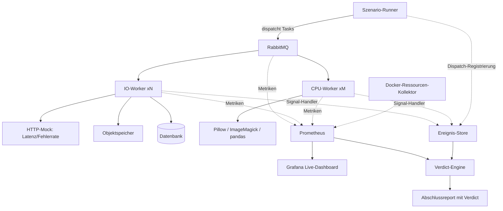
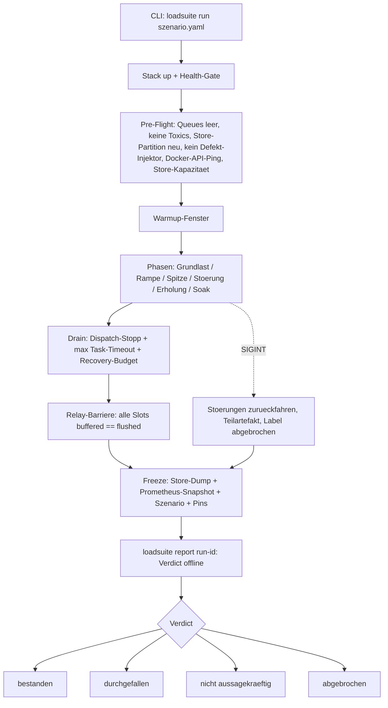
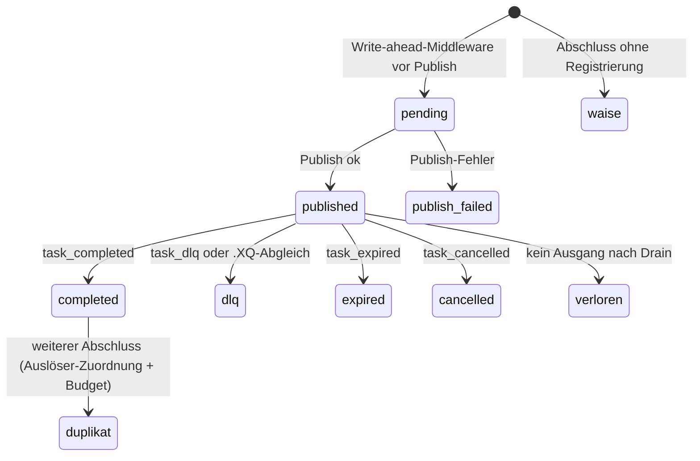

# SwarmQ Lasttest-Suite - Plan

**Target repo:** `swarmq-loadsuite` (neues Repository; alle Datei-Pfade in Implementation Units beziehen sich darauf, sofern nicht anders benannt).

## Goal Capsule

- **Objective:** Eine eigenständige Lasttest-Suite, die swarmq unter realitätsnaher Dauerlast, Lastspitzen und gezielten Störungen prüft und als Produktions-Gate für die Ablösung von taskiq im Phoenix-Projekt dient. Dieser Plan liefert Stufe 1 (1h-Lauf, fünf Task-Archetypen, ein Worker-Kill, Negativkontrollen a–c) implementierbar aus; die Zielausbau-Anforderungen (24h-Abnahme, voller Katalog, Multi-Prozess-Topologie) sind als Requirements verankert, ohne eigene Units.
- **Product authority:** Der Product Contract in diesem Dokument. Bei Widerspruch gilt: R-IDs für Produktverhalten, KTDs für Implementierungsmechanik, Units nur unit-lokal.
- **Execution profile:** Neues Repo, Python ≥ 3.14 (von swarmq erzwungen), uv-Toolchain, Docker-Compose-Stack. swarmq wird als Git-Abhängigkeit (Tag) konsumiert plus Git-Submodule für Chaos-Assets.
- **Stop conditions:** Stoppen und rückfragen, wenn (a) cp314-Wheels für Pillow oder httpx fehlen und auch der Build im Container scheitert (U1-Verification), (b) das Submodule-Modell an Repo-Zugriffsrechten scheitert, (c) eine Negativkontrolle (U9) das Verdict nicht kippt und die Ursache im swarmq-Verhalten liegt.
- **Open blockers:** Keine für Stufe 1. Vor der Zielausbau-Planung: taskiq-Fehlerbilder-Liste (R20) und Phoenix-Messfenster (R15 d) — siehe Outstanding Questions.

**Product Contract preservation:** restructured und erweitert, kein Scope-Rückbau — R4, R9, R14, R16, R19 präzisiert, R21–R23 ergänzt (Flow-Analyse, vom Nutzer in der Scoping-Synthese bestätigt), R23 um den Defekt-Injektor-Wächter erweitert (Review Runde 3), Success Criteria an R19/R15 (d) angeglichen. Alle bestehenden R/F/AE/KD-IDs unverändert.

---

## Product Contract

### Summary

Ein eigenständiges Docker-basiertes Lasttest-Projekt startet konfigurierbar viele IO- und CPU-Worker samt Mock-Gegenstellen, fährt deklarativ definierte Szenarien aus Grundlast, Lastspitzen und Störungsinjektion mit einem Phoenix-inspirierten synthetischen Taskkatalog und urteilt über einen offline berechenbaren Abschlussreport gegen vier harte Bestanden-Kriterien — live beobachtbar über Prometheus/Grafana.

### Problem Frame

swarmq soll taskiq im produktiven Phoenix-Betrieb ablösen. Dieser Einsatz ist geschäftskritisch: Bestellabwicklung, Bildverarbeitung, Rechnungserzeugung und externe Synchronisationen laufen dort als Tasks. Ein Fehlverhalten unter Last — verlorene Tasks, Speicher-Leaks, hängende Worker nach Spitzen — wäre im Produktivbetrieb teuer und schwer diagnostizierbar.

Die bestehenden e2e-, Stress- und Soak-Tests im swarmq-Repo prüfen einzelne Mechanismen in kurzen, synthetischen Läufen. Sie beantworten nicht, wie sich das Gesamtsystem über viele Stunden unter einem produktionsähnlichen Mischprofil aus IO- und CPU-Tasks mit Spitzen und Störungen verhält. Ohne einen bestandenen Stresstest von mindestens 24 Stunden unter realitätsnahen Bedingungen wird swarmq nicht produktiv eingesetzt — genau dieses Gate fehlt heute.

### Key Decisions

- KD1. **Eigenständiges Projekt statt Teil des swarmq-Repos.** Gewählt gegenüber dem Ausbau des vorhandenen Soak-Tests im swarmq-Repo: Der prüft die Bibliothek in-process und liefert weder Docker-Worker-Topologie noch Mock-Gegenstellen, Störungsinjektion oder eine Verdict-Engine; zudem gehören die schweren Abhängigkeiten der Suite (Pillow, ImageMagick, pandas, Messinfrastruktur) nicht ins Bibliotheks-Repo. Governs R1.
- KD2. **Nur swarmq gegen absolute Kriterien, kein A/B-Vergleich mit taskiq.** Das Gate braucht absolute Kriterien — ein Vergleichslauf liefert keine Dauerlast-Aussage. „Besser als taskiq" wird über die bekannten Fehlerbilder aus dem Phoenix-Betrieb bewertet; für Kurzlauf-Kennzahlen beider Systeme existiert bereits die Vergleichs-Benchmark-Suite im swarmq-Repo. Governs R15, R20.
- KD3. **Synthetischer Taskkatalog statt Phoenix-Code-Replay.** Die Tasks werden als Archetypen aus den Phoenix-Mustern destilliert statt echten Phoenix-Code einzuspannen; das vermeidet vorgezogenes Porting und Kopplung an Phoenix-Interna. Governs R5, R6, R7.
- KD4. **Mock-Infrastruktur im Docker-Stack statt simulierter Latenz.** IO-Tasks arbeiten gegen echte lokale Gegenstellen (HTTP-Mock, Objektspeicher, Datenbank), damit Verbindungspools und Netzwerkeffekte real sind und Fehler injizierbar bleiben. Governs R8.
- KD5. **Störungsinjektion als aktiver Szenario-Baustein.** Recovery wird provoziert statt nur nach Lastspitzen beobachtet; als Injektionsschicht wird der vorhandene Toxiproxy-Chaos-Stack des swarmq-Repos wiederverwendet statt neu gebaut. Wiederverwendungsmodus: gepinnt und ohne inhaltliches Kopieren; den konkreten Mechanismus (Git-Submodule, da das Paket-Artefakt die Chaos-Dateien nicht enthält) legt KTD4 fest. Governs R11.
- KD6. **Messfundament Prometheus/Grafana plus eigene Verdict-Engine.** Metriken laufen über den Standard-Stack (swarmq exportiert bereits Prometheus-Metriken); das Bestanden-Urteil fällt eine eigene Engine, weil die Task-genaue Buchhaltung in aggregierten Metriken nicht abbildbar ist. Governs R12, R13, R14, R15, R18, R19.
- KD7. **Task-Buchhaltung setzt auf vorhandene swarmq-Signale auf — mit eigenem Transport.** swarmq exportiert einen Pub/Sub-Signal-Mechanismus; die Signale sind prozesslokal, daher schreibt ein worker-seitiger Handler sie in einen zentralen Ereignis-Store, den die Verdict-Engine liest. Governs R14.
- KD8. **Debug-Feature-Lücken werden gesammelt, nie nebenbei eingebaut.** Fehlende swarmq-Fähigkeiten landen in einem Backlog und werden separat integriert. Governs R17.

### Requirements

Jedes Requirement trägt einen Stufen-Marker: **[Stufe 1]** muss für den ersten 1h-Lauf stehen, **[Zielausbau]** für das 24h-Abnahmeszenario.

**Projekt und Stack**

- R1. Die Suite ist ein eigenständiges Projekt in eigenem Repository und konsumiert swarmq als Bibliothek; sie läuft überall, wo Docker verfügbar ist. — [Stufe 1]
- R2. Ein Docker-Compose-Stack startet alle Bestandteile: RabbitMQ, Valkey, IO-Worker-Container, CPU-Worker-Container, Mock-Gegenstellen, den Ereignis-Store der Task-Buchhaltung und Messinfrastruktur. Der RabbitMQ-Dienst setzt `consumer_timeout` deutlich über das größte Task-Timeout, damit Langläufer nicht broker-seitig abgebrochen und redelivered werden; Worker-Container tragen eine Restart-Policy, damit ein Supervisor-Exit nach ausgeschöpftem Neustart-Budget zum Container-Neustart führt. — [Stufe 1]
- R3. Die Anzahl der IO- und CPU-Worker-Container sowie die Konkurrenz pro Worker sind pro Szenario konfigurierbar. — [Stufe 1]
- R4. Alle Container — einschließlich Szenario-Runner und Ereignis-Store — laufen mit Ressourcenlimits, die einen festen Host-Headroom freihalten (Startwert: mindestens 2 CPU-Kerne und 20 % RAM außerhalb aller Limits). Der Sättigungswächter deckt Host und Container-Limits ab: Er markiert Zeitfenster, in denen der Verbrauch in den Headroom läuft, sowie CPU-Throttling und Memory-Druck an den Limits; ein Lauf gilt erst als „nicht aussagekräftig", wenn der gesättigte oder gedrosselte Zeitanteil das im Szenario definierte Budget überschreitet, und OOM-Kills werden als markierte Ereignisse geführt. — [Stufe 1]

**Taskkatalog**

- R5. Ein synthetischer Taskkatalog bildet die Phoenix-Archetypen nach — CPU-seitig: Pillow-Bildrendering mit DPI-Skalierung, ImageMagick-Verarbeitung als Subprocess, pandas-Datenauswertung; IO-seitig: Webhook-Aufrufe mit Timeout- und Retry-Verhalten, paginierte API-Synchronisation als Langläufer, PDF-Erzeugung mit Objektspeicher-Upload, idempotente Ledger-Schreiber mit Retry-Semantik. Jeder Task erzeugt zusätzlich einen idempotent prüfbaren Seiteneffekt, über den die Buchhaltung doppelte Effekte von erwarteten Redelivery-Duplikaten unterscheidet. — [Stufe 1: Webhook, paginierter Sync-Langläufer, Pillow-Rendering, ImageMagick-Subprocess, idempotenter Effekt-Schreiber; pandas, PDF+Objektspeicher im Vollausbau]
- R6. Jeder Task trägt realistische Eigenschaften nach Phoenix-Vorbild: Timeouts von 60 s bis 1800 s, Retry-Konfiguration und realistische Payload-Formen. — [Stufe 1]
- R7. Geplante Tasks (minütliche Watchdogs, stündliche Syncs) laufen als Cron-Grundrauschen in jedem Szenario mit. — [Zielausbau]

**Szenarien und Last**

- R8. Der Stack enthält Mock-Gegenstellen mit konfigurierbarer Latenz und Fehlerrate für HTTP-APIs und Webhook-Empfänger — [Stufe 1] — sowie einen S3-kompatiblen Objektspeicher und eine Datenbank — [Zielausbau].
- R9. Szenarien werden deklarativ als Phasenfolge definiert (Grundlast, Rampe, Spitze, Erholung, Soak) mit Dauer und Dispatch-Raten je Task-Typ. Die erreichte Ist-Rate wird je Phase und Task-Typ gemessen und dem Soll gegenübergestellt; überschreitet die Abweichung das Szenario-Budget für einen definierten Zeitanteil, gilt der Lauf als „nicht aussagekräftig". Jedes Szenario endet mit einer Drain-Phase: Dispatch-Stopp, danach Weiterarbeit mindestens für das größte Task-Timeout plus Recovery-Budget, erst dann wird eingefroren; danach noch laufende Tasks werden namentlich im Report geführt und machen den Lauf „nicht aussagekräftig". — [Stufe 1]
- R10. Die erste Ausbaustufe liefert ein 1h-Szenario mit einer Handvoll Task-Typen und mindestens einer Lastspitze; der Zielausbau ist das 24h-Abnahmeszenario mit dem vollen Katalog. Das 24h-Abnahmeszenario fährt die Worker in der Phoenix-Produktionstopologie: Multi-Prozess-Worker über swarmqs Process-Manager mit fester Prozesszahl, damit Kind-Prozess-Crash und Respawn Teil des Gates sind (Autoscaling bleibt außen vor). Die Suite startet den Process-Manager programmatisch mit eigenem Worker-Entry, das jedem Kindprozess einen eigenen Metrik-Port (Basisport plus Slot-Index) und ein `0.0.0.0` -Bind zuweist.
- R11. Störungen sind als Szenario-Schritte injizierbar — Fehler-Stürme der Mock-Server (429/500), Kill eines Worker-Containers, Kill eines einzelnen Worker-Kindprozesses (mit Respawn-Erwartung durch den Process-Manager), Neustart des Brokers sowie Netzwerk-Störungen (Latenzaufschlag, Paketverlust) auf den Broker- und Valkey-Verbindungen — jeweils mit definierter Recovery-Erwartung. Jede Störung wird als Zeitfenster im Ledger markiert. Crash-Injektionen bleiben pro Worker-Slot unter swarmqs Neustart-Budget (5 pro Stunde); das absichtliche Ausschöpfen des Budgets ist ein eigener Szenario-Schritt mit erwartetem Manager-Exit und Container-Neustart per Restart-Policy (R2) — eine dauerhafte Slot-Stilllegung außerhalb dieses Schritts führt zu „durchgefallen". Injektionsschicht ist der Toxiproxy-Chaos-Stack aus dem swarmq-Repo (per KD5/KTD4). — [Zielausbau; ein einzelner Worker-Kill bereits in Stufe 1]

**Messung und Auswertung**

- R12. Während des Laufs werden kontinuierlich erfasst: Ressourcenverbrauch aller Container (Speicher, CPU), cgroup-Limitdruck je Container (CPU-Throttle-Anteil, Working-Set gegen Limit, OOM-Kills), RabbitMQ-Metriken (Queue-Tiefen, Nachrichtenraten, Verbindungen, Channels) und die swarmq-Prometheus-Metriken (Kindprozesse als je eigene Scrape-Targets, Zähler pro Container summiert). — [Stufe 1]
- R13. Ein Live-Dashboard (Grafana) zeigt den Lauf in Echtzeit. — [Zielausbau]
- R14. Eine Task-Buchhaltung verfolgt jeden dispatchten Task individuell mit Write-ahead-Registrierung: `pending` vor dem Publish, `published` oder `publish_failed` danach. Weil die swarmq-Signale prozesslokal sind, registriert jeder Worker-Container einen Signal-Handler, der alle terminalen Task-Ereignisse (`task_completed`, `task_dlq`, `task_expired`, `task_cancelled`) sowie `task_failed` und `task_duplicate_detected` in den zentralen, persistenten Ereignis-Store schreibt; jeder terminale Ausgang ist eine eigene Ledger-Kategorie, ein Abschluss ohne Registrierung ist die eigene Kategorie „Waise" (Instrumentierungsbefund, kein Verlust). Der Handler puffert lokal (dateibasierter Append-Puffer mit fester Obergrenze und Rotation), schreibt nicht-blockierend und flusht asynchron mit Retry; fehlgeschlagene, gepufferte oder verworfene Writes erhöhen exportierte Relay-Zähler, die in den Report eingehen. Der Ereignis-Store läuft getrennt von swarmqs Valkey-Backend und außerhalb aller Toxiproxy-Injektionspfade. — [Stufe 1]
- R15. Ein Abschlussreport fällt ein Bestanden/Durchgefallen-Verdict gegen vier Gate-Kriterien: — [Stufe 1; Kriterium (d) urteilt erst im Zielausbau]
  - (a) Kein Task geht verloren; jeder schließt erfolgreich ab oder landet nachvollziehbar in der DLQ. Mehrfachabschlüsse werden nach Wirkung bewertet: „durchgefallen" bei doppelt angewendetem idempotenten Effekt (per R5) oder wenn die Duplikatrate das szenariodefinierte Budget überschreitet. Jedes Duplikat wird einem protokollierten Auslöser zugeordnet (Worker-Exit, Verbindungsabbruch, per R11 markierte Störung); nicht zuordenbare Duplikate zählen gegen das Budget und werden im Report gelistet.
  - (b) Kein Ressourcen-Drift, bewertet als laufzeitnormierte Driftrate (abgeleitet aus den 20-%-pro-1h-Schwellen des swarmq-Soak-Tests); Bezugspunkt ist das erste Sample nach einem szenariodefinierten Warmup-Fenster, und die Schwellen greifen erst oberhalb der absoluten Mindest-Deltas aus dem Soak-Test. Der zusätzliche Trendtest über Stundenmittel greift erst im Zielausbau — ein 1h-Lauf liefert nur ein Stundenmittel.
  - (c) Recovery nach jeder Spitze und Störung innerhalb der im Szenario definierten Zeit.
  - (d) Einhaltung der SLO-Schwellen für p95-Task-Latenz und Mindestdurchsatz — [Zielausbau]. Die Schwellen werden vor dem ersten Wertungslauf des Zielausbaus aus einem Phoenix-Messfenster abgeleitet (eine taskiq-Middleware erhebt Wartezeit, Ausführungsdauer und Task-Klasse samt Angebotslast; die Dispatch-Raten aus R9 werden auf diese Last bezogen). Stufe 1 erfasst p95-Latenz und Durchsatz nur, ohne darüber zu urteilen. Suite-Läufe verifizieren die Schwellen, sie definieren sie nicht.
- R16. Das Lauf-Artefakt umfasst den Report und die Rohdaten: Ereignis-Store-Dump, Prometheus-Snapshot, Szenario-Definition und swarmq-Versions-Pin, archiviert pro Run-ID. Das Verdict wird offline aus dem Artefakt berechnet und ist wiederholbar (`report` -Kommando); ein abgebrochener Lauf (SIGINT, Crash) fährt Störungen zurück, stoppt den Dispatch und erzeugt einen Teilreport mit dem Label „abgebrochen" — nie „bestanden". — [Stufe 1]

**Rückkopplung nach swarmq**

- R17. Beim Bau und Betrieb der Suite auffallende Debug-Feature-Lücken in swarmq werden in einer Backlog-Datei im Suite-Projekt gesammelt (Beobachtung, gewünschtes Feature, Begründung) und ausschließlich separat in swarmq integriert. — [Stufe 1]

**Gate-Absicherung**

- R18. Die Ledger-Bilanz wird am Laufende gegen unabhängige Quellen abgeglichen: die RabbitMQ-Zähler, den tatsächlichen Inhalt der Dead-Letter-Queues (Management-API — broker-seitig dead-letterte Tasks erzeugen kein Signal) und den idempotenten Effekt-Store aus R5; `swarmq_tasks_total` dient nur als Plausibilitätszähler, weil es sich aus denselben Signalen speist wie das Ledger. Eine Nur-Ledger-Differenz gilt als Instrumentierungsverlust — und damit „nicht aussagekräftig" — nur bei positivem Beleg (Relay-Fehler-/Drop-Zähler oder Heartbeat-Lücke des betroffenen Workers); unerklärte Lücken zählen als Task-Verlust und führen zu „durchgefallen". — [Stufe 1]
- R19. Je Gate-Kriterium weist ein Selbsttest-Lauf mit absichtlich injiziertem Defekt (verschluckter Task, künstliches Speicherleck, unterdrückte Recovery; gerissene Latenzschwelle erst mit Kriterium (d) im Zielausbau) nach, dass das Verdict auf „durchgefallen" kippt — in Stufe 1 als verkürzter Lauf für die Kriterien (a)–(c) (Minuten bis eine Stunde, Schwellen entsprechend skaliert), vor dem 24h-Abnahmelauf wiederholt auf Abnahmebedingungen inklusive (d). — [Stufe 1 in Kurzform für (a)–(c), Zielausbau in Abnahmelänge inkl. (d)]
- R20. Die bekannten taskiq-Fehlerbilder aus dem Phoenix-Betrieb werden namentlich aufgelistet; jedem Fehlerbild ist der Szenario-Schritt und das Gate-Kriterium zugeordnet, das den Nachweis erbringt, und das 24h-Abnahmeszenario deckt alle gelisteten Fehlerbilder ab. Die konkrete Liste liefert der Betreiber (siehe Outstanding Questions). — [Zielausbau]
- R21. Jedes Szenario deklariert je Gate-Kriterium ein Evidenzminimum (z. B. Mindest-Backlog der Spitze, mindestens ein Worker-Kill mit gemessenem Abbau, Mindest-Taskzahl pro Archetyp, mindestens ein provozierter Doppel-Zustellversuch); bleibt das Minimum unerfüllt, gilt das betroffene Kriterium als „nicht aussagekräftig", nie als bestanden. — [Stufe 1]
- R22. Verdict-Präzedenz: „durchgefallen" dominiert „nicht aussagekräftig", sobald ein Hard-Fail-Befund diagnostiziert ist (dauerhafte Slot-Stilllegung, doppelt angewendeter Effekt, unerklärte Ledger-Lücke); „nicht aussagekräftig" gilt nur ohne Hard-Fail-Befund. Der Report listet immer alle Befunde, unabhängig vom Gesamtlabel. — [Stufe 1]
- R23. Läufe sind gegeneinander isoliert: Die Run-ID ist durchgängiger Namespace (Queue-Namen, Ereignis-Store-Partition, Effekt-Store-Präfix, Report-Verzeichnis); ein Pre-Flight prüft vor jeder Phase 1, dass Queues leer sind, keine Toxics aktiv sind, die Store-Partition neu ist und kein Defekt-Injektor (R19) aktiv ist; Toxic-Reset läuft im Startup und im Teardown. Der Injektor-Zustand wird im Report-Kopf ausgewiesen — ein Lauf mit aktivem Injektor trägt nie „bestanden". — [Stufe 1]



### Key Flows

- F1. Szenariolauf
  - **Trigger:** Operator startet ein Szenario per CLI.
  - **Steps:** Stack hochfahren und Gesundheit prüfen; Pre-Flight (R23); Cron-Grundrauschen aktivieren; Phasen der Reihe nach fahren (Grundlast, Spitzen, Störungen, Erholung, Soak); durchgehend Metriken erfassen, Ist-Raten messen und Task-Ledger führen; Drain-Phase mit anschließender Relay-Barriere; danach Stack einfrieren, Rohartefakt sichern, Verdict offline berechnen, Report schreiben.
  - **Outcome:** Archiviertes Lauf-Artefakt mit Report: Bestanden, Durchgefallen, „nicht aussagekräftig" oder „abgebrochen".
  - **Covers:** R2, R4, R7, R9, R12, R15, R16, R21, R22, R23.
- F2. Störungsinjektion mit Recovery-Messung
  - **Trigger:** Szenario-Phase erreicht einen Störungs-Schritt.
  - **Steps:** Störung auslösen (Fehlersturm, Worker-Kill, Kind-Prozess-Kill, Broker-Neustart, Netzwerk-Störung via Toxiproxy); Störungsfenster im Ledger markieren; nach Ende der Störung Backlog-Abbau und Latenz-Normalisierung gegen die definierte Recovery-Zeit messen.
  - **Outcome:** Recovery-Messwert pro Störung fließt ins Gate-Kriterium R15 (c); Duplikate aus dem Fenster werden per R15 (a) ihrem Auslöser zugeordnet.
  - **Covers:** R11, R15.
- F3. Task-Buchhaltung
  - **Trigger:** Szenario-Runner dispatcht einen Task.
  - **Steps:** Write-ahead-Registrierung (`pending` → `published`); Worker-Handler puffern und schreiben alle terminalen Signale in den Store; am Laufende Ledger gegen Store, unabhängige Quellen und Effekt-Store abgleichen (fehlend, doppelt, DLQ, expired, cancelled, Waise, Instrumentierungsverlust).
  - **Outcome:** Task-genaue Bilanz für Gate-Kriterium R15 (a), abgesichert durch die Kreuzprüfung aus R18.
  - **Covers:** R14, R15, R18.

### Acceptance Examples

- AE1. **Covers R14, R15, R18.** Given ein 1h-Lauf mit 100.000 dispatchten Tasks, when der Lauf endet, then weist das Ledger für jeden Task genau einen terminalen Ausgang nach (Abschluss, DLQ, expired, cancelled oder erklärte Duplikat-Unterdrückung); Duplikate sind ihren Auslösern zugeordnet und liegen unter dem Budget. Ein doppelt angewendeter idempotenter Effekt oder ein überschrittenes Duplikat-Budget führt zu „durchgefallen"; eine Nur-Ledger-Differenz mit Instrumentierungsbeleg zu „nicht aussagekräftig", ohne Beleg zu „durchgefallen".
- AE2. **Covers R11, R15.** Given ein Worker-Container wird mitten in einer Lastphase gekillt, when die Störung endet, then baut sich der Queue-Backlog innerhalb der im Szenario definierten Recovery-Zeit ab und die Latenzen normalisieren sich; Redelivery-Duplikate werden dem markierten Störungsfenster als Auslöser zugeordnet. Andernfalls „durchgefallen".
- AE3. **Covers R4.** Given der Host-Verbrauch läuft über längere Zeit in den reservierten Headroom oder ein Worker-Container wird dauerhaft am CPU-Limit gedrosselt, when der Report erzeugt wird, then sind die betroffenen Zeitfenster markiert; überschreitet ihr Anteil das Szenario-Budget, wird der Lauf als „nicht aussagekräftig" gekennzeichnet statt bestanden oder durchgefallen.
- AE4. **Covers R15.** Given ein 24h-Soak-Lauf, when die laufzeitnormierte Driftrate des Speicherverbrauchs eines Worker-Containers — gemessen ab dem ersten Post-Warmup-Sample und oberhalb der absoluten Mindest-Deltas — die Schwelle überschreitet, then fällt der Lauf durch und der Report zeigt den Drift-Verlauf.

### Scope Boundaries

**Deferred for later**

- Kapazitäts-Erkundung (Stufe 2) und Regressions-Benchmarks pro swarmq-Release (Stufe 3) — das Szenario-Format legt sie an, dieser Plan liefert sie nicht.
- Autoscaling-Verhalten des swarmq-Process-Managers als eigener Testgegenstand — das Abnahmeszenario fährt Multi-Prozess-Worker mit fester Prozesszahl (per R10).
- Läufe auf dedizierter Hardware oder Cloud-VMs sowie CI-Integration des 24h-Laufs — V1 läuft auf der lokalen Entwicklermaschine.

**Deferred to Follow-Up Work**

- Grafana-Dashboards (R13, Zielausbau) — Prometheus-Datenquelle steht nach U7, Dashboards sind Folgearbeit.
- Multi-Prozess-Worker-Szenario (inkl. Kind-Prozess-Kill und dynamischer file_sd-Zielpflege), Cron-Grundrauschen, S3-/DB-Mocks, pandas- und PDF-Archetypen, R19-Vollkontrollen, R20-Fehlerbilder-Mapping — Zielausbau-Planung nach bestandener Stufe 1.

**Outside this product's identity**

- Kein generisches Lasttest-Framework für beliebige Task-Queues — die Suite ist auf swarmq und das Phoenix-Profil zugeschnitten.
- Kein A/B-Vergleichslauf gegen taskiq (per KD2).
- Kein Ersatz für die e2e-, Stress- und Soak-Tests im swarmq-Repo — die Suite ergänzt sie auf Systemebene.
- Kein Einbau von Debug-Features in swarmq aus der Suite heraus (per KD8).

### Dependencies / Assumptions

- swarmq exportiert einen öffentlichen Signal-Mechanismus (verifiziert: `src/swarmq/signals.py`). Die Signale sind prozesslokal, Handler laufen async, sequenziell und **ohne Timeout im Task-Pfad**; Handler-Fehler werden verschluckt und geloggt — daher der nicht-blockierende, gepufferte Relay aus R14.
- `swarmq worker` bietet **keinen Hook** für eigene Signal-Handler (das CLI baut die App selbst und exponiert sie nicht) und gibt bei `--processes N` allen Kindern denselben Metrik-Port — die Suite braucht zwingend ein eigenes Worker-Entry (KTD1).
- swarmqs Env-Overrides schlagen Konstruktor-Kwargs (`SwarmQConfig.__post_init__` wendet `SWARMQ_*` nach den Feldwerten an) — Slot-Ports müssen als Env vor der App-Konstruktion gesetzt werden (KTD1).
- swarmqs Metrik-Server rendert ausschließlich seine private `CollectorRegistry` — fremde Zähler erscheinen auf dem swarmq-Metrikport nie; die Relay-Zähler brauchen einen eigenen Exposition-Endpoint (KTD8).
- swarmq liefert per Default at-least-once (`DeliveryMode.AT_LEAST_ONCE`), `task_completed` feuert vor dem Broker-Ack, und `x-delivery-limit` ist für Quorum-Queues auf 20 hartkodiert — Grundlage der wirkungsbasierten Duplikat-Bewertung und des Budget-Bezugs in R15 (a).
- swarmq ist async-only (kein eingebautes CPU-Offloading): Die CPU-Archetypen offloaden im Task-Code selbst (Subprocess/Thread-Executor). Kandidat für das R17-Backlog.
- `worker_id` in swarmq-Signalen ist `id(self)` — instabil über Respawns; die Suite führt eine eigene Slot-Identität (KTD1). Kandidat für das R17-Backlog.
- Python ≥ 3.14 ist von swarmq erzwungen (`requires-python = ">=3.14"`); `libvalkey` hat kein cp314-Wheel (Build im Container nötig), `orjson` wird bewusst nicht installiert (Rust-Build, swarmq-CI-Präzedenz). **Annahme (früh zu verifizieren, U1):** Pillow und httpx liefern cp314-Wheels oder bauen im Container.
- Die Chaos-Dateien (`docker-compose.chaos.yml`, `tests/chaos/`) sind nicht Teil des swarmq-Paket-Artefakts (`only-include = ["src"]`) — Wiederverwendung per Git-Submodule (KTD4). Der Chaos-Stack im swarmq-Repo nutzt Ports 5673/6380, die dort auch der Dev-Stack belegt — die Suite vergibt eigene Ports.
- Die Drift-Schwellen, Warmup-Baseline und absoluten Mindest-Deltas aus `tests/soak/test_soak_1h.py` (50 MiB RSS, 20 FDs, je 20 %/1h) sind als Startpunkt wiederverwendbar (verifiziert); die Prozentwerte stammen aus Prozess-RSS-Messungen und werden je Worker-Container-Typ neu kalibriert (KTD10).
- Annahme (extern, unverifiziert): Das RabbitMQ-4-Management-Image liefert Prometheus-Metriken über das Plugin (Port 15692, `prometheus.return_per_object_metrics = true` per Repo-Empfehlung); andernfalls Rückfall auf die Management-HTTP-API.
- Phoenix erhebt heute keine Task-Latenz- oder Durchsatz-Metriken (verifiziert am Repo-Stand) — die SLO-Basiswerte für R15 (d) erfordern erst ein Messfenster mit einer taskiq-Middleware in Phoenix.
- Die Phoenix-Task-Definitionen (`../phoenix/app/tasks.py`, Task-Module unter `../phoenix/app/modules/_tasks/`) bleiben als Vorlage der Archetypen zugänglich.
- Die lokale Entwicklermaschine steht für 24h-Läufe ununterbrochen zur Verfügung.

### Success Criteria

- Das übergeordnete Handoff-Signal: Ein bestandener 24h-Abnahmelauf deckt die swarmq-Infrastrukturrisiken ab und ist die erste von zwei Voraussetzungen für die Migration der kritischen Phoenix-Queues; die zweite ist ein Canary-Lauf mit echtem Phoenix-Task-Code auf einer unkritischen Queue. Der Canary startet bereits nach dem bestandenen Stufe-1-Lauf und läuft parallel zum Zielausbau (außerhalb dieses Projekts, siehe How This Work Fits Together). Die Suite muss ihr Urteil ohne manuelle Nachauswertung fällen.
- Die erste Ausbaustufe gilt als gelungen, wenn ein 1h-Lauf durchläuft, die verkürzten Negativkontrollen für die Gate-Kriterien (a)–(c) (R19) bestanden sind und ein belastbares Verdict samt Report vorliegt.

### Outstanding Questions

Beide offenen Punkte sind **deferred** und blockieren die Ausführung dieses Plans (Stufe 1) nicht:

- Fällig vor der Planung des Zielausbaus: die konkreten taskiq-Fehlerbilder aus dem Phoenix-Betrieb (R20) — nur der Betreiber kennt sie; ohne die Liste kann das Abnahmeszenario seine Abdeckung nicht belegen.
- Fällig vor dem ersten Wertungslauf des Zielausbaus: das Phoenix-Messfenster für die SLO-Basiswerte (R15 d) — Phoenix braucht dafür erst eine Task-Dauer-Instrumentierung; zu klären ist auch, ob die p95-Latenz die Queue-Wartezeit einschließt.

<!-- ce-section: work-relationships -->
### How This Work Fits Together

Dieser Plan besitzt die Robustheits-Stufe der Suite (Stufe 1). Die weitere Aufteilung ist der aktuelle Stand, kein festgelegter Fahrplan:

- Kapazitäts-Erkundung (Stufe 2) und Regressions-Benchmarks (Stufe 3)
  - Depends on: das Szenario-Format und den Taskkatalog aus diesem Plan.
- Integration gesammelter Debug-Features in swarmq
  - Depends on: die Backlog-Datei aus R17; wird als separate swarmq-Arbeit geplant.
- Phoenix-Canary-Lauf (echter Phoenix-Task-Code über swarmq auf einer unkritischen Queue)
  - Depends on: einen bestandenen Stufe-1-Lauf; läuft parallel zum Zielausbau; liegt außerhalb dieses Projekts und ist die zweite Voraussetzung der Migration.
- Phoenix-Migration auf swarmq (kritische Queues)
  - Depends on: den bestandenen 24h-Abnahmelauf und den bestandenen Canary-Lauf; liegt außerhalb dieses Projekts.

### Sources / Research

- `src/swarmq/signals.py` — Signal-Enum und Dispatcher: async-only Handler, sequenziell, Task-Signale ohne Timeout, Fehler verschluckt; Payloads je Signal (u. a. `task_completed`: task_id, task_name, queue, duration_ms).
- `src/swarmq/client/schedule.py` — `task_id` entsteht innerhalb von `schedule()`; `pre_enqueue` -Middleware läuft vor `broker.publish` und sieht task_id/task_name/queue — der Write-ahead-Hook (KTD13).
- `src/swarmq/process_manager/` — `ProcessManager(num_workers, worker_entry, worker_args, shutdown_grace_s=…)`, `WorkerConfig` (pickle-sicher), `MAX_RESTARTS = 5` / `RESTART_WINDOW = 3600`, Supervisor-Exit 1 nach Slot-Erschöpfung; `entry.py` als Referenz für ein eigenes Worker-Entry (shutdown_event→SIGTERM-Wächter).
- `src/swarmq/config.py` — `SWARMQ_*` -Env-Registry, Env-Overrides schlagen Kwargs (`__post_init__`); `metrics_host`/`health_host` Default `127.0.0.1`; `shutdown_timeout = 30`.
- `src/swarmq/metrics.py`, `src/swarmq/health.py` — sieben Metriken (signal-gespeist) auf privater `CollectorRegistry`, Sampler-Intervall 10 s, `/health` + `/ready`.
- `src/swarmq/broker/rabbitmq/delivery.py` — Queue-Tripel `<q>`/`<q>.DQ`/`<q>.XQ`, Quorum mit `x-delivery-limit = 20` (hartkodiert); abweichende bestehende Queue-Args werfen Fehler → Run-ID-Namespacing (R23).
- `tests/soak/test_soak_1h.py`, `tests/support/services.py` — Drift-Messmuster (psutil, persistenter Valkey-Monitor-Client, Management-API mit Sentinel −1), Warmup-Baseline, Mindest-Deltas, `_unique_queue()` -Isolation.
- `tests/chaos/conftest.py`, `tests/chaos/compose.yml`, `docker-compose.chaos.yml` — `ToxiproxyClient` (down/up, add_latency, add_bandwidth, add_slicer, reset), randomisierte Ports, `check_port_connectivity` -Healthcheck-Muster; Toxiproxy 2.9.0 pinnen. Achtung: das Modul importiert pytest auf Top-Level — Adaption in `faults/toxi.py` statt Direktimport ins Runner-Image.
- `benchmarks/comparison/` — Runner/Report-Split (Rohdaten-JSON pro Lauf, separates Report-Modul mit Entscheidungsregeln) als Muster für KTD6; `benchmarks/bench_realistic.py` — Pacing- und Ergebnisformen.
- `docs/recherche-rabbitmq-server.md` — rabbitmq.conf-Empfehlung (`consumer_timeout = 3600000`, Prometheus-Plugin 15692, `vm_memory_high_watermark 0.4`, `queue_leader_locator = balanced`).
- `pyproject.toml`, `.gitlab-ci.yml` — Python ≥ 3.14, uv + `UV_FROZEN`, Extras (`metrics`, `fast`, `test`), orjson bewusst ohne cp314-Install in CI, `only-include = ["src"]`.
- `docs/solutions/spikes/2026-04-17-toxiproxy-reconnect-spike.md` — Channel-Recreation nach Outage, Valkey-Pub/Sub-Resubscribe-Lücke, Quorum-Redelivery-Flag.
- `docs/solutions/logic-errors/aiormq-reader-leak-and-stale-connection-recovery-2026-04-16.md` — Hänger erst ab n≥50k, SIGUSR1-Task-Dump + Output-Watchdog als Diagnose-Instrumentierung (KTD11).
- `docs/solutions/logic-errors/lock-ttl-shorter-than-hard-timeout-duplicate-execution-2026-06-02.md` — Duplikat-Ausführung unter Redelivery; Testmuster für das Duplikat-Budget.
- `docs/solutions/patterns/measure-before-planning-variance-claims-2026-04-16.md` — Baseline-vor-Schwellen mit CV-Regeln (KTD10).
- `../phoenix/app/tasks.py`, `../phoenix/app/modules/_tasks/`, `../phoenix/app/core/app_creator.py`, `../phoenix/docker-compose.yml` — Archetypen-Vorlage, Queues, Retry-Semantik, Produktionstopologie.

---

## Planning Contract

### Key Technical Decisions

- KTD1. **Eigenes Worker-Entry statt `swarmq worker`.** Das Entry läuft als `worker_entry` unter swarmqs `ProcessManager`, setzt die Slot-Werte als Env-Variablen (`SWARMQ_METRICS_PORT`/`SWARMQ_HEALTH_PORT` = Basisport + Slot-Index, Hosts `0.0.0.0`) **vor** der App-Konstruktion — swarmqs Env-Overrides schlagen Konstruktor-Kwargs, und die Compose-Env setzt diese vier Variablen nicht —, baut die `SwarmQ` -App aus der übrigen `SWARMQ_*` -Env, registriert die Relay-Handler über `app.on_signal(...)` und führt eine stabile Slot-Identität (Container-Name + Slot-Index) statt swarmqs `worker_id`. Erzwungen: das CLI exponiert die App nicht und vererbt einen einzigen Metrik-Port an alle Kinder. Governs-Umsetzung von R10, R14.
- KTD2. **Relay = lokaler Append-Puffer + Background-Flusher, mit Lebenszyklus-Garantien.** Der Signal-Handler hängt Ereignisse nicht-blockierend an eine lokale JSONL-Datei (feste Obergrenze, Rotation, Drop-Zähler) auf einem Named Volume; ein Flusher-Task schreibt asynchron mit Retry in den Ereignis-Store. Beim Start adoptiert das Entry vorhandene Puffer-Dateien seines Slots und flusht sie vor der ersten Task-Annahme (Adoption-Metrik). Zwischen Drain und Freeze wartet der Runner als Relay-Barriere darauf, dass jeder Slot `buffered == flushed` meldet (gebundenes Timeout; ein Rest wird als Relay-Rest-Befund protokolliert und macht den Lauf „nicht aussagekräftig"). Erzwungen: Task-Signale laufen sequenziell ohne Timeout im Task-Pfad — ein direkter Netzwerk-Write würde jede Task-Latenz erhöhen und bei Hängern den Pipeline-Slot blockieren.
- KTD3. **Ereignis-/Effekt-Store: eigene Valkey-Instanz mit Streams.** Ereignisse als `XADD` in Run-ID-partitionierte Streams, Write-ahead-Ledger und idempotenter Effekt-Store als `SET NX` -Keys mit Run-ID-Präfix; Instanz mit `appendonly yes`, eigene, nicht geproxyte Verbindung, getrennt von swarmqs Backend. Kapazität wird vorab dimensioniert: Ereignisse-pro-Task-Faktor × erwartete Taskzahl ergibt Speicher- und AOF-Budget; der Pre-Flight prüft freien Speicher, und 80 % des Limits markieren den Lauf als „nicht aussagekräftig". (session-settled: user-approved — chosen over SQLite/Datenbank: bekannter async-Client, natürliche Streams-Semantik, ein Dienst weniger Typen im Stack.) Governs-Umsetzung von R14, R23.
- KTD4. **Chaos-Wiederverwendung per Git-Submodule.** Das swarmq-Repo wird als Submodule (`vendor/swarmq`, gepinnte SHA = Bibliotheks-Tag) eingebunden; die Bibliothek kommt als uv-Git-Quelle auf denselben Tag, `ToxiproxyClient` /Compose-Muster werden aus dem Submodule adaptiert (eigenes Modul `faults/toxi.py` mit parametrisierten Proxy-Namen, Upstreams und Ports — kein Direktimport, das Original zieht pytest als Laufzeit-Abhängigkeit). (session-settled: user-approved — chosen over Kopieren und over Pip-Referenz: das Paket-Artefakt enthält `tests/chaos/` nicht.) Governs-Umsetzung von R11 (KD5).
- KTD5. **Szenario-Format: YAML mit pydantic-Validierung.** Ein Szenario deklariert Worker-Topologie (R3), Phasen mit Raten je Task-Typ, Fault-Steps, Evidenzminima (R21), Budgets (Duplikate, Sättigung/Throttle, Raten-Abweichung), Recovery-Zeiten samt absoluten Mindest-Deltas (KTD7) und Drain-Budget. Direktional: flache Struktur, keine Vererbung/Templating in V1.
- KTD6. **Zweiphasiges Run/Verdict.** Der Runner schreibt nur das Rohartefakt (Store-Dump, Prometheus-TSDB-Snapshot, Szenario, Pins); `loadsuite report <run-id>` berechnet das Verdict offline und wiederholbar daraus. Muster: der Runner/Report-Split in `benchmarks/comparison/` des swarmq-Repos. (session-settled: user-approved — chosen over Verdict im Runner-Prozess: nachprüfbar bei bestrittenem Verdict, Teilreport nach Abbruch.) Governs-Umsetzung von R16, R22.
- KTD7. **Recovery-Definition.** Recovery gilt als erreicht, wenn die Zielserie über zwei aufeinanderfolgende Scrapes ins Pre-Fenster-Band zurückkehrt; die Toleranz ist das Maximum aus 10 % um den Pre-Fenster-Median und dem im Szenario deklarierten absoluten Mindest-Delta (das Schema aus KTD5 erzwingt das Delta — sonst degeneriert das Band bei Median nahe null). Backlog-Serie ist die Queue-Tiefe aus den RabbitMQ-Prometheus-Metriken (5-s-Scrape) — nicht der worker-gesampelte swarmq-Gauge (10-s-Sampler, nur Plausibilität). Normalisierungsserie ist die Ende-zu-Ende-Latenz aus dem Ledger (Registrierung bis terminales Ereignis, p95 je Zeitfenster) — `swarmq_task_duration_seconds` misst nur die Ausführungsdauer und dient der Anteilstrennung. Prometheus-Scrape-Intervall 5 s (≤ 1/10 des kleinsten Recovery-Budgets); alle Fensterränder mit Host-Wall-Clock im Ledger, die Auswertung schneidet nur über diese Ränder.
- KTD8. **Metrik-Exposition und Target-Discovery.** Stufe 1 nutzt statische Prometheus-Targets (ein Prozess je Worker-Container, feste Ports). Die Relay-Zähler laufen über einen eigenen Exposition-Endpoint je Worker (eigene `CollectorRegistry`, Relay-Basisport + Slot) — swarmqs Metrik-Server rendert nur seine private Registry; zusätzlich schreibt der Relay seine Zählerstände periodisch als Ereignis in den Run-Stream, damit der R18-Beleg auch ohne Scrape im Artefakt liegt. Im Zielausbau (Multi-Prozess) schreibt jedes Entry eine eigene Target-Datei pro Slot in ein gemountetes Verzeichnis (`file_sd` über `targets/*.json`, atomar per tmp-Datei + `os.replace`); Zähler werden über `increase()` mit Container-/Slot-Label summiert, nie über die instabile Kind-Instanz. Limitdruck-Metriken (Throttle, Working-Set, OOM) kommen von cAdvisor.
- KTD9. **Duplikat-Budget-Basis.** Der Budget-Bezug ist swarmqs hartkodiertes `x-delivery-limit = 20` pro Nachricht; Auslöser-Zuordnung erfolgt über Ledger-Störungsfenster plus Worker-Exit-Ereignisse (Heartbeat-Lücken). Konfigurierbarkeit des Limits ist ein R17-Backlog-Kandidat.
- KTD10. **Baseline vor Schwellen.** Vor dem Einfrieren von Budgets und Drift-Schwellen laufen 3–5 stabile 1h-Zyklen; CV-Regeln aus dem dokumentierten Learning: CV < 5 % → Schwelle ±10 % vom Mittel, 5–10 % → ±15 %, > 10 % → Ursache klären statt gaten.
- KTD11. **Diagnose-Instrumentierung eingebaut.** Runner und Worker-Entry installieren einen SIGUSR1-Handler (asyncio-Task-Dump) und einen Output-Watchdog (Dump bei eingefrorenem Fortschritt), nach dem Muster des aiormq-Leak-Learnings — Hänger bei Stunde 20 müssen diagnostizierbar sein, nicht nur beobachtbar.
- KTD12. **RabbitMQ-Konfiguration als Datei; Drain-Budget an allen drei Stellen.** `rabbitmq.conf` nach Repo-Empfehlung: `consumer_timeout = 3600000` (> 1800 s größtes Task-Timeout), Prometheus-Plugin mit `return_per_object_metrics = true`, `vm_memory_high_watermark.relative = 0.4`; alle `hard_timeout` -Werte der Archetypen bleiben strikt unter dem `consumer_timeout`. Das Drain-Budget trägt an drei Stellen denselben Wert: `SWARMQ_SHUTDOWN_TIMEOUT` (Supervisor-Env), `ProcessManager(shutdown_grace_s=…)` beim programmatischen Start (Muster: swarmqs eigener Startpfad) und Compose- `stop_grace_period`.
- KTD13. **Write-ahead über swarmq-Middleware.** Die Registrierung läuft als `pre_enqueue` -Middleware (per `app.add_middleware`): sie sieht task_id, task_name und queue **vor** `broker.publish` und schreibt `pending`; `published` wird nach erfolgreicher Rückkehr von `app.schedule` gesetzt, `publish_failed` bei Exception über die zuletzt registrierte task_id (ContextVar). Erzwungen: die task_id entsteht erst innerhalb von `schedule()` — ohne Middleware gäbe es keinen Write-ahead-Punkt, und jeder verlorene Ledger-Write würde zur harmlosen „Waise" statt zum Verlustbefund. Governs-Umsetzung von R14.

### High-Level Technical Design

Lauf-Lebenszyklus (KTD6, R9, R16, R23):



Ledger-Zustandsmodell je Task (R14, R15 a, R18):



Prosa bleibt maßgeblich: `verloren` wird per R18 nur zu „durchgefallen", wenn kein Instrumentierungsbeleg vorliegt; `waise` ist ein Instrumentierungsbefund, kein Verlust; der bei `unique_for` unterdrückte Enqueue wird über `task_duplicate_detected` als erklärter Nicht-Ausgang geführt.

### Output Structure

Erwartete Grundform des neuen Repos (Scope-Deklaration, nicht bindend):

```text
swarmq-loadsuite/
├── pyproject.toml            # uv, Python >=3.14, swarmq als Git-Quelle (Tag)
├── .gitmodules               # vendor/swarmq (gepinnte SHA)
├── vendor/swarmq/            # Submodule: Chaos-Assets, Referenzmuster
├── docker/
│   ├── compose.yml           # Stack inkl. Limits, Healthchecks, stop_grace_period
│   ├── rabbitmq/rabbitmq.conf
│   ├── prometheus/prometheus.yml
│   └── worker/Dockerfile     # cp314-Basis, ImageMagick, Fonts
├── src/loadsuite/
│   ├── cli.py                # run / report
│   ├── worker/entry.py       # KTD1
│   ├── worker/relay.py       # KTD2
│   ├── tasks/                # Archetypen (R5)
│   ├── mock/server.py        # HTTP-Mock mit Admin-Endpoint
│   ├── runner/               # Szenario-Engine, Pacing, Pre-Flight, Drain, Artefakt-Writer
│   ├── faults/               # Toxiproxy-, Docker-Injektoren
│   ├── monitor/              # Sättigungswächter, Snapshot
│   └── verdict/              # Offline-Engine + Report
├── scenarios/
│   ├── stufe1-smoke.yaml     # ~10 min
│   ├── stufe1-1h.yaml        # Referenzszenario
│   └── negativkontrollen/    # je Kriterium (a)-(c)
├── docs/debug-feature-backlog.md   # R17
└── tests/                    # Unit- und Systemtests
```

---

## Implementation Units

Phasen: **A — Fundament** (U1–U3), **B — Last und Störung** (U4–U6), **C — Messung und Urteil** (U7–U9). Reihenfolge innerhalb der Phasen ist Abhängigkeitsreihenfolge.

### U1. Projekt-Gerüst und Toolchain

- **Goal:** Neues Repo `swarmq-loadsuite` mit lauffähiger Toolchain, swarmq-Anbindung und CLI-Skelett.
- **Requirements:** R1, R17; KTD4.
- **Dependencies:** keine.
- **Files:** `pyproject.toml`, `.gitmodules`, `vendor/swarmq` (Submodule), `src/loadsuite/__init__.py`, `src/loadsuite/cli.py`, `docker/worker/Dockerfile`, `tests/test_smoke.py`, `docs/debug-feature-backlog.md`.
- **Approach:**
  1. uv-Projekt mit `requires-python = ">=3.14"`; swarmq als Git-Quelle auf Tag `v0.2.0` mit Extra `[metrics]`; `libvalkey>=4` einzeln als Abhängigkeit (Build braucht `build-essential`), `orjson` bewusst ausgeschlossen (kein cp314-Wheel, Rust-Build — swarmq-CI-Präzedenz); Submodule `vendor/swarmq` auf dieselbe SHA pinnen.
  2. CLI-Skelett `loadsuite run <szenario>` / `loadsuite report <run-id>` (argparse, Muster: `benchmarks/comparison/runner.py` im swarmq-Repo).
  3. Worker-Dockerfile: cp314-Basisimage, `build-essential` (libvalkey ohne cp314-Wheel), ImageMagick-Binärpaket.
  4. Backlog-Datei mit den fünf bekannten Kandidaten anlegen: stabile Slot-Identität in Signalen, Signal-Hook im CLI-Worker, per-Kind-Metrikport, natives CPU-Offload, konfigurierbares `x-delivery-limit`.
- **Test scenarios:**
  - Smoke: `import swarmq, loadsuite` und Import aller schweren Abhängigkeiten (Pillow, httpx, pydantic, valkey) im Worker-Image gelingt.
  - Test expectation für CLI-Skelett: `loadsuite run` ohne Argumente endet mit Usage-Fehler, Exit ≠ 0.
- **Verification:** `uv sync` frisch; `docker build docker/worker` läuft durch; der Import-Smoke-Test besteht im Container. Scheitert die Pillow- oder httpx-Installation unter cp314 auch als Build, Stop-Condition auslösen.

### U2. Docker-Stack

- **Goal:** Vollständiger Compose-Stack mit korrekt konfiguriertem Broker, getrenntem, dimensioniertem Ereignis-Store und belastbaren Healthchecks.
- **Requirements:** R2, R4 (Limits), R8 [Stufe 1]; KTD3, KTD12.
- **Dependencies:** U1.
- **Files:** `docker/compose.yml`, `docker/rabbitmq/rabbitmq.conf`, `docker/prometheus/prometheus.yml`, `tests/system/test_stack.py`.
- **Approach:**
  1. Dienste: `rabbitmq:4-management` (Config-Datei per KTD12, Prometheus-Port), `valkey/valkey:8` (swarmq-Backend), `valkey/valkey:8` als `event-store` (`appendonly yes`, eigener Port, nicht hinter Toxiproxy, `mem_limit` nach Kapazitätsbudget aus KTD3), `ghcr.io/shopify/toxiproxy:2.9.0`, `mock-http`, `prometheus` (5 s Scrape, statische Targets in Stufe 1, gestartet mit `--web.enable-admin-api` und Snapshot-Volume), `cadvisor` (`gcr.io/cadvisor/cadvisor:v0.49.1`, privilegiert mit den üblichen Read-only-Host-Mounts `/:/rootfs`, `/var/run`, `/sys`, `/var/lib/docker`, `/dev/kmsg`), Worker- und Runner-Container.
  2. Der Runner-Dienst erhält den Docker-Socket-Mount für die Störungsinjektion (U6) und den Container-Lookup im Pre-Flight.
  3. Eigene Host-Ports wählen (Kollision mit swarmq-Dev-Stack 5673/6380 vermeiden).
  4. Healthchecks: RabbitMQ mit `rabbitmq-diagnostics -q check_port_connectivity` (nicht `ping` — Muster und Begründung in `vendor/swarmq/tests/chaos/compose.yml`); Toxiproxy per `wget` auf die Admin-API.
  5. Limits (`cpus`, `mem_limit`) je Dienst inkl. Runner; `stop_grace_period` und `SWARMQ_SHUTDOWN_TIMEOUT` auf das Drain-Budget (KTD12).
- **Test scenarios:**
  - `docker compose up --wait` wird erst grün, wenn der AMQP-Listener wirklich Verbindungen annimmt (Verbindungstest direkt nach `--wait`).
  - Ereignis-Store ist vom Worker-Netz erreichbar, läuft aber nicht über einen Toxiproxy-Proxy (Toxic auf der Broker-Route beeinflusst Store-Writes nicht).
  - RabbitMQ meldet den konfigurierten `consumer_timeout` (Effektivwert per Management-API prüfen).
  - Snapshot-Aufruf auf der leeren TSDB liefert direkt nach `up --wait` Erfolg (Admin-API aktiv).
  - cAdvisor liefert `container_cpu_cfs_throttled_seconds_total` und `container_spec_memory_limit_bytes` für einen Worker-Container.
- **Verification:** Stack startet mit `--wait` reproduzierbar; Prometheus scrapt RabbitMQ (15692) und cAdvisor; Docker-Socket im Runner nutzbar (API-Ping).

### U3. Worker-Entry und Signal-Relay

- **Goal:** Eigenes Worker-Entry mit vollständigem, verlustüberwachtem Ereignis-Relay in den Store.
- **Requirements:** R10 (Entry/Ports), R14; KTD1, KTD2, KTD8, KTD11.
- **Dependencies:** U1, U2.
- **Files:** `src/loadsuite/worker/entry.py`, `src/loadsuite/worker/relay.py`, `src/loadsuite/worker/identity.py`, `tests/worker/test_relay.py`, `tests/worker/test_entry.py`.
- **Approach:**
  1. Entry nach dem Muster von `vendor/swarmq/src/swarmq/process_manager/entry.py`: Logging, shutdown_event→SIGTERM-Wächter, `asyncio.run`; Slot-Ports als Env **vor** der App-Konstruktion setzen (KTD1 — Env schlägt Kwargs); Archetypen-Module vor der App-Konstruktion importieren (Task-Registry wird beim Konstruieren eingefroren; spawn-Kinder importieren neu).
  2. Relay-Handler für `task_enqueued` (nur im Runner), `task_completed`, `task_failed`, `task_dlq`, `task_expired`, `task_cancelled`, `task_duplicate_detected`, `worker_heartbeat` registrieren; Handler hängt nur an den lokalen Puffer an (KTD2).
  3. Flusher: JSONL-Puffer auf Named Volume → `XADD` in den Run-Stream; Retry mit Backoff; Rotation und Obergrenze; beim Start Adoption vorhandener Puffer-Dateien des eigenen Slots vor der ersten Task-Annahme (Adoption-Metrik).
  4. Relay-Exposition-Endpoint: eigene `CollectorRegistry` mit `loadsuite_relay_buffered/flushed/failed/dropped/adopted_total` auf Relay-Basisport + Slot (statisches Scrape-Target in Stufe 1); Zählerstände zusätzlich periodisch als Ereignis in den Run-Stream (KTD8).
  5. Slot-Identität aus Env (`LOADSUITE_SLOT`) + Container-Hostname; jede Ledger-Zeile trägt sie.
  6. SIGUSR1-Task-Dump und Output-Watchdog (KTD11).
- **Test scenarios:**
  - Store nicht erreichbar → Task-Ausführung läuft unverändert weiter, `dropped/failed` -Zähler steigen, kein Handler blockiert länger als der Append (Latenzmessung im Test).
  - Jeder Signaltyp erzeugt genau einen Stream-Eintrag mit Slot-Identität und Wall-Clock-Zeitstempel.
  - Puffer-Obergrenze erreicht → älteste Einträge rotieren, Drop-Zähler steigt, Prozess bleibt gesund.
  - Gesetzte Container-Env für Metrik-/Health-Port übersteuert die Slot-Ports nicht (Entry setzt Env vor App-Konstruktion).
  - Relay-Endpoint liefert die `loadsuite_relay_*` -Zähler; swarmqs Metrikport bleibt swarmq-only.
  - Kill mitten im Flush → nach Neustart adoptiert das Entry den liegengebliebenen Puffer, die Einträge landen im Stream, Adoption-Zähler steigt.
  - Zwei Slots binden verschiedene Metrik- und Relay-Ports (Zielausbau-Schnittstelle, in-process testbar).
- **Verification:** Systemtest: 1000 Tasks über den Stack, Ledger-Streams enthalten 1000 terminale Ausgänge, Relay-Zähler konsistent und über den Relay-Endpoint scrapebar.

### U4. Taskkatalog Stufe 1, Effekt-Store und Mock-Server

- **Goal:** Fünf realistische Archetypen mit idempotent prüfbarem Effekt und steuerbarer Mock-Gegenstelle.
- **Requirements:** R5 [Stufe 1], R6, R8 [Stufe 1]; KD3.
- **Dependencies:** U3.
- **Files:** `src/loadsuite/tasks/webhook.py`, `src/loadsuite/tasks/paginated_sync.py`, `src/loadsuite/tasks/pillow_render.py`, `src/loadsuite/tasks/magick_convert.py`, `src/loadsuite/tasks/effect_writer.py`, `src/loadsuite/tasks/effects.py`, `src/loadsuite/mock/server.py`, `tests/tasks/…`, `tests/mock/test_server.py`.
- **Approach:**
  1. Archetypen als `Task` -Subklassen mit `TaskInfo` nach Phoenix-Vorbild: Webhook (httpx, Timeout 60 s, Retries), paginierter Sync (Langläufer, `hard_timeout` 1800 s — unter `consumer_timeout`), Pillow-Rendering (DPI-Skalierung, Offload in Thread-Executor), ImageMagick (Subprocess mit Timeout), idempotenter Effekt-Schreiber (Retry-Semantik nach Phoenix-Ledger-Muster).
  2. Effekt-Mechanik in `effects.py`: `SET NX` pro (run_id, task_id) im Effekt-Store; zweiter Schreibversuch inkrementiert einen Doppel-Effekt-Zähler — die unabhängige Evidenz für R15 (a)/R18.
  3. Mock-Server (FastAPI/uvicorn oder aiohttp): konfigurierbare Latenzverteilung und Fehlerrate, Admin-Endpoint für Fehlersturm-Fenster (429/500) — der von U6 geschaltete Fault-Step.
  4. Kein `unique_for`/`max_age` in Stufe-1-Archetypen (deren Ausgänge sind modelliert, aber nicht provoziert — Zielausbau).
- **Test scenarios:**
  - Effekt genau-einmal: dieselbe Task-Ausführung zweimal angestoßen → ein Effekt, Doppel-Zähler = 1.
  - Pillow-Task blockiert den Event-Loop nicht (paralleler Kurz-Task bleibt unter Latenzschwelle während ein Rendering läuft).
  - ImageMagick-Subprocess-Timeout führt zu Task-Fehler, nicht zu Zombie-Prozess.
  - Mock: konfigurierte Fehlerrate ±Toleranz über 1000 Requests; Fehlersturm-Fenster schaltet exakt an/aus.
  - Langläufer übersteht eine simulierte 35-Minuten-Ausführung ohne broker-seitigen Abbruch (verkürzt testbar über herabgesetzten `consumer_timeout` in einer Test-Compose).
- **Verification:** Alle fünf Archetypen laufen im Stack einmal erfolgreich durch und erscheinen mit korrektem Ausgang im Ledger.

### U5. Szenario-Runner

- **Goal:** Deklarative Szenarien werden validiert, isoliert, mit Soll-Raten gefahren und sauber beendet — inklusive Artefakt-Sicherung und Abbruchpfad.
- **Requirements:** R3, R9, R16 (Artefakt), R21 (Deklaration), R23; KTD5, KTD11, KTD13.
- **Dependencies:** U3, U4.
- **Files:** `src/loadsuite/runner/scenario.py` (pydantic-Modelle), `src/loadsuite/runner/engine.py`, `src/loadsuite/runner/preflight.py`, `src/loadsuite/runner/ledger.py` (Write-ahead-Middleware), `src/loadsuite/runner/artifact.py` (Artefakt-Writer), `scenarios/stufe1-smoke.yaml`, `tests/runner/…`.
- **Approach:**
  1. Szenario-Schema per KTD5 (Phasen, Raten je Task-Typ, Faults, Evidenzminima, Budgets, Recovery-Zeiten samt Mindest-Deltas, Drain-Budget, Worker-Topologie).
  2. Write-ahead über die `pre_enqueue` -Middleware (KTD13): `pending` aus der Middleware vor dem Publish, `published` nach erfolgreicher Rückkehr von `app.schedule`, `publish_failed` bei Exception über die ContextVar-task_id.
  3. Engine: Pacing pro Task-Typ (Muster `bench_realistic`), Ist-Raten-Zähler je Phase; Run-ID-Namespace für Queue-Namen (`suite-{runid}-io` …), Streams und Report-Verzeichnis.
  4. Pre-Flight: Queues leer (Management-API), keine Toxics (Admin-API), Store-Partition neu, kein Defekt-Injektor aktiv (R23), Docker-API-Ping plus Container-Lookup der Worker-Dienste, freier Store-Speicher über dem Kapazitätsbudget (KTD3); Abbruch mit klarer Meldung bei Verstößen.
  5. Drain-Phase per R9, danach Relay-Barriere per KTD2 (warten auf `buffered == flushed` je Slot, gebundenes Timeout).
  6. Artefakt-Writer `artifact.py`: Ereignis-Store-Dump, Szenario-Kopie, Versions-Pins (swarmq-Tag, Submodule-SHA, Image-Digests), Run-Verzeichnis-Layout; SIGINT-Pfad per R16 (Störungen zurückfahren, Teilartefakt, Label „abgebrochen").
- **Test scenarios:**
  - Schema-Validierung: fehlende Evidenzminima, Budgets oder Recovery-Mindest-Deltas → Ablehnung mit Feldpfad.
  - Pacing erreicht im Leerlauf-Stack die Sollrate ±5 %; Ist-Raten-Protokoll pro Phase vorhanden.
  - `publish_failed` (Broker weg beim Publish) landet als eigener Ledger-Zustand mit der Middleware-task_id, Engine läuft weiter.
  - Pre-Flight bricht ab bei nicht-leerer Queue, aktivem Toxic, aktivem Defekt-Injektor und fehlendem Docker-Zugriff.
  - SIGINT mitten in einer Phase → Toxics zurückgesetzt, Dispatch gestoppt, Teilartefakt mit Label „abgebrochen" vorhanden.
  - Relay-Barriere: künstlich verzögerter Flusher → Freeze wartet; nach Timeout wird der Rest als Relay-Rest-Befund protokolliert.
  - Artefakt-Vollständigkeit: nach einem Smoke-Lauf enthält das Run-Verzeichnis Dump, Szenario-Kopie, Pins und Snapshot (Check als Testhelfer, den auch U8 nutzt).
- **Verification:** `loadsuite run scenarios/stufe1-smoke.yaml` (≈10 min) läuft End-to-End durch und hinterlässt ein vollständiges Rohartefakt (Vollständigkeitscheck grün).

### U6. Störungsinjektion

- **Goal:** Fault-Steps aus dem Szenario steuerbar, mit markierten Fenstern und Budget-Wächter.
- **Requirements:** R11 [Stufe-1-Anteil: Worker-Kill]; KTD4, KTD9.
- **Dependencies:** U5.
- **Files:** `src/loadsuite/faults/toxi.py`, `src/loadsuite/faults/docker_kill.py`, `src/loadsuite/faults/mock_storm.py`, `tests/faults/…`.
- **Approach:**
  1. `toxi.py` adaptiert `ToxiproxyClient` aus `vendor/swarmq/tests/chaos/conftest.py` als eigenes Modul mit parametrisierten Proxy-Namen/Upstreams (Latenz, Paketverlust via Slicer/Bandwidth, down/up, idempotentes Reset) — kein Direktimport (pytest-Top-Level-Import im Original).
  2. `docker_kill.py` (Container-Kill/Restart über Docker-API; Socket-Mount per U2), `mock_storm.py` (Admin-Endpoint aus U4). Der Kind-Prozess-Kill gehört zur Zielausbau-Planung (siehe Scope Boundaries) — die Fault-Step-Schnittstelle bleibt dafür offen.
  3. Jeder Fault-Step schreibt Fensteranfang/-ende mit Wall-Clock in den Ledger-Stream; ein Budget-Wächter zählt Kills pro Slot und Stunde und verweigert Schritte über swarmqs Neustart-Budget.
- **Test scenarios:**
  - Toxic-Reset ist idempotent und entfernt alle von der Suite angelegten Toxics (auch nach Abbruch).
  - Fensterzeitstempel umschließen die tatsächliche Störung (Latenz-Toxic messbar aktiv nur im Fenster).
  - Budget-Wächter verweigert den sechsten Kill desselben Slots innerhalb einer Stunde.
  - Worker-Container-Kill: Container kommt per Restart-Policy zurück, Ledger enthält das Fenster.
- **Verification:** Smoke-Szenario mit einem Worker-Kill und einem Latenz-Toxic hinterlässt zwei korrekt markierte Fenster.

### U7. Messung und Sättigungswächter

- **Goal:** Vollständige Messkette inklusive Limitdruck und Snapshot-Fähigkeit fürs Artefakt.
- **Requirements:** R4 (Wächter), R12; KTD7, KTD8.
- **Dependencies:** U2, U3.
- **Files:** `docker/prometheus/prometheus.yml` (Erweiterung), `src/loadsuite/monitor/saturation.py`, `src/loadsuite/monitor/snapshot.py`, `tests/monitor/…`.
- **Approach:**
  1. Scrape-Konfiguration: 5 s Intervall; statische Jobs für RabbitMQ (15692), cAdvisor, Mock, Runner, Worker-Metrik- und Relay-Ports (Stufe 1, KTD8).
  2. Sättigungswächter als Auswertungslogik über cAdvisor-/Host-Serien (Headroom-Verbrauch, `container_cpu_cfs_throttled_*`, Working-Set vs. Limit, OOM-Events) — er schreibt markierte Zeitfenster in den Ledger-Stream, das Urteil fällt U8.
  3. Snapshot: `POST /api/v1/admin/tsdb/snapshot` (Admin-API per U2 aktiviert), Kopie aus dem Snapshot-Volume ins Run-Verzeichnis; Lesepfad für U8: Wegwerf-Prometheus über dem Snapshot-Verzeichnis oder `promtool tsdb dump`.
- **Test scenarios:**
  - Künstliches CPU-Limit + Busy-Loop-Container → Throttle-Fenster wird erkannt und markiert.
  - Headroom-Verletzung (Stress auf dem Host simuliert per Container ohne Limit) → Host-Sättigungsfenster markiert.
  - Snapshot-Erzeugung liefert ein lesbares TSDB-Verzeichnis, aus dem sich Serien re-queryen lassen.
- **Verification:** Nach dem Smoke-Szenario enthält das Artefakt einen abfragbaren Snapshot und (bei künstlich erzeugtem Druck) markierte Fenster.

### U8. Verdict-Engine und Report

- **Goal:** Offline-Verdict gegen die Gate-Kriterien (a)–(c) mit Evidenzminimum, Präzedenzregel und vollständigem Ledger-Abgleich; Report als Artefakt.
- **Requirements:** R15 (a–c), R16, R18, R21, R22; KTD6, KTD7, KTD9, KTD10.
- **Dependencies:** U5, U6, U7.
- **Files:** `src/loadsuite/verdict/ledger_check.py`, `src/loadsuite/verdict/drift.py`, `src/loadsuite/verdict/recovery.py`, `src/loadsuite/verdict/evidence.py`, `src/loadsuite/verdict/report.py`, `tests/verdict/…` (umfangreichste Testfläche des Projekts).
- **Approach:**
  1. `ledger_check`: Zustandsmodell aus dem HTD-Diagramm; Abgleich Streams ↔ RabbitMQ-Zähler ↔ `.XQ` -Inhalt ↔ Effekt-Store; Kategorien completed/dlq/expired/cancelled/duplicate/waise/publish_failed/verloren; Instrumentierungsbeleg-Regel per R18 (Relay-Zähler aus Scrape und aus den Stream-Ereignissen); Duplikat-Budget mit Auslöser-Zuordnung per KTD9.
  2. `drift`: laufzeitnormierte Rate ab Post-Warmup-Baseline, Mindest-Deltas, je Container-Typ; Trendtest nur bei Laufzeit über mehreren Stunden.
  3. `recovery`: Band-Regel per KTD7 (RabbitMQ-Queue-Tiefe, Ledger-E2E-Latenz), geschnitten an den Ledger-Fensterrändern; Lesepfad über den Snapshot (U7).
  4. `evidence`: prüft je Kriterium das deklarierte Minimum (R21); `report`: Präzedenzregel (R22), Ist-Raten-Bewertung (R9), Report-Kopf mit Injektor-Zustand (R23) und Relay-Rest-Befund; Markdown + JSON, Archivierung pro Run-ID.
- **Test scenarios (je aus synthetischen Artefakten):**
  - Covers AE1: 100k-Ledger mit einem fehlenden Task ohne Beleg → durchgefallen; derselbe Fall mit Drop-Zähler > 0 → nicht aussagekräftig.
  - Doppelter Effekt (Effekt-Store-Zähler ≥ 1) → durchgefallen, unabhängig vom Duplikat-Budget.
  - Duplikat im Störungsfenster → zugeordnet, zählt nicht gegen das Budget; Duplikat ohne Auslöser → zählt, Budget-Überschreitung kippt.
  - Waise (Abschluss ohne Registrierung) → eigene Report-Kategorie, kein „verloren".
  - Covers AE4: Driftrate über Schwelle nach Warmup → durchgefallen; Drift unter Mindest-Delta → bestanden.
  - Covers AE2: Backlog-Serie kehrt nach 2 Scrapes ins Band zurück → Recovery ok; hält das Band nur einen Scrape → nicht ok; Band bei Pre-Fenster-Median 0 nutzt das deklarierte Mindest-Delta.
  - Covers AE3: Throttle-Fensteranteil über Budget → nicht aussagekräftig.
  - Evidenzminimum unerfüllt (Spitze ohne Mindest-Backlog) → Kriterium (c) „nicht aussagekräftig", nie bestanden (R21).
  - Präzedenz: Slot-Stilllegung (Hard-Fail) + Drain-Rest (inconclusive) im selben Artefakt → Gesamtlabel durchgefallen (R22).
  - Aktiver Defekt-Injektor im Artefakt-Kopf → Lauf kann nie „bestanden" tragen (R23).
  - `report` zweimal auf dasselbe Artefakt → byte-identisches Verdict (Wiederholbarkeit).
- **Verification:** `loadsuite report` auf das Smoke-Artefakt erzeugt Report mit allen vier Kriterien-Abschnitten ((d) als „erfasst, nicht gewertet") und ausgewiesenem Injektor-Zustand.

### U9. Negativkontrollen und 1h-Referenzszenario

- **Goal:** Beleg, dass das Verdict kippen kann (R19, Stufe 1), plus das ausgearbeitete Stufe-1-Szenario.
- **Requirements:** R10 [Stufe-1-Anteil], R19 [Stufe 1], R21; Success Criteria Stufe 1.
- **Dependencies:** U8.
- **Files:** `scenarios/negativkontrollen/verlust.yaml`, `scenarios/negativkontrollen/leck.yaml`, `scenarios/negativkontrollen/recovery.yaml`, `src/loadsuite/tasks/defekt.py` (injizierbare Defekt-Tasks), `scenarios/stufe1-1h.yaml`, `tests/system/test_negativkontrollen.py`.
- **Approach:**
  1. Defekt-Injektoren als Szenario-Schalter: (a) Task, der seinen Effekt doppelt schreibt bzw. ein Relay-Suppress-Flag für gezielten „verschluckten" Ausgang; (b) Leck-Task mit wachsendem Speicher; (c) Dauer-Toxic ohne Ende-Fenster (unterdrückte Recovery). Jeder Schalter ist im Artefakt-Kopf sichtbar (R23).
  2. Je Kontrolle ein verkürztes Szenario (10–30 min) mit skalierten Schwellen; Erwartung: Verdict „durchgefallen" mit dem richtigen Kriterium.
  3. `stufe1-1h.yaml`: fünf Archetypen, Grundlast → Spitze → Erholung → Soak, ein Worker-Kill, Evidenzminima und Budgets deklariert (Startwerte aus KTD10-Baseline-Läufen, danach eingefroren).
- **Test scenarios:**
  - Jede der drei Negativkontrollen kippt das Verdict auf „durchgefallen" mit dem erwarteten Kriterium — und nur diesem.
  - Kontrolle (a) mit aktivem Relay-Suppress erzeugt „durchgefallen" (unbelegte Lücke), nicht „nicht aussagekräftig" — der R18-Regeltest im System.
  - Das 1h-Szenario erfüllt seine eigenen Evidenzminima (Selbstkonsistenz-Check per `evidence` -Modul).
- **Verification:** Alle drei Negativkontrollen bestanden (= gekippt), danach ein voller `stufe1-1h` -Lauf mit belastbarem Verdict — das Stufe-1-Erfolgskriterium.

---

## Verification Contract

| Prüfung | Kommando (im Suite-Repo) | Gilt für | Done-Signal |
|---|---|---|---|
| Unit-Tests | `uv run pytest -m "not system"` | U1, U3–U8 | grün, inkl. Verdict-Testfläche |
| Stack-Smoke | `docker compose -f docker/compose.yml up --wait` + Verbindungstest | U2 | Stack grün, AMQP nimmt an, Snapshot-API antwortet |
| System-Smoke | `uv run loadsuite run scenarios/stufe1-smoke.yaml && uv run loadsuite report <run-id>` | U5–U8 | Artefakt vollständig (Vollständigkeitscheck), Report mit Verdict |
| Negativkontrollen | `uv run pytest tests/system/test_negativkontrollen.py -m system` | U9 | alle drei kippen korrekt |
| Referenzlauf | `uv run loadsuite run scenarios/stufe1-1h.yaml` | Stufe-1-Abschluss | belastbares Verdict, Kriterien (a)–(c) gewertet |

Qualitäts-Gates: ruff + mypy strict (Toolchain-Spiegel von swarmq); jede feature-tragende Unit hat ihre Testdatei in `**Files**`.

## Definition of Done

- Alle Units U1–U9 umgesetzt; Verification-Contract-Zeilen grün.
- Stufe-1-Erfolgskriterium erfüllt: drei bestandene Negativkontrollen (a)–(c) plus ein voller 1h-Referenzlauf mit belastbarem Verdict und archiviertem Rohartefakt.
- `docs/debug-feature-backlog.md` enthält die beim Bau gesammelten swarmq-Lücken (mindestens die fünf aus U1) — und es wurde keine davon in swarmq eingebaut (KD8).
- Baseline-Läufe (KTD10) dokumentiert; Budgets und Schwellen im 1h-Referenzszenario eingefroren und begründet.
- Aufgeräumt: keine Experimentier-Reste, toten Szenarien oder auskommentierten Fault-Steps im Diff; Submodule-Pin und Bibliotheks-Tag identisch.

---

## Deferred / Open Questions

### From 2026-08-28 review

- **24h-Gate auf einziger Entwicklermaschine praktisch nicht wiederholbar** — Dependencies / Assumptions und Scope Boundaries (P2, product-lens, confidence 75)

  Die SLO-Kalibrierung braucht mehrere Läufe, jeder belegt die einzige Arbeitsmaschine 24 Stunden und kann per Sättigungsregel als „nicht aussagekräftig" enden, ohne ein Verdict zu erzeugen — Durchlaufzeit und Erfolgsquote des Gates sind damit schwer kalkulierbar, während dedizierte Hardware bewusst nach hinten geschoben wurde. Die Entscheidung für die lokale Maschine war bewusst; offen bleibt, ob der finale Abnahmelauf auf einen dedizierten, nicht parallel genutzten Host wandert und die lokale Maschine auf 1h- und Kalibrierungsläufe begrenzt wird.

- **Sidecar-Alternative zum In-Process-Flusher nicht abgewogen** — Planning Contract, KTD2 (P2, adversarial, confidence 75)

  Drei Bruchstellen der Beleg-Kette haben eine gemeinsame Ursache: Der Flusher lebt im Worker-Prozess, stirbt mit ihm, konkurriert mit dem Task-Loop und muss zum Freeze extern synchronisiert werden. Ein Sidecar-Container, der das Puffer-Volume tailt, würde unabhängig von Worker-Leben und Freeze-Zeitpunkt weiterliefern. Die Runde-3-Fixes (Volume, Adoption, Barriere) entschärfen die Bruchstellen; die Sidecar-Abwägung bleibt offen und ist billig revidierbar, solange die Worker-Unit nicht gebaut ist.

- **Fehlersturm-Injektor ohne Stufe-1-Verbraucher** — Implementation Units, Störungsinjektion (P3, scope-guardian, confidence 75)

  Der Mock-Fehlersturm-Schritt wird in Stufe 1 gebaut, obwohl kein Stufe-1-Szenario ihn auslöst (das Requirement markiert Fehlerstürme als Zielausbau, Stufe 1 braucht nur den Worker-Kill). Er ist ein dünner Wrapper um den Admin-Endpoint des Mock-Servers — behalten (geringe Kosten) oder mit den übrigen Zielausbau-Fault-Typen verschieben, bleibt Autoren-Entscheidung.
