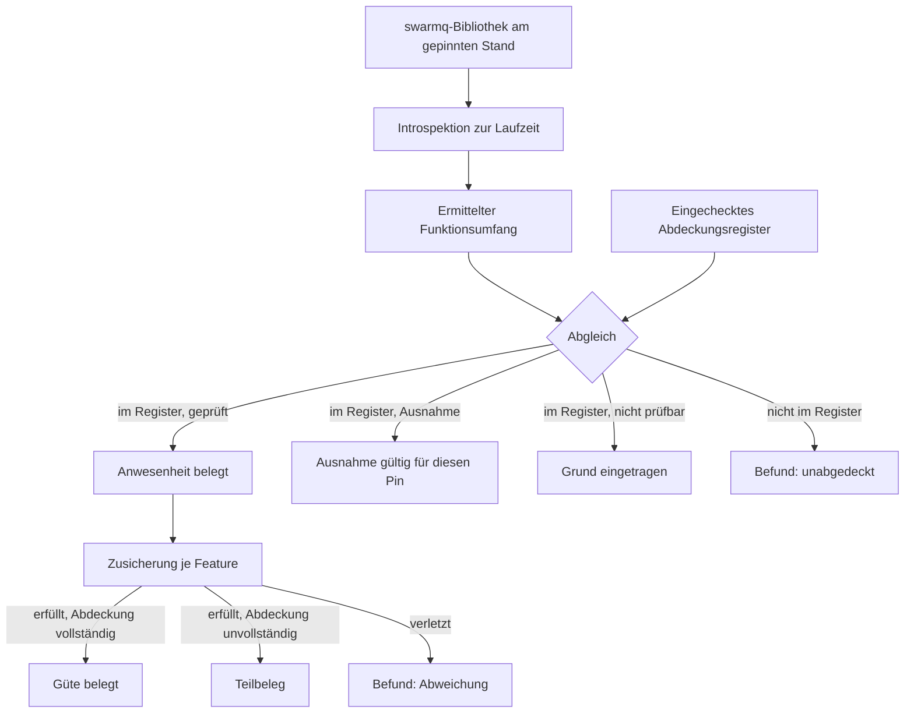
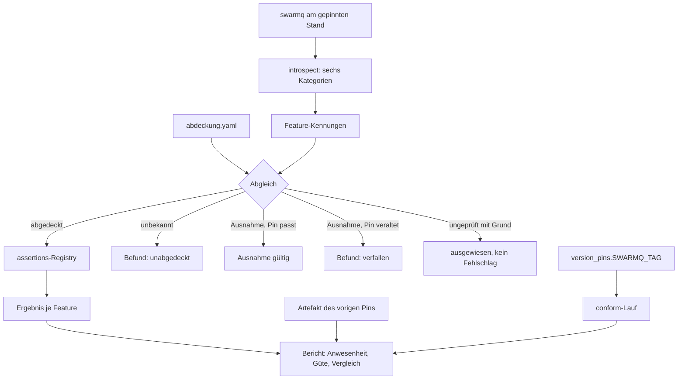

# SwarmQ-Featureabdeckung - Plan

## Goal Capsule

- **Ziel:** Eine Konformitätsstufe bauen, die swarmqs Funktionsumfang am gepinnten Stand aus Konsumentensicht prüft und maschinell gegen die Bibliotheksoberfläche abgleicht. Umfang dieses Plans sind R1 bis R24.
- **Zielrepository:** `swarmq-loadsuite`. Alle Pfadangaben sind relativ zu dessen Wurzel, sofern nicht ausdrücklich als `swarmq`-Pfad bezeichnet.
- **Autorität:** Product Contract vor Planning Contract vor Implementation Units. Der Ursprungsplan `docs/plans/2026-08-27-001-feat-swarmq-lasttest-suite-plan.md` — im `swarmq`-Repository — bleibt Autorität für den Wertungslauf; dessen Kriterien, Schwellen und Verdikt-Semantik werden hier nicht angefasst.
- **Product-Contract-Erhalt:** Product Contract unverändert. Dieser Lauf trifft nur Wie-Entscheidungen.
- **Nicht in diesem Plan:** Die Gate-Erweiterung R25 bis R29. Sie ist per R29 strikt nachgelagert und braucht die Kennzeichnung nach R15, die erst hier entsteht. Siehe KTD7.
- **Abbruchbedingungen:** Zeigt sich, dass die Bibliotheksoberfläche an `v0.2.0` nicht auslesbar ist wie in Dependencies angenommen, hält U1 an und meldet den Widerspruch, statt eine Ersatzliste zu pflegen. Verlangt ein Feature eine Änderung am Wertungslauf, gehört es nach R29 in den Folgeplan, nicht hierher.
- **Ausführungsprofil:** Kein Test-First-Zwang. U1 bis U7 sind reine Bibliotheksarbeit und werden mit Unit-Tests gegen Fakes belegt; U8 bis U10 brauchen den laufenden Stack.
- **Tail:** Nach U10 folgt der Grundlauf nach R7 am Pin `v0.2.0`; sein Register wird eingecheckt und ist die Zusicherungsbasis für den Folgeplan.

---

## Product Contract

### Summary

Eine zweite Laufart neben dem Gate prüft swarmqs Funktionsumfang am gepinnten Stand aus Konsumentensicht: Workflow-Primitive bis Verschachtelungstiefe 3, alle Signale, alle Middleware-Hooks, alle Task-Optionen. Was „alle" bedeutet, liest die Stufe zur Laufzeit aus der Bibliothek selbst aus; die Abweichung zwischen ermitteltem Umfang und eingecheckter Abdeckung ist der Befund. Features, deren Verhalten sich unter Last oder Störung ändern kann, laufen zusätzlich im bestehenden Wertungslauf mit.

### Problem Frame

Die Suite deckt heute den Transportkern ab: fünf Task-Archetypen, terminale Ausgänge, Retry, Dead-Letter, Worker-Neustart, Broker-Ausfall. Von swarmqs Funktionsumfang berührt sie nur einen Ausschnitt. Von 20 Signalen erreichen 8 die Buchhaltung; von 6 Middleware-Hooks wird einer benutzt; von 19 `TaskInfo`-Feldern sind 8 in Gebrauch. Die Workflow-Primitive `chain`, `group` und `chord` samt `WorkflowHandle` kommen nicht vor, ebenso wenig Sperren, Ratenbegrenzung, Eindeutigkeitsfenster, Prioritäten, Fortschrittsmeldung, Abbruch und der eingebettete Scheduler.

Diese Fähigkeiten sind deshalb nicht unbelegt. swarmq führt eigene Tests für sie: einen Signalkatalog, Workflow-Kombinationen, Middleware-Ketten, Chord-Idempotenz unter Störung. Wer wissen will, ob `chord` korrekt aggregiert, findet dort eine Antwort.

Drei Dinge leisten diese Tests nicht, und darin liegt die Lücke, gegen die dieser Plan antritt.

Erstens gibt es keinen maschinellen Vollständigkeitsabgleich. Der Signalkatalog ist handgeführt; ein neu hinzugekommenes Signal erscheint dort erst, wenn jemand es nachträgt. Eine handgeführte Liste versagt genau dann, wenn sie gebraucht wird — sie meldet weiterhin Vollständigkeit.

Zweitens prüfen die Bibliothekstests den Arbeitsstand des Repositorys aus Innensicht, nicht den Stand, den ein Verbraucher über einen Versions-Pin bezieht. Der Pin der Suite steht auf `v0.2.0`; sobald er sich bewegt, gibt es keine aus Konsumentensicht erhobene Grundlage für die Aussage, dass die neue Version kann, was die alte konnte.

Drittens sagen sie nichts über das Verhalten unter Last und Störung. Ein Ausfall dieser Art fällt nicht beim Versionswechsel auf, sondern später im Betrieb, wenn ein selten genutztes Feature unter realer Last zum ersten Mal falsch liegt.

### Key Decisions

- KD1. **Zwei getrennte Laufarten statt einer gemeinsamen Wertung.** Ein Feature, das falsch rechnet, ist kein Verlust; das Gate würde grün melden. (session-settled: user-directed — chosen over einer gemeinsamen Wertung: Sicherheits- und Korrektheitsaussagen tragen unterschiedliche Beweislast.) Governs R1, R25, R29
- KD2. **Die Konformitätsstufe geht der Gate-Erweiterung voraus.** Ein Feature unter Last zu prüfen ist wertlos, solange sein Sollverhalten im Ruhezustand nicht feststeht. Governs R29
- KD3. **Verschachtelung bis Tiefe 3 vollständig aufgezählt.** Vollständigkeit vor Pflegeaufwand; die Erwartungswerte bleiben fest und reproduzierbar. (session-settled: user-directed — chosen over Tiefe 2 und einem generativen Verfahren: die vollständige Aufzählung wurde einer kleineren Menge und zufallsbasierter Breite vorgezogen.) Governs R16, R19
- KD4. **Abweichung ist rot, mit eingetragenen Ausnahmen.** Ein bekannter, begründeter Mangel darf die Stufe nicht dauerhaft blockieren, muss aber sichtbar bleiben. (session-settled: user-directed — chosen over hartem Rot und reinem Befundbericht.) Governs R2, R3, R5
- KD5. **Die Stufe ist an den Bibliotheks-Pin gekoppelt.** Sie läuft, wenn sich swarmqs Verhalten ändern kann, und ist dafür nicht an ein CI-Zeitbudget gebunden. (session-settled: user-directed — chosen over CI bei jedem Merge Request.) Governs R6
- KD6. **Ausnahmen verfallen beim Pin-Wechsel.** Ohne Verfall deckt ein längst erledigter Eintrag eine frische Regression desselben Features. (session-settled: user-directed — chosen over dauerhaft gültigen Ausnahmen mit Vergleichsbericht.) Governs R4
- KD7. **Der Funktionsumfang wird introspektiv ermittelt, das Register daraus erzeugt.** Eine gepflegte Liste veraltet still; die Bibliothek selbst kann das nicht. (session-settled: user-directed — chosen over einem handgepflegten Register: Vollständigkeit soll geprüft und nicht behauptet werden.) Governs R9, R11, R12
- KD8. **Jedes Task-Optionsfeld ist prüfpflichtig.** Wo sich die auslösende Bedingung nicht herstellen lässt, entsteht ein begründeter Registereintrag statt einer stillen Lücke. (session-settled: user-directed — chosen over einer Beschränkung auf das, was der heutige Stack hergibt, und über eine Erweiterung des Stacks um Zeitraffer, künstlichen Stau und angehaltenen Scheduler.) Governs R23, R24
- KD9. **Scheduler-Leader-Failover wird Störungsart des Wertungslaufs.** Der Scheduler ist eingebettet, die Leader-Wahl läuft zwischen den vorhandenen Workern — die Störung kostet keinen neuen Compose-Dienst. (session-settled: user-approved — die Erweiterung des Wertungslaufs wurde als Folge benannt und angenommen.) Governs R27
- KD10. **Die Ruhezustandsprüfung wird in der Suite verortet, nicht in swarmqs Testsuite.** Die Bibliothekstests prüfen den Arbeitsstand aus Innensicht und sagen nichts über den bezogenen Release; die Stufe prüft den gepinnten Stand aus Konsumentensicht und gleicht maschinell gegen die Oberfläche ab. Geprüft und verworfen: dieselben Zusicherungen in swarmqs eigener Testsuite, wo sie bei jedem Commit liefen. Governs R1, R8

Die Introspektion belegt Anwesenheit, nicht Güte. Dass ein Test `chord` aufruft, sagt nichts über die geprüften Muster. R13 und R14 halten beide Ebenen im Bericht auseinander.

### Requirements

**Konformitätsstufe**

- R1. Die Suite bietet eine zweite Laufart neben dem Wertungslauf, die Featurekorrektheit am gepinnten Bibliotheksstand prüft und ein eigenes Artefakt schreibt.
- R2. Die Stufe fällt durch, sobald ein geprüftes Feature von seiner zugesicherten Semantik abweicht, sofern für diese Abweichung kein gültiger Ausnahmeeintrag besteht.
- R3. Ein Ausnahmeeintrag nennt das Feature, das erwartete Verhalten, das beobachtete Verhalten, einen Verweis in den Debug-Feature-Backlog und den swarmq-Pin, unter dem er erhoben wurde.
- R4. Ein Ausnahmeeintrag verliert seine Gültigkeit mit dem Wechsel des swarmq-Pins; seine erneute Bestätigung setzt voraus, dass die Zusicherung unter dem neuen Pin ausgeführt und das beobachtete Verhalten neu eingetragen wurde.
- R5. Der Bericht weist gültige Ausnahmen sichtbar aus und trennt dabei erneut bestätigte von unter dem neuen Pin behobenen Einträgen.
- R6. Der Bericht stellt das Ergebnis dem des vorigen Pins gegenüber und kennzeichnet jeden Befund als neu, verschwunden oder unverändert.
- R7. Die Stufe läuft einmalig am gegenwärtigen Pin als Grundlauf; ihr Vergleich nach R6 bleibt dabei leer und ist als solcher gekennzeichnet.
- R8. Jede Zusicherung nennt ihre normative Quelle — dokumentierter Vertrag, Docstring, Spezifikation oder bestehender Bibliothekstest; eine allein aus dem beobachteten Verhalten abgeleitete Zusicherung wird im Register und im Bericht als solche gekennzeichnet.

**Abdeckungsermittlung**

- R9. Die Stufe ermittelt swarmqs Funktionsumfang zur Laufzeit aus der Bibliothek, nicht aus einer gepflegten Liste.
- R10. Die Ermittlung erfasst mindestens die Signale, die Middleware-Hooks, die Felder von `TaskInfo`, die exportierten Workflow-Primitive, die öffentliche Modulexportfläche des Pakets und die Fortschritts-API.
- R11. Aus der Ermittlung entsteht ein eingechecktes Abdeckungsregister; jede Abweichung zwischen ermitteltem Umfang und Registerstand ist ein Befund.
- R12. Ein neu erkanntes, unabgedecktes Feature ist ein Befund und kein stiller Zustand.
- R13. Der Bericht trennt Anwesenheit — das Feature wird berührt — von Güte — das Feature verhält sich wie zugesichert.
- R14. Jeder Registereintrag hält fest, welche Aspekte des Features seine Zusicherung abdeckt; der Bericht führt unter Güte neben „zugesichert" und „abweichend" die Kategorie „zugesichert, Abdeckung unvollständig".
- R15. Jeder Registereintrag kennzeichnet, ob das Feature last- oder störungsempfindlich ist, und begründet die Kennzeichnung.

**Workflow-Primitive**

- R16. Die Stufe prüft `chain`, `group` und `chord` einzeln sowie in allen bis Tiefe 3 konstruierbaren Verschachtelungen; je Ebene gilt genau eine verschachtelte Position, beim `chord` zählen Header und Body je als eigene.
- R17. Kombinationen, die swarmq bei der Konstruktion zurückweist — ein `chord`-Header, der keine `group` ist —, werden als eigene Zusicherung geführt: die Zurückweisung selbst muss eintreten.
- R18. Je Muster wird die Reihenfolgezusage, das Aggregatergebnis und das Verhalten bei einem Fehler in einem Zweig geprüft.
- R19. Die Zusicherungen werden aus einer Baumbeschreibung abgeleitet statt je Muster von Hand geschrieben.
- R20. Die Stufe prüft die Handhabung eines laufenden Workflows über `WorkflowHandle`: Zustandsabfrage und Abbruch.

**Signale, Hooks und Task-Optionen**

- R21. Jedes Signal der Bibliothek wird mindestens einmal ausgelöst und in seiner Nutzlast geprüft.
- R22. Jeder Middleware-Hook wird ausgelöst und in seiner Reihenfolge relativ zum Taskablauf geprüft.
- R23. Jedes `TaskInfo`-Feld mit Vorgabewert wird mit einem Fall geprüft, der seine Wirkung belegt, und einem Vergleichsfall mit dem Vorgabewert; Pflichtfelder werden nur in ihrer Wirkung geprüft.
- R24. Lässt sich ein ermitteltes Feature nicht prüfen, weil der Stack die auslösende Bedingung nicht herstellt oder die Bibliotheks-API den Fall nicht zulässt, hält das Register den Grund und den Pin fest, unter dem er erhoben wurde; ein Feature, dessen Zusicherung schon einmal verletzt war, darf nicht als ungeprüft geführt werden, sondern nur als Ausnahme nach R3.

**Gate-Erweiterung**

- R25. Die nach R15 als last- oder störungsempfindlich gekennzeichneten Features laufen zusätzlich im Wertungslauf mit.
- R26. Ein Feature wandert nur dann in den Wertungslauf, wenn alle von ihm erzeugten Nachrichten in der Write-ahead-Buchhaltung registrierbar sind; ist das nicht der Fall, entsteht statt der Aufnahme ein Eintrag im Debug-Feature-Backlog.
- R27. Der Wertungslauf erhält Scheduler-Leader-Failover als Störungsart, trifft dabei den amtierenden Leader gezielt und misst die Übernahme.
- R28. Die Erweiterung ändert die eingefrorenen Schwellen des Wertungslaufs nicht; neue Messgrößen werden erst nach drei Zyklen gewertet.
- R29. Ein Feature wandert erst in den Wertungslauf, wenn seine Semantik in der Konformitätsstufe zugesichert ist.

### Key Flows

- F1. Lauf beim Pin-Wechsel
  - **Auslöser:** Der swarmq-Pin in Bibliotheksquelle und Submodule bewegt sich.
  - **Schritte:** Die Stufe ermittelt den Funktionsumfang des neuen Stands; sie gleicht ihn gegen das Register ab; sie führt je abgedecktem Feature dessen Zusicherung aus; sie erklärt alle Ausnahmeeinträge des alten Pins für ungültig und nimmt sie nur nach erneuter Messung wieder auf; sie stellt das Ergebnis dem des vorigen Pins gegenüber.
  - **Ergebnis:** Ein Artefakt mit Verdikt, getrennten Anwesenheits- und Gütebefunden, der Ausnahmeliste und dem Vergleich zum Vorgänger.
  - **Deckt ab:** R4, R6, R9, R11, R13

- F2. Die Bibliothek bringt ein neues Feature mit
  - **Auslöser:** Ein Pin-Wechsel fügt ein Signal, einen Hook, ein `TaskInfo`-Feld, ein Workflow-Primitiv oder ein ganzes Teilsystem hinzu.
  - **Schritte:** Die Ermittlung erkennt den Zuwachs — ein neues Teilsystem über die Modulexportfläche; der Abgleich findet keinen Registereintrag; die Stufe meldet einen Befund und fällt durch.
  - **Ergebnis:** Der Zuwachs ist sichtbar, bevor jemand ihn benutzt. Die Auflösung ist entweder eine Zusicherung oder ein begründeter Registereintrag nach R24.
  - **Deckt ab:** R10, R11, R12, R24

### Acceptance Examples

- AE1. **Deckt R4 ab.**
  - **Gegeben:** Für ein Feature besteht ein Ausnahmeeintrag, erhoben unter Pin `v0.2.0`.
  - **Wenn:** Der Pin wechselt auf `v0.3.0` und der Eintrag wird nicht unter dem neuen Pin nachgemessen.
  - **Dann:** Die Stufe fällt durch und nennt den verfallenen Eintrag als Grund. Das bloße Nachtragen des neuen Pins genügt nicht.

- AE2. **Deckt R11, R12 ab.**
  - **Gegeben:** Das Register kennt 20 Signale.
  - **Wenn:** Der neue Pin bringt ein 21. Signal mit.
  - **Dann:** Die Stufe meldet es als unabgedeckt und fällt durch, statt es stillschweigend zu übergehen.

- AE3. **Deckt R2, R13, R14 ab.**
  - **Gegeben:** Ein Feature steht als abgedeckt im Register, und es besteht kein Ausnahmeeintrag.
  - **Wenn:** Seine Zusicherung wird verletzt.
  - **Dann:** Die Stufe fällt durch; der Bericht führt das Feature unter Anwesenheit als vorhanden und unter Güte als abweichend.

- AE4. **Deckt R17 ab.**
  - **Gegeben:** Ein `chord`, dessen Header keine `group` ist.
  - **Wenn:** Das Muster konstruiert wird.
  - **Dann:** swarmq weist es zurück, und genau diese Zurückweisung ist die erfüllte Zusicherung — nicht ein Dauerbefund für ein nicht baubares Muster.

- AE5. **Deckt R23, R24 ab.**
  - **Gegeben:** Das Feld `catchup` steuert das Nachholen verpasster Auslösungen.
  - **Wenn:** Der Stack keine verpasste Auslösung herstellen kann.
  - **Dann:** Das Register hält diesen Grund und den Pin fest; die Stufe besteht, führt das Feld aber sichtbar als ungeprüft.

- AE6. **Deckt R27, R28 ab.**
  - **Gegeben:** Ein Wertungslauf mit eingebettetem Scheduler und gewähltem Leader.
  - **Wenn:** Der amtierende Leader während der Spitze fällt.
  - **Dann:** Ein anderer Worker übernimmt, die Übernahmedauer wird gemessen und im Artefakt geführt — bis drei Zyklen vorliegen, ohne dass sie in das Verdikt eingeht.

<!-- ce-section: work-relationships -->
### How This Work Fits Together

Dieser Plan besitzt die Konformitätsstufe (R1 bis R24). Die Gate-Erweiterung (R25 bis R29) steht darin, weil sie dieselbe Kennzeichnung im Register als Eingangsmenge nutzt, ist aber ein strikt nachgelagertes Arbeitspaket anderer Art — Störungs- und Zeitmessung im bestehenden Wertungslauf statt Introspektion und Musterprüfung. Die folgende Aufteilung ist das gegenwärtige Verständnis, kein zugesagter Fahrplan.

- Konformitätsstufe (R1 bis R24) — der aktive Umfang dieses Plans.
  - Gate-Erweiterung (R25 bis R29) — **hängt ab von** der Konformitätsstufe: R29 bindet jede Aufnahme an eine dort erbrachte Zusicherung, R25 an die Kennzeichnung nach R15. Kann als eigenes Anforderungsdokument herausgelöst werden, sobald die Konformitätsstufe steht; **noch zu entscheiden**, ob das geschieht.
  - Behebung der Backlog-Einträge B1 bis B8 und des nach R26 hinzukommenden Eintrags — **kann unabhängig laufen**, findet im `swarmq`-Repository statt.
  - Stufe 2 und Stufe 3 des Ursprungsplans — **teilen sich** das Szenario-Format mit dieser Arbeit, bleiben aber zurückgestellt.

### Scope Boundaries

**Zurückgestellt**

- Die Behebung der Backlog-Einträge in swarmq selbst. Sie ist eigenständige Arbeit am Bibliotheksrepository; dieser Plan erzeugt Befunde, er behebt keine.
- Stufe 2 (Kapazitäts-Erkundung) und Stufe 3 (Regressions-Benchmarks je Release) aus dem Ursprungsplan.
- Ausführung der Konformitätsstufe bei jedem Merge Request.

**Außerhalb dessen, was die Stufe leisten kann**

- Verhalten, das sich nicht deklarativ auslesen lässt. Die Introspektion erkennt Signale, Felder und Exporte; sie erkennt nicht, dass sich die Bedeutung einer Methode geändert hat, deren Signatur gleich blieb. Solche Änderungen fängt nur die Zusicherung, und nur so weit, wie R14 ihren Abdeckungsumfang ausweist.

### Dependencies / Assumptions

- Der Scheduler ist eingebettet; die Leader-Wahl läuft zwischen den vorhandenen Workern über den Valkey-Lock. Verifiziert an `v0.2.0` (`swarmq`-Pfad `src/swarmq/worker/lifecycle.py:111-128`). Fällt diese Annahme, braucht R27 eigene Compose-Dienste und wächst erheblich.
- Die Bibliothek deklariert ihren Umfang maschinell auslesbar — Signale als Enum, Task-Optionen als Feldliste, Workflow-Primitive als Modulexporte, das Paket über `__all__`. Verifiziert an `v0.2.0`. Die Fortschritts-API folgt dieser Form nicht und braucht einen eigenen Ermittlungsweg.
- Ein künftiges Primitiv in einem neuen Modul wird nur erkannt, wenn es in der Paket-Exportfläche auftaucht. Die Ermittlung darf sich nicht allein auf `dir()` stützen, solange das Paket seine Namen verzögert auflöst.
- R27 setzt voraus, dass die Scheduler-Signale in die Ereignis-Buchhaltung aufgenommen werden und die Störung den Container des amtierenden Leaders adressieren kann; heute trifft der Killer den ersten Container eines Dienstes. Das Kill-Budget von fünf Kills je Container und Stunde teilt sich der Leader-Kill mit den bestehenden Worker-Kills.
- Bibliotheksquelle und Submodule bleiben auf denselben Pin gesetzt. Die bestehende Pin-Gleichheitsprüfung der Suite deckt das ab.

### Outstanding Questions

**Während der Planung zu entscheiden**

- Ob die Konformitätsstufe einen eigenen Runner bekommt oder die vorhandene Systemtest-Infrastruktur gegen den laufenden Stack nutzt.
- In welcher Form die Baumbeschreibung nach R19 die Erwartungswerte ableitet, und wie sie die nach R17 zurückgewiesenen Kombinationen von den baubaren trennt.
- Ob das Abdeckungsregister maschinenlesbar geführt wird oder als Tabelle in der Dokumentation, und wie es sich zum vorhandenen Debug-Feature-Backlog verhält.
- Für welche Felder — Kandidaten sind `cron`, `catchup`, `max_age` und `priority` — der Stack die auslösende Bedingung herstellen kann und für welche nach KD8 ein Registereintrag entsteht.
- In welcher Reihenfolge die Features abgearbeitet werden, gemessen am tatsächlichen Bedarf der Migration. Der Taskbestand des Zielprojekts ist diesem Plan nicht bekannt; er entscheidet, welche Featuregruppe die erste Ausbaustufe bildet und was ein roter Befund an einem migrationsfremden Feature für die Migration bedeutet.
- Wie sich die Konformitätsstufe zum Zielausbau des Ursprungsplans verhält — 24h-Abnahmelauf, taskiq-Fehlerbilder, SLO-Messfenster: ob sie ihm vorausgeht, parallel läuft oder folgt.
- Wie die Ermittlung ein entferntes Feature von einem umbenannten unterscheidet; nur die Umbenennung darf die vorhandene Zusicherung weiterverwenden.

### Sources / Research

Am 2026-08-28 gegen `swarmq` an Pin `v0.2.0` und den Stand der Suite erhoben. Pfade der ersten beiden Gruppen sind relativ zur Wurzel des `swarmq`-Repositorys, die der dritten relativ zu `swarmq-loadsuite`.

| Gegenstand | Fundstelle | Umfang |
|---|---|---|
| Signale | `src/swarmq/signals.py:92-115` | 20 (11 Task, 3 Worker, 6 Scheduler) |
| Middleware-Hooks | `src/swarmq/middleware.py:57-76` | 6 |
| Task-Optionen | `src/swarmq/task.py:83-110` | 19 Felder |
| Workflow-Primitive | `src/swarmq/__init__.py:37` | `chain`, `chord`, `group`, `sig`, `Signature` |
| Workflow-Handhabung | `src/swarmq/__init__.py:78` | `WorkflowHandle` |
| `chord`-Header-Regel | `src/swarmq/workflow.py:274-278` | nur `group` zulässig |
| Eingebetteter Scheduler | `src/swarmq/worker/lifecycle.py:111-128` | Leader-Wahl je Worker |
| Bestehende Bibliothekstests | `tests/e2e/test_signal_catalog.py`, `tests/e2e/combinations/`, `tests/e2e/test_middleware_chains.py`, `tests/integration/test_chord_lua_scripts.py`, `tests/chaos/test_workflow_chord_idempotency.py` | Signalkatalog handgeführt; Workflow-Kombinationen, Hook-Ketten, Chord-Idempotenz abgedeckt |
| Signale in der Buchhaltung | `src/loadsuite/events.py:94-105` | 8 |
| Genutzte Hooks | `src/loadsuite/runner/ledger.py:41-53` | 1 (`pre_enqueue`) |
| Genutzte Task-Optionen | `src/loadsuite/tasks/` | 8 der 19 Felder |
| Bestehende Befunde | `docs/debug-feature-backlog.md` | B1 bis B8 |

Von der Suite unberührt: `workflow`, `workflow_orchestration`, `cancellation`, `locking`, `limits`, `progress`, `hot_reload`, `agent_spec`, `dishka`, `serialization`.

Workflow-Folgeschritte publiziert der Worker unmittelbar am Broker (`swarmq`-Pfad `src/swarmq/worker/pipeline.py:364-370`) — ohne Middleware-Durchlauf und ohne `TASK_ENQUEUED`. Die Write-ahead-Buchhaltung der Suite hängt an `pre_enqueue`, ein verlorener Workflow-Schritt erschiene daher nur als Waise und nicht als Verlust. R26 macht das zur Vorbedingung; die Lücke selbst gehört als neuer Eintrag in den Debug-Feature-Backlog.

---

## Planning Contract

### Key Technical Decisions

- KTD1. **Eigenes CLI-Unterkommando `conform` statt eines pytest-Moduls.** R6 verlangt einen Vergleich gegen den vorigen Pin und R1 ein eigenes Artefakt; pytest liefert weder das eine noch das andere. (session-settled: user-approved — chosen over einem pytest-Modul gegen den laufenden Stack: der Vergleichspfad wiegt den höheren Bauaufwand auf.) Governs R1, R6
- KTD2. **Das Abdeckungsregister ist eine eingecheckte YAML.** R11 gleicht maschinell gegen den ermittelten Umfang ab, R6 gegen den Vorlauf; beides braucht eine strukturierte, diffbare Form statt einer Prosatabelle. Governs R6, R11
- KTD3. **`src/loadsuite/version_pins.py` ist der einzige Pin-Anker.** Das Modul trägt `SWARMQ_TAG` bereits und wird von der bestehenden Pin-Gleichheitsprüfung bewacht; ein zweiter Ort für dieselbe Wahrheit driftet. Governs R4, R7
- KTD4. **Zusicherungen liegen in einer Registry mit Metadaten, nicht in freien Testfunktionen.** Normative Quelle, Abdeckungsumfang und Lastempfindlichkeit sind Angaben je Feature und gehören an dieselbe Stelle wie die Zusicherung selbst. Governs R8, R14, R15
- KTD5. **Die Musteraufzählung erzeugt beide Klassen und leitet die geltende Zusicherung daraus ab.** Die `chord`-Header-Regel schliesst Muster strukturell aus; die Aufzählung trennt konstruierbare von zurückgewiesenen, statt letztere auszulassen. Governs R16, R17, R19
- KTD6. **Die Stufe fährt einen eigenen Worker im eigenen Prozess.** `SignalDispatcher` verteilt nur prozessintern, und 18 der 20 Signale sowie vier der sechs Hooks feuern im Worker; ein Host-Prozess, der nur einreiht, beobachtet fast nichts. Ein eigener Worker macht alle Signale und Hooks direkt sichtbar, hält die Task-Registry unter eigener Kontrolle und lässt die Worker des Wertungslaufs unberührt. (session-settled: user-directed — chosen over Beobachtern in den vorhandenen Workern und einem eigenen Compose-Dienst.) Governs R1, R21, R22
- KTD7. **Die Gate-Erweiterung wird nicht in diesem Plan gebaut.** R29 macht sie strikt nachgelagert, und R25 braucht die Kennzeichnung nach R15, die erst hier entsteht. (session-settled: user-approved — chosen over einem gemeinsamen Plan über alle 29 Requirements.) Governs R25, R26, R27, R28, R29
- KTD8. **Ein Feature ist ein Tripel aus Kategorie, Kennung und Herkunft.** Das Register, die Ermittlung und die Zusicherungen adressieren dasselbe Feature über diese Kennung; ohne sie lässt sich eine Umbenennung nicht von einer Entfernung unterscheiden. Governs R11, R12
- KTD9. **Broker und Backend kommen aus dem stehenden Compose-Stack, die Queues nicht.** Die Stufe nutzt dieselbe Infrastruktur wie der Wertungslauf, aber einen eigenen Queue-Namensraum; damit braucht sie dessen Run-ID nicht und kann ihn nicht stören. Governs R1

### High-Level Technical Design

Der Lauf ist eine Kette aus vier Stufen. Die Ermittlung kennt die Bibliothek, aber keine Zusicherungen; die Registry kennt Zusicherungen, aber nicht den aktuellen Stand; der Abgleich bringt beides zusammen; der Bericht vergleicht gegen den Vorlauf.

Neuer Teilbaum unter `src/loadsuite/conform/`, parallel zu `runner/` und `verdict/`, mit eigenem Taskkatalog und eigenem Worker. Die vorhandenen Module bleiben unberührt; genutzt werden nur `endpoints`, `queues` und `version_pins`. Weder `worker/entry.py` noch das Worker-Image noch `tasks/__init__.py` werden angefasst — der Worker der Stufe konstruiert seine eigene App und friert dabei seine eigene Registry ein.

### Assumptions

- Fünf der sechs Ermittlungskategorien aus R10 sind an `v0.2.0` auslesbar: `Signal` als Enum, `Middleware` über die Methoden der Basisklasse, `TaskInfo` über die Dataclass-Felder, das Paket über `__all__`, und die Workflow-Primitive über dieselbe Paketfläche gefiltert nach Herkunftsmodul — `swarmq.workflow` deklariert kein eigenes `__all__`, und `dir()` liefert dort fünfzehn öffentliche Namen statt der fünf Primitive.
- Die Fortschritts-API folgt keiner dieser Formen. Ihre Oberfläche sind die Felder von `ProgressInfo` sowie die Methoden `Task.update_progress`, `Client.get_progress` und `Client.watch_progress`.
- Der Compose-Stack läuft, wenn die Stufe startet. Die Stufe fährt ihn nicht selbst hoch; das bleibt beim Bediener wie beim Wertungslauf.
- Zusicherungen brauchen keine Störungsinjektion. Alles, was Toxiproxy oder Container-Kills verlangt, ist per R29 Sache des Folgeplans.
- Der Worker der Stufe läuft im selben Prozess wie die Zusicherungen. Damit sind alle Signale und beide Hälften der Middleware-Kette direkt beobachtbar, und die Konfiguration — etwa die Prioritätsschaltung — steht unter eigener Kontrolle.

### Risks & Dependencies

- **Die Laufzeit hängt an der Musterzahl.** U6 zählt bis Tiefe 3 auf, U7 prüft je Muster drei Zusicherungen. Werden die Muster-Tasks nicht schlank gehalten, wächst der Lauf über das hinaus, was ein Pin-Wechsel verträgt. U7 nennt die Gegenmassnahme; sie ist keine Optimierung, sondern Voraussetzung.
- **Die Ermittlung bricht, wenn die Bibliothek ihre Deklarationsform ändert.** Ein Wechsel von Enum zu Konstanten oder von Dataclass zu Pydantic macht R9 unbrauchbar, bevor sie einen Befund erzeugt. U1 muss das als Fehler melden, nicht als leere Menge — eine leere Kategorie sieht sonst aus wie Vollständigkeit.
- **Das Register kann zum Ablagefach werden.** R24 erlaubt begründet ungeprüfte Einträge; ohne Aufmerksamkeit wächst diese Menge, und die Stufe besteht, während sie immer weniger prüft. Der Bericht aus U9 muss die Zahl der ungeprüften Einträge sichtbar führen, damit der Trend auffällt.
- **Abhängigkeit vom stehenden Stack.** U8 bis U10 brauchen Broker, Backend und Worker. Die Stufe fährt den Stack nicht selbst hoch; das bleibt beim Bediener wie beim Wertungslauf.

### Sequencing

U1 legt die Ermittlung fest, U2 das Register darauf. U3 und U4 hängen am Register, U5 und U7 an der Zusicherungs-Registry aus U4. U6 ist unabhängig und kann jederzeit vorgezogen werden. U11 legt den Worker und den Taskkatalog der Stufe an und steht vor U4. U8 braucht U2 bis U4 und U11, U9 braucht U3 und U8, U10 schliesst ab.

---

## Implementation Units

| U-ID | Titel | Zentrale Dateien | Hängt ab von |
|---|---|---|---|
| U1 | Ermittlung der Bibliotheksoberfläche | `conform/introspect.py` | — |
| U2 | Abdeckungsregister und Abgleich | `conform/register.py`, `abdeckung.yaml` | U1 |
| U3 | Ausnahmen mit Pin-Verfall | `conform/waivers.py` | U2 |
| U11 | Worker und Taskkatalog der Stufe | `conform/worker.py`, `conform/tasks/` | — |
| U4 | Zusicherungs-Registry, Signale und Hooks | `conform/assertions/` | U2, U11 |
| U5 | Zusicherungen der Task-Optionen | `conform/assertions/task_options.py` | U4, U11 |
| U6 | Musteraufzählung der Workflow-Bäume | `conform/patterns.py` | — |
| U7 | Zusicherungen der Workflow-Muster | `conform/assertions/workflows.py` | U4, U6 |
| U8 | Laufsteuerung und CLI-Unterkommando | `conform/run.py`, `cli.py` | U2, U3, U4, U11 |
| U9 | Bericht mit Pin-Vergleich | `conform/report.py` | U3, U8 |
| U10 | Systemtest am laufenden Stack | `tests/system/test_conform.py` | U1–U9 |

### U1. Ermittlung der Bibliotheksoberfläche

- **Goal:** Sechs Kategorien der swarmq-Oberfläche zur Laufzeit auslesen und als Menge stabiler Feature-Kennungen zurückgeben.
- **Requirements:** R9, R10; Kennungsform nach KTD8.
- **Dependencies:** keine.
- **Files:** `src/loadsuite/conform/__init__.py`, `src/loadsuite/conform/introspect.py`, `tests/conform/__init__.py`, `tests/conform/test_introspect.py`
- **Approach:**
  1. Je Kategorie eine Ermittlungsfunktion: Signale über das `Signal`-Enum, Hooks über die Methoden der `Middleware`-Basisklasse, Task-Optionen über die Dataclass-Felder von `TaskInfo`, Teilsysteme über die Paket-Exportfläche.
  2. Workflow-Primitive über dieselbe Paketfläche, gefiltert auf Objekte mit Herkunftsmodul `swarmq.workflow`. Nicht über `dir()` auf dem Modul: das liefert an `v0.2.0` fünfzehn öffentliche Namen, darunter Typ-Importe und Grenzwertkonstanten.
  3. Fortschritt aus den Feldern von `ProgressInfo` sowie den Methoden `Task.update_progress`, `Client.get_progress` und `Client.watch_progress`.
  4. Jede liefert Kennungen der Form `<kategorie>:<name>`; die Herkunft — Modul und Attributpfad — kommt als Feld daneben. Bei Task-Optionen kommt zusätzlich das Feld `pflicht` mit, abgeleitet aus der Signatur von `TaskInfo.__init__` und nicht aus dem Dataclass-Default: `queues` trägt dort den Default `()`, ist aber positional erzwungen.
  5. Die Paketfläche darf sich nicht auf `dir()` allein stützen, weil das Paket seine Namen verzögert auflöst.
- **Patterns to follow:** `src/loadsuite/version_pins.py` für ein schlankes, importfreies Modul; die lazy-Import-Disziplin aus `src/loadsuite/cli.py`.
- **Test scenarios:**
  - Die Signalermittlung liefert an `v0.2.0` genau 20 Kennungen, darunter `signal:task_completed` und `signal:scheduler_leader_failover`.
  - Die Hook-Ermittlung liefert genau die sechs öffentlichen Methoden der `Middleware`-Basisklasse; die `run_*`-Methoden von `MiddlewareChain` erscheinen nicht, weil die Ermittlung nicht an der Kette ansetzt.
  - Die Task-Optionen liefern 19 Kennungen; `taskinfo:name` trägt die Herkunft `swarmq.task.TaskInfo`.
  - Die Workflow-Ermittlung liefert genau `chain`, `group`, `chord`, `sig` und `Signature` — nicht `Chain`, `Chord`, `Group`, `WorkflowNode`, `WorkflowValidationError` oder die Grenzwertkonstanten.
  - Die Fortschritts-Ermittlung liefert die Felder von `ProgressInfo` und die drei Fortschrittsmethoden; die Kategorie ist an `v0.2.0` nicht leer.
  - `taskinfo:name` und `taskinfo:queues` tragen `pflicht = wahr`, `taskinfo:max_retries` trägt `pflicht = falsch`.
  - Die Teilsystem-Ermittlung enthält `WorkflowHandle`, obwohl es in einem anderen Modul liegt als die Primitive.
  - Ein zusätzlicher Enum-Wert in einem Fake-Signalmodul erscheint in der Ermittlung, ohne dass eine Liste angefasst wird.
  - Zwei Läufe der Ermittlung auf demselben Stand liefern dieselbe Menge in derselben Ordnung.
- **Verification:** Die Ermittlung läuft ohne Broker- oder Docker-Import und liefert an `v0.2.0` die im Product Contract genannten Zahlen; keine der sechs Kategorien ist leer.

### U2. Abdeckungsregister und Abgleich

- **Goal:** Das eingecheckte Register laden, gegen die Ermittlung abgleichen und je Feature einen Zustand liefern.
- **Requirements:** R11, R12, R14, R15, R24; Form nach KTD2, Kennung nach KTD8.
- **Dependencies:** U1.
- **Files:** `src/loadsuite/conform/register.py`, `abdeckung.yaml`, `tests/conform/test_register.py`
- **Approach:**
  1. Ein Registereintrag trägt Kennung, Zustand (`geprueft`, `ausnahme`, `ungeprueft`), die abgedeckten Aspekte nach R14, die Lastkennzeichnung mit Begründung nach R15 und bei `ungeprueft` den Grund samt Pin nach R24.
  2. Der Abgleich liefert drei Mengen: im Register und ermittelt, ermittelt aber nicht im Register, im Register aber nicht mehr ermittelt.
  3. Ein Schreibpfad erzeugt das Register aus der Ermittlung, damit ein erster Lauf nicht von Hand beginnt.
- **Patterns to follow:** `src/loadsuite/runner/scenario.py` für YAML-Laden mit Schemaprüfung.
- **Test scenarios:**
  - Ein Register, das alle ermittelten Kennungen führt, erzeugt keinen Befund.
  - Eine ermittelte, im Register fehlende Kennung erscheint als Befund `unabgedeckt`.
  - Eine Registerkennung ohne Entsprechung in der Ermittlung erscheint als Befund `entfallen`.
  - Ein Eintrag mit Zustand `ungeprueft` ohne Grund wird beim Laden abgewiesen.
  - Ein Eintrag mit Zustand `ungeprueft` und Grund erzeugt keinen Fehlschlag, erscheint aber im Ergebnis.
  - Ein Eintrag ohne Lastkennzeichnung wird beim Laden abgewiesen — R15 gilt für jeden Eintrag.
  - Der Schreibpfad erzeugt für eine leere Vorlage einen Eintrag je ermittelter Kennung, alle im Zustand `ungeprueft` ohne Grund.
- **Verification:** Das eingecheckte `abdeckung.yaml` lädt fehlerfrei und der Abgleich gegen `v0.2.0` erzeugt die erwarteten Mengen.

### U3. Ausnahmen mit Pin-Verfall

- **Goal:** Ausnahmeeinträge führen, ihre Gültigkeit am Pin prüfen und den Nachweis der erneuten Messung verlangen.
- **Requirements:** R3, R4, R5; Pin-Anker nach KTD3.
- **Dependencies:** U2.
- **Files:** `src/loadsuite/conform/waivers.py`, `tests/conform/test_waivers.py`
- **Approach:**
  1. Ein Ausnahmeeintrag trägt die Felder aus R3 plus das beobachtete Verhalten der letzten Messung.
  2. Gültig ist ein Eintrag, dessen Pin dem aktuellen `SWARMQ_TAG` entspricht. Jeder andere gilt als verfallen.
  3. Jeder Eintrag trägt einen Messfingerabdruck über Feature-Kennung, Pin und beobachtetes Verhalten. Nur der Messweg schreibt ihn. Ein Eintrag, dessen Fingerabdruck nicht zu seinen Feldern passt, gilt als verfallen — damit ist ein von Hand hochgesetzter Pin von einer echten Neumessung unterscheidbar.
- **Patterns to follow:** `src/loadsuite/verdict/ledger_check.py` für Kategorisierung mit benannten Zuständen.
- **Test scenarios:**
  - Ein Eintrag mit passendem Pin gilt und unterdrückt den Fehlschlag seines Features.
  - Ein Eintrag mit älterem Pin gilt nicht und erzeugt den Befund `verfallen`.
  - Ein Eintrag, dessen Pin von Hand hochgesetzt wurde, trägt einen Fingerabdruck, der nicht mehr zu seinen Feldern passt, und gilt nicht.
  - Wird eine Zusicherung unter dem neuen Pin ausgeführt und ist weiterhin verletzt, entsteht ein bestätigter Eintrag mit neuem Pin.
  - Wird sie unter dem neuen Pin erfüllt, entfällt der Eintrag und das Ergebnis vermerkt ihn als behoben.
  - Ein Feature mit gültiger Ausnahme erscheint im Ergebnis, auch wenn nichts fehlschlägt.
- **Verification:** Ein Pin-Wechsel in einem Fake lässt jede Ausnahme verfallen; nur der Messweg stellt sie wieder her, und eine Handänderung an der Datei wird erkannt.

### U11. Worker und Taskkatalog der Stufe

- **Goal:** Einen eigenen swarmq-Worker im Prozess der Stufe hochziehen, mit eigenem Taskkatalog und eigenem Queue-Namensraum.
- **Requirements:** R1; Verortung nach KTD6, Infrastruktur nach KTD9.
- **Dependencies:** keine.
- **Files:** `src/loadsuite/conform/worker.py`, `src/loadsuite/conform/tasks/__init__.py`, `tests/conform/test_conform_worker.py`
- **Approach:**
  1. Der Taskkatalog der Stufe liegt unter `conform/tasks/` und wird importiert, bevor die App konstruiert wird — swarmq friert die Registry beim Konstruieren ein.
  2. Der Worker läuft als Aufgabe im selben Ereignisschleifen-Prozess wie die Zusicherungen. Nur so sind die 18 worker-seitigen Signale und die vier worker-seitigen Hooks überhaupt sichtbar; `SignalDispatcher` verteilt prozessintern.
  3. Broker und Backend kommen aus dem stehenden Stack, der Queue-Namensraum aus einer eigenen Kennung. Die Stufe braucht damit die Run-ID der Wertungslauf-Worker nicht und kann deren Queues nicht berühren.
  4. Ein Kontextmanager fährt den Worker hoch und wieder herunter, damit ein Abbruch keine offene Verbindung und keinen laufenden Konsumenten hinterlässt.
- **Patterns to follow:** `src/loadsuite/worker/entry.py` für die Reihenfolge aus Katalogimport und App-Konstruktion; `src/loadsuite/queues.py` für den Namensraum je Lauf.
- **Test scenarios:**
  - Der Worker nimmt einen eingereihten Task der Stufe an und führt ihn aus.
  - Ein im Worker registrierter Signal-Handler sieht `task_started` und `task_completed` desselben Laufs.
  - Eine registrierte Middleware sieht alle sechs Hooks eines Taskdurchlaufs, nicht nur die beiden client-seitigen.
  - Der Queue-Namensraum der Stufe unterscheidet sich von dem eines laufenden Wertungslaufs.
  - Der Kontextmanager beendet den Worker auch dann, wenn eine Zusicherung wirft.
  - Nach dem Herunterfahren bleibt kein Konsument auf der Queue der Stufe.
- **Verification:** Ein Durchlauf gegen den stehenden Stack führt einen Task der Stufe aus und beobachtet dabei beide Hälften der Middleware-Kette.

### U4. Zusicherungs-Registry, Signale und Hooks

- **Goal:** Die Registry aufbauen, die je Feature Zusicherung und Metadaten trägt, und sie für Signale und Middleware-Hooks füllen.
- **Requirements:** R8, R14, R15, R21, R22; Form nach KTD4, Beobachtungsweg nach KTD6.
- **Dependencies:** U2, U11.
- **Files:** `src/loadsuite/conform/assertions/__init__.py`, `src/loadsuite/conform/assertions/signals.py`, `src/loadsuite/conform/assertions/hooks.py`, `tests/conform/test_assertions_signals.py`, `tests/conform/test_assertions_hooks.py`
- **Approach:**
  1. Eine Zusicherung ist eine Funktion plus Metadaten: Feature-Kennung, normative Quelle nach R8, abgedeckte Aspekte nach R14, Lastkennzeichnung nach R15.
  2. Die Registrierung geschieht über einen Dekorator; die Registry ist die Menge, gegen die U2 abgleicht.
  3. Handler und Prüf-Middleware werden am Worker aus U11 registriert, bevor dessen App konstruiert wird. Damit sind client- und worker-seitige Ereignisse im selben Prozess sichtbar.
  4. Für Signale löst ein kurzer Lauf jedes Signal aus und prüft dessen Nutzlast. Signale, die eine Störung verlangen — die Scheduler-Failover-Signale —, tragen nach R24 einen Grund statt einer Zusicherung.
  5. Für Hooks protokolliert die Prüf-Middleware alle sechs Methoden und ihre Reihenfolge relativ zum Taskablauf.
- **Patterns to follow:** `src/loadsuite/runner/ledger.py` für eine Middleware am Client; `src/loadsuite/worker/entry.py:98-103` für die Registrierung von Signal-Handlern vor der App-Konstruktion.
- **Test scenarios:**
  - Eine registrierte Zusicherung ohne normative Quelle wird beim Aufbau der Registry abgewiesen — R8 ist Pflichtangabe.
  - Eine Zusicherung, deren normative Quelle „beobachtetes Verhalten" ist, wird als solche gekennzeichnet und erscheint im Ergebnis getrennt.
  - Zwei Zusicherungen für dieselbe Feature-Kennung sind ein Aufbaufehler.
  - Die Hook-Reihenfolge eines erfolgreichen Tasks lautet `pre_enqueue`, `post_enqueue`, `pre_execute`, `post_execute`.
  - Ein fehlschlagender Task löst `on_error` aus, ein wiederholter zusätzlich `on_retry`.
  - Ein Signal mit fehlendem Nutzlastfeld lässt seine Zusicherung fehlschlagen und erzeugt einen Gütebefund, keinen Anwesenheitsbefund.
  - Die abgedeckten Aspekte einer Zusicherung erscheinen unverändert im Registereintrag.
- **Verification:** Alle 20 Signale und alle 6 Hooks tragen entweder eine Zusicherung oder einen begründeten Registereintrag.

### U5. Zusicherungen der Task-Optionen

- **Goal:** Jedes `TaskInfo`-Feld in seiner Wirkung belegen, mit Vergleichsfall für Felder mit Vorgabewert.
- **Requirements:** R23, R24.
- **Dependencies:** U4, U11.
- **Files:** `src/loadsuite/conform/assertions/task_options.py`, `tests/conform/test_assertions_task_options.py`
- **Approach:**
  1. Je Feld mit Vorgabewert zwei Taskvarianten: eine mit gesetztem Wert, eine mit dem Vorgabewert. Der Unterschied im beobachteten Verhalten ist die Zusicherung.
  2. Pflichtfelder sind die Parameter ohne Vorgabewert in der Signatur von `TaskInfo.__init__` — `name` und `queues` —, nicht die Felder ohne Dataclass-Default; U1 gibt diese Unterscheidung mit aus. Sie werden nur in ihrer Wirkung geprüft.
  3. Felder mit Konstruktionsabhängigkeit oder Konfigurationsvorbedingung nennen diese im Registereintrag. `lock` verlangt `hard_timeout`; `priority` verlangt die Prioritätsschaltung, die der Worker aus U11 selbst setzen kann.
  4. Felder, deren auslösende Bedingung der Stack nicht herstellt, bekommen nach R24 einen Grund statt einer Zusicherung.
- **Patterns to follow:** `src/loadsuite/tasks/` für Archetypen mit unterschiedlichem `task_info`.
- **Test scenarios:**
  - `max_retries` gesetzt führt zu einer Wiederholung, mit Vorgabewert nicht.
  - `rate_limit` gesetzt streckt den Durchsatz messbar gegenüber dem Vergleichsfall.
  - `lock` gesetzt verhindert die gleichzeitige Ausführung zweier Instanzen; der Vergleichsfall lässt sie zu.
  - `unique_for` unterdrückt eine zweite Einreihung innerhalb des Fensters.
  - `name` und `queues` werden nur in ihrer Wirkung geprüft; ein Vergleichsfall wird für sie nicht gebaut, obwohl `queues` einen Dataclass-Default trägt.
  - `priority` wirkt am Worker der Stufe mit gesetzter Prioritätsschaltung und wirkt ohne sie nicht.
  - `lock` ohne `hard_timeout` ist beim Konstruieren ein Fehler; der Registereintrag nennt die Abhängigkeit.
  - Ein Feld ohne herstellbare Bedingung erzeugt einen Registereintrag mit Grund und lässt die Stufe bestehen.
- **Verification:** Alle 19 Felder tragen eine Zusicherung oder einen begründeten Eintrag; kein Feld fehlt im Register.

### U6. Musteraufzählung der Workflow-Bäume

- **Goal:** Alle bis Tiefe 3 aufzählbaren Verschachtelungen erzeugen und in konstruierbare und zurückgewiesene trennen.
- **Requirements:** R16, R17, R19; Aufzählungsregel nach KTD5.
- **Dependencies:** keine.
- **Files:** `src/loadsuite/conform/patterns.py`, `tests/conform/test_patterns.py`
- **Approach:**
  1. Ein Baum ist eine Beschreibung, keine gebaute Signatur: Primitiv plus die verschachtelte Position. Beim `chord` sind Header und Body eigene Positionen.
  2. Die Aufzählung erzeugt alle Bäume bis Tiefe 3 und markiert jeden als konstruierbar oder zurückgewiesen. Zwei Zurückweisungsklassen: ein `chord`, dessen Header kein `group` ist, und eine Signatur mit `fire_and_forget` als Workflow-Schritt.
  3. Die Tiefe dieser Aufzählung ist nicht die Knotentiefe der Bibliothek. Ein Solo-`chord` hat dort bereits Tiefe 3, weil sein Header zwingend eine `group` ist; die Aufzählung muss die Bibliotheksgrenze von 10 im Blick behalten, ohne ihre eigene Zählung daran auszurichten.
  4. Aus der Beschreibung entstehen sowohl die Signatur als auch die erwarteten Werte — Reihenfolge, Aggregat, Fehlerfortpflanzung —, damit U7 nichts von Hand pflegt.
- **Patterns to follow:** `src/loadsuite/runner/pacing.py` für reine, testbare Berechnung ohne Seiteneffekte.
- **Test scenarios:**
  - Die Aufzählung enthält alle drei Primitive solo.
  - Ein `chord` mit `chain`-Header ist als zurückgewiesen markiert, mit `group`-Header als konstruierbar.
  - Eine Signatur mit `fire_and_forget` ist als zurückgewiesen markiert.
  - Kein aufgezählter Baum überschreitet die Knotentiefengrenze der Bibliothek.
  - Jeder als konstruierbar markierte Baum lässt sich tatsächlich bauen, ohne zu werfen.
  - Jeder als zurückgewiesen markierte Baum wirft beim Bauen den Validierungsfehler der Bibliothek.
  - Die Aufzählung ist bei gleicher Tiefe deterministisch in Menge und Ordnung.
  - Die erwartete Reihenfolge eines `chain` in einer `group` folgt der Beschreibung, nicht einer gepflegten Tabelle.
  - Die Aufzählung auf Tiefe 1 liefert genau die drei Solo-Muster.
- **Verification:** Die Zahl der konstruierbaren Muster ist reproduzierbar und wird aus der Aufzählung berichtet, nicht im Code festgeschrieben.

### U7. Zusicherungen der Workflow-Muster

- **Goal:** Jedes aufgezählte Muster gegen seine erwarteten Werte prüfen und die Handhabung eines laufenden Workflows belegen.
- **Requirements:** R18, R20; Ableitung nach R19.
- **Dependencies:** U4, U6.
- **Files:** `src/loadsuite/conform/assertions/workflows.py`, `tests/conform/test_assertions_workflows.py`, `docs/debug-feature-backlog.md`
- **Approach:**
  1. Je konstruierbarem Muster drei Zusicherungen: Reihenfolgezusage, Aggregatergebnis, Verhalten bei einem Fehler in einem Zweig.
  2. Je zurückgewiesenem Muster eine Zusicherung: der Bau muss den Validierungsfehler auslösen.
  3. `WorkflowHandle` wird an einem laufenden Muster geprüft — Zustandsabfrage während des Laufs, Abbruch mit anschliessend definiertem Endzustand.
  4. Die Tasks für die Muster sind schlank und ohne Mock-Gegenstelle, damit die Laufzeit der Stufe an der Musterzahl hängt und nicht an der Task-Dauer.
  5. Diese Einheit trägt die Lücke bei den Workflow-Folgeschritten als neuen Eintrag in `docs/debug-feature-backlog.md` nach: der Worker publiziert sie unmittelbar am Broker, ohne Middleware-Durchlauf und ohne `TASK_ENQUEUED`. Sie fällt hier auf, weil hier zum ersten Mal Workflows durch den Stack laufen.
- **Patterns to follow:** `src/loadsuite/tasks/effects.py` für idempotente, beobachtbare Effekte.
- **Test scenarios:**
  - Ein `chain` führt seine Glieder in der beschriebenen Reihenfolge aus.
  - Eine `group` schliesst alle Zweige ab, bevor ein umgebender Rückruf anläuft.
  - Ein `chord` aggregiert die Ergebnisse seines Headers vollständig.
  - Ein Fehler in einem `group`-Zweig innerhalb eines `chord` führt zu einem definierten Endzustand; der Rückruf läuft nicht mit unvollständigem Aggregat an.
  - Der Bau eines `chord` mit `chain`-Header wirft den Validierungsfehler — die erfüllte Zusicherung, kein Dauerbefund.
  - `WorkflowHandle` meldet während des Laufs einen Zwischenzustand und nach Abschluss einen Endzustand.
  - Ein abgebrochener Workflow hinterlässt keinen laufenden Zweig und keinen Task ohne terminalen Ausgang.
- **Verification:** Jedes aufgezählte Muster trägt ein Ergebnis; keines fehlt und keines ist übersprungen. Der Backlog trägt den neuen Eintrag.

### U8. Laufsteuerung und CLI-Unterkommando

- **Goal:** Den Lauf verdrahten — ermitteln, abgleichen, zusichern, Artefakt schreiben — und als `loadsuite conform` erreichbar machen.
- **Requirements:** R1, R2, R7; Verortung nach KTD1, Worker nach KTD6.
- **Dependencies:** U2, U3, U4, U11.
- **Files:** `src/loadsuite/conform/run.py`, `src/loadsuite/cli.py`, `tests/conform/test_run.py`, `tests/test_smoke.py`
- **Approach:**
  1. Der Lauf zieht den Worker aus U11 hoch, ermittelt, gleicht ab, führt die Zusicherungen aus und fährt den Worker wieder herunter.
  2. Er schreibt ein Artefakt unter `conform-runs/<pin>-<zeitstempel>/`: den ermittelten Umfang, den Abgleich, das Ergebnis je Zusicherung, den Pin und den Registerstand. Diese Artefakte werden versioniert — R6 vergleicht gegen den vorigen Pin, und ohne eingecheckten Bestand bliebe der Vergleich auf jedem frischen Checkout leer.
  3. Ein Schalter schreibt das Ergebnis in die eingecheckte `abdeckung.yaml` zurück; ohne ihn bleibt die Datei unangetastet und nur das Artefakt trägt den neuen Stand.
  4. Ein Schalter kennzeichnet den Grundlauf nach R7; der Vergleich bleibt dann leer.
  5. Das Unterkommando folgt dem lazy-Import-Muster von `run` und `report`, damit `loadsuite --help` weiterhin keine schweren Pfade zieht.
  6. Der Exit-Code trennt bestanden von durchgefallen wie beim Wertungslauf.
- **Patterns to follow:** `src/loadsuite/cli.py` für den Argumentbaum und die lazy Importe; `src/loadsuite/runner/artifact.py` für Artefaktaufbau und Vollständigkeitsprüfung.
- **Test scenarios:**
  - `loadsuite conform --help` läuft ohne Broker- und ohne Docker-Import.
  - Ein Lauf gegen einen Fake-Stack schreibt ein vollständiges Artefakt mit allen benannten Teilen.
  - Ein Lauf mit einem unabgedeckten Feature endet mit dem Fehlschlag-Exit-Code.
  - Ein Lauf, dessen Befunde alle durch gültige Ausnahmen gedeckt sind, endet mit dem Erfolgs-Exit-Code.
  - Eine verletzte Zusicherung ohne gültige Ausnahme endet mit dem Fehlschlag-Exit-Code — der Kern von R2, unabhängig vom Anwesenheitsbefund.
  - Der Rückschreibe-Schalter aktualisiert `abdeckung.yaml`; ohne ihn bleibt die Datei byte-gleich.
  - Der Grundlauf-Schalter schreibt ein Artefakt mit leerem, als solchem gekennzeichnetem Vergleich.
  - Das Artefakt trägt den Pin aus `version_pins`, nicht einen übergebenen Wert.
  - Ein Abbruch während der Zusicherungen hinterlässt ein als unvollständig gekennzeichnetes Artefakt, kein halbes Ergebnis.
- **Verification:** `uv run loadsuite conform` läuft gegen den stehenden Stack durch und schreibt ein Artefakt, das die Vollständigkeitsprüfung besteht.

### U9. Bericht mit Pin-Vergleich

- **Goal:** Aus dem Artefakt einen Bericht rechnen, der Anwesenheit von Güte trennt und gegen den vorigen Pin vergleicht.
- **Requirements:** R5, R6, R13, R14.
- **Dependencies:** U3, U8.
- **Files:** `src/loadsuite/conform/report.py`, `tests/conform/test_conform_report.py`
- **Approach:**
  1. Der Bericht entsteht offline aus dem Artefakt, wie das Verdikt des Wertungslaufs — derselbe Schnitt, damit ein Ergebnis wiederholbar bleibt.
  2. Zwei Ebenen getrennt ausweisen: Anwesenheit mit `abgedeckt`, `unabgedeckt`, `entfallen`; Güte mit `zugesichert`, `zugesichert, Abdeckung unvollständig`, `abweichend`.
  3. Der Vergleich sucht das jüngste eingecheckte Artefakt eines anderen Pins unter `conform-runs/` und kennzeichnet jeden Befund als neu, verschwunden oder unverändert.
  4. Gültige Ausnahmen erscheinen auch bei bestandenem Lauf, getrennt nach erneut bestätigt und behoben.
- **Patterns to follow:** `src/loadsuite/verdict/report.py` für den Aufbau aus dem Artefakt und die Trennung von Rechnung und Darstellung.
- **Test scenarios:**
  - Ein Feature mit erfüllter Zusicherung erscheint unter Anwesenheit als abgedeckt und unter Güte als zugesichert.
  - Ein Feature mit verletzter Zusicherung erscheint als abgedeckt und abweichend — nicht als unabgedeckt.
  - Eine Zusicherung, die nicht alle im Register genannten Aspekte prüft, erscheint als „Abdeckung unvollständig".
  - Ein Befund, der im Vorlauf schon stand, wird als unverändert gekennzeichnet.
  - Ein Befund, der im Vorlauf stand und jetzt fehlt, wird als verschwunden gekennzeichnet.
  - Ohne eingechecktes Vorlauf-Artefakt ist der Vergleich leer und als solcher gekennzeichnet, statt zu werfen.
  - Der Bericht führt die Zahl der nach R24 ungeprüften Einträge aus, damit ein wachsendes Ablagefach auffällt.
  - Ein zweiter Bericht auf demselben Artefakt liefert dasselbe Ergebnis.
- **Verification:** Zwei Artefakte unterschiedlicher Pins ergeben einen Vergleich, der neue von unveränderten Befunden trennt.

### U10. Systemtest am laufenden Stack

- **Goal:** Belegen, dass die Stufe gegen den echten Stack durchläuft und ihre Befundlogik greift.
- **Requirements:** R1, R7, R11, R12.
- **Dependencies:** U1 bis U9, U11.
- **Files:** `tests/system/test_conform.py`
- **Approach:**
  1. Ein Durchlauf gegen den stehenden Compose-Stack, markiert wie die übrigen Systemtests.
  2. Eine Negativprobe: ein künstlich aus dem Register entfernter Eintrag muss die Stufe durchfallen lassen — dieselbe Beweisform wie die Negativkontrollen des Wertungslaufs.
  3. Der Test verändert die Topologie nicht und stellt sie hinterher nicht wieder her, weil er sie nicht anfasst. Der Worker der Stufe läuft im Testprozess und in eigenem Queue-Namensraum.
- **Patterns to follow:** `tests/system/conftest.py` für die Stack-Fixture und das Überspringen bei fehlendem Stack; `tests/system/test_negativkontrollen.py` für die Beweisform der Negativprobe.
- **Test scenarios:**
  - Der Lauf gegen den stehenden Stack endet mit dem Erfolgs-Exit-Code und schreibt ein vollständiges Artefakt.
  - Ein aus dem Register entfernter Eintrag lässt die Stufe durchfallen und erzeugt genau einen Anwesenheitsbefund.
  - Steht der Stack nicht, überspringt der Test, statt fehlzuschlagen.
  - Der Lauf verändert weder die Worker-Topologie noch die Queues des Wertungslaufs.
- **Verification:** `uv run pytest tests/system -q` bleibt grün und enthält die neuen Fälle.

---

## Verification Contract

Alle Befehle laufen in der Wurzel von `swarmq-loadsuite`.

| Gate | Befehl | Gilt für |
|---|---|---|
| Unit-Suite | `uv run pytest tests/ --ignore=tests/system` | U1 bis U9 |
| Linting | `uv run ruff check .` | alle |
| Typen, strikt | `uv run mypy` | `src/loadsuite/` — die Konfiguration deckt `tests/` nicht ab |
| Systemtests | `uv run pytest tests/system -q` | U10 |
| Grundlauf | `uv run loadsuite conform --grundlauf` | U8, U9, U11 |

Die bestehenden Gates dürfen nicht schwächer werden: 182 Unit-Tests und 26 Systemtests sind der Stand vor diesem Plan. Der Wertungslauf und seine drei Negativkontrollen bleiben unangetastet; schlägt einer davon nach einer Einheit fehl, ist das ein Regressionsbefund dieser Einheit.

## Definition of Done

**Global**

- Alle Gates des Verification Contract sind grün.
- Der Grundlauf nach R7 ist am Pin `v0.2.0` gefahren. `abdeckung.yaml` und das Grundlauf-Artefakt unter `conform-runs/` sind mit seinem Ergebnis eingecheckt; ohne den Artefaktbestand bliebe der Pin-Vergleich nach R6 dauerhaft leer.
- Jedes ermittelte Feature trägt im Register einen der drei Zustände: geprüft, mit gültiger Ausnahme, oder begründet ungeprüft nach R24. Kein Feature fehlt und keines steht ohne Begründung.
- Der Bericht weist Anwesenheit und Güte getrennt aus und kennzeichnet beobachtungsabgeleitete Zusicherungen nach R8 als solche.
- Die Lücke bei den Workflow-Folgeschritten steht als neuer Eintrag in `docs/debug-feature-backlog.md`; U7 trägt ihn nach.
- Der Diff enthält keine Reste verworfener Ansätze — keine toten Module, keine auskommentierten Zusicherungen, keine Experimentierszenarien.
- Der Worker des Wertungslaufs, sein Image und `src/loadsuite/tasks/` sind unverändert; die Stufe fährt ihren eigenen Worker.
- Der Product Contract ist unverändert; R25 bis R29 sind nicht umgesetzt und tragen keine Implementierungseinheit.

**Je Einheit**

Eine Einheit ist fertig, wenn ihre Test-Szenarien als Tests bestehen, ihre Verification-Zeile zutrifft und die Gates aus dem Verification Contract, die für sie gelten, grün sind.
