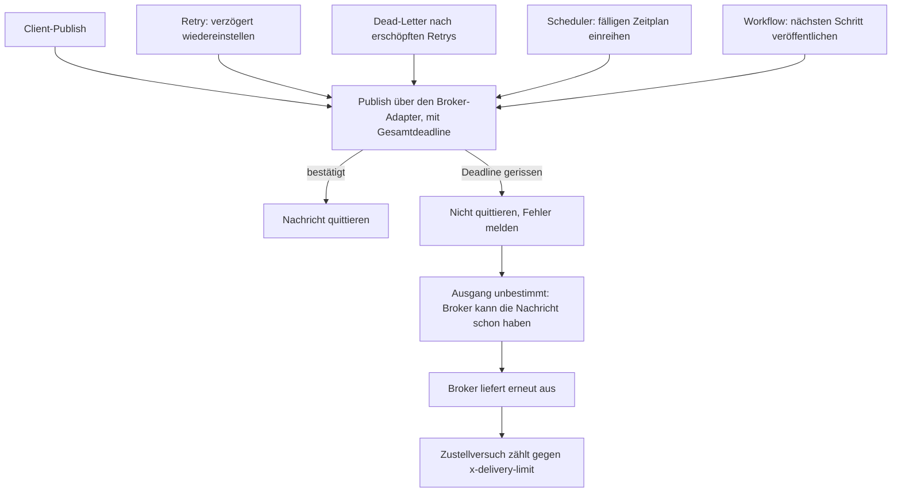
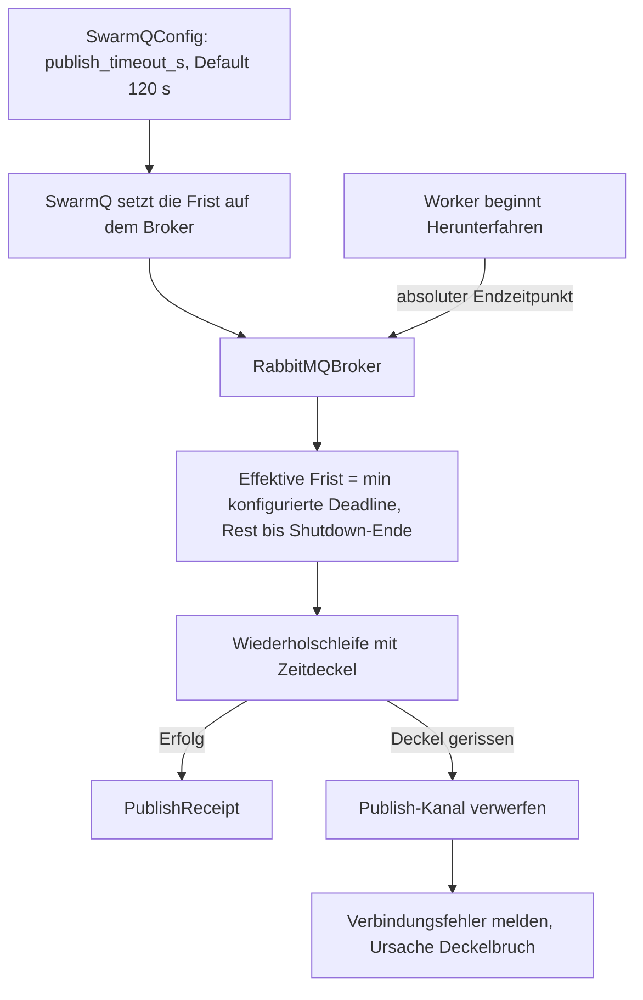

# Publish-Deadline, Port-Guard und Log-Verdopplung - Plan

## Goal Capsule

- **Objective:** Die drei Fehler beheben, die der Aufbau der Lasttest-Suite in swarmq freigelegt hat: ein unbegrenzt hängender Publish, ein stiller Crash-Loop bei Mehrprozess-Workern mit Metrik-Port, und eine fehlkonfigurierte structlog-Kette, die jede JSON-Logzeile verdoppelt. Klein im Umfang, aber mit einer ab Werk aktiven Verhaltensänderung und einer neuen Startablehnung — die Release-Einstufung ist offen.
- **Product authority:** Der Product Contract in diesem Dokument. Bei Widerspruch gilt: R-IDs für Verhalten, KDs für die Rahmenentscheidungen.
- **Nicht aktiver Scope:** Die übrigen fünf Einträge des Debug-Feature-Backlogs (B1, B2, B4, B5, B7) und das Slot-Konzept im Supervisor sind Kontext, nicht Anforderung — siehe How This Work Fits Together.
- **Reichweite des Port-Guards:** Er macht die Kollision diagnostizierbar, nicht messbar. Die Mehrprozess-Topologie mit festem Beobachtungs-Port bleibt bis zum Port je Kindprozess unbenutzbar, und die Lasttest-Suite trägt ihren eigenen Workaround so lange weiter.
- **Execution profile:** Python ≥ 3.14, uv-Toolchain. Drei unabhängige Fehlerkorrekturen an der Bibliothek selbst; keine neuen Abhängigkeiten. Der Reproduktionsfall des Referenzlaufs braucht den vorhandenen Docker-Chaos-Stack.
- **Stop conditions:** Stoppen und rückfragen, wenn (a) sich die Gesamtdeadline nicht ohne Eingriff in die Wiederholsemantik durchsetzen lässt, (b) der Startguard bestehende Tests der Mehrprozess-Topologie bricht, die eine heute gültige Kombination absichern, (c) das Entfernen der formatter-internen Schlüssel Signal-Tests oder den Metrik-Kollektor bricht.
- **Tail ownership:** Nicht Teil dieses Plans — Release-Schnitt (Patch oder Minor) und Release-Notes-Text entscheidet Georg nach der Umsetzung.
- **Open blockers:** Keine.

**Product Contract preservation:** restructured, no scope change — R10, R11 und R12 ergänzt (Folgezustand, Client-Zusicherung, Shutdown-Kopplung), R2/R4/R5/R7/R9 präzisiert, AE5–AE7 ergänzt; alle Änderungen stammen aus dem Dokument-Review vom 2026-08-29 und der dort gefällten Shutdown-Entscheidung. AE7 im zweiten Durchgang um den Fall „Publish lief bereits“ erweitert (Plan-Review vom 2026-08-29). R11 und AE6 im Code-Review vom 2026-08-29 nachgeschärft (Unique-Sperre bleibt bei unbestimmter Zustellung stehen — Entscheidung von Georg), KTD4 entsprechend. Bestehende R-, AE- und KD-IDs unverändert.

---

## Product Contract

### Summary

Ein konfigurierbarer Gesamtdeckel auf jeden Publish-Vorgang, ein Fail-fast-Guard gegen die Kombination aus Mehrprozess-Betrieb und festem Beobachtungs-Port, und die korrigierte `ProcessorFormatter`-Kette. Die drei Fixes sind unabhängig voneinander.

### Problem Frame

Die Lasttest-Suite ist das Produktions-Gate für die Ablösung von taskiq im Phoenix-Betrieb. Beim Bau der Suite entstand ein Backlog beobachteter Fähigkeitslücken (`docs/debug-feature-backlog.md` im Repo `swarmq-loadsuite`). Drei der acht Einträge sind keine Lücken, sondern Fehler im laufenden Verhalten.

Der teuerste zeigte sich im Referenzlauf vom 2026-08-28: ein fünfsekündiger Toxiproxy-Ausfall auf RabbitMQ (13:44:58 UTC) blockierte eine Handvoll `Client.schedule`-Aufrufe dauerhaft. `aio_pika` verband neu und meldete das auch, die hängenden Aufrufe blieben offen. Danach stand der Lauf 62 Minuten ohne eine einzige weitere Logzeile und ließ sich auch per SIGTERM nicht mehr beenden — ein verlorener Stundenlauf aus einer Sekundenstörung.

Der zweite Fehler scheitert leise, nicht laut: Wer `--processes N` mit `--metrics-port` kombiniert, bekommt keinen Startfehler. Das erste Kind bindet den Port, die übrigen scheitern beim Start mit einem Traceback, der Supervisor startet sie nach — bis das Restart-Budget von fünf Versuchen je Slot und Stunde aufgebraucht ist und er `worker_restart_limit_exceeded` meldet. Danach läuft der Worker dauerhaft mit weniger Prozessen als angefordert weiter. Die angeforderte Topologie wird also nie erreicht, ohne dass der Start je scheitert, und keine der Meldungen nennt die Portkollision als Ursache.

Der dritte kostet nur Geld und Lesbarkeit — aber genau dann, wenn beides knapp ist: Über einen 24h-Lauf verdoppelt die doppelte JSON-Nutzlast die Logmenge, und von Hand lesbar ist die Ausgabe im Diagnosefall kaum noch.

### Key Decisions

- KD1. **Der Umfang bleibt auf die drei Fehler begrenzt.** (session-settled: user-directed — gewählt gegenüber dem Mitnehmen von B5/B7 oder dem gesamten Backlog: die drei Fehler sind der Block, der das Lasttest-Gate entblockt, und tragen ein Patch-Release ohne neuen Unterbau.) Governs R1–R12.
- KD2. **Die Publish-Deadline deckelt den gesamten Aufruf, nicht den einzelnen Versuch.** (session-settled: user-directed — gewählt gegenüber einem Timeout je Versuch: der Aufrufer bekommt eine planbare Obergrenze; der Preis ist ein unbestimmter Ausgang, wenn die Deadline mitten in einem Versuch reißt.) Governs R1, R10, R11.
- KD3. **Die Deadline gilt für alle Publish-Pfade mit einem gemeinsamen Wert.** (session-settled: user-directed — gewählt gegenüber einer Beschränkung auf den Client-Pfad: ein hängendes `dead_letter()` legt den Worker genauso still wie ein hängendes `schedule()`.) Governs R2, R4.
- KD4. **Die Deadline ist ab Werk aktiv, mit großzügigem Default.** (session-settled: user-directed — gewählt gegenüber Opt-in mit Default `None`: geschützt wäre sonst nur, wer die Release Notes liest, und die Worker-internen Pfade konfiguriert ohnehin niemand bewusst.) Governs R3.
- KD5. **Die Port-Kollision wird abgefangen, nicht aufgelöst.** (session-settled: user-directed — gewählt gegenüber einem Slot-Konzept im Supervisor mit Port-Auto-Increment: der Guard verwandelt einen stillen Crash-Loop in einen verstandenen Fehler, ohne die Respawn- und Autoscaling-Logik anzufassen. Die Messbarkeit der Mehrprozess-Topologie bleibt offen.) Governs R5, R6, R7.
- KD6. **Im Herunterfahren deckelt die kürzere der beiden Fristen.** (session-settled: user-directed — gewählt gegenüber einer angehobenen Shutdown-Gnadenfrist oder einer generell engeren Deadline: die Sonderregel greift nur im Drain und lässt sowohl den Default aus KD4 als auch die normale Dauer des Herunterfahrens unberührt.) Governs R12.

### Requirements

**Publish-Deadline**

- R1. Ein Publish-Vorgang gibt spätestens nach Ablauf der konfigurierten Gesamtdeadline die Kontrolle an den Aufrufer zurück — die Deadline umspannt den kompletten Vorgang einschließlich aller internen Wiederholversuche und Wartezeiten dazwischen.
- R2. Die Deadline gilt für jede Veröffentlichung, die swarmq über seinen Broker-Adapter absetzt — die Regel bindet an diese Naht, nicht an eine feste Liste von Aufrufstellen. Heute sind das: das Veröffentlichen durch den Client, das verzögerte Wiedereinstellen eines Retrys, das Übergeben in die Dead-Letter-Queue, das periodische Einreihen fälliger Zeitpläne durch den Scheduler und die Veröffentlichung des nächsten Workflow-Schritts.
- R3. Die Deadline ist über die swarmq-Konfiguration und die zugehörige Umgebungsvariable einstellbar und ohne Zutun aktiv; der Default liegt bei 120 Sekunden.
- R4. Reißt die Deadline im Retry-Pfad oder beim Dead-Lettering nach erschöpften Retrys, bleibt die auslösende Nachricht unbestätigt — swarmq quittiert dort nie eine Nachricht, deren Folge-Veröffentlichung nicht bestätigt ist. Die terminalen Lock-Gate-Fälle behalten ihren bestehenden Ausweg über den Broker-DLX und sind von dieser Regel ausgenommen.
- R10. Nach einem gerissenen Deadline-Vorgang verwirft swarmq den betroffenen Publish-Kanal, sodass der nächste Vorgang auf einer neu geöffneten Verbindung läuft statt erneut in die volle Deadline zu laufen.
- R11. Ein Deadline-Fehler aus dem Client-Publish bedeutet „möglicherweise zugestellt“: Der Aufrufer darf nicht von Nicht-Zustellung ausgehen. Er ist als eigener Fehlertyp unterscheidbar, der von der bestehenden Verbindungsfehler-Klasse erbt. Bei einem Task mit Unique-Sperre bleibt diese in genau diesem Fall stehen, statt freigegeben zu werden — ein Wiederholversuch wird abgewiesen, bis sie abläuft, statt den Task ein zweites Mal auszuführen.
- R12. Während des Herunterfahrens gilt für einen laufenden Publish-Vorgang als effektive Obergrenze das Kleinere aus der Deadline und der verbleibenden Shutdown-Gnadenfrist. Er kehrt damit innerhalb der Gnadenfrist mit Fehler zurück, statt vom Supervisor abgeschossen zu werden.

**Beobachtungs-Ports im Mehrprozess-Betrieb**

- R5. Der Start wird mit einem erklärenden Fehler abgelehnt, wenn mehr als ein Worker-Prozess angefordert wird und zugleich ein fester Metrik- oder Health-Port wirksam ist. Geprüft wird der aufgelöste Effektivwert — gleich ob er von der Kommandozeile oder aus der Umgebung stammt. Das gilt für die feste Prozesszahl ebenso wie für den Autoscaling-Bereich.
- R6. Ein einzelner Worker-Prozess mit festem Metrik- oder Health-Port bleibt uneingeschränkt gültig.
- R7. Die Fehlermeldung benennt den wirksamen Port samt seiner Herkunft — Kommandozeilenoption oder Umgebungsvariable — sowie den gangbaren Weg: Mehrprozess-Betrieb ohne festen Port oder ein Prozess mit Port.

**JSON-Logausgabe**

- R8. Eine JSON-Logzeile enthält den Ereignisinhalt genau einmal. Die formatter-internen Schlüssel erscheinen nicht in der Ausgabe.
- R9. Die Textausgabe für Menschen verliert dieselben formatter-internen Schlüssel wie die JSON-Ausgabe — beide Renderer hängen an demselben Formatter, der Fix trifft zwangsläufig beide. Aufbau, Reihenfolge und Farbgebung der übrigen Felder bleiben unverändert.

### Acceptance Examples

Key Flows entfallen: Die drei Fehler sind unabhängige Punktkorrekturen ohne mehrstufigen Ablauf. Das einzige mehrschrittige Verhalten — der Ausgang einer gerissenen Deadline — tragen AE2, AE5 und AE6 samt Diagramm.

- AE1. **Covers R1, R2.** Gegeben ein Worker unter Last und ein Broker, dessen Verbindung still ausfällt (Pakete verschwinden, kein Verbindungsabbruch). Wenn ein Publish in diesem Moment startet, dann kehrt er innerhalb der Deadline mit einem Fehler zurück, statt unbegrenzt zu warten — unabhängig davon, über welchen der in R2 genannten Wege er läuft, den Scheduler-Tick eingeschlossen. Kehrt der Transport zurück, gelingt der nächste Publish wieder in normaler Latenz, statt erneut die volle Deadline zu verbrennen (R10).
- AE2. **Covers R4.** Gegeben ein nach erschöpften Retrys gescheiterter Task, dessen Übergabe in die Dead-Letter-Queue in die Deadline läuft. Dann bleibt die Nachricht unbestätigt, der Broker liefert sie erneut aus, und der Task wird erneut ausgeführt. Ob er zusätzlich in der Dead-Letter-Queue liegt, ist unbestimmt: Die Deadline reißt beim Warten auf die Bestätigung des Brokers, die Übergabe kann ihn also bereits erreicht haben. Der bewusst getragene Preis ist damit mindestens eine zusätzliche Ausführung, möglicherweise neben einem Eintrag in der Dead-Letter-Queue — billiger als ein stiller Verlust.
- AE3. **Covers R5, R6, R7.** Gegeben `--processes 4 --metrics-port 9000`. Dann bricht der Start mit der Meldung aus R7 ab, bevor ein Kindprozess entsteht. Gegeben stattdessen vier Prozesse und den Port nur aus der Umgebung (`SWARMQ_METRICS_PORT=9000`, ohne Kommandozeilenoption), bricht der Start genauso ab und die Meldung nennt die Umgebungsvariable als Quelle. Gegeben `--processes 1 --metrics-port 9000`, startet der Worker normal und exponiert seine Metriken.
- AE4. **Covers R8.** Gegeben JSON-Logausgabe. Wenn ein beliebiges Ereignis geloggt wird, dann enthält die Zeile keinen Schlüssel, der die Ereignisdaten ein zweites Mal trägt.
- AE5. **Covers R4.** Gegeben ein Task, den ein Lock-Gate terminal abweist, und dessen Dead-Letter-Übergabe in die Deadline läuft. Dann greift der bestehende Ausweg über den Broker-DLX: Die Nachricht landet ohne Diagnose-Header in der Dead-Letter-Queue und wird nicht erneut ausgeführt. Das ist keine Regression, sondern der unveränderte Bestandspfad.
- AE6. **Covers R11.** Gegeben ein Client-Publish, der mit Deadline-Fehler zurückkehrt. Dann darf der Aufrufer nicht von Nicht-Zustellung ausgehen. Bei einem Task mit Unique-Sperre bleibt diese stehen, sodass ein Wiederholversuch abgewiesen wird statt den Task zu duplizieren; bei jedem anderen Publish-Fehler wird sie weiterhin freigegeben, weil dort sicher nichts gesendet wurde.
- AE7. **Covers R12.** Gegeben ein Worker, der ein Herunterfahren beginnt, während ein Publish-Vorgang bereits läuft. Dann bricht dieser spätestens mit Ablauf der Gnadenfrist mit Fehler ab, nicht erst nach der vollen Deadline — auch dann, wenn er schon vor dem Beginn des Herunterfahrens gestartet war. Der Worker beendet sich regulär, ohne dass der Supervisor auf SIGKILL eskalieren muss, und die restliche Abbausequenz läuft noch vollständig durch.

Der Deckel und sein Ausgang, über alle Pfade:

Der untere Pfad ist die Kopplung, die diesen Fix an B5 bindet: Jede von einer gerissenen Deadline erzwungene erneute Zustellung verbraucht einen der 20 hartkodierten Zustellversuche. Die terminalen Lock-Gate-Fälle (AE5) berührt das nicht — sie enden ohne Redelivery.

### Scope Boundaries

**Aufgeschoben**

- Slot-stabile Worker-Identität in Signalen (B1). Braucht ein echtes Slot-Konzept im Supervisor, das heute nicht existiert — `_start_worker()` in `src/swarmq/process_manager/supervisor.py` vergibt monoton wachsende IDs, auch beim Respawn.
- Port je Kindprozess und damit messbare Mehrprozess-Topologie (B3, zweite Hälfte). Teilt den Unterbau mit B1.
- Konfigurierbares `x-delivery-limit` (B5) und ein Signal für broker-seitiges Dead-Lettering (B7). Rücken durch R4 näher, sind aber nicht Voraussetzung für diesen Block.
- Signal-Hook im CLI-Worker (B2) und natives CPU-Offloading (B4).
- Die übrigen hartkodierten Timeout- und Budget-Konstanten in `src/swarmq/broker/rabbitmq/connection.py` in die Konfiguration zu heben. Dieser Plan fügt einen konfigurierbaren Wert hinzu und vereinheitlicht die bestehenden nicht.

### Dependencies / Assumptions

- Die Toxiproxy-Infrastruktur für einen Reproduktionstest existiert bereits (`tests/e2e/combinations/_toxiproxy.py`, `tests/chaos/`); ein neuer Unterbau ist nicht nötig.
- R5 bezieht den Health-Port ein, obwohl der Backlog nur den Metrik-Port nennt. Annahme: `health_port` hat dieselbe Vererbungskante (`src/swarmq/worker/lifecycle.py`) und es wäre willkürlich, nur eine Hälfte abzufangen.
- Der Guard aus R5 ist ein Breaking Change für eine real laufende Konfiguration. Heute endet die Kombination nicht im Abbruch, sondern in einem degradierten Betrieb: Ein Kind hält den Port und arbeitet samt Metriken weiter, die übrigen Slots brennen ihr Restart-Budget ab und bleiben leer. Nach dem Release lehnt der Start ab, und der in R7 angebotene Ausweg entzieht diesen Nutzern die Metriken vollständig, solange der Port je Kindprozess aufgeschoben bleibt.
- Der Default aus R3 ist eine Verhaltensänderung für Bestandsnutzer. Annahme: 120 Sekunden liegen weit über jedem legitimen Publish, sodass praktisch nur pathologische Fälle getroffen werden.

### Success Criteria

- Der Fehlerfall aus dem Referenzlauf ist als automatisierter Test reproduzierbar und schlägt ohne den Fix fehl.
- Ein 24h-Lauf der Suite endet nicht mehr in einem Stillstand ohne Logzeilen.
- Die JSON-Logmenge eines vergleichbaren Laufs sinkt um mindestens die Hälfte.

### Outstanding Questions

**Deferred to Planning**

- Welcher Fehlertyp eine gerissene Deadline nach außen trägt — ein eigener Typ oder der bestehende neutrale Verbindungsfehler, den Aufrufer bereits als transient behandeln. Ein eigener Typ zieht die eng gefassten Verbindungsfehler-Handler im Ablauf-Gate mit, weil die Nachricht dort sonst ohne erneute Zustellung durchschlägt.
- Ob der Reproduktionstest den bestehenden Chaos-Stack erweitert oder einen eigenen, engeren Fall bekommt.
- Ob R4 in der Praxis genug Redeliveries erzwingt, um B5 zum unmittelbaren Nachfolger zu machen. Messbar erst nach dem ersten langen Lauf mit aktivem Deckel.

<!-- ce-section: work-relationships -->
### How This Work Fits Together

Dieser Plan besitzt einen Teil des Debug-Feature-Backlogs aus `swarmq-loadsuite`: die drei Einträge, die Fehler sind (B8, B3 erste Hälfte, B6). Die folgende Aufteilung ist das heutige Verständnis der übrigen Einträge, keine zugesagte Reihenfolge.

- Beobachtbarkeit im Mehrprozess-Betrieb (B1, B3 zweite Hälfte)
  - Depends on: ein Slot-Konzept im Supervisor, das freie Plätze recycelt statt monoton zu zählen.
  - Enables: das 24h-Abnahmeszenario ohne den Workaround, den die Suite heute im eigenen Worker-Entry fährt.
  - Shares: den fehlenden Unterbau mit diesem Plan — R5 fängt genau die Kante ab, die dieses Vorhaben später auflösen würde.
- Zustellbudget und Dead-Letter-Sichtbarkeit (B5, B7)
  - Depends on: nichts aus diesem Plan.
  - Shares: das Zustellbudget mit R4 — jede von einer gerissenen Deadline erzwungene Redelivery zehrt daran.
  - Still to decide: ob R4 dieses Vorhaben zum unmittelbaren Nachfolger macht.
- Erweiterbarkeit des CLI-Workers (B2)
  - Can proceed independently of: allen anderen Bereichen.
- Natives CPU-Offloading (B4)
  - Can proceed independently of: allen anderen Bereichen. Eigenständige Produktentscheidung über die Ausführungssemantik von Tasks, nicht Teil dieser Fehlerbehebung.

### Sources / Research

Verifiziert gegen den Stand von `main` am 2026-08-28:

- `src/swarmq/broker/rabbitmq/delivery.py:156` — Publish ohne Zeitbegrenzung; der umgebende Wiederholpfad greift nur bei Ausnahmen, nicht bei einem stillen Hänger.
- `src/swarmq/broker/rabbitmq/delivery.py:258-264` — `retry_later()` und `dead_letter()` veröffentlichen vor dem Quittieren, beide über denselben Pfad wie der Client.
- `src/swarmq/broker/rabbitmq/connection.py:330-365` — Der bestehende Zeitdeckel greift nur beim Neuöffnen eines Kanals; ein Kanal, der bei stillem Transportausfall nicht als geschlossen gilt, passiert ihn ungebremst.
- `src/swarmq/process_manager/run.py:118` und `src/swarmq/worker/lifecycle.py:147-171` — Derselbe Metrik- und Health-Port geht an alle Kindprozesse und wird dort fest gebunden.
- `src/swarmq/process_manager/supervisor.py:348-349,551` — Worker-IDs wachsen monoton, auch beim Respawn; es gibt keinen wiederverwendeten Slot-Index.
- `src/swarmq/logging.py:105-108` — Die Prozessorkette des `ProcessorFormatter` entfernt die formatter-internen Schlüssel nicht vor dem Renderer; beide Renderer teilen diesen Formatter.
- `src/swarmq/scheduler/loop.py:506` und `src/swarmq/worker/pipeline.py:368` — Zwei weitere Aufrufstellen desselben Publish-Pfads: der fällige Zeitplan des Schedulers und der nächste Workflow-Schritt.
- `src/swarmq/worker/gates/lock.py:199,246` — Die terminalen Lock-Gate-Fälle nacken über den Broker-DLX statt erneut zuzustellen.
- `src/swarmq/config.py:159,161` — Metrik- und Health-Port werden bedingungslos aus der Umgebung überschrieben; ein Guard auf den Kommandozeilenargumenten allein greift zu kurz.
- `src/swarmq/config.py:76` und `src/swarmq/process_manager/supervisor.py:391-404` — Die Shutdown-Gnadenfrist von 30 Sekunden eskaliert danach auf SIGKILL.
- `src/swarmq/process_manager/supervisor.py:98-99,531-544` — Neustarts sind auf fünf je Slot und Stunde begrenzt; danach meldet der Supervisor das erschöpfte Budget und der Lauf bleibt unterbesetzt.
- Ausgangsbeobachtungen: `docs/debug-feature-backlog.md` im Repo `swarmq-loadsuite`.

---

## Planning Contract

### Key Technical Decisions

- KTD1. **Die Gesamtdeadline umschließt den bestehenden Wiederholpfad, statt ihn zu ersetzen.** Ein einzelner Zeitdeckel um die komplette Schleife in `_publish_with_retry` liefert die Obergrenze aus R1, ohne die Backoff- und Kanalwiederherstellungslogik anzufassen, die Nack-Behandlung und Kanalneuöffnung bereits korrekt unterscheidet. (session-settled: user-directed — chosen over einem Timeout je Wiederholversuch: der Aufrufer bekommt eine planbare Obergrenze; der Preis ist ein unbestimmter Ausgang, wenn die Deadline mitten in einem Versuch reißt.) Governs R1, R2.
- KTD2. **Der Wert erreicht den Broker über das bestehende Muster, mit dem die App Broker-Eigenschaften aus der Konfiguration setzt.** `src/swarmq/app.py:56` setzt heute schon `broker._queue_type` aus der Konfiguration; der Zeitdeckel folgt demselben Weg. Kein neuer Konstruktorparameter, damit direkt konstruierte Broker (Producer-Pfad, injizierte Verbindungen) unverändert weiterlaufen und ihren Default behalten. Governs R3.
- KTD3. **Nach einem Deadline-Bruch wird der Publish-Kanal verworfen: Referenz sofort lösen, Schließen nebenläufig mit eigener kurzer Frist.** Das Repo hat den zugrunde liegenden Fehlschluss bereits dokumentiert (`docs/solutions/logic-errors/aiormq-reader-leak-and-stale-connection-recovery-2026-04-16.md`): Der Zustandsmelder der robusten Verbindung meldet „offen“, während die darunterliegende Verbindung tot ist. Genau dieser Fall lässt den Schnellpfad im Kanal-Getter durchlaufen und würde jeden Folge-Publish erneut die volle Deadline verbrennen. Die Zweiteilung löst einen echten Zielkonflikt: Ein Schließen auf totem Transport wartet auf eine Bestätigung, die nie kommt, und überschritte damit die gerade durchgesetzte Frist — ein bloßes Dereferenzieren ließe dagegen die Bestätigungsstruktur der Bibliothek liegen, die erst beim Schließen freigegeben wird. Der Verwurf läuft unter der bestehenden Kanalsperre und greift nur, wenn das getrackte Kanalobjekt noch dasselbe ist wie beim abgelaufenen Versuch; sonst würde er den Kanal wegwerfen, den eine parallele Ausführung gerade frisch geöffnet hat. Governs R10.
- KTD4. **Ein Deadline-Bruch wird als Unterklasse des bestehenden Verbindungsfehlers gemeldet.** (Nachgeschärft im Code-Review vom 2026-08-29: Eine Unterklasse erfüllt beide Anforderungen — die eng gefassten Handler fangen sie unverändert, und der Client kann den unbestimmten Ausgang von einem definitiven Fehlschlag unterscheiden, um die Unique-Sperre stehen zu lassen.) Die Fehlerbehandlung im Ablauf-Gate fängt ausschließlich diesen Typ; ein eigener Typ schlüge dort durch und verließe den Pfad ohne die vorgesehene erneute Zustellung. Preis: Aufrufer, die diesen Fehler bereits automatisch als vorübergehend wiederholen, tun das künftig auch bei einem Deckelbruch — R11 schreibt darum die Unbestimmtheit ausdrücklich fest, und die Meldung nennt den Deckelbruch als Ursache. Governs R11.
- KTD5. **Die Shutdown-Endfrist wird Teil des Broker-Vertrags, nicht eine Attributzuweisung.** Der Worker hält den Broker als Protokoll und darf die konkrete Broker-Implementierung nicht importieren — ein Architektur-Guard erzwingt das, und das Typen-Gate läuft strikt. KTD2 trägt hier deshalb nicht als Vorbild: Dort hält die App einen konkret typisierten Broker. Die Endfrist wird darum als benanntes Mitglied im `Publisher`-Protokoll (`src/swarmq/contracts/broker.py`) deklariert und über den Worker-seitigen Protokollausschnitt sichtbar; der In-Memory-Broker der Testunterstützung erfüllt sie mit. Der Publish-Pfad nimmt das Kleinere aus dem Rest bis zu dieser Frist und der konfigurierten Deadline. (session-settled: user-directed — chosen over einer angehobenen Shutdown-Gnadenfrist oder einer generell engeren Deadline: die Sonderregel greift nur im Drain.) Governs R12.
- KTD9. **Die Endfrist liegt eine benannte Reserve unter der Gnadenfrist und zieht laufende Deckel nach.** Zwei Fallen machen die naive Rechnung wirkungslos. Erstens ist die Gnadenfrist des Supervisors derselbe Wert, den der worker-interne Drain bereits als eigenes Zeitlimit verbraucht (`src/swarmq/process_manager/run.py:107`) — eine Endfrist auf „Beginn plus Gnadenfrist“ fiele exakt mit der Eskalation zusammen, und für Sperrenfreigabe, Scheduler-Stopp und Verbindungsschluss bliebe nichts. Zweitens verkürzt sich ein bereits gesetzter Zeitdeckel nicht von selbst: Ein Publish, der eine Sekunde vor dem Herunterfahren startete, liefe weiter gegen die volle Deadline. Der Broker führt darum seine aktiven Deckel mit und zieht sie beim Setzen der Endfrist nach. Governs R12.
- KTD6. **Der Startguard sitzt im bestehenden Pre-Flight-Validator und prüft die aufgelöste Konfiguration.** `check_worker_config` in `src/swarmq/process_manager/check.py` ist der Ort, an dem der Mehrprozess-Start heute schon fehlschlägt, bevor ein Kind entsteht — und er speist zugleich `swarmq worker --check` — dessen Aufrufer (`src/swarmq/cli/check_cmd.py`) muss die neuen Argumente mit durchreichen, sonst meldet die Vorabprüfung „in Ordnung“ für genau die Kombination, die der Start danach ablehnt. Damit R5 den Effektivwert trifft, löst der Guard Metrik- und Health-Port über dieselbe Umgebungsauswertung auf wie die Konfiguration, statt die Kommandozeilenargumente zu lesen. Governs R5, R6, R7.
- KTD7. **Der Guard löst an der Obergrenze des Autoskalierungsbereichs aus, nicht an der Untergrenze.** Ein Bereich mit Untergrenze eins und Obergrenze vier würde sonst sauber starten und erst beim ersten Hochskalieren mitten im Betrieb kollidieren — der Fehler wäre dann noch schwerer zuzuordnen als heute. Governs R5.
- KTD8. **Zwei Testebenen für den Deckel.** Die Mechanik (Ablauf, Kanalverwurf, Shutdown-Kopplung) wird mit einem Doppel geprüft, dessen Publish nie zurückkehrt — schnell, dienstfrei, im blockierenden Testlauf. Der Störungsfall des Referenzlaufs läuft gegen einen echten Broker in der Chaos-Suite, die planmäßig nicht blockiert. Governs R1, R10, R12.

### High-Level Technical Design

Wo der Deckel entsteht und wie er den Publish-Pfad erreicht:

Der Kanalverwurf ist der Punkt, an dem sich dieser Plan von einem reinen Timeout unterscheidet: Ohne ihn bleibt die tote Verbindung stehen und der nächste Vorgang läuft erneut in die volle Frist.

### Assumptions

- `asyncio.timeout` steht zur Verfügung (Python ≥ 3.14 ist ohnehin erzwungen) und schneidet den laufenden Publish ab. Die zugrunde liegende Bibliothek räumt dabei **nicht** selbst auf: Die offene Bestätigungsstruktur eines abgebrochenen Publish wird erst beim Schließen des Kanals freigegeben. Genau darum schließt der Verwurf aus KTD3 den Kanal, statt ihn nur zu dereferenzieren — und tut es nebenläufig, weil das Schließen selbst hängen kann.
- Der Broker erfährt nichts über den Worker-Lebenszyklus außer der gesetzten Endfrist aus KTD5. Ein Producer ohne Worker setzt sie nie und läuft immer gegen die konfigurierte Deadline.
- Das Entfernen der formatter-internen Schlüssel berührt keinen Konsumenten: Sie entstehen erst im Formatter, nach jedem Prozessor der Ereigniskette, und werden nirgends gelesen.

### Sequencing

U1 legt den Konfigurationswert an, U2 setzt ihn im Publish-Pfad durch, U3 koppelt ihn an das Herunterfahren. U6 belegt das Ergebnis am echten Broker und hängt allein an U2 — der Störungstest prüft Netzwerkausfall und Kanalverwurf, nicht das Herunterfahren, und die wertvollste Regressionsabsicherung soll nicht auf eine fachlich unabhängige Änderung warten. U4 und U5 hängen an nichts und können jederzeit parallel laufen — sie berühren weder den Broker noch die Konfiguration des Deckels.

---

## Implementation Units

### U1. Publish-Deadline konfigurierbar machen

- **Goal:** Ein einstellbarer Zeitwert für Publish-Vorgänge existiert in der Konfiguration, ist ab Werk gesetzt und erreicht den Broker.
- **Requirements:** R3. Instantiiert die Rahmenentscheidung aus KTD2; der Default folgt der session-settled Entscheidung KD4.
- **Dependencies:** keine.
- **Files:** `src/swarmq/config.py`, `src/swarmq/app.py`, `website/reference/configuration.md`, `website/reference/configuration.de.md`, `website/reference/agent/spec/config.json`, `tests/unit/test_config.py`, `tests/unit/test_app.py`
- **Approach:**
  1. Feld `publish_timeout_s: float = 120.0` in `SwarmQConfig` ergänzen, unmittelbar bei den übrigen Zeitwerten, mit Kommentar zur Herkunft des Defaults.
  2. `("SWARMQ_PUBLISH_TIMEOUT_S", "publish_timeout_s", "float")` in die Umgebungs-Zuordnung aufnehmen.
  3. Das Feld in die bestehende Gruppe mit der gemeinsamen Zusage „> 0" aufnehmen, damit ein Wert von null oder darunter dieselbe Meldung erzeugt wie die Nachbarwerte.
  4. In `SwarmQ.__init__` die Frist auf dem Broker setzen, an derselben Stelle und im selben Stil wie `broker._queue_type` heute gesetzt wird.
  5. Die neue Option auf beiden Konfigurations-Referenzseiten beschreiben und die eingecheckte, generierte Konfigurationsspezifikation neu erzeugen — sie trägt den Hinweis, nicht von Hand bearbeitet zu werden, und veraltet sonst still, weil kein Gate die Abweichung fängt.
- **Patterns to follow:** Die Feld-plus-Umgebungsvariable-plus-Validierung-Trias der bestehenden Zeitwerte in `src/swarmq/config.py`; die Broker-Zuweisung in `src/swarmq/app.py:56`.
- **Test scenarios:**
  - Ohne Umgebungsvariable und ohne Argument trägt die Konfiguration 120.0.
  - Eine gesetzte Umgebungsvariable mit gültiger Zahl überschreibt den Default.
  - Ein nicht-numerischer Umgebungswert erzeugt denselben Fehlertyp und dieselbe Meldungsform wie bei den benachbarten Zeitwerten.
  - Ein Wert von null und ein negativer Wert werden beide mit der „> 0"-Meldung abgelehnt.
  - Nach der Konstruktion einer App trägt der Broker die konfigurierte Frist.
- **Verification:** Die Konfigurationstests laufen durch, und eine App mit gesetzter Umgebungsvariable reicht den Wert nachweislich an den Broker durch.

### U2. Deadline im Publish-Pfad durchsetzen

- **Goal:** Jeder Publish über den Broker-Adapter kehrt spätestens nach Ablauf der Frist zurück, verwirft dabei den Kanal und meldet einen zuordenbaren Fehler.
- **Requirements:** R1, R2, R4, R10, R11. Umgesetzt nach KTD1, KTD3, KTD4. R4 ist vom heutigen Code bereits erfüllt — Veröffentlichen vor dem Quittieren — und muss über den Umbau hinweg erhalten bleiben.
- **Dependencies:** U1.
- **Files:** `src/swarmq/broker/rabbitmq/delivery.py`, `src/swarmq/broker/rabbitmq/connection.py`, `tests/unit/broker/test_rabbitmq.py`
- **Approach:**
  1. Die Wiederholschleife in `_publish_with_retry` in einen Zeitdeckel fassen, der die effektive Frist des Brokers verwendet.
  2. Beim Ablauf den Publish-Kanal verwerfen, damit der Kanal-Getter beim nächsten Aufruf neu öffnet statt den Schnellpfad zu nehmen: unter der bestehenden Kanalsperre prüfen, ob das getrackte Kanalobjekt noch dasselbe ist wie beim abgelaufenen Versuch, die Referenz lösen und das Schließen mit eigener kurzer Frist nebenläufig anstoßen. Der Aufrufer wartet nicht darauf. Ohne die Identitätsprüfung würfe der Verwurf den Kanal weg, den eine parallele Ausführung gerade geöffnet hat.
  3. Den Ablauf in den bestehenden Verbindungsfehler übersetzen, dessen Meldung die abgelaufene Frist und den betroffenen Zielnamen nennt.
  4. Eine Logzeile beim Deckelbruch, damit eine dadurch erzwungene erneute Zustellung später zuordenbar ist.
- **Execution note:** Zuerst einen fehlschlagenden Test schreiben, der mit einem nie zurückkehrenden Publish-Doppel belegt, dass der Aufruf heute unbegrenzt wartet — das ist der Kern des Referenzlaufs und der einzige Weg, den Fix ehrlich zu beweisen.
- **Patterns to follow:** Die bestehende Fehlerübersetzung in `_publish_with_retry`, die Nack-Antworten und Kanalstörungen bereits unterscheidet; die Zeitdeckel-plus-Fehlerübersetzung in `_ensure_channel_tracked`.
- **Test scenarios:**
  - Covers AE1. Ein Publish-Doppel, das nie zurückkehrt, führt zu einem Verbindungsfehler innerhalb der gesetzten Frist statt zu unbegrenztem Warten.
  - Nach diesem Ablauf ist der Publish-Kanal des Brokers zurückgesetzt, und der nächste Publish öffnet einen neuen Kanal.
  - Ein gesunder Publish innerhalb der Frist kehrt unverändert mit einer Quittung zurück; der Kanal bleibt bestehen.
  - Ein Publish, der nach zwei fehlgeschlagenen Versuchen im dritten gelingt, bleibt erfolgreich, solange die Summe unter der Frist bleibt.
  - Wiederholversuche, die einzeln schnell sind, aber zusammen die Frist überschreiten, brechen mit Verbindungsfehler ab statt das Versuchsbudget auszuschöpfen.
  - Die Fehlermeldung nennt die abgelaufene Frist, sodass sie sich von einem gewöhnlichen Verbindungsabbruch unterscheiden lässt.
  - Der verzögerte Wiedereinstell- und der Dead-Letter-Pfad unterliegen demselben Deckel — je Aufruf, nicht je Nachrichtenstapel.
  - Covers AE2. Reißt die Frist beim Dead-Lettering nach erschöpften Retrys, bleibt die Nachricht unbestätigt — die Reihenfolge Veröffentlichen-dann-Quittieren überlebt den Umbau.
  - Covers AE5. Der terminale Lock-Gate-Ausweg bleibt unverändert: Er quittiert ohne erneute Zustellung und ist vom Deckel unberührt.
  - Covers AE6. Ein Client-Publish mit gerissener Frist kehrt mit Verbindungsfehler zurück, ohne dass der Aufrufer erfährt, ob die Nachricht ankam; die Unique-Sperre ist danach zurückgerollt, ein Wiederholversuch also nicht duplikatgeschützt.
  - Ein Publish über den Scheduler-Pfad — fälliger Zeitplan — unterliegt demselben Deckel wie der Client-Publish. Dasselbe für den Workflow-Folgeschritt.
  - Nach einem Deckelbruch ist der alte Kanal gelöst, während eine parallel geöffnete Kanalinstanz unangetastet bleibt.
- **Verification:** Ein Publish gegen einen nie antwortenden Doppel bricht innerhalb der Frist ab, der Kanal ist danach erneuert, und keiner der bestehenden Broker-Tests bricht.

### U3. Deadline an die Shutdown-Gnadenfrist koppeln

- **Goal:** Ein laufender Publish kehrt während des Herunterfahrens innerhalb der Gnadenfrist mit Fehler zurück, statt vom Supervisor abgeschossen zu werden.
- **Requirements:** R12. Umgesetzt nach KTD5, KTD9.
- **Dependencies:** U2.
- **Files:** `src/swarmq/contracts/broker.py`, `src/swarmq/worker/gates/__init__.py`, `src/swarmq/broker/rabbitmq/connection.py`, `src/swarmq/worker/lifecycle.py`, `tests/support/inmemory/broker.py`, `tests/unit/broker/test_rabbitmq.py`, `tests/unit/test_app.py`
- **Approach:**
  1. Die Endfrist als benanntes Mitglied im `Publisher`-Protokoll deklarieren und über den worker-seitigen Protokollausschnitt sichtbar machen; der In-Memory-Broker der Testunterstützung erfüllt sie mit, damit das Typen-Gate über `src/swarmq` und `tests/support` grün bleibt. Ohne diesen Schritt scheitert der Zugriff aus dem Worker am Architektur-Guard, der ihm den Import der konkreten Broker-Implementierung verbietet.
  2. Die effektive Frist eines Publish als Kleineres aus konfigurierter Deadline und Rest bis zur Endfrist berechnen; ohne gesetzte Endfrist bleibt es bei der Konfiguration.
  3. Im Shutdown-Pfad des Workers die Endfrist setzen, bevor der Drain startet — auf den Beginn plus Gnadenfrist **abzüglich einer benannten Reserve** für Sperrenfreigabe, Scheduler-Stopp und Verbindungsschluss. Ohne diese Reserve fällt die Frist mit der Eskalation des Supervisors zusammen, weil dessen Gnadenfrist derselbe Wert ist, den der Drain bereits verbraucht.
  4. Beim Setzen der Endfrist die bereits laufenden Publish-Deckel nachziehen. Ein vorher gestarteter Publish behielte sonst sein altes Budget und liefe weiter gegen die volle Deadline — genau der Fall aus AE7.
  5. Eine bereits abgelaufene Endfrist lässt einen Publish sofort scheitern statt in einen negativen Deckel zu laufen.
  6. Die Endfrist am Ende der Shutdown-Sequenz und beim Verbindungsaufbau wieder leeren. Sonst scheitert bei einem eingebetteten Nutzer, dessen Worker sich beendet hat und der über dieselbe Instanz weiter Tasks einreiht, ab da jeder Publish sofort.
- **Patterns to follow:** Der Shutdown-Ablauf in `src/swarmq/worker/lifecycle.py`, der die Gnadenfrist bereits kennt; die bestehenden Protokolldefinitionen in `src/swarmq/contracts/broker.py`.
- **Test scenarios:**
  - Covers AE7. Ohne gesetzte Endfrist gilt allein die konfigurierte Deadline.
  - Mit einer Endfrist, die näher liegt als die Deadline, bricht ein hängender Publish zur Endfrist ab, nicht erst zur Deadline.
  - Covers AE7. Ein Publish, der **vor** dem Setzen der Endfrist gestartet ist, wird nachgezogen und bricht ebenfalls zur Endfrist ab.
  - Mit einer Endfrist, die weiter entfernt liegt als die Deadline, gilt weiter die Deadline.
  - Eine bereits verstrichene Endfrist lässt den Publish sofort mit Verbindungsfehler scheitern.
  - Der Beginn des Herunterfahrens setzt die Endfrist; ein Producer ohne Worker setzt sie nie.
  - Nach abgeschlossenem Herunterfahren ist die Endfrist geleert: Ein danach über dieselbe Instanz abgesetzter Publish läuft wieder gegen die konfigurierte Deadline.
  - Der In-Memory-Broker der Testunterstützung erfüllt den erweiterten Vertrag.
- **Verification:** Ein Worker mit hängendem Publish beendet sich innerhalb seiner Gnadenfrist regulär, ohne dass der Supervisor eskalieren muss, und die restliche Shutdown-Sequenz läuft noch vollständig durch.

### U4. Startguard für Beobachtungs-Ports im Mehrprozess-Betrieb

- **Goal:** Die Kombination aus mehreren Worker-Prozessen und festem Metrik- oder Health-Port wird vor dem ersten Kindprozess mit erklärender Meldung abgelehnt.
- **Requirements:** R5, R6, R7. Umgesetzt nach KTD6, KTD7.
- **Dependencies:** keine.
- **Files:** `src/swarmq/process_manager/check.py`, `src/swarmq/process_manager/run.py`, `src/swarmq/cli/check_cmd.py`, `website/reference/configuration.md`, `website/reference/configuration.de.md`, `tests/unit/process_manager/test_check.py`, `tests/unit/process_manager/test_run.py`
- **Approach:**
  1. `check_worker_config` um die Prozesszahl, den Autoskalierungsbereich sowie Metrik- und Health-Port erweitern; die neuen Parameter mit Defaults versehen, damit bestehende Aufrufer und `swarmq worker --check` unverändert funktionieren.
  2. Den wirksamen Port über dieselbe Umgebungsauswertung auflösen, die auch die Konfiguration verwendet, und die Quelle mitführen.
  3. Ablehnen, sobald die Prozesszahl über eins liegt oder die Obergrenze des Autoskalierungsbereichs über eins liegt, und zugleich einer der beiden Ports wirksam ist.
  4. Den Aufruf in `run_multi_process_worker` um die neuen Argumente ergänzen — der Pre-Flight liegt dort bereits vor dem Start des Supervisors.
  5. Denselben Durchreichschritt im Aufrufer von `swarmq worker --check` ergänzen. Ohne ihn meldet die Vorabprüfung „in Ordnung“ für genau die Kombination, die der Start danach ablehnt, und bricht damit ihre eigene Zusage, dass ein erfolgreiches Ergebnis den Pre-Flight des Supervisors impliziert.
  6. Die neue Startablehnung auf den beiden Konfigurations-Referenzseiten beschreiben.
- **Patterns to follow:** Die bestehenden Ablehnungen in `check_worker_config` und deren Meldungsform; die Umgebungsauswertung der Portwerte in `src/swarmq/config.py`.
- **Test scenarios:**
  - Covers AE3. Vier Prozesse mit Metrik-Port als Kommandozeilenoption werden abgelehnt; die Meldung nennt die Option als Quelle.
  - Vier Prozesse mit Metrik-Port allein aus der Umgebung werden ebenso abgelehnt; die Meldung nennt die Umgebungsvariable als Quelle.
  - Dasselbe für den Health-Port, einzeln und zusammen mit dem Metrik-Port.
  - Ein Prozess mit Metrik-Port wird angenommen.
  - Mehrere Prozesse ohne jeden festen Port werden angenommen.
  - Ein Autoskalierungsbereich von eins bis vier wird mit festem Port abgelehnt, obwohl die Untergrenze eins ist.
  - Ein Autoskalierungsbereich von eins bis eins mit festem Port wird angenommen.
  - `swarmq worker --check` meldet den Konflikt in derselben Form wie die übrigen Pre-Flight-Fehler.
- **Verification:** Der Start bricht vor dem ersten Kindprozess ab, und die Meldung nennt Port, Quelle und den gangbaren Weg.

### U5. Formatter-interne Schlüssel aus der Logausgabe entfernen

- **Goal:** Jede Logzeile trägt den Ereignisinhalt genau einmal, in beiden Ausgabeformen.
- **Requirements:** R8, R9.
- **Dependencies:** keine.
- **Files:** `src/swarmq/logging.py`, `tests/unit/test_logging.py`
- **Approach:** Die Prozessorkette des Formatters um den von structlog dafür vorgesehenen Entferner ergänzen, unmittelbar **vor** dem Renderer. Der Formatter ist beiden Renderern gemeinsam, die Änderung trifft daher Text- und JSON-Ausgabe zugleich — genau wie in R9 zugesagt.
- **Patterns to follow:** Die bestehende Prozessorkette in `setup_logging`; die Ausgabe-Erfassung über den Listener-Handler in den vorhandenen Logging-Tests.
- **Test scenarios:**
  - Covers AE4. Eine JSON-Zeile enthält weder den Datensatz-Schlüssel noch die Herkunftsmarkierung.
  - Die JSON-Zeile trägt Ereignisname, Stufe, Zeitstempel und die gebundenen Felder unverändert.
  - Die Textausgabe enthält dieselben Schlüssel ebenfalls nicht mehr, behält aber Ereignisname und Felder in der bisherigen Anordnung.
  - Die Bindung über Kontextvariablen erscheint weiterhin in der Ausgabe.
  - Eine Ausnahme wird weiterhin mit vollständigem Verlauf gerendert.
- **Verification:** Die vorhandenen Logging-Tests laufen unverändert durch, und keine erfasste Zeile enthält die formatter-internen Schlüssel.

### U6. Chaos-Reproduktion des Referenzlauf-Ausfalls

- **Goal:** Der Störungsfall des Referenzlaufs ist als automatisierter Test gegen einen echten Broker belegt und schlägt ohne den Deckel fehl.
- **Requirements:** Belegt das erste Erfolgskriterium. Umgesetzt nach KTD8.
- **Dependencies:** U2. Nicht U3 — keines der Szenarien hier berührt das Herunterfahren.
- **Files:** `tests/chaos/test_publish_deadline.py`, `tests/chaos/conftest.py`
- **Approach:**
  1. Den Chaos-Helfer um einen Störfaktor erweitern, der Pakete verschluckt, ohne die Verbindung zu beenden. Das vorhandene Abschalten des Proxys taugt nicht: Es schließt alle offenen Verbindungen, erzeugt also ein sichtbares Verbindungsende, das die bestehende Wiederholschleife bereits abfängt — der Test würde auch ohne den Deckel grün.
  2. Während der Störung einen Publish absetzen und belegen, dass er innerhalb einer kurz gesetzten Frist mit Verbindungsfehler zurückkehrt.
  3. Die Verbindung wiederherstellen und belegen, dass der nächste Publish wieder in normaler Zeit gelingt — der Beleg für den Kanalverwurf.
  4. Keine Markierung von Hand nötig — der Chaos-Aufbau markiert jeden Test unterhalb seines Verzeichnisses automatisch.
- **Execution note:** Erst den Test gegen den ungefixten Stand laufen lassen und den Hänger beobachten; ein Test, der auch ohne den Fix grün ist, belegt nichts.
- **Patterns to follow:** Der Aufbau und die Proxy-Steuerung in `tests/chaos/conftest.py`; die Markierungs- und Fixture-Konventionen der bestehenden Chaos-Tests.
- **Test scenarios:**
  - Ein Publish während der stillen Störung kehrt innerhalb der gesetzten Frist mit Verbindungsfehler zurück.
  - Nach Wiederherstellung gelingt der nächste Publish in normaler Zeit, ohne erneut die volle Frist zu verbrauchen.
  - Der Testlauf endet ohne offene Aufgaben oder hängende Verbindungen.
- **Verification:** Der Test schlägt gegen den Stand ohne Deckel fehl und läuft mit dem Deckel durch.

---

## Verification Contract

| Gate | Befehl | Gilt für |
|---|---|---|
| Lint | `uv run --extra test --extra reload ruff check src/ tests/` | alle Units |
| Typen | `uv run --extra test --extra reload mypy src/swarmq tests/support tests/contracts` | alle Units |
| Schneller Lauf | `uv run --extra test --extra reload pytest tests/unit -q --reruns 1 --reruns-delay 1` | U1, U2, U3, U4, U5 |
| Integration | `uv run --extra test --extra reload pytest tests/integration -q` | U2, U3, U4 |
| Ende-zu-Ende | `uv run --extra test --extra reload pytest tests/e2e -q` | U2, U3, U5 |
| Störungslauf | `uv run --extra test --extra reload pytest -m chaos tests/chaos -q` | U6 |

Der Störungslauf braucht den Docker-Chaos-Stack und blockiert planmäßig nicht — er läuft im geplanten Lauf. Alle übrigen Gates sind blockierend.

---

## Definition of Done

**Global**

- Alle zwölf Anforderungen sind durch mindestens ein Arbeitspaket abgedeckt und durch mindestens ein Testszenario belegt.
- Die blockierenden Gates des Verification Contract laufen grün.
- Der Störungslauf aus U6 ist einmal gegen den ungefixten und einmal gegen den gefixten Stand ausgeführt und zeigt den Unterschied.
- Die neue Konfigurationsoption samt Default ist in der Nutzerdokumentation beschrieben, und die neue Startablehnung ist dort genannt.
- Verworfene Ansätze sind aus dem Stand entfernt: keine auskommentierten Zwischenstände, keine ungenutzten Hilfsfunktionen aus Versuchen, die nicht getragen haben.

**Je Arbeitspaket**

- U1: Die Frist ist konfigurierbar, ab Werk gesetzt und erreicht den Broker.
- U2: Ein hängender Publish kehrt innerhalb der Frist zurück, der Kanal ist danach erneuert, und der Fehler nennt den Deckelbruch.
- U3: Ein Worker mit hängendem Publish beendet sich innerhalb seiner Gnadenfrist regulär, und die restliche Abbausequenz läuft noch vollständig durch.
- U4: Die abgelehnte Kombination scheitert vor dem ersten Kindprozess, mit Port, Quelle und Ausweg in der Meldung.
- U5: Keine Logzeile trägt den Ereignisinhalt zweimal, in keiner der beiden Ausgabeformen.
- U6: Der Störungstest belegt den Unterschied zwischen ungefixtem und gefixtem Stand.

---

## Risks & Dependencies

- **Alle vier Dead-Letter-Kommandos entnehmen Nachrichten zerstörend und stellen sie im Nachlauf wieder ein — auch die beiden, die rein diagnostisch aussehen.** Auflisten und Inspizieren teilen sich denselben Ablauf mit dem gezielten und dem vollständigen Wiedereinstellen. Reißt dort die Frist, ist der Verlust nicht auf einzelne Nachrichten begrenzt: Die Wiedereinstellschleife fängt je Nachricht ab und läuft weiter, sodass unter einer anhaltenden Störung jede Nachricht des entnommenen Stapels in ihre eigene Frist läuft und am Ende nur eine Zeile über die Zahl der Fehlschläge erscheint. Das Risiko besteht heute schon bei jedem Publish-Fehler, wird durch den Deckel aber wahrscheinlicher. Kein Arbeitspaket dieses Plans ändert diesen Pfad — wer ihn absichern will, braucht ein eigenes Vorhaben. Bis dahin gilt: Während einer Broker-Störung kein Dead-Letter-Kommando ausführen, auch kein lesendes.
- **Der Kanalverwurf aus U2 trifft eine Verbindung, die auch andere Vorgänge nutzen.** Ein paralleler Publish auf demselben Kanal sieht dessen Ende; die vorhandene Wiederholschleife fängt genau diesen Fall bereits ab. Die Identitätsprüfung unter der Sperre aus KTD3 verhindert den umgekehrten Fehler, einen frisch geöffneten Kanal wegzuwerfen.
- **Der Startguard nimmt Bestandsnutzern eine heute laufende Konfiguration.** Siehe die Annahme dazu im Product Contract; der Ausweg entzieht ihnen die Metriken vollständig, bis der Port je Kindprozess umgesetzt ist.
