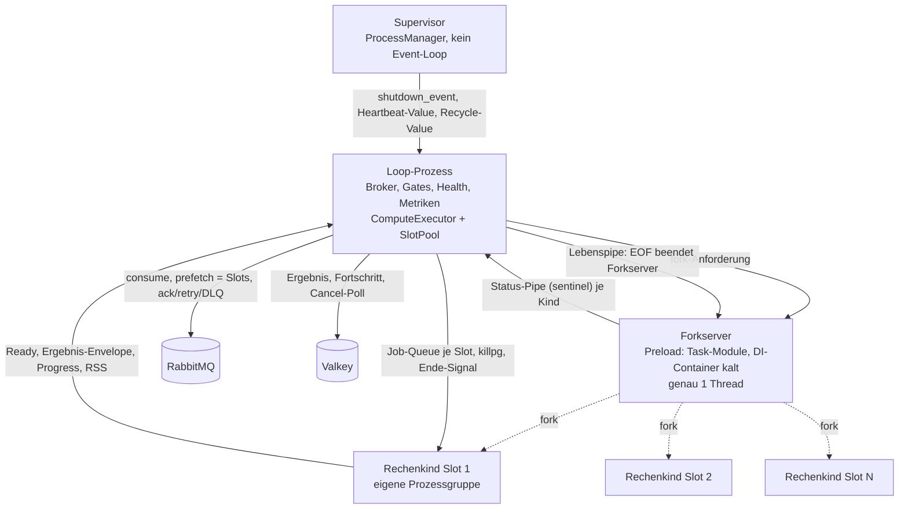
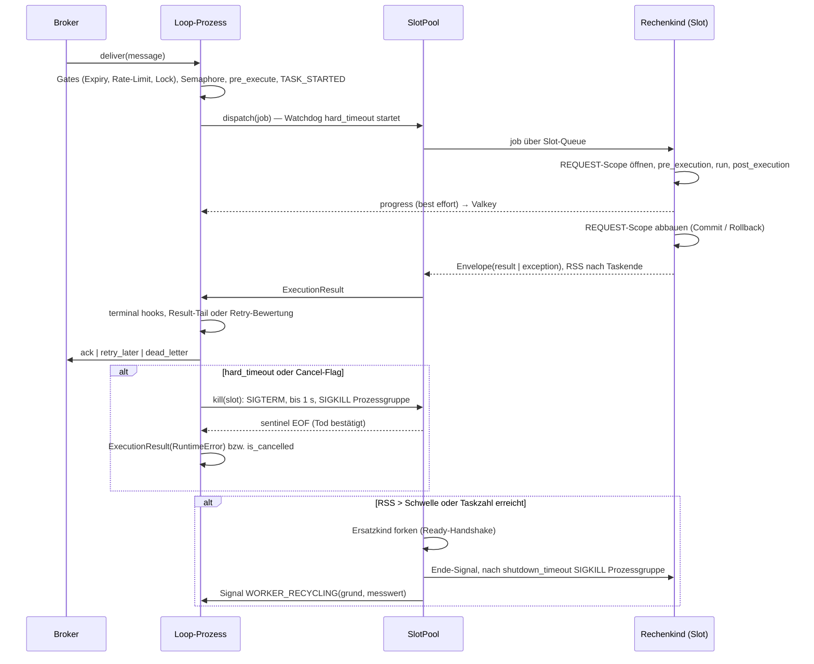
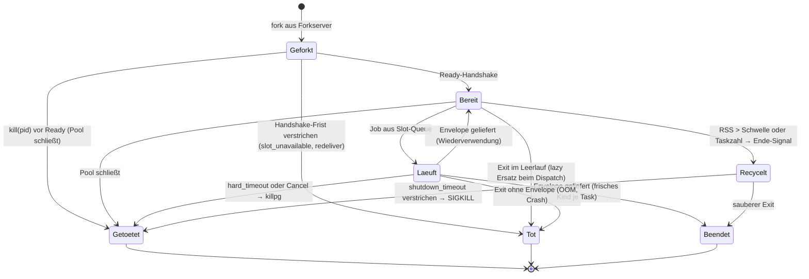

# CPU-Worker-Modus - Plan

## Goal Capsule

- **Objective:** swarmq bekommt einen CPU-Betriebsmodus: Ein Loop-Prozess, der nie rechnet, verteilt Tasks auf kurzlebige Rechenkinder aus einem vorgewärmten Forkserver, mit echter Killbarkeit über `hard_timeout` und Cancel (Phase 1). Als eigene, unabhängig lieferbare Phase im selben Plan bekommt der normale IO-Worker einen Lebenszeichen-Kanal zum Supervisor und Selbst-Recycling nach Taskzahl oder Speicher (Phase 2). Beide Phasen erscheinen als 0.5.0.
- **Product authority:** Der Product Contract in diesem Dokument: R-IDs für Produktverhalten, KTDs für Implementierungsmechanik, Units nur unit-lokal. `docs/cpu-worker-machbarkeit.md` ist die Messgrundlage; bei Widerspruch gilt dieser Plan.
- **Execution profile:** Python ≥ 3.14, uv-Toolchain, Tests gegen RabbitMQ 4 und Valkey 8 aus Docker; CPU-Modus POSIX-only, Messmechanik Linux (`/proc`). Umsetzung in vier Phasen A bis D (siehe Planning Contract); Phase B und C sind getrennt mergebar.
- **Stop conditions:** Stoppen und rückfragen, wenn (a) die Thread-Prüfung des Forkservers auf der Zielplattform nicht implementierbar ist, weil die Forkserver-PID nicht ermittelbar ist, (b) der Parent-Death-Mechanismus für Rechenkinder unter Python 3.14 nicht ohne C-Extension erreichbar ist, (c) die Ack-Invariante der Pipeline durch den Executor-Umbau verletzt werden müsste, (d) ein bestehender e2e-Test nur durch Verhaltensänderung des IO-Workers grün wird.
- **Tail ownership:** Der Implementierer liefert je Phase einen MR gegen `main` mit grüner CI; Chaos-Suite und Messnachweis sind lokale Gates vor dem Merge der Phase B.
- **Not active scope:** Task-Marker für Offload je Task (Ansatz A), `--autoscale` im CPU-Modus und Autoscaling auf Slot-Ebene sind benannte spätere Stufen.
- **Open blockers:** Keine.

**Product Contract preservation:** restructured und erweitert, kein Scope-Rückbau. Geändert: R8 trennt Cancel (Cancel-Pfad wie heute) vom `hard_timeout` (Fehlerpfad), weil „wie heute" beides meint; F3 entsprechend. Umformuliert ohne Bedeutungsänderung: R17 (der Container entsteht beim Import, wird im Forkserver nie aufgelöst). Ergänzt aus Planung und Flow-Analyse: R27 (Kind-Lebensdauer), R28 (Recycling-Voreinstellungen für DI-Kinder), R29 (Konfigurationsfehler-Exit), R30 (eigenes Ersatz-Budget), R31 (Betrieb ohne Supervisor). Die offene Frage zum DI-Status der Phoenix-Tasks ist beantwortet (mit DI) und in Dependencies aufgenommen.

---

## Product Contract

### Summary

Ein Worker startet mit `--pool cpu` in einem Betriebsmodus, in dem der Loop-Prozess ausschließlich Broker, Health, Metriken und Aufsicht bedient und jeden Task in ein Rechenkind aus einem vorgewärmten Forkserver auslagert. Tasks ohne DI bekommen ein frisches Kind je Task, Tasks mit DI ein wiederverwendetes Kind mit Recycling nach Speicher und Taskzahl. `hard_timeout` und Cancel töten das Kind und führen in den bekannten Fehlerpfad. Unabhängig davon läuft jeder Worker künftig unter einem Supervisor, meldet Lebenszeichen und kann sich nach konfigurierbaren Schwellen selbst recyceln.

### Problem Frame

swarmq ist reines asyncio und lagert rechenintensive Task-Körper nicht aus. Ein synchroner Pillow-, numpy- oder ImageMagick-Aufruf blockiert den Event-Loop und mit ihm alle nebenläufigen Tasks des Workers. Daraus folgen drei Probleme: CPU-Tasks laufen nicht wirklich parallel, ein `hard_timeout` greift nicht, weil asyncio-Cancel eine blockierte Loop nie erreicht, und jeder Betreiber mit CPU-Last baut das Offloading im Task-Körper selbst.

Der erste echte Anwendungsfall ist die Phoenix-Migration von taskiq: Bildpipeline (Konvertierung, Crop) und DTF-Verifier (ImageMagick). Dort laufen die Tasks heute in einem ThreadPool, der funktioniert, solange die Bibliothek die GIL freigibt. Er scheitert an zwei Stellen: Ein Thread ist nicht killbar, und ein Leak im Thread ist ein Leak im Worker. In Produktion gibt es OOM-Kills. Ihre Ursache ist unbegrenzte Nebenläufigkeit plus glibc-Speicherwachstum von rund 240 MB je 180 Bilder, nicht fehlende Killbarkeit. Der ThreadPool ist damit die Messlatte: Der CPU-Modus muss ihn im Durchsatz bei Vollauslastung mindestens erreichen und zusätzlich Isolation und Killbarkeit liefern. Die Latenz eines einzelnen Bildes bei niedriger Last darf mit einem Thread je Kind steigen.

Die Machbarkeit ist mit 52 Messpunkten aus sieben Serien belegt. Der tragende Fund: Ein Kind aus einem vorgewärmten Forkserver startet in 6 ms statt 114 ms bei `spawn` mit swarmq-Import. Bei 6 ms wird das Recycling-Problem gegenstandslos, weil ein frisches Kind je Task nichts kostet, was ein Leak überleben könnte.

### Key Decisions

- **Ansatz B: CPU-Modus als eigener Betriebsmodus mit Loop-Prozess und Rechenkindern aus dem Forkserver.** Nur die Prozessgrenze liefert Isolation und Killbarkeit; Offload-Primitive im Task (A), Aufsicht statt Auslagerung (C), Free-Threading, Subinterpreter und ThreadPool scheitern daran. (session-settled: user-approved — chosen over Ansatz A, Ansatz C, Free-Threading, Subinterpreter und ThreadPool: Abbrechbarkeit und Leak-Recycling sind Isolationsprobleme, und Isolation gibt es in CPython nur an der Prozessgrenze.) Governs R2, R6, R27.
- **Volle Ausbaustufe als erste Lieferung.** Die Phoenix-Migration startet mit dem kompletten CPU-Modus, nicht mit einer Zwischenlösung, obwohl die OOM-Ursache Nebenläufigkeit ist. (session-settled: user-directed — chosen over Concurrency-Deckel plus Selbst-Recycling im IO-Worker als erste Stufe: die Migration soll nicht auf einer Zwischenlösung aufsetzen.)
- **Aktivierung per Worker-Flag.** Ein Worker läuft komplett im CPU-Modus; der Betreiber trennt CPU-Last per Queue-Bindung. (session-settled: user-directed — chosen over Task-Marker in `TaskInfo` und Queue-Eigenschaft in der Konfiguration: Prefetch, Ack-Reihenfolge und Slot-Zahl sind Eigenschaften des Worker-Prozesses, nicht eines Tasks.) Governs R1.
- **`--processes` kombinierbar, `--concurrency` bedeutet Slots, `--autoscale` abgelehnt.** Kein neues Flag für die Slot-Zahl; Autoscaling-Schwellwerte sind auf IO-Worker zugeschnitten. (session-settled: user-directed — chosen over Exklusivität mit genau einem Loop-Prozess, Autoscale auf Slots und voller Orthogonalität: der Supervisor ist ohnehin Teil der Topologie, Autoscale braucht eigene Schwellwerte.) Governs R3, R4.
- **`hard_timeout` und Cancel töten das Rechenkind; der Task folgt dem Fehlerpfad wie heute.** Das ist die Killbarkeit, die der Modus verspricht. Auflage 5 der Machbarkeitsdoku (kein harter Kill mitten in der Rechnung) gilt für Recycling-Kills, nicht für deklarierte Timeouts. (session-settled: user-directed — chosen over reines Soft-Verhalten in Stufe 1 und Kill mit direkter DLQ-Zustellung: ein deklarierter Timeout ist eine Entscheidung des Task-Autors, und Retry-Semantik bleibt einheitlich.) Governs R8, R9.
- **Frisches Kind je Task ohne DI, wiederverwendetes Kind mit Recycling bei DI.** Maximale Isolation, wo sie nichts kostet; Amortisation des Verbindungsaufbaus, wo sie zählt. (session-settled: user-approved — chosen over einheitlicher Wiederverwendung: bei 6 ms Kindstart ist Isolation je Task kostenlos, nur DI-Verbindungen rechtfertigen Wiederverwendung.) Governs R6, R7, R26, R28.
- **Supervisor wird Standard, auch bei einem Prozess.** Lebenszeichen, Recycling und Restart funktionieren überall gleich. (session-settled: user-directed — chosen over Recycling nur unter Supervisor und Exit-Code-Recycling für systemd: Schutz soll kein Opt-in sein, und der Supervisor-Pfad existiert bereits für `--reload`.) Governs R20, R29.
- **Lebenszeichen standardmäßig an, Recycling-Schwellen Opt-in.** Kein stiller Verhaltenswechsel für Bestandsnutzer durch ungefragte Neustarts. (session-settled: user-approved — chosen over aktiven Recycling-Voreinstellungen: Schwellen hängen vom Workload ab und gehören dem Betreiber.) Governs R21, R22, R30, R31.
- **Beide Phasen als 0.5.0.** Ein Release, eine Ankündigung, keine Halbversion in Produktion. (session-settled: user-directed — chosen over getrennten Minors je Phase: die Phasen teilen die Recycling-Mechanik und sollen zusammen ankommen.) Governs R24.
- **Phase 2 im selben Plan statt eigenem Plan.** Beide Phasen teilen die Recycling-Mechanik; ein Dokument hält die Begrifflichkeit zusammen, die Umsetzung bleibt trennbar. (session-settled: user-directed 2026-08-31 — chosen over eigenem Plan für den IO-Worker-Schutz: der Rest von Ansatz C bekommt eigenständigen Umfang, aber keine eigene Begriffswelt.) Governs R23.
- **Der CPU-Modus ist POSIX-only.** Der Forkserver existiert auf Windows nicht; der IO-Worker-Schutz bleibt plattformneutral. (session-settled: user-approved — chosen over einem Spawn-Fallback für Windows: 114 ms Kindstart machen frische Kinder je Task unbezahlbar.) Governs R5.
- **Middleware-Hooks und Signale laufen im Loop-Prozess um den Offload; nur die DI-Auflösung passiert im Kind.** Übernommen aus der Machbarkeitsdoku; Hooks, die Kontext aus dem Task-Körper brauchen, sind eine Planungsfrage. Governs R12.

<!-- ce-section: work-relationships -->
### How This Work Fits Together

Dieser Plan besitzt zwei Phasen, die getrennt lieferbar sind und im selben Release erscheinen: Phase 1 ist der CPU-Betriebsmodus (R1 bis R19, R26 bis R28), Phase 2 der Schutz des IO-Workers (R20 bis R23, R29 bis R31). Die Aufteilung darüber hinaus ist der heutige Stand, keine festgelegte Roadmap.

- **Phase 2 — IO-Worker-Schutz.** Shares die Recycling-Mechanik mit Phase 1 (R23). Can proceed independently of Phase 1; ist ohne Phase 1 lieferbar.
- **Task-Marker für Offload je Task (Ansatz A).** Depends on Phase 1. Still to decide: ob ein Mischbetrieb in einem Worker den zweiten Bedeutungsraum für `--concurrency` und Prefetch rechtfertigt.
- **`--autoscale` im CPU-Modus und Autoscaling auf Slot-Ebene.** Depends on Phase 1 und eigenen Schwellwerten für Rechenslots.
- **Lasttest-Suite** (`docs/plans/2026-08-27-001-feat-swarmq-lasttest-suite-plan.md`). Enables die Abnahme des CPU-Modus über 24 Stunden und den `consumer_timeout`-Nachweis, die dieser Plan nicht führt. Voraussetzung: Der Lasttest-Plan bekommt ein Szenario, in dem die CPU-Worker-Container mit `--pool cpu` laufen; heute offloaden seine CPU-Archetypen im Task-Code. Ohne dieses Szenario ist der 24-Stunden-Nachweis für den CPU-Modus nicht erbracht.
- **Phoenix-Migration von taskiq.** Enabled by Phase 1; erster Anwendungsfall mit Bildpipeline und DTF-Verifier.

### Actors

- A1. **Betreiber** — startet Worker mit Flags, bindet Queues, setzt Schwellen und Umgebungsvariablen, liest Logs und Metriken. Im ersten Anwendungsfall das Phoenix-Team.
- A2. **Task-Autor** — schreibt Tasks mit `@task`, deklariert `hard_timeout`, `FromDishka`-Abhängigkeiten und Retry-Verhalten. Soll den Modus nicht in der Task-Signatur sehen.
- A3. **Supervisor** — Elternprozess ohne Event-Loop; startet, überwacht, ersetzt Worker- und Loop-Prozesse.
- A4. **Loop-Prozess** — der Worker im CPU-Modus; konsumiert vom Broker, prüft Gates, verteilt auf Slots, bestätigt Nachrichten, meldet Health und Metriken. Rechnet nie.
- A5. **Rechenkind** — aus dem Forkserver geforkt; führt genau den Task-Körper aus, löst DI auf, meldet Ergebnis und Fortschritt über den Rückkanal.
- A6. **IO-Worker-Prozess** — der heutige Worker mit Event-Loop unter dem Supervisor; sendet Lebenszeichen und recycelt sich nach Schwellen (Phase 2).

### Requirements

**Aktivierung und Topologie (Phase 1)**

- R1. Der Worker startet mit `--pool cpu` komplett im CPU-Modus. Ohne das Flag bleibt das Verhalten des IO-Workers unverändert.
- R2. Im CPU-Modus bedient der Loop-Prozess ausschließlich Broker, Health, Metriken, Gates und Aufsicht; jeder Task-Körper läuft in einem Rechenkind aus einem vorgewärmten Forkserver. Der Loop-Prozess führt nie einen Task-Körper aus.
- R3. `--concurrency` bedeutet im CPU-Modus die Zahl der Rechenslots. Die Voreinstellung ist die Zahl der dem Worker zugeteilten CPUs (CPU-Affinität und cgroup-Quote, aufgerundet), nicht die Kernzahl des Hosts und nicht 10. Bei `--processes N` wird die Voreinstellung durch N geteilt (mindestens 1), so dass die Summe der Slots die zugeteilten CPUs nicht übersteigt; eine explizite `--concurrency` übersteuert diese Aufteilung.
- R4. `--processes N` startet N Loop-Prozesse unter dem Supervisor, jeder mit eigenem Forkserver und eigenen Slots. `--autoscale` zusammen mit `--pool cpu` wird beim Start mit einer Fehlermeldung abgelehnt, die auf die spätere Stufe verweist.
- R5. Der CPU-Modus ist auf POSIX-Plattformen mit Forkserver verfügbar. Auf anderen Plattformen bricht der Start mit einer klaren Fehlermeldung ab.

**Ausführung, Isolation und Recycling (Phase 1)**

- R6. Ein Task ohne DI-Abhängigkeit läuft in einem frischen Rechenkind, das nach dem Task endet. Ein Task mit DI-Abhängigkeit läuft in einem wiederverwendeten Kind seines Slots; das Kind wird recycelt, wenn sein RSS nach Taskende eine Schwelle überschreitet (primär) oder es eine Taskzahl erreicht hat (zweite Linie). Gemessen wird nach Taskende, nie währenddessen.
- R7. Recycling ist rollierend: Das Ersatzkind ist startbereit, bevor das alte Kind endet, der Slot liegt nicht brach. Jedes Recycling wird mit Grund und Messwert als Log-Eintrag und als Metrik ausgegeben.
- R8. Überschreitet ein Task seinen `hard_timeout` oder wird er abgebrochen, tötet der Loop-Prozess das Rechenkind. Der Kill trifft das Rechenkind samt allen von ihm gestarteten Prozessen, weil jedes Kind eine eigene Prozessgruppe bildet; nach dem Kill lebt kein Nachkomme des Kindes mehr. Nach `hard_timeout` folgt der Task dem heutigen Fehlerpfad: Retry bis `max_retries`, danach DLQ. Nach Cancel endet er wie heute im Cancel-Pfad: als abgebrochen markiert, ohne Retry, mit `TASK_CANCELLED`. Der Kill ist bestätigt, bevor die Nachricht bewertet wird; der Slot ist binnen einer Sekunde wieder nutzbar.
- R9. Stirbt ein Rechenkind ohne Ergebnis, etwa durch den OOM-Killer, wird der Task bei at-least-once-Zustellung wie ein Taskfehler behandelt und geht nie verloren: Er läuft durch die Retry-Bewertung des Workers mit Retry-Zähler, Backoff und DLQ nach `max_retries`, nicht über Nack mit Requeue, damit auch ein deterministisch sterbender Task die DLQ erreicht. Der Loop-Prozess beendet verbliebene Nachkommen des toten Kindes. Der Slot ist danach sofort wieder nutzbar.
- R10. Bei at-least-once-Zustellung bestätigt der Loop-Prozess eine Nachricht erst, nachdem das Ergebnis des Kindes vorliegt oder der Fehlerpfad entschieden ist, nie vor dem Offload. Tasks im Zustellmodus fire-and-forget werden wie heute vor der Ausführung und damit vor dem Offload bestätigt; stirbt ihr Kind, ist der Task wie heute verloren.
- R11. Der Loop-Prozess hält höchstens so viele Nachrichten unbestätigt, wie er Rechenslots hat.
- R12. Expiry, Rate-Limit, Lock und `max_concurrency` greifen im Loop-Prozess vor dem Offload, unverändert zum IO-Worker. Middleware-Hooks und Signale laufen im Loop-Prozess um den Offload. Der Task-Körper umfasst `pre_execution`, `run` und `post_execution`; alle drei laufen im Rechenkind, weil ihre `FromDishka`-Injektion den REQUEST-Container des Kindes braucht. `update_progress()` läuft über den Rückkanal vom Kind zum Loop-Prozess, der nach Valkey schreibt. Cancel erkennt der Loop-Prozess wie heute per Valkey-Poll und tötet das Kind (per R8).
- R13. Für den Task-Autor bleiben Signatur, Rückgabewert, Retry-, Lock- und Rate-Limit-Semantik unverändert. Fünf Verhaltensänderungen sind dokumentiert: APP-scoped DI-Singletons leben nur so lange wie ihr Rechenkind; N Slots bedeuten N Verbindungspools; bei `hard_timeout`, Cancel oder Kindtod laufen REQUEST-Scope-Finalizer nur, wenn das Kind auf SIGTERM binnen einer Sekunde reagiert, sonst kein Rollback durch yield-Provider (eine offene Datenbanktransaktion rollt der Server beim Verbindungsabbruch zurück, Autocommit-Folgen und externe Seiteneffekte nicht); `hard_timeout` deckt im CPU-Modus Fork, DI-Aufbau und alle drei Lifecycle-Methoden, nicht nur `run`; `soft_timeout` kann einen blockierenden Körper im Kind so wenig unterbrechen wie heute.
- R26. Das Rechenkind baut den REQUEST-Scope des DI-Containers selbst ab, bei normalem Ende ohne Fehler und bei einer Exception mit dieser Exception, bevor es das Ergebnis oder den Fehler an den Loop-Prozess meldet. yield-Provider erhalten damit Commit und Rollback wie heute; nur ein Kill nach R8 oder ein Kindtod nach R9 überspringt den Abbau (per R13).
- R27. Die Lebensdauer eines Rechenkinds ist an den Loop-Prozess gebunden: Stirbt der Loop-Prozess, auch per SIGKILL, lebt binnen einer Sekunde kein Rechenkind mehr; Nachkommen des Kindes (etwa ImageMagick) sterben in diesem Fall nach bestem Bemühen. Die Überlappung zwischen Kind und Redelivery seiner Nachricht beträgt höchstens eine Sekunde, unter Linux mit Parent-Death-Signal praktisch null.
- R28. Für wiederverwendete DI-Kinder gelten Recycling-Voreinstellungen aus der H-Serie: RSS-Schwelle 250 MB nach Taskende, zweite Linie 1000 Tasks. Beide sind konfigurierbar und im Startlog sichtbar.

**Startbedingungen des Forkservers (Phase 1)**

- R14. Der Forkserver-Preload importiert, rechnet aber nie. Der Worker prüft nach dem Preload, dass der Forkserver genau einen Thread hat, und bricht sonst den Start ab.
- R15. Die Thread-Limits der Rechenbibliotheken (`OMP_NUM_THREADS`, `OPENBLAS_NUM_THREADS`, `MKL_NUM_THREADS`, `NUMEXPR_NUM_THREADS`, `MAGICK_THREAD_LIMIT`) sind gesetzt, bevor der Forkserver startet. Voreinstellung ist ein Thread je Kind; der Betreiber kann sie überschreiben.
- R16. `MALLOC_TRIM_THRESHOLD_` und `MALLOC_ARENA_MAX` sind wie die Thread-Limits aus R15 in der Umgebung des Loop-Prozesses gesetzt, bevor der Forkserver startet, und gelten damit für alle Rechenkinder; im Kind gesetzt wären sie wirkungslos, weil glibc die Werte nur beim Prozessstart liest. Die Voreinstellung und ihre Laufzeitkosten von rund 14 Prozent je Bild sind dokumentiert; der Betreiber kann sie überschreiben.
- R17. Der DI-Container entsteht beim Import des Task-Moduls, also auch im Forkserver-Preload, wird dort aber nie aufgelöst; Provider werden ausschließlich im Rechenkind aufgelöst. Ein Provider, der beim Import eine Verbindung öffnet, ist als Fehler des Task-Autors dokumentiert.
- R18. Eine `FromDishka`-Annotation, die keinen Dependency-Key ergibt (etwa `FromDishka[X] | None = None`), führt beim Worker-Start zu einem `ConfigurationError`. Das gilt in allen Worker-Modi.
- R19. Die maximale Tasklaufzeit ist eine Brokereinstellung. Die Dokumentation des CPU-Modus benennt RabbitMQs `consumer_timeout` von 30 Minuten, und der Worker warnt beim Start, wenn ein registrierter Task einen `hard_timeout` über dem konfigurierten Broker-Timeout hat.

**Schutz des IO-Workers (Phase 2)**

- R20. `swarmq worker` startet immer einen Supervisor mit einem Worker-Prozess darunter, auch ohne `--processes` oder `--autoscale`. Der Changelog von 0.5.0 nennt diesen Wechsel im Startverhalten. Endet der Worker-Prozess sauber mit Exit-Code 0, etwa nach dem Drain im `--burst`-Modus, füllt der Supervisor den Slot nicht nach und endet selbst mit Exit-Code 0, sobald kein Worker mehr läuft. Die Recycling-Absicht nach R22 meldet der Worker dem Supervisor über einen eigenen Kanal, nicht über den Exit-Code.
- R21. Jeder Worker-Prozess sendet dem Supervisor regelmäßig ein Lebenszeichen aus seinem Event-Loop; das ist standardmäßig an. Bleibt das Lebenszeichen länger als eine konfigurierbare Frist aus, gilt der Worker als hängend, und der Supervisor ersetzt ihn. Die Nachrichten des hängenden Workers gehen per Redelivery an andere Worker. Eine Nachricht, deren Worker wegen ausbleibendem Lebenszeichen ersetzt wurde, zählt als fehlgeschlagener Zustellversuch; nach dem Delivery-Limit der Queue landet sie in der DLQ, damit ein einzelner blockierender Task nicht fortlaufend Worker ersetzt. Die Dokumentation nennt Quorum-Queues mit Delivery-Limit als Voraussetzung, und der Worker warnt beim Start, wenn eine konsumierte Queue kein Limit trägt. Der Lebenszeichen-Kanal zum Supervisor ist ein neuer Kanal, getrennt vom bestehenden In-Process-Signal `WORKER_HEARTBEAT`, das nur Hook-Handler innerhalb des Workers erreicht.
- R22. Ein Worker recycelt sich selbst, wenn sein RSS nach Taskende eine Schwelle überschreitet oder er eine Taskzahl erreicht hat. Beide Schwellen sind Opt-in und standardmäßig aus. Das Recycling ist graceful: Der Worker nimmt keine neuen Nachrichten an, wartet ohne erzwungenen Abbruch auf das Ende laufender Tasks (Frist: größter registrierter `hard_timeout` plus Puffer) und endet; der Supervisor startet den Ersatz, bevor der alte Worker endet. Ein Recycling verbraucht keinen Retry eines laufenden Tasks.
- R23. Recycling-Messung, Recycling-Grund und die Form von Log-Eintrag und Metrik sind in Phase 1 und Phase 2 dieselben (per R7).
- R29. Ein Konfigurationsfehler beim Worker-Start (per R4, R5, R14, R18) beendet den Worker-Prozess mit einem eigenen Exit-Code; der Supervisor startet ihn nicht neu, sondern beendet alle Worker und endet selbst mit Fehler. Es gibt genau einen Startversuch.
- R30. Ersatz wegen ausbleibendem Lebenszeichen und Selbst-Recycling zählen nicht gegen das Neustart-Budget für Abstürze, sondern gegen einen eigenen Zähler mit Grenze 2 × Delivery-Limit je Stunde. Eine Nachricht, die einen Worker zum wiederholten Ersatz bringt, läuft ab dem vorletzten Zustellversuch über den Anwendungs-Dead-Letter des Workers mit Fehlerergebnis, Workflow-Fail, Unique-Freigabe und `TASK_DLQ`, nicht stumm über die Broker-DLX.
- R31. Läuft ein Worker ohne Supervisor, etwa eingebettet über die Bibliotheks-API, ist das Lebenszeichen wirkungslos; gesetzte Recycling-Schwellen erzeugen beim Start eine Warnung, und ein Recycling endet als sauberer Exit mit Code 0 für den äußeren Prozessmanager.

**Release und Dokumentation**

- R24. Beide Phasen erscheinen als 0.5.0. Phase 2 ist ohne Phase 1 lieferbar; scheitert Phase 1, verschiebt sich nur Phase 1. Der Changelog führt neben dem Startverhaltens-Wechsel aus R20 auch die neue Startprüfung aus R18 als Breaking Change auf, mit dem betroffenen Signaturmuster und der Korrektur.
- R25. Die Dokumentation bekommt eine Seite zum CPU-Modus mit Aktivierung, CPU-Dimensionierung (Slots = zugeteilte CPUs, Pillow skaliert nur bis zur Kernzahl), Speicherdimensionierung (Speicherbedarf = Slots × RSS-Schwelle + Loop-Prozess + Forkserver + ein Ersatzkind + RSS ruhender DI-Kinder bei gemischten Workloads, Schwelle aus dem cgroup-Limit abgeleitet), dem Latenz-Trade-off eines Threads je Kind samt Übersteuerung der Thread-Limits für latenzkritische Queues, Verbindungsvervielfachung, Lebensdauer von APP-Singletons, fehlenden Finalizern nach Kill, MALLOC-Voreinstellungen samt Kosten, `consumer_timeout` und dem Verhältnis zu `--processes`.

### Key Flows

- F1. Task ohne DI im CPU-Modus
  - **Trigger:** Der Loop-Prozess erhält eine Nachricht und hat einen freien Slot.
  - **Actors:** A4, A5
  - **Steps:** Gates prüfen (R12); frisches Kind aus dem Forkserver forken; Task-Körper im Kind ausführen; Ergebnis über den Rückkanal empfangen; Ergebnis speichern, Signale auslösen; Nachricht bestätigen (R10); Kind endet.
  - **Covered by:** R2, R6, R10, R12

- F2. Task mit DI, Kind-Wiederverwendung und Recycling
  - **Trigger:** Ein Task mit `FromDishka`-Abhängigkeit trifft auf einen Slot mit warmem Kind.
  - **Actors:** A4, A5
  - **Steps:** Task an das Kind des Slots übergeben; Kind löst DI auf, führt aus und baut den REQUEST-Scope ab (R26); Ergebnis über den Rückkanal; Loop-Prozess misst RSS des Kindes nach Taskende; liegt es über der Schwelle oder ist die Taskzahl erreicht, startet das Ersatzkind, dann erhält das alte Kind das Ende-Signal; Recycling wird mit Grund und Messwert geloggt und gemessen.
  - **Covered by:** R6, R7, R12, R13, R26

- F3. `hard_timeout` oder Cancel im CPU-Modus
  - **Trigger:** Ein Task überschreitet seinen `hard_timeout`, oder ein Cancel für seine Task-ID liegt vor.
  - **Actors:** A4, A5
  - **Steps:** Loop-Prozess tötet die Prozessgruppe des Rechenkinds; Slot wird freigegeben; nach `hard_timeout` geht der Task in den Fehlerpfad (Retry oder DLQ), nach Cancel in den Cancel-Pfad ohne Retry; Signale wie heute; Nachricht wird bestätigt.
  - **Covered by:** R8, R10

- F4. Kindtod ohne Ergebnis
  - **Trigger:** Ein Rechenkind endet unerwartet, etwa durch den OOM-Killer.
  - **Actors:** A4, A5
  - **Steps:** Loop-Prozess erkennt das Ende ohne Ergebnis; Task geht in den Fehlerpfad; Slot bekommt bei Bedarf ein neues Kind; Nachricht wird nicht vor der Entscheidung bestätigt.
  - **Covered by:** R9, R10, R11

- F5. Startbedingung verletzt
  - **Trigger:** `--pool cpu` mit `--autoscale`, auf einer Plattform ohne Forkserver, mit einem Preload, der rechnet, oder mit einer wirkungslosen `FromDishka`-Annotation.
  - **Actors:** A1, A4
  - **Steps:** Worker prüft die Bedingung beim Start; bricht mit einer Fehlermeldung ab, die die verletzte Bedingung benennt; kein Prozess bleibt zurück.
  - **Covered by:** R4, R5, R14, R18

- F6. IO-Worker recycelt sich selbst (Phase 2)
  - **Trigger:** Nach Taskende überschreitet der RSS die gesetzte Schwelle oder die Taskzahl ist erreicht.
  - **Actors:** A3, A6
  - **Steps:** Worker meldet Recycling-Absicht mit Grund und Messwert; Supervisor startet den Ersatz; Worker nimmt keine neuen Nachrichten an, beendet laufende Tasks, endet; Log und Metrik wie in Phase 1.
  - **Covered by:** R20, R22, R23

- F7. IO-Worker hängt (Phase 2)
  - **Trigger:** Das Lebenszeichen eines Workers bleibt länger als die konfigurierte Frist aus.
  - **Actors:** A3, A6
  - **Steps:** Supervisor markiert den Worker als hängend; startet den Ersatz; beendet den hängenden Worker mit SIGTERM, nach Frist mit SIGKILL; unbestätigte Nachrichten gehen per Redelivery an andere Worker.
  - **Covered by:** R20, R21

### Acceptance Examples

- AE1. **Covers R6, R7.** Given ein Slot mit warmem DI-Kind und einer RSS-Schwelle von 300 MB, when ein Task endet und der RSS des Kindes bei 320 MB liegt, then startet ein Ersatzkind, das alte Kind erhält das Ende-Signal, und Log sowie Metrik nennen Grund `rss` und den Messwert 320 MB.
- AE2. **Covers R6.** Given ein Task ohne `FromDishka`-Parameter, when er zehnmal hintereinander läuft, then wurde jeder Lauf in einem eigenen Rechenkind ausgeführt, und nach dem zehnten Lauf lebt keines dieser Kinder mehr.
- AE3. **Covers R8.** Given ein Task mit `hard_timeout=5` und `max_retries=1`, when sein Körper 60 Sekunden rechnet, then ist das Rechenkind nach etwa 5 Sekunden tot, der Task wird einmal wiederholt, landet danach in der DLQ, und der Slot hat inzwischen weitere Tasks ausgeführt.
- AE4. **Covers R9, R10.** Given ein Rechenkind wird während der Ausführung von außen mit SIGKILL beendet, when der Loop-Prozess das bemerkt, then wurde die Nachricht bis dahin nicht bestätigt, der Task folgt dem Fehlerpfad, und derselbe Slot führt den nächsten Task aus.
- AE5. **Covers R11.** Given ein Loop-Prozess mit 4 Slots und 100 wartenden Nachrichten, when alle Slots belegt sind, then hält der Loop-Prozess genau 4 Nachrichten unbestätigt, und ein zweiter Worker an derselben Queue erhält die übrigen.
- AE6. **Covers R4.** Given der Aufruf `swarmq worker --pool cpu --autoscale 2,8`, when der Worker startet, then bricht er vor dem Broker-Connect mit einer Fehlermeldung ab, die die Kombination als nicht unterstützt benennt.
- AE7. **Covers R14.** Given ein Preload-Modul, das beim Import eine numpy-Berechnung mit mehreren Threads ausführt, when der Worker im CPU-Modus startet, then stellt er fest, dass der Forkserver mehr als einen Thread hat, und bricht den Start ab.
- AE8. **Covers R18.** Given ein Task mit Parameter `db: FromDishka[Database] | None = None`, when der Worker startet, then endet er mit einem `ConfigurationError`, der den Task und den Parameter benennt.
- AE9. **Covers R12, R13.** Given ein Task mit Rate-Limit und `FromDishka`-Abhängigkeit im CPU-Modus, when Nachrichten schneller eintreffen als das Limit erlaubt, then greift das Rate-Limit im Loop-Prozess vor dem Offload, und die Abhängigkeit wird im Rechenkind aufgelöst, ohne dass der Task-Autor seine Signatur ändern musste.
- AE10. **Covers R20, R22.** Given `swarmq worker` ohne `--processes` und mit einer Taskzahl-Schwelle von 500, when der 500. Task endet, then startet der Supervisor einen Ersatz-Worker, der alte Worker nimmt keine neuen Nachrichten an, beendet laufende Tasks und endet, und kein Task ist verloren.
- AE11. **Covers R21.** Given ein IO-Worker, dessen Event-Loop durch einen synchronen Aufruf blockiert ist, when die Lebenszeichen-Frist verstreicht, then ersetzt der Supervisor den Worker, und die unbestätigten Nachrichten werden an einen anderen Worker zugestellt. Blockiert dieselbe Nachricht auch den Ersatz-Worker, landet sie spätestens nach dem Delivery-Limit der Queue in der DLQ, mit Fehlerergebnis im Backend und `TASK_DLQ`-Signal, statt weitere Worker zu ersetzen.
- AE12. **Covers R22.** Given `swarmq worker` ohne gesetzte Recycling-Schwellen, when der Worker 10.000 Tasks ausführt, then wurde er kein einziges Mal recycelt.
- AE13. **Covers R8.** Given ein Task mit `hard_timeout=5`, der ImageMagick als Subprozess startet und 60 Sekunden rechnet, when der Timeout greift, then sind Rechenkind und ImageMagick-Prozess tot, bevor der Task in den Fehlerpfad geht, und kein Prozess aus der Prozessgruppe des Kindes lebt weiter.
- AE14. **Covers R26, R13.** Given ein Task mit einem REQUEST-scoped yield-Provider, der bei Erfolg committet und bei Exception zurückrollt, when der Task im Rechenkind eine Exception wirft, then läuft der Rollback im Kind, bevor der Loop-Prozess den Fehlerpfad entscheidet, und der Task landet nach `max_retries` in der DLQ. Wird derselbe Task stattdessen per `hard_timeout` gekillt, läuft kein Rollback, und die Dokumentation nennt genau diesen Fall.

### Success Criteria

- Die 52 Messpunkte aus `docs/cpu-worker-machbarkeit.md` sind gegen die Implementierung reproduzierbar, insbesondere Kindstart im einstelligen Millisekundenbereich, Ack-Reihenfolge und Redelivery der I-Serie und das Recycling der H-Serie.
- Bildpipeline und DTF-Verifier aus Phoenix laufen im CPU-Modus mit Slots = zugeteilte CPUs, ohne dass der Loop-Prozess für Health oder Broker-Heartbeat blockiert.
- Bildpipeline und DTF-Verifier erreichen im CPU-Modus bei Vollauslastung mindestens den Durchsatz des heutigen ThreadPool-Betriebs in Phoenix, gemessen an einer Baseline aus dem Messfenster vor der Migration.
- Unter Dauerlast der Bildpipeline bleibt der Gesamt-RSS eines Loop-Prozesses samt Rechenkindern unter Slots × RSS-Schwelle plus Grundlast, gemessen nach Taskende, und über die Abnahmedauer tritt kein OOM-Kill auf.
- Ein Task, dessen Kind stirbt oder gekillt wird, ist im Backend als fehlgeschlagen oder in der DLQ sichtbar, nie verschwunden.
- Jedes Recycling ist in Logs und Metriken mit Grund und Messwert nachvollziehbar.
- Bestehende Unit-, Integrations- und e2e-Suiten bleiben grün; der IO-Worker verhält sich ohne gesetzte Schwellen wie vor 0.5.0, abgesehen vom zusätzlichen Supervisor-Prozess und dem Ersatz bei ausbleibendem Lebenszeichen.

### Scope Boundaries

**Deferred for later**

- Task-Marker für Offload je Task (Ansatz A) und Mischbetrieb von IO- und CPU-Tasks in einem Worker.
- `--autoscale` im CPU-Modus und Autoscaling auf Slot-Ebene.
- Recycling-Kill mitten in der Rechnung, etwa bei RSS-Überschreitung während eines Tasks. Den Host vor OOM schützt das cgroup-Limit.
- Dauerlauf über 24 Stunden und der Nachweis, dass `consumer_timeout` bei Langläufern greift. Beides gehört in die Lasttest-Suite, die dafür ein Szenario mit `--pool cpu` braucht (siehe How This Work Fits Together).
- Windows-Unterstützung des CPU-Modus.
- Automatische Erkennung von Providern, die beim Import verbinden (R17 dokumentiert, prüft aber nicht).

**Outside this product's identity**

- ThreadPool-Offload als eingebaute Alternative. Er ist die Messlatte, nicht das Ziel.
- Subinterpreter als Isolationsmechanismus. NumPy lädt dort nicht.

### Dependencies / Assumptions

- Python 3.14 mit funktionierendem `forkserver`-Startverfahren und Preload auf der Zielplattform.
- Der Branch `cpu-worker-machbarkeit` (Merge Request !44 mit `docs/cpu-worker-machbarkeit.md`, den Prototypen `prototypes/cpu_worker_*.py` und der Korrektur von `docs/worker-architecture.md`) ist in `main` gemergt, bevor die Planung beginnt; die hier zitierten Dateien existieren bis dahin nur dort.
- Der Host-OOM-Schutz kommt vom cgroup-Limit des Deployments, nicht vom Worker.
- RabbitMQ 4.x mit `consumer_timeout` von 30 Minuten als Broker des ersten Anwendungsfalls; Valkey als Backend für Ergebnis, Fortschritt und Cancel.
- Der Supervisor-Pfad existiert und wird heute bei `--processes` größer 1, `--autoscale` und `--reload` genutzt; R20 macht ihn zum Standard, ohne ihn neu zu erfinden.
- Die Amortisation der Kind-Wiederverwendung ist eine Untergrenze, gemessen mit einem 4-ms-Valkey-Ping; mit echten Datenbankpools fällt sie höher aus.
- Die Phoenix-Tasks sind in Argumenten und Rückgabewerten serialisierbar (Broker-Serialisierung heute, Pickle über den Rückkanal).
- Die Phoenix-Tasks (Bildpipeline, DTF-Verifier) nutzen `FromDishka`; der Abnahmepfad ist damit die Kind-Wiederverwendung mit Recycling (F2), das frische Kind je Task (F1) wird gleichwertig getestet.

### Outstanding Questions

**Resolve Before Planning**

Keine.

**Deferred to Implementation**

- Genaue Fristen für Ready-Handshake und Ende-Signal unter CI-Last; Voreinstellungen stehen in KTD4 und KTD10, Feintuning nach den ersten Läufen der Chaos-Suite.
- Zugriff auf die Forkserver-PID ohne private multiprocessing-Interna; Fallback per Warnung ist in KTD14 festgelegt.
- Mechanik des Parent-Death-Signals unter Python 3.14 (ctypes-`prctl` oder Pipe-EOF allein); Anforderung steht in R27, Stop-Bedingung (b) in der Goal Capsule.
- Name und Hierarchie der Exception für Kindtod im Fehlerpfad; Verhalten ist durch KTD2 festgelegt.

### Sources / Research

- `docs/cpu-worker-machbarkeit.md` — Entscheidung, verworfene Alternativen, 52 Messpunkte (Serien A bis I), zwölf Auflagen, Nutzerentscheidungen vom 2026-08-31.
- `prototypes/cpu_worker_feasibility.py`, `prototypes/cpu_worker_integration.py`, `prototypes/cpu_worker_parallel.py`, `prototypes/cpu_worker_lifecycle.py` — Messprogramme, die als Referenz für die Success Criteria dienen.
- `docs/worker-architecture.md` Abschnitt 2.3 — `spawn` für Worker-Subprozesse, `forkserver` für Rechenkinder, mit Messtabelle.
- `src/swarmq/cli/__init__.py:249-253` — der Supervisor-Pfad wird heute bei `--processes` größer 1, `--autoscale` und `--reload` gewählt.
- `src/swarmq/cli/parser.py:101-105` — `--concurrency` mit Voreinstellung 10.
- `src/swarmq/worker/pipeline.py:708` — Gate-Reihenfolge Expiry, Rate-Limit, Lock vor der Ausführung; DI-Teardown und Lock-Freigabe im `finally`.
- `src/swarmq/worker/execution.py:256-273` — heutiger `hard_timeout` als asyncio-Watchdog ohne Prozess-Kill.
- `src/swarmq/process_manager/supervisor.py:98-114,170` — Restart-Fenster, Autoscale-Schwellwerte, `spawn`-Kontext; keine RSS-Überwachung, kein Lebenszeichen-Kanal.
- `src/swarmq/task.py:83-110` — Felder von `TaskInfo`; kein Feld für den Ausführungsort.
- Phoenix-Repo, `docs/solutions/infrastructure/2026-08-28-worker-cpu-oom-vollanalyse.md` — OOM-Ursache, glibc-Wachstum, `MALLOC_TRIM_THRESHOLD_`-Messung.
- `docs/plans/2026-08-27-001-feat-swarmq-lasttest-suite-plan.md` — Lasttest-Suite als Produktions-Gate, übernimmt Dauerlauf und `consumer_timeout`-Nachweis.

---

## Planning Contract

### Key Technical Decisions

- KTD1. **Der CPU-Modus ist ein eigener `ComputeExecutor` hinter der bestehenden Executor-Schnittstelle, in einem neuen Paket `swarmq.worker.compute`.** Die Pipeline wählt beim Start den Executor nach Pool-Modus und bleibt sonst unverändert. Die Executor-Schnittstelle bekommt `start()` und `aclose()`: `start()` läuft in `WorkerLifecycle.start()` nach dem Forkserver-Bootstrap, `aclose()` in `_execute_shutdown` nach dem Drain und vor `broker.close()` (Reihenfolge: `cancel_consume` → Drain → `pool.aclose()` → Locks → `broker.close()`). Grund: `worker/pipeline.py` steht am 800-Zeilen-Limit der Architektur-Guards, die Ack-Invariante (genau ein Broker-Verb je Zustellung, nur Runner und Result-Tail sprechen Ack) darf kein zweiter Pfad umgehen, und `TaskExecutor.execute` liefert bereits ein `ExecutionResult`, das die Pipeline auswertet. Governs R2, R12.
- KTD2. **Timeout und Kindtod werden als heutiges Fehlerergebnis abgebildet, Cancel als heutiges Cancel-Ergebnis; `execute` lässt nie eine Exception entkommen.** Der `ComputeExecutor` liefert bei `hard_timeout` und Kindtod ein `ExecutionResult` mit `RuntimeError`, genau wie der heutige Watchdog; bei Cancel `is_cancelled=True`. Auch der Abbruch des Handlers am Drain-Ende wird so abgebildet (Kill, Tod bestätigen, Fehlerergebnis), nie als propagierter `CancelledError`: Ein propagierter Abbruch träfe den Terminal-Default des `finally` in `_handle_message`, der Schedfire-Completed-Marker und Unique-Freigabe auf eine unbestätigte Nachricht schreibt (Lehre aus `docs/solutions/logic-errors/schedfire-retry-dedup-collision-silent-drop-2026-06-02.md`). Damit laufen Retry, DLQ und Signale ohne neuen Code durch `_resolve_error_path` und `RetryHandler.evaluate`. (session-settled: user-approved — chosen over Cancel im Retry-Pfad: ein stornierter Task darf nicht bis `max_retries` erneut laufen; „Fehlerpfad wie heute" heißt auch „Cancel wie heute".) Governs R8, R9.
- KTD3. **Jedes Rechenkind bildet eine eigene Prozessgruppe; der Kill ist zweistufig und synchron; die Lebensdauer hängt über den Forkserver am Loop-Prozess.** Das Kind ruft nach dem multiprocessing-Bootstrap `setpgid(0, 0)`; bis zum Ready-Handshake tötet der Pool per PID, danach per `killpg`. Kill: SIGTERM an die Gruppe, bis zu einer Sekunde Gnade für den REQUEST-Teardown, dann SIGKILL; danach wartet der Pool auf den Tod des Kindes über den `Process.sentinel` (Frist 1 s), erst dann liefert der Executor das `ExecutionResult`. Bleibt das Kind unreapbar (D-State), bleibt der Slot blockiert, Log `compute_child_unreaped`, die Nachricht wird trotzdem bewertet. Lebensdauer: Der Forkserver endet beim EOF seiner Lebenspipe, die nur der Loop-Prozess hält; das Kind setzt `PR_SET_PDEATHSIG` (Linux) und stirbt damit mit dem Forkserver, eine zweistufige Kette, die den stillen Forkserver-Neustart (KTD4) zur Voraussetzung hat. Nachkommen des Kindes verlieren das Signal beim `exec`; nach einem SIGKILL des Loop-Prozesses sterben sie nur nach bestem Bemühen. Portable Rückfallebene ist das EOF der Job-Pipe. Governs R8, R27.
- KTD4. **Der Slot-Pool hat eine Job-Queue je Slot, einen Ready-Handshake, einen Watchdog ab Dispatch und den Sentinel als Todesmelder.** Jedes Slot-Kind meldet Bereitschaft binnen kurzer Frist. Bleibt sie vor der Job-Übergabe aus, ist das ein Slot-Fehler, kein Kindtod: Das `ExecutionResult` trägt `slot_unavailable`, `_resolve_error_path` bildet es bei at-least-once auf `redeliver` ohne Zähler ab (das Delivery-Limit begrenzt die Schleife), bei fire-and-forget bleibt der Verlust wie heute. Der `hard_timeout` läuft ab Dispatch und deckt Fork, DI-Aufbau und alle drei Lifecycle-Methoden. Kindtod erkennt der Pool über `Process.sentinel` per `add_reader`, nicht per Polling; ein im Zustand „bereit" gestorbenes Kind wird beim nächsten Dispatch lazy ersetzt. Das Ende-Signal beim Recycling hat eine Frist in Höhe von `shutdown_timeout`, danach Kill nach KTD3. Ein Slot hält höchstens ein wiederverwendetes DI-Kind; frische Kinder für Tasks ohne DI laufen daneben, das ruhende DI-Kind bleibt warm (Speicherfolge in R25). Muster: `prototypes/cpu_worker_lifecycle.py::SlotPool`. Governs R6, R7, R11, R28. **Nachtrag 2026-09-05 (nach ce-code-review):** Umgesetzt wurde je Kind eine eigene Pipe als Rückkanal statt einer gemeinsamen Queue; das EOF des Kanals ist die Todesmeldung und steht in derselben FIFO hinter dem letzten Ergebnis, der `Process.sentinel` ist nur noch Rückfallebene mit Gnadenfrist. Die Job-Übergabe an wiederverwendete Kinder läuft über eine Pipe je Kind, Ergebnisse werden per `task_id` geprüft. Quelle der Wahrheit ist der Modul-Docstring von `src/swarmq/worker/compute/pool.py`.
- KTD5. **Der Rückkanal transportiert einen minimalen Job und einen typerhaltenden Envelope; das Ergebnis wird im Kind kodiert.** Zum Kind reisen nur `task_name`, `args`, `kwargs`, `task_id`, `queue`, `retry_count` und die Log-Konfiguration; die aio_pika-Nachricht bleibt im Loop-Prozess. Zurück kommt ein Envelope: das Ergebnis bereits als Bytes aus `encode_result`, damit ein nicht serialisierbarer Rückgabewert genau wie heute als gespeichertes Fehlerergebnis ohne Retry landet (`_encode_with_fallback`); Exceptions picklebar unverändert, sonst als Modul, Qualname, Text und Traceback, im Loop-Prozess per Import rekonstruiert (`Retry` samt `delay`, `NoRetry`, alle `retry_exceptions`-Typen), Rückfall `RemoteTaskError(RuntimeError)` mit `remote_type`. Fortschritt geht über einen duck-typed Backend-Shim im Kind (Muster `prototypes/cpu_worker_lifecycle.py::_QueueBackend`), der Loop-Prozess schreibt nach Valkey. Cancel erkennt der Loop-Prozess wie heute per Valkey-Poll im Executor. Governs R12, R13, R26.
- KTD6. **DI-Erkennung über `_dishka_injected_keys`; der Container entsteht beim Import im Forkserver, aufgelöst wird nur im Kind.** Die Keys werden über `run`, `pre_execution` und `post_execution` gesammelt; ein Task mit DI nur in `pre_execution` wählt damit korrekt das wiederverwendete Kind, und `validate_registered_tasks` nutzt dasselbe Prädikat, so dass Startprüfung und Dispatch nie auseinanderlaufen. `setup_dishka` läuft heute beim Import des Task-Moduls, also auch im Forkserver-Preload; die Prüfung für R17 lautet deshalb „kein APP-Provider wird beim Import aufgelöst", nicht „kein Container existiert". Der Loop-Prozess öffnet im CPU-Modus keinen REQUEST-Scope; das Kind öffnet ihn nur bei vorhandenen Keys und spiegelt `_open_di_scope` und `_teardown_di_scope` (Muster `prototypes/cpu_worker_lifecycle.py::_fuehre_aus`). Governs R6, R17, R26.
- KTD7. **Die Slot-Voreinstellung liest die zugeteilten CPUs aus Affinität und cgroup-Quote.** `os.sched_getaffinity(0)` liefert die Affinität, `/sys/fs/cgroup/cpu.max` die Quote (aufgerundet); das Minimum, geteilt durch `--processes`, mindestens 1. `os.process_cpu_count()` allein reicht nicht, weil es die Quote ignoriert. Der Worker loggt beim Start die gewählte Slotzahl samt Quelle. Governs R3.
- KTD8. **Konfigurationsfehler beenden den Worker-Subprozess mit Exit-Code 78 (`EX_CONFIG`); der Supervisor startet dann nicht neu und endet mit 1.** Prüfungen, die vor dem Modul-Import möglich sind (`--autoscale` mit `--pool cpu`, Plattform), laufen im Supervisor-Elternprozess über `check_worker_config`; Thread-Prüfung und `FromDishka`-Prüfung laufen nach dem Import im Subprozess. Grund: heute führt ein `ConfigurationError` im Subprozess zu fünf Neustarts je Stunde und erst dann zum Ende. Governs R14, R18, R29.
- KTD9. **Der Supervisor-Pfad wird für `swarmq worker` unbedingt gewählt, außer bei `--check`.** Ein neuer Zähler für saubere Enden (Exit 0 ohne `expected_shutdown`) reduziert das Ziel wie heute `_exhausted_slots`; ein Recycling-Exit (mit `expected_shutdown`) zählt nicht. Sind keine Worker mehr da, endet der Supervisor mit 0. SIGHUP bedeutet unter dem Supervisor Reload, auch ohne `--reload`; das ist dokumentiert. (session-settled: user-directed — chosen over Recycling nur unter Supervisor und Exit-Code-Recycling; siehe Key Decision „Supervisor wird Standard".) Governs R20.
- KTD10. **Der Lebenszeichen-Kanal besteht aus drei geteilten Werten je Worker; der Supervisor markiert vor jedem Ersatz `expected_shutdown`.** `heartbeat` (`ctx.Value('d')`, monotone Uhr, vom Worker aus dem bestehenden Shutdown-Watcher alle `heartbeat_interval_s` geschrieben), `intent` (`ctx.Value('i')`, nur der Worker schreibt) und `ack` (`ctx.Value('i')`, nur der Supervisor schreibt); ein gemeinsamer Wert mit zwei Schreibern wäre ein Race. Der Supervisor prüft die Frische im Monitor-Loop vor `_check_dead_workers`. Voreinstellung: Intervall 5 s, Frist 60 s; während eines Drains gilt statt einer Ausnahme die Frist `shutdown_grace_s + SHUTDOWN_TERM_S`, damit ein Worker, der im Drain hängt, trotzdem ersetzt wird. Die Frist muss über der längsten legitimen Loop-Blockade liegen (Dispatch-Timeout, `backend_op_timeout`) und unter der Heartbeat-Erkennung von RabbitMQ, damit der Supervisor, der auch den Ersatz startet, zuerst handelt. Bei Ablauf: `expected_shutdown=True` setzen, Ersatz starten, SIGTERM, nach `SHUTDOWN_TERM_S` SIGKILL; ohne das Flag würde der SIGKILL-Exit einen zweiten Ersatz auslösen. Ersatz zählt gegen einen eigenen Zähler mit Grenze 2 × Delivery-Limit je Stunde. Ein neues Pre-Pipeline-Gate liest `x-delivery-count` und führt eine Nachricht ab dem vorletzten Zustellversuch über den Anwendungs-`dead_letter` (`WorkerHungError`, Workflow-Fail, Unique-Freigabe, `TASK_DLQ`) statt über die stumme Broker-DLX; es liegt vor dem fire-and-forget-Ack. Governs R21, R30.
- KTD11. **Selbst-Recycling meldet Absicht, wartet auf die Ersatz-Bestätigung und drainiert ohne erzwungenen Abbruch.** Der Worker misst den RSS aus `/proc/self/status` nach jedem Taskende und schreibt die Absicht in `intent`; der Supervisor setzt `expected_shutdown`, startet den Ersatz und schreibt dann `ack`. Erst danach beginnt der Drain über `_request_shutdown`, jedoch mit einer Frist von größtem registriertem `hard_timeout` plus Puffer statt `shutdown_timeout`, damit ein gesunder Langläufer nicht bei jedem Recycling einen Retry verliert; der erzwungene Abbruch bleibt SIGTERM vorbehalten. Bleibt `ack` aus, endet der Worker mit Exit-Code ungleich 0, damit der bestehende Restart-Pfad greift. Ohne Supervisor (eingebetteter Betrieb) sind Lebenszeichen wirkungslos, gesetzte Schwellen erzeugen eine Startwarnung, und das Recycling endet mit Exit 0. Governs R22, R31.
- KTD12. **Recycling wird über ein neues Signal `WORKER_RECYCLING` mit Grund und Messwert im Worker-Prozess ausgegeben; die Metrik hängt am Signal.** Der Supervisor hat weder Registry noch HTTP-Endpunkt, also emittiert der Worker- beziehungsweise Loop-Prozess selbst. Muster: `_install_outcome_counters` in `src/swarmq/metrics.py`. Governs R7, R23.
- KTD13. **Startwarnungen statt Laufzeitprüfungen für Broker-Grenzen.** Der Worker deklariert seine Queues selbst mit `x-delivery-limit`, sobald `queue_type == "quorum"`; die Warnung für R21 reduziert sich damit auf `queue_type != quorum`. `consumer_timeout` ist per AMQP nicht abfragbar und wird ein neues Konfigurationsfeld (Voreinstellung 1800 s), gegen das `hard_timeout` je registriertem Task beim Start verglichen wird. Governs R19, R21.
- KTD14. **RSS-Messung und Thread-Prüfung lesen `/proc`; ohne `/proc` fällt RSS-Recycling mit Warnung auf die Taskzahl zurück.** Der CPU-Modus startet auf jeder POSIX-Plattform mit Forkserver; auf macOS bleibt die Thread-Prüfung unmöglich und wird mit Warnung übersprungen. Kein Laufzeit-Dependency auf psutil. Governs R5, R6, R14, R22.
- KTD15. **Recycling und feste Beobachtbarkeitsports: der Ersatz bindet mit Wiederholung.** Der alte Worker gibt Metrik- und Health-Port als ersten Schritt seines Drains frei; der Ersatz versucht das Binden für bis zu fünf Sekunden erneut. `check_worker_config` wertet gesetzte Recycling-Schwellen wie Mehrprozessbetrieb und warnt bei festen Ports. Governs R20, R22.
- KTD16. **Forkserver-Pfade werden nur als CLI-Subprozess getestet, Pool-Logik gegen einen gefälschten Kontext.** Der Forkserver ist ein Singleton je Prozess; in-process-Pytest kann nicht mehrere Preload-Konfigurationen fahren. Muster: `tests/unit/process_manager/_helpers.py::_fake_process` und `tests/integration/test_cli_worker.py::_spawn_worker`. Kill- und Kindtod-Szenarien liegen in der Opt-in-Chaos-Suite `tests/chaos/`.

### High-Level Technical Design

Prozess-Topologie im CPU-Modus. Der Supervisor kennt nur den Loop-Prozess; der Forkserver und die Kinder hängen am Loop-Prozess über Job-Queues, Rückkanal und Parent-Death-Signal.

Ablauf eines DI-Tasks mit Recycling (F2). Gates, Ack und Fehlerpfad bleiben im Loop-Prozess; das Kind besitzt REQUEST-Scope und Task-Körper.

Lebenszyklus eines Slot-Kindes. Der Zustand „läuft" wird nur durch Ergebnis, Kill oder Kindtod verlassen; Recycling greift ausschließlich aus „bereit".

Phase 2 ergänzt den Supervisor um zwei Rückwege vom Worker (Lebenszeichen als Zeitstempel, Recycling-Absicht als Wert) und einen Hinweg (Bestätigung). Der Supervisor entscheidet im bestehenden Monitor-Loop in dieser Reihenfolge: erst Lebenszeichen und Absicht der lebenden Worker auswerten (abgelaufen → `expected_shutdown`, Ersatz, SIGTERM, nach Frist SIGKILL, eigener Zähler; Absicht → `expected_shutdown`, Ersatz, `ack`), dann `_check_dead_workers`. Weil das Flag vor dem Ersatz gesetzt ist, führt „Absicht gesetzt, Worker stirbt sofort" zu genau einem Ersatz.

### Phased Delivery

- **Phase A — Fundament (U1, U2):** Konfiguration, CLI-Oberfläche, Startprüfungen und Exit-Code-Vertrag. Ohne Produktwirkung außer R18.
- **Phase B — CPU-Modus (U3 bis U7):** Forkserver-Bootstrap, Kind-Laufzeit, Slot-Pool, `ComputeExecutor`, Verdrahtung. Lieferbar ohne Phase C.
- **Phase C — IO-Worker-Schutz (U8 bis U10):** Supervisor als Standard, Lebenszeichen, Selbst-Recycling. Lieferbar ohne Phase B; braucht aus Phase A nur U1 und den Exit-Code-Vertrag aus U2.
- **Phase D — Release (U11):** Dokumentation, Changelog, Version 0.5.0.

Reihenfolge innerhalb von Phase B ist hart: U3 → U4 → U5 → U6 → U7. Phase C kann parallel zu Phase B ab U8 beginnen.

### System-Wide Impact

- **Prozess-Topologie für alle Nutzer:** `swarmq worker` startet ab 0.5.0 immer zwei Prozesse. Container-Health und Restart-Alarme, die auf den Exit des Einzelprozesses hörten, greifen erst nach dem Neustart-Budget des Supervisors (R20, KTD9).
- **Signal-Semantik:** SIGHUP bedeutet unter dem Supervisor Reload statt Beenden; SIGINT wird vom Worker-Subprozess ignoriert, nur der Supervisor reagiert (Muster in `docs/worker-architecture.md`).
- **Ack-Invariante:** Der `ComputeExecutor` spricht kein Broker-Verb. Kindtod, Timeout und Cancel werden als `ExecutionResult` in die bestehende Retry-Bewertung geführt (KTD2), womit `x-swarmq-retry-count` in Phase 1 der einzige Zähler bleibt. In Phase 2 terminiert der Broker per `x-delivery-count`, ohne Fehlerergebnis, Workflow-Fail, Unique-Freigabe und `TASK_DLQ`; das Gate aus KTD10 zieht diese Nachrichten vor dem letzten Versuch in den Anwendungs-Dead-Letter.
- **DI-Lebensdauer:** APP-Singletons leben je Rechenkind, REQUEST-Finalizer laufen nach Kill nicht (R13, R26). Die Dokumentation muss das vor der Migration tragen.
- **Beobachtbarkeit:** Neues Signal `WORKER_RECYCLING` (Katalog in `tests/e2e/test_signal_catalog.py` und `website/guides/signals.md` ist gepinnt), neue Metrik, `/ready` meldet Forkserver-Liveness mit.
- **Konfigurationsfläche:** Neue Felder für Pool, Slots, Recycling-Schwellen, Lebenszeichen-Intervall und -Frist, `consumer_timeout`, MALLOC-Voreinstellungen; alle mit Env-Override in der Tabelle in `src/swarmq/config.py`.
- **Tests, die sich ändern:** `tests/unit/test_cli_multiprocess.py::TestMainRouting::test_single_process_path_unchanged` (Supervisor wird Standard), `tests/unit/test_cli_help_output.py` (Hilfetext gepinnt), `tests/unit/test_architecture_guards.py` (`_SPLIT_MODULES` für neue Module), `tests/integration/test_cli_worker.py` (läuft künftig über den Supervisor).

### Risks & Dependencies

| Risiko | Wirkung | Gegenmaßnahme |
|---|---|---|
| Forkserver-PID nur über private multiprocessing-Interna erreichbar | Thread-Prüfung (R14) bricht bei Python-Updates | Zugriff kapseln, bei Fehlen mit Warnung überspringen; Integrationstest pinnt das Verhalten je Python-Version |
| Stiller Forkserver-Neustart durch `ensure_running()` | Preload läuft erneut ohne Thread-Prüfung | PID je Fork vergleichen, Prüfung wiederholen, `forkserver_restarted` loggen (KTD4) |
| Watchdog- und Heartbeat-Fristen kürzer als legitime Laufzeit | Doppelte Ausführung, wie im Lock-TTL-Vorfall (`docs/solutions/logic-errors/lock-ttl-shorter-than-hard-timeout-duplicate-execution-2026-06-02.md`) | Fristen aus `hard_timeout` plus Puffer ableiten, nie unabhängig raten; Heartbeat-Frist über AMQP-Heartbeat |
| Timing-Tests unter CI-Last flaky | Subprozess- und Heartbeat-Tests kippen auf belastetem Runner | Fristen in Tests großzügig, Warten auf Zustände statt `sleep` (Lehre aus `docs/solutions/logic-errors/scheduler-cron-sync-clobber-test-flake-2026-06-01.md`) |
| Speicher beim rollierenden Recycling | Alter und neuer Prozess gleichzeitig im RSS-Hochpunkt | Dimensionierungsregel in R25 samt Reserve dokumentieren |
| Bestehende Burst- und CLI-Tests | Laufen künftig über den Supervisor und können hängen | U8 liefert einen CLI-Burst-Test, `_wait_for_worker_started` an Supervisor-Logs anpassen |
| Prototyp-Code als Vorlage | Prototypen pollen synchron mit `sleep(0.002)` | Im Worker `add_reader` auf Sentinel und Pipe-Deskriptoren statt Busy-Polling (KTD4) |
| Propagierte Exception aus dem Executor | Terminal-Default des `finally` schreibt Completed-Marker und Unique-Freigabe auf eine unbestätigte Nachricht | `execute` liefert immer ein `ExecutionResult` (KTD2); Test in U6 prüft, dass kein Marker vor `retry_later` geschrieben wird |
| Kind überlebt den Kill (D-State) | Retry-Kopie läuft parallel zum alten Kind; Lock-TTL deckt den Watchdog, nicht ein unsterbliches Kind | Synchroner Kill mit Sentinel-Wartezeit, Slot bleibt blockiert, Log `compute_child_unreaped` (KTD3) |
| Recycling-Drain bricht Langläufer ab | Gesunder Task verliert je Recycling einen Retry | Drain-Frist aus größtem `hard_timeout` (KTD11, R22) |
| Loop-SIGKILL | Bis zu einer Sekunde Doppelrechnung mit dem Ersatz-Consumer | Akzeptiert als at-least-once; Chaos-Test in U7 misst die Spanne (R27) |
| Halbe Seiteneffekte nach Kill | Autocommit-Folgen und externe Aufrufe bleiben stehen | Zweistufiger Kill mit Teardown-Gnade (KTD3), Dokumentation in R25, AE14 |
| Giftnachricht unter Lebenszeichen-Ersatz | Zwei parallele Giftnachrichten erschöpfen den Ersatz-Zähler | Grenze 2 × Delivery-Limit und Gate ab vorletztem Zustellversuch (KTD10, R30) |

Abhängigkeiten: Python ≥ 3.14 (`requires-python` in `pyproject.toml`), RabbitMQ 4 mit Quorum-Queues für das Delivery-Limit, Valkey als Backend, Docker-Dienste für Integrations- und e2e-Tests (`tests/support/services.py`).

### Documentation / Operational Notes

- Neue Seite `website/guides/cpu-mode.md` und `website/guides/cpu-mode.de.md` unter „Operations" in `website/guides/index.md`, Inhalt per R25.
- `website/reference/cli.md`, `website/reference/configuration.md`, `website/explanation/architecture.md` und `website/guides/signals.md` mit `.de.md`-Zwillingen aktualisieren; `mkdocs.yml` bekommt Nav-Eintrag und `nav_translations`.
- Changelog `website/reference/changelog.md` unter `## [Unreleased]`: `### Changed (breaking)` mit Supervisor-Standard, SIGHUP-Semantik, R18-Startprüfung; `### Added` mit CPU-Modus, Lebenszeichen, Selbst-Recycling, neuen Konfigurationsfeldern.
- Betrieb: Restart-Alarme auf das Log-Ereignis `worker_died` umstellen, nicht auf Container-Restarts; Recycling-Schwellen mit Reserve für den rollierenden Ersatz wählen; `MAGICK_THREAD_LIMIT` und `MALLOC_*` sind Startbedingungen des Workers, keine Deployment-Einstellungen mehr.

### Sources & Research

- `docs/cpu-worker-machbarkeit.md` — 52 Messpunkte, zwölf Auflagen, I-Serie als Referenz für U6/U7.
- `docs/worker-architecture.md` §2.3 und §7–9 — spawn vs. forkserver, Signal-Race-Schließung per `pthread_sigmask`, `is_alive()`-Nachlauf bei spawn, Shutdown-Reihenfolge (Drain vor Consumer-Abbau).
- `docs/solutions/patterns/invarianten-der-worker-pipeline-2026-08.md`, `docs/solutions/logic-errors/worker-pipeline-stage-ack-ordering-2026-04-16.md` — Ack-Invariante und `DeliveryOutcome`-Vertrag, die KTD1 und KTD2 einhalten.
- `docs/solutions/architecture-patterns/dishka-di-integration-async-task-queue.md` — Container je Prozess, REQUEST-Teardown per detached shield; Vorlage für den Kind-Teardown in U4.
- `docs/solutions/patterns/worker-cancel-safe-teardown-detached-tasks-2026-06-01.md` — cancel-sicherer Teardown für den Heartbeat-Kanal und Pool-Monitor-Tasks.
- `src/swarmq/worker/execution.py` (`TaskExecutor.execute`, `_run_with_guards`, `_hard_timeout_watchdog`, `_cancel_monitor`, `_await_run_result`) — Aufteilungspunkt für U6.
- `src/swarmq/worker/pipeline.py:644-800` (`_handle_message`), `:162` (Executor-Instanziierung), `:718` (FAF-Ack) — Einhängepunkt für KTD1.
- `src/swarmq/process_manager/supervisor.py` (`_start_worker`, `_monitor_loop`, `_check_dead_workers`, `_maybe_restart`, `_current_target`, `_shutdown_all_workers`, `_signal_survivors`), `entry.py::_watch_shutdown`, `check.py::check_worker_config` — Einhängepunkte für U2, U8 bis U10.
- `src/swarmq/dishka.py` (`maybe_wrap_task`, `_raw_mentions_fromdishka`, `_dishka_injected_keys`, `validate_registered_tasks`) — U2 und KTD6.
- `src/swarmq/broker/rabbitmq/delivery.py` (`_declare_queue_triplet`, `set_qos`) — Delivery-Limit und Prefetch.
- `prototypes/cpu_worker_lifecycle.py` (`SlotPool`, `_fuehre_aus`, `_QueueBackend`, `child_once`, `child_loop`, `waerme_forkserver`), `prototypes/cpu_worker_integration.py::child_thread_probe` — direkt übertragbare Bausteine.
- `tests/unit/process_manager/_helpers.py`, `tests/unit/process_manager/test_supervisor.py`, `tests/integration/test_cli_worker.py`, `tests/integration/_cli_fixture_tasks.py`, `tests/chaos/test_worker_crash.py` — Testmuster für KTD16.

---

## Implementation Units

| U-ID | Titel | Kern-Dateien | Depends on |
|---|---|---|---|
| U1 | Konfiguration und CLI-Oberfläche | `cli/parser.py`, `cli/__init__.py`, `config.py`, `process_manager/config.py`, `process_manager/check.py` | — |
| U2 | Startprüfungen und Exit-Code-Vertrag | `dishka.py`, `process_manager/entry.py`, `process_manager/supervisor.py` | U1 |
| U3 | Forkserver-Bootstrap | `worker/compute/forkserver.py` | U1 |
| U4 | Kind-Laufzeit | `worker/compute/child.py` | U3 |
| U5 | Slot-Pool und Recycling | `worker/compute/pool.py` | U4 |
| U6 | ComputeExecutor | `worker/compute/executor.py`, `worker/execution.py` | U5 |
| U7 | Verdrahtung und e2e-Abnahme CPU-Modus | `worker/pipeline.py`, `worker/lifecycle.py`, `health.py` | U6, U2 |
| U8 | Supervisor als Standard | `cli/__init__.py`, `process_manager/supervisor.py`, `process_manager/check.py` | U1, U2 |
| U9 | Lebenszeichen-Kanal und Delivery-Count-Gate | `process_manager/entry.py`, `process_manager/supervisor.py`, `worker/lifecycle.py`, `worker/gates/delivery_count.py` | U8 |
| U10 | Selbst-Recycling des IO-Workers | `worker/lifecycle.py`, `process_manager/supervisor.py`, `signals.py`, `metrics.py` | U9 |
| U11 | Dokumentation, Changelog, Version | `website/guides/cpu-mode.md`, `website/reference/*.md`, `pyproject.toml` | U7, U10 |

### U1. Konfiguration und CLI-Oberfläche

- **Goal:** Alle neuen Schalter und Felder existieren, werden validiert und fließen bis in den Worker-Subprozess.
- **Requirements:** R1, R3, R4, R5, R19, R28; Vorbereitung für R21, R22.
- **Dependencies:** keine.
- **Files:** `src/swarmq/cli/parser.py`, `src/swarmq/cli/__init__.py`, `src/swarmq/cli/worker_cmd.py`, `src/swarmq/cli/check_cmd.py`, `src/swarmq/config.py`, `src/swarmq/app.py` (Konstruktor-Kwargs), `src/swarmq/process_manager/config.py`, `src/swarmq/process_manager/check.py`, neu `src/swarmq/worker/compute/__init__.py` und `src/swarmq/worker/compute/slots.py` (Slot-Voreinstellung); Tests `tests/unit/test_cli_parser.py`, `tests/unit/test_cli_help_output.py`, `tests/unit/test_config.py`, `tests/unit/process_manager/test_port_guard.py`, `tests/unit/process_manager/test_config.py`, neu `tests/unit/worker/compute/test_slots.py`.
- **Approach:**
  1. `--pool {io,cpu}` mit Voreinstellung `io` in `_add_worker_parser`; `--concurrency` bekommt `default=None`, die Auflösung passiert nach dem Pool-Modus (io: 10, cpu: KTD7).
  2. Neue `SwarmQConfig`-Felder mit Env-Override: `pool`, `recycle_rss_mb`, `recycle_max_tasks` (beide `None` = aus, im CPU-Modus für DI-Kinder Voreinstellung 250 MB / 1000 per R28), `heartbeat_interval_s` (5), `heartbeat_timeout_s` (60), `consumer_timeout_s` (1800), `malloc_trim_threshold`, `malloc_arena_max`, `compute_thread_limit` (1).
  3. `WorkerConfig` (frozen, pickle-sicher) trägt die Felder in den Subprozess; `worker_subprocess_entry` reicht sie an `run_worker_async` durch.
  4. `check_worker_config` bekommt `pool` und lehnt `--autoscale` mit `--pool cpu` sowie Nicht-POSIX ab, mit derselben Meldung wie der echte Start; `--check` und Start stimmen überein (Muster `TestPreflightCommandAgrees`).
  5. Slot-Voreinstellung in `compute/slots.py`: Affinität, cgroup `cpu.max`, Division durch `--processes`, Quelle im Rückgabewert für das Startlog.
- **Patterns to follow:** Env-Override-Tabelle in `src/swarmq/config.py:160-190`; `_validate_core`; Port-Guard in `process_manager/check.py::_validate_observability_ports`.
- **Test scenarios:**
  - `swarmq worker --pool cpu` ohne `--concurrency` auf einem Host mit 8 Kernen und cgroup-Quote 4 löst 4 Slots auf; mit `--processes 2` sind es 2 je Loop-Prozess; mit `--concurrency 6` sind es 6 (Covers AE6 im Negativfall).
  - `--pool cpu --autoscale 2,8` endet vor dem Broker-Connect mit Fehlermeldung, und `swarmq worker --check` mit denselben Argumenten meldet denselben Fehler (Covers AE6).
  - Env-Override `SWARMQ_RECYCLE_RSS_MB=300` überschreibt die Voreinstellung; ungültige Werte (negativ, nicht numerisch) fallen in `_validate_core`.
  - `WorkerConfig` mit allen neuen Feldern überlebt Pickle-Roundtrip und `Namespace(**asdict(cfg))`.
  - Hilfetext-Pin in `test_cli_help_output.py` ist aktualisiert und enthält `--pool`.
  - Nicht-POSIX (gepatchtes `os.name`) mit `--pool cpu` liefert klare Fehlermeldung.
- **Verification:** Unit-Suite grün; `swarmq worker --help` zeigt die neuen Optionen; `swarmq worker --check --pool cpu` gibt die aufgelöste Slotzahl im Payload aus.

### U2. Startprüfungen und Exit-Code-Vertrag

- **Goal:** Wirkungslose `FromDishka`-Annotationen und andere Konfigurationsfehler beenden den Worker sauber, und der Supervisor startet solche Fehler nicht neu.
- **Requirements:** R18, R29; Vorbereitung für R14.
- **Dependencies:** U1.
- **Files:** `src/swarmq/dishka.py`, `src/swarmq/process_manager/entry.py`, `src/swarmq/process_manager/supervisor.py`, `src/swarmq/exceptions.py` (falls `ConfigurationError` dort lebt); Tests `tests/unit/test_dishka.py`, `tests/unit/process_manager/test_supervisor.py`, `tests/integration/test_cli_worker_dishka.py`, Fixture `tests/integration/_dishka_fixture_tasks.py`.
- **Approach:**
  1. In `maybe_wrap_task`: trifft `_raw_mentions_fromdishka` zu und `method_keys` bleibt leer, wird `cls._dishka_ineffective_fromdishka` mit Methodenname und Parameter belegt statt still zu überspringen.
  2. `validate_registered_tasks` wirft `ConfigurationError` mit Task und Parameter, wenn das Attribut gesetzt ist; die frühen Rückgaben (`not _HAVE_DISHKA`, `not di_tasks`) dürfen die Prüfung nicht überspringen.
  3. `worker_subprocess_entry` fängt `ConfigurationError` und beendet mit Exit-Code 78.
  4. `_check_dead_workers` behandelt Exit 78 wie einen Konfigurationsfehler: kein `_maybe_restart`, Log `worker_config_error`, Supervisor beendet alle Worker und endet mit 1.
- **Patterns to follow:** bestehende Fehlerbehandlung in `entry.py`; `_exhausted_slots`-Logik als Vorlage für den neuen Zustand.
- **Test scenarios:**
  - Task mit `db: FromDishka[Database] | None = None`: `validate_registered_tasks` wirft `ConfigurationError`, Meldung nennt Task und Parameter (Covers AE8).
  - Task mit korrekter `FromDishka[Database]`-Annotation bleibt unverändert gültig.
  - Task ohne Dishka-Installation (`_HAVE_DISHKA=False`) und Annotation im Quelltext: Verhalten wie heute, kein Absturz.
  - Supervisor mit gefälschtem Prozess, der mit 78 endet: kein Neustart, Supervisor-Exit 1 innerhalb eines Monitor-Ticks.
  - Supervisor mit Prozess, der mit 1 endet: Neustart wie heute (Regression).
  - CLI-Integration: `swarmq worker` gegen das Fixture-Modul mit ungültiger Annotation endet mit Exit 1 und einem einzigen Start-Versuch im Log (Covers F5).
- **Verification:** Unit- und Integrationstests grün; kein Restart-Loop bei Konfigurationsfehlern im Log.

### U3. Forkserver-Bootstrap

- **Goal:** Der Loop-Prozess startet einen vorgewärmten, geprüften Forkserver mit korrekter Umgebung.
- **Requirements:** R2, R5, R14, R15, R16, R17.
- **Dependencies:** U1.
- **Files:** neu `src/swarmq/worker/compute/forkserver.py`; Tests neu `tests/unit/worker/compute/test_forkserver.py`, Integration neu `tests/integration/test_cli_worker_cpu.py` (Grundgerüst), Fixture neu `tests/integration/_cpu_fixture_tasks.py`.
- **Approach:**
  1. Umgebung setzen, bevor der Kontext entsteht: Thread-Limits (R15) und MALLOC-Variablen (R16) per `os.environ.setdefault`, überschreibbar durch Konfiguration.
  2. `multiprocessing.get_context("forkserver")`, `set_forkserver_preload([task_module])`, Aufwärm-Fork, der nichts rechnet.
  3. Thread-Prüfung: Forkserver-PID über gekapselten Zugriff ermitteln, `Threads:` aus `/proc/<pid>/status` lesen; ungleich 1 → `ConfigurationError` (Exit 78 über U2). Ohne `/proc` Warnung und Überspringen (KTD14).
  4. Neustart-Erkennung: PID je Fork vergleichen; bei Wechsel Warnung `forkserver_restarted` und Prüfung wiederholen (KTD4).
  5. Plattformprüfung: kein `forkserver` im Kontext-Angebot → `ConfigurationError`.
- **Patterns to follow:** `prototypes/cpu_worker_lifecycle.py:52-59` (Env), `::waerme_forkserver`, `prototypes/cpu_worker_integration.py::child_thread_probe`.
- **Test scenarios:**
  - Umgebungsvariablen sind im Kontext-Prozess gesetzt, bevor `set_forkserver_preload` läuft (Reihenfolge per Aufruf-Protokoll mit gefälschtem Kontext).
  - Bereits gesetzte Variable im Betreiber-Environment wird nicht überschrieben.
  - Preload-Modul, das beim Import eine numpy-Berechnung mit mehreren Threads startet: Start bricht mit `ConfigurationError` ab (Covers AE7; Integration als Subprozess).
  - Gefälschtes `/proc` mit `Threads: 1` besteht die Prüfung; fehlendes `/proc` erzeugt Warnung, kein Abbruch.
  - PID-Wechsel zwischen zwei Forks löst `forkserver_restarted` aus.
- **Verification:** Integrationstest startet `swarmq worker --pool cpu` gegen das Fixture-Modul, das Startlog nennt Slotzahl, Forkserver-PID und Threadzahl 1.

### U4. Kind-Laufzeit

- **Goal:** Ein Rechenkind führt genau einen Task-Körper mit DI korrekt aus, meldet Ergebnis, Fortschritt und RSS und stirbt mit dem Loop-Prozess.
- **Requirements:** R6, R12, R13, R26, R27.
- **Dependencies:** U3.
- **Files:** neu `src/swarmq/worker/compute/child.py`, neu `src/swarmq/worker/compute/envelope.py`; Tests neu `tests/unit/worker/compute/test_child.py`, `tests/unit/worker/compute/test_envelope.py`.
- **Approach:**
  1. Kind-Target: `setpgid(0, 0)`, Parent-Death-Signal setzen, Job-Pipe-EOF-Wächter, Log-Kontext aus dem Job binden (Level, Format, `task_id`, `queue`, `worker_id`).
  2. Ready-Handshake an den Loop-Prozess, dann Job lesen; zwei Betriebsarten `once` (frisches Kind) und `loop` (Slot-Kind bis Ende-Signal).
  3. Ausführung je Job: Task-Instanz wie `TaskExecutor._prepare_task_instance` vorbereiten (Backend durch Progress-Shim ersetzt), REQUEST-Scope öffnen, `pre_execution`, `run`, `post_execution`, REQUEST-Scope mit Ausnahme abbauen (R26), Envelope senden, RSS aus `/proc/self/status` melden.
  4. Envelope: Ergebnis bereits im Kind mit `encode_result` zu Bytes kodiert, damit ein nicht serialisierbarer Rückgabewert wie heute als gespeichertes Fehlerergebnis ohne Retry landet; Exceptions picklebar unverändert, sonst Modul, Qualname, Text, Traceback (KTD5).
  5. Soft-Timeout bleibt im Kind (`asyncio.wait_for` innerhalb `asyncio.run`).
- **Patterns to follow:** `prototypes/cpu_worker_lifecycle.py::_fuehre_aus`, `::_QueueBackend`, `::child_once`, `::child_loop`; `src/swarmq/worker/execution.py::_prepare_task_instance`, `_open_di_scope`; `pipeline.py::_teardown_di_scope`.
- **Execution note:** DI-Verhalten test-first absichern: zuerst die Tests zu Scope-Abbau bei Erfolg und Exception schreiben, dann die Kind-Laufzeit.
- **Test scenarios:**
  - Task ohne DI liefert Ergebnis über den Envelope; das Kind endet nach dem Task (Covers AE2 auf Kind-Ebene).
  - Task mit yield-Provider und Erfolg: Provider-Finalizer läuft mit `None`; mit Exception: Finalizer erhält die Exception, Envelope trägt die Exception typerhaltend (Covers AE14, erster Teil).
  - Acht Tasks in einem Slot-Kind: eine APP-Identität, acht verschiedene REQUEST-Identitäten (Nachstellung H1).
  - Exception aus einer Closure (nicht picklebar) kommt als Typname, Text und Traceback an; `NoRetry` und `Retry(delay=5)` kommen typerhaltend an.
  - Rückgabewert nicht serialisierbar: Envelope trägt das heutige Fehlerergebnis aus `_encode_with_fallback`, kein Retry, das Kind lebt weiter (Slot-Modus).
  - Task mit `retry_exceptions=(MyError,)` wirft eine nicht picklebare `MyError`: nach Rekonstruktion per Import greift der Retry, nicht die DLQ.
  - `update_progress` im Kind schreibt über den Shim; mehr als eine Meldung je Mindestintervall wird gedrosselt wie heute.
  - Job-Pipe wird geschlossen, während das Kind bereit wartet: das Kind endet binnen einer Sekunde (Covers R27 ohne PDEATHSIG).
  - Unter Linux: Loop-Prozess-Simulation stirbt per SIGKILL, das Kind erhält das Parent-Death-Signal und ist binnen einer Sekunde tot (Chaos-Suite).
- **Verification:** Unit-Tests grün; Integration aus U7 bestätigt Ende-zu-Ende.

### U5. Slot-Pool und Recycling

- **Goal:** Der Loop-Prozess verwaltet N Slots mit frischen oder wiederverwendeten Kindern, rollierendem Recycling, Kill und Ernte.
- **Requirements:** R6, R7, R9, R11, R23, R27, R28.
- **Dependencies:** U4.
- **Files:** neu `src/swarmq/worker/compute/pool.py`; `src/swarmq/signals.py` (Signal `WORKER_RECYCLING`), `src/swarmq/metrics.py`; Tests neu `tests/unit/worker/compute/test_pool.py`, `tests/e2e/test_signal_catalog.py` (Katalog-Pin), `tests/unit/test_metrics.py`.
- **Approach:**
  1. Slot-Struktur: Job-Queue je Slot, Kind-Handle, Zähler, letzter RSS, Zustand aus dem Zustandsdiagramm.
  2. Dispatch: Entscheidung frisch oder wiederverwendet aus `getattr(task_class, "_dishka_injected_keys", None)`; frisches Kind je Task ohne DI, Slot-Kind mit DI.
  3. Ready-Handshake mit Frist; Bruch vor der Job-Übergabe liefert `slot_unavailable` (KTD4); Ergebniswarten über `add_reader` auf den Pipe-Deskriptor, Kindtod über `add_reader` auf `Process.sentinel`, kein Busy-Polling; ein im Leerlauf gestorbenes Slot-Kind wird beim nächsten Dispatch ersetzt.
  4. Recycling nach Taskende: RSS über Schwelle oder Taskzahl erreicht → Ersatz forken, Handshake abwarten, Ende-Signal an das alte Kind, nach `shutdown_timeout` SIGKILL auf die Prozessgruppe; Signal `WORKER_RECYCLING` mit Grund (`rss`, `tasks`, `forced`) und Messwert.
  5. `kill(slot)` zweistufig und synchron nach KTD3: SIGTERM, bis 1 s, SIGKILL, dann Sentinel abwarten; vor dem Ready-Handshake Kill per PID statt `killpg`. Ernte toter Kinder ohne Envelope → Kindtod-Ereignis an den Executor; Slot bleibt nutzbar (H6).
  6. Metrik über das Signal nach dem Muster `_install_outcome_counters`, in beiden Zweigen von `Metrics.__init__`.
- **Patterns to follow:** `prototypes/cpu_worker_lifecycle.py::SlotPool` (`_starte_kind`, `_recycle`, `_ernte_sterbende`, `_pruefe_recycling`, `kill`, `close`).
- **Test scenarios:**
  - Slot mit RSS-Schwelle 300 MB, Kind meldet 320 MB nach Taskende: Ersatz startet vor dem Ende-Signal, Signal `WORKER_RECYCLING` mit Grund `rss` und Messwert 320 (Covers AE1).
  - Taskzahl 1000 erreicht bei RSS unter Schwelle: Recycling mit Grund `tasks`.
  - Ohne DI werden zehn Tasks in zehn verschiedenen Kind-PIDs ausgeführt, danach lebt keines (Covers AE2).
  - Kind mitten im Task per SIGKILL beendet: Pool meldet Kindtod, der Slot führt den nächsten Job aus (Covers AE4 auf Pool-Ebene, H6).
  - Kind antwortet nicht auf das Ende-Signal: nach `shutdown_timeout` SIGKILL auf die Prozessgruppe, Grund `forced`.
  - Handshake-Frist verstreicht vor der Job-Übergabe: Ereignis `slot_unavailable`, kein Kindtod, Ersatz gestartet.
  - `kill(slot)` kehrt erst zurück, wenn der Sentinel den Tod gemeldet hat; ein Kind mit SIGTERM-Handler wird binnen einer Sekunde sauber beendet, eines in einem blockierenden C-Aufruf nach einer Sekunde per SIGKILL.
  - Slot-Kind stirbt im Leerlauf: der nächste Dispatch forkt ein neues Kind, kein Fehler für die Nachricht.
  - Pool `close()` beendet alle Kinder; nach dem Ende lebt kein Prozess aus einer Slot-Prozessgruppe.
  - Signal-Katalog-Pin in `tests/e2e/test_signal_catalog.py` enthält `WORKER_RECYCLING`.
- **Verification:** Unit-Tests mit gefälschtem Kontext grün; Chaos-Test mit echtem Forkserver für Kill und Kindtod grün.

### U6. ComputeExecutor

- **Goal:** Der Loop-Prozess führt Tasks über den Pool aus, mit Watchdog, Cancel, Kindtod-Abbildung und unveränderter Fehlerpfad-Semantik.
- **Requirements:** R2, R8, R9, R10, R12, R13.
- **Dependencies:** U5.
- **Files:** neu `src/swarmq/worker/compute/executor.py`; `src/swarmq/worker/compute/envelope.py` (Decoder-Seite, Rekonstruktion per KTD5); `src/swarmq/worker/execution.py` (Aufteilung in Loop-Anteil und Task-Körper); Tests neu `tests/unit/worker/compute/test_executor.py`, `tests/unit/worker/test_execution.py`.
- **Approach:**
  1. `TaskExecutor.execute` aufteilen: Loop-Anteil (`chain.run_pre_execute`, `TASK_STARTED`, `_emit_terminal_hooks`) wird wiederverwendbar; der Körper-Anteil bleibt für den IO-Modus.
  2. `ComputeExecutor.execute(ctx, message_dict, chain)` mit identischer Signatur liefert `ExecutionResult` mit `di_scope=None` (das Kind besitzt den Scope).
  3. Watchdog ab Dispatch (KTD4): bei `hard_timeout` `kill(slot)` mit bestätigtem Tod und `fail(RuntimeError("hard timeout after Ns"))` wie `_await_run_result`; Cancel-Monitor wie heute per Valkey-Poll, bei Cancel `kill(slot)` und `is_cancelled=True` (KTD2). `slot_unavailable` aus dem Pool wird als eigenes Kennzeichen im `ExecutionResult` weitergegeben, `_resolve_error_path` bildet es auf `redeliver` ab.
  4. Kindtod ohne Envelope → `fail(RuntimeError(...))` mit eigener Unterklasse zur Unterscheidung im Log.
  5. Handler-Cancel während des Wartens (Drain-Ende): `kill(slot)` ohne weitere Suspendierungspunkte, Tod bestätigen, dann dasselbe Fehlerergebnis wie beim Timeout liefern; `execute` lässt keinen `CancelledError` entkommen (KTD2).
  6. Fire-and-forget: Nachricht ist vor dem Dispatch bestätigt; Kindtod und Timeout enden wie heute als `fire_and_forget_error`-Log.
- **Patterns to follow:** `execution.py::_run_with_guards`, `_hard_timeout_watchdog`, `_cancel_monitor`, Cancel-Reason-Box.
- **Test scenarios:**
  - Task mit `hard_timeout=5`, `max_retries=1`, Kind rechnet 60 s: nach etwa 5 s ist die Prozessgruppe tot, Ergebnis ist `RuntimeError`, `RetryHandler.evaluate` liefert einmal Retry, dann DLQ (Covers AE3).
  - Cancel-Flag im Backend gesetzt: Prozessgruppe tot, `is_cancelled=True`, kein Retry, `TASK_CANCELLED` (Covers F3 Cancel-Zweig).
  - Kind stirbt ohne Envelope: Ergebnis `RuntimeError`-Unterklasse, Pipeline bestätigt die Nachricht erst nach der Retry-Entscheidung (Covers AE4).
  - Task mit Subprozess (`sleep 60` als Kind des Kindes) läuft in den Timeout: kein Prozess aus der Prozessgruppe lebt weiter, bevor `execute` zurückkehrt (Covers AE13).
  - Middleware-`pre_execute` und `TASK_STARTED` laufen im Loop-Prozess vor dem Dispatch; terminale Hooks danach (Covers AE9 Signalteil).
  - Fire-and-forget-Task, dessen Kind stirbt: Log `fire_and_forget_error`, kein Retry, kein zweiter Ack (Covers R10).
  - Handler-Task wird während des Wartens abgebrochen: Kill gerufen, `execute` liefert ein Fehlerergebnis, die Pipeline schreibt weder Schedfire-Completed-Marker noch Unique-Freigabe vor `retry_later`.
  - Handshake bricht vor dem Dispatch: `_resolve_error_path` liefert `redeliver`, `x-swarmq-retry-count` unverändert.
  - Rückgabewert nicht JSON-kodierbar: gespeichertes Fehlerergebnis, kein Retry (Regression zu heute).
  - IO-Modus-Regression: `TaskExecutor` verhält sich nach der Aufteilung unverändert (bestehende Tests grün).
- **Verification:** Unit-Suite grün; kein Broker-Verb im Executor (Guard oder Test, der den Broker-Stub auf Null Aufrufe prüft).

### U7. Verdrahtung und e2e-Abnahme CPU-Modus

- **Goal:** `swarmq worker --pool cpu` läuft Ende-zu-Ende gegen RabbitMQ und Valkey und erfüllt die Acceptance Examples von Phase 1.
- **Requirements:** R1, R2, R11, R19, R25 (Startlog-Anteil); AE1 bis AE9, AE13, AE14.
- **Dependencies:** U6, U2.
- **Files:** `src/swarmq/worker/pipeline.py` (Executor-Auswahl), `src/swarmq/worker/lifecycle.py` (Startwarnungen, Shutdown-Reihenfolge, Forkserver-Start), `src/swarmq/health.py` (`/ready` mit Forkserver-Liveness), `tests/unit/test_architecture_guards.py` (`_SPLIT_MODULES`); Tests `tests/integration/test_cli_worker_cpu.py`, `tests/e2e/test_cpu_mode.py` (neu), `tests/chaos/test_cpu_child_kill.py` (neu, Opt-in).
- **Approach:**
  1. Pipeline instanziiert `ComputeExecutor` bei `config.pool == "cpu"`, sonst `TaskExecutor`; im CPU-Modus wird `_open_di_scope` im Loop-Prozess nicht aufgerufen.
  2. Lifecycle: Forkserver-Bootstrap (U3) vor dem Broker-Connect; Prefetch bleibt `concurrency` und ist damit gleich Slots (R11); Startwarnung `hard_timeout > consumer_timeout_s` je Task neben `_warn_priority_tasks_without_routing`.
  3. Shutdown: `cancel_consume` wie heute als erster Drain-Schritt; Drain wartet `shutdown_timeout`; verbleibende Handler werden abgebrochen, der Executor killt ihre Kinder (U6); dann `executor.aclose()` (Pool), Rest-Locks, Broker-Verbindung (KTD1). `executor.start()` läuft nach dem Forkserver-Bootstrap in `WorkerLifecycle.start()`.
  4. `/ready` prüft zusätzlich, dass der Forkserver lebt.
  5. Architektur-Guards: neue Module in `_SPLIT_MODULES["swarmq.worker"]` eintragen; Purity-Guard bleibt erfüllt (kein aio_pika, kein valkey im Compute-Paket).
- **Patterns to follow:** `lifecycle.py::_declare_and_consume_queues`, `_execute_shutdown`, `_start_background_monitors`; `tests/integration/test_cli_worker.py::_spawn_worker`.
- **Test scenarios:**
  - e2e ohne DI: zehn Tasks, Ergebnisse im Backend, zehn verschiedene Kind-PIDs im Log (Covers AE2).
  - e2e mit DI und Rate-Limit: Limit greift im Loop-Prozess, Abhängigkeit im Kind aufgelöst, Signatur unverändert (Covers AE9).
  - e2e Timeout mit Retry und DLQ (Covers AE3); Cancel über Backend-Flag (Covers F3).
  - e2e vier Slots, hundert Nachrichten, zweiter Worker an derselben Queue erhält Nachrichten, während vier unbestätigt sind (Covers AE5).
  - Chaos: Kind per SIGKILL von außen, Nachricht bleibt unbestätigt, Task landet im Fehlerpfad, Slot führt weitere Tasks aus (Covers AE4).
  - Chaos: Loop-Prozess per SIGKILL bei vier rechnenden Kindern; nach höchstens einer Sekunde lebt kein Kind, die Spanne zwischen Kill und letztem Kind-Exit wird gemessen (Covers R27).
  - e2e yield-Provider mit Exception: Rollback im Kind, DLQ nach Retries; derselbe Task per Timeout gekillt: kein Rollback-Log (Covers AE14).
  - Startwarnung bei Task mit `hard_timeout=3600` und `consumer_timeout_s=1800`.
  - `/ready` liefert nicht bereit, wenn der Forkserver getötet wurde.
  - Graceful Shutdown mit rechnenden Kindern: Drain wartet `shutdown_timeout`, danach sind Kinder tot und Nachrichten redelivered (Nachstellung I1 und I2).
- **Verification:** Integrations- und e2e-Suiten grün gegen Docker-Dienste; Chaos-Suite grün bei `pytest -m chaos`; Architektur-Guards grün.

### U8. Supervisor als Standard

- **Goal:** Jeder `swarmq worker` läuft unter dem Supervisor; saubere Enden werden nicht nachgefüllt; Burst funktioniert.
- **Requirements:** R20, R24 (Changelog-Anteil), R29.
- **Dependencies:** U1, U2.
- **Files:** `src/swarmq/cli/__init__.py`, `src/swarmq/process_manager/supervisor.py`, `src/swarmq/process_manager/check.py`, `src/swarmq/process_manager/run.py`; Tests `tests/unit/test_cli_multiprocess.py`, `tests/unit/process_manager/test_supervisor.py`, `tests/integration/test_cli_worker.py`, neu `tests/integration/test_cli_worker_burst.py`.
- **Approach:**
  1. `_run_worker_command`: `use_multi` unbedingt außer `--check`; `--processes` Voreinstellung 1.
  2. Supervisor: `_clean_exits`-Zähler analog `_exhausted_slots` in `_current_target`; `_monitor_loop` endet mit 0, wenn keine Worker mehr laufen und keine erschöpft sind.
  3. `_check_dead_workers`: Exit 0 → `_clean_exits += 1`, kein Neustart; Exit 78 → Ende mit 1 (U2).
  4. `check_worker_config` läuft nun bei jedem Start; Dokumentation des Modulimports im Elternprozess.
  5. SIGHUP-Semantik unter dem Supervisor bleibt Reload; Changelog-Eintrag.
- **Patterns to follow:** `_exhausted_slots`, `_scale_down_one` mit `expected_shutdown`.
- **Test scenarios:**
  - `swarmq worker` ohne Flags startet Supervisor plus genau einen Worker (Routing-Test ersetzt `test_single_process_path_unchanged`).
  - `swarmq worker --check` läuft ohne Supervisor.
  - Gefälschter Worker endet mit 0: kein Nachfüllen, Supervisor endet mit 0 im nächsten Tick.
  - Zwei Worker, einer endet mit 0, einer läuft: Ziel sinkt auf 1, kein Nachfüllen.
  - CLI: `swarmq worker --burst` gegen eine Queue mit fünf Nachrichten verarbeitet alle und endet mit 0 (Covers R20).
  - `tests/integration/test_cli_worker.py`: SIGTERM an den Supervisor beendet Worker und Supervisor sauber; Log-Erkennung des Worker-Starts funktioniert über den Supervisor.
  - SIGHUP an den Supervisor ohne `--reload` startet den Worker neu und beendet ihn nicht.
- **Verification:** Unit- und Integrationstests grün; e2e-Burst-Test in-process bleibt grün.

### U9. Lebenszeichen-Kanal und Delivery-Count-Gate

- **Goal:** Der Supervisor erkennt einen hängenden Worker und ersetzt ihn begrenzt; eine Giftnachricht erreicht den Anwendungs-Dead-Letter statt der stummen Broker-DLX.
- **Requirements:** R21, R30.
- **Dependencies:** U8.
- **Files:** `src/swarmq/process_manager/entry.py`, `src/swarmq/process_manager/supervisor.py`, `src/swarmq/worker/lifecycle.py` (Status „draining" nach außen), neu `src/swarmq/worker/gates/delivery_count.py` (Gate für `x-delivery-count`), `src/swarmq/worker/pipeline.py` (Gate einhängen, minimal), `src/swarmq/broker/rabbitmq/delivery.py` oder `lifecycle.py` (Startwarnung Delivery-Limit); Tests `tests/unit/process_manager/test_supervisor.py`, `tests/unit/process_manager/test_entry.py`, `tests/unit/process_manager/_helpers.py`, neu `tests/integration/test_cli_worker_heartbeat.py`.
- **Approach:**
  1. `_start_worker` legt je Worker `heartbeat = ctx.Value('d')`, `intent = ctx.Value('i')` und `ack = ctx.Value('i')` an und übergibt sie als zusätzliche Argumente (KTD10); `WorkerInfo` hält die Handles; `_entry_stub` in den Test-Helfern toleriert Extra-Argumente.
  2. `entry.py::_watch_shutdown` schreibt die monotone Zeit aus dem Event-Loop alle `heartbeat_interval_s` (Voreinstellung 5 s; der Watcher tickt weiter alle 0,3 s und schreibt nur, wenn das Intervall verstrichen ist); ein blockierter Loop schreibt nicht; der Schreiber läuft auch während des Drains weiter.
  3. `lifecycle._request_shutdown` meldet „draining" über `intent`; der Supervisor prüft solche Worker mit der Frist `shutdown_grace_s + SHUTDOWN_TERM_S` statt sie auszunehmen.
  4. `_monitor_loop` vor `_check_dead_workers`: Zeitstempel älter als Frist → Log `worker_hung`, `expected_shutdown=True`, Ersatz starten, SIGTERM, nach `SHUTDOWN_TERM_S` SIGKILL (Muster `_signal_survivors`); eigener Zähler `_hang_replacements`, Grenze 2 × `delivery_limit` je Stunde, Überschreitung wie erschöpfter Slot.
  5. Neues Pre-Pipeline-Gate (eigenes Modul neben den bestehenden Gates, vor dem fire-and-forget-Ack) liest `x-delivery-count`; ab `delivery_limit - 1` läuft die Nachricht über den Anwendungs-`dead_letter` mit `WorkerHungError`, Workflow-Fail, Unique-Freigabe und `TASK_DLQ` (KTD10).
  6. Startwarnung im Worker, wenn `queue_type != "quorum"` (kein Delivery-Limit), mit Hinweis auf R21.
- **Patterns to follow:** `entry.py::_watch_shutdown`; `supervisor.py::_shutdown_all_workers`, `_signal_survivors`; `multiprocessing.Event`-Polling aus `docs/worker-architecture.md`.
- **Test scenarios:**
  - Gefälschter Worker, dessen Zeitstempel 61 s alt ist: `expected_shutdown` gesetzt, Ersatz gestartet, SIGTERM gesendet, Zähler erhöht; sein späterer SIGKILL-Exit löst keinen zweiten Ersatz aus; `MAX_RESTARTS` unverändert (Covers AE11 Supervisor-Teil).
  - Worker im Drain mit Zeitstempel innerhalb `shutdown_grace_s + SHUTDOWN_TERM_S`: kein Ersatz; darüber: Ersatz.
  - Nachricht mit `x-delivery-count = delivery_limit - 1` trifft ein: Gate führt sie in den Anwendungs-`dead_letter`, Fehlerergebnis im Backend, `TASK_DLQ` ausgelöst, kein Broker-DLX-Pfad.
  - Zeitstempel 30 s alt bei Frist 60 s: nichts passiert.
  - Zähler erreicht die Grenze: Verhalten wie erschöpfter Slot, Log nennt den Grund.
  - Integration: Worker mit Task, der den Loop 90 s synchron blockiert, Frist 20 s: Supervisor ersetzt den Worker, die Nachricht wird erneut zugestellt, nach dem Delivery-Limit landet sie in der DLQ, der Supervisor läuft weiter (Covers AE11).
  - Startwarnung erscheint bei `queue_type=classic`, nicht bei `quorum`.
  - Heartbeat-Schreiber stoppt beim Drain nicht, solange der Loop lebt (kein falscher Ersatz während `shutdown_timeout`).
- **Verification:** Unit- und Integrationstests grün; kein Ersatz eines gesunden Workers über einen 10-Minuten-Soak (Opt-in).

### U10. Selbst-Recycling des IO-Workers

- **Goal:** Ein IO-Worker recycelt sich nach Schwellen graceful und rollierend, mit Log und Metrik wie Phase 1.
- **Requirements:** R22, R23, R31.
- **Dependencies:** U9.
- **Files:** `src/swarmq/worker/lifecycle.py`, `src/swarmq/worker/pipeline.py` (Messpunkt nach Taskende, minimal), `src/swarmq/process_manager/supervisor.py`, `src/swarmq/process_manager/entry.py`, `src/swarmq/process_manager/check.py` (Port-Guard bei Schwellen); Tests `tests/unit/worker/test_lifecycle.py`, `tests/unit/process_manager/test_supervisor.py`, `tests/unit/process_manager/test_port_guard.py`, neu `tests/integration/test_cli_worker_recycle.py`.
- **Approach:**
  1. Messung nach Taskende im `finally` von `_handle_message` über einen Hook des Lifecycle-Objekts (kein Broker-Verb, keine neue Pipeline-Logik): RSS aus `/proc/self/status`, Taskzähler.
  2. Schwelle erreicht → Signal `WORKER_RECYCLING` (Grund, Messwert), Absicht in `intent` schreiben, auf `ack` des Supervisors warten (Frist), dann `_request_shutdown` mit Drain-Frist aus größtem registriertem `hard_timeout` plus Puffer, ohne erzwungenen Abbruch (KTD11, R22); Exit 0.
  3. Supervisor: Absicht erkannt → `expected_shutdown=True`, `_start_worker()`, dann `ack` schreiben; Recycling zählt weder gegen `MAX_RESTARTS` noch als sauberes Ende im Sinne von KTD9.
  4. Ohne Bestätigung binnen Frist: Exit ungleich 0, bestehender Restart-Pfad.
  5. Ohne Supervisor (eingebettet oder `--check`-Kontext): Startwarnung bei gesetzten Schwellen, Recycling endet mit Exit 0.
  6. Port-Guard: gesetzte Schwellen zählen wie Mehrprozessbetrieb; Ersatz bindet Ports mit Wiederholung bis 5 s (KTD15).
- **Patterns to follow:** `lifecycle.py::_request_shutdown`, `_execute_shutdown`, `_drain_in_flight`; `supervisor.py::_scale_down_one`.
- **Test scenarios:**
  - Taskzahl-Schwelle 500: nach dem 500. Task Signal `WORKER_RECYCLING` mit Grund `tasks`, Absicht gesetzt, nach Bestätigung Drain und Exit 0 (Covers AE10 Worker-Teil).
  - RSS-Schwelle überschritten nach Taskende: Grund `rss` mit Messwert.
  - Keine Schwellen gesetzt: 10.000 Tasks ohne Recycling (Covers AE12).
  - Supervisor erhält Absicht: `expected_shutdown` gesetzt, Ersatz gestartet, `ack` geschrieben, `MAX_RESTARTS`-Zähler und Zähler für saubere Enden unverändert.
  - Task mit 20 s Laufzeit, `shutdown_timeout=5`, Taskzahl-Schwelle erreicht: der Task endet regulär, `x-swarmq-retry-count` bleibt 0.
  - Bestätigung bleibt aus: Worker endet mit Exit ungleich 0, Supervisor startet neu.
  - Eingebetteter Worker mit Schwellen: Startwarnung, Recycling endet mit Exit 0.
  - Integration: `swarmq worker --metrics-port 9100` mit Taskzahl-Schwelle 50 recycelt zweimal über 150 Tasks, kein Task verloren, Metrik-Port nach jedem Recycling wieder gebunden (Covers AE10).
- **Verification:** Unit- und Integrationstests grün; Recycling-Metrik im Prometheus-Endpunkt sichtbar.

### U11. Dokumentation, Changelog, Version

- **Goal:** Nutzer finden Aktivierung, Dimensionierung, Verhaltensänderungen und Breaking Changes dokumentiert; das Paket trägt Version 0.5.0.
- **Requirements:** R13, R24, R25.
- **Dependencies:** U7, U10.
- **Files:** neu `website/guides/cpu-mode.md`, `website/guides/cpu-mode.de.md`; `website/guides/index.md`, `website/guides/signals.md` (+`.de.md`), `website/reference/cli.md` (+`.de.md`), `website/reference/configuration.md` (+`.de.md`), `website/explanation/architecture.md` (+`.de.md`), `website/reference/changelog.md` (+`.de.md`), `mkdocs.yml`, `pyproject.toml`, `docs/worker-architecture.md` (Abschnitt Supervisor-Standard und Lebenszeichen).
- **Approach:**
  1. CPU-Modus-Seite nach R25: Aktivierung, CPU- und Speicherdimensionierung, Latenz-Trade-off, Verbindungsvervielfachung, APP-Singleton-Lebensdauer, fehlende Finalizer nach Kill, MALLOC-Kosten, `consumer_timeout`, Verhältnis zu `--processes`, POSIX-Hinweis.
  2. Changelog `[Unreleased]` → `[0.5.0]`: Breaking (Supervisor-Standard, SIGHUP, R18-Startprüfung, Restart-Alarme), Added (CPU-Modus, Lebenszeichen, Selbst-Recycling, Konfigurationsfelder, Signal `WORKER_RECYCLING`).
  3. Version in `pyproject.toml` auf 0.5.0; `uv.lock` aktualisieren.
- **Patterns to follow:** bestehende Guide-Seiten unter „Operations", Keep-a-Changelog-Format, `nav_translations` in `mkdocs.yml`.
- **Test expectation:** none — reine Dokumentation; `mkdocs build --strict` und die Hilfetext- und Signal-Katalog-Pins aus U1 und U5 sichern die Konsistenz.
- **Verification:** `mkdocs build --strict` ohne Warnungen; beide Sprachen vorhanden; Changelog nennt alle drei Breaking Changes.

---

## Verification Contract

| Gate | Kommando | Gilt für | Bestanden wenn |
|---|---|---|---|
| Unit | `uv run --extra test --extra reload pytest tests/unit -q --reruns 1` | alle Units | grün, keine neuen Skips ohne Ticket |
| Lint und Typen | `uv run ruff check src/ tests/` und `uv run mypy src/swarmq tests/support tests/contracts` | alle Units | keine Befunde, keine neuen `noqa` |
| Architektur-Guards | `uv run pytest tests/unit/test_architecture_guards.py -q` | U3 bis U7 | Modulgrößen und Purity-Regeln eingehalten |
| Integration | `uv run --extra test pytest tests/integration -q` (RabbitMQ 4 und Valkey 8 aus `tests/support/services.py`) | U2, U3, U7 bis U10 | grün, CLI-Subprozess-Tests beenden sich selbst |
| e2e | `uv run --extra test pytest tests/e2e -q` | U7, U8 | grün inklusive `test_signal_catalog.py` |
| Chaos (Opt-in) | `uv run --extra test pytest -m chaos tests/chaos -q` | U4, U5, U7 | Kill-, Kindtod- und Loop-Kill-Szenarien grün |
| Messnachweis | `prototypes/cpu_worker_lifecycle.py` I-Serie gegen die Implementierung nachfahren (manuell, dokumentiert im MR) | U7 | Ack-Reihenfolge, Redelivery und Retry bis DLQ stimmen mit der Machbarkeitsdoku überein |
| Doku | `uv run --extra docs mkdocs build --strict` | U11 | keine Warnungen, beide Sprachen |

Die CI (`.gitlab-ci.yml`) fährt Unit, Lint, Typen, Integration und e2e; Chaos und Messnachweis sind lokale Gates vor dem Merge der Phase B.

---

## Definition of Done

**Global**

- Alle Gates des Verification Contract sind grün; die Chaos-Suite ist mindestens einmal gegen den Stand des MR gelaufen.
- Jede Acceptance Example AE1 bis AE14 ist durch mindestens ein Testszenario abgedeckt, das den AE-Bezug nennt.
- Kein Broker-Verb außerhalb von Runner und Result-Tail; die Ack-Invariante aus `docs/solutions/patterns/invarianten-der-worker-pipeline-2026-08.md` bleibt erfüllt.
- Alle Startprüfungen aus R4, R5, R14, R18 enden mit Exit 78 und ohne Restart-Loop.
- Dokumentation und Changelog gemäß U11 sind in beiden Sprachen vorhanden; Version 0.5.0 gesetzt.
- Aufgegebener Versuchs- oder Prototyp-Code ist entfernt; `prototypes/` bleibt als Messreferenz unverändert und wird nicht ins Paket importiert.
- Alle bestehenden Unit-, Integrations- und e2e-Tests laufen weiter grün; bewusst geänderte Tests (Routing, Hilfetext, Signal-Katalog) sind im MR benannt.

**Je Unit**

- U1: neue Flags und Felder validiert, Env-Overrides dokumentiert, `--check` und Start stimmen überein.
- U2: ungültige `FromDishka`-Annotation endet mit Exit 78 nach genau einem Startversuch.
- U3: Startlog nennt Slotzahl mit Quelle, Forkserver-PID und Threadzahl 1; Verletzung bricht ab.
- U4: REQUEST-Scope wird im Kind bei Erfolg und Exception abgebaut; Kind stirbt mit dem Loop-Prozess.
- U5: Recycling rollierend mit Signal und Metrik; kein Slot geht durch Kindtod verloren.
- U6: Timeout, Cancel und Kindtod führen ohne neuen Retry-Code in Retry, DLQ oder Cancel-Pfad; Prozessgruppe stirbt vollständig.
- U7: e2e- und Chaos-Szenarien von Phase 1 grün; `/ready` spiegelt den Forkserver.
- U8: `swarmq worker` läuft unter dem Supervisor, Burst endet mit 0, Konfigurationsfehler mit 1.
- U9: hängender Worker wird ersetzt, begrenzt durch eigenen Zähler, DLQ nach Delivery-Limit.
- U10: Recycling nach Schwellen ohne Taskverlust, Ports wieder gebunden, ohne Schwellen kein Recycling.
- U11: `mkdocs build --strict` grün, Changelog vollständig.
