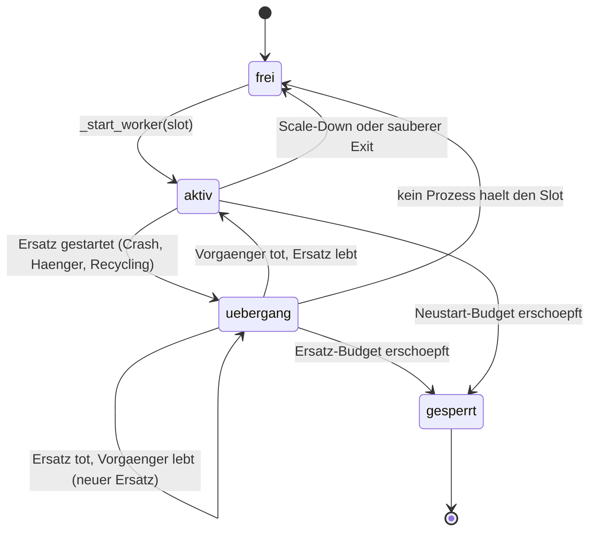
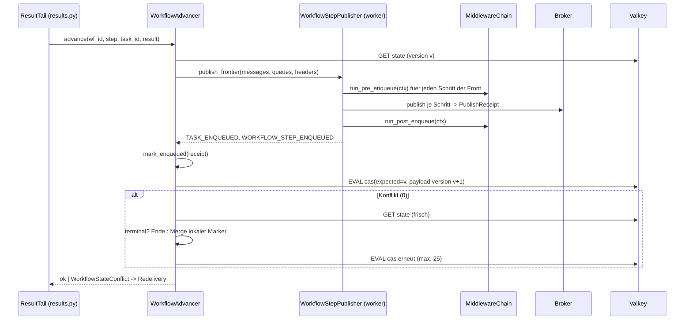

# Debug-Backlog der Lasttest-Suite - Plan

## Goal Capsule

- **Objective:** swarmq 0.6.0 schließt den offenen Debug-Feature-Backlog der Lasttest-Suite: stabile Slot-Identität in Signalen und Metriken (B1), ein Konfigurations-Hook für den CLI-Worker (B2), ein Beobachtungsport je Worker-Slot (B3), ein Signal für den swarmq-eigenen Reject-Weg ins `.XQ` (B7 teilweise; broker-eigenes Dead-Lettering bleibt ohne Consumer unbeobachtbar), Workflow-Folgeschritte durch Middleware und Signal (B9), ein Log-Formatter, der an fremden Records nicht scheitert (B11), ein durchgängiger Exit-Code-Vertrag für Konfigurationsfehler (B12), keine `RuntimeWarning` je Rechenkind (B13) sowie ein Compare-and-Set für den Workflow-Zustand samt den drei Review-Resten am Workflow-Modul (KTD5 des Plans 2026-08-30-002).
- **Product authority:** Dieses Dokument. Quelle der Einträge ist `docs/debug-feature-backlog.md` im Repo `swarmq-loadsuite` (Stand Pin v0.5.1); Abgleichsgrundlage `docs/plans/2026-08-30-001-fix-inventar-debug-backlog.md`. Bei Widerspruch gilt dieser Plan.
- **Execution profile:** Python ≥ 3.14, uv-Toolchain, strikt test-first nach `AGENTS.md`; Tests gegen RabbitMQ 4 (`localhost:5672`) und Valkey 8 (`localhost:6379`) aus Docker. Vier Merge Requests gegen `main` in der Reihenfolge C, A, B, D (siehe Phased Delivery): der Korrektheitsfix zuerst, dann die Features; jeder MR mit grüner CI.
- **Stop conditions:** Stoppen und rückfragen, wenn (a) das Hauptmodul-Aliasing im Forkserver (KTD10) unter Python 3.14 nicht ohne private multiprocessing-Interna erreichbar ist und auch der Warnungsfilter die Zeile nicht unterdrückt, (b) das Compare-and-Set (KTD11) die Golden-Fixture des Workflow-Zustands ungültig macht oder das Hauptmodul-Aliasing nur mit dem Warnungsfilter grün wird (dann ist U8 nicht erledigt), (c) eine Ack-Invariante der Pipeline (Datei `docs/solutions/patterns/invarianten-der-worker-pipeline-2026-08.md`) durch B7 oder B9 verletzt werden müsste, (d) ein bestehender e2e-Test nur durch eine Verhaltensänderung grün wird, die nicht in den Requirements steht.
- **Tail ownership:** Der Implementierer liefert vier MRs, den Versions-Bump auf 0.6.0 und den Changelog. Die Veröffentlichung auf PyPI ist ein manueller Schritt nach dem Merge (Token liegt außerhalb des Repos) und gehört nicht zum autonomen Lauf. Der Pin-Wechsel der Lasttest-Suite auf v0.6.0 ist Folgearbeit im anderen Repo.
- **Not active scope:** Ein Consumer auf `.XQ` für broker-eigenes Dead-Lettering, ein App-Factory-Hook mit eigenem Broker oder Backend, `--autoscale` im CPU-Modus, Task-Marker für Offload je Task.
- **Open blockers:** Keine.

---

## Product Contract

### Summary

Ein Betreiber erkennt denselben Worker-Slot über Respawns hinweg in jedem Signal und jeder Metrik, hängt eigene Middleware und Signal-Handler ohne eigenes Worker-Entry an den CLI-Worker, scrapt jeden Worker-Prozess auf einem eigenen Port und sieht jede Nachricht, die swarmq selbst ins `.XQ` gibt, als Signal. Workflow-Folgeschritte laufen durch dieselbe Middleware-Kette und dieselben Signale wie `Client.schedule`. Konfigurationsfehler enden überall mit Exit-Code 78. Der Workflow-Zustand wird per Compare-and-Set geschrieben, so dass zwei nebenläufige Advances einander keine Schritt-Marker mehr löschen. Der Diagnosefall bleibt lesbar: keine Tracebacks aus dem Log-Formatter, keine Warnzeile je Rechenkind.

### Problem Frame

Die Lasttest-Suite ist das Produktions-Gate für die Ablösung von taskiq in Phoenix. Beim Bau und Betrieb der Suite sind neun Fähigkeitslücken aufgefallen, die jeder Betreiber selbst umgehen müsste: Die Suite führt eine eigene Slot-Identität, ein eigenes Worker-Entry, setzt Ports per Env vor der App-Konstruktion, gleicht den `.XQ`-Inhalt über die Management-API ab, hält Workflows aus dem Wertungslauf heraus und filtert Warnzeilen per `PYTHONWARNINGS`. Dazu kommt ein bekannter Korrektheitsfehler: `WorkflowAdvancer.advance()` ist ein Read-Modify-Write ohne CAS, und der Vollständigkeits-Guard aus 0.4.0 macht den verlorenen Schritt-Marker seit damals betriebsrelevant.

### Key Decisions

- **Alle offenen Einträge in einem Release 0.6.0, geliefert in vier getrennt mergebaren MRs; der Korrektheitsfix (Phase C) geht als erster MR.** Die Einträge teilen Verträge (Signal-Katalog, Exit-Codes, Konfigurationsspezifikation, Changelog); ein Release hält sie zusammen, die MRs halten die Reviews klein. Der verlorene Schritt-Marker ist seit 0.4.0 betriebsrelevant und von den Feature-MRs unabhängig, darum wartet er nicht hinter ihnen. Chosen over ein MR je Eintrag, over ein Sammel-MR und over die Reihenfolge A bis D. Governs R30, R31.
- **Slot-Identität kommt aus dem Supervisor, nicht aus einem neuen Env-Mechanismus.** Der Supervisor kennt den Slot bereits und übergibt ihn dem Kind; das Kind verwirft ihn heute. Chosen over eine frei konfigurierbare Kennung ohne Slot-Bezug: Nur der Slot bleibt über Respawns gleich. Eine persistente Slot-Tabelle zieht zwei Regeln nach sich: ein erschöpfter Slot muss gesperrt sein, sonst belegt der Backfill einen dauerhaft ausfallenden Slot immer wieder neu, und der Scale-Down darf nicht mehr nach Slot-Nummer wählen, weil ein niedriger Slot nach Ersatz den jüngsten Prozess tragen kann. Governs R1 bis R4.
- **Ports je Slot ersetzen den Startguard; der Env- und CLI-Wert ist der Basisport.** Slot 0 behält den Basisport, Einzelprozess-Konfigurationen bleiben unverändert. Chosen over Port-Bereich als eigenes Flag: ein zweiter Mechanismus für dieselbe Größe. Governs R5 bis R8.
- **Ein Hook `--configure MODULE:CALLABLE` statt einer Namenskonvention im Task-Modul.** Explizit, im `--help` sichtbar, in der Konfigurationsspezifikation maschinenlesbar. Chosen over `configure(app)` per Konvention und over `--app-factory`: Broker und Backend bleiben Sache der CLI. Governs R9 bis R11.
- **Ein neues Signal `TASK_REJECTED` mit eigenem Zähler statt einer Erweiterung von `TASK_DLQ`.** `TASK_DLQ` verspricht Fehlerergebnis und Task-Kennung; auf dem Reject-Weg fehlen beide oft. Das Signal schließt den in der Recherche gefundenen stummen Weg über `route_via_dlx`; die Lücke aus dem Backlog-Eintrag B7 (broker-eigenes Dead-Lettering) bleibt ohne Consumer auf `.XQ` offen und wird im Abgleich als „teilweise“ geführt. Chosen over nullable Felder in `TASK_DLQ`. Governs R12 bis R14.
- **Workflow-Schritte lösen `TASK_ENQUEUED` mit unverändertem Payload aus und zusätzlich `WORKFLOW_STEP_ENQUEUED`.** Handler mit fester Signatur bleiben funktionsfähig. Chosen over neue Kwargs in `TASK_ENQUEUED`: Ein Handler mit fester Signatur stürbe stumm. Governs R15 bis R18.
- **Compare-and-Set über eine Versionsnummer im Zustandsdokument, Konflikte werden clientseitig gemergt, nicht wiederholt.** Der Advance hat zwischen Lesen und Schreiben bereits publiziert und den Chord-Zähler bewegt; eine Wiederholung würde doppelt publizieren und den Fan-in verlieren. Der Merge läuft im Client, weil ein serverseitiger Merge in Lua das Dokument mit `cjson` neu kodieren müsste und dabei Fließkommazahlen in Task-Argumenten der Topologie verändern kann; das Lua-Skript dekodiert nur die Version und schreibt die Payload byteweise. Chosen over `WATCH`/`MULTI`, over Re-Advance bei Konflikt und over einen additiven Merge im Lua-Skript. Governs R22 bis R24.
- **Konfigurationsfehler enden überall mit 78, Verbindungsfehler bleiben 1.** Orchestrierungen unterscheiden „nicht wieder anfassen" von „gleich nochmal". Chosen over 1 für alle Startfehler. Governs R19 bis R21.

<!-- ce-section: work-relationships -->
### How This Work Fits Together

- **Lasttest-Suite** (`docs/plans/2026-08-27-001-feat-swarmq-lasttest-suite-plan.md`, Repo `swarmq-loadsuite`). Enabled by diesem Plan: Sie kann ihr eigenes Worker-Entry, die Slot-Notlösung und den `.XQ`-Abgleich ablegen und Workflows in den Wertungslauf nehmen (R26 der Suite). Folgearbeit dort: Pin auf v0.6.0, Backlog-Abgleich.
- **CPU-Worker-Modus** (`docs/plans/2026-09-03-001-feat-cpu-worker-modus-plan.md`). Dieser Plan ändert dessen KTD8 (Supervisor-Exit 1 → 78) und KTD15 (Recycling-Warnung entfällt, Bind-Budget wird abgeleitet).
- **B10-Fix** (`docs/plans/2026-08-30-002-fix-workflow-group-composite-members-plan.md`). Dieser Plan schließt dessen KTD5 und die drei dort offen gebliebenen Review-Befunde.
- **Phoenix-Migration.** Enabled by: stabile Dashboards je Slot, Prometheus-Targets je Prozess, Exit-Code-Vertrag für die Plattform.

### Actors

- A1. **Betreiber** — startet Worker per CLI, liest Signale, Metriken, Logs und Exit-Codes; im ersten Anwendungsfall die Lasttest-Suite und das Phoenix-Team.
- A2. **Task-Autor** — schreibt Middleware und Signal-Handler; soll den Hook nutzen, ohne die CLI zu ersetzen.
- A3. **Supervisor** — vergibt Slots, startet und ersetzt Worker, entscheidet über Neustart und Exit-Code.
- A4. **Worker-Prozess** — IO- oder Loop-Prozess unter dem Supervisor; trägt die Slot-Identität in Signale, Metriken, Logkontext, Scheduler und Rechenkinder.
- A5. **Eingebetteter Worker** — `SwarmQ.start_worker()` ohne Supervisor; braucht eine Identität ohne Slot.
- A6. **WorkflowAdvancer** — publiziert Folgeschritte im Worker und schreibt den Workflow-Zustand.

### Requirements

**Slot-Identität (B1)**

- R1. Der Supervisor verwaltet Slots `0..N-1` (N = `--processes` oder die Obergrenze von `--autoscale`). Ein Ersatz für einen gestorbenen, hängenden oder recycelten Worker erhält denselben Slot; ein Scale-Up nimmt den kleinsten freien Slot, ein Scale-Down entfernt den jüngsten aktiven Worker nach Startzeit und gibt bei gleichem Alter den höchsten Slot frei.
- R2. Ein Slot gilt erst als frei, wenn kein Prozess ihn mehr hält. Während eines rollierenden Ersatzes halten Alt- und Neu-Prozess denselben Slot; der Slot-Zustand kennt diese Übergangsphase, und der Autoscaler zählt einen Slot im Übergang einmal, nicht je Prozess.
- R3. `worker_id` in allen Signalen, Metrik-Labels und im Logkontext ist ein String der Form `<basis>:<slot>` unter dem Supervisor und `<basis>:p<pid>` im eingebetteten Betrieb, damit beide Formen unterscheidbar bleiben. `<basis>` ist `SWARMQ_WORKER_ID`, sonst der Hostname. Das gilt für `WORKER_*`, `SCHEDULER_*`, `WORKER_RECYCLING` (auch `kind="compute_child"`) und die Labels `worker_uptime_seconds` und `scheduler_leader`.
- R4. Ein erschöpftes Neustart-Budget sperrt den Slot; der Backfill vergibt einen gesperrten Slot nicht neu. Der Autoscaler bestimmt den jüngsten Worker über die Startzeit, nicht über die Slot-Nummer.

**Ports je Slot (B3)**

- R5. `--metrics-port`, `--health-port`, `SWARMQ_METRICS_PORT` und `SWARMQ_HEALTH_PORT` sind Basisports. Der Worker in Slot s bindet `basis + s`. Ohne Slot (eingebettet) bindet er den Basisport.
- R6. Der Start wird abgelehnt (per R19), wenn ein Bereich `[basis, basis + N)` über 65535 hinausreicht oder wenn sich Metrik- und Health-Bereich überschneiden. Der Startguard „fester Port bei N Prozessen" entfällt.
- R7. `swarmq worker --check` meldet beide Bereiche im Payload.
- R8. Der Ersatz eines Slots bindet denselben Port mit Wiederholung; das Budget deckt sowohl die Zeit bis zum SIGKILL eines hängenden Vorgängers als auch die Zeit bis zur Portfreigabe eines recycelnden Vorgängers nach dessen `WORKER_SHUTDOWN`-Dispatch, jeweils plus Reserve. Scheitert das Binden nach dem Budget, endet der Start wie heute mit Fehler.

**Konfigurations-Hook (B2)**

- R9. `swarmq worker --configure MODULE:CALLABLE` ruft das benannte Callable nach der Konstruktion der `SwarmQ`-App und vor dem Start des Workers mit der App als einzigem Argument. Ein Awaitable als Rückgabe wird abgewartet.
- R10. Der Hook läuft in jedem Worker-Prozess genau einmal, nie im Forkserver und nie in `schedule`, `dlq` oder `inspect`. Ein Fehler im Hook ist ein Konfigurationsfehler (per R19).
- R11. `--check` prüft die Syntax `MODULE:CALLABLE` und die Auffindbarkeit des Moduls ohne Import; das Attribut wird erst im Worker aufgelöst.

**Signal für den Reject-Weg (B7)**

- R12. Jede Nachricht, die der Worker per `route_via_dlx` ins `.XQ` gibt, löst das Signal `TASK_REJECTED` aus mit `queue`, `reason`, `task_id` (oder `None`), `task_name` (oder `None`) und `error`. Die Gründe sind ein fester Satz: `body_too_large`, `undecodable`, `unregistered_task`, `middleware_chain_factory`, `dlq_publish_failed`.
- R13. Der Zähler `swarmq_tasks_rejected_total{queue, reason}` zählt jedes `TASK_REJECTED`. `swarmq_tasks_total{outcome="dlq"}` bleibt unverändert und zählt nur `TASK_DLQ`.
- R14. Die Dokumentation der Dead-Letter-Queue benennt die drei Wege ins `.XQ`: `dead_letter` mit `TASK_DLQ`, `route_via_dlx` mit `TASK_REJECTED`, und broker-eigene Gründe ohne Signal, die nur der Gauge `swarmq_dlq_messages` zeigt.

**Workflow-Schritte durch Middleware (B9)**

- R15. Jeder Folgeschritt, den der WorkflowAdvancer publiziert, läuft durch `pre_enqueue` und nach dem Publish durch `post_enqueue` derselben Middleware-Kette wie `Client.schedule`, mit `delivery_mode="at_least_once"` unabhängig von der Task-Deklaration, wie heute für alle Workflow-Schritte. `pre_enqueue` läuft für alle Schritte einer Front, bevor der erste publiziert wird.
- R16. Nach jedem publizierten Schritt löst der Worker `TASK_ENQUEUED` mit dem bestehenden Payload aus und zusätzlich `WORKFLOW_STEP_ENQUEUED` mit `task_id`, `task_name`, `queue`, `workflow_id`, `step_path`.
- R17. Wirft `pre_enqueue` im Advancer für einen Schritt der Front, wird kein Schritt dieser Front publiziert, der Workflow wird als gescheitert markiert (`error.type` = Name der Ausnahme) und die Nachricht bestätigt.
- R18. `Client.apply` läuft für jeden Schritt der Anfangsfront durch `pre_enqueue`, bevor der Zustand persistiert wird; nach jedem Publish folgen `post_enqueue`, `TASK_ENQUEUED` und `WORKFLOW_STEP_ENQUEUED`. Das bisherige Pseudo-Ereignis mit `task_name="<workflow>"` entfällt.

**Exit-Code-Vertrag (B12)**

- R19. Ein `ConfigurationError` oder `ModuleNotFoundError` im Elternprozess von `swarmq worker` erzeugt einen strukturierten Logsatz `worker_config_error` im konfigurierten Format und endet mit Exit-Code 78. Ein `ImportError` beim Import des Task-Moduls im Kind (etwa eine fehlende Abhängigkeit) ist ein Konfigurationsfehler des Kindes. Verbindungsfehler zu Broker oder Backend enden weiter mit 1. `--check` behält seinen Exit-Code-Vertrag.
- R20. Endet ein Worker-Kind mit 78, endet der Supervisor mit 78. Endet ein Kind mit 75, protokolliert der Supervisor `worker_recycle_noack` und behandelt den Fall wie heute (Neustart im Budget).
- R21. Der Fehlertext eines Konfigurationsfehlers im Kind erscheint als strukturierter Logsatz im konfigurierten Format, nicht als rohe stderr-Zeile.

**Compare-and-Set und Workflow-Modul (KTD5)**

- R22. Der Workflow-Zustand trägt ein Feld `version`; fehlt es (Dokumente aus 0.5.x), gilt 0. Jede Schreibung des Advancers erfolgt als Compare-and-Set gegen die gelesene Version und erhöht sie.
- R23. Bei einem Konflikt liest der Advancer den Zustand neu, übernimmt seine lokalen Änderungen in die frische Kopie und schreibt erneut: `step_tasks` additiv, und bei lokalem Terminalstatus zusätzlich `status`, `final_result_task_id` und `error`. Ist der frische Status terminal, bricht er ohne Schreibung ab. Die Konfliktgrenze liegt bei 25 Runden; jede Runde gewinnt mindestens ein Schreiber, so dass ein Advancer höchstens so oft verliert, wie parallele Zweige schreiben. Wird die Grenze doch überschritten, gilt die Nachricht als nicht abgeschlossen und wird neu zugestellt; die dabei mögliche Doppel-Publikation deterministischer Schritt-Kennungen ist bewusst akzeptiert, wie heute bei `BackendConnectionError`.
- R24. Der xfail-Test zum verlorenen Zustands-Update wird zum Regressionstest. Die frische Lesung vor dem Fan-in bleibt, weil ein Schritt vor der Persistenz seines Markers publiziert wird und schneller enden kann als die Persistenz; sie honoriert einen frischen Terminalstatus und beendet den Advance dann ohne Schreibung. Die Fehlermarkierung nach einem Teilfehler der Anfangsfront in `Client.apply` schreibt ebenfalls per Compare-and-Set.
- R25. Scheitert die Fehlermarkierung eines Workflows mit einem `BackendConnectionError`, wird die Nachricht bei at-least-once neu zugestellt statt bestätigt. Scheitert sie aus einem anderen Grund, wird bestätigt und der Fehler mit Workflow-Kennung geloggt.
- R26. Die reinen Pfad- und Topologie-Helfer des Workflow-Moduls liegen in einem eigenen Modul; `workflow_orchestration.py` unterschreitet 800 Zeilen, und `_LOC_EXCEPTIONS` ist leer. Öffentliche Re-Exporte bleiben bestehen.

**Diagnosefall (B11, B13)**

- R27. Scheitert die Formatierung eines Log-Records (etwa an einem `__repr__` in `record.args`), gibt der Formatter eine Zeile im konfigurierten Format mit `event="log_record_unformattable"`, Logger-Name, Level und Fehlertext aus; kein Traceback erreicht stderr.
- R28. Im CPU-Modus erzeugt der Start eines Rechenkinds keine `RuntimeWarning` aus `runpy`, auch wenn der Worker per `python -m paket.modul` gestartet wurde.

**Release und Dokumentation**

- R29. Changelog (en/de) unter 0.6.0 führt als Breaking Changes: das neue `worker_id`-Format, den Supervisor-Exit 78, den Wegfall des Pseudo-Ereignisses aus R18 und die neue Middleware-Reichweite aus R15. Die Konfigurationsspezifikation (`website/reference/agent/spec/`) ist neu generiert.
- R30. Dokumentation: CLI-Referenz (`--configure`, Exit-Codes), Konfigurationsreferenz (`SWARMQ_WORKER_ID`, Basisport-Semantik mit Prometheus-Beispiel für N Targets), Signal-Guide (`TASK_REJECTED`, `WORKFLOW_STEP_ENQUEUED`, `worker_id`-Format), Dead-Letter-Guide (drei Wege), jeweils en und de.
- R31. Version 0.6.0 in `pyproject.toml`.

### Key Flows

- F1. Slot-Ersatz mit Port
  - **Trigger:** Worker in Slot 2 stirbt, hängt oder recycelt sich.
  - **Actors:** A3, A4
  - **Steps:** Supervisor markiert Slot 2 als „Übergang"; startet Ersatz mit Slot 2; Ersatz bindet `basis + 2` mit Wiederholung (R8); Alt-Prozess endet (SIGTERM, nach Frist SIGKILL); Supervisor setzt Slot 2 auf „aktiv"; Signale des Ersatzes tragen `host:2`.
  - **Covered by:** R1, R2, R3, R5, R8

- F2. Konfigurationsfehler
  - **Trigger:** `SWARMQ_QUEUE_TYPE=bogus swarmq worker --module m` oder ein Task-Modul ohne Tasks.
  - **Actors:** A1, A3, A4
  - **Steps:** Elternfehler: strukturierter Logsatz, Exit 78, kein Kind gestartet. Kindfehler: Kind loggt strukturiert, endet mit 78; Supervisor loggt `worker_config_error`, beendet alle Kinder, endet mit 78.
  - **Covered by:** R19, R20, R21

- F3. Workflow-Folgeschritt
  - **Trigger:** Ein Workflow-Schritt endet erfolgreich.
  - **Actors:** A6
  - **Steps:** Advancer liest Zustand (Version v); baut Nachricht; `pre_enqueue`; Publish mit Receipt; `post_enqueue`; `TASK_ENQUEUED` und `WORKFLOW_STEP_ENQUEUED`; Marker setzen; Compare-and-Set gegen v; bei Konflikt Merge und erneut.
  - **Covered by:** R15, R16, R22, R23

### Acceptance Examples

- AE1. **Covers R1, R3.** Given `swarmq worker --processes 3` und der Worker in Slot 1 wird mit SIGKILL beendet, when der Ersatz `WORKER_ONLINE` sendet, then trägt es `worker_id="<hostname>:1"`, und kein Signal des Laufs trägt eine Kennung außer `:0`, `:1`, `:2`.
- AE2. **Covers R5, R6.** Given `--metrics-port 9000 --health-port 9002 --processes 4`, when der Worker startet, then bricht er vor dem ersten Kind mit einem Konfigurationsfehler ab, der die Überschneidung `9002` nennt, und endet mit 78.
- AE3. **Covers R5, R8.** Given `SWARMQ_METRICS_PORT=9000 --processes 2` und der Worker in Slot 1 wird recycelt, when der Ersatz startet, then ist `/metrics` binnen des Bind-Budgets wieder auf 9001 erreichbar, und 9000 war die ganze Zeit erreichbar.
- AE4. **Covers R9, R10.** Given ein Modul `hooks.py` mit `def configure(app): app.add_middleware(Counting())`, when `swarmq worker --module tasks --configure hooks:configure` einen Task ausführt, then hat die Middleware `pre_execute` genau einmal je Task gesehen, und die Middleware ist im Forkserver nicht registriert worden.
- AE5. **Covers R12, R13.** Given eine Nachricht, deren Body `max_message_body_bytes` überschreitet, when der Worker sie ablehnt, then feuert `TASK_REJECTED` mit `reason="body_too_large"` und `task_id=None`, `swarmq_tasks_rejected_total{reason="body_too_large"}` steht auf 1, und `swarmq_tasks_total{outcome="dlq"}` ist unverändert.
- AE6. **Covers R15, R16.** Given eine Middleware, die in `pre_enqueue` einen Header zählt, und eine `chain` aus drei Tasks, when der Workflow durchläuft, then hat die Middleware drei `pre_enqueue`-Aufrufe gesehen, und `WORKFLOW_STEP_ENQUEUED` feuerte dreimal mit den Schrittpfaden `0`, `1`, `2`.
- AE7. **Covers R15, R17.** Given eine Middleware, deren `pre_enqueue` für das zweite Glied einer Gruppen-Front wirft, when der Schritt davor endet und der Advancer die Front publizieren will, then wurde kein Glied der Front publiziert, der Workflow ist `FAILED` mit `error.type` gleich dem Namen der Ausnahme, `handle.get()` wirft binnen einer Sekunde, und die Nachricht des vorherigen Schritts ist bestätigt.
- AE8. **Covers R19.** Given `SWARMQ_QUEUE_TYPE=bogus`, when `swarmq worker --module m --log-format json` startet, then steht auf stderr genau eine JSON-Zeile mit `"event": "worker_config_error"`, und der Exit-Code ist 78.
- AE9. **Covers R19, R20, R21.** Given ein Task-Modul ohne Tasks und `--processes 2`, when der Worker startet, then enden beide Kinder mit 78, jedes mit einem strukturierten `worker_config_error`, und der Supervisor endet mit 78 ohne Neustart. Dasselbe gilt für ein Task-Modul, dessen Import an einer fehlenden Abhängigkeit scheitert.
- AE10. **Covers R22, R23, R24.** Given zwei Advancer auf demselben Backend und eine Gruppe mit zwei Gliedern, when beide Glieder gleichzeitig enden und der zweite Advancer einen veralteten Zustand gelesen hat, then enthält der persistierte Zustand beide Schritt-Marker, das Gruppenergebnis hat zwei Elemente, und `handle.get()` liefert es, nicht `None`.
- AE11. **Covers R25.** Given das Backend wirft `BackendConnectionError` beim Fail-Mark nach einem fehlgeschlagenen Advance, when der Result-Tail entscheidet, then wird die Nachricht neu zugestellt und nicht bestätigt.
- AE12. **Covers R27.** Given ein Log-Record, dessen einziges Argument ein Objekt mit werfendem `__repr__` ist, when der Listener ihn formatiert, then erscheint eine Zeile mit `event="log_record_unformattable"` und kein Traceback.
- AE13. **Covers R28.** Given ein Worker im CPU-Modus, gestartet per `python -m paket.modul` mit `-W error::RuntimeWarning`, when zehn Tasks in frischen Rechenkindern laufen, then enthält stderr keine `RuntimeWarning`, alle zehn Ergebnisse liegen vor, und jedes Rechenkind meldet, dass das Hauptmodul dort nicht ein zweites Mal ausgeführt wurde.

### Success Criteria

- Die Lasttest-Suite kann am Pin v0.6.0 ihr eigenes Worker-Entry durch `swarmq worker --configure` ersetzen, ihre Slot-Notlösung streichen und Workflows registrieren; sieben Backlog-Einträge stehen im Abgleich auf „behoben", B7 auf „teilweise" mit Verweis auf den fehlenden `.XQ`-Consumer.
- Die Golden-Fixture des Workflow-Zustands decodiert unverändert; laufende Workflows aus 0.5.x werden nach dem Upgrade korrekt weitergefahren.
- Unit-, Integrations- und e2e-Suiten bleiben grün; bewusst geänderte Tests (Exit-Codes, Port-Guard, Signal-Katalog, Hilfetext, Surface-Whitelist) sind im MR benannt.

### Scope Boundaries

**Deferred for later**

- Ein Consumer oder Zähler für broker-eigene Gründe ins `.XQ` (TTL, Überlauf). Ohne Consumer auf `.XQ` nicht möglich; der Gauge bleibt die Sicht.
- `route_via_dlx` bei einem Fehler der Middleware-Chain-Factory (`worker/pipeline.py`) ist ein Konfigurationsfehler des Workers, kein Nachrichtenfehler. R12 macht ihn sichtbar; ob er den Worker beenden sollte, ist eine spätere Entscheidung.
- `swarmq schedule status` zeigt den Scheduler-Lock-Owner (`hostname:pid:uuid`), nicht die Slot-Kennung. Angleichen ist Folgearbeit.
- Ein Hook, der Broker oder Backend der CLI ersetzt.
- `--autoscale` im CPU-Modus und Task-Marker für Offload je Task (aus dem Plan 2026-09-03-001 übernommen).
- Weiterlaufen ohne Beobachtungsport nach gescheitertem Bind statt Startabbruch. Ein reines Beobachtbarkeitsproblem könnte so keinen Slot sperren; die Änderung des heutigen „Fehler bei Teilstart" ist eine eigene Entscheidung.

**Deferred to Follow-Up Work**

- Pin-Wechsel und Backlog-Abgleich im Repo `swarmq-loadsuite`.
- PyPI-Upload 0.6.0 nach dem Merge der Phase D.

**Outside this product's identity**

- Verteilte Sperren auf dem Workflow-Zustand statt Compare-and-Set.

### Dependencies / Assumptions

- Valkey 8 mit `EVAL` und `cjson` im Lua-Kontext; das Repo nutzt bereits `register_script` für sechs Skripte.
- `asyncio.start_server` setzt `SO_REUSEADDR`; ein per SIGKILL beendeter Vorgänger gibt den Listen-Port sofort frei.
- Die Rechenkinder des CPU-Modus laufen unter Python 3.14 mit `multiprocessing.spawn._fixup_main_from_name`, das ein `__main__` mit passendem `__spec__.name` nicht erneut ausführt.
- Die lokalen Docker-Container `rabbitmq` (5672) und `valkey` (6379) laufen für Integration und e2e.

### Outstanding Questions

**Resolve Before Planning**

Keine.

**Deferred to Implementation**

- Wie die Doppelkonfiguration des Loggings im Kind vermieden wird (Entry konfiguriert für R21, `SwarmQ.__init__` konfiguriert heute ebenfalls); Vorgabe: genau ein `QueueListener` je Prozess.
- Ob das Hauptmodul-Aliasing (KTD10) allein reicht oder der Warnungsfilter als Rückfallebene bleibt; AE13 entscheidet.
- Genaue Reserve im Bind-Budget (R8); Vorgabe 2 s, Feintuning nach den Integrationstests.
- Wer den `QueueListener` des Elternprozesses stoppt, wenn `setup_logging` aus `run_multi_process_worker` in `_run_worker_command` wandert; die Tests in `tests/unit/process_manager/test_run.py`, die `setup_logging` dort patchen, ziehen mit.

### Sources / Research

- `swarmq-loadsuite/docs/debug-feature-backlog.md` — Beobachtung, Wunsch und Begründung je Eintrag, Stand Pin v0.5.1.
- `docs/plans/2026-08-30-001-fix-inventar-debug-backlog.md` — War/Jetzt je Eintrag, offene Review-Reste, KTD5.
- Reproduktion B12 (2026-09-08): `SWARMQ_QUEUE_TYPE=bogus` scheitert im Elternprozess in `process_manager/run.py` beim Bau der `SwarmQConfig`, vor dem Supervisor; ein Fehler erst im Kind (leeres Task-Modul) wird vom Supervisor korrekt geloggt, endet aber mit 1.
- `src/swarmq/process_manager/supervisor.py::_start_worker` — monotone `worker_id`, Übergabe an `worker_subprocess_entry`, das sie verwirft (`process_manager/entry.py`).
- `src/swarmq/worker/lifecycle.py`, `worker/recycling.py`, `worker/compute/wiring.py`, `scheduler/loop.py`, `worker/pipeline.py` — die Stellen mit `str(id(...))` beziehungsweise `id(self)` als `worker_id`.
- `src/swarmq/process_manager/check.py::_validate_observability_ports` und `_effective_port` — heutiger Guard und Env-vor-CLI-Auflösung.
- `src/swarmq/worker/gates/__init__.py` (Helfer `route_via_dlx`), Aufrufer in `worker/pipeline.py` und `worker/gates/lock.py`.
- `src/swarmq/workflow_orchestration.py::_enqueue_node`, `mark_enqueued`, `_refresh_step_tasks`; `src/swarmq/client/schedule.py` (Middleware- und Signal-Reihenfolge); `src/swarmq/client/workflows.py::apply`.
- `src/swarmq/backend/valkey/results.py::store_workflow_state` (blinder `SET … PX`), `src/swarmq/lua/` (CAS-Muster), `tests/support/inmemory/backend.py`.
- `src/swarmq/logging.py::setup_logging` — `ProcessorFormatter`, `QueueListener`; kein Fehlerfänger.
- `src/swarmq/worker/compute/wiring.py::_main_module_name`, `forkserver.py::start_forkserver`; CPython `multiprocessing/spawn.py::_fixup_main_from_name`.
- `docs/solutions/patterns/invarianten-der-worker-pipeline-2026-08.md`, `docs/solutions/logic-errors/nack-requeue-false-routes-via-dlx-not-data-loss-2026-04-16.md`, `docs/solutions/patterns/r3-5-unique-tasks-implementation-learnings-2026-04-17.md`, `docs/solutions/logic-errors/schedfire-retry-dedup-collision-silent-drop-2026-06-02.md`, `docs/solutions/architecture-patterns/dishka-di-integration-async-task-queue.md`, `docs/solutions/patterns/sunset-cli-surface-whitelist-kp2-2026-12-31.md`.

---

## Planning Contract

### Key Technical Decisions

- KTD1. **Slot-Tabelle im Supervisor mit den Zuständen frei, aktiv, Übergang, gesperrt.** `ProcessManager` führt neben `self.workers` (Schlüssel PID) eine Slot-Tabelle; `_start_worker(slot)` nimmt den Slot als Argument statt `_next_worker_id`. Ersatzpfade (`_maybe_restart`, Hang-Ersatz, Recycling-Ersatz) übergeben den Slot des Vorgängers und setzen ihn auf „Übergang". `_check_dead_workers` löst den Übergang auf: Stirbt der Vorgänger und der Ersatz lebt, wird der Slot „aktiv"; stirbt der Ersatz, während der Vorgänger noch lebt, bleibt der Slot im Übergang und `_maybe_restart` startet einen weiteren Ersatz; „frei" wird ein Slot nur, wenn kein Prozess ihn mehr hält. Erschöpftes Budget setzt „gesperrt", auch mit lebendem Vorgänger. Der Autoscaler rechnet mit belegten Slots (aktiv oder Übergang zählt einmal) statt `len(self.workers)`, und `_scale_down_one` wählt den jüngsten Worker über `spawned_at` unter Ausschluss von Slots im Übergang. `WorkerInfo.worker_id` bleibt `int` und bedeutet Slot. Governs R1, R2, R4.
- KTD2. **Die Slot-Kennung reist als `SwarmQConfig.worker_slot` in die Konfiguration; `worker_id` wird dort aufgelöst.** `worker_subprocess_entry` reicht `worker_id` als `worker_slot` an `run_worker_async` und `SwarmQ(...)` weiter. `SwarmQConfig` bekommt `worker_slot: int | None` (kein Env), `worker_id: str | None` mit Env `SWARMQ_WORKER_ID` als Basis, und eine abgeleitete Eigenschaft `worker_identity` nach R3. Transportweg: `worker_subprocess_entry` setzt `worker_slot` und `bind_retry_budget_s` (KTD4) als Attribute in die argparse-Namespace, `run_worker_async` reicht sie als Kwargs an `SwarmQ(...)`; `WorkerConfig` bleibt das geteilte, slot-unabhängige Objekt. Alle sechs `str(id(...))`-Stellen und der Logkontext in `worker/pipeline.py` lesen diese Eigenschaft; `SchedulerLoop` und `ComputeExecutor` bekommen sie injiziert wie heute den `str(id(...))`-Wert. Governs R3.
- KTD3. **Portableitung in der Konfiguration, nach dem Env-Override.** `SwarmQConfig.__post_init__` addiert `worker_slot` auf `metrics_port` und `health_port`, nachdem `_apply_env_overrides` gelaufen ist; damit gewinnt weder die Env im Kind noch das geteilte `WorkerConfig`-Objekt. Ein gemeinsamer Helfer `observability_port_ranges(base_metrics, base_health, upper)` liefert die Bereiche für `check_worker_config`, `--check`-Payload und Startlog. `_validate_observability_ports` prüft Obergrenze und Überschneidung statt „fester Port bei N". Die Warnung `recycling_with_fixed_port` entfällt. Governs R5, R6, R7.
- KTD4. **Bind-Budget aus beiden Freigabefristen, transportiert über die Konfiguration.** `SHUTDOWN_TERM_S` wandert als Modulkonstante nach `swarmq/supervision.py` (neben `RECYCLE_NOACK_EXIT_CODE`; `ProcessManager.SHUTDOWN_TERM_S` verweist darauf), damit `process_manager/entry.py` sie ohne Import von `supervisor.py` kennt. `SwarmQConfig` bekommt `bind_retry_budget_s: float = 5.0` (kein Env); das Entry setzt es auf `max(SHUTDOWN_TERM_S, _LIFECYCLE_DISPATCH_TIMEOUT_S) + 2 s`, `WorkerLifecycle` übergibt es an `start_with_bind_retry`. Semantik bleibt „Fehler nach Budget". Grund: Ein hängender Vorgänger hält den Port bis zum SIGKILL nach `SHUTDOWN_TERM_S`; ein recycelnder Vorgänger gibt ihn erst nach dem `WORKER_SHUTDOWN`-Dispatch frei, der mit `_LIFECYCLE_DISPATCH_TIMEOUT_S` (10 s) gedeckelt ist, und ein langsamer Handler aus `--configure` macht diesen Pfad wahrscheinlich. Ein festes 5-s-Budget würde den Ersatz in einen Bind-Fehler und damit ins Neustart-Budget laufen lassen. Governs R8.
- KTD5. **`--configure` ist ein String `MODULE:CALLABLE` im `WorkerConfig`, aufgelöst in `run_worker_async`.** Neuer Typ in `cli/_shared.py` neben `_dotted_module_name`; Auflösung per `importlib.import_module` und `getattr` nach der App-Konstruktion, vor `async with app`; Awaitable wird abgewartet; jede Ausnahme wird in `ConfigurationError` gehüllt. `check_worker_config` prüft nur Syntax und `find_spec` des Moduls (kein Import im Supervisor, wie `_validate_module_importable`). Neue Symbole in `swarmq.cli` landen bewusst in der Whitelist `tests/unit/test_cli_module_surface.py`. Governs R9, R10, R11.
- KTD6. **`TASK_REJECTED` feuert im Helfer neben `route_via_dlx`, nach erfolgreichem Broker-Verb.** Der Helfer in `worker/gates/__init__.py` bekommt Zugriff auf den Signal-Dispatcher über `GateDeps` und einen `reason`-Parameter; die sechs Aufrufer übergeben ihren Grund. Das Signal ist kein weiteres Broker-Verb, die Ack-Invariante bleibt. Der Zähler entsteht in `metrics.py` als eigener `Counter` mit Labels `queue`, `reason`, angeschlossen wie `_install_outcome_counters`. Governs R12, R13.
- KTD7. **Der Advancer bekommt einen `WorkflowStepPublisher` statt der rohen Publish-Funktion; `pre_enqueue` ist ein Gate über die ganze Front.** Der Publisher nimmt Nachrichten-Dicts, Queues und Header (nicht Bytes), damit der Worker-Adapter in `worker/pipeline.py` den `MessageContext` ohne Dekodieren baut. `_enqueue_node` ruft zuerst `pre_enqueue` für alle noch nicht markierten Schritte der Front; erst danach läuft je Schritt `broker.publish` (Receipt) → `post_enqueue` → `TASK_ENQUEUED` → `WORKFLOW_STEP_ENQUEUED` → `mark_enqueued`. Dieselbe Reihenfolge fährt `Client.schedule_many` heute. Der Adapter liefert den `PublishReceipt` unverändert zurück, `mark_enqueued` bleibt der Typzwang. Eine Ausnahme aus `pre_enqueue` propagiert, bevor etwas publiziert ist; der generische Zweig in `worker/results.py::_advance_workflow` markiert den Workflow als gescheitert (R17). `Client.apply` nutzt denselben Aufbau mit der Client-Kette. Governs R15 bis R18.
- KTD8. **Exit-Code 78 ist die einzige Quelle für „Konfigurationsfehler" auf allen drei Ebenen.** `_run_worker_command` ruft `setup_logging` als ersten Schritt (vor `prepare_pool_args` und vor dem Bau der `SwarmQConfig`), fängt `ConfigurationError` und `ModuleNotFoundError`, loggt `worker_config_error` mit `source="supervisor"` und gibt `CONFIG_ERROR_EXIT_CODE` zurück; `_monitor_loop` gibt bei `_config_error` denselben Code zurück; `worker_subprocess_entry` loggt `worker_config_error` mit `source="worker"` statt der stderr-Zeile; `run_worker_async` hüllt jeden `ImportError` aus dem Import des Task-Moduls in einen `ConfigurationError` mit Modulname und Ursache, damit auch eine fehlende Abhängigkeit mit 78 endet statt mit Traceback und fünf Neustarts. Exit 75 bekommt im Supervisor den Logsatz `worker_recycle_noack`. Die Konstante wandert nach `swarmq/supervision.py` neben `RECYCLE_NOACK_EXIT_CODE`, damit `cli` sie ohne Import von `process_manager` kennt (Zyklus-Allowlist bleibt unberührt). Governs R19, R20, R21.
- KTD9. **Der Formatter fängt Formatierungsfehler selbst.** Eine Unterklasse von `structlog.stdlib.ProcessorFormatter` in `swarmq/logging.py` überschreibt `format`: Ausnahme → Ersatz-Event `log_record_unformattable` mit `logger`, `level`, `error`, gerendert durch denselben Renderer. Kein Upper-Pin für `aio-pika`; der Test nutzt einen synthetischen Record mit werfendem `__repr__`. Governs R27.
- KTD10. **Das Hauptmodul wird im Forkserver einmal als `__main__` registriert, damit `spawn._fixup_main_from_name` es nicht je Kind erneut ausführt.** `wiring.py` setzt vor dem Forkserver-Start `SWARMQ_MAIN_MODULE` auf den Namen aus `_main_module_name()`; ein neues Preload-Modul `swarmq.worker.compute.preload` (erstes Element der Preload-Liste) importiert das Modul unter seinem Namen und setzt `sys.modules["__main__"]` darauf, wenn der Name nicht `__main__` ist. Damit findet `_fixup_main_from_name` ein `__main__` mit passendem `__spec__.name` und kehrt zurück: keine Warnung, kein zweiter Import je Kind. Rückfallebene, falls AE13 damit nicht grün wird: derselbe Modul-Import installiert einen `warnings`-Filter auf das runpy-Muster (`found in sys.modules after import of package`, `RuntimeWarning`). Die Rückfallebene unterdrückt nur die Zeile, der zweite Import je Kind bleibt; darum prüft U8 im Rechenkind, ob `sys.modules["__main__"]` das Hauptmodul ist, und gilt mit der Rückfallebene nicht als erledigt (Stop-Bedingung b). Governs R28.
- KTD11. **Compare-and-Set als Lua-Skript `workflow_state_cas.lua` mit `version` im Dokument.** `KEYS[1]` Zustandsschlüssel; `ARGV` erwartete Version, Payload, TTL. Das Skript liest, decodiert die Version (fehlend = 0), vergleicht und setzt mit `PX`; Rückgabe 1 oder 0. Der Vertrag `ResultBackend` bekommt `compare_and_store_workflow_state(wf_id, data, ttl_ms, *, expected_version) -> bool`; `store_workflow_state` bleibt für die Erstanlage. InMemory-Stub und Valkey implementieren beide, die Contract-Suite prüft beide identisch. Das Skript dekodiert nur, es kodiert nie: Die Payload wird byteweise geschrieben, so dass `cjson` keine Fließkommazahlen der Topologie verändert. Der Advancer schreibt in `_persist`, `_mark_terminal` und `fail` per CAS mit `state["version"] + 1`; bei 0 wirft er intern einen Konflikt, den `advance()` per Merge behandelt (R23): frischen Zustand lesen, terminal → Ende ohne Schreibung, sonst lokale `step_tasks` additiv sowie bei lokalem Terminalstatus `status`, `final_result_task_id` und `error` übernehmen, erneut schreiben; nach 25 Konflikten `WorkflowStateConflict(SwarmQError)`, das `worker/results.py` wie `BackendConnectionError` in eine Redelivery abbildet. Die frische Lesung vor dem Fan-in (`_refresh_step_tasks`) bleibt als Schutz gegen das Publish-vor-Persistenz-Fenster, prüft aber zusätzlich den frischen Status und beendet den Advance bei terminalem Zustand. Die Fehlermarkierung nach Teilfehler der Anfangsfront in `client/workflows.py` schreibt per CAS mit `expected_version=0`; scheitert das, wird der frische Zustand gelesen und nur ein nicht-terminaler Zustand erneut markiert. Governs R22, R23, R24.
- KTD12. **Fail-Mark-Fehler werden nach Ausnahmetyp unterschieden.** In `worker/results.py` (drei Stellen) und `worker/retry.py`: `BackendConnectionError` → `Redelivered` bei at-least-once, sonst Ack mit `logger.error`. Grund: Nach einem deterministischen Advance-Fehler würde eine Redelivery den Task-Körper erneut ausführen und in eine Poison-Schleife bis zum Delivery-Limit laufen. Governs R25.
- KTD13. **Modul-Split zuletzt in Phase C, rein mechanisch.** Verschoben werden `workflow_step_task_id`, `aggregate_result_id`, `split_path`, `node_at_path`, `initial_frontier`, `_frontier`, `inject_result` in ein neues reines Modul (`_node_from_dict` bleibt in `swarmq/workflow.py`, wo es heute definiert ist); `workflow_orchestration.py` re-exportiert sie. Importer (`client/workflows.py`, `worker/pipeline.py`, `worker/lifecycle.py`, `app.py`, `__init__.py`) bleiben unverändert. Der Eintrag in `_LOC_EXCEPTIONS` wird gestrichen, das Limit nicht erhöht. Governs R26.
- KTD14. **Signal-Katalog und Dokumentation sind Vertragsflächen.** Neue Signale bekommen Schema-Doku in `signals.py`, einen e2e-Test in `tests/e2e/test_signal_catalog.py` und Einträge im Signal-Guide; neue Konfigurationsfelder und Flags erscheinen in der generierten Spezifikation (`python -m swarmq.agent_spec`), deren Sync-Tests sonst rot sind. Governs R29, R30.

### High-Level Technical Design

Slot-Lebenszyklus im Supervisor (KTD1):

Workflow-Folgeschritt mit Middleware und Compare-and-Set (KTD7, KTD11):

Portableitung (KTD3): `WorkerConfig` (geteilt, Basisports) → `worker_subprocess_entry(slot)` → `SwarmQ(worker_slot=slot, metrics_port=basis)` → `SwarmQConfig.__post_init__`: Env-Override, dann `port = basis + slot` → `MetricsServer`/`HealthServer` binden den abgeleiteten Port.

### Phased Delivery

| Reihenfolge | Phase | MR-Branch | Units | Inhalt |
|---|---|---|---|---|
| 1 | C | `fix/workflow-cas-middleware` | U9 bis U12 | Compare-and-Set, Fail-Mark-Regel, Workflow-Schritte durch Middleware, Modul-Split |
| 2 | A | `feat/slot-identity-ports-exitcodes` | U1 bis U4 | Supervisor-Slots, `worker_id`, Ports je Slot, Exit-Code-Vertrag |
| 3 | B | `feat/worker-hooks-signals-diagnostics` | U5 bis U8 | `--configure`, `TASK_REJECTED`, Formatter-Schutz, Forkserver-Hauptmodul |
| 4 | D | `release/0.6.0` | U13 | Dokumentation, Changelog, Spezifikation, Version |

Phase C geht zuerst, weil sie den Korrektheitsfehler behebt und von A und B unabhängig ist. A liefert den Exit-Code 78, den B (Hook-Fehler) nur dokumentiert. Innerhalb von C gilt: U9 vor U11 vor U12.

### System-Wide Impact

- **Signal-Katalog:** zwei neue Signale, geändertes `worker_id`-Format in zehn Signalen, Wegfall eines Pseudo-Ereignisses. Handler mit fester Signatur sind nicht betroffen (KTD7).
- **Metriken:** neue Zeitreihe `swarmq_tasks_rejected_total`; Label `worker_id` wird niedrig-kardinal und über Recycling hinweg stetig (Uptime springt auf 0).
- **Exit-Codes:** Der Supervisor endet bei Konfigurationsfehlern mit 78 statt 1; `RestartPreventExitStatus=78` greift damit auch für Elternfehler.
- **Konfiguration:** neue Felder `worker_id`, `worker_slot`, `configure`; `metrics_port`/`health_port` werden Basisports. Konfigurationsspezifikation und `--check`-Payload ändern sich.
- **Workflow-Zustand:** neues Feld `version` (append-only, Default 0); Backend-Vertrag um eine Methode erweitert; InMemory-Stub und Contract-Suite ziehen mit.
- **Middleware-Reichweite:** `pre_enqueue`/`post_enqueue` sehen jetzt jeden Workflow-Schritt. Eine Middleware, die dort wirft, lässt Workflows scheitern, die vorher liefen.

### Risks & Dependencies

- **Slot-Ersatz und Port (R8).** Wenn der Vorgänger den Port über das Budget hinaus hält (etwa im D-State), scheitert der Ersatz wie heute mit Bind-Fehler, zählt ins Neustart-Budget und kann den Slot sperren. Minderung: Budget aus beiden Freigabefristen (KTD4), Integrationstests mit hängendem und mit langsam herunterfahrendem Vorgänger (U3); Weiterlaufen ohne Beobachtungsport ist als spätere Entscheidung in den Scope Boundaries geführt.
- **CAS-Merge (R23).** Ein Merge, der einen Terminalstatus des anderen Advancers überschreibt oder `final_result_task_id` und `error` verliert, wäre ein neuer Korrektheitsfehler; `handle.get()` lieferte dann `None` ohne Ausnahme. Minderung: terminaler frischer Status beendet den Merge ohne Schreibung, der Merge-Umfang ist in R23 ausbuchstabiert; Property-Test mit zufälligen Verschränkungen und Gruppen aus mindestens zehn parallelen Ketten (U9).
- **Fail-Mark-Regel (R25).** Scheitert die Fehlermarkierung mit einem Nicht-Verbindungsfehler, bleibt der Workflow nach dem Ack `RUNNING` bis zum TTL; `handle.get()` läuft in den Timeout. Die Abwägung gegen die Poison-Schleife ist bewusst; der Fall ist über den Logsatz mit Workflow-Kennung beobachtbar.
- **Eingebettete Kennung (R3).** Mit gemeinsam gesetztem `SWARMQ_WORKER_ID` können eingebettete Worker auf verschiedenen Hosts kollidieren; das Präfix `p` trennt sie nur von Slot-Kennungen. Dokumentiert, nicht verhindert.
- **Middleware-Fehler in Workflows (R17).** Bestehende Middleware, die `pre_enqueue` mit Annahmen über Client-Kontext implementiert, kann Workflow-Schritte jetzt ablehnen. Minderung: Changelog als Breaking, `delivery_mode="at_least_once"` im Kontext, `workflow_id`/`step_path` als zusätzliche optionale Kontextschlüssel.
- **Hauptmodul-Aliasing (KTD10)** hängt an CPython-Interna von `multiprocessing.spawn`. Minderung: Warnungsfilter als Rückfallebene, AE13 als Test mit `-W error`.
- **Doppelkonfiguration des Loggings im Kind (R21).** Zwei `QueueListener` würden Zeilen verdoppeln (Lehre aus B6). Minderung: Test auf genau einen Handler am Root-Logger nach dem Start.
- **Whitelist-Tests** (`test_cli_module_surface.py`, `test_cli_help_output.py`, `test_agent_spec.py`) sind eingefroren; jede Änderung ist bewusst einzutragen.

### Documentation / Operational Notes

- Prometheus: Beispiel-`static_configs` mit N Targets `host:9000` bis `host:9000+N-1` und Hinweis auf `SWARMQ_METRICS_HOST=0.0.0.0`.
- Betrieb: `worker_id` in Dashboards als Slot lesen; Uptime springt bei Recycling. Alert auf `swarmq_tasks_rejected_total` getrennt von `outcome="dlq"`.
- systemd/Kubernetes: Exit 78 auch aus dem Elternprozess; 75 bleibt intern.

---

## Implementation Units

| U-ID | Titel | Kern-Dateien | Depends on |
|---|---|---|---|
| U1 | Slot-Tabelle im Supervisor | `process_manager/supervisor.py` | — |
| U2 | Slot-Identität im Worker | `config.py`, `app.py`, `process_manager/entry.py`, `cli/worker_cmd.py`, `worker/lifecycle.py`, `worker/recycling.py`, `worker/compute/wiring.py`, `worker/compute/executor.py`, `worker/pipeline.py`, `scheduler/loop.py` | U1 |
| U3 | Ports je Slot | `config.py`, `supervision.py`, `process_manager/check.py`, `process_manager/run.py`, `process_manager/entry.py`, `process_manager/supervisor.py`, `cli/check_cmd.py`, `worker/recycling.py`, `worker/lifecycle.py` | U2 |
| U4 | Exit-Code-Vertrag 78 | `cli/__init__.py`, `process_manager/run.py`, `process_manager/supervisor.py`, `process_manager/entry.py`, `supervision.py` | U1 |
| U5 | `--configure`-Hook | `cli/parser.py`, `cli/_shared.py`, `cli/worker_cmd.py`, `process_manager/config.py`, `process_manager/run.py`, `process_manager/check.py` | — |
| U6 | `TASK_REJECTED` und Zähler | `signals.py`, `metrics.py`, `worker/gates/__init__.py`, `worker/pipeline.py`, `worker/gates/lock.py` | — |
| U7 | Formatter-Schutz | `logging.py` | — |
| U8 | Hauptmodul im Forkserver | `worker/compute/wiring.py`, neu `worker/compute/preload.py` | — |
| U9 | Compare-and-Set des Workflow-Zustands | `contracts/backend.py`, `backend/valkey/results.py`, neu `lua/workflow_state_cas.lua`, `workflow_orchestration.py`, `exceptions.py`, `client/workflows.py`, `tests/support/inmemory/backend.py` | — |
| U10 | Fail-Mark-Regel | `worker/results.py`, `worker/retry.py` | U9 |
| U11 | Workflow-Schritte durch Middleware und Signale | `workflow_orchestration.py`, `worker/pipeline.py`, `worker/lifecycle.py`, `client/workflows.py`, `middleware.py`, `signals.py` | U9 |
| U12 | Modul-Split Workflow-Topologie | neu `workflow_topology.py`, `workflow_orchestration.py`, `tests/unit/test_architecture_guards.py` | U11 |
| U13 | Dokumentation, Changelog, Spezifikation, Version | `website/**`, `pyproject.toml` | U1 bis U12 |

### U1. Slot-Tabelle im Supervisor

- **Goal:** Der Supervisor vergibt Slots `0..N-1`, gibt Ersatzprozessen den Slot des Vorgängers und kennt Übergang und Sperre.
- **Requirements:** R1, R2, R4.
- **Dependencies:** keine.
- **Files:** `src/swarmq/process_manager/supervisor.py`; Tests `tests/unit/process_manager/test_supervisor.py`, `tests/unit/process_manager/_helpers.py`.
- **Approach:**
  1. Slot-Tabelle nach KTD1; `_start_worker(slot)` ersetzt `_next_worker_id`; `_start_all_workers` vergibt `0..initial_workers-1`.
  2. Ersatzpfade (`_maybe_restart`, Hang-Ersatz, Recycling-Ersatz) übergeben den Slot des Vorgängers und setzen „Übergang"; `_check_dead_workers` löst den Übergang nach KTD1 auf, auch wenn der Ersatz vor dem Vorgänger stirbt.
  3. `_current_target` und Backfill überspringen gesperrte Slots; erschöpftes Budget sperrt, auch mit lebendem Vorgänger.
  4. `_autoscale_tick` rechnet mit belegten Slots statt Prozessen und nimmt beim Scale-Up den kleinsten freien Slot; `_scale_down_one` wählt den jüngsten Worker per `spawned_at` außerhalb von Übergängen und bevorzugt bei Gleichstand den höchsten Slot.
- **Patterns to follow:** `_exhausted_slots`/`_clean_exits`-Buchhaltung; `restart_timestamps`-Vererbung beim Ersatz.
- **Test scenarios:**
  - Start mit `--processes 3` vergibt Slots 0, 1, 2; Crash von Slot 1 → Ersatz trägt Slot 1, `worker_spawned` loggt `worker_id=1` (Covers AE1).
  - Während des rollierenden Recycling-Ersatzes existieren zwei Prozesse mit Slot 1; nach Tod des Vorgängers ist der Slot „aktiv", kein zweiter Ersatz entsteht.
  - Hang-Ersatz: Slot „Übergang" bis der Vorgänger nach SIGKILL tot ist.
  - Ersatz stirbt während des Drains des Vorgängers → Slot bleibt „Übergang", ein weiterer Ersatz startet, kein Scale-Up vergibt diesen Slot.
  - Autoscale während eines Recycling-Übergangs: der Slot zählt einmal, `_scale_down_one` wählt nie den frischen Ersatz eines Übergangs.
  - Budget von Slot 2 erschöpft → Slot „gesperrt", Backfill startet keinen Worker für Slot 2, `_current_target` sinkt wie heute.
  - Autoscale 1,4: Scale-Up nimmt Slot 1 (kleinster freier), Scale-Down gibt den jüngsten (nach `spawned_at`) frei; bei gleichem Alter den höchsten Slot.
  - Regression: `restart_timestamps` wandern weiter zum Ersatz; Burst-Exit 0 gibt den Slot frei ohne Backfill.
- **Verification:** Unit-Suite grün; Supervisor-Logs zeigen wiederholte Slot-Nummern nach Respawn.

### U2. Slot-Identität im Worker

- **Goal:** Jedes Signal, jedes Metrik-Label und der Logkontext tragen `worker_id` nach R3.
- **Requirements:** R3.
- **Dependencies:** U1.
- **Files:** `src/swarmq/config.py`, `src/swarmq/app.py` (Konstruktor-Kwargs), `src/swarmq/process_manager/entry.py`, `src/swarmq/cli/worker_cmd.py`, `src/swarmq/worker/lifecycle.py`, `src/swarmq/worker/recycling.py`, `src/swarmq/worker/compute/wiring.py`, `src/swarmq/worker/compute/executor.py`, `src/swarmq/worker/pipeline.py`, `src/swarmq/scheduler/loop.py`; Tests `tests/unit/test_config.py`, `tests/unit/worker/test_lifecycle.py`, `tests/unit/worker/test_recycling.py`, `tests/unit/worker/compute/test_wiring.py`, `tests/unit/process_manager/test_entry.py`, `tests/e2e/test_signal_catalog.py`.
- **Approach:**
  1. `SwarmQConfig`: Felder `worker_slot` und `worker_id` (Env `SWARMQ_WORKER_ID`), Eigenschaft `worker_identity` nach KTD2.
  2. `worker_subprocess_entry` reicht `worker_id` als `worker_slot` in die Namespace; `run_worker_async` gibt sie an `SwarmQ` weiter.
  3. Alle Stellen mit `str(id(...))` und `id(self)` lesen `config.worker_identity`; `SchedulerLoop` und `ComputeExecutor` erhalten den Wert wie heute injiziert.
- **Patterns to follow:** Env-Override-Tabelle `_ENV_OVERRIDES`; Injektion `worker_id=` in `_wire_coordination`.
- **Test scenarios:**
  - `SwarmQConfig(worker_slot=2)` auf Host `h` → `worker_identity == "h:2"`; mit `SWARMQ_WORKER_ID=phx` → `"phx:2"`; ohne Slot → `"h:p<pid>"`.
  - `WORKER_ONLINE`, `WORKER_HEARTBEAT`, `WORKER_SHUTDOWN`, `WORKER_RECYCLING` (beide `kind`), `SCHEDULER_LEADER` tragen denselben String; `worker_uptime_seconds` hat dasselbe Label.
  - Der Logkontext (`bind_contextvars`) in der Pipeline trägt denselben String, kein `int`.
  - e2e: Signal-Katalog prüft das Format `^[^:]+:(p)?\d+$` statt nur `isinstance(str)` (Covers AE1).
- **Verification:** Unit und e2e grün; `grep "str(id("` in `src/swarmq` liefert keinen `worker_id`-Treffer mehr.

### U3. Ports je Slot

- **Goal:** Jeder Slot bindet `basis + slot`; der Startguard wird zur Bereichsprüfung; der Ersatz bindet mit abgeleitetem Budget.
- **Requirements:** R5, R6, R7, R8.
- **Dependencies:** U2.
- **Files:** `src/swarmq/config.py`, `src/swarmq/supervision.py`, `src/swarmq/process_manager/check.py`, `src/swarmq/process_manager/run.py`, `src/swarmq/process_manager/supervisor.py`, `src/swarmq/cli/check_cmd.py`, `src/swarmq/worker/recycling.py`, `src/swarmq/worker/lifecycle.py`, `src/swarmq/process_manager/entry.py`; Tests `tests/unit/process_manager/test_port_guard.py`, `tests/unit/process_manager/test_check.py`, `tests/unit/test_config.py`, `tests/unit/worker/test_recycling.py`, `tests/integration/test_cli_worker_recycle.py`, `tests/integration/test_cli_worker.py`.
- **Approach:**
  1. Portableitung in `SwarmQConfig.__post_init__` nach dem Env-Override (KTD3).
  2. Helfer für Bereiche; `_validate_observability_ports` prüft Obergrenze und Überschneidung; `--check`-Payload nennt beide Bereiche; Warnung `recycling_with_fixed_port` entfällt.
  3. `SHUTDOWN_TERM_S` nach `supervision.py`; `bind_retry_budget_s` in `SwarmQConfig`, vom Entry gesetzt, von `WorkerLifecycle` an `start_with_bind_retry` übergeben (KTD4).
- **Patterns to follow:** `_effective_port` (Env vor CLI); `TestPreflightCommandAgrees` in `test_port_guard.py`.
- **Test scenarios:**
  - `metrics_port=9000, worker_slot=3` → Config bindet 9003; `SWARMQ_METRICS_PORT=9000` im Env plus `worker_slot=1` → 9001 (Env ist Basis).
  - Ohne Slot bleibt 9000; `--processes 1` verhält sich wie 0.5.1.
  - `--metrics-port 9000 --health-port 9002 --processes 4` → `ConfigurationError` nennt 9002 (Covers AE2); `--metrics-port 65534 --processes 4` → Fehler nennt die Obergrenze.
  - `--check` Payload enthält `metrics_ports: [9000, 9003]` und `health_ports` für `--processes 4`; `--autoscale 1,8` reserviert acht Ports.
  - Bind-Retry: Vorgänger hält den Port 9 s, Budget 12 s → Ersatz bindet; hält er 14 s → `RuntimeError bind failed` wie heute.
  - Recycling mit einem `WORKER_SHUTDOWN`-Handler, der 9 s blockiert → Ersatz bindet ohne Bind-Fehler.
  - Integration: Recycling unter `--processes 2` mit Basisport → beide Ports antworten vor und nach dem Ersatz (Covers AE3).
- **Verification:** Unit und Integration grün; `swarmq worker --check --processes 4 --metrics-port 9000` zeigt die Bereiche.

### U4. Exit-Code-Vertrag 78

- **Goal:** Konfigurationsfehler enden auf allen Ebenen mit 78 und einem strukturierten Logsatz.
- **Requirements:** R19, R20, R21.
- **Dependencies:** U1.
- **Files:** `src/swarmq/cli/__init__.py`, `src/swarmq/process_manager/run.py`, `src/swarmq/process_manager/supervisor.py`, `src/swarmq/process_manager/entry.py`, `src/swarmq/supervision.py`; Tests `tests/unit/test_cli_multiprocess.py`, `tests/unit/process_manager/test_supervisor.py`, `tests/unit/process_manager/test_entry.py`, `tests/unit/process_manager/test_run.py`, `tests/integration/test_cli_worker.py`.
- **Approach:**
  1. `setup_logging` als erster Schritt in `_run_worker_command` nach dem `--check`-Zweig; `run_multi_process_worker` konfiguriert nicht mehr selbst (oder erkennt die bestehende Konfiguration).
  2. Fangen von `ConfigurationError` und `ModuleNotFoundError` → `worker_config_error` mit `source="supervisor"`, Rückgabe 78; Verbindungsfehler bleiben 1.
  3. `_monitor_loop` gibt 78 zurück; Exit 75 loggt `worker_recycle_noack`.
  4. Entry: strukturierter Logsatz `worker_config_error` mit `source="worker"` statt stderr; genau ein `QueueListener` je Prozess (offener Punkt).
  5. Konstante nach `supervision.py`; `process_manager/entry.py` importiert sie von dort.
- **Patterns to follow:** bestehende `worker_config_error`-Zeile im Supervisor; `_StructlogQueueHandler`.
- **Test scenarios:**
  - `SWARMQ_QUEUE_TYPE=bogus` mit `--log-format json`: genau eine JSON-Zeile `worker_config_error`, Exit 78 (Covers AE8); mit `human` eine Console-Zeile.
  - Fehlende `SWARMQ_BROKER_URL` → 78 mit Logsatz; Broker nicht erreichbar → weiterhin 1.
  - Supervisor mit Kind-Exit 78 → Supervisor-Rückgabe 78, kein Neustart (Anpassung von `test_supervisor_surfaces_config_error`).
  - Kind-Exit 75 → Logsatz `worker_recycle_noack`, Neustart im Budget.
  - Integration: leeres Task-Modul mit `--processes 2` → zwei strukturierte Kind-Logsätze, Supervisor 78 (Covers AE9).
  - Integration: Task-Modul, dessen Import an einer fehlenden Abhängigkeit scheitert, unter `--processes 2` → beide Kinder 78 mit Modulname und Ursache im Logsatz, Supervisor 78 ohne Neustart (Covers AE9).
  - Root-Logger hat im Kind nach dem Start genau einen Handler.
- **Verification:** Unit und Integration grün; das Repro aus der Recherche (Scratchpad `repro_tasks.py` mit `SWARMQ_QUEUE_TYPE=bogus` und `repro_empty.py`) endet auf beiden Wegen mit 78.

### U5. `--configure`-Hook

- **Goal:** Ein Betreiber registriert Middleware und Signal-Handler auf der CLI-App ohne eigenes Entry.
- **Requirements:** R9, R10, R11.
- **Dependencies:** keine (Exit 78 aus U4 ist dokumentierte Folge, keine Voraussetzung).
- **Files:** `src/swarmq/cli/parser.py`, `src/swarmq/cli/_shared.py`, `src/swarmq/cli/worker_cmd.py`, `src/swarmq/process_manager/config.py`, `src/swarmq/process_manager/run.py`, `src/swarmq/process_manager/check.py`; Tests `tests/unit/test_cli_parser.py`, `tests/unit/test_cli_help_output.py`, `tests/unit/test_cli_module_surface.py`, `tests/unit/process_manager/test_config.py`, `tests/unit/process_manager/test_check.py`, `tests/unit/test_cli.py`, `tests/integration/test_cli_worker.py`, Fixture `tests/integration/_cli_fixture_tasks.py`.
- **Approach:** nach KTD5.
- **Patterns to follow:** `_dotted_module_name`; `WorkerConfig`-Pickle-Allowlist; `_validate_module_importable`.
- **Test scenarios:**
  - Parser akzeptiert `pkg.mod:func`, lehnt `pkg.mod`, `:func`, `pkg mod:func` mit Fehlermeldung ab.
  - `WorkerConfig(configure="pkg.mod:func")` überlebt Pickle und `asdict`.
  - Hook wird mit der App aufgerufen, vor `start_worker`; async Hook wird abgewartet; Hook wirft → `ConfigurationError` mit Modul und Callable im Text.
  - Callable fehlt im Modul → `ConfigurationError`; Modul fehlt → `--check` meldet es, Start endet mit 78.
  - Integration: Middleware aus dem Hook zählt `pre_execute` je Task (Covers AE4); im CPU-Modus enthält die Preload-Liste das Hook-Modul nicht (Import passiert im Worker, nicht im Forkserver).
  - Hilfetext-Pin und Surface-Whitelist aktualisiert.
- **Verification:** `swarmq worker --help` zeigt `--configure`; Integrationstest grün.

### U6. `TASK_REJECTED` und Zähler

- **Goal:** Jeder Weg über `route_via_dlx` ist als Signal und Zähler sichtbar.
- **Requirements:** R12, R13.
- **Dependencies:** keine.
- **Files:** `src/swarmq/signals.py`, `src/swarmq/metrics.py`, `src/swarmq/worker/gates/__init__.py`, `src/swarmq/worker/pipeline.py`, `src/swarmq/worker/gates/lock.py`; Tests `tests/unit/test_signals.py`, `tests/unit/test_metrics.py`, `tests/unit/worker/test_pipeline.py`, `tests/unit/worker/gates/test_lock.py`, `tests/integration/broker/test_rabbitmq_fallbacks.py`, `tests/e2e/test_signal_catalog.py`.
- **Approach:** nach KTD6; Schema-Doku im Docstring von `Signal`; Log-Wortlaut „routed via broker DLX to {queue}.XQ without diagnostic headers".
- **Patterns to follow:** `_install_outcome_counters`; Characterization in `test_rabbitmq_fallbacks.py` bleibt und wird um die Signal-Erwartung ergänzt.
- **Test scenarios:**
  - Body zu groß → Signal mit `reason="body_too_large"`, `task_id=None`, `queue` gesetzt; Zähler 1; `outcome="dlq"` unverändert (Covers AE5).
  - Nicht dekodierbar → `undecodable`; unregistrierter Task → `unregistered_task` mit `task_name` gesetzt; Middleware-Factory → `middleware_chain_factory`; Lock-Fallbacks → `dlq_publish_failed`.
  - Schlägt `route_via_dlx` selbst fehl, feuert kein Signal (Signal folgt nur dem erfolgreichen Verb).
  - Am InMemory-Broker: genau ein Broker-Verb je Ablehnung (Ack-Invariante).
  - e2e: neuer Katalog-Test für `TASK_REJECTED`.
- **Verification:** Unit, Integration und e2e grün.

### U7. Formatter-Schutz

- **Goal:** Ein fehlschlagendes `repr` in einem fremden Log-Record erzeugt eine Zeile, keinen Traceback.
- **Requirements:** R27.
- **Dependencies:** keine.
- **Files:** `src/swarmq/logging.py`; Tests `tests/unit/test_logging.py`.
- **Approach:** nach KTD9.
- **Patterns to follow:** bestehender `ProcessorFormatter`-Aufbau mit `remove_processors_meta`.
- **Test scenarios:**
  - Record mit werfendem `__repr__` in `args` → eine Zeile `log_record_unformattable` mit Logger-Name, Level, Fehlertext; stderr enthält kein `Traceback` (Covers AE12); JSON- und Console-Renderer.
  - Normale Records rendern unverändert (Regression gegen `test_logging_processor_meta.py`).
- **Verification:** Unit grün.

### U8. Hauptmodul im Forkserver

- **Goal:** Kein zweiter Hauptmodul-Import je Rechenkind und keine `RuntimeWarning`.
- **Requirements:** R28.
- **Dependencies:** keine.
- **Files:** `src/swarmq/worker/compute/wiring.py`, neu `src/swarmq/worker/compute/preload.py`; Tests `tests/unit/worker/compute/test_wiring.py`, neu `tests/unit/worker/compute/test_preload.py`, `tests/integration/test_cli_worker_cpu.py`.
- **Approach:** nach KTD10; die Preload-Liste beginnt mit dem neuen Modul und enthält das Hauptmodul weiterhin.
- **Execution note:** Zuerst den Integrationstest mit `python -m` und `-W error::RuntimeWarning` rot sehen, dann Aliasing; bleibt er rot, den Warnungsfilter ergänzen.
- **Patterns to follow:** `_main_module_name`; Env-Setzung in `configure_compute_environment`.
- **Test scenarios:**
  - `preload_modules` beginnt mit `swarmq.worker.compute.preload`; `SWARMQ_MAIN_MODULE` ist vor dem Forkserver-Start gesetzt.
  - Import des Preload-Moduls mit `SWARMQ_MAIN_MODULE=pkg.mod` registriert `sys.modules["__main__"]` als dieses Modul; mit `__main__` bleibt `sys.modules["__main__"]` unverändert.
  - Integration: Worker per `python -m` im CPU-Modus, zehn Tasks, `-W error::RuntimeWarning` → keine Warnung, alle Ergebnisse (Covers AE13); Konsolenskript-Start ebenfalls grün.
  - Ein Fixture-Task meldet aus dem Rechenkind, ob `sys.modules["__main__"]` das Hauptmodul ist und ob ein Modul-Zähler des Hauptmoduls bei 1 steht; mit der Rückfallebene ist dieser Test rot und U8 nicht erledigt (Covers AE13).
  - Messung: `prototypes/cpu_worker_measure.py` zeigt Kindstart weiterhin im einstelligen Millisekundenbereich (im MR dokumentiert).
- **Verification:** Unit und Integration grün; Messwert im MR.

### U9. Compare-and-Set des Workflow-Zustands

- **Goal:** Zwei nebenläufige Advances verlieren keinen Schritt-Marker mehr; der xfail wird Regressionstest.
- **Requirements:** R22, R23, R24.
- **Dependencies:** keine.
- **Files:** `src/swarmq/contracts/backend.py`, `src/swarmq/backend/valkey/results.py`, neu `src/swarmq/lua/workflow_state_cas.lua`, `src/swarmq/workflow_orchestration.py`, `src/swarmq/exceptions.py`, `src/swarmq/client/workflows.py` (Fehlermarkierung per CAS), `tests/support/inmemory/backend.py`, `tests/contracts/result_backend.py`; Tests `tests/unit/test_workflow_advancer.py`, `tests/property/test_workflow_advancer_properties.py`, `tests/unit/backend/test_valkey_results.py`, `tests/integration/test_contracts_valkey.py`, `tests/integration/test_workflow_backend.py`, `tests/unit/test_lua_loader.py`.
- **Approach:** nach KTD11.
- **Execution note:** Der bestehende strikte xfail `test_lost_state_update_still_truncates_group` ist der erste rote Test; er wird zum grünen Regressionstest umgeschrieben.
- **Patterns to follow:** `chord_complete.lua` und `unique_release.lua` (Registrierung, Owner-Vergleich); Contract-Suite `tests/contracts/coordination.py`.
- **Test scenarios:**
  - Lua: passende Version → 1 und neuer Wert mit TTL; falsche Version → 0 und alter Wert bleibt; fehlendes `version` im Bestand zählt als 0; Schlüssel fehlt → 0.
  - Contract: InMemory-Stub und Valkey verhalten sich identisch.
  - Advancer: zwei Advancer, veralteter Snapshot beim zweiten → beide Marker persistiert, Gruppenergebnis vollständig (Covers AE10).
  - Konflikt mit frischem `FAILED`-Status → keine Schreibung, Ende ohne Fehler.
  - Konflikt beim terminalen Schreiben → Merge trägt `status`, `final_result_task_id` und `error`; `handle.get()` liefert das Ergebnis, nicht `None` (Covers AE10).
  - 25 Konflikte in Folge → `WorkflowStateConflict`.
  - Property: zufällige Verschränkung von Advancern auf Gruppen und Chords, darunter Gruppen aus mindestens zehn parallelen Ketten mit gleichzeitig endenden Zweigen, endet immer vollständig oder terminal, nie mit gekürzter Liste, nie über der Konfliktgrenze.
  - Golden-Fixture decodiert; `version` fehlt dort und wird beim ersten Schreiben 1.
  - Frische Lesung vor dem Fan-in findet einen terminalen Status → Advance endet ohne Schreibung.
  - `Client.apply` mit Teilfehler der Anfangsfront markiert per CAS; ist ein Advancer schneller, wird der frische Zustand gelesen und nur ein laufender Zustand als `FAILED` markiert.
- **Verification:** Unit, Property, Integration grün; kein `xfail` mehr im Advancer-Test.

### U10. Fail-Mark-Regel

- **Goal:** Eine gescheiterte Fehlermarkierung führt nie zu „bestätigt und für immer RUNNING", aber auch nicht in eine Poison-Schleife.
- **Requirements:** R25.
- **Dependencies:** U9 (`WorkflowStateConflict`-Abbildung).
- **Files:** `src/swarmq/worker/results.py`, `src/swarmq/worker/retry.py`; Tests `tests/unit/worker/test_results.py`, `tests/unit/worker/test_retry.py`.
- **Approach:** nach KTD12; `WorkflowStateConflict` wird wie `BackendConnectionError` in `Redelivered` abgebildet.
- **Patterns to follow:** bestehende `BackendConnectionError`-Zweige in `_advance_workflow`.
- **Test scenarios:**
  - Fail-Mark wirft `BackendConnectionError` nach `workflow_advance_failed` → `Redelivered`, kein Ack (Covers AE11); bei FAF → Log, kein Verb.
  - Fail-Mark wirft `ValueError` → Ack, `logger.error` mit Workflow-Kennung.
  - Fehler-/Cancel-Zweig und FAF-Guard: dieselbe Regel.
  - `retry.py`: dieselbe Regel im Dead-Letter-Pfad.
  - `WorkflowStateConflict` aus `advance` → `Redelivered`.
- **Verification:** Unit grün; Ack-Ordnungstest in `test_pipeline.py` unverändert grün.

### U11. Workflow-Schritte durch Middleware und Signale

- **Goal:** Folgeschritte und Anfangsfront laufen durch `pre_enqueue`/`post_enqueue` und lösen `TASK_ENQUEUED` sowie `WORKFLOW_STEP_ENQUEUED` aus.
- **Requirements:** R15, R16, R17, R18.
- **Dependencies:** U9.
- **Files:** `src/swarmq/workflow_orchestration.py`, `src/swarmq/worker/pipeline.py`, `src/swarmq/worker/lifecycle.py`, `src/swarmq/client/workflows.py`, `src/swarmq/middleware.py` (optionale Kontextschlüssel `workflow_id`, `step_path`), `src/swarmq/signals.py`; Tests `tests/unit/test_workflow_advancer.py`, `tests/unit/worker/test_pipeline.py`, `tests/unit/client/test_workflows.py`, `tests/unit/test_middleware.py`, `tests/e2e/test_workflows.py`, `tests/e2e/test_signal_catalog.py`.
- **Approach:** nach KTD7; Reihenfolge wie `client/schedule.py`.
- **Patterns to follow:** `Client.schedule` (pre → publish → post → Signal); `coerce_middleware_chain_factory` für die Live-Kette im Worker.
- **Test scenarios:**
  - Advancer publiziert einen Schritt: `pre_enqueue` vor `publish`, `post_enqueue` nach dem Receipt, dann beide Signale mit `workflow_id` und `step_path` (Covers AE6).
  - `pre_enqueue` wirft für das zweite Glied einer Gruppen-Front → kein Glied publiziert, kein Marker, Ausnahme propagiert; im Result-Tail → Workflow `FAILED` mit `error.type`, Nachricht bestätigt (Covers AE7).
  - Schritt-Task mit `at_most_once`-Deklaration → `MessageContext` trägt trotzdem `delivery_mode="at_least_once"` (wie `apply` heute).
  - `post_enqueue` wirft → wird geloggt, Marker gesetzt (wie im Client).
  - `Client.apply`: `pre_enqueue` für alle Frontschritte vor `store_workflow_state`; wirft es, wird kein Zustand persistiert; nach jedem Publish beide Signale; das Pseudo-Ereignis `<workflow>` feuert nicht mehr.
  - `MessageContext` für Schritte trägt `delivery_mode="at_least_once"`, `args`, `kwargs`, `queue`.
  - e2e: Katalog-Test für `WORKFLOW_STEP_ENQUEUED`; `TASK_ENQUEUED`-Test zählt Schritte.
- **Verification:** Unit und e2e grün; `test_workflows.py` läuft mit einer zählenden Middleware.

### U12. Modul-Split Workflow-Topologie

- **Goal:** Die reinen Helfer liegen in einem eigenen Modul; die Ausnahmeliste der Architektur-Guards ist leer.
- **Requirements:** R26.
- **Dependencies:** U11.
- **Files:** neu `src/swarmq/workflow_topology.py`, `src/swarmq/workflow_orchestration.py`, `tests/unit/test_architecture_guards.py`; Tests neu `tests/unit/test_workflow_topology.py` (verschobene Fälle), bestehende Importer-Tests unverändert.
- **Approach:** nach KTD13; reiner Refactor, kein Verhaltenswechsel.
- **Execution note:** Refactor-Schritt ohne neue Tests außer dem Verschieben bestehender; Architektur-Guard-Test ist der einzige neue rote Test.
- **Patterns to follow:** frühere Extraktionen der 0.2.0-Restrukturierung (`worker/outcome.py`, `worker/gates/`).
- **Test scenarios:**
  - `test_no_module_exceeds_line_limit_outside_exception_list` grün mit leerer `_LOC_EXCEPTIONS`; Stale-Check nicht ausgelöst.
  - Re-Exporte aus `workflow_orchestration` funktionieren (`client/workflows.py`, `worker/pipeline.py` importieren unverändert).
  - `test_core_packages_import_no_implementations` und Zyklus-Test grün.
- **Verification:** gesamte Unit-Suite grün; `wc -l` unter 800.

### U13. Dokumentation, Changelog, Spezifikation, Version

- **Goal:** 0.6.0 ist dokumentiert, maschinenlesbar spezifiziert und versioniert.
- **Requirements:** R14, R29, R30, R31.
- **Dependencies:** U1 bis U12.
- **Files:** `website/reference/changelog.md`, `website/reference/changelog.de.md`, `website/reference/cli.md`, `website/reference/cli.de.md`, `website/reference/configuration.md`, `website/reference/configuration.de.md`, `website/guides/signals.md`, `website/guides/signals.de.md`, Dead-Letter-Guide (en/de), `website/reference/agent/spec/*.json`, `website/reference/agent/message-formats.md` (`--check`-Payload), `pyproject.toml`.
- **Approach:** Changelog nach Keep a Changelog mit Abschnitt „Changed (breaking)" nach R29; Spezifikation per `python -m swarmq.agent_spec`; Prometheus-Beispiel nach Documentation Notes.
- **Test expectation:** `tests/unit/test_agent_spec.py` (Sync) und `mkdocs build --strict` sind die Prüfungen; keine weiteren Unit-Tests.
- **Verification:** `uv run --extra docs mkdocs build --strict` ohne Warnung; Spec-Sync-Tests grün; Version 0.6.0.

---

## Verification Contract

| Gate | Kommando | Gilt für | Bestanden wenn |
|---|---|---|---|
| Unit | `uv run pytest tests/unit -q` | alle Units | grün, kein neuer Skip ohne Ticket, kein `xfail` im Advancer-Test |
| Lint und Typen | `uv run ruff check src/ tests/` und `uv run mypy src/swarmq tests/support tests/contracts` | alle Units | keine Befunde, keine neuen `noqa` |
| Architektur-Guards | `uv run pytest tests/unit/test_architecture_guards.py -q` | U4, U5, U12 | `_LOC_EXCEPTIONS` leer, Zyklus-Allowlist unverändert |
| Contract | `uv run pytest tests/integration/test_contracts_valkey.py -q` | U9 | InMemory und Valkey identisch |
| Integration | `uv run pytest tests/integration -q` | U3, U4, U5, U6, U8, U9 | grün, CLI-Subprozess-Tests beenden sich selbst |
| e2e | `uv run pytest tests/e2e -q` | U2, U6, U11 | grün inklusive `test_signal_catalog.py` mit den neuen Signalen |
| Property | `uv run pytest tests/property -q` | U9 | grün |
| Messung | `prototypes/cpu_worker_measure.py` gegen U8 (manuell, im MR dokumentiert) | U8 | Kindstart einstellig in Millisekunden |
| Doku | `uv run --extra docs mkdocs build --strict` | U13 | keine Warnung, beide Sprachen |
| Repro | Scratchpad-Reproduktion B12 (`repro_tasks.py`, `repro_empty.py`) | U4 | Exit 78 auf beiden Wegen mit strukturierter Zeile |

Die CI (`.gitlab-ci.yml`) fährt Unit, Lint, Typen, Integration und e2e je MR.

---

## Definition of Done

**Global**

- Alle Gates des Verification Contract sind grün für jeden der vier MRs.
- Jede Acceptance Example AE1 bis AE13 ist durch mindestens ein Testszenario abgedeckt, das den AE-Bezug nennt.
- Kein Broker-Verb außerhalb von Runner und Result-Tail; die Invarianten aus `docs/solutions/patterns/invarianten-der-worker-pipeline-2026-08.md` bleiben erfüllt.
- Changelog en/de vollständig, Spezifikation neu generiert, Version 0.6.0 gesetzt.
- Aufgegebener Versuchs-Code ist entfernt; `prototypes/` bleibt Messreferenz.
- Bewusst geänderte Tests (Exit-Codes, Port-Guard, Signal-Katalog, Hilfetext, Surface-Whitelist) sind im jeweiligen MR benannt.

**Je Unit**

- U1: Slot-Nummern wiederholen sich nach Respawn; gesperrte Slots werden nicht nachgefüllt.
- U2: kein `str(id(...))` als `worker_id` mehr; Katalog-Test prüft das Format.
- U3: Bereichsprüfung ersetzt den Guard; Recycling unter `--processes 2` bindet beide Ports wieder.
- U4: Repro B12 endet mit 78 und strukturierter Zeile auf beiden Wegen.
- U5: Middleware aus dem Hook wirkt je Task; Hook-Fehler endet mit 78.
- U6: jeder `route_via_dlx`-Aufruf hat Signal und Zähler.
- U7: kein Traceback aus dem Formatter.
- U8: keine `RuntimeWarning` je Kind unter `python -m` und kein zweiter Hauptmodul-Import im Rechenkind; Messwert dokumentiert.
- U9: xfail ist Regressionstest; Contract-Suite deckt CAS; Merge trägt alle Terminalfelder.
- U10: Fail-Mark-Fehler nach Typ unterschieden.
- U11: Workflow-Schritte laufen durch Middleware und Signale; Pseudo-Ereignis entfällt.
- U12: `_LOC_EXCEPTIONS` leer.
- U13: `mkdocs build --strict` grün, Changelog vollständig.
