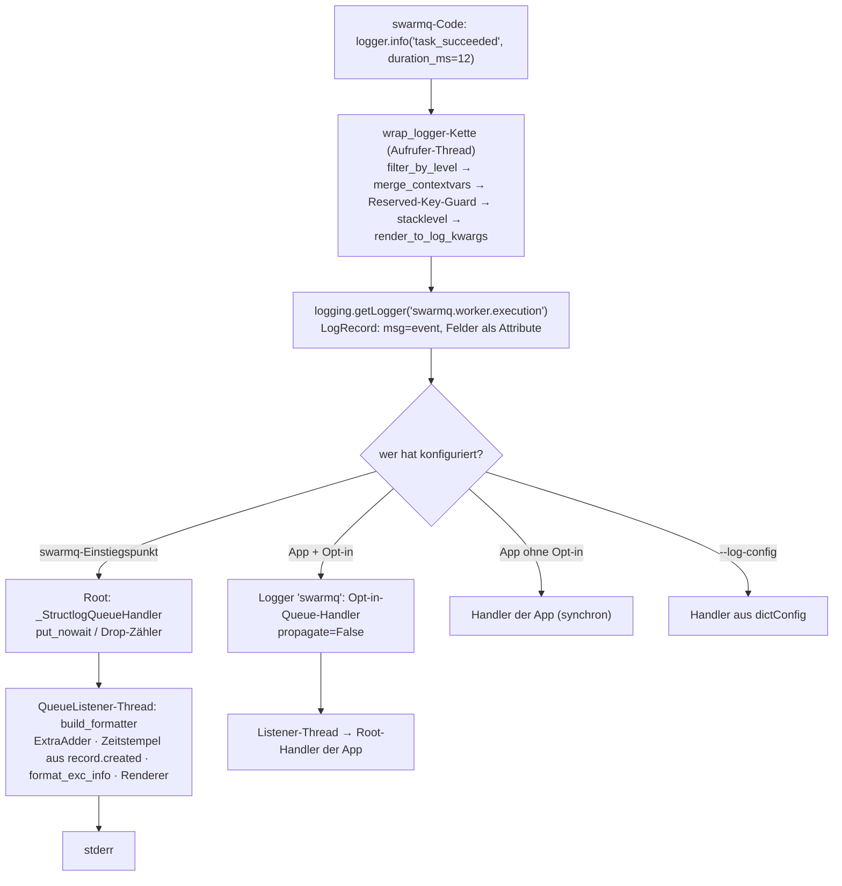
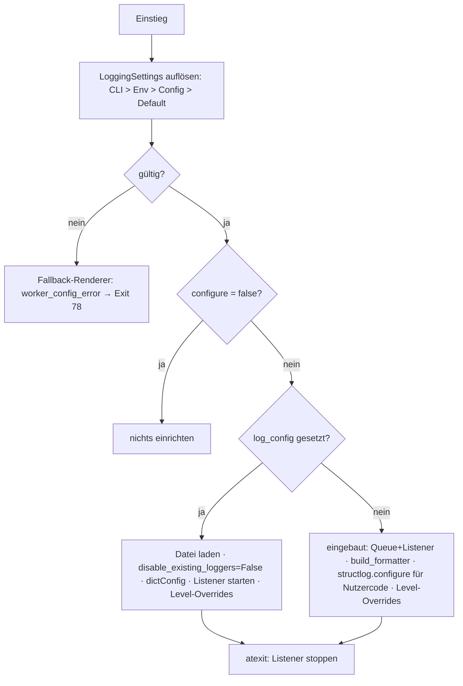
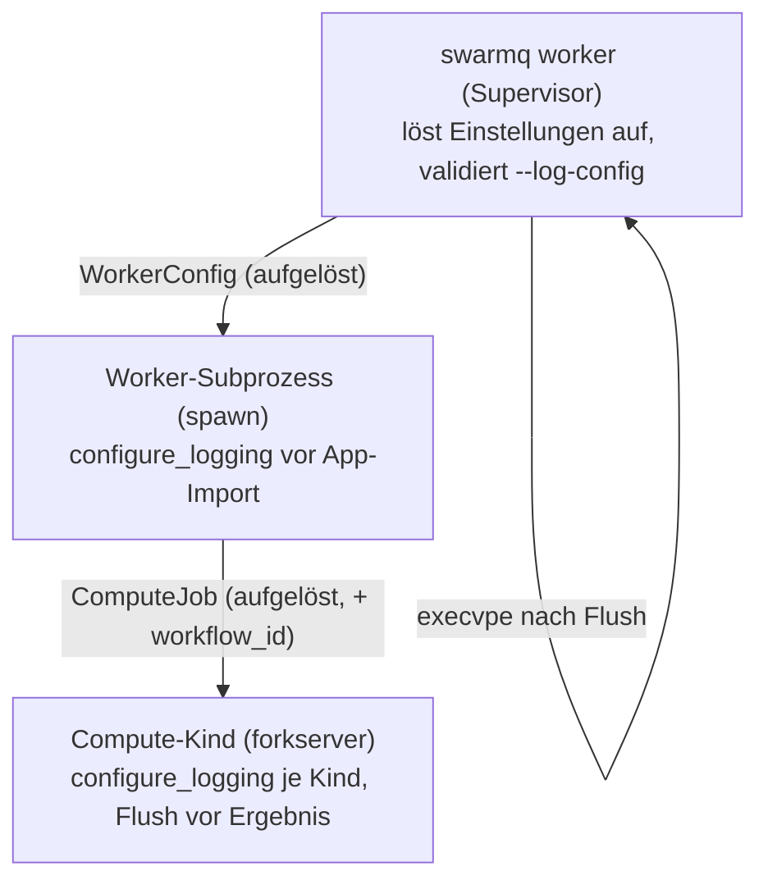

# Logging-Härtung und -Umbau - Plan

## Goal Capsule

- **Objective:** Wer swarmq betreibt oder einbettet, bekommt vollständige, strukturierte Logs in seinem eigenen Logging-Setup, egal ob mit oder ohne structlog. Sein Setup wird dabei nie verändert, und ein Logaufruf hält den Event-Loop nie auf. Die swarmq-Prozesse (CLI, Supervisor, Worker, Compute-Kinder) loggen wie gewohnt, lassen sich aber vollständig umkonfigurieren.
- **Means:** structlog-Logger je Modul, die von der globalen structlog-Konfiguration unabhängig sind und ins Standard-`logging` übergeben (KTD1). Rendering nur im Listener-Thread (KTD2/KTD3). Die Einrichtung übernehmen ausschließlich die Einstiegspunkte (KTD4).
- **Authority:** Bei Konflikten gelten zuerst die Product-Contract-Requirements, dann die KTDs, zuletzt die Units. AGENTS.md (strikt TDD) gilt für jede Unit.
- **Execution profile:** Breaking Minor-Release (0.8.0). Jede Unit wird test-first umgesetzt, mit genau einem roten Test zur Zeit.
- **Stop conditions:**
  - Stopp, falls sich zeigt, dass `wrap_logger`-Logger in structlog 26.x nicht stabil ohne globale Konfiguration arbeiten.
  - Stopp, falls der Forkserver-Thread-Check nicht mehr grün zu halten ist.
  - In beiden Fällen nicht improvisieren, sondern Rücksprache halten.
- **Tail ownership:** Release-Schritte (Tag, PyPI) nur nach ausdrücklicher Freigabe durch Georg.

---

## Product Contract

### Summary

swarmq loggt weiter mit structlog, aber nur noch über eigene `swarmq.*`-Logger. Diese hängen nicht von der globalen structlog-Konfiguration ab und übergeben strukturierte Felder als LogRecord-Attribute ans Standard-`logging`. Die Bibliothek konfiguriert nichts. Die Prozesse, die swarmq selbst startet, richten das Logging wie bisher ein. Konfigurierbar sind Level, Format, eigene dictConfig-Datei, „nicht anfassen“, Level je Logger, Queue-Größe und das Level der Lebenszyklus-Events. Dazu kommen Lebenszyklus-Events je Task, ein festes Fehlerschema, Level-Hygiene und ein sauberes Prozessende.

### Problem Frame

`SwarmQ()` ruft heute `setup_logging()` auf (`src/swarmq/app.py:62`). Das leert die Root-Handler der einbettenden App, setzt das Root-Level und überschreibt deren globale structlog-Konfiguration (`structlog.reset_defaults()`). Wer swarmq in FastAPI oder Django einbettet, verliert sein eigenes Logging.

Den Aufruf einfach zu entfernen reicht nicht. Ohne `structlog.configure` gehen swarmq-Logs per `PrintLogger` direkt nach stdout, an `logging` vorbei (empirisch geprüft).

Dazu kommen weitere Schwächen:
- Erfolgreiche Tasks erzeugen keine Logzeile.
- Fehlerfelder und Event-Namen sind uneinheitlich, die Level werden kaum genutzt.
- Fremd-Bibliotheken lassen sich nicht separat einstellen.
- Env und CLI haben je nach Prozess eine andere Priorität: Der Supervisor loggt Text, die Worker JSON.
- Compute-Kinder enden per `os._exit` ohne `logging.shutdown`.
- Bei Hot-Reload (`execvpe`) und an einigen Exit-Pfaden gehen Zeilen verloren oder landen als Rohtext im JSON-Strom.

### Requirements

**Bibliothek**
- R1. `SwarmQ()` und alle übrigen Bibliotheks-APIs verändern weder Root-Handler, Root-Level, globale structlog-Konfiguration noch Logger-Klassen der Anwendung.
- R2. Jeder swarmq-Logeintrag geht über einen benannten Logger `swarmq.<modul>` ins Standard-`logging`. Der Event-Name wird zur Nachricht, alle Felder werden zu LogRecord-Attributen. Das gilt unabhängig davon, ob und wie die App structlog konfiguriert hat.
- R3. Eine structlog-App, deren `ProcessorFormatter` `ExtraAdder` enthält, rendert swarmq-Events mit allen Feldern als echte Schlüssel/Werte. Eine reine stdlib-App kann die Felder per Formatter lesen.
- R4. Der Task-Kontext hängt an jedem Eintrag innerhalb eines Tasks: `task_id`, `task_name`, `queue`, `worker_id`, `workflow_id`, `attempt`, im Compute-Kind zusätzlich `compute_child`. Er wird pro Task gebunden und danach wiederhergestellt. Kontextvariablen der App bleiben erhalten.
- R5. Eine eingebettete App kann per Opt-in-Schalter alle `swarmq.*`-Logs über eine swarmq-eigene Hintergrund-Queue leiten. Standardmäßig ist der Schalter aus.

**Nicht-blockierend**
- R6. Ein Logaufruf im Event-Loop schreibt nie selbst auf einen Stream, rendert nie und wartet nie. Ein deaktiviertes Level kostet höchstens einen Level-Check. Ein aktives Level erzeugt nur den Record und hängt ihn an die Queue.
- R7. Bei voller Queue wird verworfen statt gewartet. Verworfene Einträge werden gezählt, als Metrik bereitgestellt und höchstens einmal pro Sekunde gemeldet. Im JSON-Modus erfolgt die Meldung als gültige JSON-Zeile.
- R8. Fremd-Records, deren Formatierung fehlschlägt, erzeugen ein Ersatz-Event `log_record_unformattable` statt eines Tracebacks im Logstrom (bestehendes Verhalten, AE12 aus Plan 2026-09-08-001).

**Programme (Prozesse, die swarmq startet)**
- R9. CLI-Supervisor, Worker-Subprozess und Compute-Kinder richten ohne Zusatzangaben das Logging wie bisher ein:
  - JSON oder Text mit gleichen Event-Namen und Kontextfeldern auf stderr
  - kein ANSI bei umgeleitetem stderr (CLI-03)
  - genau ein Listener und genau eine Zeile pro Event je Prozess (B6)
- R10. `structlog.get_logger()` in Nutzer-Tasks rendert in diesen Prozessen wie bisher über dieselbe Ausgabe wie swarmq selbst.
- R11. Ist eine eigene dictConfig-Datei gesetzt (JSON, YAML wenn PyYAML installiert ist), wendet swarmq in allen gestarteten Prozessen diese Datei statt der eingebauten Einrichtung an.
- R12. Mit dem Schalter „Logging nicht konfigurieren“ richtet swarmq in keinem gestarteten Prozess etwas ein.
- R13. Konfigurierbar sind:
  - Level und Format
  - Pfad der Logging-Konfigurationsdatei und der Schalter „nicht konfigurieren“
  - Level je Logger-Name (z. B. `aio_pika`, `aiormq`, `valkey`)
  - Queue-Größe
  - Level der Lebenszyklus-Events

  Jede Einstellung gibt es als CLI-Option, Umgebungsvariable und `SwarmQConfig`-Feld. Es gilt eine feste Priorität (KTD7), und alle Einstellungen gelten auch in Kindprozessen.
- R14. Ungültige Logging-Einstellungen beenden den Prozess mit Exit 78 und genau einer strukturierten `worker_config_error`-Zeile im gewählten Format. `--check` meldet sie ebenfalls.
- R15. Beim regulären Prozessende werden alle Einträge in der Queue geschrieben, auch in Compute-Kindern, vor `execvpe` (Hot-Reload) und an den bisherigen Rohtext-Exitpfaden.

**Inhalt der Logs**
- R16. Jeder Task erzeugt Lebenszyklus-Events:
  - `task_received` und `task_started` auf DEBUG
  - `task_succeeded` und `task_failed` auf INFO, jeweils mit `duration_ms`

  Die Level sind konfigurierbar.
- R17. Fehler werden einheitlich geloggt: `error_type` (Klassenname) und `error` (Text), ein Traceback nur bei unerwarteten Fehlern über `exc_info`.
- R18. Event-Namen sind feste snake_case-Literale, also keine f-Strings, Leerzeichen oder Punkte. Level folgen einer dokumentierten Regel (KTD11).

**Dokumentation**
- R19. README und Website-Referenz (EN und DE) dokumentieren:
  - Logger-Namen, Felder und Event-Katalog
  - Integration für stdlib- und structlog-Apps
  - alle neuen Optionen

  Das Changelog führt die BREAKING-Änderung mit Migrationshinweis.

### Key Decisions

- **Die Bibliothek konfiguriert nie, nur Einstiegspunkte konfigurieren.** Governs R1, R9, R12. (session-settled: user-approved — gewählt statt „SwarmQ() konfiguriert weiter, aber abschaltbar“: eine Bibliothek darf das Logging der App nicht übernehmen)
- **structlog bleibt fester Bestandteil, und der swarmq-Code loggt in structlog-Schreibweise.** Governs R2, R3, R10. (session-settled: user-directed — gewählt statt „reines stdlib-logging mit extra“ und statt „structlog optional“: der Nutzer hat beide Alternativen nach Abwägung verworfen)
- **Alle wichtigen Teile sind konfigurierbar und funktionieren wie gewohnt.** Governs R9, R11, R12, R13. (session-settled: user-directed — gewählt statt fest verdrahteter Einrichtung)
- **Kein `NullHandler` im Paket.** Governs R2. (session-settled: user-approved — gewählt statt NullHandler: ohne Konfiguration sollen WARNING+ über Pythons `lastResort` sichtbar bleiben)
- **Die Opt-in-Queue für eingebettete Apps ist standardmäßig aus.** Governs R5. (session-settled: user-approved — gewählt statt „immer an“: kein Eingriff in die Konfiguration der App ohne Zustimmung)
- **Lebenszyklus-Level: empfangen/gestartet DEBUG, erfolgreich/fehlgeschlagen INFO.** Governs R16. (session-settled: user-approved — gewählt statt „alles INFO“ bzw. „alles DEBUG“: Sichtbarkeit ohne Zeilenflut)
- **dictConfig-Datei als JSON, YAML nur mit installiertem PyYAML.** Governs R11. (session-settled: user-approved — gewählt statt einer neuen Pflicht-Abhängigkeit)

### Acceptance Examples

- AE1. Covers R1, R2. **Given** eine App mit `logging.basicConfig(format="%(name)s %(message)s %(task_id)s")`, **when** sie `SwarmQ(...)` erzeugt und ein Task läuft, **then** sind die Root-Handler der App unverändert. Die Zeile zeigt `swarmq.worker.execution task_succeeded <task_id>`.
- AE2. Covers R2, R3. **Given** eine App mit eigener `structlog.configure` und `ProcessorFormatter(foreign_pre_chain=[..., ExtraAdder()], JSONRenderer)`, **when** swarmq `task_failed` loggt, **then** enthält die JSON-Zeile `event`, `level`, `logger`, `task_id`, `error_type`, `error` und einen Traceback-Schlüssel. Die structlog-Konfiguration der App ist unverändert.
- AE3. Covers R9. **Given** `swarmq worker --log-format json`, **when** ein Worker startet, **then** steht genau eine JSON-Zeile `worker_started` mit dem Schlüssel `event` auf stderr. Es gibt keine doppelten Zeilen und kein ANSI.
- AE4. Covers R11, R14. **Given** `--log-config bad.json` mit einem Tippfehler in einem Handler-Schlüssel, **when** der Supervisor startet, **then** gibt es Exit 78 und genau eine `worker_config_error`-Zeile mit `path`, `error_type` und der Ursache aus `__cause__`.
- AE5. Covers R13. **Given** `SWARMQ_LOG_FORMAT=json` und `--log-format human`, **then** loggen Supervisor und alle Worker im Textformat. Ohne `--log-format` loggen alle im JSON-Format.
- AE6. Covers R5. **Given** ein Task-Modul, das `SwarmQ(log_queue=True)` auf Modulebene erzeugt, im CPU-Pool, **when** der Forkserver das Modul vorlädt, **then** besteht der Single-Thread-Check. Der Listener startet erst beim ersten Logeintrag.
- AE7. Covers R7. **Given** eine volle Queue im JSON-Modus, **then** erscheint höchstens eine `log_records_dropped`-Zeile pro Sekunde als gültiges JSON, und der Metrik-Zähler steigt.

### Scope Boundaries

- Kein Wechsel der Logging-Bibliothek, kein Log-Versand an externe Dienste (OTel, Sentry). Kein Sampling von DEBUG-Events.
- Client-CLI-Unterbefehle (`schedule`, `dlq`, `inspect`) richten weiterhin kein Logging ein.
- Kein Schutz gegen Verlust bei SIGKILL. Was beim Kill in der Queue liegt, ist verloren (dokumentiert).
- Verzahnung von über 4 KiB langen Zeilen mehrerer Prozesse auf einer gemeinsamen Pipe: bestehendes Verhalten, nicht Teil dieses Plans.

#### Deferred to Follow-Up Work

- Eine Korrelations-ID über Message-Header über Task-Grenzen hinweg (Empfehlung aus `docs/recherche-logging.md`).
- Learning in `docs/solutions/` über B6, den `capture_logs`-Cache und den Forkserver-Thread. Dafür nach dem Merge `ce-compound` ausführen.

---

## Planning Contract

### Key Technical Decisions

- KTD1. **Bibliotheks-Logger per `structlog.wrap_logger` über `logging.getLogger(name)`.** Ein neuer `swarmq.logging.get_logger(name)` liefert einen Logger mit expliziten `processors` und `wrapper_class=structlog.stdlib.BoundLogger` sowie `cache_logger_on_first_use=True`. Weil `processors` und `wrapper_class` gesetzt sind, greift ein `structlog.configure` der App nicht (geprüft gegen structlog 26.1). `structlog.stdlib.LoggerFactory` wird nicht verwendet, weil es global `logging.setLoggerClass` setzt. Den stdlib-Logger holt der Wrapper erst beim ersten Logaufruf (lazy), nicht beim Modulimport. Sonst würde eine dictConfig der App mit dem Default `disable_existing_loggers=True` alle bereits importierten `swarmq.*`-Logger stumm schalten, und heute verhindert genau dieser Lazy-Proxy das. Instanziiert dieses Pattern für die Key Decision „structlog bleibt fester Bestandteil“ (Governs R2, R3).
- KTD2. **Minimale Prozessorkette auf der Aufruferseite.** Die Kette ist `filter_by_level`, `merge_contextvars`, Reserved-Key-Guard, Stacklevel-Setter, `render_to_log_kwargs`. Gemessen kostet das etwa 5 µs bei aktivem Level und etwa 1 µs bei deaktiviertem. Teure Schritte laufen nie auf der Aufruferseite: `format_exc_info` (~42 µs), ISO-`TimeStamper`, `CallsiteParameterAdder` und die Renderer.
  - `render_to_log_kwargs` statt `wrap_for_formatter`: Ein Dict als `msg` würde in stdlib-Apps als String erscheinen und im `ProcessorFormatter` die `foreign_pre_chain` umgehen.
  - Der Reserved-Key-Guard benennt Schlüssel, die LogRecord-Attribute sind (`name`, `module`, `msg`, `args`, `message`, `asctime` …), in `swarmq_<key>` um. Sonst wirft `logging` einen `KeyError` in den Aufrufer (real betroffen: `hot_reload.py:135` `module=`).
  - Kontextvariablen namens `exc_info`, `stack_info` oder `stacklevel` werden ebenfalls umbenannt.
  - Der Stacklevel-Setter sorgt für korrekte `funcName`/`lineno`. Sein Verhalten hängt von der structlog-Version ab und wird deshalb per Test festgehalten.
- KTD3. **Rendering in einem Listener-Thread über einen öffentlichen Formatter.**
  - `swarmq.logging.build_formatter(json: bool, colors: bool)` liefert einen `ProcessorFormatter` (abgeleitet von `_SafeProcessorFormatter`, R8).
  - Seine `foreign_pre_chain` enthält `add_log_level`, `add_logger_name`, einen Zeitstempel aus `record.created`, `ExtraAdder` und `format_exc_info`.
  - Der Zeitstempel kommt aus `record.created`, damit Rückstau in der Queue die Zeit nicht verfälscht.
  - `ExtraAdder` lässt `message` und `asctime` aus, damit keine Streufelder entstehen. Ohne `ExtraAdder` gingen auch in swarmqs eigener Ausgabe alle Felder verloren.
  - Danach folgen `remove_processors_meta` (B6) und der Renderer.
  - Nutzer können die Factory in ihrer dictConfig per `"()"` verwenden.
- KTD4. **Die Bibliothek konfiguriert nie, die Einstiegspunkte genau einmal.** `configure_logging(settings)` ersetzt `setup_logging` und wird nur an drei Stellen aufgerufen:
  - im Supervisor `swarmq worker` (`src/swarmq/cli/__init__.py`)
  - im Worker-Subprozess (`src/swarmq/process_manager/entry.py`, vor dem App-Import)
  - im Compute-Kind (`src/swarmq/worker/compute/child.py`)

  `run_worker_async` in `src/swarmq/cli/worker_cmd.py` wird nur aus `entry.py` aufgerufen. Er importiert die App vor `SwarmQ(...)` und konfiguriert deshalb nicht: Ein Aufruf dort würde die Logging-Einrichtung der App nach dem Import wieder überschreiben.

  Je Prozess gibt es genau einen Eigentümer. Ein zweiter `configure_logging`-Aufruf im selben Prozess ist ein No-op mit einem DEBUG-Event. Neu aufgebaut wird nur über `shutdown_logging()` und danach `configure_logging()`.

  `basicConfig` in `entry.py` entfällt, ebenso der `_ACTIVE_LISTENER`-Workaround als privater globaler Zustand. An seine Stelle tritt ein Modul-Zustand mit öffentlichem `shutdown_logging()`.

  **Regel „App gewinnt“**: Vor dem App-Import wird ein Schnappschuss der Root-Handler gemacht. Verglichen wird nach dem Import in `run_worker_async` und noch einmal nach einem `--configure`-Hook.
  - Fehlt swarmqs Handler, hat die App ersetzt. swarmq stoppt seinen Root-Listener und aktiviert die Queue aus KTD10 am Logger `swarmq`. Damit schreiben die swarmq-Logs weiter über einen Hintergrund-Thread an die Handler der App, und R6 bleibt gewahrt. `logging_reconfigured_by_app` erscheint einmal.
  - Hat die dictConfig der App bereits existierende `swarmq.*`-Logger deaktiviert, schaltet swarmq sie wieder ein und nennt die Zahl in `logging_reconfigured_by_app`.
  - Sind neben swarmqs Handler weitere dazugekommen, meldet swarmq `logging_handlers_added_by_app` mit den Handler-Typen als WARNING und entfernt nichts.
  - `basicConfig` in einem Task-Modul ist unter `swarmq worker` wirkungslos (wird dokumentiert). Wer das Logging selbst besitzen will, nutzt `--log-config` oder `--no-configure-logging`.
- KTD5. **Queue und Listener.**
  - `_StructlogQueueHandler` bleibt in seiner Rolle, wird aber umgebaut:
    - `prepare` reicht den Record durch, damit `exc_info` erhalten bleibt und die Formatierung im Listener stattfindet.
    - `enqueue` fängt `queue.Full` und `queue.ShutDown` ab.
    - Die Drop-Meldung geht im JSON-Modus als vorgerenderte JSON-Zeile raus (R7).
    - Der Zähler wird über `swarmq.metrics` exportiert.
  - Der Listener startet idempotent. `QueueListener.start()` wirft unter 3.14 bei doppeltem Start. Gestoppt wird er per `atexit`, weil dictConfig und `logging.shutdown` Listener weder starten noch stoppen.
  - Der Start des Listeners läuft unter einem Lock, weil der erste Eintrag zwischen Threads konkurrieren kann.
  - Fork-Sicherheit: `os.register_at_fork(after_in_child=…)` ersetzt im Kind die Queue des aktiven Handlers durch eine frische `Queue(maxsize)` und verwirft die geerbten Records. Die Records schreibt der Elternprozess; ohne diesen Schritt erschienen sie doppelt. Außerdem werden Drop-Zähler und Meldezeitpunkt zurückgesetzt und die Listener-Referenz gelöscht. Beim nächsten Eintrag startet ein neuer Listener.
  - Reserve für wichtige Einträge: Ab einem Füllstand von 90 % wird nur noch unterhalb von WARNING verworfen. WARNING und höher nutzen die restlichen 10 % und gehen erst bei vollständig voller Queue verloren.
  - Drop-Zähler gibt es je Prozess. Die Worker-Metrik umfasst nur den Worker-Prozess. Verluste in Compute-Kindern bleiben als `log_records_dropped`-Zeile sichtbar (dokumentiert).
  - `shutdown_logging()` leert die Queue und stoppt den Listener, lässt den Queue-Handler aber installiert. Der nächste Eintrag startet den Listener lazy unter demselben Lock wieder (gleicher Mechanismus wie nach einem Fork). Das ist zugleich die Leerung pro Job im wiederverwendeten Compute-Kind.
- KTD6. **structlog-Konfiguration für Nutzercode nur in Einstiegspunkten.** Im eingebauten Modus ruft `configure_logging` weiterhin global `structlog.configure` auf, mit `LoggerFactory`, `merge_contextvars` und `render_to_log_kwargs` in einer eigenen schlanken Kette, damit Nutzer-Tasks gerendert werden wie bisher (R10). Bei `--log-config` und „nicht konfigurieren“ unterbleibt das; der Nutzer ist dann zuständig, was dokumentiert wird. Unterbleiben soll es auch, wenn `structlog.is_configured()` schon wahr ist, wie im Compute-Kind nach dem Vorladen einer App, die structlog selbst konfiguriert. Die Bibliothek ruft `structlog.configure` nie auf.
- KTD7. **Einstellungsmodell und Priorität.**
  - Ein unveränderliches, pickle-sicheres `LoggingSettings` bündelt alle Einstellungen aus R13: Level, Format, Konfigurationspfad, Konfigurieren ja/nein, Logger-Level als Tupel von Paaren, Queue-Größe, Lebenszyklus-Level.
  - Priorität: CLI-Option > Umgebungsvariable > `SwarmQConfig`-Argument > Default. Damit das geht, werden die argparse-Defaults zu `None`.
  - Der Supervisor löst die Einstellungen einmal auf und gibt sie aufgelöst über `WorkerConfig` und `ComputeJob` an die Kinder weiter. Die Kinder lesen kein Env mehr.
  - `worker_cmd.py` übergibt das aufgelöste `LoggingSettings` aus `WorkerConfig` als ein Objekt an `SwarmQ`/`SwarmQConfig`. Aus ihm stammende Logging-Felder sind von `_ENV_OVERRIDES` ausgenommen. Worker und Lebenszyklus-Events lesen Level, Queue-Größe und Lebenszyklus-Level aus diesem Objekt.
  - Ohne dieses Objekt, also eingebettet, gilt weiter: erst kwargs, dann Env.
  - Eingebettet sind die Logging-Felder von `SwarmQConfig` die Quelle für die Prozesse, die die Bibliothek selbst startet, also die Compute-Kinder eines eingebetteten CPU-Pools. Damit hat jedes Feld aus R13 einen Verbraucher. Die Kinder richten sich nach diesen Feldern ein wie heute (stderr, `log_level`/`log_json`), oder nach `log_config`, oder gar nicht. Die Regel „App gewinnt“ (KTD14) gilt auch dort.
  - Dokumentiert wird: Logs eingebetteter Compute-Kinder gehen nicht über die Handler der App.
- KTD8. **Neue Optionen und Env-Variablen.**

  | Einstellung | CLI-Option | Umgebungsvariable | Hinweis |
  |---|---|---|---|
  | Format | `--log-format` | `SWARMQ_LOG_FORMAT` (`human`/`json`) | `SWARMQ_LOG_JSON` bleibt als Alias, `SWARMQ_LOG_FORMAT` hat Vorrang |
  | Level | `--log-level` | `SWARMQ_LOG_LEVEL` | |
  | Konfigurationsdatei | `--log-config PATH` | `SWARMQ_LOG_CONFIG` | |
  | Nicht konfigurieren | `--no-configure-logging` | `SWARMQ_CONFIGURE_LOGGING=false` | |
  | Level je Logger | `--logger-level NAME=LEVEL` (wiederholbar) | `SWARMQ_LOGGER_LEVELS="aio_pika=WARNING,valkey=ERROR"` | |
  | Queue-Größe | `--log-queue-size N` | `SWARMQ_LOG_QUEUE_SIZE` | |
  | Lebenszyklus-Level | `--log-lifecycle-level LEVEL` | `SWARMQ_LOG_LIFECYCLE_LEVEL` | |

  - Das Lebenszyklus-Level verschiebt `task_received` und `task_started`. `task_succeeded` und `task_failed` folgen über KTD12.
  - CRITICAL wird überall akzeptiert.
  - Diese Kombinationen sind Konfigurationsfehler (Exit 78): `--log-config` zusammen mit einem ausdrücklichen `--log-format`, und `--no-configure-logging` zusammen mit `--log-config`.
  - `--log-level` und `--logger-level` wirken nach einer dictConfig zusätzlich per `setLevel`.
- KTD9. **Laden der dictConfig-Datei.**
  - JSON immer, `.yaml`/`.yml` nur mit installiertem PyYAML, sonst Konfigurationsfehler mit Hinweis.
  - Fehlt `disable_existing_loggers`, wird `False` gesetzt, sonst würden bereits importierte `swarmq.*`- und `aio_pika`-Logger stumm.
  - Nach `dictConfig` werden alle Listener noch nicht laufender `QueueHandler` gestartet und per `atexit` gestoppt.
  - Der Supervisor löst den Pfad absolut auf, parst und validiert die Datei einmal (Exit 78 mit `__cause__`) und gibt die geprüfte Konfiguration als JSON-String in `LoggingSettings` weiter. Ein String ist pickle-sicher, Dicts lässt `WorkerConfig` nicht zu. Kinder lesen die Datei nie, damit ändern weder ein anderes Arbeitsverzeichnis noch eine nachträgliche Änderung der Datei etwas für sie.
  - Hot-Reload ist ein vollständiger `execvpe` des Supervisors. Deshalb validiert der laufende Supervisor `--log-config` neu, bevor er einen Worker stoppt (Helfer in `src/swarmq/process_manager/run.py` oder `src/swarmq/hot_reload.py`, weil `supervisor.py` am 800-Zeilen-Guard liegt). Scheitert das, wird der Reload abgebrochen und `log_config_reload_failed` geloggt. Worker und Logging laufen unverändert weiter, es gibt kein `execvpe` und kein Exit 78.
  - Dokumentiert wird: Im Mehrprozessbetrieb sind nur Stream-Handler (stdout/stderr) unterstützt. Dateirotation gehört außerhalb des Prozesses, z. B. in journald, logrotate mit `copytruncate` oder einen Collector.
- KTD10. **Opt-in-Queue für eingebettete Apps.**
  - Gesteuert über `SwarmQConfig.log_queue: bool = False` bzw. `SWARMQ_LOG_QUEUE`.
  - Hängt einen swarmq-eigenen Queue-Handler an den Logger `swarmq` und setzt `propagate=False`.
  - Der Listener gibt jeden Record zum Ausgabezeitpunkt über `logging.getLogger().callHandlers(record)` an die Handler der App weiter, also die Elternkette von `swarmq`. Er hält keinen Schnappschuss der Handler. Damit gelten Handler-Level weiter, später hinzugefügte Handler (Sentry, OTel, uvicorn) greifen, und ohne Handler bleibt `lastResort` aktiv.
  - Damit laufen langsame Handler der App im Listener-Thread statt im Event-Loop, ohne dass Zeilen doppelt erscheinen.
  - Kontext für Filter: `enqueue` hängt `contextvars.copy_context()` an den Record (O(1)). Der Listener führt die Weitergabe in `ctx.run(...)` aus, sodass Filter, die Kontextvariablen lesen (z. B. Korrelations-IDs), wie im Aufrufer arbeiten. Vor `callHandlers` entfernt der Listener dieses interne Attribut wieder, sonst gäbe `ExtraAdder` es als Feld aus.
  - Handler, die die App direkt an `swarmq` hängt, bleiben synchron. Sentrys `LoggingIntegration` läuft weiter im Aufrufer. Beides wird dokumentiert.
  - Der Zustand liegt mit Referenzzählung auf Modulebene (`enable_log_queue()` / `disable_log_queue()`): `SwarmQ` erwirbt ihn in `__init__` und gibt ihn in `__aexit__` frei. Die letzte Freigabe stellt Handler, `propagate` und das vorherige `swarmq`-Level wieder her. Mehrere Instanzen im selben Prozess stören sich damit nicht.
  - Der Listener startet lazy beim ersten Eintrag, unter Lock, nie in `__init__`, damit der Forkserver-Check (AE6) besteht. Er ist fork-sicher (KTD5).
  - Das `swarmq`-Level folgt `log_level`, sonst würde das Root-Level WARNING der App INFO verschlucken.
  - Hat ein Einstiegspunkt im Modus „eingebaut“ oder „Datei“ konfiguriert, ist der Opt-in wirkungslos. `configure_logging` deaktiviert in diesen Modi einen bereits aktiven Opt-in, etwa einen aus dem Forkserver-Vorladen geerbten, und stellt Handler, `propagate` und Level von `swarmq` wieder her. Unter `--no-configure-logging` wird der Opt-in beachtet. Intern nutzt auch die Regel „App gewinnt“ (KTD4) diesen Mechanismus.
  - `log_level` und `log_json` bleiben als Felder erhalten und steuern nur noch den Opt-in. Sie werfen keinen TypeError und brauchen keine Deprecation. `log_json` steht weiterhin standardmäßig auf `True`, der CLI-Default ist `human` (wird dokumentiert).
- KTD11. **Level-Regel.**
  - ERROR: Datenverlust oder ein Task bzw. Prozess ist fehlgeschlagen.
  - WARNING: Degradierung mit automatischer Erholung.
  - INFO: Lebenszyklus von Prozess und Task.
  - DEBUG: Diagnose.

  Konkrete Umstufungen: `check_backend_failed` und `check_broker_failed` → WARNING. Weitere Fälle legt U9 nach der Regel fest. Fehler werden über einen internen Helfer `_error_fields(exc)` gemeldet (R17).
- KTD12. **Lebenszyklus-Events an bestehenden Nahtstellen, über einen eigenen Logger `swarmq.task`.** Mit `--logger-level swarmq.task=WARNING` lassen sie sich abschalten, ohne andere Events derselben Module zu verlieren.
  - `task_received` in `src/swarmq/worker/pipeline.py` nach Dekodieren und Kontextbindung.
  - `task_started`, `task_succeeded` und `task_failed` in `src/swarmq/worker/execution.py` (`_emit_terminal_hooks`). Diese Stelle nutzt auch der Compute-Executor, damit decken sie beide Pools ab.
  - `task_failed` meldet das Ausführungsergebnis. Retry bzw. DLQ melden weiterhin `task_retrying` und `task_sent_to_dlq`.
  - Abgebrochene Tasks melden `task_cancelled` auf INFO.
- KTD13. **Task-Kontext per Scope.** Ein interner Helfer `_task_log_context(...)` auf Basis von `structlog.contextvars.bound_contextvars` ersetzt `_bind_log_context`/`clear_contextvars` in Pipeline und Gates. Er bindet beim Betreten und stellt beim Verlassen wieder her. Weil jede Nachricht in einem eigenen asyncio-Task läuft, gibt es keine Lecks und keine gelöschten App-Variablen. Neu sind `workflow_id` (aus `decode.valid_workflow_id`) und `attempt` (aus `retry_count`); `ComputeJob` bekommt `workflow_id` dazu.
- KTD14. **Compute-Kinder behalten Queue und Listener**, wie bisher (`src/swarmq/worker/compute/child.py`). Der Listener wird geleert, bevor das Ergebnis an den Eltern geht, und im `finally` folgt `logging.shutdown()`. Ein synchroner Handler würde stderr-Schreibvorgänge in die Event-Loop des Kindes legen und R6 verletzen.
  - Die Regel „App gewinnt“ aus KTD4 gilt auch hier. Hat die App beim Vorladen im Forkserver eigene Root-Handler gesetzt, ersetzt das Kind sie nicht.
  - `logging_reconfigured_by_app` erscheint dann einmal pro Pool, nicht pro Kind. swarmq-Logs laufen dort, wie im Worker, über die Queue aus KTD10, und die structlog-Konfiguration der App bleibt erhalten (KTD6). Gleiche App, gleiches Ergebnis in beiden Pools.
  - Im wiederverwendeten Kind (`child_loop`) wird pro Job vor dem Ergebnis mit `shutdown_logging()` geleert (KTD5).
  - Die Kosten beim Kindstart (bisher 5 ms) werden in U7 für den eingebauten Modus und den Modus `--log-config` gemessen.

### High-Level Technical Design

Datenfluss eines Logaufrufs:

Entscheidungsbaum der Einrichtung in einem Einstiegspunkt:

Prozesse und Weitergabe der Einstellungen:

### Assumptions

- Die Ausgabeform der eingebauten Einrichtung (Schlüssel `event`, `level`, `timestamp`) bleibt erhalten. Neu ist das Feld `logger`. e2e- und Chaos-Tests werten nur `event` aus und bleiben grün.
- Der CLI-Default für das Format bleibt `human`. Die e2e-Läufe setzen `--log-format json` ausdrücklich.

### System-Wide Impact

- **Eingebettete Apps:**
  - Root-Handler, Root-Level, structlog-Konfiguration und Logger-Klasse bleiben unberührt (R1).
  - Apps mit Root-Level WARNING, die sich darauf verlassen haben, dass `SwarmQ()` konfiguriert, sehen keine INFO-Events mehr. Das ist der Migrationshinweis im Changelog.
  - Ohne Handler erreichen WARNING und höher weiterhin `lastResort`.
- **Supervisor:** genau ein Eigentümer. Er löst die Einstellungen auf, validiert `--log-config` einmal und leert die Queue vor `execvpe` und vor Exit 78.
- **Worker-Subprozess:** konfiguriert vor dem App-Import. Die Einrichtung, die die App beim Import vornimmt, gewinnt (KTD4).
- **Compute-Pool:**
  - Der Forkserver bleibt single-threaded: Es gibt keinen Listener beim Import und kein swarmq-Log beim Modulimport.
  - Kinder folgen derselben „App gewinnt“-Regel (KTD14).
- **Client-CLI-Unterbefehle:** unverändert. `swarmq --help` importiert `swarmq.logging` nicht.
- **Log-Konsumenten:**
  - e2e und Chaos lesen nur `event`, Integrationstests parsen JSON-Zeilen.
  - Neu sind der Schlüssel `logger` und die Lebenszyklus-Events. Event-Namen werden umbenannt (`swarmq.dedup.*` → `dedup_*`, f-String-Namen in `_http.py`, Namen mit Leerzeichen in `backend/valkey/results.py`).
  - Das ändert den Ausgabevertrag für alle, die Logs per grep auswerten. Das Dashboard swarmv liest keine Logs.
- **swarmq-loadsuite** (Nachbar-Repo): Die Konformitätsprüfung prüft `app.config.log_json` und `log_level` je CLI-Option (`src/loadsuite/conform/assertions/cli_worker.py`), und das Oberflächenregister (`abdeckung.yaml`) listet `SWARMQ_LOG_*`. Die neuen Optionen und Variablen müssen dort im selben Release-Fenster nachgetragen werden.
- **Metriken:** Ein neuer Drop-Zähler im Worker-Prozess (KTD5).
- **Öffentliche API:**
  - Neu öffentlich: `get_logger`, `build_formatter`, `configure_logging`, `shutdown_logging` und `SwarmQConfig.log_queue`. `_error_fields`, `_task_log_context` und die Opt-in-Steuerung bleiben intern.
  - `setup_logging` und `flush_logging` werden deprecated Wrapper.
  - `SwarmQ._log_listener` entfällt.

### Risks & Dependencies

| Risiko | Gegenmaßnahme |
|---|---|
| structlog-Kopplung: Stacklevel, `wrap_logger` ohne globale Konfiguration, `exc_info`-Durchreichung in `render_to_log_kwargs` | Vertragstests in U1. Obergrenze `structlog<27` in `pyproject.toml`. U1-Tests beim nächsten Deps-Upgrade bewusst prüfen |
| Python 3.14: doppelter `QueueListener.start()` wirft, `queue.ShutDown`, unterdrücktes reentrantes Logging | Idempotenter Start unter Lock, `ShutDown` abfangen, Drop-Meldung direkt auf stderr statt über `logging` |
| Doppelte oder verlorene Zeilen (B6-Klasse) durch Fork-Reset, von der App hinzugefügte Handler oder Opt-in mit Propagation | Tests „genau eine Zeile“ in U3, U6, U7 und U8 |
| Logvolumen und GIL-Last durch `task_succeeded` auf INFO unter Last | Eigener Logger `swarmq.task`, Reserve für WARNING+ in der Queue, Loadsuite-Smoke in U11 |
| Breaking Change für einbettende Nutzer | Migrationshinweis mit Dreizeilen-Rezept und Opt-in-Queue, Version 0.8.0 |
| dictConfig im Mehrprozessbetrieb: Dateirotation, Kosten pro Kind | Doku (nur Stream-Handler), Konfiguration einmal geparst (KTD9), Messung in U7 |
| Test-Umbau in 38 Modulen und sechs `capture_logs`-Suiten verwässert Aussagen | Beide Capture-Wege bis U9, Diff-Review auf entfernte statt migrierte Assertions |
| Nachbar-Repo swarmq-loadsuite | Register und Konformität im selben Release-Fenster aktualisieren, „Konformität ohne Ausnahme“ vor dem Release laufen lassen |

### Sources & Research

- Messwerte und Prototypen zu `wrap_logger`, `render_to_log_kwargs`, `ExtraAdder`, `QueueHandler.prepare`, dictConfig-Queue und `capture_logs`: Prototypen gegen structlog 26.1.0 und CPython 3.14.4. Doku: https://www.structlog.org/en/stable/standard-library.html, https://docs.python.org/3.14/library/logging.config.html#configuring-queuehandler-and-queuelistener.
- Historie und Invarianten:
  - B6 doppelte Zeilen: `docs/plans/2026-08-28-001-fix-publish-deadline-port-guard-logfix-plan.md`, `docs/plans/2026-08-30-001-fix-inventar-debug-backlog.md`
  - KTD8, AE8, AE9 und AE12: `docs/plans/2026-09-08-001-feat-debug-backlog-loadsuite-plan.md`
  - CLI-03 Farben: `docs/plans/2026-04-23-001-fix-cli-refactor-residuals-plan.md`
  - P1-8 Supervisor-JSON: `docs/plans/2026-06-03-001-fix-hardening-round-2-plan.md`
- Forkserver-Single-Thread-Check: `src/swarmq/worker/compute/forkserver.py` (`start_forkserver`). Vorladen der Nutzermodule: `src/swarmq/worker/compute/wiring.py`.
- Grundlagenrecherche: `docs/recherche-logging.md` (Queue-Muster, kein `ainfo`, `merge_contextvars` zuerst).

---

## Implementation Units

| U-ID | Titel | Kern-Dateien | Abhängig von |
|---|---|---|---|
| U1 | Bibliotheks-Logger-Fabrik | `src/swarmq/logging.py` | – |
| U2 | Öffentlicher Formatter | `src/swarmq/logging.py` | U1 |
| U3 | Queue, Listener, Prozessende | `src/swarmq/logging.py`, `src/swarmq/metrics.py` | U2 |
| U4 | Test-Infrastruktur | `tests/unit/conftest.py`, `tests/unit/_log_capture.py` | U1 |
| U5 | Einstellungen und Priorität | `src/swarmq/logging_settings.py`, `src/swarmq/config.py`, `src/swarmq/cli/parser.py` | U1 |
| U6 | `configure_logging` | `src/swarmq/logging.py` | U3, U5 |
| U7 | Einstiegspunkte | `src/swarmq/cli/*`, `src/swarmq/process_manager/*`, `src/swarmq/worker/compute/*` | U6 |
| U8 | Bibliothek entkoppeln und Opt-in | `src/swarmq/app.py`, `src/swarmq/logging.py` | U3, U7 |
| U9 | Aufrufstellen migrieren | 38 Module unter `src/swarmq/` | U4, U8 |
| U10 | Task-Kontext per Scope | `src/swarmq/worker/pipeline.py`, `src/swarmq/worker/gates/*`, `src/swarmq/worker/compute/child.py` | U9 |
| U11 | Lebenszyklus-Events | `src/swarmq/worker/execution.py`, `src/swarmq/worker/pipeline.py` | U10 |
| U12 | Dokumentation und Spezifikation | `README.md`, `website/**`, `website/reference/agent/spec/*.json` | U11 |

### U1. Bibliotheks-Logger-Fabrik

- **Goal:** `swarmq.logging.get_logger(name)` liefert einen von globaler structlog-Konfiguration unabhängigen Logger, der ins Standard-`logging` übergibt.
- **Requirements:** R2, R3, R6. KTD1, KTD2.
- **Dependencies:** keine.
- **Files:** `src/swarmq/logging.py` (oder ein neues Teilmodul `src/swarmq/_logging/`, falls `logging.py` zu groß wird), `pyproject.toml` (`structlog>=24,<27`), `tests/unit/test_logging_logger.py`.
- **Approach:**
  1. Eine Prozessorkette als Modulkonstante (KTD2), die der Test-Capture-Hook in U4 erweitern kann.
  2. Reserved-Key-Guard: Er nutzt die Attributnamen eines frischen `LogRecord` sowie `message` und `asctime`.
  3. Stacklevel-Setter mit dem für 26.1 ermittelten Wert.
- **Execution note:** Mit dem Test anfangen, der zeigt, dass ein `structlog.configure` der App den swarmq-Logger nicht verändert.
- **Patterns to follow:** Die bestehenden `logging.py`-Docstrings (deutsch, mit Plan-IDs).
- **Test scenarios:**
  - Eine reine stdlib-App mit `%(task_id)s`-Format rendert ein swarmq-Event mit Feldwert (Covers AE1).
  - Eine App mit eigener `structlog.configure` und `ProcessorFormatter`+`ExtraAdder` rendert Felder als Schlüssel/Werte. `structlog.get_config()` der App ist danach unverändert (Covers AE2).
  - `logging.getLoggerClass()` ist nach dem Erzeugen eines swarmq-Loggers unverändert.
  - Ein Feld `module=` bzw. `name=` wird als `swarmq_module` bzw. `swarmq_name` geliefert und wirft nicht.
  - Eine Kontextvariable namens `exc_info` wird umbenannt und nicht als stdlib-kwarg interpretiert.
  - `logger.exception(...)` liefert einen Record mit gesetztem `exc_info`.
  - `funcName`/`lineno` zeigen auf die aufrufende Funktion, für `info`, `warning`, `exception` und `log`.
  - Ein deaktiviertes Level erzeugt keinen Record.
  - Nach `import swarmq` und einer dictConfig mit dem Default `disable_existing_loggers=True` ist ein danach erstmals benutzter swarmq-Logger nicht deaktiviert.
  - Ein `%` im Event-Namen wird nicht als Format-String interpretiert.
- **Verification:** Alle Szenarien grün, ohne dass in einem Test `structlog.configure` durch swarmq aufgerufen wurde.

### U2. Öffentlicher Formatter

- **Goal:** `build_formatter(json, colors)` rendert swarmq- und Fremd-Records einheitlich, im Listener-Thread.
- **Requirements:** R3, R8, R9. KTD3.
- **Dependencies:** U1.
- **Files:** `src/swarmq/logging.py`, `tests/unit/test_logging.py`, `tests/unit/test_logging_processor_meta.py`.
- **Approach:** `_SafeProcessorFormatter` bleibt die Basis. `foreign_pre_chain` nach KTD3. Die Form der JSON-Ausgabe bleibt bis auf das neue Feld `logger` kompatibel.
- **Patterns to follow:** Bestehende Tests in `tests/unit/test_logging_processor_meta.py` (B6) und `tests/unit/test_logging.py` (`log_record_unformattable`).
- **Test scenarios:**
  - Ein swarmq-Record ergibt eine JSON-Zeile mit `event`, `level`, `logger`, `timestamp` und allen Feldern.
  - Der Zeitstempel entspricht `record.created`, nicht dem Formatierungszeitpunkt (Record mit fixiertem `created`).
  - Ein Record mit `exc_info` liefert einen Traceback-Schlüssel in JSON bzw. einen Traceback-Block im Text.
  - Ein Record, den ein anderer Formatter vorher formatiert hat (gesetztes `message`/`asctime`), erzeugt keine Felder `message`/`asctime`.
  - Ein Fremd-Record mit werfendem `__repr__` ergibt `log_record_unformattable` (Regression AE12).
  - `_record` und `_from_structlog` erscheinen nicht in der Ausgabe (Regression B6).
  - Der Textmodus mit `colors=False` enthält kein ANSI.
  - Die Factory ist per dictConfig-`"()"` nutzbar.
- **Verification:** Bestehende B6- und AE12-Tests sind grün oder auf die neue API umgestellt, ohne Aussagen abzuschwächen.

### U3. Queue, Listener, Prozessende

- **Goal:** Ein Queue- und Listener-Kern, der nie blockiert, Verluste zählt und beim Prozessende sauber leert.
- **Requirements:** R6, R7, R15. KTD5.
- **Dependencies:** U2.
- **Files:** `src/swarmq/logging.py`, `src/swarmq/metrics.py`, `tests/unit/test_logging_queue.py`, `tests/unit/test_metrics.py`.
- **Approach:**
  1. `_StructlogQueueHandler` nach KTD5 umbauen.
  2. Listener-Verwaltung als Modulzustand mit `start` (idempotent), `shutdown_logging()` (öffentlich, ersetzt `flush_logging`, das als Alias bestehen bleibt) und `atexit`-Registrierung genau einmal.
  3. Ein `register_at_fork`-Hook setzt den Zustand im Kind zurück.
  4. Drop-Meldung im JSON-Modus als vorgerenderte JSON-Zeile.
  5. Den Drop-Zähler als Prometheus-Counter registrieren, falls `metrics` aktiv ist.
- **Test scenarios:**
  - `prepare` gibt denselben Record mit erhaltenem `exc_info` zurück, die Formatierung läuft im Listener-Thread (Thread-Name im Formatter prüfen).
  - Eine volle Queue blockiert nicht. `dropped` steigt, und innerhalb einer Sekunde erscheint genau eine Meldung (Zeit über Mock gesteuert).
  - Im JSON-Modus ist die Drop-Meldung als JSON parsebar mit `event=log_records_dropped` und `count` (Covers AE7).
  - Nach `queue.ShutDown` wird gezählt statt geworfen.
  - Ein zweiter `start` wirft nicht und startet keinen zweiten Thread.
  - `shutdown_logging()` schreibt alle Einträge in der Queue und ist mehrfach aufrufbar.
  - Ein atexit-Hook ist genau einmal registriert, auch nach mehrfacher Konfiguration.
  - Nach einem simulierten Fork (Hook direkt aufrufen) ist der Zustand zurückgesetzt, und der nächste Eintrag startet einen Listener.
  - Ein vor dem simulierten Fork eingereihter Record wird vom Kind nicht ausgegeben.
  - Zwei Threads, die gleichzeitig den ersten Eintrag schreiben, starten genau einen Listener.
  - Bei 90 % Füllstand wird ein INFO-Record verworfen, ein WARNING-Record noch eingereiht.
  - Der Metrik-Zähler steigt mit verworfenen Einträgen.
  - Nach `shutdown_logging()` startet der nächste Eintrag den Listener wieder und wird geschrieben.
- **Verification:** Ein Unit-Test pro Szenario, alle unter 100 ms. Kein `asyncio.sleep`, Synchronisation über Events.

### U4. Test-Infrastruktur

- **Goal:** Tests können swarmq-Logs ohne globale structlog-Konfiguration erfassen. Zustand und Env lecken nicht zwischen Tests.
- **Requirements:** Voraussetzung für U5–U11 (AGENTS.md: deterministische, unabhängige Tests).
- **Dependencies:** U1.
- **Files:** `tests/unit/_log_capture.py` (neu), `tests/unit/conftest.py`, `tests/unit/_structlog_cache.py` (entfällt), `tests/unit/test_structlog_cache.py` (entfällt), `tests/conftest.py`.
- **Approach:**
  1. Fixture `swarmq_logs`: ein stdlib-Handler am Logger `swarmq` mit Level DEBUG, der Records sammelt und Event, Level und Felder als Dicts bereitstellt.
  2. Ein Autouse-Fixture ruft `shutdown_logging()` und stellt den Root-Logger wieder her. Es ersetzt `_stop_leftover_log_listener`.
  3. Ein Autouse-Fixture entfernt `SWARMQ_LOG_*`, `SWARMQ_CONFIGURE_LOGGING` und `SWARMQ_LOGGER_LEVELS` aus dem Env.
  4. Die sechs `capture_logs`-Tests migrieren erst, wenn ihr Modul in U9 umgestellt wird. Bis dahin funktionieren beide Wege.
- **Test scenarios:**
  - Das Fixture erfasst ein swarmq-Event mit Feldern und Kontextvariablen.
  - Das Fixture erfasst nichts von Loggern außerhalb von `swarmq`.
  - Nach einem Test, der `configure_logging` aufruft, ist die Root-Handler-Liste im nächsten Test wieder im Ausgangszustand.
- **Verification:** Die gesamte Unit-Suite ist grün und läuft mit `-p no:randomly` und in umgekehrter Reihenfolge gleich.

### U5. Einstellungen und Priorität

- **Goal:** Ein `LoggingSettings`-Modell mit allen Einstellungen aus R13, aufgelöst mit fester Priorität aus CLI, Env und Config.
- **Requirements:** R13, R14. KTD7, KTD8.
- **Dependencies:** U1.
- **Files:**
  - `src/swarmq/logging_settings.py` (neu)
  - `src/swarmq/config.py`
  - `src/swarmq/cli/parser.py`
  - `src/swarmq/cli/_shared.py`
  - `src/swarmq/cli/check_cmd.py` (argv-Spiegel)
  - `src/swarmq/process_manager/config.py`
  - `src/swarmq/worker/compute/envelope.py`
  - `src/swarmq/agent_spec.py`
  - Tests: `tests/unit/test_logging_settings.py`, `tests/unit/test_config.py`, `tests/unit/cli/test_parser.py`, `tests/unit/process_manager/test_config.py`
- **Approach:**
  1. Das Settings-Objekt ist pickle-sicher: Logger-Level als Tupel von Paaren.
  2. Ein Resolver nimmt argparse-Namespace, Env und Config entgegen und liefert Settings oder einen `ConfigurationError` mit Ursache.
  3. Die argparse-Defaults werden zu `None`.
  4. `WorkerConfig` bekommt die aufgelösten Settings, `ComputeJob` die für Kinder relevanten Felder.
  5. CRITICAL wird in `_VALID_LOG_LEVELS` vereinheitlicht.
  6. `--log-config`, `--logger-level`, `--log-queue-size` und `--log-lifecycle-level` kommen in den Argv-Spiegel von `check_cmd`.
- **Test scenarios:**
  - Ohne Angaben gelten die Defaults INFO, `human`, eingebaut, Queue 10 000, Lebenszyklus DEBUG.
  - Env `SWARMQ_LOG_FORMAT=json` ohne CLI-Option ergibt json. Zusammen mit `--log-format human` gewinnt human (Covers AE5).
  - `SWARMQ_LOG_JSON=true` ohne `SWARMQ_LOG_FORMAT` ergibt json. Beide gesetzt: `SWARMQ_LOG_FORMAT` gewinnt.
  - `--logger-level aio_pika=WARNING --logger-level valkey=ERROR` und die Env-Form ergeben dieselben Paare.
  - `--logger-level aio_pika` ohne `=` und `aio_pika=LOUD` sind Konfigurationsfehler mit präziser Meldung.
  - `--log-config x.json --log-format json` und `--no-configure-logging --log-config x.json` sind Konfigurationsfehler.
  - Eine Queue-Größe ≤ 0 oder nicht numerisch ist ein Konfigurationsfehler.
  - CRITICAL wird von CLI, `SwarmQConfig` und `WorkerConfig` akzeptiert.
  - `WorkerConfig` mit Settings lässt sich picklen und wieder laden.
  - `--check` erkennt `--log-config FILE` nicht fälschlich als Check-Token.
- **Verification:** `tests/unit/test_agent_spec.py` ist nach `python -m swarmq.agent_spec` grün (Spec-JSON neu generiert).

### U6. `configure_logging`

- **Goal:** Eine Funktion richtet das Logging eines swarmq-Prozesses nach `LoggingSettings` ein: eingebaut, per Datei, oder gar nicht.
- **Requirements:** R9, R10, R11, R12, R14. KTD4, KTD6, KTD9.
- **Dependencies:** U3, U5.
- **Files:** `src/swarmq/logging.py`, `tests/unit/test_logging_configure.py`, `tests/unit/test_cli_residuals.py` (CLI-03-Tests anpassen).
- **Approach:**
  1. Eingebaut: Root-Handler ersetzen, Queue und Listener starten (U3) und `build_formatter` mit TTY-Erkennung verwenden. Dann `structlog.configure` für Nutzercode (KTD6) und zuletzt die Level-Overrides.
  2. Datei: laden und validieren nach KTD9, dann dictConfig, Listener starten und die Level-Overrides anwenden.
  3. Aus: nichts tun.
  4. Ein Fehler wird zu `LoggingConfigError` (Unterklasse von `ConfigurationError`) mit `path` und Ursache.
  5. `setup_logging` und `flush_logging` bleiben als dünne, als deprecated markierte Wrapper bestehen.
- **Test scenarios:**
  - Eingebaut mit JSON: genau ein Root-Handler, genau ein Listener-Thread, und ein swarmq-Event ergibt genau eine JSON-Zeile (Regression B6).
  - Eingebaut: `structlog.get_logger("user").info("x", a=1)` im Nutzercode erscheint im selben Format auf stderr (R10).
  - Ein zweiter Aufruf erhöht die Zahl der Listener-Threads nicht.
  - Datei als JSON: Handler aus der Datei sind aktiv, `swarmq.*`-Logger sind nicht deaktiviert, obwohl `disable_existing_loggers` fehlt.
  - Datei mit ausdrücklich `disable_existing_loggers: true`: wird respektiert.
  - Datei mit einem `QueueHandler`, der einen `listener` hat: Der Listener läuft danach, und die Einträge erscheinen.
  - YAML-Datei ohne PyYAML ergibt `LoggingConfigError` mit Installationshinweis (Import gemockt). Mit PyYAML wird sie geladen.
  - Datei fehlt, ist ungültiges JSON oder enthält einen Handler-Tippfehler: `LoggingConfigError` mit `path` und Ursache aus `__cause__` (Covers AE4).
  - Aus: Root-Handler und `structlog.get_config()` sind unverändert.
  - Logger-Level-Overrides setzen das Level des genannten Loggers, auch nach einer dictConfig.
  - Textmodus auf einen Nicht-TTY-Stream: kein ANSI (Regression CLI-03).
- **Verification:** Alle Szenarien grün. `swarmq --help` importiert `swarmq.logging` weiterhin nicht (`tests/unit/test_cli_import_laziness.py`).

### U7. Einstiegspunkte

- **Goal:** Alle von swarmq gestarteten Prozesse konfigurieren genau einmal und leeren die Queue an jedem Exit-Pfad.
- **Requirements:** R9, R11, R12, R14, R15. KTD4, KTD7, KTD9, KTD14.
- **Dependencies:** U6.
- **Files:**
  - `src/swarmq/cli/__init__.py`
  - `src/swarmq/cli/worker_cmd.py` (konfiguriert nicht, siehe KTD4; reicht die aufgelösten Werte weiter an `SwarmQConfig`)
  - `src/swarmq/process_manager/run.py`
  - `src/swarmq/process_manager/entry.py`
  - `src/swarmq/process_manager/supervisor.py` (Achtung: Guard-Limit von 800 Zeilen; neue Logik gehört in `src/swarmq/process_manager/run.py` oder in Helfer)
  - `src/swarmq/worker/compute/child.py`
  - `src/swarmq/worker/compute/executor.py`
  - `src/swarmq/hot_reload.py`
  - Tests: `tests/unit/process_manager/test_run.py`, `tests/unit/process_manager/test_entry.py`, `tests/unit/worker/compute/test_child.py`, `tests/unit/test_cli_worker.py`, `tests/integration/test_cli_worker*.py`
- **Approach:**
  1. Supervisor: Settings auflösen. Bei einem Fehler über einen Fallback-Renderer (eingebaut, Format nach Settings oder `human`) `worker_config_error` schreiben, leeren und Exit 78.
  2. `--log-config` vor dem Start der Kinder absolut auflösen, parsen und validieren (KTD9).
  3. Worker-Subprozess: `basicConfig` entfernen und `configure_logging` aus `WorkerConfig` vor dem App-Import aufrufen.
  4. Die Regel „App gewinnt“ aus KTD4 im Worker-Subprozess und, nach KTD14, im Compute-Kind umsetzen.
  5. `worker_cmd.py` konfiguriert nicht und gibt die aufgelösten Werte an `SwarmQConfig` weiter. Damit `app.config.log_level` den tatsächlich wirksamen Wert zeigt, gilt für diese Felder dort die CLI-Priorität aus KTD7.
  6. `RecycleAckTimeout` und `BrokerConnectionError` loggen strukturiert und leeren vor dem Exit.
  7. Hot-Reload: `--log-config` vor dem Stoppen der Worker validieren (KTD9). Bei Erfolg vor `execvpe` `shutdown_logging()` aufrufen.
  8. Compute-Kind: `configure_logging` aus `ComputeJob`, leeren vor dem Senden des Ergebnisses, `logging.shutdown()` im `finally`.
  9. Die Kindstartzeit mit `child_once` vorher und nachher messen, im eingebauten Modus und mit `--log-config`, und im MR festhalten.
- **Execution note:** Mit dem Integrationstest für Exit 78 bei ungültiger `--log-config` anfangen. Lokal nur mit `SWARMQ_TEST_RABBITMQ_PORT=5699 SWARMQ_TEST_VALKEY_PORT=6399`.
- **Test scenarios:**
  - `swarmq worker --log-format json`: genau eine `worker_started`-JSON-Zeile je Worker, keine Duplikate (Covers AE3, Integration).
  - Ungültige `--log-config`: Exit 78, genau eine strukturierte Zeile mit `path` und `error_type` (Covers AE4, Integration).
  - `SWARMQ_QUEUE_TYPE=bogus --log-format json`: weiterhin genau eine JSON-Zeile und Exit 78 (Regression AE8/AE9).
  - `--no-configure-logging`: Der Worker-Subprozess fasst Root-Handler nicht an (Unit mit gemocktem Entry).
  - Die Settings kommen aufgelöst im Worker-Subprozess an. Env im Kind beeinflusst sie nicht mehr.
  - Eine App, die beim Import `logging.config.dictConfig` aufruft, ersetzt swarmqs Root-Handler. Danach läuft kein swarmq-Listener mehr, und `logging_reconfigured_by_app` erscheint genau einmal.
  - Eine App, die beim Import `root.addHandler(...)` aufruft: swarmqs Handler bleibt, und `logging_handlers_added_by_app` nennt den Handler-Typ.
  - `run_worker_async` ruft `configure_logging` nicht auf. Die Handler der App bleiben nach `SwarmQ(...)` bestehen.
  - Compute-Kind mit vom Forkserver geerbten App-Handlern: Diese bleiben erhalten, und `logging_reconfigured_by_app` erscheint einmal pro Pool.
  - `--log-config` mit relativem Pfad: Kinder bekommen die geprüfte Konfiguration und lesen die Datei nicht.
  - Hot-Reload mit inzwischen ungültiger Datei: Die Worker laufen weiter, `execvpe` wird nicht aufgerufen, `log_config_reload_failed` wird geloggt, kein Exit 78.
  - Ein Task-Modul ruft beim Import `dictConfig` ohne `disable_existing_loggers` auf: `worker_started` und `logging_reconfigured_by_app` erscheinen trotzdem.
  - Nachdem die App ersetzt hat, hält ein blockierender Root-Handler der App einen swarmq-Logaufruf im Event-Loop nicht auf.
  - Ein `--configure`-Hook, der die Root-Handler ersetzt, löst dieselbe Reaktion aus wie ein Ersatz beim Import.
  - Compute-Kind, dessen vorgeladenes Modul `SwarmQ(log_queue=True)` erzeugt: Task-Logzeilen stehen vor dem Ergebnis und erscheinen genau einmal.
  - Ein App-Modul mit eigenem `structlog.configure` behält diese Konfiguration im Compute-Kind.
  - `child_loop` mit zwei Jobs: Die Logzeile jedes Jobs steht vor dessen Ergebnis.
  - Eingebetteter CPU-Pool: Die Kinder richten sich nach `SwarmQConfig.log_level`/`log_json` ein. Bei gesetztem `log_config` richten sie sich nach der Datei.
  - Mit `--log-level INFO` ergibt `app.config.log_level` im Worker INFO, auch wenn `SWARMQ_LOG_LEVEL=DEBUG` gesetzt ist.
  - Hot-Reload: `process_manager_reload_execvp` ist geschrieben, bevor `execvpe` aufgerufen wird (gemockt, Reihenfolge geprüft).
  - Compute-Kind: Ein Logeintrag aus dem Task liegt vor der Ergebnisnachricht im Stream (Reihenfolge über gemockten Kanal).
  - Compute-Kind: Nach dem Ende ist `logging.shutdown` aufgerufen.
  - Forkserver: Nach dem Vorladen eines Moduls, das `swarmq.logging` importiert und einen swarmq-Logger erzeugt, besteht der Thread-Check.
  - `RecycleAckTimeout`: strukturierte Zeile statt Rohtext, dann Exit.
- **Verification:**
  - Unit- und Integrationstests sind grün.
  - Die e2e- und Chaos-Suiten finden ihre Events (`worker_started`, `compute_pool_started`, `worker_hung`, `delivery_limit_reached_dead_letter`, `all_workers_exited_clean`) unverändert.
  - Die gemessene Kindstartzeit liegt nicht spürbar über den bisherigen 5 ms. Liegt sie spürbar darüber, vor dem Mergen Rücksprache halten.

### U8. Bibliothek entkoppeln und Opt-in-Queue

- **Goal:** `SwarmQ()` konfiguriert nichts mehr. Optional leitet es `swarmq.*` über eine eigene Hintergrund-Queue.
- **Requirements:** R1, R5. KTD10.
- **Dependencies:** U3, U7. U7 muss vorher landen, sonst verliert der CLI-Worker kurzzeitig seine Einrichtung.
- **Files:** `src/swarmq/app.py`, `src/swarmq/config.py`, `src/swarmq/logging.py`, `tests/unit/test_app.py` (`TestSwarmQLogging` umkehren), `tests/unit/test_logging_optin.py`.
- **Approach:**
  1. `setup_logging`-Aufruf und Listener-Stopp aus `SwarmQ` entfernen.
  2. Neues Feld `log_queue` mit `SWARMQ_LOG_QUEUE`.
  3. Opt-in-Handler mit Referenzzählung, Weitergabe per `callHandlers` und Kontext-Kopie nach KTD10.
- **Test scenarios:**
  - `SwarmQ(...)` lässt Root-Handler, Root-Level und `structlog.get_config()` unverändert (Covers AE1).
  - `SwarmQ(...)` ohne Opt-in startet keinen Thread (`threading.active_count()` unverändert).
  - Opt-in: Nach dem Erzeugen läuft kein Listener-Thread. Nach dem ersten Eintrag läuft genau einer (Covers AE6).
  - Opt-in: Ein langsamer App-Handler (blockiert auf einem Event) hält den aufrufenden Coroutine-Logaufruf nicht auf.
  - Opt-in: Jede Zeile erscheint genau einmal im App-Handler (keine Duplikate über Propagation).
  - Opt-in mit `log_level="INFO"` in einer App mit Root-Level WARNING: INFO-Events kommen an.
  - Opt-in, während ein Einstiegspunkt bereits konfiguriert hat: wirkungslos, kein zusätzlicher Handler.
  - `async with SwarmQ(..., log_queue=True)`: Nach dem Verlassen sind Opt-in-Handler, `propagate` und das vorherige `swarmq`-Level wiederhergestellt.
  - Zwei Instanzen mit Opt-in: genau ein Handler. Nach dem ersten `__aexit__` ist er noch aktiv, nach dem zweiten entfernt.
  - Ein Root-Handler der App mit Level ERROR erhält über die Opt-in-Queue kein INFO-Event.
  - Ein Handler, den die App nach dem ersten Eintrag an den Root hängt, erhält spätere swarmq-Events.
  - Ohne jeden Handler in der App erreicht ein WARNING-Event `lastResort`.
  - Ein Handler-Filter, der eine Kontextvariable liest, sieht im Listener den Wert des Aufrufers.
  - Unter `--no-configure-logging` wirkt der Opt-in.
  - Ein App-Formatter mit `ExtraAdder` zeigt in Zeilen über die Opt-in-Queue kein internes Kontext-Attribut.
  - `SwarmQ(log_level=..., log_json=...)` ohne Opt-in wirft nicht und konfiguriert nichts.
- **Verification:** Die bisherigen Tests in `tests/unit/test_app.py` sind umgekehrt und grün. Das Tutorial-Szenario (`basicConfig` vor `SwarmQ`) behält seine Handler.

### U9. Aufrufstellen migrieren

- **Goal:** Alle Module loggen über `swarmq.logging.get_logger(__name__)` mit festen Event-Namen, Fehlerschema und Level-Regel.
- **Requirements:** R2, R17, R18. KTD1, KTD11.
- **Dependencies:** U4, U8.
- **Files:** alle Module mit Loggern (Liste im Approach) und ihre Tests unter `tests/unit/`, außerdem `src/swarmq/logging.py` (`_error_fields`).
- **Approach:**
  1. Modulweise umstellen, je Modul ein TDD-Zyklus. Das Attribut `logger` auf Modulebene bleibt (Patch-Ziele in Tests und `_architecture.py`).
  2. Ungenutzte Logger entfernen: `client/__init__.py`, `client/results.py`, `client/workflows.py`, `backend/valkey/connection.py`, `process_manager/check.py`, `process_manager/config.py`, `process_manager/sampler.py`, `metrics.py`.
  3. stdlib-Logger in `_http.py` und `health.py` umstellen.
  4. Event-Namen korrigieren:
     - f-Strings in `_http.py` → `http_server_started`, `http_server_stopped` und `http_server_request_failed` mit Feld `server`
     - Leerzeichen in `backend/valkey/results.py` (dort außerdem `wf_id` → `workflow_id`)
     - Punkte in `swarmq.dedup.*` (`client/schedule.py`, `scheduler/loop.py`) → `dedup_detected`, `dedup_rollback_failed`
  5. `hot_reload.py` `module=` → `module_name=`.
  6. `error=str(exc)` → `**_error_fields(exc)`.
  7. Level nach KTD11 prüfen.
  8. `dishka.py` und `cli/__init__.py` holen den Logger nicht mehr inline.
  9. `tests/unit/test_dishka.py` patcht danach `swarmq.dishka.logger` statt `structlog.get_logger`.
  10. Die `capture_logs`-Tests in `test_middleware`, `test_signals`, `process_manager/test_supervisor`, `worker/test_recycling`, `worker/compute/test_wiring` und `process_manager/test_run` auf `swarmq_logs` umstellen.
  11. Danach die alten Cache-Fixtures löschen.
- **Execution note:** Ein Architektur-Test kommt zuerst. Er prüft, dass kein Modul unter `src/swarmq/` `structlog.get_logger` oder `logging.getLogger` direkt aufruft (Ausnahme: `swarmq/logging.py`) und dass Event-Namen in Aufrufen String-Literale in snake_case sind. Er wird mit jedem migrierten Modul grüner.
- **Test scenarios:**
  - Architektur-Test: keine direkten Logger-Fabriken außerhalb von `swarmq.logging`, keine f-String- oder Nicht-snake_case-Event-Namen.
  - `_error_fields(ValueError("x"))` ergibt `{"error_type": "ValueError", "error": "x"}`. Bei einer Exception mit leerer Nachricht ist `error` der Klassenname.
  - Je umgestelltem Modul bleibt der bestehende Test des Events grün, mit `swarmq_logs` statt `capture_logs`.
  - `check_backend_failed` und `check_broker_failed` kommen auf WARNING an.
  - Der `_http.py`-Start loggt `http_server_started` mit `server`, `host` und `port` (bisher gingen `host`/`port` verloren).
  - `swarmq.dedup.detected` heißt jetzt `dedup_detected` (Test in `tests/unit/test_schedule*.py` angepasst).
- **Verification:** Der Architektur-Test ist grün. `rg "structlog.get_logger|logging.getLogger" src/swarmq` trifft nur `src/swarmq/logging.py`. Die gesamte Suite ist grün.

### U10. Task-Kontext per Scope

- **Goal:** Der Task-Kontext wird per Scope gebunden, enthält `workflow_id` und `attempt` und lässt Kontextvariablen der App unberührt.
- **Requirements:** R4. KTD13.
- **Dependencies:** U9.
- **Files:**
  - `src/swarmq/logging.py` (`_task_log_context`)
  - `src/swarmq/worker/pipeline.py`
  - `src/swarmq/worker/gates/cancel.py`
  - `src/swarmq/worker/gates/schedfire.py`
  - `src/swarmq/worker/gates/delivery_count.py`
  - `src/swarmq/worker/compute/child.py`
  - `src/swarmq/worker/compute/envelope.py`
  - `src/swarmq/worker/compute/executor.py`
  - Tests: `tests/unit/worker/test_pipeline*.py`, `tests/unit/worker/gates/test_*.py`, `tests/unit/worker/compute/test_child.py`
- **Approach:**
  1. `_bind_log_context` durch einen `with _task_log_context(...)`-Block um die Nachrichtenverarbeitung ersetzen.
  2. Die manuellen `clear_contextvars` in Gates und Pipeline entfernen.
  3. `ComputeJob` um `workflow_id` ergänzen. `attempt` kommt aus `retry_count`.
- **Test scenarios:**
  - Ein Event innerhalb eines Tasks trägt `task_id`, `task_name`, `queue`, `worker_id`, `workflow_id` und `attempt`.
  - Ohne Workflow-Header fehlt `workflow_id` (oder ist `None`, festgelegt im Test). Mit ungültigem Header gilt dasselbe.
  - Eine von der App gebundene Variable `request_id` ist nach dem Task wieder vorhanden. Bisher wurde sie durch `clear_contextvars` gelöscht.
  - Zwei parallel laufende Tasks sehen jeweils nur ihren eigenen Kontext.
  - Gate-Pfade (cancel, schedfire, delivery_count), die früh enden, hinterlassen keinen Task-Kontext.
  - Compute-Kind: Ein Event trägt `compute_child` und `workflow_id`. Ein wiederverwendetes Kind trägt beim zweiten Job keinen Kontext des ersten.
- **Verification:** `rg clear_contextvars src/swarmq` trifft höchstens den Kind-Reset im Compute-Kind.

### U11. Lebenszyklus-Events

- **Goal:** Jeder Task meldet Empfang, Start und Ergebnis mit Dauer, auf konfigurierbaren Leveln.
- **Requirements:** R16. KTD12, KTD8 (Lebenszyklus-Level).
- **Dependencies:** U10.
- **Files:** `src/swarmq/worker/pipeline.py`, `src/swarmq/worker/execution.py`, `src/swarmq/worker/compute/executor.py`, `tests/unit/worker/test_execution.py`, `tests/unit/worker/test_pipeline*.py`, `tests/unit/worker/compute/test_executor.py`.
- **Approach:**
  1. Die Events an den Nahtstellen aus KTD12 ausgeben.
  2. Das Level kommt aus den Settings und wird im Worker beim Start einmal aufgelöst, nicht pro Aufruf aus dem Env.
  3. `duration_ms` ist bereits berechnet und wird übernommen.
- **Test scenarios:**
  - Ein erfolgreicher Task ergibt `task_received` und `task_started` (DEBUG) sowie `task_succeeded` (INFO) mit `duration_ms` ≥ 0, in dieser Reihenfolge.
  - Ein fehlschlagender Task ergibt `task_failed` (INFO) mit `error_type`, `error` und `duration_ms`. Bei einem Retry folgt zusätzlich `task_retrying`.
  - Ein abgebrochener Task ergibt `task_cancelled`.
  - Mit Lebenszyklus-Level INFO erscheinen `task_received` und `task_started` auf INFO.
  - Im Compute-Pool erscheinen dieselben Events mit `compute_child`.
  - Ein unbekannter Task (`task_not_found`) ergibt kein `task_started`.
  - Alle Lebenszyklus-Events kommen vom Logger `swarmq.task`. `--logger-level swarmq.task=WARNING` unterdrückt sie, andere Events aus `swarmq.worker.execution` bleiben sichtbar.
- **Verification:**
  - Die Event-Reihenfolge ist in Unit-Tests festgehalten.
  - Ein Integrationstest mit `--log-format json --log-level DEBUG` findet alle vier Events zu einer `task_id`.
  - Ein Loadsuite-Smoke vergleicht den Durchsatz mit und ohne Lebenszyklus-Events. Ergebnis im MR, bei spürbarem Einbruch Rücksprache.

### U12. Dokumentation und Spezifikation

- **Goal:** Nutzer finden Logger-Namen, Felder, Events, Integrationsrezepte und die Migration.
- **Requirements:** R19.
- **Dependencies:** U11.
- **Files:**
  - `README.md`
  - `website/reference/cli.md`, `website/reference/cli.de.md`
  - `website/reference/configuration.md`, `website/reference/configuration.de.md`
  - `website/reference/logging.md` und `website/reference/logging.de.md` (neu)
  - `website/reference/changelog.md`, `website/reference/changelog.de.md`
  - `website/tutorials/first-email-worker.md`, `website/tutorials/first-email-worker.de.md`
  - `website/getting-started.md`
  - `website/reference/errors.md`
  - `website/reference/agent/spec/*.json` (generiert)
  - `docs/worker-architecture.md` §7.5
- **Approach:**
  1. Neue Referenzseite „Logging“ mit:
     - Logger-Hierarchie und Feldkatalog
     - Event-Katalog mit Leveln
     - Rezept für stdlib (Formatter liest Attribute) und für structlog (`ExtraAdder` in `foreign_pre_chain`)
     - Beispiel-dictConfig mit `build_formatter` und Queue-Handler
     - Opt-in-Queue
     - Hinweis auf `disable_existing_loggers` und `logging.disable`
  2. Changelog unter `[Unreleased]`: BREAKING mit Migrationsschritten (`SwarmQ()` konfiguriert nicht mehr, umbenannte Events, `logger`-Feld neu, Lebenszyklus-Events neu).
  3. Das Tutorial auf das neue Verhalten anpassen.
  4. `website/reference/cli.md` zur Env-Priorität korrigieren.
- **Test expectation:** Der einzige automatisierte Test ist der Drift-Guard in `tests/unit/test_agent_spec.py`. Die Doku-Inhalte selbst sind nicht testbar.
- **Verification:** Der Docs-Build läuft ohne Warnungen, `test_agent_spec` ist grün, und EN und DE stimmen inhaltlich überein.

---

## Verification Contract

| Gate | Befehl / Nachweis | Gilt für |
|---|---|---|
| Unit-Suite | `uv run pytest tests/unit -x` (< 30 s, einzelne Tests < 100 ms) | jede Unit |
| Gesamtsuite | `SWARMQ_TEST_RABBITMQ_PORT=5699 SWARMQ_TEST_VALKEY_PORT=6399 uv run pytest tests/ -x` | U7, U8, U11 und vor dem MR |
| Typen | `uv run mypy src` | jede Unit |
| Lint | `uv run ruff check src tests` und `uv run ruff format --check src tests` | jede Unit |
| Spec-Drift | `uv run python -m swarmq.agent_spec`, danach `tests/unit/test_agent_spec.py` grün | U5, U12 |
| Laziness | `tests/unit/test_cli_import_laziness.py` grün | U6, U7 |
| Forkserver | Thread-Check-Test grün mit einem Vorlademodul, das `SwarmQ(log_queue=True)` erzeugt | U7, U8 |
| Kindstart | Messung `child_once` vorher/nachher im MR-Text | U7 |
| e2e/Chaos | Bestehende Suiten finden ihre Event-Namen unverändert | vor dem MR |

Integrationstests nie ohne die Port-Variablen ausführen. Sonst wird das fremde Valkey auf 6379 geflusht.

## Definition of Done

- Alle Requirements R1–R19 sind durch mindestens einen Test oder, für R19, durch Doku abgedeckt. AE1–AE7 sind als Tests vorhanden.
- Alle Gates aus dem Verification Contract sind grün, ohne `skip` und ohne Rerun.
- `rg "structlog.get_logger|logging.getLogger" src/swarmq` trifft nur `src/swarmq/logging.py`. `SwarmQ.__init__` ruft keine Logging-Konfiguration auf.
- Die alten Test-Hacks (`_structlog_cache.py`, `_stop_leftover_log_listener` mit Zugriff auf private Globals) sind entfernt.
- Kein toter Code aus verworfenen Ansätzen im Diff. `setup_logging` und `flush_logging` existieren nur als dokumentierte, deprecated Wrapper.
- Das Changelog führt die BREAKING-Änderung. Ein Release nur nach Freigabe durch Georg.
- Je Unit: Ihre Test-Szenarien sind geschrieben und grün, ihre Verification ist erfüllt.
