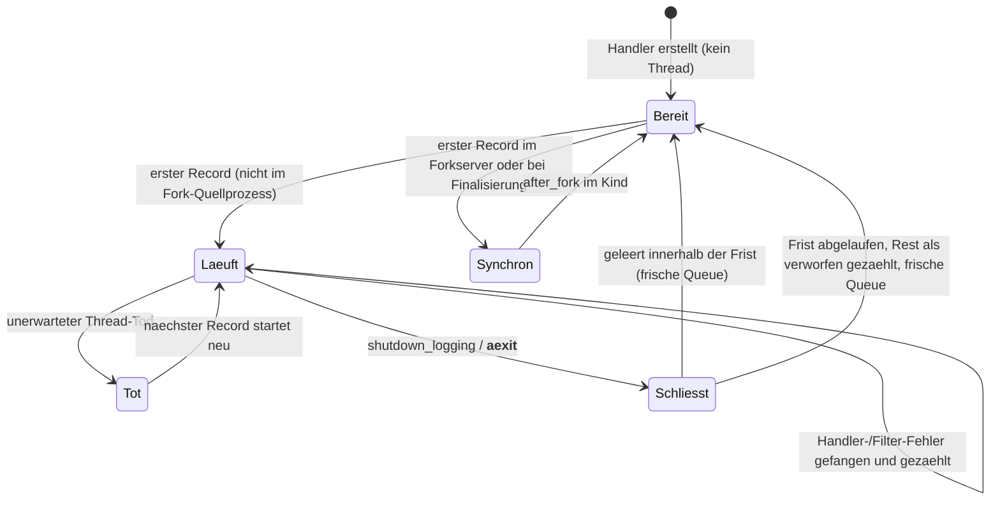
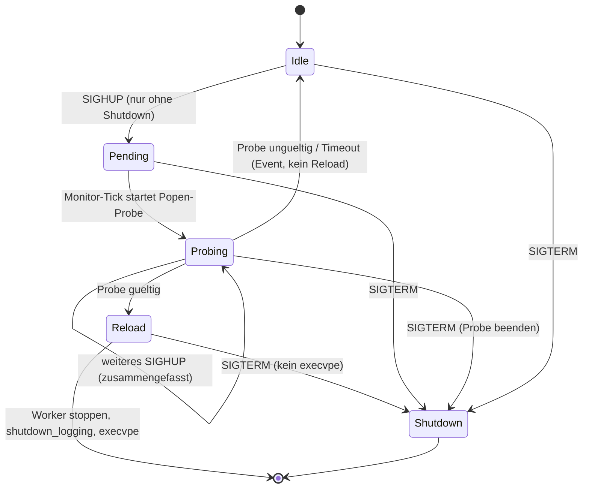

# Behebung der Logging-Schwächen aus 0.8.0 - Plan

## Goal Capsule

- **Objective:** Wer swarmq betreibt oder einbettet, erlebt nie, dass Logging den Event-Loop anhält, einen Prozess beim Beenden hängen lässt, ein Signal verschluckt oder Logzeilen still verliert. Dieselbe App loggt im IO- und im CPU-Pool gleich.
- **Means:**
  - nie sterbende Listener mit begrenztem Leeren (KTD1–KTD4)
  - keine Listener-Threads im Forkserver (KTD6)
  - Reload-Prüfung außerhalb des Signal-Handlers (KTD8)
  - dieselbe „App gewinnt“-Regel in beiden Pools (KTD9)
- **Authority:** Bei Konflikten gelten zuerst die Product-Contract-Requirements, dann die KTDs, zuletzt die Units. Die Key Decisions des Logging-Umbaus (`docs/plans/2026-10-06-0831-refactor-logging-haertung-plan.md`) bleiben unverändert. AGENTS.md (strikt TDD) gilt für jede Unit.
- **Execution profile:** Release 0.9.0, weil sich das Verhalten im CPU-Pool sichtbar ändert. Jede Unit wird test-first umgesetzt, mit genau einem roten Test zur Zeit. Jede Schwäche bekommt einen Test über echte Prozesse; die Reproduktionsskripte der Analyse dienen als Vorlage.
- **Stop conditions:**
  - Stopp, falls sich eine begrenzte Frist für das Leeren nicht ohne Datenverlust über die gezählten Drops hinaus einhalten lässt.
  - Stopp, falls der Sentinel im Forkserver die Thread-Prüfung oder die Kindstartzeit (bisher etwa 6 ms) spürbar verschlechtert.
  - In beiden Fällen nicht improvisieren, sondern Rücksprache halten.
- **Tail ownership:** Merge, Release und PyPI-Upload nur nach Georgs Freigabe. Den Upload führt Georg selbst aus.

---

## Product Contract

### Summary

Der Plan behebt sieben reproduzierte Schwächen des Logging-Umbaus von 0.8.0 (S1–S7) und fünf Folgefunde (R1–R5):
- Listener-Threads überleben fehlerhafte Handler.
- Jedes Leeren ist durch eine konfigurierbare Frist begrenzt.
- Der Aufrufer schreibt nie selbst.
- Im Forkserver läuft kein Log-Thread.
- Der Supervisor prüft eine Logging-Datei außerhalb des Signal-Handlers, und SIGTERM gewinnt immer.
- `basicConfig` und `--log-config` wirken im IO- und im CPU-Pool gleich.

### Problem Frame

Der Logging-Umbau von 0.8.0 hat das Logging in den normalen Pfaden nicht-blockierend gemacht. Eine Ursachenanalyse mit Reproduktionen hat danach Randpfade gefunden, die diese Ziele brechen.

**Belegte Befunde:**
- Eine volle Queue bei blockiertem stderr ließ den Event-Loop 2,9 s stehen, ohne Leser von stderr unbegrenzt.
- Ein einziger werfender App-Handler tötet den Listener, und ein volles Leeren hängt danach den Prozess beim Beenden dauerhaft.
- `SwarmQ.__aexit__` hielt den Event-Loop bis zu 12 s an.
- Im Supervisor friert die Prüfung der Logging-Datei bei SIGHUP die Überwachung bis zu 30 s ein, und ein SIGTERM in dieser Zeit wird zum Neustart.
- Im CPU-Pool gewinnt ein `basicConfig` der App gegen `--log-config` und gegen JSON-Ausgabe. Die Doku verspricht das Gegenteil.

Die vollständige Analyse mit Belegen und Ursachen (Datei:Zeile) ist im Anhang verlinkt.

### Requirements

**Nicht-blockierend und nie hängend**
- R1. Ein Logaufruf schreibt im aufrufenden Thread nie auf einen Stream und wirft keine Exception aus dem Logging in den Anwendungscode (S1).
- R2. Ein Listener-Thread überlebt Exceptions aus Handlern, Filtern und Formattern. Wo ein Listener dennoch tot ist, startet ihn der nächste Record neu (S2).
- R3. Jedes Leeren der Log-Queue ist zeitlich begrenzt: beim Prozessende, vor dem Neustart beim Hot-Reload, im Compute-Kind vor jedem Ergebnis, in `SwarmQ.__aexit__` und bei Datei-Modus-Listenern. Nicht geschriebene Records gelten als verworfen und werden gezählt (S2).
- R4. `SwarmQ.__aexit__` hält den Event-Loop beim Leeren der Opt-in-Queue nicht an (S3).
- R5. Ein Record, der während der Finalisierung des Interpreters entsteht, wird ausgegeben oder gezählt und erzeugt keinen Logging-Fehler (R2-Fund).

**Forkserver und Fork**
- R6. Im Forkserver-Prozess startet swarmq keinen Log-Thread, auch nicht bei aktiver Opt-in-Queue (S4).
- R7. Scheitert die Thread-Prüfung des Forkservers, nennt die Meldung die tatsächlichen Threads und einen passenden Hinweis. Ein still neu gestarteter Forkserver wird ebenso geprüft (S4, R4-Fund).
- R8. Nach einem Fork aus Task-Code schreiben Datei-Modus-Queue-Handler im Kind weiter, und kein Log-Ziel bleibt durch einen halb geschriebenen Datensatz blockiert (S5, R3-Fund).

**Supervisor**
- R9. Die Prüfung einer Logging-Datei bei Hot-Reload läuft außerhalb des Signal-Handlers. Die Überwachung (Worker-Tod, Neustart, Autoscale) läuft währenddessen weiter (S6).
- R10. Ein SIGTERM beendet den Supervisor immer, auch während einer laufenden Prüfung und auch dann, wenn kurz danach ein SIGHUP eintrifft (S6, Szenario E).
- R11. Eine Prüfung, die in ihre Frist läuft, wird als Timeout gemeldet, nicht als ungültige Konfiguration. Mehrere SIGHUPs während einer Prüfung führen zu genau einer Prüfung (S6).

**Gleiches Verhalten in beiden Pools**
- R12. Dieselbe App loggt im IO- und im CPU-Pool nach derselben „App gewinnt“-Regel. `basicConfig` in einem Task-Modul ist in beiden Pools wirkungslos, und `--log-config`, `--log-format` und `--log-level` gelten auch in den Compute-Kindern (S7).
- R13. Bringt eine App eigene Queue-Handler mit, gehen die Logs ihrer Compute-Kinder nicht verloren (R1-Fund).

**Konfiguration und Doku**
- R14. Die Frist für das Leeren ist als `log_drain_timeout` konfigurierbar, über CLI-Option, Env-Variable und Config-Feld. Es gilt dieselbe Priorität wie bei allen Logging-Optionen.
- R15. Die Doku beschreibt das tatsächliche Verhalten, besonders „App gewinnt“ im CPU-Pool und die Frist beim Leeren. Das Changelog nennt die Verhaltensänderung im CPU-Pool.

### Key Decisions

- **Ein Logaufruf blockiert nie, und Logging hängt keinen Prozess.** Governs R1–R5. (session-settled: user-directed — gewählt statt „blockierendes Leeren ohne Datenverlust“: Ein hängender Prozess ist schlimmer als gezählte, verworfene Zeilen)
- **Frist beim Leeren als Einstellung `log_drain_timeout` mit 5 s Standard.** Governs R3, R14. (session-settled: user-approved — gewählt statt unbegrenztem Leeren und statt fester Frist; Abwägung: bei sehr langsamen Senken gehen eher Zeilen verloren)
- **`basicConfig` ist in beiden Pools wirkungslos, Release 0.9.0.** Governs R12, R15. (session-settled: user-approved — gewählt statt „CPU-Pool behält App-Format“; sichtbare Verhaltensänderung, daher Minor-Release)
- **Fork aus Task-Code wird mit behoben, nicht nur dokumentiert.** Governs R8. (session-settled: user-approved — gewählt statt reiner Doku; das Review zeigte, dass KTD10 mit Fork-Hooks mehr Mechanik braucht als zunächst angenommen)
- **Hängt beim Prozessende nach Ablauf der Frist noch ein Log-Thread in einem blockierten Ziel, beendet swarmq seine eigenen Prozesse hart per `os._exit` mit dem ursprünglichen Exit-Code; eingebettete Apps werden nie hart beendet.** Governs R3. (session-settled: user-directed — gewählt statt „nie `os._exit`“: Ein aufgegebener Daemon-Thread im Schreibvorgang lässt den Interpreter sonst abbrechen (SIGABRT) oder dauerhaft hängen, reproduziert auf Python 3.14.4)
- **Die Entscheidungen aus dem Logging-Umbau bleiben gültig:** Die Bibliothek konfiguriert nie, structlog bleibt mit structlog-Schreibweise, alles ist konfigurierbar, die Opt-in-Queue ist standardmäßig aus. Governs R1–R15.

### Scope Boundaries

- Nicht enthalten: kleine API-Punkte (`WorkflowStateConflict`-Export, Feldreihenfolge in `SwarmQConfig`), Projekt-Hygiene (Laufzeit der Unit-Suite, `ruff format`, tote Links in `mkdocs.yml`) und das Loadsuite-Repo.
- Kein Wechsel auf Multiprocessing-Logging oder externen Log-Versand.
- Kein Schutz gegen Verlust bei SIGKILL.

#### Deferred to Follow-Up Work

- swarmq-loadsuite: Register und Konformitätsprüfung um `log_drain_timeout` sowie um die Änderungen aus 0.8.0 ergänzen.

---

## Planning Contract

### Key Technical Decisions

- KTD1. **Listener stirbt nie.** `_SwarmqQueueListener.handle` fängt jede `Exception` pro Record, die Opt-in-Weitergabe auch pro Handler. Gefangene Fehler werden gezählt und höchstens einmal pro Sekunde als `log_handler_errors` gemeldet, ohne den Aufrufer zu berühren. Eine eigene Metrik dafür gibt es nicht (nicht verlangt; bei Bedarf später). `running` bedeutet künftig „Thread lebt“ (`is_alive()`), sodass der nächste Record einen toten Listener neu startet. Records in der Queue eines toten Listeners zählen beim Neustart nicht doppelt und gehen nicht verloren, weil die Queue erhalten bleibt. Dasselbe gilt für die stdlib-`QueueListener` aus einer dictConfig (Datei-Modus): Am Exemplar, wie bei `_restart_lazily`, fängt `handle` Exceptions pro Record, `enqueue_restarting` startet neu, wenn der Thread nicht mehr lebt, und zählt ein `queue.Full` als Drop, statt es an `handleError` (Traceback im Aufrufer) durchzureichen. Grund: Der realistische Auslöser für S2 ist ein werfender App-Handler oder Filter; die stdlib-Methode `_monitor` fängt nichts.
- KTD2. **Drop-Meldung im Listener.** Der Aufrufer erhöht in `_drop` nur Zähler. Der Listener prüft nach jedem Record und beim Stoppen, ob `dropped > gemeldet` ist, und gibt höchstens einmal pro Sekunde einen Record `log_records_dropped` über seine eigenen Handler aus. Damit gelten JSON-Format und App-Handler ohne Sonderpfad. Verworfen wird ein nicht-blockierendes `os.write` aus dem Aufrufer: O_NONBLOCK gilt für die gemeinsame File Description und würde die Schreibvorgänge des Listeners ebenfalls nicht-blockierend machen.
- KTD3. **Begrenztes Leeren mit einer gemeinsamen Frist.**
  - `shutdown_logging(timeout=None)` nutzt `log_drain_timeout` als Gesamtfrist über alle Listener.
  - Pro Listener, in dieser Reihenfolge: zuerst bekommt der Handler eine frische Queue und einen frischen Listener (Muster `_reset_after_fork`), damit Records anderer Threads während des Leerens nicht verloren gehen; dann wird die alte Queue per `Queue.shutdown()` (3.13+, blockiert nie) geschlossen und ihr Thread mit `join(timeout=Restzeit)` erwartet.
  - Läuft die Zeit ab, wird der Thread aufgegeben und `qsize()` als verworfen gezählt. Seine Ziel-Handler werden als aufgegeben markiert: Solange der alte Thread lebt, startet auf ihnen kein neuer Listener, und neue Records werden gezählt statt eingereiht. So häufen sich im wiederverwendeten Compute-Kind keine hängenden Threads an. Aufgegebene Handler werden aus `logging._handlerList` ausgetragen, damit `logging.shutdown()` (atexit, `_shutdown_child_logging`) nicht an ihrem Lock hängt.
  - Prozessende: Lebt nach der Frist noch ein aufgegebener Thread, beenden die Prozesse, die swarmq selbst startet (Supervisor, Worker-Subprozess, Compute-Kind, CLI), per `os._exit` mit dem ursprünglichen Exit-Code, nach den übrigen eigenen Aufräumschritten. Grund: Ein Daemon-Thread, der im Schreibvorgang auf stderr festhängt, hält den Lock des BufferedWriter; die Interpreter-Finalisierung bricht dann mit „Fatal Python error: _enter_buffered_busy“ ab (SIGABRT, Exit 134) oder hängt dauerhaft (im Review auf 3.14.4 reproduziert). Eingebettete Apps werden nie hart beendet; dort bleibt es beim Austragen der Handler, das Restrisiko steht in der Doku.
  - Datei-Modus-Listener (stdlib `QueueListener` aus dictConfig) laufen über dieselbe Frist: `put(timeout)` und `join(timeout)`.
  - Die Listener werden parallel gestoppt (alle schließen, dann gemeinsam warten), damit ein hängender nicht die anderen blockiert.
  - Bei Fristüberschreitung erscheint eine Abschlusszeile `log_drain_timeout_exceeded` mit der Zahl der Records, aber nur, wenn das gefahrlos geht: per `os.write(2, …)` an `sys.stderr` und dessen Lock vorbei, höchstens `PIPE_BUF` Bytes und nur, wenn `select.poll` mit Timeout 0 fd 2 als beschreibbar meldet. Sonst bleibt es beim Zähler. O_NONBLOCK wird dabei nicht gesetzt (vgl. KTD2). Grund: Jede Aufrufstelle aus S2 (atexit, Worker-`finally`, Supervisor vor `execvpe`, Compute-Kind vor dem Ergebnis) ist damit auf einen Schlag begrenzt.
- KTD4. **`__aexit__` leert asynchron.** `_disable_log_queue` wird zweigeteilt:
  - Ein synchroner Teil hängt in O(1) ab: Handler entfernen, `propagate` und Level zurücksetzen, Queue schließen.
  - Ein awaitbarer Teil (`_await_log_queue_drained`) wartet per `asyncio.wait_for(asyncio.to_thread(thread.join, Restzeit), Restzeit)` bis zur Frist. `wait_for` deckt auch die Wartezeit auf einen freien Executor-Platz ab; bei Ablauf zählt der Rest als verworfen.

  Erwirbt eine neue `SwarmQ`-Instanz die Opt-in-Queue, während eine alte noch leert, bekommt sie einen frischen Handler und eine frische Queue. `to_thread` allein wäre nicht sicher, weil ein unbegrenztes `stop` das Hängen nur in `shutdown_default_executor` verschiebt; erst KTD3 macht es sicher.
- KTD5. **Finalisierung des Interpreters.** Ist `sys.is_finalizing()`, oder wirft der Thread-Start `PythonFinalizationError`, gibt der Handler den Record synchron über die Ziel-Handler des Listeners aus. Sind die Ziel-Handler aufgegeben (KTD3) oder scheitert die Ausgabe, wird der Record gezählt. Das gilt ebenso für `_restart_lazily` im Datei-Modus.
- KTD6. **Kein Listener-Thread im Fork-Quellprozess.**
  - `swarmq.worker.compute.preload` läuft als erstes Preload-Modul und nur im Forkserver. Es setzt in `swarmq.logging` das Prozessflag `_IN_FORK_SOURCE`.
  - Solange das Flag gesetzt ist, startet `enqueue` keinen Thread, sondern gibt synchron über die Ziel-Handler aus. Der Forkserver hat keinen Event-Loop, also ist das unkritisch.
  - `_after_fork_in_child` löscht das Flag.
  - `start_forkserver` stellt sicher, dass das Preload-Modul an erster Stelle steht, auch für andere Aufrufer.
  - Grenze: Wird ein eigenes Hauptmodul per Pfad gestartet (`python app.py`), importiert `multiprocessing.forkserver.main` es vor der Preload-Liste. Für dieses Modul gelten Flag und Sentinel (KTD9) dann nicht. Der `swarmq`-Befehl und `python -m` sind nicht betroffen; die Doku nennt sie als garantierten Weg.

  Verworfen: die Opt-in-Queue im Forkserver ganz abzuschalten. Dann erbt das Kind unter `--no-configure-logging` keine Opt-in-Queue, und das widerspräche der Key Decision zur Opt-in-Queue. Die Monkeypatch-Prototypen der Analyse haben den gewählten Weg bestätigt.
- KTD7. **Thread-bewusste Forkserver-Prüfung.**
  - Die Prüfung liest die Thread-Namen aus `/proc/<pid>/task/*/comm`. `comm` kürzt auf 15 Zeichen, deshalb wird `LISTENER_THREAD_NAME` auf höchstens 15 Zeichen gekürzt, etwa `swarmq-log-lsnr`.
  - Der Hinweis richtet sich nach dem Thread:
    - swarmq-Listener: Opt-in-Queue plus Log beim Import
    - stdlib-`QueueListener`: App-Listener beim Import gestartet; lazy oder im `--configure`-Hook starten
    - sonst: der bisherige BLAS-Hinweis
  - `ForkserverHandle.restarted()` wendet dieselbe Prüfung an. Ein Neustart mit mehr als einem Thread wird mit `forkserver_restarted_multithreaded` (ERROR) abgelehnt; der Pool behandelt das wie eine ungesunde Kindquelle.
- KTD8. **Reload-Zustandsmaschine im Monitor-Loop.**
  - Der SIGHUP-Handler setzt nur `_reload_pending`, und das auch nur ohne laufenden Shutdown.
  - Der SIGTERM-Handler setzt `_shutting_down` und storniert jeden ausstehenden und auch einen bereits beschlossenen Reload (`_reload_requested = False`). Unmittelbar vor `execvpe` wird `_shutting_down` erneut geprüft; ein SIGTERM während des Worker-Stopps beendet den Supervisor also ohne Neustart.
  - Beide Handler loggen nicht mehr selbst, sondern hinterlegen das Event für den Loop. Das beseitigt auch das Deadlock-Risiko beim Loggen aus Signal-Handlern.
  - Der Monitor-Loop startet die Probe per `Popen`, ohne Threads, weil der Supervisor Prozesse startet. Er pollt pro Tick mit eigener Frist und entscheidet dann:
    - gültig: Reload wie bisher, mit `shutdown_logging()` vor `execvpe`
    - ungültig: `log_config_reload_failed`
    - Frist überschritten: `log_config_reload_probe_timeout`
    - Shutdown in der Zwischenzeit: Probe beenden, kein Reload
  - SIGHUPs während einer laufenden Probe werden zusammengefasst. `FileWatcher.is_busy` deckt die laufende Probe ab.
  - Die Probe läuft in einer eigenen Prozessgruppe (`start_new_session=True`), damit Ctrl-C sie nicht als „ungültig“ abbrechen lässt.
  - Die Logik liegt in einem neuen Modul `process_manager/reload.py`, weil `supervisor.py` mit 799 Zeilen am 800-Zeilen-Guard steht.
  - Verworfen: die Konfiguration im Prozess selbst zu validieren. `dictConfig` mutiert globalen Zustand und öffnet Handler.
- KTD9. **Sentinel-Root-Handler im Forkserver.**
  - `preload.py` hängt vor jedem App-Import einen thread-freien Sentinel-Handler (`_ForkSourceSentinel`) an Root. Damit ist `basicConfig` im Forkserver genauso wirkungslos wie im IO-Worker.
  - Das gilt nur, wenn swarmq das Logging konfiguriert. Der Loop-Prozess gibt die aufgelöste `configure`-Einstellung wie `SWARMQ_MAIN_MODULE` per Umgebung an den Forkserver. Unter `--no-configure-logging` bzw. `configure_logging=False` gibt es keinen Sentinel, und `basicConfig` der App wirkt in beiden Pools. `configure_child_logging` entfernt einen geerbten Sentinel auch im Pfad `not settings.configure`.
  - Der Sentinel ist kein reiner NullHandler: Records ab `logging.lastResort.level` gibt er an `logging.lastResort` weiter (ohne Thread). So bleiben Warnungen aus dem Forkserver und aus dem Kind vor `configure_child_logging` sichtbar.
  - `configure_child_logging` vergleicht im Kind mit derselben Regel wie `react_to_app_logging`:
    - nur der Sentinel: entfernen, dann `configure_logging(settings)`, eingebaut oder per `--log-config`
    - Sentinel ersetzt: App gewinnt, `logging_reconfigured_by_app`
    - zusätzliche Handler neben dem Sentinel: swarmq konfiguriert, behält sie und meldet `logging_handlers_added_by_app`
  - Im Fall „App gewinnt“ startet swarmq geerbte, ungestartete Queue-Listener der App (R13), über die Logik von `start_queue_listeners`.
  - Die Regel wird an einer Stelle implementiert und von beiden Pools genutzt, statt doppelt.
- KTD10. **Fork-Sicherheit für Datei-Modus und laufende Schreibvorgänge.**
  - `start_queue_listeners` registriert die gepatchten Paare aus Handler und Listener. `_after_fork_in_child` gibt ihnen eine frische Queue gleichen Typs und gleicher `maxsize` und setzt `_thread` auf `None`. Multiprocessing-Queues und nicht rekonstruierbare `"()"`-Queues bleiben ausgenommen.
  - `os.register_at_fork(before=…)` erwirbt die Locks aller Ziel-Handler aktiver Listener, damit laufende `emit`-Aufrufe zu Ende kommen. `after_in_parent` gibt sie wieder frei, im Kind setzt der Reset die Handler zurück.
  - Das `before` wartet insgesamt höchstens 50 ms über alle Handler (Gesamtbudget, nicht pro Handler) und gibt sonst auf, damit ein Fork nie hängt. Restrisiko: Ist ein Handler gerade langsam, kann das R3-Problem (halb geschriebener Datensatz) im Kind dennoch auftreten; aufgegebene Handler (KTD3) werden ausgelassen.
- KTD11. **Konfiguration `log_drain_timeout`:**
  - CLI `--log-drain-timeout SECONDS`, Env `SWARMQ_LOG_DRAIN_TIMEOUT`, Feld in `SwarmQConfig`, `LoggingSettings`, `WorkerConfig` und `ComputeJob`.
  - Standard 5.0, der Wert muss größer als 0 sein.
  - Die Priorität (CLI > Env > Config) und die Auflösung im Supervisor folgen dem bestehenden Muster in `logging_settings.py`.

### High-Level Technical Design

Lebenszyklus eines Listeners nach dem Fix:

Reload im Supervisor nach dem Fix:

### Sources & Research

- Ursachenanalyse mit Reproduktionen: siehe Anhang. Die Reproduktionsskripte liegen im Scratchpad der Planungssitzung und dienen als Vorlage für die Tests über echte Prozesse.
- Logging-Umbau mit KTD5, KTD10 und KTD14: `docs/plans/2026-10-06-0831-refactor-logging-haertung-plan.md`.
- Python 3.14: `queue.Queue.shutdown()` und `QueueListener` (doppelter Start wirft) laut stdlib-Quelle; `PythonFinalizationError` beim Thread-Start während der Finalisierung.

### System-Wide Impact

- **Eingebettete Apps mit Opt-in:** `async with SwarmQ(...)` kehrt spätestens nach `log_drain_timeout` zurück, ohne den Loop anzuhalten. Werfende App-Handler töten den Listener nicht mehr.
- **CLI-Prozesse:** Das Prozessende ist begrenzt. Ein Supervisor mit kaputtem Log-Ziel startet nach einem Reload garantiert wieder Worker.
- **CPU-Pool:** Sichtbare Verhaltensänderung: `basicConfig` in einem Task-Modul greift nicht mehr. `--log-config`, `--log-format` und `--log-level` gelten in den Kindern. Apps mit eigenem Queue-Listener verlieren keine Logs mehr.
- **Supervisor:** Die Reload-Logik wird nach `process_manager/reload.py` ausgelagert, und SIGTERM ist nun immer endgültig.
- **Neue Events:** `log_handler_errors`, `log_drain_timeout_exceeded`, `log_config_reload_probe_timeout`, `forkserver_restarted_multithreaded`.
- **Hartes Ende:** swarmq-eigene Prozesse können nach Ablauf der Frist per `os._exit` enden; spätere atexit-Handler und Finalizer laufen dann nicht.
- **Neue Einstellung:** `log_drain_timeout`.
- **Umbenannt:** Der Thread-Name `swarmq-log-listener` wird kürzer; nur wer per `threading` danach sucht, ist betroffen.
- **Nachbar-Repo:** swarmq-loadsuite (siehe Deferred).

### Risks & Dependencies

| Risiko | Gegenmaßnahme |
|---|---|
| Eine Frist von 5 s verwirft bei sehr langsamen Senken Zeilen | Konfigurierbar; Verluste gezählt und als `log_drain_timeout_exceeded` gemeldet |
| Aufgegebener Thread blockiert die Interpreter-Abschaltung (Abbruch mit Exit 134 oder Hängen) | swarmq-Prozesse enden nach der Frist per `os._exit` mit ursprünglichem Exit-Code; aufgegebene Handler werden aus `logging._handlerList` ausgetragen; Tests mit echtem Prozessende (blockierte Pipe, später bzw. nie geleert) |
| Eingebettete App mit blockiertem stderr am Prozessende | kein `os._exit` in fremden Prozessen; Handler austragen; Restrisiko dokumentiert |
| Aufgegebener Thread schreibt seine alte Queue später doch noch, die Verlustzahl ist dann zu hoch | Zählung als Obergrenze dokumentiert |
| Sentinel im Forkserver verändert die Kindstartzeit | Messung vorher und nachher wie in U7b des Umbaus; Stop-Bedingung im Goal Capsule |
| Locks im `before`-Fork-Hook verzögern einen Fork | Höchstens 50 ms warten, dann aufgeben |
| `supervisor.py` und `logging.py` stehen am 800-Zeilen-Guard | Erst auslagern (U1, U8), dann ändern |
| Verhaltensänderung im CPU-Pool überrascht Nutzer | Release 0.9.0, Changelog mit Migrationshinweis (`--configure`-Hook oder `--log-config`) |

---

## Implementation Units

| U-ID | Titel | Kern-Dateien | Abhängig von |
|---|---|---|---|
| U1 | Queue-Kern auslagern | `src/swarmq/logging.py`, `src/swarmq/logging_queue.py` (neu) | – |
| U2 | Listener stirbt nie | `src/swarmq/logging_queue.py`, `src/swarmq/logging_file.py` | U1 |
| U3 | Drop-Meldung im Listener | `src/swarmq/logging_queue.py` | U2 |
| U4 | Begrenztes Leeren und `log_drain_timeout` | `src/swarmq/logging_queue.py`, `src/swarmq/logging_file.py`, `src/swarmq/logging_settings.py`, `src/swarmq/config.py`, `src/swarmq/cli/parser.py`, `src/swarmq/worker/compute/*` | U2 |
| U5 | `__aexit__` asynchron begrenzt | `src/swarmq/app.py`, `src/swarmq/logging_queue.py` | U4 |
| U6 | Forkserver ohne Log-Thread | `src/swarmq/worker/compute/preload.py`, `src/swarmq/worker/compute/forkserver.py`, `src/swarmq/logging_queue.py` | U2 |
| U7 | Fork-Sicherheit | `src/swarmq/logging_queue.py`, `src/swarmq/logging_file.py` | U4 |
| U8 | Reload-Zustandsmaschine | `src/swarmq/process_manager/reload.py` (neu), `src/swarmq/process_manager/supervisor.py`, `src/swarmq/process_manager/run.py`, `src/swarmq/logging_file.py` | – |
| U9 | Gleiche Regel in beiden Pools | `src/swarmq/worker/compute/preload.py`, `src/swarmq/logging.py`, `src/swarmq/worker/compute/child.py` | U6 |
| U10 | Doku, Changelog, Release-Vorbereitung | `website/reference/logging*.md`, `website/reference/cli*.md`, `website/reference/configuration*.md`, `website/reference/changelog*.md` | U1–U9 |

### U1. Queue-Kern auslagern

- **Goal:** `logging.py` (790 Zeilen) hat Platz für die Fixes: Queue-Handler, Listener, Opt-in-Queue, Shutdown und Fork-Hook ziehen in ein neues Modul.
- **Requirements:** Voraussetzung für R1–R8.
- **Dependencies:** keine.
- **Files:** `src/swarmq/logging_queue.py` (neu), `src/swarmq/logging.py`, die Architektur-Tests unter `tests/unit/` (Guard und Logging-Architektur).
- **Approach:**
  1. Reine Verschiebung ohne Verhaltensänderung.
  2. `swarmq.logging` exportiert die öffentlichen Namen weiter (`shutdown_logging`, `flush_logging`, `dropped_log_records`, `LISTENER_THREAD_NAME`).
  3. Tests, die private Namen aus `swarmq.logging` patchen, werden auf das neue Modul umgestellt.
- **Execution note:** Refactoring nach AGENTS.md: Nach jedem Schritt laufen alle Tests, bei Rot wird zurückgerollt.
- **Test expectation:** none -- reine Strukturänderung; die bestehende Suite ist die Absicherung. Zusätzlich ein Test, dass die öffentlichen Namen aus `swarmq.logging` importierbar bleiben.
- **Verification:** Suite grün, `logging.py` deutlich unter 800 Zeilen, Architektur-Test für Logger-Fabriken weiter grün.

### U2. Listener stirbt nie

- **Goal:** Werfende Handler, Filter oder Formatter töten keinen Listener mehr. Ein toter Listener startet beim nächsten Record neu.
- **Requirements:** R2. KTD1.
- **Dependencies:** U1.
- **Files:** `src/swarmq/logging_queue.py`, `src/swarmq/logging_file.py`, `tests/unit/test_logging_queue.py`, `tests/unit/test_logging_optin.py`, `tests/unit/test_logging_configure.py`, `tests/integration/test_logging_robustness.py` (neu).
- **Test scenarios:**
  - Ein App-Root-Handler, dessen `emit` wirft (Opt-in): Nach dem Gift-Record lebt der Listener, und der nächste Record erreicht einen sammelnden Handler (Event statt Sleep).
  - Ein Filter, der wirft, etwa durch eine fehlende Kontextvariable: dasselbe Ergebnis.
  - Ein Listener mit totem Thread (Fake mit `is_alive()` gleich False): Der nächste `enqueue` startet einen neuen Thread, und der Record kommt an.
  - Die Fehler werden gezählt. `log_handler_errors` erscheint höchstens einmal pro Sekunde (Zeit gemockt).
  - Datei-Modus: dictConfig-Queue mit werfendem Filter; danach kommt der nächste Record an. Toter Datei-Modus-Thread wird beim nächsten Record neu gestartet. Volle begrenzte dictConfig-Queue: Drop gezählt, kein Traceback auf stderr.
  - **Echter Prozess:** Subprozess mit Opt-in, werfendem App-Handler und voller Queue. Der Prozess endet mit Exit 0 innerhalb der Frist; die Reproduktion `s2_dead_listener` dient als Vorlage.
- **Verification:** Keine Exception aus einem Handler erreicht `threading.excepthook`. Die Reproduktion endet sauber statt mit Exit 124.

### U3. Drop-Meldung im Listener

- **Goal:** Der Aufrufer schreibt nie selbst auf stderr, und aus dem Logging fliegt keine Exception in den Anwendungscode.
- **Requirements:** R1. KTD2.
- **Dependencies:** U2.
- **Files:** `src/swarmq/logging_queue.py`, `tests/unit/test_logging_queue.py`, `tests/integration/test_logging_robustness.py`.
- **Test scenarios:**
  - Volle Queue, ein Ziel-Stream, dessen `write` an einem nie gesetzten Event blockiert: Ein `log.warning` in einem Hilfsthread kehrt sofort zurück (`join(timeout=1)` erfolgreich).
  - Nach dem Freigeben kommt genau eine Meldung `log_records_dropped` über den Listener an, im JSON-Modus als gültiges JSON.
  - `sys.stderr` geschlossen: Ein Logaufruf wirft nicht, der Drop wird gezählt.
  - Ratenbegrenzung: höchstens eine Meldung pro Sekunde (Zeit gemockt), die Zählung stimmt.
  - **Echter Prozess:** Kindprozess mit fd 2 auf einer vollen, nie geleerten Pipe. Jeder Logaufruf braucht unter 100 ms (im Kind gemessen und über stdout gemeldet); nach dem Leeren der Pipe erscheint die JSON-Meldung. Vorlage: `s1_drop_notice`.
- **Verification:** Die Reproduktion `s1_drop_notice` zeigt keinen Loop-Lag mehr über 100 ms.

### U4. Begrenztes Leeren und `log_drain_timeout`

- **Goal:** Kein Leeren kann einen Prozess hängen lassen. Die Frist ist konfigurierbar.
- **Requirements:** R3, R5, R14. KTD3, KTD5, KTD11.
- **Dependencies:** U2.
- **Files:**
  - Quellcode: `src/swarmq/logging_queue.py`, `src/swarmq/logging_file.py`, `src/swarmq/logging_settings.py`, `src/swarmq/config.py`, `src/swarmq/cli/parser.py`, `src/swarmq/cli/check_cmd.py` (Argv-Spiegel), `src/swarmq/process_manager/config.py`, `src/swarmq/worker/compute/envelope.py`, `src/swarmq/worker/compute/executor.py`, `src/swarmq/worker/compute/child.py`
  - generiert: `website/reference/agent/spec/*.json`
  - Tests: `tests/unit/test_logging_settings.py`, `tests/unit/test_logging_queue.py`, `tests/unit/test_logging_configure.py`, `tests/integration/test_logging_robustness.py`
- **Approach:**
  1. Zuerst die Einstellung nach dem bestehenden Muster in `logging_settings.py`.
  2. Dann `shutdown_logging(timeout=None)` mit `Queue.shutdown()`, parallelem Stoppen und gemeinsamer Frist.
  3. Datei-Modus-Listener über dieselbe Frist.
  4. Danach die Finalisierungs-Ausnahme (KTD5).
  5. Alle Aufrufstellen nutzen die aufgelöste Frist, das Compute-Kind über `ComputeJob`.
- **Test scenarios:**
  - **Einstellung:** CLI > Env > Config > Default 5.0. Werte ≤ 0 oder nicht numerisch ergeben Exit 78. Der Wert kommt in Worker und Compute-Kind an.
  - Ein Handler, der an einem nie gesetzten Event blockiert, bei voller Queue: `shutdown_logging(timeout=0.05)` kehrt zurück, `dropped` steigt um die Zahl der aufgegebenen Records, und `log_drain_timeout_exceeded` erscheint auf stderr.
  - Zwei Listener, einer hängt: Der andere wird trotzdem geleert (paralleles Stoppen).
  - Records, die ein anderer Thread während des Leerens loggt, landen in der frischen Queue und gehen nicht verloren.
  - Nach Fristüberschreitung mit noch lebendem altem Thread: Auf den aufgegebenen Handlern startet kein neuer Listener, neue Records werden gezählt, und `logging.shutdown()` kehrt sofort zurück.
  - Abschlusszeile: fd 2 als blockierte Pipe; `shutdown_logging` kehrt innerhalb der Frist zurück, die Zeile wird übersprungen. fd 2 schreibbar: genau eine Zeile `log_drain_timeout_exceeded`.
  - Nach einem Leeren mit Fristüberschreitung startet der nächste Record einen neuen Listener auf frischer Queue.
  - Datei-Modus: begrenzte dictConfig-Queue und blockierender Handler, die Frist greift.
  - **Finalisierung:** `sys.is_finalizing` gemockt auf True bzw. Thread-Start wirft `PythonFinalizationError`. Der Record wird synchron ausgegeben, ohne `--- Logging error ---`.
  - **Echte Prozesse** (Rückgabecode prüfen, keine Wanduhr; faulthandler-Dump bei Hang), Vorlagen `s2c_blocked_stderr_shutdown`, `s2b_filemode`, `repro_final2`:
    - fd 2 auf einer nie geleerten Pipe: Der Prozess endet innerhalb von Frist plus Puffer, mit dem ursprünglichen Exit-Code (über `os._exit`).
    - fd 2 auf einer Pipe, die erst nach Ablauf der Frist geleert wird: kein Exit 134, kein „Fatal Python error“.
    - Eingebetteter Fall (Opt-in, blockierter App-Handler): kein `os._exit`; die App endet mit ihrem eigenen Exit-Code.
    - Datei-Modus mit begrenzter Queue und werfendem Handler: Ende innerhalb der Frist.
    - Record aus `__del__` während der Finalisierung: kein Logging-Fehler auf stderr.
  - **Compute-Kind:** Ein Ziel-Handler blockiert; das Ergebnis kommt trotzdem nach höchstens Frist plus Puffer beim Pool an.
- **Verification:** Keine Aufrufstelle aus S2 kann länger als `log_drain_timeout` plus Puffer blockieren. Die Agent-Spezifikation ist neu generiert, `test_agent_spec` grün.

### U5. `__aexit__` asynchron begrenzt

- **Goal:** Der Abbau der Opt-in-Queue hält den Event-Loop nicht an.
- **Requirements:** R4. KTD4.
- **Dependencies:** U4.
- **Files:** `src/swarmq/app.py`, `src/swarmq/logging_queue.py`, `tests/unit/test_app.py`, `tests/unit/test_logging_optin.py`, `tests/integration/test_logging_robustness.py`.
- **Test scenarios:**
  - Ein App-Handler blockiert an einem `threading.Event`, und `app.__aexit__` läuft als Task. Eine zweite Coroutine (per `asyncio.Event` und `call_soon`) läuft durch, solange der Handler noch blockiert. Nach dem Freigeben endet `__aexit__`, und alle Records sind angekommen.
  - Handler nie freigegeben, `log_drain_timeout=0.05`: `__aexit__` kehrt zurück, und die Drops sind gezählt.
  - Eine neue `SwarmQ(log_queue=True)`-Instanz während des asynchronen Leerens bekommt einen frischen Handler und eine frische Queue, ohne doppelte Zeilen.
  - Abhängen in O(1): Gleich nach dem synchronen Teil sind Handler, `propagate` und Level von `swarmq` wiederhergestellt.
  - Default-Executor ist ausgelastet (blockierende `to_thread`-Arbeit der App): `__aexit__` kehrt trotzdem spätestens nach `log_drain_timeout` zurück.
  - **Echter Prozess:** Vorlage `s3_aexit_stall`; der maximale Loop-Lag während `__aexit__` liegt unter 100 ms.
- **Verification:** Alle async-Tests mit `@pytest.mark.timeout(5)`, ohne `asyncio.sleep`.

### U6. Forkserver ohne Log-Thread

- **Goal:** Im Forkserver startet kein Log-Thread. Die Thread-Prüfung nennt den wahren Verursacher und greift auch nach einem stillen Neustart.
- **Requirements:** R6, R7. KTD6, KTD7.
- **Dependencies:** U2.
- **Files:**
  - Quellcode: `src/swarmq/worker/compute/preload.py`, `src/swarmq/worker/compute/forkserver.py`, `src/swarmq/worker/compute/wiring.py`, `src/swarmq/worker/compute/pool.py`, `src/swarmq/logging_queue.py`
  - Tests: `tests/unit/worker/compute/test_forkserver.py`, `tests/unit/test_logging_queue.py`, `tests/integration/test_compute_child_logging.py`, `tests/integration/_compute_logging_driver.py`
- **Approach:** Den Integrations-Driver zuerst auf die echte Preload-Liste aus `wiring.preload_modules` umstellen (R5-Fund). Erst dann ist der rote Test aussagekräftig.
- **Test scenarios:**
  - Mit gesetztem `_IN_FORK_SOURCE`, Opt-in aktiv und einem Record auf `swarmq.*`: kein Thread namens `LISTENER_THREAD_NAME`, und der Record kommt synchron im Root-Handler an. Nach `_after_fork_in_child` startet der nächste Record genau einen Listener.
  - Thread-Prüfung mit gefälschtem `proc_root` (`Threads: 2`):
    - mit einem `comm` gleich dem swarmq-Listener: die Meldung nennt die Opt-in-Queue
    - mit einem `Thread-1 (_moni`: die Meldung nennt einen App-`QueueListener`
    - mit einem anderen Thread: der BLAS-Hinweis
  - `LISTENER_THREAD_NAME` hat höchstens 15 Zeichen.
  - `ForkserverHandle.restarted()` mit mehr als einem Thread: `forkserver_restarted_multithreaded`, und der Pool verwirft die Quelle.
  - **Integration, echter Forkserver mit Produktions-Preload:** Ein Modul erzeugt `SwarmQ(log_queue=True)` und loggt danach INFO auf `swarmq.*`. Varianten: mit `SWARMQ_LOG_QUEUE=1` und mit zweimaligem `setup_dishka`. Erwartung: Thread-Prüfung besteht, jede Kindzeile genau einmal.
  - **e2e:** Echter `swarmq worker --pool cpu` mit diesem Modul startet und verarbeitet eine Task, statt mit Exit 78 abzubrechen.
- **Verification:** Die Reproduktion `driver3` (v1, v4, v5) besteht; die Kindstartzeit ist vorher und nachher gemessen.

### U7. Fork-Sicherheit

- **Goal:** Nach einem Fork aus Task-Code schreiben Datei-Modus-Handler im Kind weiter, und kein Log-Ziel bleibt durch einen halb geschriebenen Datensatz blockiert.
- **Requirements:** R8. KTD10.
- **Dependencies:** U4.
- **Files:** `src/swarmq/logging_queue.py`, `src/swarmq/logging_file.py`, `tests/unit/test_logging_configure.py`, `tests/integration/test_logging_fork.py` (neu).
- **Test scenarios:**
  - **Unit:** dictConfig mit Queue-Handler auf einen sammelnden Handler, ein Record, dann `listener._thread` als gestarteten und beendeten No-op-Thread simulieren und den registrierten Fork-Hook aufrufen. Der nächste Record kommt an.
  - Multiprocessing-Queue: wird beim Reset nicht ersetzt.
  - `before`-Fork-Hook: erwirbt die Handler-Locks und gibt sie im Elternprozess wieder frei. Ist ein Lock länger als 50 ms belegt, gibt der Hook auf, und der Fork läuft trotzdem.
  - **Echter Prozess:** Subprozess mit `os.fork()`, dessen Kind loggt und leert. Die Datei enthält die PID-Zeilen des Kindes. Variante mit begrenzter Queue: kein `Logging error` auf stderr. Variante mit Fork unter Schreiblast: kein `RuntimeError: reentrant call` in 20 Läufen. Vorlagen: `repro5`, `repro5_proto`.
- **Verification:** `repro5` schreibt alle Kindzeilen.

### U8. Reload-Zustandsmaschine

- **Goal:** Die Prüfung der Logging-Datei friert den Supervisor nicht ein, SIGTERM gewinnt immer, und Timeouts heißen Timeout.
- **Requirements:** R9, R10, R11. KTD8.
- **Dependencies:** keine. Die Unit ist unabhängig von U1–U7 und kann parallel laufen.
- **Files:**
  - Quellcode: `src/swarmq/process_manager/reload.py` (neu), `src/swarmq/process_manager/supervisor.py`, `src/swarmq/process_manager/run.py`, `src/swarmq/logging_file.py` (Probe als `Popen`-Fabrik)
  - Tests: `tests/unit/process_manager/test_reload.py` (neu), `tests/unit/process_manager/test_supervisor.py`, `tests/integration/test_hot_reload_logconfig_e2e.py` (neu)
- **Approach:**
  1. Zuerst die Zustandsmaschine in `reload.py`, mit injizierbarer Probe-Fabrik und Uhr.
  2. Dann die Signal-Handler in `supervisor.py` schlank machen: nur Flags setzen, Events über den Loop loggen.
  3. Die Zeilen in `supervisor.py` müssen sinken.
- **Test scenarios** (Unit, alle mit gefälschter Probe-Fabrik und Uhr, ohne echte Signale):
  - `_on_reload_signal` ruft keine Probe auf, sondern setzt nur den ausstehenden Reload.
  - Ein Monitor-Tick startet die Probe. Solange `poll()` None liefert, laufen die Prüfungen auf tote Worker weiter.
  - SIGTERM während der Probe: Die Probe wird beendet, es gibt keinen Reload, und der Supervisor endet.
  - SIGTERM, danach SIGHUP: kein Reload (Szenario E).
  - Zwei SIGHUPs während einer Probe: genau eine Probe.
  - Probe überschreitet die Frist: `log_config_reload_probe_timeout`, kein `log_config_reload_failed`, kein Reload.
  - Probe ungültig: `log_config_reload_failed`, die Worker laufen weiter.
  - Probe gültig: Reload mit `shutdown_logging` vor `execvpe` (Reihenfolge geprüft).
  - Probe gültig, SIGTERM während des Worker-Stopps: kein `execvpe`, der Supervisor endet.
  - Die Probe läuft mit `start_new_session=True`.
- **Echte Prozesse** (Vorlage `drive_reload.py`, Szenarien A–E):
  - Langsame Probe und während der Probe getöteter Worker: Der Ersatz kommt, bevor die Probe endet.
  - SIGTERM während der Probe: Rückgabecode 0, kein zweiter `process_manager_start`.
  - SIGTERM, dann SIGHUP: Ende ohne Neustart.
  - SIGTERM während die Worker für einen beschlossenen Reload stoppen: Ende ohne Neustart.
  - Ports nur 5699/6399, Abbau per `terminate_worker_process`.
- **Verification:** `supervisor.py` liegt unter 800 Zeilen. Die Reproduktionen A–E zeigen das neue Verhalten.

### U9. Gleiche Regel in beiden Pools

- **Goal:** `basicConfig`, `--log-config`, `--log-format` und `--log-level` wirken im CPU-Pool wie im IO-Pool. Logs aus eigenen Queue-Handlern der App gehen nicht verloren.
- **Requirements:** R12, R13. KTD9.
- **Dependencies:** U6, weil beide `preload.py` und die Regeln für den Fork-Quellprozess betreffen.
- **Files:**
  - Quellcode: `src/swarmq/worker/compute/preload.py`, `src/swarmq/worker/compute/wiring.py` (configure-Einstellung per Umgebung an den Forkserver), `src/swarmq/logging.py` (`configure_child_logging` und die gemeinsame Regel mit `react_to_app_logging`), `src/swarmq/logging_file.py`, `src/swarmq/worker/compute/child.py`
  - Tests: `tests/unit/test_logging_app_wins.py`, `tests/unit/worker/compute/test_child_logging.py`, `tests/integration/test_compute_child_logging.py`, `tests/e2e/test_logging_pools_e2e.py` (neu)
- **Test scenarios:**
  - **Unit:**
    - Sentinel installiert, dann `basicConfig(format=…)`: Root bleibt unverändert, und `configure_child_logging(settings)` installiert den swarmq-Handler.
    - Sentinel installiert, dictConfig ersetzt Root: Übernahme, `logging_reconfigured_by_app`.
    - Sentinel installiert, `addHandler`: swarmq konfiguriert, behält den Handler und meldet `logging_handlers_added_by_app`.
    - Sentinel installiert und `log_config` gesetzt: Die Datei wird angewendet.
    - Übernahme mit geerbtem, ungestartetem App-`QueueListener`: Er wird gestartet, und die Kindzeilen kommen an.
    - Der Sentinel startet keinen Thread.
    - Der Sentinel gibt Records ab `lastResort.level` an `lastResort` weiter; ein WARNING aus dem Forkserver erscheint genau einmal.
    - Unter `configure=False` gibt es keinen Sentinel, und ein geerbter Sentinel wird im Kind entfernt.
  - **e2e** (Vorlage `drive_bc.py`): ein App-Modul mit `basicConfig`, parametrisiert über `io` und `cpu`:
    - mit `--log-format json`: Jede Task-Logzeile ist JSON, und die INFO-Zeile ist in beiden Pools vorhanden
    - mit `--log-config`: Das Format der Datei gilt in beiden Pools
    - ohne Level in `basicConfig`: INFO bleibt sichtbar
    - mit `--no-configure-logging`: Das App-Format aus `basicConfig` gilt in beiden Pools
  - **App mit eigenem Queue-Listener** (Cookbook-Muster, Start im `--configure`-Hook): Im CPU-Pool kommen die Kindzeilen an. Startet die App den Listener schon beim Import, nennt die Thread-Prüfung den App-Listener (aus U6).
- **Verification:** Die Reproduktion `drive_bc.py` zeigt identische Ausgabe in beiden Pools. Die Kindstartzeit bleibt im Rahmen.

### U10. Doku, Changelog, Release-Vorbereitung

- **Goal:** Doku und Changelog beschreiben das neue Verhalten, und 0.9.0 ist vorbereitet.
- **Requirements:** R15. Dazu die Doku-Anteile von R3, R11 und R14.
- **Dependencies:** U1–U9.
- **Files:** `website/reference/logging.md` und `.de.md`, `website/reference/cli.md` und `.de.md`, `website/reference/configuration.md` und `.de.md`, `website/reference/changelog.md` und `.de.md`, `website/guides/hot-reload.md` und `.de.md`, `README.md` (falls Features betroffen).
- **Approach:**
  - **„App gewinnt“-Abschnitt:** gleiche Regel in beiden Pools, `basicConfig` wirkungslos, Empfehlung `--log-config` oder `--configure`-Hook.
  - **Frist beim Leeren:** `log_drain_timeout` und was bei Überschreitung passiert.
  - **Neue Events:** `log_handler_errors`, `log_drain_timeout_exceeded`, `log_config_reload_probe_timeout`, `forkserver_restarted_multithreaded`.
  - **Reload und SIGTERM:** neues Verhalten.
  - **Thread-Name:** neuer, kürzerer Name.
  - **Hartes Ende:** swarmq-eigene Prozesse enden nach Ablauf der Frist per `os._exit`; eingebettete Apps nicht (Restrisiko bei blockiertem stderr am Prozessende).
  - **Grenze Forkserver:** Ein per Pfad gestartetes eigenes Hauptmodul wird vor dem Preload importiert; garantiert gilt die Regel über den `swarmq`-Befehl und `python -m`.
  - **Changelog unter 0.9.0:** Abschnitt „Changed“ mit der Verhaltensänderung im CPU-Pool und Migrationshinweis, Abschnitt „Fixed“ mit S1–S7 und R1–R5, Abschnitt „Added“ mit `log_drain_timeout`.
- **Test expectation:** `mkdocs build --strict` und `test_agent_spec`.
- **Verification:** Docs-Build grün, EN und DE inhaltlich gleich.

---

## Verification Contract

| Gate | Befehl / Nachweis | Gilt für |
|---|---|---|
| Unit-Suite | `uv run pytest tests/unit -x` | jede Unit |
| Integration + e2e | `SWARMQ_TEST_RABBITMQ_PORT=5699 SWARMQ_TEST_VALKEY_PORT=6399 uv run pytest tests/integration tests/e2e` | U2–U9 und vor dem MR |
| Typen, Lint | `uv run mypy src`, `uv run ruff check src tests` | jede Unit |
| Spec-Drift | `uv run python -m swarmq.agent_spec`, danach `tests/unit/test_agent_spec.py` | U4, U10 |
| 800-Zeilen-Guard | Architektur-Test grün; `logging.py` und `supervisor.py` unter 800 | U1, U8 |
| Kindstart | Messung `child_once` vorher/nachher (Vorlage aus dem Umbau) | U6, U9 |
| Reproduktionen | Alle Skripte der Analyse zeigen das neue Verhalten | U2–U9 |
| Release-Gate | Chaos- und Fuzz-Suite örtlich (`docs/testing/test-strategy.md`) | vor dem Release |
| Docs | `uv run mkdocs build --strict` | U10 |

Integrations-, e2e- und Chaos-Tests nie ohne die Port-Variablen ausführen. Sonst wird das fremde Valkey auf 6379 geflusht.

## Definition of Done

- R1–R15 sind durch Tests belegt, R15 durch die Doku. Jede Schwäche S1–S7 und jeder Folgefund R1–R5 hat mindestens einen Test über echte Prozesse.
- Alle Gates aus dem Verification Contract sind grün, ohne `skip` und ohne Rerun.
- Kein Leeren kann länger als `log_drain_timeout` plus Puffer blockieren, und kein swarmq-Prozess bricht beim Ende mit Exit 134 ab oder hängt. Kein Logaufruf schreibt im aufrufenden Thread.
- `logging.py` und `supervisor.py` liegen unter 800 Zeilen.
- Kein toter Code aus verworfenen Ansätzen im Diff.
- Changelog 0.9.0 mit Migrationshinweis. Release nur nach Georgs Freigabe.

## Appendix

Konsolidierte Ursachenanalyse (S1–S7, R1–R5) mit Belegen, Ursachen (Datei:Zeile), Betroffenheit und Lösungsoptionen: in der Planungssitzung als `logging-schwaechen-analyse.md` erstellt. Sie wird zusammen mit diesem Plan unter `docs/plans/2026-10-06-1811-fix-logging-schwaechen-analyse.md` abgelegt.
