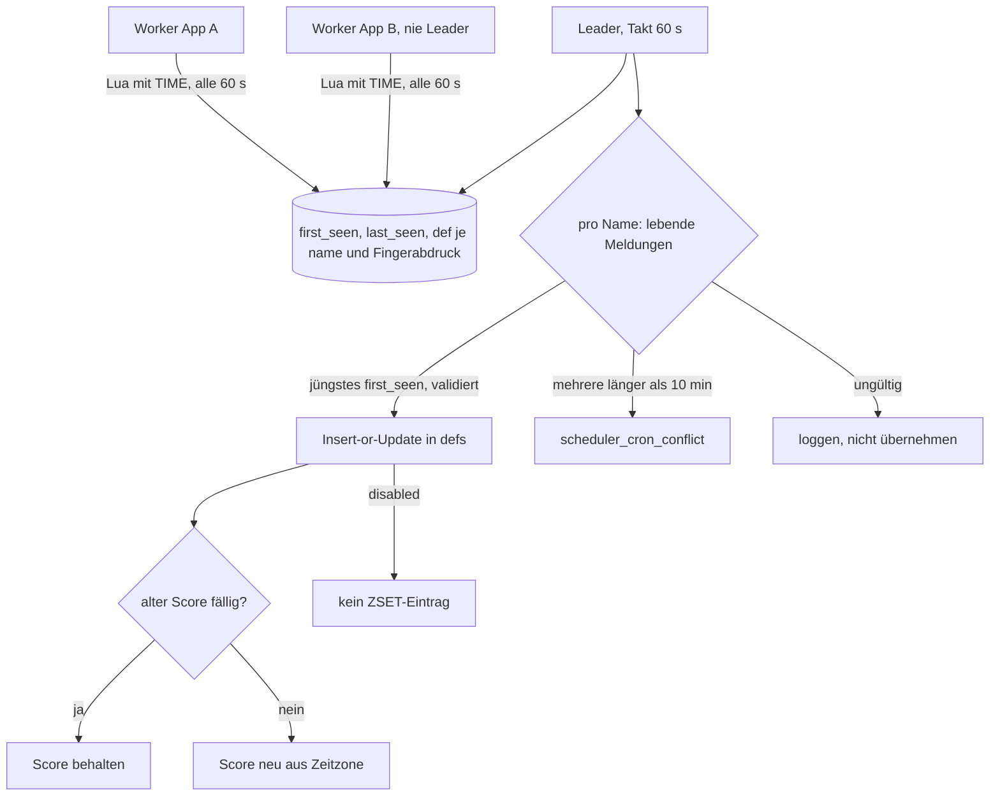
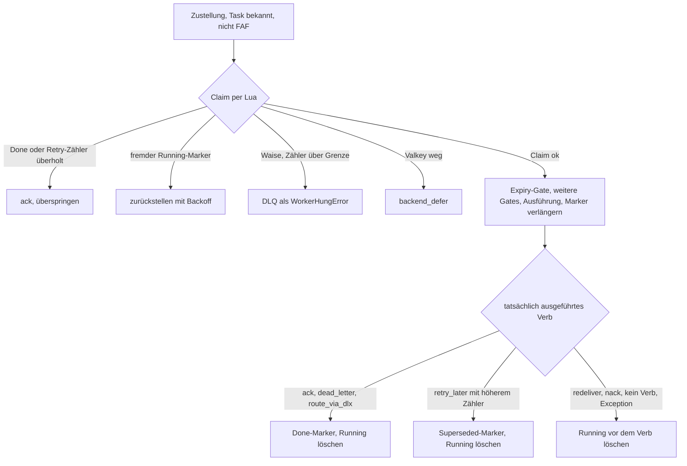
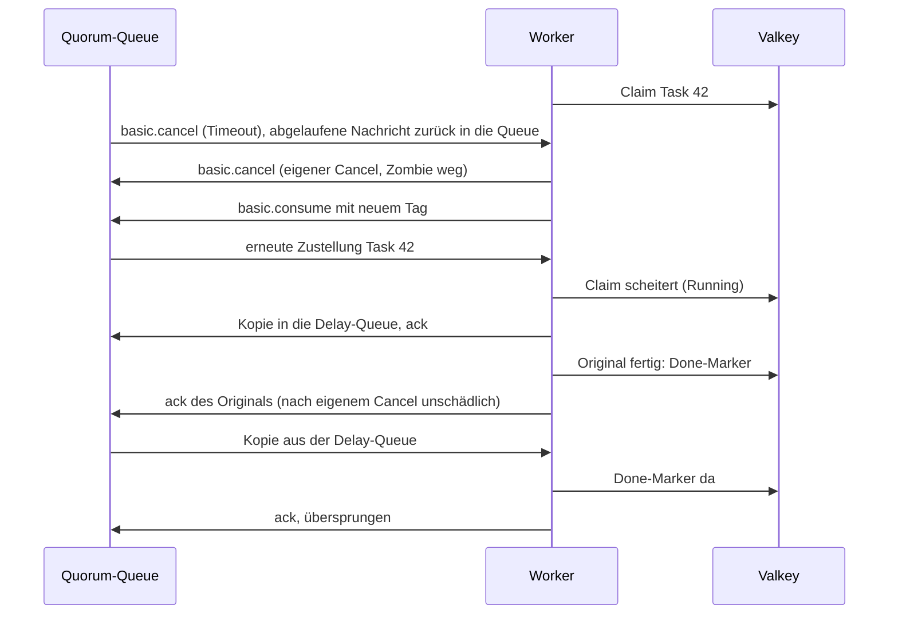

# Behebung der Einbindungsfehler A1, A2, A3 und A14 - Plan

## Goal Capsule

- **Objective:** Ein Projekt, das swarmq einbindet, kann sich auf vier Dinge verlassen:
  - Ein Worker arbeitet nach einem Consumer-Timeout des Brokers weiter, und kein Task läuft dadurch doppelt.
  - Crons feuern zur lokalen Uhrzeit, auch über Zeitumstellungen hinweg und über mehrere Apps auf einem Valkey.
  - Aus dem Code entfernte Crons hören auf zu feuern.
  - Die Dead-Letter-Queue wächst nicht unbegrenzt.
- **Means:**
  - Zeitzone pro Cron, eine gemeinsame Rechenfunktion mit DST-Regel (KTD1, KTD2)
  - Cron-Meldungen jedes Workers; der Leader übernimmt die jüngste lebende Definition (KTD10), erkennt veraltete Leader (KTD11) und räumt nach Frist auf (KTD8)
  - Consumer-Wächter, der Zombie-Consumer selbst abmeldet, und Settle-Regeln für 4.2 und 4.3 (KTD3, KTD4)
  - Ausführungsschutz pro Task-ID, gesteuert vom tatsächlich ausgeführten Broker-Verb (KTD5)
  - Rest-TTL pro Nachricht in der DLQ und abschaltbares Dead-Lettering (KTD6, KTD7)
- **Authority:** Bei Konflikten gelten zuerst die Product-Contract-Requirements, dann die KTDs, zuletzt die Units. AGENTS.md (strikt TDD, ein roter Test zur Zeit) gilt für jede Unit. Queue-Argumente bestehender Queues bleiben unverändert; die Golden-Fixture `tests/integration/backend/golden/queue_args.json` darf sich nicht ändern.
- **Execution profile:**
  - **Basis:** Branch `fix/b22-b23-log` (Commit 24b74b0, Settle-Fehler sauber geloggt) wird zuerst gemergt; alle Arbeit setzt darauf auf.
  - **Phase 1 → 0.10.0:** Zeitzonen, Cron-Meldungen, Leader-Versionserkennung (U1, U2, U3, U12, U13, U4).
    - Go/No-Go am 15.10.2026, Release-Ziel 16.10., spätestens 19.10.
    - So bleiben dem Projekt bis zum 25.10. zwei Deploy-Runden (alle Apps auf 0.10.0, danach Crons umstellen).
  - **Parallel zu Phase 1:** U5 (Broker-Pinning und Charakterisierung, kein Produktionscode).
  - **Phase 2 → 0.11.0:** Consumer-Timeout, Ausführungsschutz, DLQ-Begrenzung, Cron-Aufräumen (U6–U11).
  - Jede Unit test-first. Integrationstests, die einen ganzen Ablauf prüfen, sind der letzte Zyklus einer Unit: Sie werden rot, solange der neue Baustein nicht eingehängt ist, und das Einhängen ist ihr grüner Schritt. So ist nie mehr als ein Test rot.
- **Stop conditions:**
  - Stopp, falls Phase 1 am 15.10. nicht absehbar bis 19.10. releasefähig ist. Dann den Notbehelf (Scope Boundaries) mit Georg auslösen.
  - Stopp, falls U5 auf RabbitMQ 4.3.6 oder 4.2.9 ein anderes Verhalten zeigt als in KTD3/KTD4 beschrieben. Dann KTD3/KTD4 neu bewerten und Rücksprache halten.
  - Stopp, falls der Ausführungsschutz die Durchsatzmessung der Loadsuite um mehr als 10 % verschlechtert.
- **Tail ownership:** Merge, Tag und PyPI-Upload nur nach Georgs ausdrücklicher Freigabe. Den Upload führt Georg aus.

---

## Product Contract

### Summary

Der Plan behebt vier Fehler, die beim Einbinden von swarmq in ein Projekt mit mehreren Apps auf einem Valkey aufgefallen sind.
Crons bekommen eine Zeitzone mit fester Regel für die Umstellungsnächte.
Jeder Worker meldet seine Crons; der Leader übernimmt pro Cron die jüngste lebende Definition und warnt, wenn ein veralteter swarmq-Leader die Zeitzonen zerstören würde.
Der Worker meldet einen vom Broker beendeten Consumer selbst ab, meldet sich neu an und zeigt den Zustand in `/ready`.
Ein Ausführungsschutz verhindert, dass eine erneut zugestellte Nachricht neben dem laufenden Original oder nach dessen Abschluss ausgeführt wird.
Die DLQ bekommt eine konfigurierbare Haltedauer, und Dead-Lettering terminaler Task-Fehler lässt sich abschalten.
Statische Crons, die kein Worker mehr meldet, werden nach einer Frist entfernt.

### Problem Frame

Das einbindende Projekt betreibt mehrere Apps mit unterschiedlichen Tasks auf demselben Valkey und meldet vier Probleme. Die Ursachen sind in der Analyse und der Belastungsprüfung vom 08.10. belegt (Appendix).

- **A1:** Ab RabbitMQ 4.3 hört ein Worker nach einem `consumer_timeout` still auf zu konsumieren. Bis 4.2 (wie auf 3.13) läuft der Task doppelt.
  - Ab 4.3 sendet die Quorum-Queue `basic.cancel`, der Channel bleibt offen. Der Consumer bleibt am Broker als Zombie bestehen: Bestätigt der Client die abgelaufenen Zustellungen spät, stellt der Broker wieder an ihn zu, und aiormq verwirft diese Zustellungen still (auf 4.3.6 nachgestellt).
  - Bis 4.2 schließt der Broker den Channel. aio-pika stellt den Consumer wieder her, die Nachricht wird erneut zugestellt, während das Original noch läuft.
  - `/ready` prüft nur die Verbindung, und swarmq prüft bei Neuzustellung weder `redelivered` noch ein vorhandenes Ergebnis.
- **A2:** Crons werden nur in UTC berechnet. Das Projekt hat 105 Crons von Hand nach UTC umgerechnet; nach dem 25.10. laufen 49 davon zur falschen Stunde.
- **A3:** Aus dem Code entfernte Crons feuern weiter. Der Sync fügt nur ein oder aktualisiert, er läuft nur bei Leader-Übernahme und nur über die Registry des Leaders. Crons einer App, deren Worker nie Leader wird, kommen nie an.
- **A14:** Seit MR !12 geht jeder terminale Fehlschlag in `{queue}.XQ`, auch bei `max_retries=0`. Die XQ hat weder TTL noch Längengrenze. Im Dauerlauf waren es 123 Nachrichten in 30 Minuten.

### Requirements

**Zeitzonen und Crons über Apps hinweg (Phase 1)**
- R6. Ein Cron kann eine IANA-Zeitzone tragen, pro Task oder über einen globalen Standard. Ohne Angabe bleibt UTC. `"UTC"`, `"Etc/UTC"` und keine Angabe sind gleichwertig.
- R7. In der Rückstellungsnacht feuert ein Cron, dessen Stundenfeld kein `*` enthält, nur im ersten Durchlauf der doppelten Stunde. Ein Cron mit `*` im Stundenfeld (auch `*/n`) folgt der echten Zeit. `@`-Aliase werden vor dieser Einstufung in ihre Fünf-Feld-Form übersetzt.
- R8. Fällt die Uhrzeit eines Crons in die Lücke der Vorstellungsnacht, gilt das Verhalten von croniter: feste Stunden feuern einmal zur nächsten existierenden Uhrzeit; für Crons mit `*` im Stundenfeld ist das croniter-Verhalten per Tabellentest festgeschrieben und dokumentiert.
- R9. Ändert sich Zeitzone, Queue oder Cron-Ausdruck eines statischen Crons im Code einer beliebigen App, gilt die Änderung binnen zwei `scheduler_seen_interval_s` nach dem Start des ersten Workers mit dem neuen Code, auch wenn dieser nie Leader wird. Ein bereits fälliger, noch nicht gefeuerter Termin geht dabei nicht verloren.
- R12. Laufen zwei Code-Stände desselben Crons gleichzeitig (Rolling Deploy), gilt der zuletzt neu aufgetauchte. Ein später neu startender Worker des alten Stands setzt ihn nicht zurück. Bleiben zwei Stände länger als 10 Minuten gleichzeitig am Leben, warnt swarmq.
- R18. Eine Cron-Definition, deren nächster Termin sich nicht berechnen lässt, blockiert keine anderen Crons. Sie wird geloggt und übersprungen.
- R19. Ist der aktuelle Scheduler-Leader eine swarmq-Version ohne Zeitzonen-Unterstützung, warnen alle neueren Worker, und `schedule status` zeigt es an.
- R20. Das Projekt kann vor dem Umstellen prüfen, dass ein umgestellter Ausdruck mit Zeitzone bis zum 25.10. dieselben Termine liefert wie der alte UTC-Ausdruck (öffentliche Funktion für die nächsten Termine).

**Consumer-Timeout (Phase 2)**
- R1. Beendet der Broker einen Consumer des Workers (`basic.cancel` oder Channel-Close), konsumiert der Worker binnen zwei `consumer_watch_interval_s` wieder, ohne Neustart, und am Broker bleibt kein Zombie-Consumer zurück.
- R2. `/ready` meldet einen Worker als nicht bereit, wenn eine seiner erwarteten Queues länger als `consumer_ready_grace_s` keinen aktiven Consumer hat. Jede Neuanmeldung erzeugt ein Log-Event und eine Metrik.
- R3. Ein Settle schließt nie einen Channel und lässt keine Nachricht unbestätigt am Broker hängen.
- R4. Eine erneut zugestellte Nachricht wird nicht ausgeführt, solange ihre Ausführungs-Identität (Task-ID plus Replay-ID) anderswo läuft, bereits terminal abgeschlossen ist oder durch einen Retry überholt wurde.
- R5. Fällt ein Worker während der Ausführung aus, darf die erneute Zustellung nach Ablauf von `execution_guard_ttl_s` laufen. Stürzt dieselbe Ausführung wiederholt ab, landet sie nach `execution_guard_max_orphans` Versuchen in der DLQ.

**Verwaiste Crons (Phase 2)**
- R11. Ein statischer Cron, der mindestens einmal gemeldet wurde und seit `scheduler_prune_after_s` von keinem Worker mehr gemeldet wird, wird entfernt. Dazu erscheint ein Log-Event.
- R13. Crons, die nie gemeldet wurden (Altbestand, Apps auf älteren Versionen), werden nie automatisch entfernt, sondern als Kandidaten geloggt und lassen sich per CLI entfernen. Ein beim Entfernen deaktivierter Cron wird deaktiviert wieder angelegt.

**Dead-Letter-Queue (Phase 2, Notbehelf ab 0.10.0)**
- R14. Von swarmq in die DLQ gelegte Nachrichten verfallen `dead_letter_ttl_s` nach dem Dead-Lettering, Standard 7 Tage, unabhängig davon, wie oft die DLQ gelesen wird. Mit `none` gilt unbegrenzt.
- R15. Dead-Lettering terminaler Task-Fehler lässt sich global und pro Task abschalten. Dann gilt das Verhalten vor MR !12: Fehlerergebnis speichern, Workflow-Fehler propagieren, bestätigen.
- R16. Bestehende Deployments starten ohne `PRECONDITION_FAILED`; die Argumente bestehender Queues ändern sich nicht.
- R21. Altbestand ohne TTL in bestehenden XQs blockiert den Verfall nicht dauerhaft. Die Release-Notes von 0.10.0 enthalten die Broker-Policy als sofortigen Notbehelf.

**Doku und Release**
- R17. Doku (EN und DE) und Changelog beschreiben alle Änderungen samt Migrationshinweisen; 0.10.0 enthält eine Migrationsanleitung für von Hand umgerechnete UTC-Crons in Umgebungen mit mehreren Apps.

### Acceptance Examples

- AE1. **Covers R7.** `30 2 * * *` mit `Europe/Berlin` feuert in der Nacht zum 25.10.2026 um 02:30+02:00, nicht um 02:30+01:00, und am 26.10. um 02:30+01:00.
- AE2. **Covers R7.** `*/30 * * * *` mit `Europe/Berlin` feuert in der Nacht zum 25.10.2026 um 02:00 und 02:30 in beiden Durchläufen.
- AE3. **Covers R8.** `30 2 * * *` mit `Europe/Berlin` feuert am 28.03.2027 einmal um 03:00+02:00.
- AE7. **Covers R7.** `0 */2 * * *` mit `Europe/Berlin` feuert in der Nacht zum 25.10.2026 um 02:00+02:00 und 02:00+01:00; `0 1-3 * * *` nur um 02:00+02:00; `@hourly` in beiden Durchläufen.
- AE8. **Covers R9, R12.** App B (nie Leader) stellt `0 1 * * *` UTC auf `0 3 * * *` Berlin um. Binnen zwei Meldetakten steht die neue Definition in Valkey; ein danach neu startender Worker des alten Stands ändert sie nicht zurück.
- AE9. **Covers R19.** Ein 0.9.0-Worker wird Leader. Alle 0.10.0-Worker loggen `scheduler_leader_outdated`, `schedule status` zeigt die Leader-Version.
- AE4. **Covers R1, R4.** Ein Task läuft länger als der Consumer-Timeout (4.2.9 und 4.3.6). Danach konsumiert der Worker weiter, am Broker hängt kein Zombie-Consumer, und der Task wurde genau einmal ausgeführt.
- AE5. **Covers R5.** Ein Worker stirbt mitten im Task. Nach Ablauf von `execution_guard_ttl_s` läuft die erneute Zustellung normal. Stürzt sie dreimal ab, liegt sie in der DLQ.
- AE6. **Covers R11, R13.** App A und App B nutzen dasselbe Valkey, nur Worker von A laufen. Bs Crons bleiben, solange B innerhalb von `scheduler_prune_after_s` wieder meldet. Ein nie gemeldeter Altbestand-Cron bleibt immer.
- AE10. **Covers R14.** Eine DLQ-Nachricht wird nach der Hälfte ihrer TTL per `dlq inspect` gelesen und verfällt trotzdem zum ursprünglichen Zeitpunkt.

### Key Decisions

- **Zeitzonen zuerst und als eigenes Release** (session-settled: user-approved — gewählt statt eines gemeinsamen Releases: die Frist 25.10. darf nicht von A1 abhängen). Governs R6–R9, R12, R18–R20.
- **Mehrere Apps auf einem Valkey sind der Normalfall** (session-settled: user-directed — bestätigt am 08.10.). Deshalb gehören Cron-Meldungen und Versionserkennung in Phase 1. Governs R9, R12, R19.
- **Doppelte Stunde: nur der erste Durchlauf** für Crons mit fester Stunde (session-settled: user-approved — gewählt statt croniters Doppelfeuerung). Die Einstufung nach `*` im Stundenfeld ist ergänzt. Governs R7.
- **Ausführungsschutz ist Teil des Fixes** (session-settled: user-approved — gewählt statt „nur Consumer neu anmelden“: sonst bleibt die Doppelausführung bis 4.2). Governs R4, R5.
- **Abschaltbares Dead-Lettering** (session-settled: user-approved — gewählt statt nur TTL: stellt das taskiq-nahe Verhalten wieder her). Governs R15.
- **Cron-Aufräumen über Lebenszeichen** (session-settled: user-directed — gewählt statt Owner-Markierung pro App: die Owner-Markierung kann in Rolling Deploys neue Crons löschen). Governs R11, R13.
- **Upgrade in zwei Schritten.** Erst alle Apps auf demselben Valkey auf 0.10.0, ohne Cron-Änderung; erst danach Ausdrücke und Zeitzonen umstellen. Ein 0.9.0-Leader verwirft das Feld `timezone` bei jedem Fire. Governs R17, R19.

### Scope Boundaries

- Keine eigene Testumgebung für RabbitMQ 3.13; das Verhalten bis 4.2 wird mit 4.2.9 getestet.
- Kein Valkey-Index der DLQ (aus `docs/recherche-retry-dlq.md` §16.2).
- Keine Cron-API im Python-Client.
- Keine Änderung an Queue-Argumenten bestehender Queues.
- **Notbehelf, falls 0.10.0 nicht rechtzeitig kommt** (vom Projekt jetzt vorzubereiten, kein swarmq-Code): ein Branch des Projekts mit den 49 betroffenen Ausdrücken nach Winterzeit (UTC+1) umgerechnet, deployt am 25.10. nach 01:00 UTC und vor dem ersten betroffenen Termin.

#### Deferred to Follow-Up Work

- 0.10.1: `schedule add --tz`, `--at` in einer Zone, Ortszeit-Spalten in `schedule list`/`status` (R10 aus der ersten Planfassung). Das einbindende Projekt nutzt statische Crons; `schedule list --format json` zeigt `timezone` ohnehin.
- `unique_for`/`unique_until` für Crons fremder Apps: Der Leader kennt deren `TaskInfo` nicht und ignoriert die Einstellung heute schon.
- `x-consumer-timeout` als Consumer-Argument in `basic.consume` (ab 4.3), damit `consumer_timeout_s` mehr als eine Warnung ist.
- Zusammenlegen von Schedfire-Markern und Ausführungsschutz.
- Wechsel von croniter zu cronsim prüfen.

---

## Planning Contract

### Key Technical Decisions

**Scheduler (Phase 1)**

- KTD1. **Zeitzone wird in der `ScheduleDefinition` gespeichert und normalisiert.**
  - Neues Feld `timezone: str | None = None` am Ende des Structs; `"UTC"` und `"Etc/UTC"` werden zu `None` normalisiert, damit sich beim Upgrade kein Fingerabdruck ändert.
  - Quelle: `TaskInfo.timezone`, sonst `SwarmQConfig.scheduler_timezone` (Env `SWARMQ_SCHEDULER_TIMEZONE`). Die Doku empfiehlt die Angabe pro Task; die globale Variable muss im selben Deploy wie die Ausdrücke umgestellt werden.
  - Validierung per `zoneinfo.ZoneInfo` beim Definieren des Tasks (`ValueError` wie alle `TaskInfo`-Prüfungen) bzw. beim Config-Laden.
  - Abhängigkeiten: `tzdata` wird Dependency (Images ohne `/usr/share/zoneinfo`), `croniter>=6.2` (fold-Verhalten nur dafür belegt).
  - Muster: `unique_until` in `src/swarmq/scheduler/definition.py`; abwärtskompatibel nach `docs/solutions/patterns/r3-5-unique-tasks-implementation-learnings-2026-04-17.md` (Pattern 7).
- KTD2. **Eine gemeinsame, öffentliche Funktion berechnet die nächsten Termine.**
  - Eingabe: Ausdruck, Zeitzone, Referenzzeitpunkt; Ausgabe: Unix-ms (intern) bzw. eine Folge zeitzonenbehafteter Termine (öffentlich, R20).
  - Alle vier croniter-Aufrufer nutzen sie: Sync bzw. Übernahme, nächster Score nach dem Fire, `_count_skipped_fires`, CLI `schedule add`.
  - Nur `get_next` (pallets-eco/croniter #258, #259 betreffen `get_prev` und `croniter_range`).
  - DST-Regel: Ist das croniter-Ergebnis eine mehrdeutige Wanduhrzeit (`utcoffset` von fold=0 und fold=1 verschieden) im späteren Durchlauf, und enthält das Stundenfeld kein `*`, wird ab dem Ende der doppelten Phase weitergesucht, nicht minutenweise. Das vermeidet Tausende Schritte bei Sekunden-Crons.
  - Aliase (`@hourly` usw.) werden vor der Einstufung in ihre Fünf-Feld-Form übersetzt. Bei Sechs-Feld-Ausdrücken bleibt das Stundenfeld an zweiter Stelle.
  - Die Regel ist empirisch gegen einen minutengenauen Referenzrechner geprüft: 17 Ausdrücke × 8 Zonen × 4 Umstellungen, 0 Abweichungen (Belastungsprüfung 08.10.). Der Verweis auf Debian-cron entfällt; anders als Debian zählt nur das Stundenfeld.
- KTD10. **Cron-Meldungen mit Fingerabdruck; der Leader übernimmt die jüngste lebende Definition.** Ersetzt den heutigen Sync über die Registry des Leaders.
  - Jeder Worker meldet beim Start und danach alle `scheduler_seen_interval_s` (Standard 60 s) jeden seiner statischen Crons: Name, Fingerabdruck über die aus dem Code stammenden Felder (Cron, normalisierte Zeitzone, Queue, Task-Name) und die vollständige Definition.
  - Melden per Lua mit Valkey-Zeit (`TIME`, Vorbild `lua/lock_acquire.lua`), damit Uhrabweichungen zwischen Workern keine Rolle spielen. Ablage in drei Hash-Tag-Hashes unter `sq:{sched}:` (`first_seen`, `last_seen`, `def`), Feld jeweils `name|fingerprint`.
  - `first_seen` wird nur gesetzt, wenn das Feld fehlt oder der Fingerabdruck tot war (`last_seen` älter als das Lebendigkeitsfenster `3 × scheduler_seen_interval_s`). So gilt ein Revert A→B→A wieder als neu.
  - Der Leader wählt im Takt `scheduler_seen_interval_s` (nicht im Poll-Takt) pro Name unter den lebenden Meldungen die mit dem jüngsten `first_seen`. Er validiert sie vorher (Zone, Ausdruck) und übernimmt sie per Insert-or-Update (U3-Logik) in `defs`.
  - Leben pro Name länger als 10 Minuten mehrere Fingerabdrücke: Log `scheduler_cron_conflict` und Metrik. Typische Ursache sind gleichnamige Tasks in zwei Apps.
  - Meldungen mit `last_seen` älter als 7 Tage löscht der Leader (Phase 1, unabhängig vom Cron-Aufräumen).
  - CLI-Definitionen (`source` = `cli`, `cli_unique`) bleiben unberührt; ein gleichnamiger statischer Cron erzeugt wie heute nur eine Warnung.
  - Crons fremder Apps, die über Meldungen übernommen wurden, lösen beim Fire keine Warnung `scheduler_task_not_in_local_registry` mehr aus.
- KTD12. **Übernahme und Fire sind gegen Verlust und Vergiftung abgesichert.**
  - Ist der alte Score einer geänderten Definition bereits fällig, bleibt er bestehen; der Termin feuert einmal mit dem neuen Inhalt. Sonst wird neu berechnet.
  - Deaktivierte Definitionen bekommen keinen ZSET-Eintrag (heute macht `put` immer ZADD, und der Poll überspringt deaktivierte Einträge ohne ZREM).
  - Die Folgezeit wird vor dem Publish berechnet. Scheitert sie, wird nur dieser Eintrag geloggt (`scheduler_next_fire_failed`) und aus dem ZSET genommen; der Rest des Batches läuft weiter (R18).
  - `commit_fire` schreibt die Definition nur zurück, wenn sie sich seit dem Poll nicht geändert hat (Vergleich im Lua). Sonst würde ein Fire eine eben übernommene Änderung kurz zurücksetzen.
- KTD11. **Leader-Version wird sichtbar.**
  - Der Leader schreibt seine swarmq-Version neben das Leader-Lock (Key `sq:{sched}:leader_version` mit Lock-TTL).
  - Ein 0.10.0-Worker, der ein Lock ohne Versionsangabe oder mit älterer Version sieht, loggt `scheduler_leader_outdated` (einmal pro Wechsel) und setzt eine Metrik. `schedule status` zeigt die Leader-Version und die Versionen der meldenden Worker.
  - Ein Charakterisierungstest hält fest, dass ein Leader ohne `timezone`-Feld die Zone beim Re-Encode verwirft (Grund für das Upgrade in zwei Schritten).

**Consumer und Ausführungsschutz (Phase 2)**

- KTD3. **Der Consumer-Wächter meldet Zombie-Consumer selbst ab.**
  - Ein Hintergrund-Task prüft alle `consumer_watch_interval_s` (Standard 5 s) jede erwartete Queue gegen `consumers` des aktuellen aiormq-Channels. `get_underlay_channel()` wird mit Timeout begrenzt, weil es auf `connection.ready()` wartet.
  - Fehlt ein Tag auf einem offenen, unveränderten Channel (4.3, `basic.cancel`): sofort selbst `queue.cancel(tag)` senden. Auf 4.3.6 belegt: Das beendet den Zombie am Broker und räumt `RobustQueue._consumers` auf. Erst nach erfolgreichem Cancel neu anmelden, sonst bleibt der tote Tag für den nächsten Restore stehen.
  - Fehlt ein Tag, weil der Channel geschlossen oder ersetzt wurde (bis 4.2): zwei Takte warten, ob aio-pikas Restore ihn wieder anlegt (auf 4.2.9 belegt: gleicher Tag auf neuem Channel). Erst danach neu anmelden.
  - Neu angemeldet wird über dieselbe `RobustQueue` mit neuem Tag, nicht über `broker.consume()`, denn `_ensure_consume_channel` kann im Restore-Fenster einen zweiten Channel anlegen.
  - Ein Settle auf einen vom Broker gecancelten Tag stößt den Wächter sofort an (KTD4).
  - Log `consumer_reregistered` mit Grund, Metrik `swarmq_consumer_reregistrations_total{queue}`.
  - `/ready` bekommt einen Consumer-Check gegen die erwartete Queue-Menge einschließlich Prioritäts-Queues, mit Gnadenfrist `consumer_ready_grace_s` (Standard 30 s). Der Readiness-Hook wird von einem einzelnen `compute_check` auf mehrere Checks erweitert. Die Doku warnt, `/ready` nie als Liveness-Probe zu nutzen.
- KTD4. **Settle-Regeln nach Broker-Verhalten.**
  - Bis 4.2 ist der alte Channel zu; aio-pika wirft beim späten Ack `ChannelInvalidStateError`. Das fängt seit B22 `contain_delivery_errors` (`src/swarmq/worker/settle.py`) bereits ab, und kein Ack kann eine fremde Nachricht treffen. Hier ist nur ein Integrationstest nötig.
  - Ab 4.3 bleibt der Channel offen. Ein spätes Ack auf einen vom Broker gecancelten Tag würde den Zombie wieder aufwecken. Deshalb wartet ein Settle auf einen Tag, der fehlt und nicht selbst abgemeldet wurde, bis der Wächter das eigene `basic.cancel` gesendet hat, und geht erst dann raus. Danach sind Acks auf dem offenen Channel unschädlich (auf 4.3.6 belegt).
  - Tags, die swarmq selbst abgemeldet hat (`cancel_consume` beim Shutdown, Wächter nach seinem Cancel), bleiben bestätigbar. Ohne diese Regel gingen beim Drain im Shutdown alle Acks verloren.
  - Ein zurückgehaltenes Settle kehrt für den Aufrufer normal zurück, damit z. B. `retry_later` nach erfolgreichem Publish als Erfolg gilt.
- KTD5. **Ausführungsschutz pro Ausführungs-Identität, gesteuert vom tatsächlich ausgeführten Broker-Verb.**
  - **Identität:** Task-ID plus `x-swarmq-replay-id`, falls vorhanden. `dlq retry`, `retry --all` und jeder Wiederholungspfad für Workflows mit deterministischen Task-IDs (`workflow_topology.py`) setzen eine neue Replay-ID.
  - **Position:** Innerhalb des `try` in `pipeline.py`, nach `_lookup_task_or_route` und vor dem Expiry-Gate. So deckt das `finally` jeden Ausgang ab, die Erkennung hängender Worker (Delivery-Count-Gate) bleibt davor, und `max_age` schickt keine Kopie in die DLQ, während das Original läuft. FIRE_AND_FORGET-Tasks werden vor der Ausführung bestätigt und übersprungen.
  - **Claim:** Ein Lua-Aufruf setzt den Running-Marker mit Owner-Token und TTL `execution_guard_ttl_s` (Standard 60 s), außer ein Done- oder Superseded-Marker spricht dagegen. Ein gesammelter Takt im Worker verlängert die eigenen Marker per Compare-and-PEXPIRE, im CPU-Modus aus dem Hauptprozess. Ist ein Marker weg oder fremd, folgen Log und Metrik.
  - **Ausgang:** Ein protokollierender Broker-Wrapper pro Zustellung hält fest, welches Verb tatsächlich erfolgreich ausgeführt wurde. Das `DeliveryOutcome` taugt dafür nicht: DLQ-Wege melden heute `Redelivered`, manche Neuzustellungen `Terminal`, und der Standard im `finally` ist `Terminal`.

    | Ausgeführtes Verb | Marker |
    |---|---|
    | `ack` nach Ausführung, `dead_letter`, `route_via_dlx`, Expiry-DLQ, Cancel vor Start | Done-Marker setzen, Running löschen |
    | `retry_later` mit erhöhtem `x-swarmq-retry-count` (Publish erfolgreich, auch wenn das Ack danach scheitert) | Superseded-Marker mit neuem Zähler, Running löschen |
    | `redeliver`, `nack`, Requeue-Kopie, Zurückstellung, kein Verb, Exception | nur Running löschen, vor dem Verb (wie `redeliver_in_place`) |

  - **Konflikte:** Done-Marker oder kleinerer Retry-Zähler als der Superseded-Marker → bestätigen und überspringen (`duplicate_delivery_skipped`). Fremder Running-Marker → per `retry_later` mit `republish_headers` zurückstellen (zählt nicht gegen den Retry-Zähler), Verzögerung mit Backoff über einen eigenen Header `x-swarmq-guard-defer-count`.
  - **Absturzschleifen:** Findet der Claim einen abgelaufenen Running-Marker ohne Freigabe (Waise), zählt Lua einen Waisen-Zähler hoch. Ab `execution_guard_max_orphans` (Standard 3) geht die Zustellung als `WorkerHungError` in die DLQ. Sonst würde jede Zurückstellung als neue Nachricht das Zustelllimit aushebeln.
  - **TTL von Done und Superseded:** Standard `max(retry_max_delay, consumer_timeout_s) + 300`, mindestens `execution_guard_ttl_s`, mit Kreuzvalidierung (Vorbild `scheduler_dedup_ttl`). Zurückgestellte Kopien können hinter langen Retry-Verzögerungen in der Delay-Queue stecken, und ab 4.3 bleiben Zustellungen bis zum eigenen Timeout ausgecheckt.
  - **Valkey nicht erreichbar:** zurückstellen wie `backend_defer`.
  - Schalter `execution_guard` (Standard an). Restrisiko: Hängt der Event-Loop, bleibt die Verlängerung aus (Learning `lock-ttl-shorter-than-hard-timeout-duplicate-execution-2026-06-02.md`); ältere Worker im Mischbetrieb schützen nicht.
- KTD9. **RabbitMQ exakt pinnen, Timeouts schnell auslösen.**
  - Images `rabbitmq:4.2.9-management` und `rabbitmq:4.3.6-management` (lokal vorhanden); der Chaos-Stack (`tests/chaos/compose.yml`, heute `3.13`) wird ebenfalls gepinnt.
  - 4.3: Policy `consumer-timeout` pro Testqueue (z. B. 3000 ms). Die Quorum-Queue setzt einen Timer pro Nachricht; das Cancel kam auf 4.3.6 nach etwa 3 s.
  - 4.2: Prüftakt `channel_tick_interval` auf 1000 ms (lokal per `advanced.config`, in CI über `RABBITMQ_SERVER_ADDITIONAL_ERL_ARGS`, in U5 zu prüfen); Close kam auf 4.2.9 nach etwa 4 s. Deterministische Alternative ohne Timer: ein unbekanntes Delivery-Tag auf dem Consume-Channel acken.
  - Damit passen die Tests ins globale pytest-Timeout von 30 s; ein zweiter RabbitMQ-Dienst bekommt eine eigene Port-Variable in `tests/support/services.py`.

**DLQ und Aufräumen (Phase 2)**

- KTD6. **Rest-TTL pro Nachricht statt Queue-Argument.**
  - `_publish_to_dead_letter_queue` setzt `expiration` aus `dead_letter_ttl_s` (aio-pika erwartet Sekunden als Zahl und kodiert ms als String) und den Header `x-swarmq-dead-lettered-at`.
  - `dlq list` und `dlq inspect` legen gelesene Nachrichten mit der Rest-TTL zurück; abgelaufene werden verworfen. Nachrichten ohne `x-swarmq-dead-lettered-at` (Altbestand, DLX-Wege) bekommen beim Zurücklegen die volle `dead_letter_ttl_s` ab jetzt. `dlq retry` leitet ohne `expiration` in die Hauptqueue.
  - Die Queue-Argumente bleiben unverändert (R16).
  - Grenze: DLX-geroutete Nachrichten (`route_via_dlx`, `x-delivery-limit`) kommen ohne TTL in die XQ und halten den Kopf auf, bis sie gelesen werden. (Geändert durch Plan 2026-10-12-1105, MR 8: Die Ablehnungen `undecodable`, `body_too_large` und `middleware_chain_factory` gehen seitdem als Worker-Kopie mit TTL in die XQ; `route_via_dlx` bleibt nur der Rückfall, wenn die Kopie scheitert, und der Weg für `dlq_publish_failed`.) Die vollständige Begrenzung leistet nur eine Broker-Policy auf `\.XQ$` mit `message-ttl` und `max-length`; die Doku warnt, dass pro Queue nur eine Policy gilt und Überlauf verworfen wird.
  - `dead_letter_ttl_s=none` braucht eine neue optionale Art im Env-Parser (`config.py`), weil `parse_env_value` und `_POSITIVE_FIELDS` heute kein `None` kennen.
- KTD7. **Abschaltbares Dead-Lettering über den Ergebnis-Pfad.**
  - Neues Feld `dead_letter: bool | None = None` in `TaskInfo`, Config `dead_letter_terminal_failures: bool = True`; das Task-Feld gewinnt.
  - Die Weiche sitzt in `RetryHandler.evaluate`, nur in den drei terminalen Zweigen (`NoRetry`, nicht wiederholbare Exception, Retries ausgeschöpft). Bei Abschaltung läuft die Zustellung in `results.finish`: Ergebnis mit `task_info.result_ttl`, Workflow-Fehlermarkierung, Unique-Freigabe, Ack. So gilt exakt das Verhalten vor MR !12.
  - Kein zusätzliches Signal: `TASK_FAILED` und `outcome="failed"` feuern schon pro Versuch. Die Doku vermerkt, dass ein Alarm auf `outcome="dlq"` dann entfällt.
  - Das Delivery-Count-Gate (`WorkerHungError`), undecodierbare Nachrichten, `max_age` und Lock-Fehler gehen weiter in die XQ.
- KTD8. **Aufräumen über Lebenszeichen** (session-settled: user-directed — gewählt statt Owner-Markierung pro App: kann in Rolling Deploys neue Crons löschen).
  - Lebenszeichen sind die `last_seen`-Werte aus KTD10.
  - Der Leader entfernt Definitionen mit `source == "static"`, die mindestens einmal gemeldet wurden und deren jüngste Meldung älter als `scheduler_prune_after_s` ist (Standard 86400 s; Kreuzvalidierung ≥ 3 × `scheduler_seen_interval_s`).
  - Nie gemeldete Definitionen werden nur als `scheduler_cron_prune_candidate` geloggt; `schedule prune --orphans` entfernt sie bewusst. So verlieren Apps auf älteren Versionen und Apps, die länger pausieren, keine Crons.
  - Beim Entfernen deaktivierte Namen merkt sich der Leader in `sq:{sched}:disabled`; das Wiederanlegen übernimmt den Zustand.
  - Schalter `scheduler_prune` mit `off`, `log` und `on` (Standard `on`). Voraussetzung im Changelog: alle Apps auf dem Valkey mindestens 0.10.0.
  - Wer einen entfernten Cron sofort loswerden will, nutzt weiterhin `schedule remove --permanent`.

### High-Level Technical Design

**Cron-Meldungen und Übernahme (KTD10–KTD12)**

**Ausführungsschutz (KTD5)**

**Consumer-Timeout ab 4.3 (KTD3–KTD5)**

**DST-Regel (KTD2)**

| Lage des croniter-Ergebnisses | Stundenfeld ohne `*` | Stundenfeld mit `*` (auch `*/n`, Aliase nach Übersetzung) |
|---|---|---|
| normale Zeit | feuern | feuern |
| doppelte Stunde, erster Durchlauf | feuern | feuern |
| doppelte Stunde, zweiter Durchlauf | ab Ende der doppelten Phase weitersuchen | feuern |
| Lücke im Frühjahr | croniter verschiebt auf die nächste existierende Zeit, einmal feuern | croniter-Verhalten, per Tabellentest festgeschrieben (z. B. Berlin `15 * * * *`: 02:15 entfällt; `45 */2 * * *`: 03:00) |

### Sources & Research

- Analyse vom 08.10.2026 und Belastungsprüfung (Premortem, Code-Prüfung, Scheduler-Experimente, DLQ/TDD/Release) mit Datei:Zeile-Belegen; Kernbelege im Appendix.
- Experimente gegen `rabbitmq:4.3.6` und `4.2.9`: Zombie-Consumer nach `basic.cancel`, eigenes Cancel räumt auf, Restore mit gleichem Tag, schnelle Timeouts per Policy bzw. `channel_tick_interval`.
- RabbitMQ 4.3: https://www.rabbitmq.com/blog/2026/04/23/rabbitmq-4.3-release, https://github.com/rabbitmq/rabbitmq-server/releases/tag/v4.3.0, `rabbit_channel.erl` und `rabbit_fifo.erl` v4.3.0. Bis 4.2: https://www.rabbitmq.com/docs/consumers.
- TTL und DLX: https://www.rabbitmq.com/docs/ttl, https://www.rabbitmq.com/docs/dlx.
- croniter 6.2.4 (pallets-eco), Issues #258, #259; Skizze der DST-Regel und Referenzrechner aus der Belastungsprüfung.
- Learnings: `docs/solutions/patterns/invarianten-der-worker-pipeline-2026-08.md`, `docs/solutions/logic-errors/schedfire-retry-dedup-collision-silent-drop-2026-06-02.md`, `docs/solutions/logic-errors/lock-ttl-shorter-than-hard-timeout-duplicate-execution-2026-06-02.md`, `docs/solutions/logic-errors/nack-requeue-false-routes-via-dlx-not-data-loss-2026-04-16.md`, `docs/solutions/logic-errors/scheduler-cron-sync-clobber-test-flake-2026-06-01.md`, `docs/solutions/patterns/r3-5-unique-tasks-implementation-learnings-2026-04-17.md`.
- Ursprüngliche Entscheidungen: `docs/plans/2026-04-17-002-feat-phase3c-scheduler-plan.md` (UTC-only, Aufräumen zurückgestellt), `docs/recherche-retry-dlq.md` §16.3 (7 Tage DLQ-TTL), Commit 72e0b3d (DLQ bei `max_retries=0`).

### System-Wide Impact

- **Valkey-Last:** pro Task zwei Lua-Aufrufe plus gesammelte Verlängerung; pro Worker und Minute ein Lua-Aufruf mit allen eigenen Crons.
- **Neue Keys:** Meldungs-Hashes, `leader_version`, Running/Done/Superseded/Waisen pro Ausführung, `disabled`. Alle mit Hash-Tags, festgehalten in den Golden-Fixtures (`keys.json`, `lua_contract.txt`, `headers.txt`; Mehrschlüssel-Skripte von Hand in `multi` in `tests/integration/backend/_golden.py`).
- **Verhaltensänderungen in 0.10.0:** Der Sync über die Registry des Leaders entfällt; Crons kommen über Meldungen. Ohne Zeitzonen-Angabe ändert sich nichts.
- **Verhaltensänderungen in 0.11.0:** DLQ-Nachrichten verfallen nach 7 Tagen; gemeldete, nicht mehr gemeldete Crons verschwinden nach 24 h; doppelte Zustellungen werden übersprungen; `/ready` kann nach 30 s ohne Consumer rot werden.
- **Dashboard swarmv:** liest die DLQ über `list_dead_letters`. Mit KTD6 ändert das die TTL nicht mehr; die neuen Header erscheinen in der Ansicht.
- **CLI:** neue Befehle bzw. Optionen (`schedule prune --orphans`, Anzeige der Leader-Version) laufen über die Help-Fixtures `tests/unit/fixtures/cli_help/*.txt` und `website/reference/agent/spec/cli.json`, nicht über `test_cli_module_surface.py` (der friert nur Symbole ein).
- **Agent-Spec:** Jede Unit mit neuem Config-Feld erzeugt die Spec neu (`website/reference/agent/spec/*.json`, `website/llms.txt`).

### Risks & Dependencies

| Risiko | Gegenmaßnahme |
|---|---|
| Ein 0.9.0-Leader einer anderen App verwirft `timezone` bei jedem Fire | Upgrade in zwei Schritten (Key Decision), Warnung und Anzeige (KTD11), Migrationsanleitung |
| Phase 1 sprengt die Frist (Schätzung 8–10 Personentage, 8 Arbeitstage bis 20.10.) | Go/No-Go 15.10., CLI-Komfort nach 0.10.1 verschoben, Notbehelf vom Projekt vorbereitet |
| Migration nach dem 25.10. 01:00 UTC feuert am Umstellungstag doppelt oder gar nicht | Anleitung verlangt Umstellung vorher; Äquivalenzprüfung mit der öffentlichen Funktion (R20) |
| Neues e2e mit zwei Registries im bereits einmal flaky Leader-Bereich | Helfer `_wait_zscore_present`, reale Poll-Settings, Learning zum Sync-Clobber-Flake |
| Gleichnamige Tasks in zwei Apps | `scheduler_cron_conflict`, Anzeige in `schedule list` |
| Hängender Event-Loop verlängert keine Marker | dokumentiertes Restrisiko, `execution_guard_ttl_s` konfigurierbar |
| DLX-geroutete Nachrichten ohne TTL halten den XQ-Kopf auf | Rest-TTL beim Lesen, Policy-Empfehlung |
| `/ready` rot bei allen Workern gleichzeitig → Massen-Neustart | Gnadenfrist, Doku „nie als Liveness“, Test „alle Consumer weg“ |

---

## Implementation Units

| U-ID | Titel | Hauptdateien | Abhängig von |
|---|---|---|---|
| U1 | Zeitzone im Modell | `task.py`, `config.py`, `scheduler/definition.py`, `pyproject.toml` | Basis-Merge B22/B23 |
| U2 | Rechenfunktion mit DST-Regel | `scheduler/` (neues Modul), `loop.py`, `cli/schedule_cmd.py` | U1 |
| U3 | Übernahme ohne Verlust | `scheduler/sync.py`, `scheduler/loop.py`, `backend/valkey/schedules.py` | U2 |
| U12 | Cron-Meldungen aller Worker | `scheduler/` (neues Modul), `lua/`, `backend/valkey/schedules.py`, `worker/lifecycle.py` | U3 |
| U13 | Leader-Version | `scheduler/loop.py`, `locking.py`, `cli/schedule_cmd.py` | U12 |
| U4 | Doku, Migration, Release 0.10.0 | `website/` | U1–U3, U12, U13 |
| U5 | Broker-Pinning und Charakterisierung | `docker-compose*.yml`, `tests/chaos/compose.yml`, `.gitlab-ci.yml`, `tests/support/services.py` | Basis-Merge, parallel zu Phase 1 |
| U6 | Consumer-Wächter und Readiness | `broker/rabbitmq/`, `worker/lifecycle.py`, `health.py` | U5 |
| U7 | Settle-Regeln für 4.3 | `broker/rabbitmq/delivery.py`, `worker/settle.py` | U6 |
| U8 | Ausführungsschutz | `worker/gates/`, `worker/pipeline.py`, `lua/`, `backend/valkey/`, `broker/rabbitmq/admin.py` | U7 |
| U9 | DLQ-TTL und abschaltbares Dead-Lettering | `broker/rabbitmq/delivery.py`, `admin.py`, `connection.py`, `app.py`, `worker/retry.py`, `config.py` | U5 |
| U10 | Cron-Aufräumen | `scheduler/`, `backend/valkey/schedules.py`, `cli/schedule_cmd.py` | U12 |
| U11 | Doku und Release 0.11.0 | `website/` | U6–U10 |

### Phase 1 – Release 0.10.0

### U1. Zeitzone im Modell

- **Goal:** Tasks, Config und gespeicherte Definitionen tragen eine validierte, normalisierte Zeitzone.
- **Requirements:** R6.
- **Dependencies:** Merge von `fix/b22-b23-log`.
- **Files:** `src/swarmq/task.py`, `src/swarmq/config.py`, `src/swarmq/scheduler/definition.py`, `pyproject.toml`, `uv.lock`, `tests/unit/test_task.py`, `tests/unit/test_config.py`, `tests/unit/scheduler/test_definition.py`, `tests/integration/backend/golden/values/schedule_definition.json`, `website/reference/agent/spec/*.json`, `website/llms.txt`.
- **Approach:**
  1. Feld `timezone` in `TaskInfo`; Prüfung in `_validate_scheduling` per `ZoneInfo`, nur zusammen mit `cron` erlaubt; Normalisierung nach KTD1.
  2. `scheduler_timezone` in `SwarmQConfig` mit Env-Mapping (Vorbild `scheduler_poll_interval`, nicht `consumer_timeout_s`; keine Durchreichung über `process_manager` nötig).
  3. Feld `timezone` am Ende von `ScheduleDefinition`.
  4. `tzdata` als Dependency, `croniter>=6.2`.
  5. Golden-Fixture und Spec neu erzeugen.
- **Test scenarios:**
  - `TaskInfo(cron="0 3 * * *", timezone="Europe/Berlin")` wird angenommen.
  - Unbekannte Zone `"Europe/Atlantis"` → `ValueError` mit dem Namen.
  - `timezone` ohne `cron` → `ValueError`.
  - `"UTC"` und `"Etc/UTC"` werden zu `None`.
  - `SWARMQ_SCHEDULER_TIMEZONE=Europe/Berlin` setzt den Standard; ungültige Zone lässt das Config-Laden scheitern.
  - Gespeicherte Definition ohne `timezone` (alte JSON) wird mit `None` gelesen; Hin- und Rückweg mit Zone verlustfrei.
- **Verification:** Unit-Tests grün, Golden- und Spec-Test grün mit neuen Fixtures.

### U2. Rechenfunktion mit DST-Regel

- **Goal:** Alle Termine werden in der Zeitzone des Crons nach der DST-Regel berechnet, über eine einzige, öffentlich nutzbare Funktion.
- **Requirements:** R6, R7, R8, R20.
- **Dependencies:** U1.
- **Files:** neues Modul unter `src/swarmq/scheduler/` (z. B. `cron_time.py`), Export in `src/swarmq/scheduler/__init__.py`, `src/swarmq/scheduler/loop.py`, `src/swarmq/scheduler/sync.py`, `src/swarmq/cli/schedule_cmd.py`, `tests/unit/scheduler/test_cron_time.py`, `tests/unit/scheduler/test_loop.py`.
- **Approach:**
  1. Reine Funktion nach KTD2, ohne I/O; die Skizze und der Referenzrechner aus der Belastungsprüfung dienen als Vorlage für die Tabellentests.
  2. Alle vier Aufrufer umstellen; Kommentar „no timezone/DST handling“ in `loop.py` entfernen.
- **Execution note:** Mit Tabellentests über beide Umstellungsnächte 2026/2027 beginnen, ohne echte Uhr.
- **Test scenarios:**
  - Covers AE1, AE2, AE3, AE7 (je ein Tabellentest).
  - `0 3 * * *` Berlin über die Rückstellungsnacht feuert einmal um 03:00+01:00; `0 2 * * *` einmal um 02:00+02:00.
  - Lücke im Frühjahr mit `*` im Stundenfeld: Berlin `15 * * * *` (02:15 entfällt), `45 */2 * * *` (03:00) festgeschrieben.
  - `* 2 * * * *` (Sechs-Feld) in der Rückstellungsnacht terminiert ohne Iterationsgrenze und feuert nur im ersten Durchlauf.
  - `@daily`, `@hourly` werden vor der Einstufung übersetzt, ohne Absturz.
  - Referenz im zweiten Durchlauf (z. B. 02:10+01:00) für `30 2 * * *` → nächster Termin am Folgetag (dokumentiertes Verhalten).
  - Ohne Zeitzone identisch zur bisherigen UTC-Rechnung (Regression); `Asia/Tokyo` liefert UTC+9; `America/New_York` am 01.11.2026 und `Australia/Lord_Howe` (30-Minuten-DST) je ein Fall.
  - Öffentliche Funktion liefert für `0 1 * * *` UTC und `0 3 * * *` Berlin bis zum 24.10.2026 identische Termine und ab dem 25.10. verschiedene (Rezept für R20).
- **Verification:** Tabellentests grün; bestehende Scheduler-Tests unverändert grün.

### U3. Übernahme ohne Verlust

- **Goal:** Die Übernahme einer Definition vergleicht alle Code-Felder, verliert keinen fälligen Termin, und eine kaputte Definition blockiert nichts.
- **Requirements:** R9, R18.
- **Dependencies:** U2.
- **Files:** `src/swarmq/scheduler/sync.py`, `src/swarmq/scheduler/loop.py`, `src/swarmq/backend/valkey/schedules.py`, `src/swarmq/lua/` (Commit-Skript), `tests/unit/scheduler/test_sync.py`, `tests/unit/scheduler/test_loop.py`, `tests/integration/test_sched_lua_scripts.py`.
- **Approach:**
  1. Insert-or-Update vergleicht Cron, normalisierte Zeitzone, Queue, Task-Name.
  2. Score-Regeln, `disabled` ohne ZSET-Eintrag, Folgezeit vor dem Publish, Fehler-Isolation, bedingter Commit nach KTD12.
- **Test scenarios:**
  - Geänderte Zeitzone, nicht fälliger Score → Definition aktualisiert, Score neu.
  - Geänderte Zeitzone, Score bereits fällig → Score bleibt, Termin feuert einmal mit neuem Inhalt.
  - Geänderte Queue → aktualisiert; unveränderte Definition → kein Schreibzugriff.
  - Änderung bei `disabled=True` → bleibt deaktiviert, kein ZSET-Eintrag.
  - CLI-Definition gleichen Namens → Warnung, keine Änderung (Regression).
  - Definition mit nicht berechenbarem nächsten Termin (unbekannte Zone im Leader) → geloggt, aus dem ZSET genommen; die anderen fälligen Crons im selben Batch feuern.
  - Commit nach einer Übernahme zwischen Poll und Commit setzt den neuen Inhalt nicht zurück.
- **Verification:** Unit- und Lua-Integrationstests grün.

### U12. Cron-Meldungen aller Worker

- **Goal:** Jeder Worker meldet seine Crons, und der Leader übernimmt pro Cron die jüngste lebende Definition, auch über App-Grenzen hinweg.
- **Requirements:** R9, R12.
- **Dependencies:** U3.
- **Files:** neues Modul unter `src/swarmq/scheduler/` (z. B. `reports.py`), neues Lua-Skript unter `src/swarmq/lua/`, `src/swarmq/contracts/coordination.py`, `src/swarmq/backend/valkey/schedules.py`, `tests/support/inmemory/backend.py` samt Vertragstests, `src/swarmq/scheduler/loop.py`, `src/swarmq/worker/lifecycle.py`, `src/swarmq/config.py`, `tests/unit/scheduler/test_reports.py`, `tests/integration/test_scheduler_store.py`, `tests/e2e/test_scheduler.py`, Golden-Fixtures (`keys.json`, `lua_contract.txt`, `_golden.py`), Spec.
- **Approach:**
  1. Fingerabdruck, Lua-Melden mit `TIME`, Ablage und `first_seen`-Regel nach KTD10.
  2. Melden beim Worker-Start und periodisch, unabhängig von der Leader-Rolle.
  3. Auswahl im Leader im Takt `scheduler_seen_interval_s`, Validierung, Übernahme über U3; der bisherige Sync über die eigene Registry entfällt.
  4. Konfliktwarnung, Löschen alter Meldungen, keine Registry-Warnung für übernommene fremde Crons.
  5. Config `scheduler_seen_interval_s`.
- **Execution note:** Die Bausteine in Unit-Zyklen bauen; das e2e mit zwei Registries ist der letzte Zyklus und wird mit dem Einhängen in `lifecycle.py` grün.
- **Test scenarios:**
  - Covers AE8. Worker von App B (nie Leader) meldet neue Zone → Leader aus App A übernimmt binnen zwei Takten.
  - Zwei Fingerabdrücke leben: jüngeres `first_seen` gewinnt; ein danach neu startender Worker des alten Stands ändert nichts.
  - Revert A→B→A: A war tot → bekommt neues `first_seen` und gewinnt.
  - Rollback: nur noch der alte Stand meldet → gewinnt nach Ablauf des Lebendigkeitsfensters.
  - Zwei Fingerabdrücke länger als 10 Minuten → `scheduler_cron_conflict` und Metrik.
  - Meldung mit ungültiger Zone → nicht übernommen, geloggt.
  - Unterschiedliche Worker-Uhren ändern die Auswahl nicht (Valkey-Zeit).
  - Meldung älter als 7 Tage → gelöscht.
  - Valkey beim Melden nicht erreichbar → Worker läuft weiter.
  - Upgrade von 0.9.0: bestehende `defs` ohne Meldungen bleiben unverändert, bis Meldungen eintreffen.
  - In-Memory-Backend erfüllt denselben Vertrag wie Valkey.
- **Verification:** Unit-, Vertrags-, Integrations- und e2e-Tests grün, e2e ohne Rerun.

### U13. Leader-Version

- **Goal:** Ein veralteter Leader wird erkannt und angezeigt.
- **Requirements:** R19.
- **Dependencies:** U12.
- **Files:** `src/swarmq/scheduler/loop.py`, `src/swarmq/locking.py`, `src/swarmq/cli/schedule_cmd.py`, `tests/unit/fixtures/cli_help/schedule_status.txt`, `tests/unit/scheduler/test_loop.py`, `tests/integration/test_cli_schedule.py`, `tests/unit/scheduler/test_definition.py`.
- **Approach:**
  1. Leader-Version und Warnung nach KTD11.
  2. `schedule status` zeigt Leader-Version und Versionen der meldenden Worker (zusätzliche JSON-Felder, bestehende bleiben).
  3. Charakterisierungstest: Decode/Replace/Encode mit einem Struct ohne `timezone` verliert die Zone.
- **Test scenarios:**
  - Covers AE9. Lock ohne Versionsangabe → `scheduler_leader_outdated` einmal pro Wechsel, Metrik gesetzt.
  - Lock mit gleicher Version → keine Warnung.
  - `schedule status` zeigt die Leader-Version.
  - Charakterisierung: alte Struct-Form verwirft `timezone`.
- **Verification:** Tests grün; Help-Fixture aktualisiert.

### U4. Doku, Migration, Release 0.10.0

- **Goal:** Zeitzonen, Meldungen und das Upgrade in zwei Schritten sind dokumentiert; 0.10.0 ist releasefähig.
- **Requirements:** R17 (Teil 0.10.0), R20 (Rezept), R21 (Policy-Notbehelf in den Release-Notes).
- **Dependencies:** U1–U3, U12, U13.
- **Files:** `website/guides/scheduling-and-retries.md` und `.de.md`, `website/reference/configuration.md` und `.de.md`, `website/reference/logging.md` und `.de.md`, `website/reference/cli.md` und `.de.md`, `website/guides/dead-letter-queues.md` und `.de.md` (nur Policy-Notbehelf), `website/reference/changelog.md` und `.de.md`, `pyproject.toml`, `uv.lock`, Spec.
- **Approach:**
  - **Warnbox „Crons sind UTC“** durch einen Abschnitt zu Zeitzonen, DST-Regel und Lücken-Verhalten ersetzen.
  - **Migrationsanleitung:**
    1. Alle Apps auf demselben Valkey auf 0.10.0, ohne Cron-Änderung; prüfen per `schedule status`, dass Leader und alle meldenden Worker 0.10.0 sind.
    2. Pro App Zone pro Task setzen und Ausdruck im selben Commit zurückführen; Wochentag und Tag bei Tagesgrenzen mitumrechnen; UTC-Ausdrücke mit `*/n` im Stundenfeld prüfen.
    3. Vor dem 25.10.2026 01:00 UTC deployen; Äquivalenz vorher mit der öffentlichen Funktion testen (Rezept).
    4. Kein Deploy zwischen 24.10. 22:00 und 25.10. 04:00.
    5. Rollback: Ausdrücke mit zurückrollen.
  - **Neue Log-Events** (`scheduler_leader_outdated`, `scheduler_cron_conflict`, `scheduler_next_fire_failed`) in `logging.md`.
  - **Changelog 0.10.0:** Added (Zeitzonen, Meldungen, Leader-Version, öffentliche Funktion), Changed (Sync über Meldungen statt Leader-Registry; Golden-Fixtures), Fixed (fällige Termine bei Änderungen, Vergiftung der Poll-Schleife), Notbehelf DLQ-Policy.
  - Version setzen, Spec neu erzeugen.
- **Test expectation:** `mkdocs build --strict` und `test_agent_spec`.
- **Verification:** Docs-Build grün, EN und DE inhaltlich gleich, alle Gates für Phase 1 grün.

### Phase 2 – Release 0.11.0

### U5. Broker-Pinning und Charakterisierung

- **Goal:** Beide Broker-Versionen stehen für schnelle, deterministische Tests bereit, und ihr Verhalten ist in grünen Charakterisierungstests festgehalten.
- **Requirements:** Grundlage für R1, R3, R4.
- **Dependencies:** Merge von `fix/b22-b23-log`; läuft parallel zu Phase 1.
- **Files:** `docker-compose.yml`, `docker-compose.swarmq-dev.yml`, `tests/chaos/compose.yml`, `.gitlab-ci.yml`, `tests/support/services.py`, Konfigurationsdatei für `channel_tick_interval` (z. B. `tests/support/rabbitmq/advanced.config`), `tests/integration/broker/test_consumer_timeout.py`.
- **Approach:**
  1. Images nach KTD9 pinnen; zweiter Dienst mit Port-Variable.
  2. Test-Helfer, der einen Consumer gezielt in den Timeout laufen lässt (Policy bzw. Tick-Intervall) und den deterministischen Channel-Close per unbekanntem Delivery-Tag auslöst.
  3. Grüne Charakterisierung gegen roh benutztes aio-pika (kein Produktionscode).
- **Execution note:** Hier entsteht kein Produktionscode und kein roter Test.
- **Test scenarios:**
  - 4.3.6: Nach Timeout bleibt der Channel offen, der Tag fehlt in `consumers`, späte Acks wecken den Zombie, der dann Nachrichten bekommt.
  - 4.3.6: Eigenes `queue.cancel` beendet den Zombie; spätere Acks lassen den Channel offen.
  - 4.2.9: Timeout schließt den Channel; Restore legt denselben Tag wieder an; spätes Ack wirft `ChannelInvalidStateError`.
  - Beide Tests laufen unter dem globalen pytest-Timeout.
- **Verification:** Charakterisierung grün und deterministisch; Abweichung von KTD3/KTD4 löst die Stop-Bedingung aus.

### U6. Consumer-Wächter und Readiness

- **Goal:** Der Worker konsumiert nach einem Consumer-Verlust wieder, ohne Zombie, und meldet den Zustand.
- **Requirements:** R1, R2.
- **Dependencies:** U5.
- **Files:** `src/swarmq/broker/rabbitmq/connection.py`, `src/swarmq/broker/rabbitmq/delivery.py`, `src/swarmq/worker/lifecycle.py`, `src/swarmq/health.py`, `src/swarmq/metrics.py`, `src/swarmq/config.py`, `tests/unit/broker/test_rabbitmq.py`, `tests/unit/test_health.py`, `tests/unit/worker/test_lifecycle.py`, `tests/integration/broker/test_consumer_timeout.py`, Spec.
- **Approach:**
  1. Wächter nach KTD3, gestartet mit `consume`, gestoppt vor `cancel_consume`.
  2. Erwartete Queue-Menge (inkl. Prioritäten) als Grundlage für Wächter und Readiness.
  3. Readiness-Hook auf mehrere Checks erweitern; Consumer-Check mit Gnadenfrist.
  4. Config `consumer_watch_interval_s`, `consumer_ready_grace_s`.
- **Execution note:** Bausteine mit Fake-Channel und injizierbarem Takt; der Integrationstest auf 4.3.6 ist der letzte Zyklus und wird mit dem Einhängen in `lifecycle.py` grün.
- **Patterns to follow:** `_ensure_consume_channel` in `connection.py` (nicht für die Neuanmeldung verwenden); `compute_check` in `health.py`.
- **Test scenarios:**
  - Offener, unveränderter Channel ohne den Tag → sofortiger eigener Cancel, danach Neuanmeldung mit neuem Tag über dieselbe Queue; Log und Metrik.
  - Eigener Cancel scheitert → keine Neuanmeldung, nächster Takt versucht erneut.
  - Channel ersetzt, Tag fehlt im ersten Takt, im zweiten wieder da → keine Neuanmeldung.
  - Channel ersetzt, Tag fehlt zwei Takte → Neuanmeldung.
  - `get_underlay_channel()` hängt → Takt bricht nach Timeout ab, Wächter lebt weiter.
  - Shutdown: nach `cancel_consume` keine Neuanmeldung.
  - `/ready` bleibt grün bei kurzem Fehlen, wird nach `consumer_ready_grace_s` rot, danach wieder grün; vor dem ersten `consume` nicht trivial grün.
  - Alle Consumer gleichzeitig weg → alle werden neu angemeldet.
  - Integration 4.3.6: Nach dem Timeout konsumiert der Worker weiter, kein Zombie am Broker (Management-API zeigt einen Consumer).
- **Verification:** Integrationstest grün; Unit-Tests unter 100 ms ohne echte Wartezeiten.

### U7. Settle-Regeln für 4.3

- **Goal:** Kein spätes Settle weckt einen Zombie-Consumer oder schließt einen Channel, und beim Shutdown gehen keine Acks verloren.
- **Requirements:** R3.
- **Dependencies:** U6.
- **Files:** `src/swarmq/broker/rabbitmq/delivery.py`, `src/swarmq/worker/settle.py`, `tests/unit/broker/test_rabbitmq.py`, `tests/integration/broker/test_consumer_timeout.py`, `tests/integration/broker/test_rabbitmq_settle.py`.
- **Approach:**
  1. Settle-Regeln nach KTD4; Log-Event abgestimmt mit dem bestehenden `delivery_settle_failed`.
  2. Fehlender, nicht selbst abgemeldeter Tag stößt den Wächter an; Settle wartet auf dessen Cancel.
- **Test scenarios:**
  - Settle auf vom Broker gecancelten Tag → wartet, bis der eigene Cancel gesendet ist, geht dann raus; Aufrufer sieht normalen Erfolg.
  - Geordneter Shutdown: nach `cancel_consume` wird eine laufende Zustellung weiterhin bestätigt.
  - Gültige Zustellung → Ack wie bisher.
  - Integration 4.3.6: Spätes Ack des Originals weckt keinen Zombie; weitere Nachrichten werden normal konsumiert.
  - Integration 4.2.9: Spätes Ack nach Channel-Close wird von `contain_delivery_errors` abgefangen, der neue Channel bleibt offen.
- **Verification:** Unit- und Integrationstests grün.

### U8. Ausführungsschutz

- **Goal:** Eine erneut zugestellte Nachricht läuft nicht neben dem Original, nicht nach dessen Abschluss und nicht neben einem Retry, und Absturzschleifen enden in der DLQ.
- **Requirements:** R4, R5.
- **Dependencies:** U7.
- **Files:** neues Gate unter `src/swarmq/worker/gates/` (z. B. `execution_guard.py`), protokollierender Broker-Wrapper, Lua-Skripte unter `src/swarmq/lua/`, `src/swarmq/backend/valkey/`, `src/swarmq/contracts/`, `tests/support/inmemory/backend.py`, `src/swarmq/worker/pipeline.py`, `src/swarmq/worker/results.py`, `src/swarmq/worker/retry.py`, `src/swarmq/worker/lifecycle.py`, `src/swarmq/headers.py` (`x-swarmq-replay-id`, `x-swarmq-guard-defer-count`, `x-swarmq-retry-count` als Konstanten), `src/swarmq/broker/rabbitmq/admin.py`, Workflow-Wiederholungspfade, `src/swarmq/config.py`, `tests/unit/worker/gates/test_execution_guard.py`, `tests/unit/worker/test_pipeline.py`, `tests/integration/test_execution_guard.py`, `tests/integration/broker/test_consumer_timeout.py`, Golden-Fixtures (`headers.txt`, `lua_contract.txt`, `keys.json`), Spec.
- **Approach:**
  1. Protokollierender Wrapper für die Broker-Verben einer Zustellung.
  2. Gate und Lua nach KTD5 an der dort genannten Position.
  3. Marker-Zuordnung nach der Tabelle in KTD5; Freigabe nicht-terminaler Ausgänge vor dem Verb.
  4. Replay-ID in `admin.py` (`dlq retry`, `retry --all`) und in Workflow-Wiederholungspfaden; der Implementierer ermittelt diese Pfade ausgehend von `workflow_topology.py`.
  5. Gesammelte Verlängerung, Waisen-Zähler, Backoff.
  6. Config `execution_guard`, `execution_guard_ttl_s`, `execution_guard_done_ttl_s`, `execution_guard_max_orphans` mit Kreuzvalidierung.
- **Execution note:** Integrationstests auf 4.2.9 und 4.3.6 („genau einmal“) sind die letzten Zyklen und werden mit dem Einhängen des Gates grün.
- **Patterns to follow:** `src/swarmq/worker/gates/schedfire.py` (Claim-Token, `backend_defer`), `redeliver_in_place` in `src/swarmq/worker/gates/__init__.py`, `tests/integration/test_worker_schedfire_dedup.py`.
- **Test scenarios:**
  - Erste Zustellung → Claim, Ausführung, Done-Marker, Running gelöscht.
  - Zweite Zustellung, Original läuft → zurückgestellt mit Backoff, nicht ausgeführt, Retry-Zähler unverändert.
  - Zustellung nach Abschluss → bestätigt und übersprungen.
  - Retry-Ausgang → Superseded-Marker; eine zurückgestellte Kopie des alten Versuchs wird übersprungen, nur die Retry-Kopie läuft.
  - `retry_later` publiziert, Ack scheitert → trotzdem Superseded-Marker, kein Doppellauf.
  - DLQ-Ausgang → Done-Marker; zurückgestellte Kopie übersprungen.
  - `dlq retry` innerhalb der Done-TTL → läuft erneut; erneute Zustellung dieser Wiederholung wird dedupliziert.
  - Workflow-Wiederholung mit deterministischer Task-ID → läuft erneut.
  - Covers AE5. Running-Marker läuft ohne Verlängerung ab → nächste Zustellung läuft; drei Waisen → DLQ als `WorkerHungError`.
  - Shutdown-`nack` → Running vor dem `nack` gelöscht; Neuzustellung läuft sofort.
  - Exception oder `CancelledError` im Hauptteil → kein Done-Marker; Neuzustellung läuft.
  - `max_age` überschritten, Original läuft → Kopie wird zurückgestellt, nicht dead-gelettert.
  - FIRE_AND_FORGET → keine Valkey-Aufrufe.
  - Valkey nicht erreichbar → zurückgestellt.
  - `execution_guard=False` → keine Valkey-Aufrufe.
  - Verlängerung hält den Marker (Fake-Uhr); fremder Marker wird nicht verlängert oder gelöscht.
  - Covers AE4. Integration 4.2.9 und 4.3.6: langer Task läuft genau einmal.
- **Verification:** Integrationstests grün; Loadsuite (`swarmq-loadsuite`, Pin auf den Branch-Build) innerhalb der Stop-Grenze.

### U9. DLQ-TTL und abschaltbares Dead-Lettering

- **Goal:** Die DLQ wächst nicht mehr unbegrenzt, Lesen verlängert keine TTL, und Dead-Lettering terminaler Fehler ist abschaltbar.
- **Requirements:** R14, R15, R16, R21.
- **Dependencies:** U5.
- **Files:** `src/swarmq/broker/rabbitmq/delivery.py`, `src/swarmq/broker/rabbitmq/admin.py`, `src/swarmq/broker/rabbitmq/connection.py`, `src/swarmq/app.py`, `src/swarmq/worker/retry.py`, `src/swarmq/task.py`, `src/swarmq/config.py`, `src/swarmq/headers.py`, `tests/unit/broker/test_rabbitmq.py`, `tests/unit/worker/test_retry.py`, `tests/unit/test_config.py`, `tests/integration/broker/test_rabbitmq_dlq.py`, Golden `headers.txt`, Spec.
- **Approach:**
  1. `dead_letter_ttl_s` mit optionaler Env-Art; Durchreichen an den Broker wie `delivery_limit` in `app.py`.
  2. DLQ-Publish und Zurücklegen nach KTD6.
  3. Weiche nach KTD7 in `RetryHandler.evaluate`.
  4. Golden-Fixture der Queue-Argumente unverändert.
- **Test scenarios:**
  - DLQ-Publish trägt die kodierte Property `expiration == "604800000"` und `x-swarmq-dead-lettered-at`.
  - `SWARMQ_DEAD_LETTER_TTL_S=none` → keine `expiration`; 0 oder negativ → Config-Fehler.
  - Covers AE10. `dlq inspect` nach halber TTL → Nachricht verfällt zum ursprünglichen Zeitpunkt.
  - Altbestand ohne Header → bekommt beim Zurücklegen die volle TTL.
  - Abgelaufene Nachricht beim Lesen → verworfen.
  - `dlq retry` → Hauptqueue ohne `expiration`.
  - `dead_letter=False`, `max_retries=0`, Fehler → Ergebnis mit `task_info.result_ttl`, Workflow-Fehler propagiert, Ack, kein XQ-Publish, kein zusätzliches Signal.
  - Global aus, Task-Feld `True` → Task-Feld gewinnt.
  - Delivery-Count-Gate und undecodierbare Nachricht bei ausgeschaltetem Dead-Lettering → weiterhin XQ.
  - Golden-Test der Queue-Argumente unverändert grün.
- **Verification:** Unit- und Integrationstests grün; bestehende DLQ-CLI-Tests grün.

### U10. Cron-Aufräumen

- **Goal:** Gemeldete Crons ohne Code werden entfernt, nie gemeldete nur angezeigt, und deaktivierte bleiben deaktiviert.
- **Requirements:** R11, R13.
- **Dependencies:** U12.
- **Files:** `src/swarmq/scheduler/` (Aufräum-Logik), `src/swarmq/scheduler/loop.py`, `src/swarmq/backend/valkey/schedules.py`, `src/swarmq/config.py`, `src/swarmq/cli/schedule_cmd.py`, `src/swarmq/cli/parser.py`, `tests/unit/fixtures/cli_help/`, `tests/unit/scheduler/`, `tests/integration/test_scheduler_store.py`, `tests/integration/test_cli_schedule.py`, `tests/e2e/test_scheduler.py`, Golden `keys.json`, Spec.
- **Approach:**
  1. Aufräumen nach KTD8 im Leader-Takt; Config `scheduler_prune`, `scheduler_prune_after_s`.
  2. `schedule prune --orphans` und Anzeige des letzten Lebenszeichens in `schedule list`.
- **Test scenarios:**
  - Gemeldeter Cron, letzte Meldung älter als `prune_after` → entfernt samt ZSET-Eintrag, Log.
  - Frische Meldung → bleibt; CLI-Cron → bleibt.
  - Covers AE6. Nie gemeldeter Altbestand → bleibt, `scheduler_cron_prune_candidate`; `schedule prune --orphans` entfernt ihn.
  - Rolling Deploy: alte Version meldet X weiter, neue nicht → X bleibt, bis die alte Version nicht mehr meldet.
  - `cron=` entfernt, Task bleibt → nach `prune_after` entfernt.
  - Entfernter deaktivierter Cron → beim nächsten Melden deaktiviert wieder angelegt.
  - `scheduler_prune=log` → nur Log; `off` → nichts.
- **Verification:** Unit-, Integrations- und e2e-Tests grün.

### U11. Doku und Release 0.11.0

- **Goal:** Doku und Changelog beschreiben Phase 2, und 0.11.0 ist vorbereitet.
- **Requirements:** R17 (Teil 0.11.0).
- **Dependencies:** U6–U10.
- **Files:** `website/guides/dead-letter-queues.md` und `.de.md` (inkl. DLQ-Matrix), `website/guides/scheduling-and-retries.md` und `.de.md`, `website/guides/cpu-mode.md` und `.de.md` (Abschnitt `consumer_timeout`), `website/reference/configuration.md` und `.de.md` (inkl. Metriktabelle), `website/reference/logging.md` und `.de.md`, `website/reference/cli.md` und `.de.md`, `website/reference/changelog.md` und `.de.md`, `pyproject.toml`, `uv.lock`, Spec.
- **Approach:**
  - **Consumer-Timeout:** Verhalten bis 4.2 und ab 4.3, Zombie-Consumer, Wächter, Readiness mit Gnadenfrist, `/ready` nie als Liveness.
  - **Ausführungsschutz:** Garantie, Replay-ID, Waisen-Grenze, Restrisiken (hängender Event-Loop, ältere Worker im Mischbetrieb), Abschalten.
  - **DLQ:** Rest-TTL, Altbestand, Policy-Empfehlung mit Warnungen, Abschalten für terminale Fehler, Wegfall des `outcome="dlq"`-Alarms bei Abschaltung.
  - **Cron-Aufräumen:** Frist, nie gemeldete Crons, `prune --orphans`, Voraussetzung alle Apps ≥ 0.10.0.
  - **Changelog 0.11.0:** Changed mit Migrationshinweisen, Fixed A1, Added neue Config-Felder und Events.
- **Test expectation:** `mkdocs build --strict` und `test_agent_spec`.
- **Verification:** Docs-Build grün, EN und DE inhaltlich gleich.

---

## Verification Contract

| Gate | Befehl / Nachweis | Gilt für |
|---|---|---|
| Unit-Suite | `uv run --extra test --extra reload pytest tests/unit -x` | jede Unit |
| Integration + e2e | `SWARMQ_TEST_RABBITMQ_PORT=5699 SWARMQ_TEST_VALKEY_PORT=6399 uv run --extra test --extra reload pytest tests/integration tests/e2e` | U1–U3, U12, U13, U5–U10 und vor jedem MR |
| Broker-Matrix | Consumer-Timeout-Tests gegen `4.2.9` und `4.3.6` (zweite Port-Variable) | U5–U8 |
| Typen, Lint | `uv run mypy src`, `uv run ruff check src tests` | jede Unit |
| Spec-Drift | Spec neu erzeugen (`swarmq.agent_spec`), danach `tests/unit/test_agent_spec.py` | U1, U4, U6, U8–U13 |
| Golden-Fixtures | Queue-Argumente unverändert; übrige Fixtures bewusst neu erzeugt mit `SWARMQ_TEST_VALKEY_PORT=6399 uv run --extra test python -m tests.integration.backend._golden --write` | U1, U3, U12, U13, U8, U9, U10 |
| Loadsuite | Durchsatz mit und ohne `execution_guard`, Pin auf den Branch-Build | U8 |
| Release-Gate | Chaos- und Fuzz-Suite örtlich (`docs/testing/test-strategy.md`) | vor 0.10.0 und 0.11.0 |
| Docs | `uv run --extra docs mkdocs build --strict` | U4, U11 |

Integrations-, e2e- und Chaos-Tests nie ohne die Port-Variablen ausführen. Sonst wird das fremde Valkey auf 6379 geflusht. Die CI läuft mit `--reruns 1`; der Nachweis „ohne Rerun“ wird lokal erbracht.

## Definition of Done

- **Phase 1:**
  - R6–R9, R12, R18–R20 sind durch Tests belegt; AE1–AE3, AE7–AE9 als Tests.
  - Eine Zeitzonen-Änderung im Code einer App, deren Worker nie Leader ist, kommt in Valkey an (e2e mit zwei Registries).
  - Migrationsanleitung mit Upgrade in zwei Schritten und Policy-Notbehelf veröffentlicht.
  - Go/No-Go am 15.10. getroffen; 0.10.0 spätestens am 19.10. releasefähig.
- **Phase 2:**
  - R1–R5, R11, R13–R16, R21 sind durch Tests belegt; AE4 auf 4.2.9 und 4.3.6, AE5, AE6, AE10.
  - Die Golden-Fixture der Queue-Argumente ist unverändert.
- Alle Gates aus dem Verification Contract sind grün, ohne `skip` und lokal ohne Rerun.
- Kein toter Code aus verworfenen Ansätzen im Diff.
- Changelogs mit Migrationshinweisen. Release nur nach Georgs Freigabe.

## Appendix

Kernbelege aus Analyse und Belastungsprüfung vom 08.10.2026:

- **A1:**
  - `consume` ohne Cancel-Handling (`src/swarmq/broker/rabbitmq/delivery.py`); `/ready` prüft nur die Verbindung (`src/swarmq/health.py`).
  - aiormq `Channel._on_cancel_frame` entfernt den Tag nur lokal und verwirft Zustellungen an unbekannte Tags still.
  - 4.3.6: Zombie-Consumer nach `basic.cancel` (`rabbit_channel.erl` v4.3.0 entfernt ihn nicht aus seiner Zuordnung), eigenes Cancel räumt auf.
  - Outcome-Typen sagen nichts über das ausgeführte Verb (`worker/retry.py`, `worker/gates/expiry.py`, `worker/gates/delivery_count.py`, Standard `Terminal` in `worker/pipeline.py`).
  - Settle-Fehler seit B22 in `src/swarmq/worker/settle.py` abgefangen.
- **A2:** croniter-Aufrufe mit `datetime.now(UTC)` in `scheduler/sync.py`, `scheduler/loop.py` und `cli/schedule_cmd.py`. Ein 0.9.0-Leader verwirft beim Re-Encode im Commit unbekannte Felder (`ScheduleDefinition` ohne `forbid_unknown_fields`).
- **A3:** `scheduler/sync.py` ohne Löschzweig, Vergleich nur des Cron-Strings, Sync nur bei Leader-Übernahme über die Registry des Leaders; gemeinsame Keys und ein Leader-Lock für alle Apps; Cron-Name ist der Task-Name.
- **A14:** XQ nur mit `x-queue-type` deklariert; `dlq list`/`inspect` legen Nachrichten per `get` und Neu-Publish zurück (`broker/rabbitmq/admin.py`); swarmv liest die DLQ bei jeder Ansicht; Altbestand und DLX-Wege ohne TTL.
