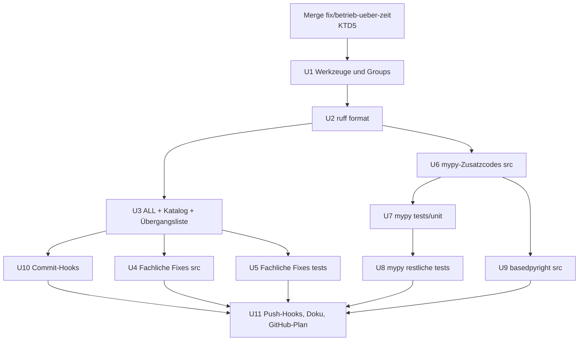
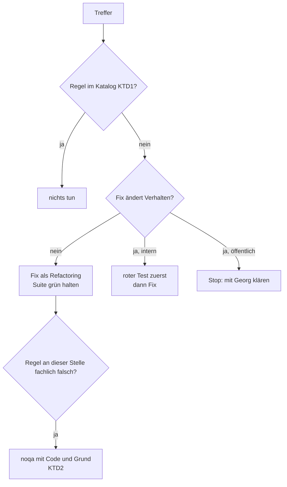

# Ausbau von ruff und mypy - Plan

## Goal Capsule

- **Objective:** Wer an swarmq arbeitet oder es als Bibliothek einsetzt, bekommt Code, den ein Formatter einheitlich hält, den ruff mit dem vollen Regelwerk prüft und den zwei unabhängige Typprüfer für korrekt halten. Verstöße fallen schon beim Commit auf, nicht erst in der CI oder beim Nutzer in Pylance.
- **Means:** ruff `ALL` mit begründetem Ausnahmekatalog (KTD1, KTD2), `ruff format` (KTD4), mypy strict mit Zusatzcodes auf `src/` und ganz `tests/` (KTD6, KTD7), basedpyright strict als zweiter Typprüfer auf `src/` (KTD8), prek-Hooks (KTD10) und die Dependency-Groups `lint` und `typing` (KTD9).
- **Authority:** `AGENTS.md` (TDD-Pflicht) vor diesem Plan, dieser Plan vor `docs/recherche-qualitaetssystem.md`. Bei Widerspruch zwischen einer Regel und dem Verhalten des Codes gewinnt das Verhalten: Eine Lint- oder Typregel, die nur durch eine Verhaltensänderung grün würde, wird nicht durch Umbau grün gemacht, sondern gemäß KTD2 behandelt.
- **Stop conditions:**
  - Ein Fix ändert beobachtbares Verhalten der öffentlichen API (KTD16 aus dem Plan 0.2.0) → anhalten, mit Georg klären.
  - Ein Typprüfer deckt einen echten Fehler auf → als Bugfix nach `AGENTS.md` behandeln (roter Test zuerst), nicht in einer Lint-Unit verstecken.
  - Die Unit-Suite oder die Integration/e2e-Suite wird rot und der Grund ist nicht der eigene Fix → anhalten.
- **Execution profile:** lokal, ein Branch pro Unit oder Unit-Gruppe, MRs nach dem bisherigen Muster. Kein Push ohne Freigabe.
- **Tail ownership:** Georg merged; der GitHub-Umzugsplan übernimmt die neuen Job-Befehle (U11).

---

## Product Contract

### Summary

Der Plan stellt ruff auf `select = ["ALL"]` mit einem Katalog begründeter Ausnahmen um, formatiert den Bestand einmalig mit `ruff format` und behebt die fachlich relevanten Treffer. mypy bekommt die zusätzlichen Fehlercodes und prüft künftig auch ganz `tests/`. basedpyright läuft als zweiter voller Typprüfer über `src/`. prek setzt Format und Lint lokal durch, und die Lint- und Typwerkzeuge wandern aus dem Extra `test` in eigene Dependency-Groups.

### Problem Frame

Die Bestandsaufnahme in `docs/recherche-qualitaetssystem.md` zeigt: Das Regelwerk umfasst neun Familien und zwei Einzelregeln. Ein Formatter fehlt, 325 von 482 Dateien wären betroffen. mypy prüft nur `src/`, `tests/support` und `tests/contracts`. Ein zweiter Typprüfer fehlt, obwohl viele Nutzer swarmq durch Pylance (pyright) sehen, und pyright meldet heute 69 Fehler in `src/`. Lokale Hooks gibt es nicht, Verstöße fallen erst in der CI auf. Die Spitzenprojekte des Ökosystems (structlog, attrs, Litestar, Pydantic) arbeiten mit `ALL` oder breiten Regelsätzen, Formatter und zwei Typprüfern.

### Key Decisions

- **ruff `ALL` mit begründeten Ausnahmen statt kuratierter Liste.** Neue Regeln greifen beim Upgrade automatisch. (session-settled: user-approved — chosen over eine erweiterte kuratierte Liste: weniger Pflege für Neuzugänge, Ausnahmen bleiben sichtbar begründet) Governs R1, R2.
- **Bestand beheben, Stilregeln abschalten, keine eingefrorene noqa-Baseline.** (session-settled: user-approved — chosen over eine gestufte noqa-Baseline wie bei Plan U2: kein Dauer-noqa, das nie abgebaut wird) Governs R3, R4.
- **Voller zweiter Typprüfer über `src/`.** (session-settled: user-directed — chosen over nur `pyright --verifytypes` und über keinen zweiten Prüfer: volle Abdeckung der Nutzersicht) Governs R8.
- **mypy auf ganz `tests/`, prek-Hooks und Dependency-Groups `lint`/`typing` gehören zu diesem Plan.** (session-settled: user-directed — aus vier Reichweiten-Optionen gewählt) Governs R7, R10, R11.

### Requirements

**Lint und Format**

- R1. ruff prüft `src/` und `tests/` mit `select = ["ALL"]`. Jede global oder per Datei abgeschaltete Regel trägt in `pyproject.toml` einen Begründungskommentar.
- R2. `ruff format --check` ist für das ganze Repo grün, und der Umformatierungs-Commit steht in `.git-blame-ignore-revs`.
- R3. Fachlich relevante Treffer sind behoben oder an der einzelnen Stelle mit Code und Grund begründet: in `src/` ASYNC, BLE, S, PERF, LOG/G, DTZ, PTH, ERA und ARG, in `tests/` ASYNC, PT und PLW1510. Am Ende gibt es keine temporäre Ausnahmeliste mehr.
- R4. Kein Lint- oder Typfix ändert öffentliches Verhalten (KTD16 aus `docs/plans/2026-08-26-001-refactor-restrukturierung-0-2-0-plan.md`). Fixes, die internes Verhalten ändern, laufen test-first.

**Typprüfung**

- R5. mypy läuft strict mit den Zusatzcodes aus KTD6 über `src/swarmq` und über ganz `tests/` (dort mit dem Override aus KTD7) ohne Fehler.
- R6. Jede Unterdrückung (`# type: ignore`, `# pyright: ignore`, `# noqa`) nennt einen Code.
- R7. `tests/` wird vollständig von mypy geprüft (Testkörper eingeschlossen).
- R8. basedpyright läuft im Modus strict über `src/swarmq` ohne Fehler und ohne Baseline-Datei.

**Durchsetzung und Werkzeuge**

- R9. Der CI-Job `lint-and-types` prüft Format, Lint, mypy und basedpyright blockierend.
- R10. prek prüft beim Commit Format und Lint der geänderten Dateien und vor dem Push beide Typprüfer, mit den Werkzeugversionen aus `uv.lock`.
- R11. ruff, mypy, basedpyright, prek und die Typ-Stubs stehen in den Dependency-Groups `lint` und `typing`, nicht mehr im Extra `test`.
- R12. `docs/testing/test-strategy.md`, `AGENTS.md` und der GitHub-Umzugsplan beschreiben die Befehle so, wie sie laufen.

### Success Criteria

- Ein frischer Klon mit `uv sync --extra test --extra reload` und `prek install` lehnt einen Commit mit unformatiertem Code oder einem Lint-Verstoß ab und einen Push mit Typfehler ebenso.
- basedpyright meldet für `src/swarmq` 0 Fehler (heute 586 im Modus strict, 69 im Standardmodus von pyright).
- mypy meldet für `src/swarmq tests` 0 Fehler (heute 856 auf `tests/` mit dem Override aus KTD7).
- Die Unit-, Integrations- und e2e-Suite liefern nach dem Plan dieselbe Testzahl wie davor, zuzüglich der neuen Tests aus Bugfixes.

### Scope Boundaries

- Keine Docstring-Regeln (`D`). Eine Docstring-Policy für die mkdocstrings-Doku ist ein eigenes Thema.
- Keine Änderung der Zeilenlänge (120 bleibt).
- basedpyright prüft nur `src/`, nicht `tests/` (KTD8).
- Kein Umbau öffentlicher Signaturen für Lint-Regeln, etwa `timeout`-Parameter (ASYNC109) oder boolesche Positionsargumente (FBT).

#### Deferred to Follow-Up Work

- Coverage, pytest-Strenge, Reihenfolge-Befunde, Laufzeit-Gate, Matrix, Sicherheits-Gates (Stufen A–D der Recherche, ohne ruff/mypy).
- Umstellung der übrigen Extras (`test`, `docs`) auf Dependency-Groups und RTD per `method: uv`.
- `pyright --verifytypes` als Messung der Typvollständigkeit; das braucht eine lösbare Installation des Pakets im Prüfer (die Probe am 2026-10-11 fand 0 Symbole).
- Docstring-Regeln (D) und D-Teile.

---

## Planning Contract

### Key Technical Decisions

- KTD1. **Ausnahmekatalog nach drei Klassen.** Jede Regel, die abgeschaltet wird, fällt in genau eine Klasse und trägt diese als Kommentar. Den Katalog legt U3 an; er ist die einzige Stelle für globale und dateiweise Ausnahmen. Ausnahmen an einer einzelnen Stelle begründet KTD2. (session-settled: user-approved — chosen over eine kuratierte Liste: siehe Key Decisions)
  - *Werkzeug-Konflikt:* `COM812`, `ISC001` (Formatter), `E501` (Formatter regelt Länge, Rest sind Strings), `CPY` (keine Lizenzköpfe), `ANN` (mypy strict deckt das ab), `D` (Scope Boundaries).
  - *Projektentscheidung oder API-Vertrag:* `ASYNC109` (öffentliche `timeout`-Parameter, KTD16), `FBT001/FBT002` (öffentliche Signaturen), `PLR0913/PLR0917` (dito), `PLC0415` (lazy Importe, erzwungen von `tests/unit/test_cli_import_laziness.py`), `PLC0414` (explizite Re-Exporte für `no_implicit_reexport`), `SLF001` (paketinterner Zugriff über Fassaden ist Architektur, siehe `tests/unit/test_architecture_guards.py`), `TC001–TC003` (msgspec und dishka werten Annotationen zur Laufzeit aus; Verschieben in `TYPE_CHECKING` bricht sie), `N818` (bestehend, KTD16), `RUF002/RUF003` (bestehend, deutsche Typografie), `SIM105` (bestehend).
  - *Stil ohne Nutzen für dieses Projekt:* `TRY003`, `EM101`, `EM102` (Fehlermeldungen direkt am raise sind gewollt), `TRY400` (Log-Ausgabe ist durch die Logging-Pläne festgelegt; `exception()` statt `error()` änderte sie), `S101` in `src/` (alle 52 `assert` sind Typ-Narrowing ohne Seiteneffekt; unter `python -O` fiele statt AssertionError ein AttributeError, beide nur bei schon gebrochener Invariante).
  - *Per Datei für `tests/**`:* `S` (Asserts, Subprozesse, Temp-Pfade sind Testmittel), `PLR2004`, `ARG` (Fixtures), `FBT`, `TRY`, `EM`, `BLE`, `T201`, dazu die bestehenden Einträge. structlog und attrs schalten für Tests dieselben Familien ab.
- KTD2. **Fachliche Regeln werden im Bestand behoben, nicht per Baseline eingefroren.** Eine Stelle, an der die Regel fachlich falsch liegt, bekommt `# noqa: <CODE>` mit einem Grund von wenigen Wörtern in derselben Zeile. Das ist eine Begründung, keine Baseline: Sie bleibt, weil die Stelle richtig ist. (session-settled: user-approved — chosen over eine gestufte noqa-Baseline: kein Dauer-noqa)
- KTD3. **Schrumpfende Übergangsliste statt Baseline zwischen den Units.** U3 schaltet `ALL` ein und trägt die noch nicht behobenen fachlichen Regeln in eine eigene, als temporär markierte Ignore-Liste ein. Jede folgende Unit beginnt damit, ihre Einträge zu streichen; dieser rote Lint-Lauf ist ihr Startsignal. Am Ende ist die Liste leer und wird entfernt. Das ist das Muster aus KTD14 des Plans 0.2.0 (`_LOC_EXCEPTIONS`), das der Repo bereits kennt.
- KTD4. **Umformatierung als eigener, reiner Commit, vor allen Lint-Fixes und nach dem Upgrade auf ruff 0.17.** ruff 0.17 rechnet Pragma-Kommentare nicht mehr in die Zeilenlänge; wer vorher formatiert, formatiert zweimal. Der Commit enthält ausschließlich die Ausgabe von `ruff format`, sein Hash geht in einem Folge-Commit in `.git-blame-ignore-revs`. Der MR wird ohne Squash gemerged, sonst stimmt der Hash nicht. Format-Optionen bleiben auf den Defaults (doppelte Anführungszeichen, Zeilenlänge 120 aus `[tool.ruff]`).
- KTD5. **Start erst nach dem Merge von `fix/betrieb-ueber-zeit`.** Dieser Branch (Worktree `swarmq-impl`) trägt 95 Commits über 324 Dateien und wird gerade bearbeitet. Eine repo-weite Umformatierung davor erzeugt Konflikte in fast jeder Datei. Die Trefferzahlen in diesem Plan stammen von `5be30e7`; U1 misst nach dem Merge neu.
- KTD6. **mypy-Zusatzcodes:** `ignore-without-code`, `truthy-bool`, `truthy-iterable`, `redundant-expr`, `redundant-self`, `possibly-undefined`, `unused-awaitable`, `deprecated`, `exhaustive-match`, `mutable-override`, `explicit-override`, dazu `warn_unreachable`. Das ist das Litestar-Set, erweitert um die vier, die für eine async-Bibliothek zählen. Gemessen auf `src/`: 30 × `explicit-override` (14 Dateien), 3 × `mutable-override`, je 1 × `possibly-undefined` und `unused-awaitable`, die übrigen Codes 0; `warn_unreachable` ist nicht gemessen. `explicit-override` heißt: `@override` aus `typing` wird an jeder überschreibenden Methode Pflicht. `local_partial_types` und `strict_bytes` sind seit mypy 2.0 Default und brauchen keinen Eintrag.
- KTD7. **mypy auf `tests/`: strict mit schmalem Override.** Ein Override-Block für `tests.*` erlaubt untypisierte Defs und Aufrufe (`disallow_untyped_defs`, `disallow_incomplete_defs`, `disallow_untyped_calls` aus), lässt aber `check_untyped_defs` an. So werden die Testkörper geprüft, ohne 3715 Testfunktionen mit `-> None` zu annotieren. Gemessen mit diesem Override: 856 Fehler in 152 Dateien (statt 5130). Litestar fährt strict auf Tests mit gezielten Overrides; structlog schaltet Tests ganz ab, was R7 widerspricht. Die Zusatzcodes aus KTD6 gelten auch für Tests. (session-settled: user-directed — mypy auf ganz `tests/` gewählt)
- KTD8. **basedpyright, Modus strict, nur `src/`, ohne Baseline.** basedpyright statt pyrefly: ausgereifte Konfiguration in `pyproject.toml`, eingebaute Regeln für Ignore-Kommentare und die höchste Spec-Konformität im Feld. Die Baseline von pyrefly ist noch experimentell, und es will mypy ausdrücklich nicht nachbilden. basedpyright statt pyright, weil nur basedpyright `reportIgnoreCommentWithoutRule` kennt und als PyPI-Paket ohne eigenes Node auskommt. Nur `src/`, weil strict auf `tests/` 22 371 Fehler meldet, fast alle aus Mocks; mypy deckt die Tests ab (KTD7). Konfiguration (session-settled: user-directed — voller zweiter Prüfer):
  - `typeCheckingMode = "strict"`; `reportPrivateUsage` aus (158 Treffer; gleiche Begründung wie `SLF001` in KTD1).
  - `enableTypeIgnoreComments = false`: Jeder Prüfer beachtet und prüft nur seine eigenen Kommentare. mypy prüft `# type: ignore[code]` über `warn_unused_ignores`, basedpyright prüft `# pyright: ignore[<rule>]` über `reportUnnecessaryTypeIgnoreComment` und `reportIgnoreCommentWithoutRule`, beide auf `error`. Geteilte Kommentare gehen nicht: basedpyright wertet die mypy-Codes in den Klammern nicht aus und meldete jeden nur für mypy nötigen Kommentar als überflüssig, während mypy ihn ohne Kommentar wieder anmahnt. Braucht eine Stelle beide Unterdrückungen, bekommt sie beide Kommentare, jeweils mit Code.
  - Die `reportUnknown*`-Meldungen (275) stammen fast ganz aus Bibliotheken ohne Typen (msgpack, croniter und andere). Sie werden an der Grenze gelöst (schmale lokale Stubs in einem Verzeichnis `typings/` oder typisierende Wrapper), nicht durch Abschalten der Regel. mypy liest dieselben Stubs über `mypy_path = "src:typings"`; die Overrides `croniter.*` und `msgpack.*` mit `ignore_missing_imports` entfallen, sobald Stubs für beide vorliegen.
  - Divergenzen zu mypy werden bevorzugt im Code gelöst (`isinstance`, ehrlichere Typen), nicht mit Kommentaren.
- KTD9. **Dependency-Groups `lint` und `typing`, das Extra `test` behält die Testwerkzeuge.** `lint`: ruff, prek. `typing`: mypy, basedpyright, `types-psutil` sowie alles, was die Typprüfer zum Auflösen brauchen. Weil die Prüfer das Projekt selbst und die Test-Abhängigkeiten importieren, installiert der Typ-Job die Gruppe `typing` zusätzlich zum Projekt mit den Extras `test` und `reload`, nicht mit `--only-group`. Ruff und mypy verlassen das Extra `test`. Abhängigkeitsgruppen werden nicht veröffentlicht, der Wegfall im Extra trifft also nur dieses Repo. `tests/unit/typing/test_contract_shapes.py` startet mypy als Subprozess (`python -m mypy`); jede Umgebung, die die Unit-Suite fährt, braucht deshalb die Gruppe `typing`. Dafür setzt `[tool.uv] default-groups` lokal `lint` und `typing`, und der CI-Job `unit-tests` installiert `typing` ausdrücklich mit. Mindestversionen: ruff ≥ 0.17, mypy ≥ 2.4, basedpyright ≥ 1.40, prek ≥ 0.5; die genaue Version steht in `uv.lock`. Nach der Änderung `uv lock` und Lock-Check, siehe `docs/solutions/tooling-decisions/uv-lock-drift-from-pyproject-optional-extras.md`.
- KTD10. **prek mit lokalen Hooks über `uv run --frozen`, nicht über `ruff-pre-commit`.** So kommt jede Werkzeugversion aus `uv.lock`, und es gibt keinen zweiten Satz `rev`-Pins, der driften kann. Die Typprüfer brauchen ohnehin die Projektumgebung. Stufen:
  - `pre-commit`: `ruff format --check` auf alle Python-Dateien des Commits, `ruff check` nur auf Dateien unter `src/` und `tests/` (passend zur CI; `benchmarks/`, `prototypes/` und `scripts/` haben gegen `ALL` heute 997 Treffer und gehören nicht zu diesem Plan).
  - `pre-push`: mypy und basedpyright über das ganze Projekt, aufgerufen mit `--extra test --extra reload --group typing` wie im Verification Contract. Ein schlichtes `uv sync` entfernt die Extras, und ohne pytest oder watchfiles scheiterten die Prüfer an Importen statt an Typfehlern. Die Konfigurationsdatei ist `.pre-commit-config.yaml`, damit auch pre-commit selbst sie lesen kann.
- KTD11. **Die CI ruft die Werkzeuge direkt auf, mit denselben Befehlen wie die Hooks.** Ein Job `lint-and-types` mit vier klar getrennten Schritten (Format, Lint, mypy, basedpyright) ist bei Fehlern leichter zu lesen als ein einziger prek-Aufruf. Die Befehle sind die gleichen wie in den Hooks.

### High-Level Technical Design

Reihenfolge und Abhängigkeiten der Units:

Behandlung eines einzelnen Treffers, für alle Lint- und Typ-Units:

### Assumptions

- Nach dem Merge von `fix/betrieb-ueber-zeit` liegen die Trefferzahlen in derselben Größenordnung. U1 misst neu, die Units passen ihren Umfang an.
- Die 69 Fehler von pyright im Standardmodus sind überwiegend Divergenzen der Prüfer (etwa `reportInvalidTypeForm` 16, `reportOptionalCall` 17, `reportReturnType` 23), keine Laufzeitfehler. Wo sich das als falsch erweist, greift die Stop-Bedingung für Bugs.

### Risks

| Risiko | Gegenmaßnahme |
|---|---|
| Umformatierung kollidiert mit offenen Branches | KTD5; danach offene Branches per Rebase mit `ruff format` je Commit nachziehen, Tests nach dem Rebase laufen lassen |
| Autofix ändert Verhalten (unsichere Fixes) | nur sichere Autofixes pauschal; `--unsafe-fixes` nie pauschal, nur je Regel nach Durchsicht; volle Suite nach jedem Fix-Commit |
| `@override` oder Typänderungen ändern Laufzeit | `typing.override` setzt nur ein Attribut; Typänderungen sind reine Annotationen. Suite nach jeder Datei-Gruppe |
| mypy-Konfiguration verändert die Negativ-Fixtures in `tests/unit/typing/test_contract_shapes.py` | U6 prüft diese Tests ausdrücklich; die Fixtures sollen weiterhin genau ihren Fehler melden |
| Override `tests.*` kollidiert mit dem Override-Guard (`tests/unit/_architecture.py`, `mypy_override_modules`) | Der Guard bemängelt nur Overrides für nicht existierende Module; `tests` ist ein Paket. U7 prüft das |
| basedpyright und mypy widersprechen sich an einer Stelle unauflösbar | Code-Lösung bevorzugt; sonst je Prüfer ein eigener Kommentar mit Code (KTD8), gezählt im MR |
| Das Umschreiben der Historie beim GitHub-Umzug ändert den Hash des Format-Commits | U11 trägt in den Umzugsplan ein, den Eintrag in `.git-blame-ignore-revs` über die `commit-map` von filter-repo nachzuziehen |

---

## Implementation Units

### U1. Werkzeuge, Versionen und Dependency-Groups

- **Goal:** Die Lint- und Typwerkzeuge stehen in eigenen Gruppen mit den Zielversionen, die CI installiert sie dort, und der Ist-Stand ist nach dem Merge von `fix/betrieb-ueber-zeit` neu gemessen.
- **Requirements:** R11, R9 (Teil)
- **Dependencies:** Merge von `fix/betrieb-ueber-zeit` (KTD5)
- **Files:** `pyproject.toml`, `uv.lock`, `.gitlab-ci.yml`, `docs/testing/test-strategy.md`
- **Approach:**
  1. `[dependency-groups]` mit `lint` und `typing` anlegen (KTD9); ruff und mypy aus dem Extra `test` entfernen, `types-psutil` nach `typing`; `[tool.uv] default-groups` auf `lint` und `typing`.
  2. ruff auf 0.17 und mypy auf 2.4 heben, Lock neu erzeugen, Lock-Check lokal.
  3. Job `lint-and-types` auf die Gruppen umstellen, Befehle zunächst unverändert; Job `unit-tests` installiert zusätzlich `typing`, weil `tests/unit/typing/test_contract_shapes.py` mypy startet.
  4. Neu messen: ruff gegen `ALL` je Regel, mypy mit Zusatzcodes, mypy auf `tests/` mit KTD7-Override, basedpyright strict auf `src/`. Zahlen im MR festhalten.
  5. Neue Lint-Treffer, die allein durch ruff 0.17 oder mypy 2.4 entstehen, in diesem MR beheben (die drei neu stabilen Regeln greifen erst mit `ALL` in U3).
- **Patterns to follow:** `build:`-Commits für Toolchain-Updates (`e331234`); Lock-Disziplin aus `docs/solutions/tooling-decisions/uv-lock-drift-from-pyproject-optional-extras.md`.
- **Execution note:** Vor allem Konfiguration und Verpackung; Nachweis über eine saubere Installation und grüne Läufe, nicht über neue Tests.
- **Test expectation:** none -- reine Abhängigkeits- und CI-Konfiguration; die bestehende Suite muss unverändert grün sein.
- **Verification:** `uv lock --check` ohne `UV_FROZEN` grün; Lint-Job, Unit-, Integrations- und e2e-Suite grün mit gleicher Testzahl wie vorher; die mypy-Fixtures in `tests/unit/typing/test_contract_shapes.py` laufen im CI-Job `unit-tests` und finden mypy.

### U2. Einmalige Umformatierung mit ruff format

- **Goal:** Der ganze Bestand ist mit `ruff format` formatiert, `git blame` überspringt diesen Commit, und Format-Abweichungen fallen in der CI auf.
- **Requirements:** R2, R9 (Teil)
- **Dependencies:** U1
- **Files:** `pyproject.toml` (`[tool.ruff.format]`, falls Abweichungen von den Defaults nötig sind), alle Python-Dateien, `.git-blame-ignore-revs` (neu), `.gitlab-ci.yml`
- **Approach:**
  1. Commit A: nur die Ausgabe von `ruff format` über das Repo, ohne Handänderung (KTD4).
  2. Danach `ruff check` mit dem bisherigen Regelsatz; falls die Formatierung Treffer erzeugt (etwa E501 an umgebrochenen Stellen), in einem eigenen Commit B beheben.
  3. Commit C: Hash von A in `.git-blame-ignore-revs` mit Kommentar.
  4. CI-Schritt `ruff format --check` im Job `lint-and-types`.
  5. Hinweis zur lokalen Blame-Einstellung in `docs/testing/test-strategy.md` (Abschnitt zu Lint).
- **Test expectation:** none -- reines Refactoring ohne Verhaltensänderung; die volle Suite ist der Nachweis.
- **Verification:** `ruff format --check` grün; Unit-, Integrations- und e2e-Suite grün mit gleicher Testzahl; `git blame` auf einer umformatierten Datei zeigt mit gesetztem `blame.ignoreRevsFile` den Vor-Format-Autor. MR ohne Squash.

### U3. ruff ALL mit Ausnahmekatalog und Übergangsliste

- **Goal:** ruff prüft mit `ALL`, alle Ausnahmen stehen begründet im Katalog, die sicheren Autofixes sind angewandt, und die noch offenen fachlichen Regeln stehen in einer temporären Liste.
- **Requirements:** R1, R3 (Teil), R6
- **Dependencies:** U2
- **Files:** `pyproject.toml`
- **Approach:**
  1. `select = ["ALL"]`; den Katalog aus KTD1 als `ignore` und `per-file-ignores` mit Klassen-Kommentaren anlegen. Bestehende Einträge (N818, SIM105, RUF002, RUF003, die Test-Ausnahmen) übernehmen und einordnen.
  2. Pro Regel mit nur sicheren Autofixes (etwa `C408`, `PT001`, `PT023`, `TC006`, `Q003`, `PLC0207`) den Fix in einem eigenen Commit anwenden; Suite grün.
  3. Alle übrigen Treffer in eine Liste `# TEMPORÄR — U4/U5 streichen` eintragen, jede Regel mit Verweis auf die Unit, die sie abbaut (KTD3).
  4. Kein Preview-Modus; einzelne Preview-Regeln gehören nicht in diesen Plan.
- **Patterns to follow:** Kommentarstil der bestehenden Ignore-Einträge in `pyproject.toml` (Begründung plus KTD-Verweis).
- **Test expectation:** none -- Konfiguration und sichere Autofixes ohne Verhaltensänderung; die volle Suite ist der Nachweis.
- **Verification:** `ruff check src tests` grün; jede Zeile im Katalog hat einen Kommentar; die Übergangsliste nennt für jede Regel eine Unit; Suite grün.

### U4. Fachliche Lint-Fixes in src

- **Goal:** Die fachlichen Regeln aus der Übergangsliste sind in `src/` behoben oder an der Stelle begründet, und ihre Einträge sind gestrichen.
- **Requirements:** R3, R4, R6
- **Dependencies:** U3
- **Files:** `pyproject.toml` (Übergangsliste), betroffene Module unter `src/swarmq/` (Schwerpunkte laut Messung: `worker/retry.py`, `scheduler/loop.py`, `backend/valkey/results.py`, `worker/lifecycle.py`, `_http.py`, `broker/rabbitmq/connection.py`, `logging_file.py`), Tests zu jedem Fix mit Verhaltensänderung unter `tests/unit/` nach `AGENTS.md`-Dateistruktur
- **Approach:** Regelgruppe für Regelgruppe; jede Gruppe beginnt mit dem Streichen ihres Eintrags (KTD3):
  1. `BLE001` (104) und `S110` (18): Teardown- und Best-Effort-Pfade behalten das breite `except` mit `# noqa: BLE001` und kurzem Grund (KTD2). Kein Verengen von Exceptions in Teardown-Pfaden; dort soll eine unerwartete Exception gerade nicht durchschlagen (vgl. `docs/solutions/patterns/worker-cancel-safe-teardown-detached-tasks-2026-06-01.md`). Stellen, die nur loggen, behalten ihre Log-Form und bekommen ebenfalls die Begründung; kein Umstieg auf `exception()`, weil das die Log-Ausgabe änderte (TRY400 ist im Katalog).
  2. Sicherheitsregeln: `S603`, `S606`, `S301`, `S311` an der Stelle begründen (Subprozess mit festen Argumenten, Pickle nur intern, Jitter ist kein Krypto).
  3. Kleine Familien beheben: `DTZ` (falls nach U1 Treffer), `PTH` (4), `PERF401`, `FURB` (5), `G201`, `ERA001` (4), `PYI034/PYI036`, `PLW2901`, `PLW0108`, `PLW0406`, `PLR2004` in `src/` (11, als benannte Konstanten), `ARG` in `src/` (10), `RET`, `ISC004`, `TRY300/TRY301`.
  4. `PLW0603` (18 × `global`): an Modul-Singletons begründen oder entfernen, wenn ein Zustandsobjekt schon existiert.
  5. `T201` (2): per-file-ignore für die CLI-Module, die bewusst auf stdout schreiben.
  6. Verbliebene `ASYNC`-Treffer außer `ASYNC109` beheben.
- **Execution note:** Jeder Fix, der internes Verhalten ändert (andere Exception, andere Reihenfolge, entfernter Zweig), beginnt mit einem fehlschlagenden Test. Reine Umbenennungen und Konstanten sind Refactoring.
- **Patterns to follow:** bestehende kommentierte Best-Effort-Stellen wie `logging_format.py` (`# eine Property der App darf hier nicht werfen`) und `scheduler/loop.py` (`# Der Worker arbeitet weiter; ...`).
- **Test scenarios:**
  - Für jede Stelle, an der ein `except Exception` verengt wird (nur außerhalb von Teardown): eine Exception außerhalb der neuen Klasse schlägt jetzt durch, eine innerhalb wird weiterhin abgefangen und geloggt.
  - Für eine aufgelöste `global`-Stelle: zwei Aufrufe in einem Test teilen weiterhin denselben Zustand, und die Test-Isolation per Fixture setzt ihn zurück.
  - Für ersetzte magische Zahlen: kein neuer Test; die bestehenden Tests der Funktion decken den Wert ab. Wo kein Test den Wert festhält, einen Charakterisierungstest ergänzen, bevor der Wert in eine Konstante wandert.
- **Verification:** Übergangseinträge für `src/` gestrichen; `ruff check src` grün; jede neue `noqa` nennt Code und Grund; Suite grün.

### U5. Fachliche Lint-Fixes in tests

- **Goal:** Die fachlichen Regeln aus der Übergangsliste sind in `tests/` behoben, und die Liste ist danach leer und entfernt.
- **Requirements:** R3, R1
- **Dependencies:** U3
- **Files:** `pyproject.toml`, betroffene Dateien unter `tests/`
- **Approach:**
  1. `ASYNC110` (7, Warteschleifen mit `sleep`): auf Events oder Conditions umstellen, wie `AGENTS.md` es für async Tests verlangt. Das ist echter Gewinn, kein Stil.
  2. `PT018` (309, zusammengesetzte Asserts) in Einzel-Asserts aufteilen, sofern der Autofix sicher ist; sonst je Datei von Hand.
  3. `PT019` (186, Fixture-Parameter ohne Wert) auf `@pytest.mark.usefixtures` umstellen.
  4. `PT011` (9, zu breites `pytest.raises`) mit `match=` schärfen.
  5. `PLW1510` (21, `subprocess.run` ohne `check`): `check` ausdrücklich setzen.
  6. Verbliebene kleine Treffer (`PERF401`, `ERA001`, `TC*` falls nicht im Katalog) beheben.
  7. Übergangsliste entfernen.
- **Execution note:** Test-Refactoring: jede geänderte Testdatei muss vor und nach der Änderung grün sein, und die Testzahl darf nicht sinken. Bei `ASYNC110` prüfen, dass der Test ohne Fix wirklich auf das Ereignis wartet (bricht er bei absichtlich verzögertem Ereignis weiterhin richtig?).
- **Test scenarios:**
  - Für jede umgestellte Warteschleife: Der Test besteht wie vorher, und mit absichtlich ausbleibendem Ereignis schlägt er über das Timeout fehl, statt still zu bestehen.
  - Für jedes aufgeteilte Assert: Bei bewusst falschem Wert nennt die Fehlermeldung jetzt die verletzte Teilbedingung.
- **Verification:** Übergangsliste entfernt; `ruff check src tests` grün; Testzahl unverändert; Laufzeit der Unit-Suite nicht messbar schlechter.

### U6. mypy-Zusatzcodes auf src

- **Goal:** mypy prüft `src/` mit den Zusatzcodes aus KTD6 ohne Fehler.
- **Requirements:** R5 (Teil), R6
- **Dependencies:** U2 (die `@override`-Änderungen berühren 14 Dateien; vor dem Format-Commit kollidierten sie mit ihm)
- **Files:** `pyproject.toml` (`[tool.mypy]`), die 14 Dateien mit `explicit-override` (bei U1 neu gemessen), die Datei mit `mutable-override`, die Fundstellen von `possibly-undefined` und `unused-awaitable`; Tests unter `tests/unit/` für jeden echten Fund; `tests/unit/typing/test_contract_shapes.py` (prüfen)
- **Approach:**
  1. `enable_error_code` und `warn_unreachable` setzen.
  2. `@override` an den 30 überschreibenden Methoden ergänzen.
  3. `mutable-override` (3): Attributtyp der Unterklasse auf den Basistyp angleichen oder das Attribut schreibgeschützt deklarieren.
  4. `unused-awaitable` und `possibly-undefined` (je 1): als möglichen Bug untersuchen. Ein nicht abgewartetes Awaitable in async-Code ist meist ein echter Fehler.
  5. `warn_unreachable` ist nicht gemessen; die Funde in U6 einzeln bewerten, denn unerreichbarer Code deutet oft auf eine falsche Typannahme hin.
  6. Negativ-Fixtures in `tests/unit/typing/test_contract_shapes.py` prüfen: Sie müssen weiterhin genau ihren erwarteten Fehler melden.
- **Execution note:** Ein echter Fund bei `unused-awaitable`, `possibly-undefined` oder `warn_unreachable` ist ein Bugfix nach `AGENTS.md`: roter Test, dann Fix, in eigenem Commit.
- **Test scenarios:**
  - Falls das nicht abgewartete Awaitable ein Bug ist: Ein Test belegt, dass die Operation vor dem Abschluss des Aufrufers tatsächlich ausgeführt wird (heute rot).
  - Falls die möglicherweise undefinierte Variable auf einem echten Pfad ungebunden bleibt: Ein Test führt genau diesen Pfad aus und erwartet das korrekte Ergebnis statt `UnboundLocalError`.
  - Die Negativ-Fixtures in `test_contract_shapes.py` bleiben rot für ihren Grund und werden nicht durch neue Codes zusätzlich rot.
- **Verification:** `mypy src/swarmq tests/support tests/contracts` grün mit Zusatzcodes; Suite grün.

### U7. mypy auf tests/unit

- **Goal:** mypy prüft `tests/unit` nach KTD7 ohne Fehler.
- **Requirements:** R5, R7, R6
- **Dependencies:** U6
- **Files:** `pyproject.toml` (Override `tests.*`), `.gitlab-ci.yml` (mypy-Pfade), Dateien unter `tests/unit/`, ggf. `tests/unit/conftest.py` und gemeinsame Fakes unter `tests/support/`
- **Approach:**
  1. Override-Block `tests.*` nach KTD7 anlegen; Verhalten des Override-Guards in `tests/unit/test_architecture_guards.py` prüfen.
  2. Fehler nach Kategorie abbauen, die häufigsten zuerst: `arg-type`, `attr-defined` und `method-assign` (meist Mocks an Methoden: auf `patch.object` oder typisierte Fakes aus `tests/support/` umstellen), `union-attr`, `type-arg`, die 21 `unused-ignore`.
  3. Wiederkehrende Mock-Muster in typisierte Helfer unter `tests/support/` ziehen, statt jede Stelle einzeln zu unterdrücken.
  4. CI-Pfad für mypy um `tests/unit` erweitern.
- **Execution note:** Reines Test-Refactoring. Wo ein Typfehler in einem Test zeigt, dass der Test etwas anderes prüft als behauptet (falsche Attribute am Mock, nie aufgerufene Methode), wird der Test korrigiert und muss danach den beabsichtigten Fehlerfall weiterhin erkennen.
- **Test scenarios:**
  - Für jeden Test, der wegen eines falsch benannten Mock-Attributs korrigiert wird: Der Test schlägt fehl, wenn das geprüfte Verhalten im Produktionscode absichtlich gebrochen wird (vorher bestand er womöglich immer).
- **Verification:** `mypy src/swarmq tests/unit tests/support tests/contracts` grün; Testzahl unverändert; Suite grün.

### U8. mypy auf die übrigen Testverzeichnisse

- **Goal:** mypy prüft ganz `tests/` ohne Fehler, und der CI-Aufruf ist auf `tests` vereinfacht.
- **Requirements:** R5, R7
- **Dependencies:** U7
- **Files:** Dateien unter `tests/integration/`, `tests/e2e/`, `tests/chaos/`, `tests/fuzz/`, `tests/property/`, `tests/stress/`, `tests/soak/`, `tests/conftest.py`; `.gitlab-ci.yml`
- **Approach:**
  1. Verzeichnisweise abbauen, Muster aus U7 wiederverwenden.
  2. Chaos-, Stress- und Soak-Tests laufen nicht in der Pipeline; ihre Typfehler werden trotzdem behoben, weil sie statisch geprüft werden können, ohne den Stack zu starten.
  3. CI-Aufruf auf `mypy src/swarmq tests` umstellen.
- **Execution note:** wie U7. Für Chaos-Tests gilt das örtliche Gate aus `docs/testing/test-strategy.md`; geänderte Chaos-Dateien werden örtlich gegen den Chaos-Stack gefahren, bevor der MR abgeschlossen wird.
- **Test scenarios:**
  - Wie U7, für jeden korrigierten Integrations- oder e2e-Test.
- **Verification:** `mypy src/swarmq tests` grün; Integrations- und e2e-Suite grün mit gleicher Testzahl; örtlicher Chaos-Lauf mit dem erwarteten Ergebnis aus `docs/testing/test-strategy.md`, falls Chaos-Dateien geändert wurden.

### U9. basedpyright als zweiter Typprüfer auf src

- **Goal:** basedpyright strict meldet für `src/swarmq` keinen Fehler und läuft in der CI blockierend.
- **Requirements:** R8, R6, R9
- **Dependencies:** U6
- **Files:** `pyproject.toml` (`[tool.basedpyright]`), `typings/` (neu, lokale Stubs für untypisierte Bibliotheken, falls nötig), betroffene Module unter `src/swarmq/`, `.gitlab-ci.yml`, Tests unter `tests/unit/` für echte Funde
- **Approach:**
  1. Konfiguration nach KTD8 anlegen, mit Python-Version und Pfaden.
  2. Divergenzen zuerst abbauen, weil sie die meisten echten Funde enthalten: `reportReturnType`, `reportOptionalCall`, `reportInvalidTypeForm`, `reportPossiblyUnbound`, `reportIncompatibleVariableOverride`, `reportDeprecated`.
  3. `reportUnknown*` an der Grenze lösen: Stubs für die tatsächlich genutzte Oberfläche von msgpack und croniter, typisierte Rückgaben an den Stellen, an denen aio-pika oder valkey `Unknown` liefern. mypy liest die Stubs mit (KTD8); dadurch überflüssig gewordene `# type: ignore` meldet mypy selbst und werden entfernt.
  4. `reportUnusedFunction`, `reportUnusedImport` und `reportConstantRedefinition` beheben; ausgenommen sind Re-Exporte und Hook-Funktionen, die per Name gefunden werden, wo eine Stelle mit Code begründet wird.
  5. CI-Schritt basedpyright im Job `lint-and-types`.
- **Execution note:** Jeder Fund, der ein Laufzeitproblem zeigt (Aufruf von `None`, falscher Rückgabetyp, ungebundene Variable auf echtem Pfad), ist ein Bugfix: roter Test zuerst, eigener Commit.
- **Test scenarios:**
  - Für jeden `reportOptionalCall`-Fund, der ein echter Pfad ist: Ein Test ruft die Funktion in dem Zustand auf, in dem das Callable `None` ist, und erwartet das dokumentierte Verhalten statt `TypeError`.
  - Für jeden `reportReturnType`-Fund mit falschem Laufzeitwert: Ein Test prüft Typ und Wert der Rückgabe.
  - Für lokale Stubs: kein Laufzeittest; mypy und basedpyright müssen beide mit den Stubs grün sein, und mypy darf nicht zusätzlich rot werden.
- **Verification:** basedpyright auf `src/swarmq` 0 Fehler, keine Baseline-Datei; mypy weiterhin grün; Suite grün.

### U10. prek-Hooks für Format und Lint

- **Goal:** Ein Commit mit unformatiertem Code oder Lint-Verstoß wird lokal abgelehnt, mit den Versionen aus `uv.lock`.
- **Requirements:** R10 (Teil)
- **Dependencies:** U3
- **Files:** `.pre-commit-config.yaml` (neu), `pyproject.toml` (prek in Gruppe `lint`), `AGENTS.md`, `docs/testing/test-strategy.md`
- **Approach:**
  1. Lokale Hooks der Stufe `pre-commit` nach KTD10, inklusive des Pfadfilters für `ruff check`.
  2. Die Hooks für mypy und basedpyright schon anlegen, aber in der Stufe `manual`; scharf schaltet sie U11, sobald U8 und U9 grün sind.
  3. Einrichtung (`uv sync --extra test --extra reload`, `prek install` mit den Stufen `pre-commit` und `pre-push`) in `AGENTS.md` und `docs/testing/test-strategy.md` dokumentieren.
  4. Eine Zeile in `AGENTS.md` unter den Qualitäts-Gates: Format, Lint und Typen müssen grün sein, bevor committed wird. Das ergänzt das bestehende Commit-Gate.
- **Execution note:** Konfiguration; Nachweis per Smoke-Probe, nicht per Unit-Test.
- **Test expectation:** none -- Hook-Konfiguration ohne Produktionscode; Nachweis über die Probe unter Verification.
- **Verification:** In einem Wegwerf-Commit lehnt der Hook eine absichtlich falsch formatierte Datei ab und einen Lint-Verstoß unter `src/` ebenso; eine Änderung unter `scripts/` passiert den Lint-Hook; `prek run --all-files` ist auf dem sauberen Stand grün.

### U11. Push-Hooks scharf, Doku und GitHub-Plan

- **Goal:** Ein Push mit Typfehler wird lokal abgelehnt, und Doku sowie GitHub-Umzugsplan beschreiben die neuen Gates so, wie sie laufen.
- **Requirements:** R10, R12, R9
- **Dependencies:** U4, U5, U8, U9, U10
- **Files:** `.pre-commit-config.yaml`, `docs/testing/test-strategy.md`, `docs/plans/2026-10-10-1156-chore-umzug-github-plan.md`, `README.md` (Abschnitt für Mitwirkende, falls vorhanden), `docs/recherche-qualitaetssystem.md`
- **Approach:**
  1. Die Hooks für mypy und basedpyright von `manual` auf `pre-push` umstellen (KTD10).
  2. Job-Tabelle in `docs/testing/test-strategy.md` auf die vier Schritte von `lint-and-types` umschreiben (KTD11).
  3. Im GitHub-Umzugsplan U2 und den Verifikationsbefehl für Lint und Typen auf die neuen Befehle und die Gruppen `lint`/`typing` anpassen; der Vergleich der Testzahlen (R10 jenes Plans) bleibt unberührt.
  4. Im GitHub-Umzugsplan, Unit zum Umschreiben der Historie, einen Schritt ergänzen: Nach `git filter-repo` den Hash in `.git-blame-ignore-revs` über `.git/filter-repo/commit-map` auf den neuen Hash umschreiben und als eigenen Commit festhalten. Dazu die Verifikation, dass `git blame` auf einer umformatierten Datei den Autor vor der Umformatierung zeigt.
  5. In der Recherche die Lint- und Typ-Lücken als erledigt markieren.
- **Test expectation:** none -- Hook-Konfiguration und Doku ohne Produktionscode.
- **Verification:** Ein Push mit absichtlichem Typfehler wird abgelehnt, und auf einem frischen Klon nach `uv sync --extra test --extra reload` scheitert die Push-Probe nur an diesem Typfehler, nicht an Importen; jeder in der Doku genannte Befehl läuft auf dem Endstand grün.

---

## Verification Contract

| Gate | Befehl | Units |
|---|---|---|
| Lock | `uv lock --check` (ohne `UV_FROZEN`) | U1, U10 |
| Format | `uv run --group lint ruff format --check .` | U2 ff. |
| Lint | `uv run --group lint ruff check src tests` | U3 ff. |
| mypy | `uv run --extra test --extra reload --group typing mypy src/swarmq tests` (bis U8: die jeweils aufgenommenen Pfade) | U6–U8 |
| basedpyright | `uv run --extra test --extra reload --group typing basedpyright src/swarmq` | U9 |
| Unit-Suite | `uv run --extra test --extra reload --group typing pytest tests/unit -q` (lokal kommt `typing` auch über die Default-Groups) | jede Unit |
| Integration und e2e | `SWARMQ_TEST_RABBITMQ_PORT=5699 SWARMQ_TEST_VALKEY_PORT=6399 uv run --extra test --extra reload pytest tests -q`, Testzahl gegen den Stand vor dem Plan | jede Unit mit Codeänderung |
| Chaos (örtlich) | Befehl aus `docs/testing/test-strategy.md`, Abschnitt „Chaos und Fuzz“ | U5, U8, falls Chaos-Dateien geändert |
| Hooks | `prek run --all-files` (U10), dazu `prek run --all-files --hook-stage pre-push` (U11) | U10, U11 |

Integration und e2e nur mit den Ports 5699/6399 (Schutz des fremden Valkey auf 6379, siehe `docs/testing/test-strategy.md`). Ein Commit setzt ein ausdrücklich geprüftes grünes Ergebnis voraus, nicht nur eine Pipe auf `tail`.

---

## Definition of Done

- `select = ["ALL"]` ist aktiv, jede Ausnahme ist begründet, die Übergangsliste ist entfernt.
- `ruff format --check`, `ruff check`, mypy auf `src/swarmq tests` und basedpyright auf `src/swarmq` sind grün, lokal und im CI-Job `lint-and-types`.
- `.git-blame-ignore-revs` enthält den Format-Commit; der MR wurde ohne Squash gemerged.
- prek ist eingerichtet und dokumentiert; die Proben aus U10 (Commit) und U11 (Push) sind bestanden.
- Der GitHub-Umzugsplan enthält den Schritt, der `.git-blame-ignore-revs` nach dem Umschreiben der Historie nachzieht.
- ruff, mypy, basedpyright, prek und die Stubs stehen in den Gruppen `lint`/`typing`; `uv lock --check` ist grün.
- Jeder echte Fund der Typprüfer ist als Bugfix mit Test gelandet und im MR benannt.
- Unit-, Integrations- und e2e-Suite sind grün, mit der Testzahl von vorher plus den neuen Bugfix-Tests.
- Doku und GitHub-Umzugsplan sind angepasst (U11).
- Kein liegengebliebener Versuchs-Code, keine auskommentierten Reste, keine `noqa` oder `type: ignore` ohne Code.

---

## Sources and Research

- Ist-Stand und Recherche: `docs/recherche-qualitaetssystem.md`.
- Messungen am 2026-10-11 auf `5be30e7`: ruff `ALL` je Regel für `src/` und `tests/`; mypy-Zusatzcodes einzeln; `mypy tests` strict 5130 Fehler, mit KTD7-Override 856; basedpyright 1.40.2 strict auf `src/` 586 Fehler (161 `reportUnknownMemberType`, 158 `reportPrivateUsage`), auf `tests/` 22 371; pyright 1.1.414 Standardmodus auf `src/` 69 Fehler; pyrefly 1.3.2 auf `src/` 47 Fehler.
- Präzedenzfälle im Repo: Plan U2 und U12 in `docs/plans/2026-08-26-001-refactor-restrukturierung-0-2-0-plan.md` (Lint-Gate, mypy-strict-Sweep nach Import-Tiefe, schrumpfende Ausnahmelisten nach KTD14).
- ruff-Konfigurationen mit `ALL`: [structlog](https://raw.githubusercontent.com/hynek/structlog/main/pyproject.toml), [attrs](https://raw.githubusercontent.com/python-attrs/attrs/main/pyproject.toml); Liste von Litestar: [pyproject](https://raw.githubusercontent.com/litestar-org/litestar/main/pyproject.toml).
- ruff 0.17.0 Release Notes (2026-10-09): [Releases](https://github.com/astral-sh/ruff/releases); Konflikte mit dem Formatter: [Doku](https://docs.astral.sh/ruff/formatter/#conflicting-lint-rules).
- mypy 2.4.0 (2026-10-01), optionale Fehlercodes: [error_code_list2](https://mypy.readthedocs.io/en/stable/error_code_list2.html).
- basedpyright 1.40.2: [Konfiguration](https://docs.basedpyright.com/latest/configuration/config-files/); pyrefly-Baseline experimentell: [Doku](https://pyrefly.org/en/docs/error-suppressions/).
- prek 0.5.5: [PyPI](https://pypi.org/project/prek/); Drift zwischen Hook-Pins und Lockfile: [pydevtools](https://pydevtools.com/blog/sync-with-uv-eliminate-pre-commit-version-drift/).
- `.git-blame-ignore-revs` auf GitHub: [Docs](https://docs.github.com/en/repositories/working-with-files/using-files/viewing-and-understanding-files); auf GitLab ab 17.11: [Docs](https://docs.gitlab.com/ee/user/project/repository/git_blame.html).
