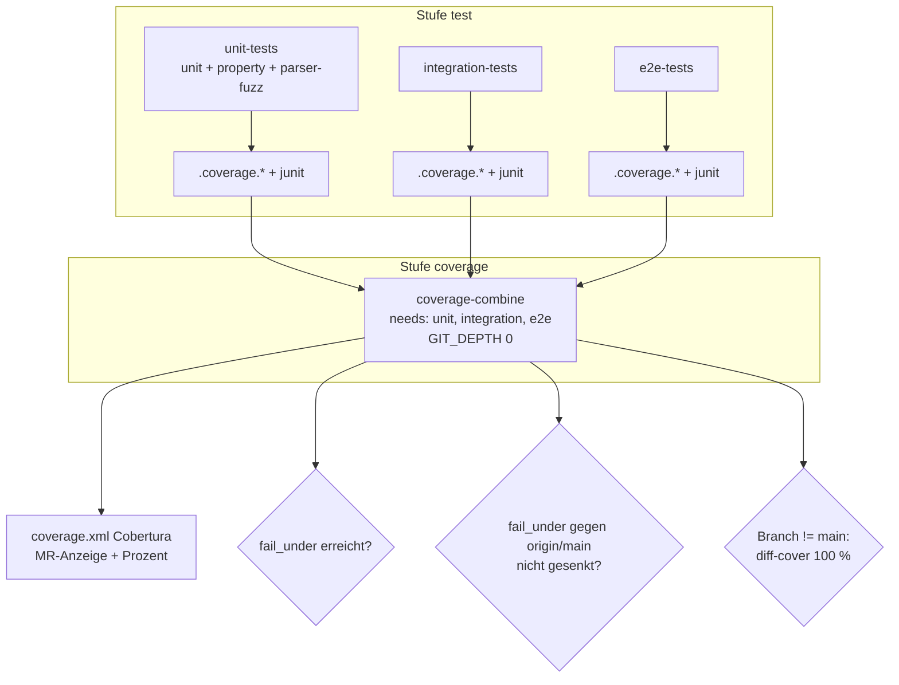
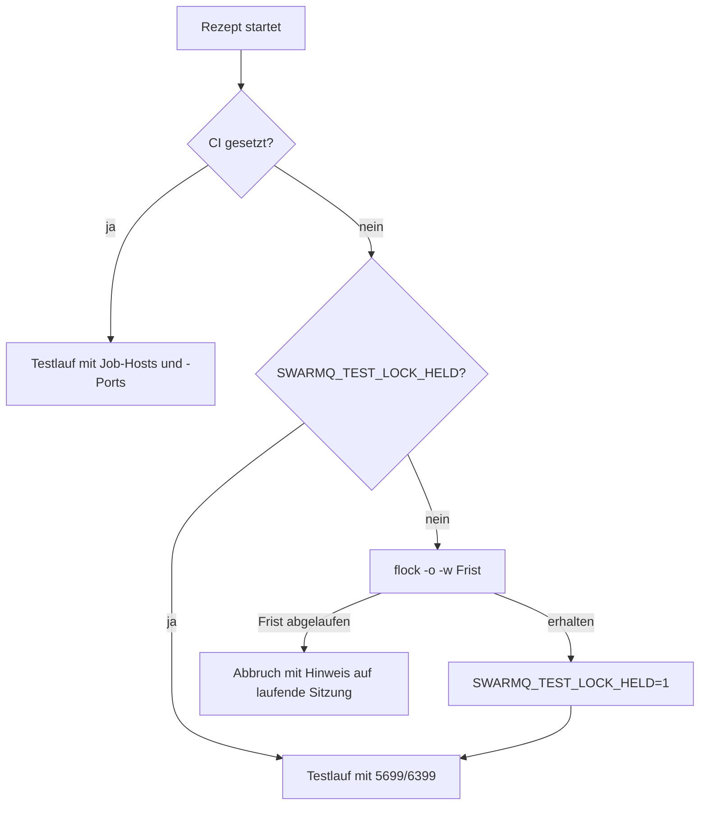

# Teststrenge, Coverage-Gate und just - Plan

## Goal Capsule

- **Objective:** Wer an swarmq arbeitet, kann sich auf ein grünes Testergebnis verlassen: Tests sind nachweislich unabhängig von ihrer Reihenfolge, Warnungen bleiben nicht unbemerkt, ungetesteter neuer Code fällt vor dem Merge auf, und jeder startet die Suiten lokal und in der CI auf dieselbe Weise, ohne fremde Dienste auf dem Rechner zu treffen.
- **Means:** pytest `strict` und `filterwarnings = error` (KTD1, KTD2), pytest-randomly in jedem Lauf (KTD3), Coverage über alle Prozessmodelle mit Ratchet und Diff-Coverage (KTD5–KTD8), ein `justfile` mit festen Testports und Sperre (KTD9, KTD10).
- **Authority:** `AGENTS.md` (TDD-Pflicht, Verbot 9) vor diesem Plan, dieser Plan vor `docs/recherche-qualitaetssystem.md`. Ein Gate, das nur durch Abschwächen eines Tests grün würde, wird nicht so grün gemacht.
- **Stop conditions:**
  - Ein Test lässt sich nur durch kürzere Wartezeiten, gelockerte Schranken oder Rerun stabilisieren → anhalten, mit Georg klären.
  - Coverage-Messung ändert beobachtbares Verhalten (Signale, Shutdown) und das lässt sich nicht durch Konfiguration vermeiden → anhalten.
  - Integration oder e2e werden rot und der Grund ist nicht die eigene Änderung → anhalten.
- **Execution profile:** lokal auf einem Branch, Integration und e2e nur mit Ports 5699/6399 unter der gemeinsamen Sperre. Kein Push ohne Freigabe.
- **Tail ownership:** Georg merged. Das CI-Sharding und der GitHub-Umzug bauen auf diesem Plan auf.

---

## Product Contract

### Summary

Der Plan macht pytest streng (Strict-Modus, Warnungen als Fehler, fester asyncio-Scope) und lässt jede Suite in zufälliger, reproduzierbarer Reihenfolge laufen. Coverage wird in Unit, Integration und e2e einschließlich der Kindprozesse gemessen, in der CI zusammengeführt und als Gate durchgesetzt: Die Gesamtquote darf nicht sinken, neue Zeilen müssen getestet sein. Ein `justfile` wird der eine Einstiegspunkt für lokale Läufe und CI. Langsame Unit-Tests werden nur gemeldet.

### Problem Frame

Die Bestandsaufnahme (`docs/recherche-qualitaetssystem.md`) zeigt Lücken, die ein grünes Ergebnis weniger aussagekräftig machen, als es aussieht. Die Unit-Suite läuft immer in derselben Reihenfolge, und die CI wiederholt fehlgeschlagene Unit-Tests einmal (`--reruns 1`), sodass Abhängigkeiten zwischen Tests unentdeckt bleiben. Python verschluckt ResourceWarnings standardmäßig; 128 davon stammen aus einem nie geschlossenen File-Handle. pytest akzeptiert vertippte Marker und doppelte Parametrisierungs-IDs still. Coverage wird nirgends gemessen; der Beitrag von Integration und e2e ist unbekannt, und die TDD-Regel „kein ungetesteter Code“ hat kein Gate.

Lokal starten Entwickler und parallele Sitzungen die Suiten mit wechselnden Umgebungsvariablen. Das führte zu falschen Fehlschlägen (Toxiproxy-Werte, geteilte Testcontainer) und einmal zum Flush eines fremden Valkey.

### Key Decisions

- **Coverage-Gate mit Ratchet und Diff-Coverage.** Die Gesamtquote hat eine Untergrenze, die nur steigen darf; neue Zeilen müssen abgedeckt sein. (session-settled: user-directed — chosen over nur messen und berichten: passt zur TDD-Regel „kein ungetesteter Code“) Governs R9, R10.
- **Zufällige Reihenfolge immer.** Jeder lokale und CI-Lauf mischt. (session-settled: user-directed — chosen over nur in der CI oder nachts: Abhängigkeiten fallen früher auf) Governs R5.
- **just als Einstiegspunkt.** (session-settled: user-directed — chosen over make: lesbarere Rezepte) Governs R12.
- **CI-Sharding ist ein eigener Schritt.** (session-settled: user-directed — chosen over Sharding in diesem Plan) Governs Scope Boundaries.
- **Langsame Unit-Tests bleiben, wie sie sind.** Lieber ein langsamer genauer Test als ein schneller ungenauer; Überschreitungen werden gemeldet, nicht als Fehler gewertet. (session-settled: user-directed — chosen over Tests beschleunigen oder verschieben: Genauigkeit vor Laufzeit) Governs R7, R8.

### Requirements

**pytest-Strenge**

- R1. pytest läuft mit `strict = true`; die ganze Suite einschließlich der opt-in-Suiten wird ohne Konfigurations-, Marker-, ID- oder xfail-Fehler gesammelt.
- R2. `filterwarnings` beginnt mit `error`. Jede Ausnahme ist eng auf Kategorie und Modul oder Meldung begrenzt und trägt einen Grund.
- R3. Die bekannten Warnquellen sind an der Ursache behoben: das offene File-Handle in `tests/unit/_architecture.py` und, falls reproduzierbar, die unawaited Coroutine aus valkey-py beim e2e-Abbau.
- R4. Der Loop-Scope von pytest-asyncio für Fixtures und Tests ist ausdrücklich auf `function` gesetzt.

**Reihenfolge-Unabhängigkeit**

- R5. Jeder pytest-Lauf, lokal und in der CI, mischt die Reihenfolge mit einem Seed, der im Log steht und den Lauf reproduzierbar macht.
- R6. Die CI wiederholt keine Tests mehr; `--reruns` entfällt im Unit-Job.

**Laufzeit**

- R7. Kein Test wird für Laufzeit gekürzt, gelockert oder entfernt (AGENTS.md, Verbot 9).
- R8. Ein Lauf ohne Coverage meldet jede Setup- oder Call-Phase eines Unit-Tests über 100 ms in einer Zusammenfassung und einer Datei; der Exit-Code bleibt unberührt.

**Coverage**

- R9. Coverage misst Zeilen und Zweige in Unit, Integration und e2e einschließlich Kindprozessen (spawn, forkserver, fork, `os._exit`, `execv`) und wird in der CI zu einem Bericht zusammengeführt, den GitLab im Merge-Request anzeigt.
- R10. Die CI scheitert, wenn die Gesamtquote unter die in `pyproject.toml` festgehaltene Untergrenze fällt, wenn ein Branch diese Untergrenze gegenüber `main` senkt, oder wenn neue oder geänderte Zeilen eines Branches ohne Abdeckung sind.
- R11. Die Untergrenze wird aus dem zusammengeführten CI-Ergebnis von `main` abgeleitet und nur nach oben angepasst.

**Einstiegspunkt**

- R12. Ein `justfile` startet Lint, Typen, jede Test-Suite, Coverage und die Ratchet-Anpassung. Die CI-Jobs rufen dieselben Rezepte auf.
- R13. Lokale Rezepte für Integration, e2e und opt-in-Suiten setzen die Testports 5699/6399 als Standard und laufen unter einer gemeinsamen Sperre, die parallele Sitzungen serialisiert und sich bei Abbruch löst.

### Success Criteria

- Drei aufeinanderfolgende volle Läufe mit unterschiedlichen Seeds sind grün, ohne Rerun.
- Eine absichtlich ungetestete neue Zeile auf einem Testbranch lässt die Pipeline rot werden; ebenso eine gesenkte Untergrenze.
- `uv run just` listet die Rezepte, und ein frischer Klon führt `uv run just unit` ohne weitere Einrichtung aus.

### Scope Boundaries

- Kein xdist und kein Sharding; beides folgt als eigener Schritt.
- Keine Python-Matrix, kein Supply-Chain-Audit, keine CI-Sicherheit, keine Mutationstests (Stufe C/D).
- Kein Umbau der Dependency-Extras zu Gruppen über das hinaus, was neue Werkzeuge brauchen.
- Coverage für `tests/compat` entfällt: Die Suite läuft in einer eigenen Umgebung mit swarmq aus PyPI.

#### Deferred to Follow-Up Work

- CI-Sharding von Integration und e2e mit `parallel:` und pytest-split, dazu `concurrent` am lokalen Runner (Änderung am Runner nur mit Georgs Ok).
- Automatisches Anheben der Untergrenze durch die CI; vorerst passt ein Rezept sie im Merge-Request an.

---

## Planning Contract

### Key Technical Decisions

- KTD1. **`strict = true` in `[tool.pytest.ini_options]`, kein Umzug nach `[tool.pytest]`.** Der native TOML-Block ist optional und schließt die alte Tabelle aus; der Umzug wäre Umbau ohne Nutzen. pytest ist über `uv.lock` gepinnt, also tauchen künftige Strict-Optionen nur mit einem bewussten Upgrade auf.
- KTD2. **`filterwarnings = ["error", …]` mit eng begrenzten Ausnahmen, Begründung im Kommentar.** Unraisable-Warnungen aus `__del__` werden zu `PytestUnraisableExceptionWarning` und damit ebenfalls zu Fehlern. Die sporadische valkey-Warnung wird zuerst untersucht (Learning `docs/solutions/patterns/worker-cancel-safe-teardown-detached-tasks-2026-06-01.md`: oft ein echtes Teardown-Leck). Lässt sie sich nicht reproduzieren, bekommt sie eine enge Ausnahme nach Meldungstext und einen Eintrag in `docs/befunde/`, kein pauschales Ignore. Kindprozesse erben `-W error` nicht; `PYTHONWARNINGS` bleibt ungesetzt, damit die stderr-Auswertung von Kindprozessen nicht bricht.
- KTD3. **pytest-randomly 5 im Extra `test`, Seed in der CI ausdrücklich gesetzt.** Das Extra statt `uv run --with`: Unter `--with` zeigt `sys.prefix` auf ein Overlay, was den Hot-Reload-Test künstlich scheitern ließ. In der CI setzt das Rezept den Seed aus der Pipeline-ID und gibt ihn aus, weil `-q` den pytest-Header verschluckt. Hypothesis zieht seine Seeds aus einer eigenen Instanz und bleibt unbeeinflusst; das CI-Profil in `tests/property/conftest.py` bleibt maßgeblich. (session-settled: user-directed — chosen over Mischen nur in CI oder nachts: Abhängigkeiten fallen früher auf)
- KTD4. **Laufzeitbericht per Hook in `tests/unit/conftest.py`, nur ohne Coverage.** `pytest_runtest_logreport` sammelt Setup- und Call-Phasen über 100 ms, `pytest_terminal_summary` gibt sie aus und schreibt eine JSON-Datei. Unter Coverage sind die Zeiten aufgebläht; der Hook schweigt dort. `--durations-min` reicht nicht, weil es keine Datei schreibt und Setup-Phasen nicht getrennt ausweist. (session-settled: user-directed — chosen over Tests beschleunigen oder verschieben: Genauigkeit vor Laufzeit)
- KTD5. **`coverage run -m pytest` statt pytest-cov; pytest-cov fliegt aus dem Extra.** pytest-cov 7 misst Unterprozesse nicht mehr selbst und verweist auf `[run] patch`. Mit `coverage run` gilt eine Konfiguration für Eltern und Kinder, und niemand übergibt versehentlich `--cov` zusätzlich.
- KTD6. **`[tool.coverage.run]`: `branch`, `parallel`, `relative_files`, `source = ["swarmq"]`, `patch = ["subprocess", "_exit", "execv", "fork"]`, `concurrency = ["multiprocessing", "thread"]`.** Das deckt Supervisor (spawn), CPU-Pool (forkserver), rohe Forks in `logging_fork`/`logging_file`, `os._exit` und den Reload per `execvpe` ab. `sigterm = true` kommt nur, wenn ein Vergleichslauf mit und ohne Coverage kein abweichendes Shutdown-Verhalten zeigt. Mit SIGKILL beendete Kinder schreiben keine Daten; das ist hingenommen. coverage geht auf 7.16.2 (Korrekturen für Branch-Coverage unter 3.14). Keine dynamischen Kontexte: Sie erzwingen den langsamen ctrace-Kern.
- KTD7. **Ratchet über `fail_under` in `pyproject.toml`, angepasst per Rezept aus den CI-Ergebnissen von `main`.** Lokale Läufe liegen systematisch tiefer (kein zweiter Broker, andere Suiten), deshalb nimmt das Rezept den kleinsten Wert der letzten drei Combine-Artefakte von `main` (oder Werte als Argument), zieht die in U6 gemessene Schwankung von 0,5 Prozentpunkten ab und rundet auf ganze Prozent ab. So bleibt das Gate deterministisch, obwohl Kindprozesse unterschiedlich viele Daten schreiben. Es senkt nie und verweigert sich bei verändertem Arbeitsbaum. Die CI prüft, dass ein Branch `fail_under` gegenüber seinem Merge-Base mit `origin/main` nicht senkt; so werden ältere Branches nach einer Anhebung auf `main` nicht fälschlich rot. Der Combine-Job holt `main` vorher ausdrücklich (`git fetch origin +refs/heads/main:refs/remotes/origin/main`); fehlt der Ref danach, scheitert der Job hart. Nur wenn der Ref existiert, aber dort noch kein `fail_under` steht, gilt 0. (session-settled: user-directed — chosen over nur messen und berichten: TDD-Regel bekommt ein Gate)
- KTD8. **Diff-Coverage mit diff-cover, 100 % für neue und geänderte Zeilen, blockierend auf Branches außer `main`.** 100 % folgt aus „kein ungetesteter Code“. Was nur in mit SIGKILL beendeten Kindern läuft, trägt `# pragma: no cover` mit Grund, wie jede andere Unterdrückung (`AGENTS.md`). Weil das Projekt keine MR-Pipelines hat, vergleicht der Job gegen den Merge-Base mit `origin/main`; er braucht volle Historie (`GIT_DEPTH: 0`) und den ausdrücklich geholten `main`-Ref aus KTD7, weil eine Branch-Pipeline nur ihren eigenen Ref lädt. Auf `main` und Tags entfällt die Diff-Prüfung, der Ratchet-Vergleich gegen `origin/main` entfällt auf Tags. (session-settled: user-directed — chosen over nur berichten: siehe KTD7)
- KTD9. **just über das PyPI-Paket `rust-just` in einer neuen Dependency-Group `tasks`, Aufruf `uv run just …`.** So pinnt `uv.lock` die Version, und der CI-Container braucht keinen Installationsschritt. Die Gruppe kommt zu `default-groups`. diff-cover kommt in eine Gruppe `coverage`, die nur der Combine-Job braucht. (session-settled: user-directed — chosen over make: lesbarere Rezepte)
- KTD10. **Sperre im äußersten Rezept mit Diensten, mit `flock -o -w`.** `flock` hängt an der offenen Dateibeschreibung; ein gesperrtes Rezept, das ein anderes gesperrtes aufruft, würde sich selbst blockieren. Jedes Rezept mit Diensten (Blatt wie `e2e` oder Sammelrezept wie `all` und `coverage`) sperrt, sofern `SWARMQ_TEST_LOCK_HELD` nicht gesetzt ist, und setzt die Variable dann selbst; aufgerufene Rezepte sperren nicht erneut. So hält ein Sammelrezept die Sperre über alle Suiten, und keine andere Sitzung schiebt sich dazwischen. `-o` verhindert, dass verwaiste Worker die Sperre erben; `-w` bricht nach einer Frist mit klarer Meldung ab. Der Pfad ist fest (`${XDG_RUNTIME_DIR:-/tmp}/swarmq-itest.lock`) und per `SWARMQ_TEST_LOCK` überschreibbar. In der CI (`CI` gesetzt) entfällt die Sperre, und Hosts und Ports kommen aus den Job-Variablen.
- KTD11. **CI: Combine als eigene Stufe mit `needs` auf die drei Test-Jobs.** So blockieren Stress-Jobs in geplanten Pipelines den Combine nicht. Scheitert ein Test-Job, läuft Combine nicht; das ist gewollt, ein Teilbericht wäre irreführend. Test-Jobs laden Rohdaten und JUnit mit `when: always` hoch (Rohdaten 1 Tag, Bericht 30 Tage).

### High-Level Technical Design

Datenfluss der Coverage in der CI:

Sperrlogik der lokalen Rezepte:

### Assumptions

- Die Recherche fand außer dem Hot-Reload-Artefakt keine Reihenfolge-Abhängigkeit in der Unit-Suite (ein voller und mehrere Teil-Läufe). Integration und e2e wurden noch nicht gemischt; dort sind neue Befunde möglich.
- `test_logging_fork.py::test_the_child_does_not_report_the_drops_of_the_parent` ist zeitabhängig (50-ms-Sperrbudget), nicht reihenfolgeabhängig; er war in 18 gemischten Läufen grün.
- Die Dienste der CI laufen auf Nicht-Loopback-Hosts; der Schutz vor fremden Standardports greift dort nicht und muss es auch nicht.

### Risks

| Risiko | Gegenmaßnahme |
|---|---|
| Coverage verlangsamt Kindprozesse und weckt lastabhängige Rennen wieder (Learning `docs/solutions/logic-errors/scheduler-cron-sync-clobber-test-flake-2026-06-01.md`) | Vor dem Umschalten die Suite dreimal unter Coverage lokal laufen lassen; Flakes an der Ursache beheben, nie per Rerun |
| 21 Zeitzusicherungen (etwa `tests/unit/test_logging_fork.py`, `tests/e2e/test_performance.py`) scheitern unter Coverage | Durch Ereignisse statt Zeitgrenzen ersetzen, wo die Zeit nicht das geprüfte Verhalten ist; echte Leistungstests behalten ihre Grenze und laufen ohne Coverage, falls nötig |
| Die Untergrenze schwankt, weil Kindprozesse unterschiedlich viel Daten schreiben | Das Ratchet-Rezept leitet jeden Wert aus dem kleinsten von drei CI-Läufen mit Abschlag ab (KTD7) |
| `filterwarnings = error` macht die GC-zeitige valkey-Warnung zu einem zufälligen e2e-Fehlschlag | KTD2: erst untersuchen, sonst enge Ausnahme mit Befund-Eintrag |
| diff-cover und Ratchet-Vergleich finden in Branch-Pipelines keinen `main`-Ref oder keinen Merge-Base | `GIT_DEPTH: 0` und ausdrücklicher Fetch von `main` im Combine-Job, harter Abbruch ohne Ref (KTD7); ein absichtlich roter Testlauf beweist, dass das Gate greift |

---

## Implementation Units

### U1. Werkzeuge und Abhängigkeiten

- **Goal:** Die neuen Werkzeuge stehen gepinnt bereit, überflüssige fliegen raus.
- **Requirements:** R5, R9, R12
- **Dependencies:** keine
- **Files:** `pyproject.toml`, `uv.lock`, `.gitignore`
- **Approach:**
  1. pytest-randomly ins Extra `test` (KTD3), pytest-cov entfernen (KTD5), coverage auf 7.16.2 anheben.
  2. Gruppen `tasks` (rust-just) und `coverage` (diff-cover) anlegen; `tasks` in `default-groups` (KTD9).
  3. `.gitignore` um `.coverage.*`, `coverage.xml`, `coverage.json`, `junit*.xml`, `.hypothesis/` und die Laufzeitdatei ergänzen.
  4. `uv.lock` im selben Commit neu erzeugen (Learning `docs/solutions/tooling-decisions/uv-lock-drift-from-pyproject-optional-extras.md`).
- **Test expectation:** none -- reine Abhängigkeits- und Ignore-Konfiguration; der Lock-Check-Job und die Unit-Suite belegen sie.
- **Verification:** `uv lock --check` ist grün, `uv run just --version` läuft, die Unit-Suite ist grün (jetzt bereits gemischt).

### U2. pytest strict und asyncio-Scopes

- **Goal:** pytest weist Konfigurations-, Marker-, ID- und xfail-Fehler ab.
- **Requirements:** R1, R4
- **Dependencies:** U1
- **Files:** `pyproject.toml`, `tests/unit/test_config_lock_wait.py`
- **Approach:**
  1. `strict = true`, `asyncio_default_fixture_loop_scope = "function"`, `asyncio_default_test_loop_scope = "function"` setzen (KTD1). Es gibt keine asynchronen Session- oder Modul-Fixtures, der Scope ändert also nichts.
  2. In `test_must_be_finite` eindeutige `ids=` vergeben.
  3. Sammeln über alle Suiten einschließlich der opt-in-Marker prüfen (chaos, stress, soak, property, fuzz, compat, spike).
- **Test scenarios:**
  - Sammeln von `tests/` mit allen Markern ergibt keinen Fehler.
  - `test_must_be_finite` zeigt vier unterscheidbare IDs für `inf`, `nan`, `"inf"`, `"nan"`.
- **Verification:** Unit-, Integrations- und e2e-Suite sind grün; `--collect-only` über alle Marker ohne Fehler.

### U3. Warnungen als Fehler

- **Goal:** Keine Warnung bleibt unbemerkt; die bekannten Quellen sind an der Ursache behoben.
- **Requirements:** R2, R3
- **Dependencies:** U2
- **Files:** `pyproject.toml`, `tests/unit/_architecture.py`, `tests/unit/test_architecture_guards.py`, gegebenenfalls `docs/befunde/` (neuer Eintrag), gegebenenfalls Teardown-Code unter `src/swarmq/` mit Test unter `tests/e2e/` oder `tests/integration/`
- **Approach:**
  1. Das File-Handle in `_architecture.py` mit Kontextmanager schließen.
  2. `filterwarnings = ["error"]` setzen, dann jede Suite einschließlich der opt-in-Suiten mit `PYTHONTRACEMALLOC` laufen lassen und jede Warnung an der Quelle beheben; nur Drittanbieter-Warnungen ohne eigenen Hebel bekommen eine enge Ausnahme mit Grund (KTD2).
  3. Die valkey-Warnung gezielt reproduzieren (e2e unter CPU-Last, mehrere Seeds). Gefunden: Ursache nach dem Muster aus dem Teardown-Learning beheben, test-first. Nicht gefunden: enge Ausnahme nach Meldungstext und Befund-Eintrag.
  4. Bestehende lokale Filter (`tests/unit/_fork_child.py`, `test_cli_residuals.py`) bleiben, weil sie gezielte Erwartungen ausdrücken.
- **Execution note:** Ein Fix in `src/` folgt dem Bugfix-Ablauf aus `AGENTS.md`: erst ein roter Test, der die Warnung als Fehler zeigt.
- **Patterns to follow:** `docs/solutions/patterns/worker-cancel-safe-teardown-detached-tasks-2026-06-01.md` (nur abbauen, was man selbst erzeugt; keine Close-Ausnahmen schlucken).
- **Test scenarios:**
  - `test_architecture_guards.py` läuft unter `filterwarnings = error` grün; vorher scheitern beide Tests mit `PytestUnraisableExceptionWarning`.
  - Falls die valkey-Ursache gefunden wird: ein Test, der den Abbau mit ausstehendem Befehl erzwingt, scheitert vor dem Fix mit der Warnung und ist danach grün.
  - Jede Ausnahme in `filterwarnings` greift nur für ihre Meldung: Eine andere Warnung derselben Kategorie bleibt ein Fehler.
- **Verification:** Alle Suiten grün mit `error`; jede Ausnahme hat einen Kommentar mit Grund.

### U4. Zufällige Reihenfolge ohne Rerun

- **Goal:** Jeder Lauf mischt reproduzierbar, und kein Testfehler wird durch Wiederholung verdeckt.
- **Requirements:** R5, R6, R7
- **Dependencies:** U1, U3
- **Files:** `.gitlab-ci.yml`, `tests/unit/test_hot_reload.py`, `tests/unit/test_logging_fork.py`, `tests/chaos/conftest.py`, gegebenenfalls weitere Tests mit gefundenen Abhängigkeiten
- **Approach:**
  1. `--reruns 1 --reruns-delay 1` im Unit-Job streichen und den Kommentar anpassen.
  2. `test_installed_package_warns_with_module_name` von `sys.prefix` unabhängig machen, damit er in jeder Umgebung dasselbe prüft.
  3. Die 50-ms-Abhängigkeit in `test_the_child_does_not_report_the_drops_of_the_parent` durch eine Ereignis-Synchronisation ersetzen, ohne die geprüfte Aussage zu schwächen (R7).
  4. Den Compose-Projektnamen in `tests/chaos/conftest.py` aus `uuid4` statt `random` bilden, damit gleiche Seeds keine gleichen Namen erzeugen.
  5. Integration und e2e mit mehreren Seeds laufen lassen; jede gefundene Abhängigkeit an der Ursache beheben (geteilter Zustand, fehlender Reset), nach den Reset-Mustern in `tests/conftest.py` und `tests/unit/conftest.py`.
- **Execution note:** Eine gefundene Abhängigkeit gilt als Bug: erst den Seed festhalten, der sie zeigt, dann beheben.
- **Test scenarios:**
  - Der Hot-Reload-Test besteht mit normaler Umgebung und unter einem `sys.prefix`, das nicht das Paketverzeichnis enthält.
  - Der Logging-Fork-Test besteht unter 20 Seeds und unter CPU-Last ohne Zeitgrenze im Test.
  - Zwei Chaos-Fixtures mit demselben Seed erhalten unterschiedliche Projektnamen.
- **Verification:** Drei volle Läufe mit verschiedenen Seeds grün, ohne Rerun.

### U5. Bericht über langsame Unit-Tests

- **Goal:** Überschreitungen der 100 ms sind sichtbar, ohne einen Lauf scheitern zu lassen.
- **Requirements:** R7, R8
- **Dependencies:** U2
- **Files:** `tests/unit/conftest.py`, `tests/unit/test_slow_test_report.py`
- **Approach:** Hook nach KTD4. Die Datei liegt im Arbeitsverzeichnis des Laufs. Unter Coverage (erkennbar an aktiver Messung) gibt der Hook nichts aus; der Bericht entsteht deshalb nur in Läufen ohne Coverage wie dem lokalen `just unit`. Die CI-Jobs laufen unter Coverage und laden keinen solchen Bericht hoch.
- **Patterns to follow:** bestehende Hooks und Fixtures in `tests/unit/conftest.py`.
- **Test scenarios:** mit `pytester`:
  - Ein Test mit 150 ms Call-Phase erscheint im Bericht und in der Datei, der Exit-Code ist 0.
  - Eine langsame Fixture erscheint mit ihrer Setup-Phase getrennt vom Call.
  - Ein Test mit 50 ms erscheint nicht.
  - Ein Lauf ganz ohne Überschreitung schreibt eine leere Liste und keine Zusammenfassungszeile.
  - Ein fehlschlagender langsamer Test erscheint ebenfalls; der Bericht ändert den Exit-Code nicht.
- **Verification:** Der Bericht eines vollen Unit-Laufs listet die bekannten langsamen Tests (etwa `test_contract_shapes`), der Lauf bleibt grün.

### U6. Coverage-Konfiguration und lokale Messung

- **Goal:** Coverage misst alle Prozessmodelle verlässlich, und das Verhalten der Tests bleibt gleich.
- **Requirements:** R9
- **Dependencies:** U3, U4
- **Files:** `pyproject.toml`, gegebenenfalls Tests mit Zeitzusicherungen unter `tests/unit/`, `tests/integration/`, `tests/e2e/`
- **Approach:**
  1. `[tool.coverage.run]` nach KTD6, `[tool.coverage.report]` mit `precision = 2`, `show_missing`, `skip_covered`, `[tool.coverage.paths]` als Absicherung für CI-Pfade.
  2. Einen e2e-Test mit CPU-Kind und Reload mit `--debug=process,multiproc` laufen lassen und belegen, dass spawn-, forkserver-, fork- und execv-Kinder Datendateien schreiben.
  3. Unit-Suite mit und ohne Coverage vergleichen; nur bei gleichem Verhalten `sigterm = true` setzen (KTD6).
  4. Die volle Suite dreimal unter Coverage laufen lassen; scheiternde Zeitzusicherungen nach der Risiko-Tabelle behandeln.
  5. Die gemessenen Quoten der drei Läufe festhalten (Grundlage für U9).
- **Test scenarios:**
  - Ein Test, der eine Funktion nur in einem forkserver-Kind ausführt, zeigt die Zeilen dieser Funktion als abgedeckt.
  - Ebenso für ein spawn-Kind des Supervisors und für einen rohen `os.fork` mit `os._exit`.
  - Ein SIGKILL-beendetes Kind fehlt in den Daten, ohne den Combine zu stören.
- **Verification:** Drei Coverage-Läufe grün; Kinddaten nachgewiesen; die Quoten der drei Läufe weichen um weniger als 0,5 Prozentpunkte voneinander ab.

### U7. justfile als Einstiegspunkt

- **Goal:** Ein Befehl startet jede Suite lokal wie in der CI, mit sicheren Ports und Sperre.
- **Requirements:** R12, R13
- **Dependencies:** U1, U6
- **Files:** `justfile`, `tests/unit/test_justfile.py`
- **Approach:**
  1. Einstellungen: bash mit `-euo pipefail`, exportierte Standards für `SWARMQ_TEST_RABBITMQ_PORT=5699` und `SWARMQ_TEST_VALKEY_PORT=6399`, die eine Umgebung überschreiben kann.
  2. Rezepte: `lint`, `types`, `unit`, `property`, `fuzz`, `integration`, `e2e`, `all`, `chaos`, `stress`, `coverage` (mit vorherigem `coverage erase`), `coverage-report`, `ratchet`. Parameter werden an pytest durchgereicht; ein optionaler Seed-Parameter setzt `--randomly-seed` und das Rezept gibt ihn aus (KTD3).
  3. Sperre nach KTD10 in jedem Rezept mit Diensten, verschachtelt nur einmal.
  4. Die Toxiproxy-Ableitung aus `tests/e2e/combinations/conftest.py` bleibt die Quelle; das Rezept setzt keine Toxiproxy-Variablen.
- **Test scenarios:** Die Rezepte werden in `test_justfile.py` über `just --dry-run` bzw. mit einem Stub für `uv` geprüft:
  - `just e2e` setzt die Ports 5699/6399, wenn keine gesetzt sind, und übernimmt gesetzte Werte unverändert.
  - Ein Rezept mit Diensten sperrt; ein zweiter Aufruf mit kurzer Frist bricht mit Hinweis ab, solange die Sperre gehalten wird.
  - `just all` blockiert sich nicht selbst und hält die Sperre über alle Suiten; ein paralleles `just e2e` wartet bis zum Ende.
  - Mit `CI=true` sperrt kein Rezept.
  - Abbruch des Rezepts gibt die Sperre frei; ein verwaister Kindprozess hält sie nicht.
- **Verification:** `uv run just` listet die Rezepte; `uv run just unit` und `uv run just e2e` laufen lokal grün.

### U8. CI auf just und Coverage-Gate

- **Goal:** Die CI misst Coverage, führt sie zusammen und setzt Ratchet und Diff-Coverage durch.
- **Requirements:** R6, R9, R10, R12
- **Dependencies:** U7
- **Files:** `.gitlab-ci.yml`, `justfile`
- **Approach:**
  1. Unit-, Integrations- und e2e-Job rufen ihre just-Rezepte unter Coverage auf, mit Seed aus der Pipeline-ID; Artefakte nach KTD11, JUnit als `reports: junit`.
  2. Neue Stufe `coverage` nach `test` mit Job `coverage-combine` (KTD11): kombinieren, Bericht, Cobertura-Artefakt, `coverage:`-Regex für die MR-Anzeige, `fail_under` prüfen.
  3. Im selben Job: `main` ausdrücklich holen, dann Vergleich von `fail_under` gegen den Merge-Base (KTD7) und diff-cover gegen denselben Merge-Base (KTD8), beides mit den Regeln für `main` und Tags.
  4. `lint-and-types` ruft `just lint` und `just types` auf.
- **Test scenarios:** Nachweis über Testbranches, nicht über Unit-Tests:
  - Ein Branch mit einer neuen ungetesteten Zeile in `src/swarmq/` wird rot im Combine-Job.
  - Ein Branch, der `fail_under` senkt, wird rot.
  - Ein Branch, der vor einer Anhebung von `fail_under` auf `main` abgezweigt ist und den Wert selbst nicht ändert, bleibt grün.
  - Fehlt der `main`-Ref trotz Fetch, scheitert der Combine-Job mit klarer Meldung, statt mit 0 zu vergleichen.
  - Ein Branch ohne Codeänderung wird grün.
  - Eine Pipeline auf `main` läuft ohne Diff-Prüfung grün.
  - Scheitert ein Test-Job, startet der Combine-Job nicht, und die Rohdaten sind trotzdem als Artefakt da.
- **Verification:** Die drei absichtlich roten bzw. grünen Testpipelines verhalten sich wie beschrieben; die MR-Anzeige zeigt die Quote.

### U9. Untergrenze, Doku und Learnings

- **Goal:** Das Gate hat einen gemessenen Startwert, und das neue Vorgehen ist dokumentiert.
- **Requirements:** R11, R12, R13
- **Dependencies:** U8
- **Files:** `pyproject.toml`, `justfile`, `AGENTS.md`, `docs/testing/test-strategy.md`, `docs/recherche-qualitaetssystem.md`, `docs/solutions/` (neuer Eintrag zu Ports und Sperre), `.pre-commit-config.yaml` (nur falls ein Hook auf just umgestellt wird)
- **Approach:**
  1. Das Rezept `ratchet` nach KTD7: liest die letzten drei Combine-Artefakte von `main` oder Werte als Argument und leitet den Wert nach KTD7 ab; senkt nie, verweigert sich bei verändertem Arbeitsbaum.
  2. Den ersten Wert mit demselben Rezept aus drei `main`-Läufen nach dem Merge setzen. Bis dahin fehlt `fail_under`, das Gate prüft also nur Diff-Coverage und das Nicht-Senken.
  3. `AGENTS.md`: Qualitäts-Gates um zufällige Reihenfolge, Warnungen als Fehler, Coverage-Gate und `just` ergänzen; Laufzeitregel auf „melden, nicht abschwächen“ präzisieren.
  4. `docs/testing/test-strategy.md`: Befehle auf `just` umstellen, Seed-Reproduktion beschreiben (auch für Hypothesis), veralteten Dev-Stack-Abschnitt korrigieren.
  5. Lösungseintrag unter `docs/solutions/` zu festen Testports und Sperre, damit die Regel im Repo steht.
  6. Umsetzungsstand in `docs/recherche-qualitaetssystem.md` nachtragen.
- **Test scenarios:** in `tests/unit/test_justfile.py`, Rezept `ratchet` mit Stub-Daten:
  - Drei Werte 93,40 / 93,10 / 93,70 bei bisher 90 ergeben `fail_under = 92` (kleinster Wert minus 0,5, abgerundet).
  - Höherer abgeleiteter Wert hebt `fail_under` an.
  - Niedrigerer Wert lässt `fail_under` unverändert und meldet das.
  - Veränderter Arbeitsbaum bricht ab, ohne die Datei zu ändern.
- **Verification:** `fail_under` ist nach KTD7 aus drei Messwerten abgeleitet; die Doku nennt nur noch just-Befehle.

---

## Verification Contract

| Prüfung | Befehl | Wann |
|---|---|---|
| Format, Lint | `uv run just lint` | jede Unit |
| Typen | `uv run just types` | jede Unit |
| Unit | `uv run just unit` | jede Unit |
| Integration, e2e | `uv run just integration`, `uv run just e2e` (Ports 5699/6399, Sperre) | U2, U3, U4, U6, U7 |
| opt-in-Suiten sammeln | `uv run --extra test --extra reload pytest tests --collect-only -m "chaos or stress or soak or property or fuzz or compat or spike"` | U2, U3 |
| Reihenfolge | volle Suite mit drei verschiedenen `--randomly-seed` | U4 |
| Coverage lokal | `uv run just coverage` dreimal | U6 |
| Gate in der CI | drei Testbranches nach U8 | U8 |

Bis U7 fertig ist, laufen Integration und e2e wie bisher: `SWARMQ_TEST_RABBITMQ_PORT=5699 SWARMQ_TEST_VALKEY_PORT=6399` unter der gemeinsamen Sperre.

## Definition of Done

- Alle Requirements R1–R13 sind erfüllt und durch die Prüfungen oben belegt.
- Drei volle Läufe mit verschiedenen Seeds sind grün, ohne Rerun und ohne neue Ausnahme in `filterwarnings` außer den begründeten.
- Die CI-Pipeline ist grün, und die absichtlich roten Testpipelines aus U8 sind rot geworden; die Testbranches sind gelöscht.
- Kein Test wurde für Laufzeit gekürzt oder gelockert.
- Die Doku nennt die just-Befehle; abgebrochene Versuche und Hilfsskripte sind aus dem Diff entfernt.

---

## Sources and Research

- Ist-Stand und Recherche: `docs/recherche-qualitaetssystem.md`; Vorgänger: `docs/plans/2026-10-11-1200-chore-ruff-mypy-ausbau-plan.md`.
- Prozessmodelle: `src/swarmq/process_manager/supervisor.py` (spawn), `src/swarmq/worker/compute/forkserver.py` (forkserver), `src/swarmq/process_manager/reload.py` (`execvpe`), `src/swarmq/logging_drain.py` (`_hard_exit`), `src/swarmq/logging_fork.py`, `src/swarmq/logging_file.py`.
- Testinfrastruktur: `tests/support/services.py` (Ports, Schutz vor fremden Stacks), `tests/support/worker_subprocess.py`, `tests/support/cli_process.py` (SIGKILL-Pfade), `tests/e2e/combinations/conftest.py` (Toxiproxy-Ableitung).
- Learnings: `docs/solutions/logic-errors/scheduler-cron-sync-clobber-test-flake-2026-06-01.md` (keine Reruns, Last-Reproduktion), `docs/solutions/patterns/worker-cancel-safe-teardown-detached-tasks-2026-06-01.md` (Teardown), `docs/solutions/patterns/measure-before-planning-variance-claims-2026-04-16.md` (erst messen), `docs/solutions/tooling-decisions/uv-lock-drift-from-pyproject-optional-extras.md`.
- coverage.py: [Konfiguration](https://coverage.readthedocs.io/en/latest/config.html), [Unterprozesse](https://coverage.readthedocs.io/en/latest/subprocess.html), [Changelog](https://coverage.readthedocs.io/en/latest/changes.html); pytest-cov 7 ohne eigene Unterprozess-Messung: [Changelog](https://pytest-cov.readthedocs.io/en/latest/changelog.html).
- diff-cover: [Repository](https://github.com/Bachmann1234/diff_cover); GitLab Cobertura: [Doku](https://docs.gitlab.com/ci/testing/code_coverage/cobertura/).
- pytest-randomly 5.0: [README](https://github.com/pytest-dev/pytest-randomly); pytest 9 strict: [Referenz](https://docs.pytest.org/en/stable/reference/reference.html); pytest-asyncio: [Konfiguration](https://pytest-asyncio.readthedocs.io/en/stable/reference/configuration.html); just: [README](https://github.com/casey/just).
