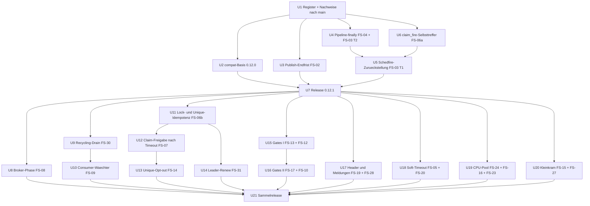

# Fehlersuche Runde 2, Fehlerbehebung - Plan

## Goal Capsule

- **Objective:** Nach Deploys, Worker-Abstürzen, Recycling, Verbindungsabrissen und verlorenen Valkey-Antworten verliert swarmq keine Tasks und Cron-Fires mehr still, führt sie nicht doppelt aus und blockiert keine Worker. Fehlermeldungen und Doku sagen, was tatsächlich passiert ist. Grundlage sind die 23 per Gegenprüfung bestätigten Fehler aus `docs/befunde/fehlersuche-runde-2-2026-10.md`.
- **Means:** Behebung in zwei Wellen nach Dringlichkeit (KTD1). Jeder Fix stützt sich auf eine Recherche zu Folgefehlern (`docs/befunde/fehlersuche-runde-2-recherche/`) und lässt das Entscheidungsregister unverletzt (KTD2).
- **Authority:** Entscheidungsregister `compound-packs/swarmq-entscheidungen/` > dieser Plan > Rechercheberichte. AGENTS.md (TDD, Qualitäts-Gates, Testports) gilt durchgehend.
- **Stop conditions:**
  - Ein Fix ließe sich nur umsetzen, wenn ein Test mit `@pytest.mark.entscheidung` geändert oder gelöscht wird: stoppen und Georg fragen.
  - Ein Fix würde eine offene Produktfrage (Scope Boundaries) mitentscheiden: stoppen.
  - Die Mischbetrieb-Suite zeigt einen Bruch zwischen 0.12.0 und 0.12.1: stoppen.
  - Die Loadsuite-Abnahme verfehlt ein Gate (Verlust > 0, Duplikate > 0, Speichertrend): kein Release.
- **Execution profile:** Strenges TDD je Unit. Für P1/P2 existiert der rote Nachweis-Test bereits (`befund`-Marker, `xfail(strict=True)`). Ein Fix gilt erst, wenn sein Nachweis ohne Marker grün ist. Für die P3-Befunde FS-17, FS-19, FS-23, FS-24, FS-27 und FS-28 gibt es noch keinen Nachweis; er wird zuerst rot geschrieben. FS-20 ist ein reiner Doku-Fehler ohne Nachweis-Test.
- **Tail ownership:** Release-Upload auf PyPI bleibt bei Georg (`!`-Befehl). Push, MR und Merge erst nach Georgs Ok.

---

## Product Contract

### Summary

Der Plan behebt alle 23 FEHLER der Fehlersuche Runde 2 in zwei Releases. 0.12.1 bringt die drei P1-Fehler: Publish nach verstrichener Endfrist, verlorene Cron-Fires durch das Schedfire-Gate und blockierte Locks bzw. Slots nach einem scheiternden DI-Finalizer. Dazu kommt der Teil von FS-06, der dasselbe Gate betrifft. Ein Sammelrelease danach behebt die übrigen P2- und P3-Fehler. Jeder Fix ist rolling-deploy-sicher neben 0.12.0, und beide Releases durchlaufen vorher die Loadsuite-Abnahme.

### Problem Frame

Die Fehlersuche Runde 2 (2026-10-13) hat auf v0.12.0 Fehler gefunden, die die Tests nicht abdeckten. Eine unabhängige Gegenprüfung hat bewusste Entscheidungen aussortiert. Übrig sind 23 Fehler mit verletzter Zusage, darunter drei P1, die im Normalbetrieb (Deploy, Neustart, OOM) Tasks verlieren, doppelt ausführen oder Worker blockieren. Für jeden P1/P2-Fehler existiert ein roter Nachweis-Test.

Die Fehler hängen zusammen: Mehrere Fixes ändern dieselben Stellen (Publish-Pfad, Pipeline-`finally`, Gates, Drain-Ablauf). Sie lassen sich deshalb nicht unabhängig nacheinander beheben, ohne neue Fehler zu erzeugen. Die Ablaufanalyse (`docs/befunde/fehlersuche-runde-2-recherche/fix-r-flow.md`) fand drei solche Wechselwirkungen. Der Plan legt Reihenfolge und Bündelung so fest, dass sie nicht entstehen.

### Requirements

**P1: Verlust und Doppelausführung im Normalbetrieb (Release 0.12.1)**

- R1. Ein Publish nach schon verstrichener Publish-Endfrist sendet nichts und meldet `BrokerConnectionError`, nie `PublishIndeterminate` (FS-02 Teil a; E-042).
- R2. Im Recycling-Drain folgt die Publish-Endfrist dem tatsächlichen Drain-Ende, nicht dem Shutdown-Budget (FS-02 Teil b; E-018).
- R3. Stirbt ein Worker mit gewonnenem Schedfire-Claim, läuft das Fire nach Ablauf oder Übernahme des Claims genau einmal. Eine Broker-Neuzustellung mit fremdem Claim wird zurückgestellt statt bestätigt (FS-03 Teil 1; E-046).
- R4. Wird ein Handler abgebrochen, während er auf einen Semaphor-Platz wartet, gibt er seinen Schedfire-Claim frei (FS-03 Teil 2).
- R5. Lock-Freigabe und Semaphor-Rückgabe laufen auch, wenn ein vorheriger Aufräumschritt scheitert oder abgebrochen wird. Dazu zählen DI-Finalizer, Guard-Settle und Unique-Freigabe (FS-04; E-022).

**P2: Falsches Verhalten in realistischen Sonderfällen (Sammelrelease)**

- R6. Eine `TimeoutError` aus dem Task selbst bleibt, was sie ist; nur ein abgelaufener `soft_timeout` wird `SoftTimeoutError`. Das gilt für IO und CPU (FS-05; E-045).
- R7. Wiederholt valkey-py einen Claim-Befehl nach verlorener Antwort, gewinnt der eigene Claim: Fire-Claim, Mutex/Semaphor, Unique-Claim mit frischer `task_id` (FS-06).
- R8. Ein Claim, dessen Antwort im Timeout verloren ging, wird owner-geprüft freigegeben: Lock-Gate, Leader-Cron und Client (FS-07; E-011).
- R9. Ein Publish, der beim Verbindungsabriss auf die Kanalsperre wartet, wird erneut versucht oder endet als `BrokerConnectionError`, nicht nach 120 s als `PublishIndeterminate` (FS-08; E-042).
- R10. DLQ-Kopien tragen keine Broker-Zustellzähler; ein Replay per UI oder Shovel läuft (FS-10).
- R11. Wird ein Workflow-Schritt per `cancel(task_id)` vor dem Start abgebrochen, wird der Workflow als fehlgeschlagen markiert (FS-12; E-040).
- R12. `unique_until="start"`: Endet die Nachricht vor dem Start terminal, wird das Flag freigegeben. Nach dem Start gibt es weiterhin genau eine Freigabe (FS-13; E-034, E-008).
- R13. `schedule(delay=/eta=, unique_for=None)` wird beim Fire nicht dedupliziert (FS-14; E-033, E-032 bleibt).
- R14. Endet ein Rechenkind, erhält seine Prozessgruppe ein SIGKILL; Enkel überleben nicht (FS-16; E-036).
- R15. Ein Recycling-Drain bricht laufende Tasks nicht nach `shutdown_timeout` ab. Hat ein konsumierter Task keinen `hard_timeout`, wartet er bis `max(größter hard_timeout + 30 s, consumer_timeout_s)`. Ein SIGTERM während des Drains setzt das Shutdown-Budget ab diesem Signal in Kraft (FS-30; E-038, E-018).

**P3: Randfälle, Meldungen und Doku (Sammelrelease)**

- R16. Der Consumer-Wächter bricht laufende `basic.cancel`/`basic.consume` nicht ab und schließt dadurch nicht den Consume-Kanal (FS-09).
- R17. `get_result()` hält den Aufrufer bei hängendem `subscribe()` nicht über `timeout` hinaus fest (FS-15; E-030 bleibt).
- R18. Scheitert im Expiry-Gate nur der Ack nach liegender DLQ-Kopie, gilt das als terminal (FS-17; E-043).
- R19. Ein nicht ganzzahliger Retry- oder Rate-Limit-Zähler im Header zählt wie kein Header; die Nachricht wird normal bestätigt (FS-19).
- R20. Die Doku zum Soft-Timeout beschreibt E-045: `CancelledError` im Task, `raise` nötig, Verschlucken ergibt ein Erfolgsergebnis (FS-20).
- R21. Ein im Hintergrund gesperrter Slot wird nicht mehr vergeben (FS-23; E-035 bleibt).
- R22. Ein gescheiterter Handshake erzeugt kein asyncio-ERROR und keinen doppelt gezählten Kindtod (FS-24).
- R23. `validate_namespace("SQ")` schlägt nicht den verbotenen Wert vor (FS-27).
- R24. Ein AT_LEAST_ONCE-Workflowschritt mit `result_ttl=0` meldet die richtige Ursache (FS-28; E-039 bleibt).
- R25. Der Leader tritt nach hängenden Lock-Renews zurück, bevor seine Lock-TTL sicher abgelaufen ist (FS-31; E-048).

**Querschnitt**

- R26. Kein Fix verletzt eine Regel des Entscheidungsregisters; kein Test mit `entscheidung`-Marker wird geändert. Wo ein Fix die Wirkung einer Regel präzisiert, bekommt die Regel einen Nachtrag.
- R27. Jeder Fix läuft in beiden Richtungen neben 0.12.0-Workern, -Leadern und -Producern (Rolling Deploy, Rollback).
- R28. Vor jedem Release bestehen Unit-, Integrations-, e2e- und Mischbetrieb-Suite sowie die Loadsuite-Abnahme (1 h und 6 h).

### Key Decisions

- **Register vor Fixes.** Der Branch `chore/entscheidungsregister` kommt vor der ersten Fix-Unit nach main, damit Guard und Marker greifen. Governs R26. (session-settled: user-approved — chosen over „Fixes ohne Register“: Fixes sollen keine früheren Entscheidungen still umwerfen.)
- **Produktfragen bleiben außen vor.** Fixes funktionieren unter den heute geltenden Regeln E-001, E-014, E-030, E-039. Governs R26. (session-settled: user-directed — chosen over „im Plan mitentscheiden“: offene Fragen klärt Georg getrennt.)
- **Drain-Abbruch nach FS-02a hinnehmen.** Ein vom SIGTERM-Drain abgebrochener Task endet nach E-001 als Fehlerergebnis. Weil die Publish-Endfrist dann verstrichen ist, wird das Original neu zugestellt statt per Retry/DLQ kopiert. E-001 bekommt dazu einen Nachtrag. Governs R1. (session-settled: user-directed — chosen over „Fehlerpfad nutzt Aufräumreserve“ und „erst E-001 entscheiden“: FS-02 ist P1, E-001 bleibt offen und regelt das später.)
- **Recycling-Grenze `consumer_timeout_s`.** Hat ein konsumierter Task keinen `hard_timeout`, gilt als Frist `max(größter hard_timeout + 30 s, consumer_timeout_s)`. E-038 bekommt diese Präzisierung. Governs R15. (session-settled: user-directed — chosen over „unbegrenzt“ und „eigene Einstellung“: Danach hat RabbitMQ die Zustellung ohnehin zurückgenommen.)

### Scope Boundaries

- Offene Produktfragen: E-001/KTD2 überdenken (FS-01), BZ-11 bzw. E-014 überdenken (FS-11), Polling E-030 (FS-15 Polling), „Ack vor DI-Scope-Ende“ (FS-04 Nebenfrage), `result_ttl=0` bei `Task.s()` ablehnen (FS-28 Nebenfrage).
- Lücken FS-25, FS-26, FS-29 und FS-32.
- Klassische Queues bei FS-03: Sie tragen keine Broker-Zähler; die Zurückstellung wirkt dort nicht. Grenze wird dokumentiert; Abhilfe bräuchte das Vertragsfeld `Delivery.redelivered`.
- Leader-Oneshots mit stabiler `task_id` bei FS-06/FS-07: E-011 verbietet die Freigabe nach `PublishIndeterminate`; Restlücke wird dokumentiert.

#### Deferred to Follow-Up Work

- Upstream-Meldung an aiormq zum Lock-Waiter auf totem Kanal (FS-08 Option B) und Untergrenze für aiormq in `pyproject.toml`.
- Gate-seitige Toleranz für Bestands-DLQ-Kopien mit Zählern (FS-10 Option B, Vertragsfeld `redelivered`).
- `PR_SET_CHILD_SUBREAPER` gegen `setsid`-Ausreißer im CPU-Modus (FS-16 Option C).
- Kosmetische Uneinheitlichkeit `_as_int` in `lock.wait_generation` (FS-19).
- `scripts/run_mutation.sh` auf mutmut 3 umstellen und ein Mutations-Gate für Releases erwägen; `[tool.mutmut] source_paths` deckt heute nicht alle Module ab, die dieser Plan ändert.
- `swarmv`: Anzeige von `source="cli_unique"` ohne Hash prüfen (FS-14); Kernänderungen im Dashboard nur nach Absprache.
- Neue Befund-Kandidaten aus dem Befüllen des Registers (E-013: 403 beim Publish zählt vermutlich nicht für den Rücktritt; E-018: `restart_budget.py`/`setpoint.py` rechnen mit altem Budget). Sie gehen in die nächste Gegenprüfung, nicht in diesen Plan.
- MC-1 zweiter Teil: Ein vom Leader verworfener Oneshot schreibt kein Ergebnis. Kein Nachweis im Register.

### Dependencies

- Branch `chore/entscheidungsregister` (Register E-001 bis E-049, Guard, Marker) ist nach main gemergt (U1).
- Branch `test/fehlersuche-runde-2` (Nachweis-Tests, Register der Befunde, Rechercheberichte) ist nach main gemergt oder Basis der Fix-Branches (U1).
- Testcontainer auf Ports 5699/15699/6399; Toxiproxy-Container für die Chaos-Tests.
- Loadsuite-Repo `swarmq-loadsuite` mit Pin auf das jeweilige Release-Tag.

### Sources

- Befundregister: `docs/befunde/fehlersuche-runde-2-2026-10.md`
- Analyse und Gegenprüfung: `docs/befunde/fehlersuche-runde-2-recherche/1-regressionen.md` bis `5-gegenpruefung-C.md`
- Fix-Recherche je Bereich: `docs/befunde/fehlersuche-runde-2-recherche/fix-r-broker.md`, `fix-r-scheduler.md`, `fix-r-worker.md`, `fix-r-cpu.md`
- Ablauf- und Randfallanalyse: `docs/befunde/fehlersuche-runde-2-recherche/fix-r-flow.md`
- Learnings und Pack-Regeln: `docs/befunde/fehlersuche-runde-2-recherche/fix-r-learnings.md`
- Ablauf einer Fehlersuche: `docs/befunde/README.md` (Branch `chore/entscheidungsregister`)

---

## Planning Contract

### Key Technical Decisions

- KTD1. **Zwei Wellen, P1 als 0.12.1.** 0.12.1 enthält FS-02 (a und b), FS-03, FS-04 und den `claim_fire`-Teil von FS-06; alles andere folgt im Sammelrelease. FS-06 `claim_fire` gehört dazu, weil es eine zweite Verlustquelle desselben Gates ohne Lua-Änderung schließt. (session-settled: user-approved — chosen over „ein einziges Release“: P1 schnell ausliefern.)
- KTD2. **Entscheidungen respektieren, Nachträge statt Änderungen.** Kein Fix ändert einen `entscheidung`-Test. Wo ein Fix eine Regel präzisiert, bekommt sie im selben Commit einen Nachtrag, und zwar E-001, E-013, E-018, E-034, E-036, E-038, E-045 und E-048. Neue Tests mit `entscheidung`-Marker nur zusammen mit der `tests:`-Liste der Regel (Guard). (pack: swarmq-entscheidungen, README.md)
- KTD3. **Publish-Endfrist: vor dem Senden prüfen, Endfrist folgt dem Drain-Ende.** Teil a: `_publish_with_retry` prüft vor dem Zeitdeckel, ob die Endfrist verstrichen ist, und wirft dann `BrokerConnectionError`, ohne Kanalzugriff. Teil b: Eine einzige Funktion liefert das Drain-Ende ab `started_at` (ohne Override `drain_until`, mit Override `started_at + override`). Sie setzt Publish-Endfrist und Drain-Wartezeit. `_shutdown_end` wird nach dem Drain-Ende aus `shutdown_budget()` neu angesetzt. Verworfen: Untergrenze statt Null (bindet Budget an E-001) und „keine Endfrist im Recycling“ (bricht Nachweis b, öffnet den Abbruch-Pfad aus `fix-r-flow.md` 2.2). (pack: swarmq-entscheidungen, e042-publish-indeterminate-nur-nach-senden.md)
- KTD4. **Recycling-Drain: Frist, SIGTERM-Anker, Budget.**
  - Die Frist ist `max(größter hard_timeout + 30, consumer_timeout_s)`, sobald ein auf `consumed_queues` konsumierter Task keinen `hard_timeout` hat; sonst wie heute. Gezählt werden nur konsumierte Queues.
  - Das erste SIGTERM während des Recycling-Drains setzt den Anker neu: Drain-Ende und Publish-Endfrist werden auf `min(bisher, SIGTERM + drain_until)` gezogen, nur nach vorn.
  - Ein zweites SIGTERM (Supervisor-Eskalation) ankert nicht neu. `request_recycle` selbst setzt das Unterbrechungs-Event nicht.
  - Begründung: Der Supervisor schickt zwei SIGTERM; ein späterer Anker läge hinter `sigkill_at` (`fix-r-flow.md` Kritisch 3).
  - (session-settled: user-directed — Grenze `consumer_timeout_s` chosen over „unbegrenzt“: siehe Key Decisions.)
- KTD5. **Schedfire: zurückstellen statt bestätigen.**
  - Eine Broker-Neuzustellung (`x-delivery-count`/`x-acquired-count` > 0) oder eine schon zurückgestellte Kopie wird bei fremdem Claim per `retry_later` mit wachsender Wartezeit zurückgestellt.
  - Die Zurückstellung setzt den neuen Header `x-swarmq-schedfire-defer-count`. Er wird mitkopiert, und `copy_headers` aus FS-10 entfernt ihn nicht.
  - Frische Leader-Duplikate werden weiter bestätigt (E-047).
  - Die Zurückstellung ist gedeckelt auf `max(completed_ttl, inflight_ttl + backend_defer_max_delay)` mit `inflight_ttl = max(scheduler_inflight_ttl, hard_timeout + 30)`; gemessen wird die Summe der Wartezeiten, die sich aus dem Defer-Zähler ergibt. Danach Log statt Lauf (`fix-r-flow.md` F5). Ein Deckel allein über `completed_ttl` (mindestens `scheduler_dedup_ttl`, Default 3.900 s) läge bei Tasks mit `hard_timeout` über rund 65 min vor dem Claim-Ablauf und verwürfe genau das Fire, das R3 retten soll.
  - Ein Stall-Log analog `execution_guard_defer_stalled`.
  - `swarmq dlq retry` setzt den Defer-Header zurück (F9).
  - Verworfen: alle Duplikate zurückstellen (Parallellauf nach 300 s ohne `hard_timeout`) und Claim-Übernahme (hängt am Ausführungsschutz).
  - (pack: swarmq-entscheidungen, e046-schedfire-at-least-once.md)
- KTD6. **Pipeline-`finally` als try/finally-Kaskade.**
  - Die Reihenfolge bleibt: Settle/Finalize → DI-Teardown → Lock-Freigabe → Semaphor.
  - Jeder spätere Schritt läuft auch, wenn ein früherer scheitert oder abgebrochen wird; die erste Ausnahme propagiert wie heute.
  - `release_acquired_locks` entnimmt den Registry-Eintrag vor dem Release (gegen doppelte Freigabe mit `_release_leftover_locks`).
  - Der Semaphor-Erwerb bleibt vor dem `try` und wird mit `except BaseException` + detached Claim-Freigabe abgesichert (FS-03 Teil 2).
  - Verworfen: `AsyncExitStack`. Er zöge den Erwerb in den geschützten Bereich, und der `finally` schriebe beim Abbruch den Completed-Marker (`fix-r-scheduler.md` FS-03 Teil 2 Option B).
- KTD7. **Idempotenz über Selbsttreffer, keine Abschaltung des Transport-Retrys.**
  - `claim_fire` hängt bei gesetztem Owner den eigenen Owner an die Übernahme-Tokens.
  - `lock_acquire.lua` wertet den eigenen Token im Key als erworben; ARGV-Zahl und Rückgaben bleiben, also neue SHA, kompatibel.
  - `claim_unique` wertet `existing == task_id` nur an Aufrufstellen mit frisch erzeugter `task_id` als eigen: Client (`schedule`, `_schedule_deferred`, `schedule_many`) und Leader-Cron. Nicht im Backend wegen CLI und E-011.
  - Verworfen: zweiter Pool mit `retries=0` (Verfügbarkeit) und Nonce im Flag (bricht Mischbetrieb).
- KTD8. **Claim-Freigabe nach Timeout owner-geprüft, wie 7e6abec.**
  - Lock-Gate: im Hintergrund, getrackt und im Shutdown abgewartet.
  - Leader: inline, nur für Crons.
  - Client: inline, auch für Einträge mit Fehler in `schedule_many`.
  - Keine zweite, verzögerte Freigabe gegen das Rennen „Freigabe vor Acquire“. Das bleibt dokumentierte Restlücke (F6).
- KTD9. **Publish gegen `underlay.closing`, Abbruch-Erkennung relativ zum Eintrittsstand.**
  - Jeder Versuch läuft als Kind-Task gegen `underlay.closing`. Gewinnt `closing`, gilt erfülltes `drain_future` als gesendet (`PublishIndeterminate`), sonst nicht gesendet (nächster Versuch).
  - `sent_before_failure` wertet ein ungebundenes `drain_future` als „nicht gesendet“.
  - „Eigener Abbruch“ misst `cancelling()` relativ zum Stand beim Eintritt in den Publish-Pfad und in `settle()`. Ein vom Drain abgebrochener Handler, der nach E-001 weiterläuft, wertet interne aio-pika-`CancelledError` deshalb nicht als eigenen Abbruch (`fix-r-flow.md` Kritisch 2). Der `settle()`-Teil kommt schon mit U3 in 0.12.1, weil U3 den `nack` nach einem Drain-Abbruch zum Normalfall macht.
  - Dazu kommt die Ergänzung a3: Reißt die Frist, bevor gesendet wurde, folgt `BrokerConnectionError`.
- KTD10. **FS-14 ohne Formatänderung.** Der ausdrückliche Opt-out wird als `source="cli_unique"` mit `dedup_hash=None` gespeichert. Der Leader fällt bei `cli_unique` nie auf die Registry zurück. Verworfen: neues Feld (Golden-Fixture neu) und `unique_for=0` bzw. neuer `source`-Wert (bricht 0.12.0).
- KTD11. **Leader-Rücktritt auch zeitbasiert.** Die Zeitgrenze ist `Start des letzten erfolgreichen Renews + ttl − backend_op_timeout`. Jeder Renew ist auf `min(backend_op_timeout, Restzeit bis zur Grenze)` begrenzt; ist die Grenze ohne erfolgreichen Renew erreicht, tritt der Leader zurück. Die Zählregel aus E-048 bleibt. Eine Grenze `ttl − heartbeat` scheidet aus: Bei der erlaubten Konfiguration `lock_ttl = 2 × heartbeat` läge sie vor dem nächsten regulären Renew und ließe einen gesunden Leader bei jedem Tick zurücktreten. Keine Abkühlzeit nach dem zeitbasierten Rücktritt (F7).
- KTD12. **Unique-Startfreigabe über einen Merker.** `GateContext` bekommt einen Merker „Startpunkt erreicht“; `maybe_release_unique` nimmt `ctx` statt `task_id`. Im start-Modus No-op nur mit gesetztem Merker. Zurückstellungen geben weiter nicht frei (E-034).
- KTD13. **Broker-Zähler zentral aus Kopien entfernen.** `identity.copy_headers` entfernt `x-delivery-count` und `x-acquired-count`; die Konstante wandert nach `swarmq/headers.py`. Replay-ID und Generation bleiben bitgleich (E-009).
- KTD14. **Soft-Timeout-Hülle innerhalb `wait_for`.** Eine innere Hülle wandelt eine `TimeoutError` des Tasks in eine private Ausnahme um, damit nur der eigene Ablauf `SoftTimeoutError` wird. `wait_for` bleibt (Wortlaut E-045). Verworfen: Unterscheidung über `__cause__` (taugt nicht) und `SoftTimeoutError` erbt von `TimeoutError` (neue Retry-Semantik).
- KTD15. **Retry-Zähler streng lesen.** Ein nicht ganzzahliger `x-swarmq-retry-count` zählt wie kein Header (wie `retry_count_of` im Ausführungsschutz und wie `dlq retry`). Ein UI-Replay mit `"3"` bekommt also wieder volles Retry-Budget. Der Rate-Limit-Zähler wird nachsichtig gelesen (`_as_count`).
- KTD16. **Consumer-Wächter bricht keine RPCs ab.**
  - Begrenzt wird nur der Kanalbezug, dazu eine aiormq-eigene Notbremse von etwa 60 s.
  - `stop()` koppelt einen laufenden Takt ab, statt ihn abzubrechen.
  - Nach `cancel_all` nimmt der Takt keine Neuanmeldung mehr an (`fix-r-flow.md` Wichtig, FS-09).
  - `cancel_consume` im Shutdown ist begrenzt und geschützt (shield).
- KTD17. **CPU-Pool: Handshake aufgeben, Gruppe räumen, gesperrte Slots verwerfen.**
  - FS-24: Ein gescheiterter Handshake bricht `child.ready` ab und setzt `pending` auf `None`, vor dem Kill.
  - FS-16: Nach dem Kindtod geht ein SIGKILL an die Gruppe. Das Flag `group_killed` verhindert ein zweites, damit der E-036-Test unverändert bleibt.
  - FS-23: `run()` verwirft einen gesperrten Index nach `_free.get()`.
- KTD18. **E-013 bleibt bei der Zählung.** Ein „nicht gesendet“ nach verstrichener Endfrist oder Abriss ist `BrokerConnectionError` und zählt für den Leader-Rücktritt. Keine eigene, nicht gezählte Unterklasse; im Shutdown-Fenster folgenlos. E-013 bekommt einen Nachtrag.
- KTD19. **Mischbetrieb wird automatisch geprüft.** Vor dem ersten Release bekommt `tests/compat` eine Basis 0.12.0 (`constraints-0.12.0.txt` plus Fixture). Jeder Fix mit wandernden Daten (Header, Lua, Definitionen) bekommt einen compat-Fall.
- KTD20. **Rollout für 0.12.1: Surge-Deploy und Grace.** Changelog und Upgrade-Doku schreiben das vor: Surge-Deploy und Orchestrator-Grace ≥ `shutdown_timeout`. FS-03 wirkt nur, wenn der empfangende Worker schon neu ist. Keine Codeänderung.

### High-Level Technical Design

**Wellen und Abhängigkeiten der Units**



**Drain-Ende, Publish-Endfrist und SIGTERM (KTD3, KTD4)**

```mermaid
stateDiagram-v2
  [*] --> Running
  Running --> ShutdownDrain: SIGTERM
  Running --> RecycleDrain: Recycling-Schwelle
  ShutdownDrain --> Cleanup: Drain-Ende = start + drain_until
  RecycleDrain --> RecycleDrain: zweites SIGTERM (kein neuer Anker)
  RecycleDrain --> RecycleCut: erstes SIGTERM (Anker = min(bisher, SIGTERM + drain_until))
  RecycleDrain --> Cleanup: alle Tasks fertig oder Frist max(hard+30, consumer_timeout_s)
  RecycleCut --> Cleanup: Drain-Ende
  Cleanup --> [*]: Aufräumbudget neu ab Drain-Ende
  note right of ShutdownDrain: Publish-Endfrist = Drain-Ende; danach sendet kein Publish mehr (BrokerConnectionError)
```



**Schedfire-Gate nach FS-03 (KTD5)**

```mermaid
flowchart TD
  A[Zustellung mit Fire-Header] --> B{Completed-Marker?}
  B -- ja --> ACK[Ack, Duplikat]
  B -- nein --> C{claim_fire mit eigenem Owner}
  C -- gewonnen oder Selbsttreffer --> RUN[Lauf]
  C -- fremd --> D{Broker-Zaehler > 0 oder Defer-Header?}
  D -- nein, frisches Duplikat --> ACK
  D -- ja --> E{Wartezeit < max(completed_ttl, inflight_ttl + defer_max)?}
  E -- ja --> DEFER[retry_later, Defer-Header +1, Backoff]
  E -- nein --> LOG[Stall-Log, Ack]
```

### Sequencing

- Phase 0 (U1, U2) vor jeder Fix-Unit.
- 0.12.1: U3, U4, U6, U5, danach U7. U4 vor U5, weil beide `_process_message` ändern; U6 vor U5, weil die Zurückstellung den Selbsttreffer voraussetzt.
- Sammelrelease, Reihenfolgeregeln aus `fix-r-flow.md` Abschnitt 7:
  - U9 nie vor U3.
  - U10 nach U9 (beide in `_drain_in_flight`).
  - U8 bringt die Abbruch-Erkennung (KTD9), bevor ein anderer Fix abgebrochenen Handlern Publish-Zeit gibt.
  - U11 vor U12, U13 und U14.
  - U15 vor U16; U16 bündelt FS-17 und FS-10, weil beide dieselbe Zeile in `expiry.py` betreffen.
- Die übrigen Units des Sammelreleases sind unabhängig.

### Risks

| Risiko | Wirkung | Gegenmaßnahme |
|---|---|---|
| FS-03 wirkt beim Deploy nur auf neuen Workern | Neuzustellungen landen anfangs auf 0.12.0 und gehen dort wie heute verloren | KTD20 (Surge-Deploy), compat-Fall in U5 |
| FS-03-Zurückstellung erzeugt viele Kopien | Last auf Delay-Queues bei langem `hard_timeout` | Backoff, Stall-Log, Deckel `completed_ttl` (KTD5); Messgröße in der Loadsuite (U21) |
| Abgebrochener Handler bekommt Publish-Zeit und verliert ein Fire still | Completed-Marker auf unbestätigter Nachricht | KTD9 (Eintrittsstand), Regressionstest in U8; Reihenfolge U8 vor jeder Änderung, die Publish-Zeit nach dem Abbruch gibt |
| `lock_acquire.lua` neue SHA neben alter | Gegenseitiger Ausschluss zwischen 0.12.0 und 0.12.1 | Integrationstest mit beiden Skriptfassungen auf demselben Lock (U11) |
| Längerer Recycling-Drain | Slot doppelt belegt, alter Prozess hält Speicher bis 30 min | KTD4, Doku; Loadsuite 6 h mit Recycling-Langläufer (U21) |
| FS-08 im Publish-Hot-Path | Latenz, Task je Versuch | p99-Publish-Latenz in der Loadsuite (U21) |
| Pipeline-`finally` ist Kern jeder Zustellung | Neue Abbruch-Fehler | Kombinationstests aus `fix-r-flow.md` Abschnitt 6 (Nr. 5, 6) in U4 |

### System-Wide Impact

- **Betrieb:** Upgrade-Hinweise zu 0.12.1 (Surge, Grace) und zum Sammelrelease (DLQ-Bestand aus 0.12.0 nur per `swarmq dlq retry` replaybar; FS-14 wirkt erst mit Leader ≥ neuer Version; klassische Queues bei FS-03).
- **Phoenix:** Producer sind eigene Dienste; FS-14 und FS-06 (Client-Teil) wirken dort erst nach deren Update.
- **Doku (EN/DE):**
  - `delivery-semantics`: Recycling-Grenze, DLQ-Kopie ohne Zähler, klassische Queues.
  - `errors`: Publish nach Endfrist, Soft-Timeout.
  - `scheduling-and-retries`: Opt-out-Rollout, Soft-Timeout.
  - `configuration`: Soft-Timeout.
  - `workflows`: Cancel vor Start.
  - `locking-and-dedup`: start-Modus.
  - `api`: `unique_for=None`.
  - Changelog.
- **Register:** Nachträge nach KTD2; E-038/E-046 wechseln von „verletzt“ auf „gilt“ mit festschreibenden Tests.

### Open Questions

Keine blockierenden. Zur Ausführung offen:
- Versionsnummer des Sammelreleases (0.12.2 oder 0.13.0). Wird bei U21 mit Georg festgelegt, je nachdem, ob bis dahin Produktfragen mit Verhaltensänderung entschieden sind.
- Exakte Namen von Helfern, Merkern und Headern; Vorschläge stehen in den Rechercheberichten.

---

## Implementation Units

| U-ID | Titel | Hauptdateien | Abhängig von |
|---|---|---|---|
| U1 | Register und Nachweise nach main | Branches, `docs/befunde/` | – |
| U2 | compat-Basis 0.12.0 | `tests/compat/` | U1 |
| U3 | Publish-Endfrist (FS-02) | `broker/rabbitmq/delivery.py`, `worker/shutdown.py` | U1 |
| U4 | Pipeline-finally (FS-04, FS-03 Teil 2) | `worker/pipeline.py`, `worker/gates/lock.py` | U1 |
| U5 | Schedfire-Zurückstellung (FS-03 Teil 1) | `worker/gates/schedfire.py`, `headers.py` | U4, U6 |
| U6 | claim_fire-Selbsttreffer (FS-06a) | `backend/valkey/schedules.py` | U1 |
| U7 | Release 0.12.1 | Changelog, Tag | U2, U3, U5 |
| U8 | Broker-Phase (FS-08) | `broker/rabbitmq/delivery.py`, `publish_phase.py` | U7 |
| U9 | Recycling-Drain (FS-30) | `worker/recycling.py`, `worker/shutdown.py` | U7 |
| U10 | Consumer-Waechter (FS-09) | `broker/rabbitmq/consumer_watch.py` | U9 |
| U11 | Lock- und Unique-Idempotenz (FS-06b) | `lua/lock_acquire.lua`, `client/schedule.py`, `scheduler/fire.py` | U7 |
| U12 | Claim-Freigabe nach Timeout (FS-07) | `worker/gates/lock.py`, `scheduler/fire.py`, `client/schedule.py` | U11 |
| U13 | Unique-Opt-out (FS-14) | `client/schedule.py`, `scheduler/fire.py` | U12 |
| U14 | Leader-Renew (FS-31) | `scheduler/loop.py` | U11 |
| U15 | Gates I (FS-13, FS-12) | `worker/finalize.py`, `worker/gates/cancel.py` | U7 |
| U16 | Gates II (FS-17, FS-10) | `worker/gates/expiry.py`, `identity.py` | U15 |
| U17 | Header und Meldungen (FS-19, FS-28) | `worker/retry.py`, `worker/results.py` | U7 |
| U18 | Soft-Timeout (FS-05, FS-20) | `worker/execution.py`, `compute/child.py`, Doku | U7 |
| U19 | CPU-Pool (FS-24, FS-16, FS-23) | `worker/compute/pool.py` | U7 |
| U20 | Kleinkram (FS-15, FS-27) | `backend/valkey/results.py`, `keyspace.py` | U7 |
| U21 | Sammelrelease | Changelog, Tag, Loadsuite | U8 bis U20 |

### U1. Register und Nachweise nach main

- **Goal:** Entscheidungsregister, Guard, Marker, Nachweis-Tests und Rechercheberichte liegen auf main; die Fix-Branches setzen darauf auf.
- **Requirements:** R26.
- **Dependencies:** keine.
- **Files:** Branches `chore/entscheidungsregister` (Register, `.compound-engineering/config.yaml`, `tests/unit/test_entscheidungsregister.py`, Marker in 94 Testdateien) und `test/fehlersuche-runde-2` (`docs/befunde/fehlersuche-runde-2-2026-10.md`, `docs/befunde/fehlersuche-runde-2-recherche/`, Nachweis-Tests, mutmut-Konfiguration, dieser Plan).
- **Approach:**
  1. Beide Branches auf aktuellen main bringen und Konflikte lösen. `pyproject.toml` und `uv.lock` ändern sich in beiden; die andere Sitzung hat `chore/teststrenge-coverage-just` offen.
  2. Mergen nach Georgs Ok, Register zuerst.
- **Test scenarios:**
  - Volle Unit-Suite grün, Nachweise als XFAIL, Guard grün.
  - Mit `--runxfail` sind alle Nachweise rot (Gegenprobe wie am 2026-10-13).
- **Verification:** main enthält beide Branches; Guard und Nachweise verhalten sich wie oben.

### U2. compat-Basis 0.12.0

- **Goal:** Die Mischbetrieb-Suite prüft 0.12.1 neben 0.12.0 (KTD19).
- **Requirements:** R27.
- **Dependencies:** U1.
- **Files:** `tests/compat/constraints-0.12.0.txt`, `tests/compat/conftest.py`, `tests/compat/_harness.py`; Marker-Beschreibung in `pyproject.toml`.
- **Approach:** Nach dem Muster der 0.11.x-Basis. Die Fix-Units ergänzen ihre Fälle (U5, U11, U13, U16).
- **Patterns to follow:** `tests/compat/test_mixed_operation.py`, `tests/compat/test_rollback_limit.py`.
- **Test scenarios:**
  - 0.12.0-Producer schickt, 0.12.1-Worker führt aus, Ergebnis lesbar.
  - Umgekehrt: 0.12.1-Producer, 0.12.0-Worker.
  - Rollback: Nachrichten aus 0.12.1 in Delay-Queues laufen auf 0.12.0 ohne Fehler.
- **Verification:** `pytest -m compat` läuft mit beiden Basen grün.

### U3. Publish-Endfrist (FS-02)

- **Goal:** Kein Publish geht nach verstrichener Endfrist auf die Leitung; im Recycling folgt die Endfrist dem Drain-Ende.
- **Requirements:** R1, R2.
- **Dependencies:** U1.
- **Files:** `src/swarmq/broker/rabbitmq/delivery.py`, `src/swarmq/broker/rabbitmq/connection.py` (Docstring), `src/swarmq/worker/shutdown.py`, optional `src/swarmq/broker/rabbitmq/redeclare.py`; Tests `tests/unit/broker/test_befund_fs02_publish_after_deadline.py`, `tests/unit/worker/test_befund_fs02_recycling_publish_deadline.py`, neue Tests unter `tests/unit/broker/` und `tests/unit/worker/`; Register E-001 und E-013 (Nachträge).
- **Approach:**
  1. Teil a nach KTD3: Prüfung vor dem Zeitdeckel in `_publish_with_retry`. `_effective_publish_timeout` bleibt (Test `test_elapsed_shutdown_deadline_fails_immediately`).
  2. Teil b nach KTD3: Funktion „Drain-Ende ab `started_at`“ für Shutdown und Recycling-Override.
  3. `_shutdown_end` nach dem Drain-Ende neu ansetzen.
  4. Abbruch-Erkennung relativ zum Eintrittsstand in `settle()` (KTD9, Teil `settle`).
  5. Nachweis b anpassen: Die normale Frist wird aus `shutdown_budget(...)` berechnet, nicht aus dem Broker gelesen (zulässig, befund-Test).
  6. Nachträge: E-001 (Folge „Neuzustellung statt DLQ“, Key Decisions) und E-013 (KTD18).
- **Patterns to follow:** `test_shutdown_deadline.py`, `test_shutdown_budget_steps.py`.
- **Test scenarios:**
  - Retry- bzw. DLQ-Publish nach der Endfrist: nichts gesendet, Original per `redeliver` zurückgestellt, Schedfire-Claim vor dem Nack freigegeben.
  - Scheduler-Fire nach der Endfrist: `_release_own_claim`, kein Commit.
  - Client `schedule()` nach der Endfrist: Unique-Rollback, `BrokerConnectionError`, nicht `PublishIndeterminate`.
  - Recycling mit Override: Endfrist folgt dem Drain-Ende; Publish nach der normalen Frist gelingt.
  - Nach einem langen Recycling-Drain bekommt jeder Aufräumschritt Budget ab Drain-Ende, nicht das 1-s-Minimum.
  - Drain-Abbruch bei `max_retries=0` im Workflow-Schritt: Fehlerergebnis, `fail_workflow`, DLQ-Publish nicht gesendet, Neuzustellung (hält die Folge aus den Key Decisions fest, ohne `entscheidung`-Marker).
  - Drain-abgebrochener Handler, `nack` in `settle()` scheitert mit aio-pika-interner `CancelledError`: kein Completed-Marker, keine Unique-Freigabe, Outcome nicht terminal.
  - E-018-Tests (`test_supervised_drain_ends_before_the_supervisor_kills`, `test_recycling_drain_is_exempt_from_the_budget`) und E-042-Tests unverändert grün.
- **Verification:** Beide FS-02-Nachweise ohne Marker grün.

### U4. Pipeline-finally (FS-04, FS-03 Teil 2)

- **Goal:** Lock, Semaphor und Schedfire-Claim werden in jedem Abbruch- und Fehlerpfad freigegeben.
- **Requirements:** R4, R5.
- **Dependencies:** U1.
- **Files:** `src/swarmq/worker/pipeline.py`, `src/swarmq/worker/gates/lock.py` (Registry-Eintrag vor dem Release entnehmen); Tests `tests/unit/worker/test_befund_fs04_dishka_finalizer.py`, `tests/unit/worker/gates/test_befund_fs03_schedfire_redelivery.py` (Fall Semaphor), neue Tests in `tests/unit/worker/test_pipeline.py` bzw. `test_worker.py`.
- **Approach:**
  1. Zuerst FS-03 Teil 2: Semaphor-Erwerb absichern (KTD6). Den `finally` berührt das nicht.
  2. Dann die FS-04-Kaskade (KTD6).
  3. Registry-Eintrag vor dem Release entnehmen.
  4. Offene Nebenfrage „Ack vor DI-Scope-Ende“ nicht anfassen; die Ack-Vorbedingung der FS-04-Nachweise bleibt.
- **Execution note:** Ein Commit je Teilschritt, damit ein Regressionsfund eindeutig zuzuordnen ist.
- **Test scenarios:**
  - `concurrency=1`, scheiternder Finalizer, danach läuft eine zweite Zustellung durch.
  - `execution_guard.settle` bzw. `maybe_release_unique` wirft eine fremde Ausnahme: Lock und Semaphor sind trotzdem frei.
  - Ein Finalizer wirft `BaseException`, bzw. ein äußerer Abbruch trifft den DI-Teardown: Semaphor zurückgegeben (Events, kein Sleep).
  - Abbruch am Semaphor mit Schedfire-Header: Claim frei, keine `finally`-Schritte.
  - Abbruch am Semaphor ohne Schedfire-Header: keine Freigabe-Aufrufe.
  - Kombination: Abbruch am Semaphor, danach zweite Zustellung mit scheiterndem Finalizer bei `concurrency=1`; die zweite läuft durch.
  - Kaskade und `_release_leftover_locks` gleichzeitig: kein `task_lock_lost`.
  - E-022- und E-034-Tests unverändert (`test_start_mode_releases_at_pickup`, Semaphor-Invariante `test_worker.py`).
- **Verification:** FS-04-Nachweise und FS-03-Semaphor-Nachweis ohne Marker grün.

### U5. Schedfire-Zurückstellung (FS-03 Teil 1)

- **Goal:** Ein Fire geht nach einem Worker-Absturz nicht mehr verloren und läuft nie parallel.
- **Requirements:** R3.
- **Dependencies:** U4, U6.
- **Files:** `src/swarmq/worker/gates/schedfire.py`, `src/swarmq/headers.py`, `src/swarmq/broker/rabbitmq/admin.py` (`dlq retry` setzt den Defer-Header zurück), `tests/integration/backend/golden/headers.txt`; Tests `tests/unit/worker/gates/test_befund_fs03_schedfire_redelivery.py`, `tests/unit/worker/gates/test_schedfire.py` (Docstring), `tests/integration/backend/test_schedfire_claim_handover.py` (Docstrings), neue Integrations- und e2e-Tests; compat-Fall; Register E-046 (`tests:` statt `ohne_test`).
- **Approach:**
  1. Das Gate stellt nach KTD5 zurück.
  2. Die Grenze „klassische Queues“ kommt in `delivery-semantics`.
  3. Der neue SIGKILL-e2e-Test bekommt `@pytest.mark.entscheidung("E-046")`, und E-046 trägt ihn in `tests:` ein.
- **Patterns to follow:** `ExecutionGuard._defer` und `backend_defer_delay` in `worker/gates/execution_guard.py`.
- **Test scenarios:**
  - Neuzustellung mit Zähler und fremdem Claim: `retry_later` mit Defer-Header, kein Ack, kein Lauf.
  - Kopie mit Defer-Header ohne Zähler, Claim weiter fremd: erneut zurückgestellt, Backoff wächst.
  - Kopie mit Defer-Header, Completed-Marker gesetzt: Ack.
  - Backend-Ausfall-Kopie einer zurückgestellten Kopie behält den Defer-Header.
  - Frisches Duplikat ohne Zähler: Ack (E-047).
  - `retry_later` scheitert: `nack` ohne Freigabe des fremden Claims.
  - Zurückstellung über den Deckel hinaus: Stall-Log statt Lauf.
  - Cron-Task mit `hard_timeout` größer als `completed_ttl`, Worker stirbt: Die Kopie läuft nach dem Claim-Ablauf genau einmal und wird nicht per Stall-Log bestätigt.
  - `swarmq dlq retry` entfernt den Defer-Header.
  - Integration: Claim mit Owner „W1“ gesetzt, Neuzustellung zurückgestellt, nach Claim-Ablauf genau ein Lauf, die zweite Kopie trifft den Completed-Marker.
  - Integration: Original läuft (Claim und Guard-Marker leben), Neuzustellung mit Zähler: kein Parallellauf, nach Abschluss Ack.
  - e2e: SIGKILL eines Workers mitten in einem Cron-Task mit skalierter `scheduler_inflight_ttl`: genau ein Lauf.
  - compat: zurückgestellte Kopie an 0.12.0-Worker verhält sich wie heute, ohne Fehler; Rollback mit Kopien in der Delay-Queue.
- **Verification:** FS-03-Nachweis (Worker-Tod) ohne Marker grün; E-046 nennt festschreibende Tests.

### U6. claim_fire-Selbsttreffer (FS-06a)

- **Goal:** Eine frische Zustellung verliert ihr Fire nicht, wenn valkey-py den Claim nach verlorener Antwort wiederholt.
- **Requirements:** R7 (Teil Fire-Claim).
- **Dependencies:** U1.
- **Files:** `src/swarmq/backend/valkey/schedules.py`, `tests/support/inmemory/backend.py`, `tests/contracts/coordination.py`; Nachweis `tests/integration/backend/test_befund_fs06_retry_after_lost_reply.py` (Fall Fire-Claim).
- **Approach:** Nach KTD7. Bei `owner=None` nichts anhängen, sonst gewännen zwei Aufrufe ohne Owner beide. Lua bleibt unverändert.
- **Test scenarios:**
  - Contract (Lua und In-Memory): wiederholter `claim_fire` mit demselben Owner gibt True.
  - Contract: zwei Aufrufe ohne Owner, nur einer gewinnt (bestehender Test bleibt).
  - Neuzustellung mit neuem Owner bleibt fremd.
- **Verification:** Integrationsnachweis Fall Fire-Claim ohne Marker grün; die anderen beiden Fälle bleiben xfail bis U11.

### U7. Release 0.12.1

- **Goal:** 0.12.1 mit den P1-Fixes ist abgenommen und veröffentlicht.
- **Requirements:** R27, R28.
- **Dependencies:** U2, U3, U5.
- **Files:** `website/reference/changelog.md` (EN/DE), Upgrade-Hinweise (KTD20), Versionsstand; Loadsuite-Pin im Repo `swarmq-loadsuite`.
- **Approach:**
  1. Release-Branch, alle Gates (Verification Contract).
  2. Release-Kandidat `v0.12.1rc1` taggen und nach Georgs Ok pushen; die Loadsuite pinnt per Git-Tag und braucht ihn auf GitLab.
  3. Loadsuite 1 h und 6 h auf dem rc-Tag, Mischbetrieb-Suite.
  4. Erst nach bestandener Abnahme: Merge, finales Tag `v0.12.1`, PyPI-Upload durch Georg.
- **Test expectation:** none -- Release-Schritt; die Abnahme besteht aus den Gates der Verification Contract.
- **Verification:** Tag gesetzt, Loadsuite ohne Verlust und ohne Duplikate, Changelog nennt Rollout-Vorgaben und Grenzen.

### U8. Broker-Phase (FS-08)

- **Goal:** Ein Publish hängt nach einem Verbindungsabriss nicht mehr auf dem toten Kanal und meldet „gesendet“ nur, wenn gesendet wurde.
- **Requirements:** R9 (inklusive Ergänzung a3: Frist reißt vor dem Senden).
- **Dependencies:** U7.
- **Files:** `src/swarmq/broker/rabbitmq/delivery.py`, `src/swarmq/broker/rabbitmq/publish_phase.py`, `tests/support/aiormq_transport.py`; Nachweis `tests/unit/broker/test_befund_fs08_publish_lock_waiter.py`; neue Tests `tests/unit/broker/test_publish_phase.py`, `tests/unit/broker/` (Kombination Drain-Abbruch).
- **Approach:**
  1. Nach KTD9.
  2. Mocks ohne `closing`-Future bleiben im heutigen Pfad, damit E-041/E-042-Tests unverändert sind.
  3. Upstream-Meldung an aiormq ist Folgearbeit.
- **Test scenarios:**
  - Kind in der Sperren-Warteschlange abgebrochen: nicht gesendet, beide Wakeup-Reihenfolgen.
  - `drain_future` erfüllt, dann Close: `PublishIndeterminate`, kein erneutes Senden.
  - Kanal-Close durch den Broker während des Wartens: neuer Kanal.
  - Frist reißt während des Wartens: Kind abgebrochen und abgeholt, keine „Task was destroyed“- oder „never retrieved“-Meldung.
  - Eigener Abbruch geht durch.
  - `sent_before_failure` mit ungebundenem `drain_future`: False.
  - Frist reißt vor dem Senden (Warten auf `ready()`): `BrokerConnectionError`.
  - Kombination: Handler per `task.cancel()` im Drain abgebrochen, `retry_later` wirft eine aio-pika-interne `CancelledError`. Ergebnis: kein Completed-Marker, keine Unique-Freigabe, Outcome nicht terminal.
  - Toxiproxy-Smoke: Abriss bei laufendem Publish-Strom mehrerer Handler, einer im Drain-Abbruch.
- **Verification:** FS-08-Nachweis ohne Marker grün; Loadsuite-p99 der Publish-Latenz nicht schlechter als 0.12.1 (U21).

### U9. Recycling-Drain (FS-30)

- **Goal:** Recycling kostet laufende Tasks keinen Retry mehr; SIGTERM beendet einen Recycling-Drain im Shutdown-Budget.
- **Requirements:** R15.
- **Dependencies:** U7 (enthält U3).
- **Files:** `src/swarmq/worker/recycling.py`, `src/swarmq/worker/shutdown.py`, ggf. `src/swarmq/worker/lifecycle.py`; Nachweis `tests/unit/worker/test_befund_fs30_recycling_drain.py`; `tests/unit/worker/test_recycling.py` (Test `test_task_count_threshold_recycles_with_ack` anpassen, wie E-038 es vorsieht); Register E-038 (Präzisierung, `tests:`) und E-018 (Nachtrag SIGTERM).
- **Approach:**
  1. Frist und SIGTERM-Anker nach KTD4. Die Drain-Ende-Funktion aus U3 bekommt hier den Anker, der nur nach vorn verschoben werden darf.
  2. Der Unterbrechungs-Event-Task wird im `finally` gestrichen, damit kein Task-Leck entsteht.
  3. Doku: Recycling-Grenze und SIGTERM in `delivery-semantics`.
- **Test scenarios:**
  - Gemischte Registry (Task mit `hard_timeout=10` und Task ohne): Frist ≥ `consumer_timeout_s`.
  - Task ohne `hard_timeout` auf nicht konsumierter Queue verlängert die Frist nicht.
  - SIGTERM während des Recycling-Drains: Abbruch spätestens bei `drain_until` ab SIGTERM, Fehlerpfad nach E-001, Locks frei vor `finish_by`.
  - Zweites SIGTERM verschiebt den Anker nicht; die Endfrist wird nie später.
  - `request_recycle` setzt das Unterbrechungs-Event nicht.
  - Bis zum SIGTERM gilt im Recycling die Drain-Ende-Endfrist aus U3 (nicht doppelt testen).
  - e2e: Supervisor-Abbau während eines Recycling-Drains: Worker endet vor `sigkill_at`, Locks frei, Leader-Übergabe mit Marker.
- **Verification:** FS-30-Nachweis ohne Marker grün; E-018- und E-001-Tests unverändert.

### U10. Consumer-Waechter (FS-09)

- **Goal:** Ein langsamer Broker schließt den Consume-Kanal nicht mehr durch einen Abbruch des Wächters.
- **Requirements:** R16.
- **Dependencies:** U9.
- **Files:** `src/swarmq/broker/rabbitmq/consumer_watch.py`, `src/swarmq/broker/rabbitmq/delivery.py` (Kommentar zu `settle_cancel_wait_s`), `src/swarmq/worker/shutdown.py` (`cancel_consume` begrenzt); Nachweis `tests/unit/broker/test_befund_fs09_consumer_watch_rpc_abort.py` (Fake-Signaturen um `timeout=` ergänzen, sonst falsch grün); `tests/unit/broker/test_consumer_watch.py::TestHangingRpc` umformulieren (keine entscheidung-Tests).
- **Approach:** Nach KTD16.
- **Test scenarios:**
  - `stop()` während laufendem RPC sendet kein `Channel.Close`.
  - Ein Cancel, das nach 3 s antwortet, führt zu `_mark_cancelled` und Neuanmeldung.
  - Die Notbremse schließt erst nach der großen Frist (Konstante skaliert).
  - `cancel_consume` im Shutdown ist begrenzt, ohne das RPC abzubrechen.
  - Takt bekommt die `consume`-Antwort nach `cancel_all`: Tag sofort abgemeldet bzw. nicht übernommen.
  - Kein „Task was destroyed but it is pending“ nach `broker.close()`.
- **Verification:** FS-09-Nachweis ohne Marker grün (mit erweiterter Fake-Signatur).

### U11. Lock- und Unique-Idempotenz (FS-06b)

- **Goal:** Mutex, Semaphor und Unique-Claim überstehen eine Wiederholung nach verlorener Antwort.
- **Requirements:** R7.
- **Dependencies:** U7.
- **Files:** `src/swarmq/lua/lock_acquire.lua`, `src/swarmq/client/schedule.py`, `src/swarmq/scheduler/fire.py`, `tests/support/inmemory/backend.py`, `tests/contracts/coordination.py`; Nachweis `tests/integration/backend/test_befund_fs06_retry_after_lost_reply.py` (Fälle Unique und Mutex); Register E-047/E-048 (Nachtrag: sofortige Wiederwahl mit eigenem Token).
- **Approach:**
  1. Nach KTD7.
  2. Die Golden-Arität in `tests/integration/backend/golden/lua_contract.txt` bleibt unverändert; ändert sie sich, ist der Vertrag gebrochen: stoppen.
- **Test scenarios:**
  - Contract (Lua und In-Memory): wiederholter Mutex- und Semaphor-`acquire` mit demselben Owner gibt den Token, PTTL unverändert (E-022).
  - Semaphor voll inklusive eigenem Token, verlorene Antwort: Token.
  - `Client.schedule`, `_schedule_deferred` und `schedule_many` mit `existing == task_id`: publiziert.
  - Leader-Cron mit `existing == task_id`: Publish.
  - Leader-Oneshot mit `existing == task_id`: bleibt Duplikat (E-011).
  - `swarmq schedule add --unique-for` zweimal: zweites bleibt Duplikat.
  - Integration: Lock-Key mit beiden `lock_acquire`-Fassungen (alte per `SCRIPT LOAD` des 0.12.0-Texts); Mutex und Semaphor schließen sich gegenseitig aus.
  - Leader-Wahl: Standby mit eigenem Token im Key erwirbt sofort (dokumentiert).
- **Verification:** Integrationsnachweis FS-06 (alle drei Fälle) ohne Marker grün.

### U12. Claim-Freigabe nach Timeout (FS-07)

- **Goal:** Ein Timeout nach erfolgreichem Claim hinterlässt keinen verwaisten Lock und kein blockiertes Unique-Flag.
- **Requirements:** R8.
- **Dependencies:** U11.
- **Files:** `src/swarmq/worker/gates/lock.py`, `src/swarmq/worker/gates/__init__.py` (`GateDeps`), `src/swarmq/worker/pipeline.py` (Verdrahtung, Drain der Hintergrund-Freigaben), `src/swarmq/scheduler/fire.py`, `src/swarmq/client/schedule.py`; Nachweise `tests/unit/worker/gates/test_befund_fs07_lock_claim_after_timeout.py`, `tests/unit/scheduler/test_befund_fs07_unique_claim_after_timeout.py`; neuer Client-Nachweis.
- **Approach:**
  1. Nach KTD8.
  2. Der Client-Pfad bekommt zuerst einen roten Nachweis (fehlt bisher).
- **Patterns to follow:** Hintergrund-Freigabe in `worker/gates/execution_guard.py` (Commit 7e6abec).
- **Test scenarios:**
  - Client: `claim_unique` setzt das Flag und wirft dann `BackendConnectionError`; Flag frei, Wiederholung publiziert (`schedule`, `_schedule_deferred`, `schedule_many` inklusive `setnx_errors`).
  - Lock-Gate: Shutdown wartet auf die Hintergrund-Freigabe.
  - Leader-Oneshot nach Timeout: keine Freigabe (E-011, `test_indeterminate_publish_keeps_the_claim` grün).
  - Freigabe trifft nie einen fremden Lock.
  - Chaos: Toxiproxy verliert die Valkey-Antwort bei `lock_acquire`, `claim_fire` und `claim_unique`, innerhalb und außerhalb von `op_timeout`; kein verwaister Lock, kein verlorener Cron (zusammen mit U11).
- **Verification:** FS-07-Nachweise ohne Marker grün.

### U13. Unique-Opt-out (FS-14)

- **Goal:** `unique_for=None` schaltet die Dedup auch für delay/eta-Oneshots ab.
- **Requirements:** R13.
- **Dependencies:** U12.
- **Files:** `src/swarmq/client/schedule.py`, `src/swarmq/scheduler/fire.py`, `src/swarmq/scheduler/definition.py` (Docstring); Nachweis `tests/unit/scheduler/test_befund_fs14_oneshot_unique_none.py`; compat-Fall; Doku `website/reference/api.md`, `website/guides/scheduling-and-retries.md` (Rollout: wirkt erst mit Leader ≥ neuer Version).
- **Approach:** Nach KTD10.
- **Test scenarios:**
  - `_MISSING` ohne Registry ergibt `source="cli"` (E-032 bleibt).
  - Explizites `None` mit Registry ohne `unique_for`: `cli_unique` ohne Hash, ohne Claim.
  - `unique_for=60`: unverändert `cli_unique` mit Hash.
  - Leader mit `cli_unique` ohne Hash: kein `claim_unique`, keine Unique-Header.
  - Unroutable-Oneshot `cli_unique` ohne Hash: keine Freigabe.
  - compat: Matrix Producer × Leader (alt und neu).
- **Verification:** FS-14-Nachweis ohne Marker grün; E-032/E-033-Tests unverändert.

### U14. Leader-Renew (FS-31)

- **Goal:** Der Leader tritt bei hängendem Valkey vor Ablauf seiner Lock-TTL zurück.
- **Requirements:** R25.
- **Dependencies:** U11.
- **Files:** `src/swarmq/scheduler/loop.py`; Nachweis `tests/unit/scheduler/test_befund_fs31_leader_renew_timeout.py`; Register E-048 (Nachtrag: zeitbasierter Auslöser).
- **Approach:** Nach KTD11.
- **Test scenarios:**
  - Renew-Erfolg bei t0, danach hängende Renews: Rücktritt vor t0 + ttl.
  - `lock_ttl = 2 × heartbeat`, erfolgreiche Renews: bleibt Leader.
  - Langsame, aber erfolgreiche Renews (4 s): bleibt Leader.
  - Renew-Timeout zählt als Fehler (`scheduler_renew_error`).
  - E-048-Tests unverändert.
- **Verification:** FS-31-Nachweis ohne Marker grün.

### U15. Gates I (FS-13, FS-12)

- **Goal:** Terminale Enden vor dem Start geben das Unique-Flag frei; Cancel vor dem Start beendet den Workflow.
- **Requirements:** R11, R12.
- **Dependencies:** U7.
- **Files:** `src/swarmq/worker/finalize.py`, `src/swarmq/worker/pipeline.py`, `src/swarmq/worker/gates/__init__.py` (`GateContext`, `GateDeps`), `src/swarmq/worker/gates/cancel.py`, `src/swarmq/worker/gates/lock.py`, `src/swarmq/worker/gates/unknown_task.py`, `src/swarmq/worker/retry.py`; Nachweise `tests/unit/worker/test_befund_fs13_unique_until_start.py`, `tests/unit/worker/test_befund_fs12_cancel_before_start.py`; Doku `website/guides/locking-and-dedup.md`, `website/guides/workflows.md` (EN/DE); Register E-034 (Nachtrag), E-008 (`tests:` ergänzen).
- **Approach:**
  1. FS-13 zuerst: Merker und neue Signatur (KTD12), sieben Aufrufstellen.
  2. Dann FS-12: Im Cancel-Gate wird bei per-Task-Cancel der Workflow vor `store_result` als fehlgeschlagen markiert. Der Workflow-Cancel-Zweig bleibt unverändert (FS-32 ist eine Lücke).
- **Test scenarios:**
  - FS-13: start-Modus, Task läuft und scheitert terminal: genau eine Freigabe.
  - FS-13: Lock- bzw. Unknown-DLX-Rückfall im start-Modus gibt frei.
  - FS-13: Rate-Limit-Requeue gibt nicht frei (E-034-Test bleibt).
  - FS-12: transient scheiternde Markierung führt zu `Redelivered`, kein Ack, kein Cancel-Ergebnis, Flag nicht verkürzt.
  - FS-12: Workflow-Cancel-Pfad ruft `fail` nicht.
  - FS-12: Schritt schon erfolgreich: keine Markierung.
  - FS-12: unbekannter Task als Schritt wird ohne Neuzustellung markiert.
  - Kombination FS-12 + FS-13: Reihenfolge `fail → store → clear → finalize → release → ack`; bei scheiterndem Ack ist die Neuzustellung idempotent (genau ein `failed`, Freigabe als No-op).
- **Verification:** FS-13- und FS-12-Nachweise ohne Marker grün.

### U16. Gates II (FS-17, FS-10)

- **Goal:** Das Expiry-Gate folgt E-043; DLQ-Kopien sind per UI oder Shovel replaybar.
- **Requirements:** R10, R18.
- **Dependencies:** U15.
- **Files:** `src/swarmq/worker/gates/expiry.py` (Kommentar zu E-031 korrigieren), `src/swarmq/identity.py`, `src/swarmq/headers.py`, `src/swarmq/worker/gates/__init__.py` (Import), `src/swarmq/broker/rabbitmq/admin.py`; Nachweise `tests/unit/worker/test_befund_fs10_dlq_copy_counters.py`, `tests/integration/broker/test_befund_fs10_dlq_replay_counters.py`; neuer Nachweis FS-17 (z. B. `tests/unit/worker/gates/test_befund_fs17_expiry_ack_failed.py`); Doku `delivery-semantics` (DLQ-Kopie ohne Zähler, Bestand nur per `dlq retry`); Changelog-Hinweis.
- **Approach:**
  1. FS-17 zuerst: roter Nachweis, dann Expiry über `dead_letter_copy`.
  2. Dann FS-10 nach KTD13. Der Defer-Header aus U5 bleibt erhalten.
- **Test scenarios:**
  - FS-17: `broker.dead_letter` wirft `SettleFailedAfterPublish`. Kein `redeliver`/`nack`, Freigabe des Flags, Log `dlq_ack_failed_after_publish`.
  - FS-17: mit Ausführungsschutz ist der Done-Marker gesetzt.
  - FS-10: `copy_headers` entfernt die Zähler.
  - FS-10: Generation und Replay-ID mit und ohne Zähler im Original identisch.
  - FS-10: Defer-Header aus U5 bleibt in `copy_headers` erhalten.
  - Kombination: Expiry im start-Modus mit `SettleFailedAfterPublish`. Kopie ohne Zähler, Freigabe genau einmal, Done-Marker gesetzt.
  - Integration: Variante `route_via_dlx` hält das Broker-Verhalten fest (xfail mit Begründung, falls RabbitMQ den Zähler trägt).
  - compat: Replay einer neuen DLQ-Kopie an einen 0.12.0-Worker läuft.
- **Verification:** FS-10- und FS-17-Nachweise ohne Marker grün.

### U17. Header und Meldungen (FS-19, FS-28)

- **Goal:** Kaputte Zähler-Header blockieren keine Nachricht; die Workflow-Meldung nennt die richtige Ursache.
- **Requirements:** R19, R24.
- **Dependencies:** U7.
- **Files:** `src/swarmq/worker/retry.py`, `src/swarmq/worker/gates/rate_limit.py`, `src/swarmq/worker/pipeline.py` (`_build_message_dict`), `src/swarmq/worker/compute/executor.py`, `src/swarmq/worker/results.py`; neue Nachweise zuerst rot.
- **Approach:**
  1. FS-19 nach KTD15. Der Helfer liegt dort, wo `decode` ihn ohne Zyklus findet.
  2. FS-28: Meldung nach Ursache; der FIRE_AND_FORGET-Text bleibt (E-039-Test).
- **Test scenarios:**
  - IO: Task scheitert mit `x-swarmq-retry-count: "1"`: genau ein Broker-Verb, kein `delivery_handler_failed`.
  - Rate-Limit gesperrt mit `x-swarmq-rate-limit-count: "abc"`: `retry_later` mit Zähler 1.
  - CPU-Executor mit nicht numerischem Retry-Header: Job wird gebaut, Zähler 0.
  - `TaskContext.retry_count` und Middleware sehen ein `int`.
  - `TailNoStoreTask` mit Workflow-Header: Text nennt `result_ttl=0`, nicht FIRE_AND_FORGET; ebenso über globales `config.result_ttl=0`.
- **Verification:** neue Nachweise grün; E-039-Test unverändert.

### U18. Soft-Timeout (FS-05, FS-20)

- **Goal:** Eigene Timeouts eines Tasks werden wiederholt wie konfiguriert; die Doku beschreibt den Soft-Timeout richtig.
- **Requirements:** R6, R20.
- **Dependencies:** U7.
- **Files:** `src/swarmq/worker/execution.py`, `src/swarmq/worker/compute/child.py`, neues Hilfsmodul (z. B. `src/swarmq/worker/soft_timeout.py`); Nachweis `tests/unit/worker/test_befund_fs05_task_timeout_error.py`; Doku `website/reference/errors.md`, `website/guides/scheduling-and-retries.md`, `website/reference/configuration.md` (je EN/DE); Register E-045 (Nachtrag: Verschlucken ergibt Erfolg).
- **Approach:** Nach KTD14. Die Doku nennt: Im Task kommt `CancelledError` an; Aufräumen geht über `finally` oder `except ...: raise`; wer verschluckt, liefert ein Erfolgsergebnis.
- **Test scenarios:**
  - `TimeoutError`-Unterklasse (wie `aiohttp.ServerTimeoutError`) behält Klasse und `error_class`.
  - `retry_exceptions=[TimeoutError]` wiederholt.
  - Abgelaufener Soft-Timeout ergibt weiter `SoftTimeoutError` mit „soft timeout after Xs“ (bestehende E-045-Tests).
  - Soft-Timeout und Drain-Abbruch im selben Durchlauf ergeben das E-001-Ergebnis.
  - CPU-Kind: dasselbe über `child.run_job`.
- **Verification:** FS-05-Nachweise ohne Marker grün; Doku an sechs Stellen angepasst.

### U19. CPU-Pool (FS-24, FS-16, FS-23)

- **Goal:** Keine Enkel überleben; gescheiterte Handshakes und gesperrte Slots bleiben folgenlos.
- **Requirements:** R14, R21, R22.
- **Dependencies:** U7.
- **Files:** `src/swarmq/worker/compute/pool.py`; Register E-036 (Nachtrag: Gruppen-SIGKILL nach Kindtod, R9 als Quelle); Nachweis `tests/unit/worker/compute/test_befund_fs16_kill_group.py`; neue Nachweise FS-24 und FS-23; `tests/unit/worker/compute/test_pool.py` (`test_cooperative_child_needs_only_sigterm` anpassen und umbenennen; `test_handshake_timeout_is_slot_unavailable_not_child_death` härten; beide ohne entscheidung-Marker).
- **Approach:** Nach KTD17, in der Reihenfolge FS-24, FS-16, FS-23.
- **Test scenarios:**
  - FS-24: Handshake-Timeout ohne Loop-Fehler, `died == 0`, `unavailable == 1` (Exception-Handler erfassen, nach `_finalize` prüfen).
  - FS-24: dasselbe bei Cancel im Handshake und beim Recycling-Ersatzkind.
  - FS-16: Kindtod ohne Ergebnis mit `pgid_ready` ergibt genau ein Gruppen-SIGKILL.
  - FS-16: Handshake-Fehler ohne `pgid_ready` ergibt kein `killpg`.
  - FS-16: Nach der zweiten Kill-Stufe kein weiteres SIGKILL aus `_finalize` (E-036-Test bleibt `[SIGTERM, SIGKILL]`).
  - FS-16: Idle-Tod des warmen DI-Kinds führt zum Sweep; Recycling-Ende mit `ending` nicht.
  - FS-23: Nach Hintergrund-Sperre landen folgende `run()` nie auf dem gesperrten Slot.
  - FS-23: Ein Slot gesperrt, der andere liefert ein Ergebnis.
  - FS-23: Beide gesperrt führt zu `SlotUnavailable`, `healthy` ist `False` (E-035 bleibt).
- **Verification:** FS-16-Nachweise ohne Marker grün, neue Nachweise grün, keine Prozesse übrig.

### U20. Kleinkram (FS-15, FS-27)

- **Goal:** `get_result` hält die Frist bei hängendem Valkey ein; die Namespace-Meldung ist widerspruchsfrei.
- **Requirements:** R17, R23.
- **Dependencies:** U7.
- **Files:** `src/swarmq/backend/valkey/results.py`, `src/swarmq/keyspace.py`; Nachweis `tests/unit/backend/test_befund_fs15_result_wait_polling.py`; neuer Nachweis FS-27 in `tests/unit/test_namespace_lowercase.py`.
- **Approach:**
  1. FS-15: `subscribe()` auf die Restfrist begrenzen, den PubSub nicht blockierend verwerfen und den Teardown begrenzen. `wait_for_workflow` mit demselben Muster mitbehandeln. Am Polling ändert sich nichts (E-030).
  2. FS-27: Der Hinweis auf Kleinschreibung entfällt, wenn das Ergebnis `sq` wäre.
- **Test scenarios:**
  - `subscribe` scheitert schnell: Polling findet das Ergebnis.
  - Hängendes `unsubscribe` im Teardown: Rückkehr ≤ `timeout` + ε.
  - `wait_for_workflow` mit hängendem `subscribe`.
  - Keine „Task was destroyed“-Warnung.
  - `SQ`/`Sq`: `ValueError` ohne „write it in lowercase“; E-012-Tests unverändert.
- **Verification:** FS-15-Nachweis ohne Marker grün; FS-27-Nachweis grün.

### U21. Sammelrelease

- **Goal:** Die P2/P3-Fixes sind abgenommen und veröffentlicht.
- **Requirements:** R27, R28.
- **Dependencies:** U8 bis U20.
- **Files:** Changelog (EN/DE), Upgrade-Hinweise (System-Wide Impact), Versionsstand; Loadsuite-Pin.
- **Approach:**
  1. Version mit Georg festlegen (Open Questions).
  2. Gates und rc-Ablauf wie U7.
  3. Loadsuite misst zusätzlich: Zurückstellungen je Minute (FS-03), p99-Publish-Latenz (FS-08) und im 6-h-Lauf mindestens ein Recycling mit Langläufer (FS-30).
  4. Befundregister: alle behobenen Befunde auf „behoben (MR, Commit)“.
- **Test expectation:** none -- Release-Schritt; Abnahme über die Gates.
- **Verification:** Tag gesetzt, Loadsuite ohne Verlust und Duplikate, `pytest -m befund --runxfail` zeigt nur noch offene Nachweise (keine der 23).

---

## Verification Contract

| Gate | Befehl bzw. Prüfung | Wann |
|---|---|---|
| Unit | `uv run --extra test --extra reload pytest tests/unit` | jede Unit |
| Nachweise | `uv run --extra test --extra reload pytest -m befund --runxfail <Nachweisdateien der Unit>` ist grün; ohne `--runxfail` kein XPASS | jede Fix-Unit |
| Register-Guard | `tests/unit/test_entscheidungsregister.py` grün; `git diff` zeigt keine Änderung an Tests mit `entscheidung`-Marker außer neuen Markern samt `tests:`-Eintrag | jede Unit |
| Integration und e2e | nur über Wrapper mit `SWARMQ_TEST_RABBITMQ_PORT=5699 SWARMQ_TEST_RABBITMQ_MGMT_PORT=15699 SWARMQ_TEST_VALKEY_PORT=6399` und gemeinsamer flock-Sperre; `pytest tests/integration tests/e2e` | Units mit Broker- oder Valkey-Bezug, vor Release |
| Chaos | `pytest -m chaos` (Toxiproxy-Container) | U8, U12, vor Release |
| Mischbetrieb | `pytest -m compat` mit Basis 0.11.x und 0.12.0 | U5, U11, U13, U16, vor Release |
| Format, Lint, Typen | `uv run ruff format --check`, `uv run ruff check`, `uv run mypy src/swarmq tests`, `uv run basedpyright` (CI-Job `lint-and-types`) | jeder Commit |
| Loadsuite | `uv run loadsuite run` 1 h und 6 h im Repo `swarmq-loadsuite`, gepinnt auf den rc-Tag; Gates Verlust 0, Duplikate 0, Speichertrend | U7, U21 |

## Definition of Done

- Alle 23 FEHLER behoben; ihre Nachweise tragen keinen `befund`/`xfail`-Marker mehr und sind grün (FS-20 ohne Nachweis: Doku an allen sechs Stellen korrigiert). Das Befundregister führt sie als „behoben“ mit MR und Commit.
- Kein Test mit `entscheidung`-Marker geändert oder gelöscht. Die Nachträge nach KTD2 stehen im Register. E-038 und E-046 nennen festschreibende Tests statt `ohne_test`.
- Mischbetrieb neben 0.12.0 automatisch geprüft und grün.
- 0.12.1 und das Sammelrelease getaggt; Loadsuite-Abnahme 1 h und 6 h bestanden.
- Doku (EN/DE) und Changelog beschreiben das neue Verhalten, die Rollout-Vorgaben und die Grenzen (klassische Queues, DLQ-Bestand, Leader-Oneshots).
- Kein Code aus verworfenen Ansätzen im Diff; keine Hilfsskripte aus der Recherche im Repo.
- Je Unit: Format, Lint, mypy und basedpyright grün; Unit-Tests < 100 ms oder mit Begründung.
