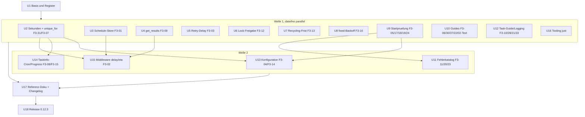
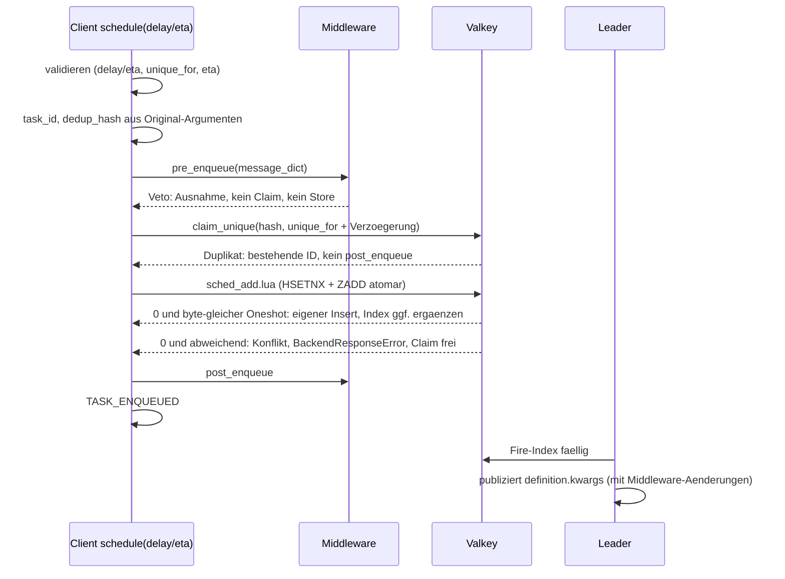

# Fehlersuche Runde 3, Fehlerbehebung 0.12.3 - Plan

## Goal Capsule

- **Objective:** Mit swarmq 0.12.3 laufen verzögerte Tasks nach einer verlorenen Valkey-Antwort wirklich, Middleware-Vetos und Signale gelten auch für `delay`/`eta`, ungültige Grenzwerte scheitern beim Start statt zur Laufzeit, und `swarmq worker --check`, `swarmq check` und die Exitcodes sagen den Start richtig voraus. Doku, Fehlerkatalog und Agent-Spec beschreiben, was der Code tut. Grundlage sind die 25 FEHLER und die entschiedene LÜCKE F3-31 aus `docs/befunde/fehlersuche-runde-3-2026-10.md`.
- **Means:** Units nach Dateien geschnitten, in drei Wellen ohne Dateikonflikte innerhalb einer Welle (KTD1). Jeder Fix folgt der Fix-Recherche in `docs/befunde/fehlersuche-runde-3-recherche/` und lässt das Entscheidungsregister unverletzt (KTD2).
- **Authority:** Entscheidungsregister `compound-packs/swarmq-entscheidungen/` (E-055 bis E-071 und die Nachträge vom 2026-10-15) > dieser Plan > Rechercheberichte. AGENTS.md (TDD, Qualitäts-Gates, Testports) gilt durchgehend.
- **Stop conditions:**
  - Ein Fix ließe sich nur umsetzen, wenn ein Test mit `@pytest.mark.entscheidung` geändert oder gelöscht wird: stoppen und Georg fragen.
  - Ein Fix würde eine offene LÜCKE (F3-32, F3-34, F3-35, F3-36, F3-38) oder eine Frage aus „Open Questions“ mitentscheiden: stoppen.
  - Ein Fix bräuchte ein neues Feld in `ScheduleDefinition`, einen neuen Header oder eine Formatänderung: stoppen (KTD4).
  - `src/swarmq/worker/pipeline.py` würde 800 Zeilen erreichen: stoppen und auslagern (KTD7).
  - Die Loadsuite-Abnahme verfehlt ein Gate (Verlust > 0, Duplikate > 0, Speichertrend): kein Release.
- **Execution profile:** Strenges TDD je Unit nach AGENTS.md. Für die 17 Code-FEHLER und F3-31 existiert der rote Nachweis bereits (`befund`-Marker, `xfail(strict=True)`). Ein Fix gilt erst, wenn sein Nachweis ohne `xfail` grün ist. Zusatzfälle aus den Test-Szenarien werden einzeln zuerst rot geschrieben. Nach jeder Unit folgt ein Review mit vier Linsen (KTD3).
- **Tail ownership:** Push, MR und Merge erst nach Georgs Ok. Der PyPI-Upload bleibt bei Georg (`!`-Befehl).

---

## Product Contract

### Summary

Der Plan behebt alle FEHLER der Fehlersuche Runde 3 in einem Patch-Release 0.12.3 auf Basis von 0.12.2. Siebzehn Befunde brauchen Code, acht nur Doku. Dazu kommen die Normalisierung von `float`-Sekunden (F3-31, E-055), die Doku-Korrekturen zu den Entscheidungen F3-28, F3-29 und F3-30, je ein Doku-Satz zu F3-33 und F3-37 und eine Tooling-Korrektur an `just integration`/`just e2e`. Jeder Fix läuft in beiden Richtungen neben 0.12.0 bis 0.12.2, ohne Formatänderung.

### Problem Frame

Die Fehlersuche Runde 3 hat auf dem Entwurf von 0.12.2 geprüft, wie die Fixes der Runde 2 zusammenspielen, ob Grenzwerte halten und ob die Doku stimmt. Die Gegenprüfung hat 25 FEHLER bestätigt, sechs davon P2: ein Oneshot, der nach einem Transport-Retry nie feuert (F3-01), eine Middleware, die verzögerte Tasks nicht sieht (F3-02), ein negativer `Retry`-Delay, der fremde Publishes scheitern lässt (F3-03), `inf` in Fristfeldern (F3-04), Importfehler mit fünf Neustarts statt Exit 78 (F3-05) und Guides, deren Handler unter `swarmq worker` nie laufen (F3-06). Georg hat am 2026-10-15 alle offenen Produktfragen dazu entschieden (E-055 bis E-071, Nachträge).

Viele Fixes berühren dieselben Dateien (`task.py`, `config_validation.py`, `client/schedule*.py`, `api.md`, Changelog), und `pipeline.py` liegt bei 797 von 800 erlaubten Zeilen. Der Plan legt Schnitt und Reihenfolge so fest, dass parallele Umsetzung ohne Dateikonflikte geht.

### Requirements

**Scheduler und Client**

- R1. Ein Oneshot aus `schedule(delay=/eta=)` hat nach einer verlorenen Valkey-Antwort einen Eintrag im Fire-Index und feuert. Definition und Fire-Index entstehen in einem Schritt, auch bei `swarmq schedule add`. Die CLI meldet bei gleichem Namen weiter „already exists“ (F3-01; E-058).
- R2. `schedule(delay=/eta=)` ruft `pre_enqueue` vor dem Speichern und vor dem Unique-Claim auf; ein Veto verhindert beides. `post_enqueue` und `TASK_ENQUEUED` folgen nach dem Speichern. In-place-Änderungen der Middleware an `kwargs` werden gespeichert und vom Leader publiziert (F3-02; E-059, KTD5).
- R3. `schedule()` und `schedule_many()` lehnen `unique_for <= 0` (auch `0.0`, `-0.5`) sowie `inf`/`nan` mit `ValueError` ab, vor jedem Claim, Publish oder Store (F3-07; E-056).
- R4. `get_results(timeout=0)` liest genau einmal (ein `MGET`). Läuft die Frist während des Wartens ab, folgt ein letzter `MGET` vor `ResultNotReadyError` (F3-09; E-030).

**Grenzwerte und Konfiguration**

- R5. `result_ttl` und `unique_for` nehmen `float` an: ganzzahlige Werte werden `int`, echte Brüche aufgerundet. Das gilt für `TaskInfo`, `SwarmQConfig.result_ttl` und den Aufrufparameter `unique_for` (F3-31; E-055).
- R6. Jede Frist, TTL und Zeitangabe der Konfiguration muss endlich sein. `inf`/`nan` als Argument oder Env-Wert ergeben `ConfigurationError` (Exit 78), die Meldung nennt das ursächliche Feld (F3-04; E-063).
- R7. Ein eingebetteter CPU-Pool ohne `concurrency` nimmt die zugeteilten CPUs wie die CLI. Ein ausdrückliches `concurrency` gewinnt (F3-14; E-061).
- R8. `retry_backoff="fixed"` wartet genau `retry_base_delay`, höchstens `retry_max_delay`, ohne Jitter (F3-16; E-023).
- R9. Ein `TaskInfo`-Cron ohne nächsten Termin (`0 0 30 2 *`) wirft beim Bau `ValueError`. Die Feldzahl-Regel bleibt offen (F3-08; E-065, F3-35).
- R10. `Retry(delay<0)` wird auf 0 geklemmt und zählt normal gegen `max_retries`. `Retry(delay=inf|nan)` wirft `ValueError` beim Erzeugen (F3-03; E-060).

**Worker und Supervisor**

- R11. Im Shutdown wird jedes Lock-Token genau einmal freigegeben, ohne Fehlalarm `task_lock_lost`. Ob der Shutdown Locks noch laufender Handler freigibt, bleibt offen (F3-12; E-071, E-022, F3-32).
- R12. Ein recycelnder Worker bekommt zwischen zwei Heartbeats mindestens `heartbeat_timeout_s`. Der Scale-down-Drain behält `shutdown_timeout + 5 s`, `shutdown_timeout=0` bleibt zulässig (F3-13; E-018 Nachtrag).
- R13. `ProgressInfo.started_at` ist die Wanduhr-Startzeit (UTC) im IO- und CPU-Modus. `elapsed` und `eta_seconds` rechnen weiter monoton (F3-15; E-044 Nachtrag).

**CLI, Exitcodes und Exporte**

- R14. Ein `ImportError` (einschließlich `ModuleNotFoundError`) oder `SyntaxError` beim Import des Task-Moduls, seines Paket-`__init__` oder eines `--configure`-Hooks endet nach einem Versuch mit 78, im Elternprozess wie im Kind. Andere Ausnahmen beim Import bleiben Exit 1 (F3-05; E-057).
- R15. `swarmq worker --check` lehnt jeden Env-Wert ab, den der Start mit 78 ablehnt. Fehlende `SWARMQ_BROKER_URL`/`SWARMQ_BACKEND_URL` prüft es nicht (F3-17; E-062).
- R16. `swarmq check` endet mit 78 für jeden `SWARMQ_*`-Wert, den ein Worker ablehnt, geprüft vor jeder Verbindung. Producer und andere CLI-Befehle werten einen ungültigen Eviction-Modus weiter als `strict` (F3-18; E-006 Nachtrag).
- R17. Jeder `--check`-Payload trägt den vollen Feldsatz einschließlich `pool`, `slots`, `configure`, `metrics_ports` und `health_ports`, unbekannte Werte `null`. Ein Argparse-Fehler endet mit 1, und die Doku sagt das (F3-19; E-062).
- R18. `BrokerPublishBlocked` und `PublishRejected` lassen sich aus `swarmq` importieren (F3-11).

**Doku und Agent-Spec**

- R19. Die Guides registrieren Worker-Signale und Worker-Middleware über einen `--configure`-Hook; Producer-Signale bleiben an der App des Producers (F3-06; E-069).
- R20. Die Task-Doku nennt `queue`, `timeout`, `polling` als Namen, die `schedule()`/`run()` abfangen, mit Ausweg (F3-10; E-064).
- R21. Doku, Fehlerkatalog und `spec/errors.json` sagen: Ein Cancel kommt im Task als `asyncio.CancelledError` an, `TaskCancelledError` nur beim Client (`when: ["result"]`) (F3-20; E-068).
- R22. Der Migrationsschritt in `delivery-semantics` sagt, dass verzögerte Tasks im Scheduler-Store warten und während der Migration weiter feuern (F3-21; E-004).
- R23. `SCHEDULER_LEADER_OUTDATED` heißt „Leader unter der Mindestversion (derzeit 0.12)“ (F3-22; E-029).
- R24. Der maschinenlesbare Fehlerkatalog (EN/DE) führt jede Klasse genau einmal, und ein Test gleicht ihn mit dem erzeugten Katalog ab (F3-23).
- R25. Die CLI-Referenz nennt Exit 78 für ein ungültiges `SWARMQ_NAMESPACE` bei `schedule`, `dlq` und `inspect` (F3-24; E-012 Nachtrag).
- R26. Der DE-Changelog führt unter 0.1.0 den Eintrag zu `swarmq worker --check` (F3-25).
- R27. Task-Guide und API-Referenz sagen: `post_execution` läuft nur bei Erfolg; Aufräumen gehört in `try/finally` oder einen Dishka-`yield`-Finalizer (F3-28; E-067).
- R28. Der Dedup-Absatz zu `delay`/`eta` unterscheidet Producer mit und ohne Registry (F3-29; E-066).
- R29. Middleware-Guide und API-Referenz sagen: Ein Cancel ruft weder `on_error` noch `post_execute`; Zustand je Task räumt man über `TASK_CANCELLED` auf (F3-30; E-068).
- R30. Der Event-Katalog erklärt `task_lock_lost` nach wiederholter Freigabe (F3-33, Option a). Der Rate-Limit-Guide sagt, dass ein Lock-Konflikt einen Rate-Limit-Slot verbraucht (F3-37; E-070).

**Querschnitt**

- R31. Kein Fix ändert einen Test mit `entscheidung`-Marker. Jeder behobene Nachweis verliert `xfail`, behält `befund` und trägt den Marker der festschreibenden Regel. Deren `tests:`-Liste nennt ihn, und ein veraltetes `ohne_test` entfällt. Ausgenommen sind F3-11 und F3-12 ohne festschreibende Regel (KTD2).
- R32. Jeder Fix läuft in beiden Richtungen neben Workern, Leadern und Producern 0.12.0 bis 0.12.2 (Rolling Deploy, Rollback).
- R33. `uv run just integration <pfad>` und `uv run just e2e <pfad>` grenzen auf den Pfad ein; Optionen wie `-k` grenzen nicht ein.
- R34. Vor dem Release bestehen alle Suiten aus dem Verification Contract, die Coverage-Gates und die Loadsuite-Abnahme.

### Key Decisions

Georgs Entscheidungen vom 2026-10-15 stehen im Register; dieser Plan setzt sie um, ohne sie neu zu verhandeln.

- **Patch-Release 0.12.3 auf 0.12.2.** 0.12.2 bleibt unverändert. Governs R1–R34. (session-settled: user-directed — chosen over „Fixes in 0.12.2 aufnehmen“: 0.12.2 ist fertig geprüft und soll nicht wieder aufgehen.)
- **Umfang: alle FEHLER, F3-31, Doku zu F3-28/29/30, Doku-Sätze zu F3-33/F3-37.** Die übrigen LÜCKEN bleiben offen. Governs R5, R27–R30. (session-settled: user-directed — chosen over „LÜCKEN mitentscheiden“: offene Produktfragen klärt Georg getrennt.)
- **F3-10 als Doku-Fix.** `queue` wird nicht reserviert (E-064). Governs R20. (session-settled: user-approved — chosen over „`queue` reservieren“: wäre ein Bruch im Patch-Release.)
- **F3-14 als Code-Fix mit Changelog-Hinweis** (E-061). Governs R7. (session-settled: user-directed — chosen over „Doku sagt Default 10“: Speicherschutz R25 des CPU-Plans gilt auch eingebettet.)
- **`--check` prüft keine fehlenden URLs** (E-062). Governs R15. (session-settled: user-directed — chosen over „URLs mitprüfen“: `--check` läuft in Build-Schritten ohne Secrets.)

### Scope Boundaries

- Offene LÜCKEN ohne Fix in 0.12.3: F3-32 (Lock eines noch laufenden Handlers im Shutdown), F3-34 (Absturzschleife ohne Ausführungsschutz), F3-35 (6/7-feldrige Crons), F3-36 (Cron-Fires durch die Enqueue-Middleware), F3-38 (`concurrency > 65535`). Bei F3-33 und F3-37 nur der Doku-Satz; Tombstone bzw. Slot-Rückgabe bleiben offen.
- Kein Header-Feld in `ScheduleDefinition` und keine Header-API in `MessageContext` (KTD5).
- Keine Klemme im Broker (`RabbitMQBroker.retry_later`) zusätzlich zu `Retry` (KTD6).
- F3-26, F3-27, F3-28, F3-29, F3-30 sind Entscheidungen; der Code bleibt dort, wie er ist.

#### Deferred to Follow-Up Work

- Festschreibender Test „Absturzschleife endet über `execution_guard_max_orphans`“ zum Nachtrag F3-27 in E-046.
- Nebenbefund N-1 (`docs/befunde/fehlersuche-runde-3-recherche/fix-r-cli.md`): Der Pre-Flight in `process_manager/run.py` liest `SWARMQ_CONCURRENCY`/`SWARMQ_SCHEDULER` auch, wenn Flags sie überstimmen. Erst Gegenprüfung nach `docs/befunde/README.md`, dann Fix im Helfer aus U9.
- `TaskInfo.max_age=inf` und `max_age` als `float`, `retry_base_delay=nan`: Kandidaten für die nächste Fehlersuche (nur per Code-Lesung gefunden).
- Learning per `/ce-compound` nach den Fixes: „Transport-Retry und NX-Befehle“ (F3-01 nach FS-06), Ergänzung im Toxiproxy-Spike, Lock-TTL-Learning als teilweise überholt (E-022) markieren.
- AGENTS.md um das Eingrenzen per Pfad ergänzen (U16): braucht Georgs Ok.
- `immutable` (`sig()`) in der Liste reservierter Namen: E-064 nennt den Namen nicht.

### Dependencies

- Branch `fix/fehlersuche-runde-2-p2` (0.12.2-Entwurf), Spitze zum Start von U1 (derzeit `e41e049`). Er enthält inzwischen den main-Stand mit xdist-Integration, Coverage-Ratchet (`fail_under = 96`) und umgebautem `scripts/run-tests.sh` (`--parallel`). `test/fehlersuche-runde-3` @ `580ef3c` zweigt davor ab (`faf6638`) und muss erst darauf gebracht werden (U1).
- Für Release und Mischbetrieb-Suite: 0.12.2 liegt auf PyPI, damit `tests/compat` eine Basis 0.12.2 bekommt (U18).
- Testcontainer auf 5699/15699/6399; Loadsuite-Repo `swarmq-loadsuite` mit Pin auf den rc-Tag.

### Sources

- Befundregister: `docs/befunde/fehlersuche-runde-3-2026-10.md`
- Fix-Recherche je Bereich: `docs/befunde/fehlersuche-runde-3-recherche/fix-r-scheduler-client.md`, `fix-r-config.md`, `fix-r-worker.md`, `fix-r-cli.md`, `fix-r-doku.md`
- Learnings, Register-Guard, Größengrenzen, Review- und Release-Ablauf: `docs/befunde/fehlersuche-runde-3-recherche/fix-r-learnings.md`
- Vorbild: `docs/plans/2026-10-14-0748-fix-fehlersuche-runde-2-plan.md`

---

## Planning Contract

### Key Technical Decisions

- KTD1. **Schnitt nach Dateien, drei Wellen.** Innerhalb einer Welle teilen Units keine Produktions-, Test-, Doku- oder Registerdatei und erzeugen nicht gleichzeitig die Agent-Spec neu. Gemeinsame Doku (`api.md`, `scheduling-and-retries.md`, `configuration.md`, `message-formats.md`, Changelog) ändert nur U17 am Ende; die Texte stehen in den Rechercheberichten. Das Befundregister ändern nur U1 und U18. Konflikte in erzeugten Dateien (`website/reference/agent/spec/*.json`, `website/llms.txt`) löst Neuerzeugen, nicht Mergen.
- KTD2. **Register: Marker, Liste und Nachtrag im selben Commit.** Nach dem Fix verliert der Nachweis `xfail`; `befund("F3-nn")` bleibt als Rückverweis (Praxis Runde 2, etwa `test_befund_fs15_result_wait_polling.py`). Der Marker der festschreibenden Regel kommt dazu, die Node-ID steht in deren `tests:` (gequotet, wenn `: ` vorkommt), `ohne_test` entfällt oder wird auf den Rest gekürzt, und ein Nachtrag „Fix in 0.12.3“ wird zu „behoben in 0.12.3“. Zuordnung: F3-01 E-058, F3-02 E-059, F3-03 E-060, F3-04 E-063, F3-05 E-057, F3-07 E-056, F3-08 E-065, F3-09 E-030, F3-13 E-018, F3-14 E-061, F3-15 E-044, F3-16 E-023, F3-17 und F3-19 E-062, F3-18 E-006, F3-31 E-055. F3-11 und F3-12 bekommen keinen `entscheidung`-Marker: F3-11 hat keine Regel, der F3-12-Nachweis prüft nicht die Reihenfolge, die E-071 festlegt. (pack: swarmq-entscheidungen, README.md)
- KTD3. **Review je Unit mit vier Linsen.** Nach jeder Unit läuft `ce-code-review` mit den Personas correctness, reliability, testing und learnings (Pack `swarmq-entscheidungen`). Die learnings-Linse prüft, was der Guard nicht prüft: markierter Test ohne `tests:`-Eintrag, veraltetes `ohne_test`, fehlender Nachtrag, Widerspruch zu einer Regel. Funde werden als eigene Commits (`fix(review): … (Un)`) behoben, bevor die nächste abhängige Unit startet. Bei parallelen Units im selben Worktree liest das Review per `git show <ref>:<pfad>`.
- KTD4. **F3-01 über ein atomares Lua-Skript plus Oneshot-Idempotenz in der Definitionsschicht.** Neues `sched_add.lua` schreibt `HSETNX` und bei Erfolg `ZADD` in einem Schritt. `ScheduleStore.add_schedule` wertet bei einem Oneshot (`task_id` gesetzt, kein `cron`, Name `oneshot:<task_id>`) ein `False` von `add` als eigenen Insert, wenn der bestehende Eintrag byte-gleich ist (`str` wird vorher zu `bytes`), und ergänzt einen fehlenden Index per `put`. Ein abweichender oder verschwundener Eintrag ist ein Konflikt. Signatur und Vertrag von `ScheduleStore.add` bleiben; `hsetnx_schedule_def` bleibt als Methode (`tests/unit/test_api_breaks_0_2_0.py`). Verworfen: nur Python ohne Lua; dann bliebe ein CLI-Cron nach verlorener Antwort ohne Index, und die bewusste Folge von E-058 wäre nicht harmlos. (pack: swarmq-entscheidungen, e058-oneshot-speichern-idempotent.md)
- KTD5. **F3-02: Reihenfolge im verzögerten Pfad und Hash vor der Middleware.** Validierung (`delay`/`eta`, `_resolve_unique`, `eta` in der Vergangenheit) bleibt vor der Middleware. Danach: `task_id` erzeugen, `dedup_hash` aus den Original-Argumenten berechnen, `pre_enqueue`, Claim mit diesem Hash, Speichern, `post_enqueue`, `TASK_ENQUEUED`. Der Client ruft weiter genau `store.add_schedule(definition)` auf, ohne Keyword-Argumente (Nachweise F3-02/F3-07 und `TestClientScheduleDelayEta` hängen daran). Meldet `add_schedule` `False`, wirft `schedule()` `BackendResponseError`, und der bestehende Rollback gibt den Claim frei. E-059 bekommt einen Nachtrag zu `post_enqueue`, zum Hash und zu Headern.
  - Konflikt mit E-059 (settled, umsetzbar): Die Regel sagt „Header- und Message-Änderungen werden gespeichert“. `MessageContext` hat kein Header-Feld, eine Middleware kann heute keine Header setzen. Umgesetzt werden die In-place-Änderungen an `kwargs` wie im sofortigen Pfad. Ein Header-Feld wäre ein Formatwechsel, den Leader 0.12.0–0.12.2 still verwerfen; das verbietet R32. Der Nachtrag hält fest: Header erst mit einer `MessageContext`-Erweiterung in einer Minor-Version.
  - (pack: swarmq-entscheidungen, e059-enqueue-middleware-ohne-umweg.md)
- KTD6. **F3-03: Klemmen und Prüfen im Konstruktor von `Retry`.** `Retry.__init__` lehnt nicht endliche Werte mit `ValueError` ab und klemmt negative auf `0.0`. So sehen `delay_ms`, `on_retry`, `TASK_RETRYING` und das Log denselben Wert. Verworfen: Klemme im `RetryHandler` (Regel an zwei Stellen) und eine zusätzliche Broker-Klemme (deckt E-060 nicht ab, nur Verteidigung in der Tiefe). Der Integrationsnachweis läuft deshalb über einen echten Worker, nicht über `retry_later`. (pack: swarmq-entscheidungen, e060-retry-delay.md)
- KTD7. **`pipeline.py` wächst nicht.** Kein Fix fügt dort Zeilen hinzu. F3-12 setzt in `worker/gates/lock.py` an: `release_acquired_locks` gibt nur frei, wenn es den Registry-Eintrag selbst entnommen hat. Die dann doppelte Prüfung in `_release_after_teardown` darf als Refactoring entfallen (2 bis 4 Zeilen weniger). Verworfen: Tombstone-Menge im Worker (mehr Zustand, Zeilen in `pipeline.py`, gleiches Atomaritätsproblem).
- KTD8. **Ein Helfer `whole_seconds` für E-055 in eigenem Modul.** `src/swarmq/seconds.py` lässt `None`, `int` und `bool` unverändert, lehnt nicht endliche `float` mit `ValueError` (Feldname in der Meldung) ab und rundet sonst mit `ceil`. Die Bereichsprüfungen laufen vorher auf dem Rohwert: `unique_for` `== 0` bzw. `< 0` vor dem Runden (sonst würde `-0.5` zu `0`). `SwarmQConfig` übersetzt `ValueError` in `ConfigurationError`. `SWARMQ_RESULT_TTL` aus der Umgebung bleibt `int`-geparst (Assumptions).
- KTD9. **Endlichkeit über eine Feldliste.** `_FINITE_FIELDS` = `_POSITIVE_FIELDS` plus `retry_max_delay`, `unknown_task_grace_s`, `shutdown_timeout`, `bind_retry_budget_s`, danach die abgeleiteten `scheduler_dedup_ttl` und `execution_guard_done_ttl_s`. `_validate_finite` prüft die Liste vor allen Relationsprüfungen, überspringt `None` und meldet „`<feld>` must be a finite number“. `log_drain_timeout` bleibt bei seiner eigenen Prüfung. Die Komplexität von `_validate_core` (12 = Grenze) steigt nicht. (pack: swarmq-entscheidungen, e063-fristen-sind-endlich.md)
- KTD10. **F3-14 über einen `int`-Sentinel.** Der Default von `concurrency` ist eine `int`-Unterklasse als Marker „nicht gesetzt“; `_apply_pool_defaults` löst sie über `slots.effective_concurrency` auf. Der öffentliche Feldtyp bleibt `int`, kein Leser ändert sich. Verworfen: `int | None` (jeder Leser braucht `cast`, auch `pipeline.py`) und `0` als „automatisch“ (verdeckt Tippfehler).
- KTD11. **F3-08 mit `croniter.get_next` im Konstruktor.** `CroniterBadDateError` wird zu „has no next fire time“, vor dem allgemeinen `ValueError`-Zweig. Kein Import aus `swarmq.scheduler` (Paketzyklus). Der Leader prüft weiter (E-065).
- KTD12. **F3-15 mit zwei Zeitwerten.** Ein zweites Attribut hält die Wanduhr-Startzeit; `_task_start_time` bleibt monoton, weil die E-044-Tests es direkt setzen.
- KTD13. **F3-13: Recycling-Frist mit `max`.** Für `INTENT_RECYCLE` gilt `max(shutdown_grace_s + SHUTDOWN_TERM_S, heartbeat_timeout_s)`, für `INTENT_DRAINING` unverändert `shutdown_grace_s + SHUTDOWN_TERM_S`. Bewusste Folge, als Satz in den E-018-Nachtrag: Ein eingefrorener Recycler wird mit Defaults nach bis zu 60 s statt 35 s beendet.
- KTD14. **F3-05: breiter Fang im Entry, `SyntaxError` im Eltern-Pre-Flight.** `process_manager/entry.py` fängt `ConfigurationError`, `ImportError` und `SyntaxError` im selben `except`-Tupel (keine neue Anweisung in `worker_subprocess_entry`, die bei 60 Anweisungen an der Grenze liegt). `error_type` bleibt der Klassenname. `_validate_module_importable` fängt zusätzlich `SyntaxError`. Verworfen: enge Hülle am Importaufruf mit neuer Unterklasse (Sonderlogik für `error_type`, kein Gewinn).
- KTD15. **Ein Helfer für die Startkonfiguration (F3-17, F3-18).** `process_manager/check.py` bekommt einen Helfer, der `SwarmQConfig` genau wie der Pre-Flight in `run.py` baut; fehlende URLs ersetzt er durch Platzhalter (`*.invalid`). `run.py`, `--check` und `swarmq check` nutzen ihn. `swarmq check` ruft ihn vor jeder Verbindung und nimmt `scheduler` per `resolved_fields` aus, damit `_scheduler_section` die eine Stelle für diesen Wert bleibt. Der Helfer bildet den heutigen Pre-Flight ab, ohne `worker_config_kwargs` (N-1 bleibt offen).
- KTD16. **F3-19: eine Schlüsselquelle.** `metrics_ports` und `health_ports` kommen in `_WORKER_CHECK_PAYLOAD_KEYS`; Erfolgs-, Fehler- und Argparse-Pfad bauen den Payload aus dieser Konstante.
- KTD17. **Changelog und gemeinsame Referenz-Doku zuletzt (U17).** Der Abschnitt `## [0.12.3] — unreleased` entsteht erst in U17 und sammelt alle Einträge samt Upgrade-Hinweisen aus den Rechercheberichten. Bis dahin ändert keine Unit den Changelog.
- KTD18. **Abnahme wie Runde 2.** rc-Tag `v0.12.3rc1`, Mischbetrieb-Suite mit Basis 0.12.2, Loadsuite 1 h und 6 h auf dem rc-Tag, dann finales Tag auf dem Merge-Commit.

### High-Level Technical Design

**Wellen und Abhängigkeiten der Units**

**Verzögerter Pfad nach F3-01 und F3-02 (KTD4, KTD5)**

**Dateieigentum je Welle (Konfliktfreiheit, KTD1)**

| Datei | Unit |
|---|---|
| `src/swarmq/task.py` | U2 (`_validate_unique`, `__init__`), danach U14 (Cron, Progress) |
| `src/swarmq/config_validation.py` | U2 (`result_ttl`), danach U13 |
| `src/swarmq/config.py` | U9 (nur Docstring `env_valkey_eviction_check`), danach U13 |
| `src/swarmq/client/schedule_resolve.py` | U2 |
| `src/swarmq/client/schedule.py`, `src/swarmq/app.py` | U15 |
| `src/swarmq/client/results.py` | U4, danach U15 (nur Signatur) |
| `tests/unit/worker/test_retry.py` | U5 |
| `src/swarmq/process_manager/check.py`, `entry.py`, `run.py` | U9 |
| `src/swarmq/agent_spec.py`, `src/swarmq/__init__.py` | U11 |
| `website/reference/cli*.md` | U9 |
| `website/guides/signals*`, `middleware*`, `rate-limiting*`, `locking-and-dedup*` | U10 |
| `website/reference/errors*`, `agent/error-catalog-machine*` | U11 |
| `website/guides/defining-tasks*`, `explanation/delivery-semantics*`, `reference/logging*` | U12 |
| `website/guides/cpu-mode*` | U13 |
| `api*`, `scheduling-and-retries*`, `configuration*`, `agent/message-formats*`, Changelog | U17 |
| `docs/befunde/fehlersuche-runde-3-2026-10.md` | U1, U18 |

### Assumptions

- `SWARMQ_RESULT_TTL` aus der Umgebung bleibt `int`-geparst; E-055 spricht nur von Argumenten. `bool` in `result_ttl`/`unique_for` bleibt unverändert.
- Bei F3-01 gilt ein Eintrag, der zwischen `HSETNX` und dem Lesen verschwindet, als Konflikt (E-058 regelt den Fall nicht; konservativ).
- `post_enqueue` läuft im verzögerten Pfad nach dem Speichern (E-059 nennt nur `TASK_ENQUEUED`; die Doku koppelt `post_enqueue` an den erfolgreichen Enqueue). Nachtrag in E-059.
- `-0.0` und Werte in `(-0,001; 0)` bei `Retry` ergeben wie heute `delay_ms = 0`.
- Eine Unit-Datei mit über 100 ms je Test (echtes just/bash, Event-gesteuerter Cancel) trägt ihre Begründung im Kopf, wie `tests/unit/test_justfile.py` heute.

### Sequencing

- U1 vor allem anderen; es legt die Basis auf die Spitze von `fix/fehlersuche-runde-2-p2`.
- Welle 1 parallel. Innerhalb von U9 zuerst F3-05, dann F3-17 mit dem Helfer, dann F3-19, dann F3-18.
- Welle 2: U13 nach U2 und U9; U14 nach U2; U15 nach U2, U3 und U4; U11 nach U9. U13, U14 und U15 sind untereinander dateifrei.
- U17 nach allen Code-Units, weil es deren Verhalten beschreibt. U18 zuletzt, nach dem Release von 0.12.2.
- Unit-Gates je Unit einzeln prüfen, nicht im gemeinsamen Lauf mehrerer fertiger Units (Runde 2: vermischte Fixtures).

### Risks

| Risiko | Wirkung | Gegenmaßnahme |
|---|---|---|
| F3-02 ändert, was Producer-Middleware sieht | Middleware mit Veto blockiert jetzt auch `delay`/`eta`; Zähler-Middleware sieht mehr Aufrufe | Upgrade-Hinweis (U17); Tests für Veto, Duplikat, Fehlerpfad (U15) |
| F3-02 Hash nach Middleware | Dedup verzögerter Aufrufe wirkungslos, wenn Middleware je Aufruf `kwargs` ergänzt | Hash aus Original-Argumenten (KTD5), Test mit `correlation_id`-Middleware |
| F3-02 und Leader-Rückfall E-032 | Bei `source="cli"` (Producer ohne Registry) hasht der Leader beim Fire die gespeicherten `kwargs` samt Middleware-Ergänzung; ergänzt eine Middleware je Aufruf `kwargs`, greift die Dedup dieser verzögerten Aufrufe nicht mehr | Doku-Satz im Dedup-Absatz (U17 Schritt 2) und Upgrade-Hinweis (U17 Schritt 5); Frage unter Open Questions |
| F3-01 neues Lua-Skript | Golden-Vertrag, Skript-Cache, Cluster-Slot | Golden-Zeilen ergänzen, beide Keys mit Hash-Tag `{sched}`, Integrationstest unter Testports (U3) |
| F3-04/F3-08/F3-14/F3-16 ändern Startverhalten oder Wartezeiten | Bestehende Deployments mit `inf`, Cron ohne Termin oder großem `fixed`-Delay verhalten sich anders | Upgrade-Hinweise im Changelog (U17); `--check` meldet es nach U9 vorher |
| F3-31 und der Cron-Abdruck im Mischbetrieb | 0.12.2-Worker mit `unique_for=3600.0` und 0.12.3-Worker melden verschiedene Abdrücke | Upgrade-Hinweis; der Konflikt endet, wenn alle Worker neu sind (U17) |
| F3-17/F3-18 in Entwicklerumgebungen | Ein kaputter `SWARMQ_*`-Wert in der Shell lässt `--check`-Tests scheitern | Tests setzen ihre Umgebung per `monkeypatch` ausdrücklich |
| Lange Wartezeit über 49,7 Tage | Broker lehnt `expiration` ab wie bei F3-03 | Nicht von E-060 gedeckt; offene Frage an Georg |
| Paralleles Arbeiten im selben Worktree | `prek` stasht fremde Dateien, gemeinsame Läufe vermischen Fixtures | Gates je Unit vorher manuell, Commit mit `--no-verify` nur dann; Unit-Läufe getrennt |

### System-Wide Impact

- **Betrieb:** Neue Exit-78-Fälle beim Start (`inf`, Importfehler) und bei `swarmq check`; `--check` scheitert früher. Eingebettete CPU-Pools bekommen weniger Slots. Ein eingefrorener Recycler lebt bis zu 25 s länger.
- **Producer (Phoenix):** F3-02 und F3-07 wirken erst, wenn die Producer-Dienste auf 0.12.3 sind.
- **Agent-Spec:** `spec/errors.json` (`TaskCancelledError.when`), `spec/cli.json` und `llms.txt` (Hilfetexte) ändern sich; kein Schemawechsel.
- **Register:** Nachträge in E-018, E-059, E-071 und Textkorrekturen in E-012/E-018; alle Regeln E-055 bis E-063 verlieren ihr `ohne_test`.

### Open Questions

Keine blockierenden. Zur Klärung mit Georg, ohne Fix in 0.12.3:

- F3-03-Nachbar: Soll eine endliche, aber zu große Wartezeit (über etwa 49,7 Tage, RabbitMQ `check_expiry`) bei `Retry(delay=…)` und `retry_max_delay` geklemmt oder abgelehnt werden?
- E-057: Ein `ValueError` in einem Paket-`__init__` ergibt im Elternprozess schon heute 78 (`check.py`), nach dem Wortlaut der Regel wäre es 1. Präzisieren oder ändern?
- E-055 nennt `unique_for` in `SwarmQConfig`; das Feld gibt es dort nicht. Textkorrektur der Regel?
- E-032/F3-02: Soll der Leader bei `source="cli"` künftig einen vom Producer gespeicherten Hash der Original-Argumente nutzen? Das wäre ein neues Definitionsfeld und gehört in eine Minor-Version.
- E-058: Ein falscher Konflikt ist möglich, wenn der Leader einen Oneshot zwischen verlorener Antwort und Wiederholung umschreibt (`unroutable_since`). „Entscheidung überdenken?“ mit dem Argument, dass die frische uuid7 im Namen die Herkunft schon beweist.

---

## Implementation Units

| U-ID | Titel | Hauptdateien | Abhängig von |
|---|---|---|---|
| U1 | Basis und Register-Vorbereitung | Branch, Befundregister, Register-Texte, `pyproject.toml` | – |
| U2 | Sekundenfelder und `unique_for` am Aufruf (F3-31, F3-07) | `seconds.py`, `task.py`, `config_validation.py`, `client/schedule_resolve.py` | U1 |
| U3 | Atomares Speichern von Schedules (F3-01) | `lua/sched_add.lua`, `backend/valkey/schedules.py`, `scheduler/definition.py` | U1 |
| U4 | `get_results` mit Frist (F3-09) | `client/results.py` | U1 |
| U5 | Retry-Wartezeit (F3-03) | `exceptions.py` | U1 |
| U6 | Lock-Freigabe im Shutdown (F3-12) | `worker/gates/lock.py` | U1 |
| U7 | Heartbeat-Frist beim Recycling (F3-13) | `process_manager/restart_budget.py` | U1 |
| U8 | `fixed`-Backoff mit Deckel (F3-16) | `backoff.py` | U1 |
| U9 | Startprüfung und Exitcodes (F3-05, F3-17, F3-18, F3-19, F3-24) | `process_manager/*`, `cli/check_cmd.py`, `cli/env_check_cmd.py`, `cli.md` | U1 |
| U10 | Guides: CLI-App, Middleware, Rate-Limit (F3-06, F3-30, F3-37, F3-22, F3-02-Text) | `website/guides/signals*`, `middleware*`, `rate-limiting*`, `locking-and-dedup*` | U1 |
| U11 | Fehlerkatalog, Spec, Exporte (F3-11, F3-20, F3-23) | `__init__.py`, `agent_spec.py`, `errors*`, `error-catalog-machine*` | U9 |
| U12 | Task-Guide, Migration, Logging (F3-10, F3-28, F3-21, F3-33) | `defining-tasks*`, `delivery-semantics*`, `logging*` | U1 |
| U13 | Konfiguration (F3-04, F3-14) | `config.py`, `config_validation.py`, `cli/_shared.py` | U2, U9 |
| U14 | TaskInfo-Cron und Progress (F3-08, F3-15) | `task.py`, `worker/execution.py`, `worker/compute/child.py` | U2 |
| U15 | Enqueue-Middleware bei `delay`/`eta` (F3-02) | `client/schedule.py`, `client/results.py`, `app.py` (Signaturen) | U2, U3, U4 |
| U16 | Tooling: Pfad-Argument bei `just` | `justfile`, `scripts/run-tests.sh` | U1 |
| U17 | Referenz-Doku und Changelog | `api*`, `scheduling-and-retries*`, `configuration*`, `message-formats*`, Changelog | U2–U16 |
| U18 | Release 0.12.3 | Version, `uv.lock`, compat, Tag, Befundregister | U17 |

Jede Unit endet mit dem Review nach KTD3. Für Code-Units gilt zusätzlich KTD2 (Marker, `tests:`, `ohne_test`, Nachtrag).

### U1. Basis und Register-Vorbereitung

- **Goal:** Die Fix-Arbeit setzt auf dem aktuellen 0.12.2-Entwurf auf, und das Register ist frei von veralteten Texten.
- **Requirements:** R31.
- **Dependencies:** keine.
- **Files:** neuer Branch `fix/fehlersuche-runde-3` von der Spitze von `fix/fehlersuche-runde-2-p2` zum Start von U1 (derzeit `e41e049`) mit `test/fehlersuche-runde-3` (inkl. dieses Plans und `docs/befunde/fehlersuche-runde-3-recherche/`); `docs/befunde/fehlersuche-runde-3-2026-10.md`; `compound-packs/swarmq-entscheidungen/e012-*.md`, `e018-*.md`; `pyproject.toml` (Beschreibung des `befund`-Markers).
- **Approach:**
  1. `test/fehlersuche-runde-3` auf den Stand von `fix/fehlersuche-runde-2-p2` bringen (Merge oder Rebase, Konflikte lösen); danach `uv lock --check`.
  2. Nachträge berichtigen: E-012 (F3-24) und E-018 (3) nennen ihre Tests noch „ohne `entscheidung`-Marker“, beide sind seit `580ef3c` markiert und gelistet.
  3. Befundregister, Tabelle „Nachweis-Tests“: Dateien existieren seit `968ff7f`, F3-31 ergänzen, F3-03-Integrationsnachweis als „über einen echten Worker“ beschreiben.
  4. `pyproject.toml`: Beschreibung von `befund` auf „offen mit xfail strict=True; nach dem Fix ohne xfail als Rückverweis“ ändern (KTD2).
- **Test expectation:** none -- Branch, Register-Text und Marker-Beschreibung; der Register-Guard bleibt grün.
- **Verification:** Alle Gates auf der neuen Basis grün; `uv run just unit -m befund` zeigt alle F3-Nachweise als XFAIL, keinen XPASS.

### U2. Sekundenfelder und `unique_for` am Aufruf (F3-31, F3-07)

- **Goal:** `float`-Sekunden legen keinen Worker mehr lahm, und `unique_for <= 0` am Aufruf scheitert sofort.
- **Requirements:** R3, R5.
- **Dependencies:** U1.
- **Files:** `src/swarmq/seconds.py` (neu), `src/swarmq/task.py` (`__init__`-Signatur für `result_ttl`/`unique_for` auf `float | None`, `_validate_unique`, `__post_init__`), `src/swarmq/config_validation.py` (Block `result_ttl`), `src/swarmq/client/schedule_resolve.py` (`_resolve_unique`, ausdrücklicher Zweig); Tests `tests/unit/test_seconds.py` (neu), `tests/unit/test_befund_f3_31_float_ttl_normalized.py`, `tests/unit/client/test_befund_f3_07_call_unique_for_bounds.py`, `tests/unit/client/test_schedule_resolve.py` (neu), `tests/unit/test_task.py`, `tests/unit/test_config.py`, `tests/unit/scheduler/test_reports.py`; Register `e055-*.md`, `e056-*.md`.
- **Approach:**
  1. Helfer nach KTD8; Rohwert-Prüfungen vor dem Runden.
  2. `TaskInfo` normalisiert per `object.__setattr__` (Muster `normalize_timezone`).
  3. `SwarmQConfig` normalisiert `result_ttl` vor der Prüfung `< 0` und übersetzt `ValueError` in `ConfigurationError`.
  4. `_resolve_unique` prüft und normalisiert einen ausdrücklichen Wert und nimmt dafür `float` an; `None` (E-033) und `_MISSING` bleiben unberührt. Die TTL-Rechnungen in `client/schedule.py` bekommen damit immer `int`, ohne Änderung dort. Die öffentlichen Signaturen (`schedule`, `schedule_many`, `app.py`, Protokoll in `client/results.py`) erweitert U15; bis dahin rufen die U2-Tests mit `cast` auf wie der F3-31-Nachweis.
- **Patterns to follow:** `normalize_timezone` in `config.py`, `_MISSING`-Sentinel (`docs/solutions/patterns/r3-5-unique-tasks-implementation-learnings-2026-04-17.md`, Pattern 6 und 10).
- **Test scenarios:**
  - Nachweise F3-31: `86400.0` → `86400`, `1.5` → `2`, `0.5` → `1`, Typ `int`, für `TaskInfo.result_ttl`, `TaskInfo.unique_for`, `SwarmQConfig.result_ttl`.
  - Nachweise F3-07: `0` und `-5` an `schedule` sofort, verzögert und `schedule_many` → `ValueError` mit „unique_for“, kein Claim, kein Publish, kein Store.
  - `TaskInfo(unique_for=0.0)` → „use None to disable dedup“; `unique_for=-0.5` → „must be > 0“ (nicht „unique_for=0“).
  - `0.0` und `-0.5` am Aufruf in allen drei Pfaden → `ValueError` ohne Claim.
  - `TaskInfo(result_ttl=float("inf"))`, `unique_for=float("nan")` → `ValueError` mit Feldname; `SwarmQConfig(result_ttl=float("inf"))` → `ConfigurationError` mit `result_ttl`.
  - `schedule(…, unique_for=0.2)` → `claim_unique(…, ttl_ms=1000)` als `int`; `unique_for=3600.0` → `3_600_000`; verzögert `delay=10`, `unique_for=1.5` → `(2 + 10) * 1000`.
  - `inf`/`nan` am Aufruf → `ValueError` mit „unique_for“.
  - Cron-Meldung mit `unique_for=3600.0` → gemeldete `ScheduleDefinition` dekodiert mit `unique_for == 3600`.
  - `TaskInfo(result_ttl=0.0)` → `0`; `True` bleibt unverändert.
  - `SWARMQ_RESULT_TTL=1.5` bleibt `ConfigurationError`.
- **Verification:** Nachweise F3-31 und F3-07 ohne `xfail` grün, Marker E-055 bzw. E-056; E-055 und E-056 ohne `ohne_test`.

### U3. Atomares Speichern von Schedules (F3-01)

- **Goal:** Nach einer verlorenen Valkey-Antwort hat jeder gespeicherte Schedule Definition und Fire-Index.
- **Requirements:** R1, R32.
- **Dependencies:** U1.
- **Files:** `src/swarmq/lua/sched_add.lua` (neu), `src/swarmq/backend/valkey/schedules.py` (`add`), `src/swarmq/scheduler/definition.py` (`add_schedule`); Tests `tests/integration/backend/test_befund_f3_01_schedule_add_lost_reply.py` (verlorene Antwort auf `EVALSHA` statt `HSETNX`; Docstring „Entscheidung 4“ → E-058), `tests/unit/backend/test_valkey_schedules.py` (Skript-Fixture, drei HSETNX/ZADD-Tests, `TestErrorWrapping`), `tests/unit/scheduler/test_definition.py`, `tests/integration/backend/golden/lua_contract.txt`, `tests/integration/backend/_golden.py`, neuer Integrationstest für `sched_add`; Register `e058-*.md`.
- **Approach:** Nach KTD4. Der Client-Anteil (Fehler bei `False`) gehört zu U15. Der In-Memory-Store in `tests/support/inmemory/backend.py` ist schon atomar.
- **Execution note:** Den Integrationsnachweis zuerst auf `EVALSHA` umstellen und rot sehen; er trägt keinen `entscheidung`-Marker und darf angepasst werden.
- **Test scenarios:**
  - Nachweis F3-01: verlorene `EVALSHA`-Antwort bei `schedule(delay=60)` → ID zurück, Definition vorhanden, `fire_ts` gesetzt.
  - Definitionsschicht: Oneshot, `add` → `False`, `get` → dieselben Bytes, Score vorhanden → `True`, kein `put`.
  - Wie oben ohne Score → genau ein `put(name, payload, fire_ts)`, `True`.
  - `get` liefert `str` mit gleichem Inhalt → `True`.
  - Abweichende Bytes (`unroutable_since` gesetzt) → `False`, kein `put`.
  - `get` → `None` → `False`.
  - CLI-artige Definition (`task_id=None`, `--at`) mit `add` → `False` → `False`, kein `get` (E-058).
  - Cron-Definition mit `add` → `False` → `False` (`test_add_schedule_existing_entry_is_noop` bleibt grün).
  - Store-Unit: `add` ruft das Skript mit `keys=[defs, zset]`, `args=[name, payload, fire_ts]`, ohne Fire-Zeitpunkt `""`; 1 → `True`, 0 → `False`; Skriptfehler → `BackendConnectionError`.
  - Integration: `sched_add` mit bestehendem Eintrag → 0, Definition und Score unverändert; ohne `fire_ts` kein Index.
  - Integration: verlorene Antwort bei einer CLI-Cron-Definition → Score vorhanden, `add_schedule` meldet `False` („already exists“).
- **Verification:** Nachweis ohne `xfail` grün, Marker E-058; Golden-Vertrag mit zwei neuen Zeilen; `uv run just integration` grün.

### U4. `get_results` mit Frist (F3-09)

- **Goal:** `get_results` liest bei `timeout=0` einmal und nach Fristablauf ein letztes Mal.
- **Requirements:** R4.
- **Dependencies:** U1.
- **Files:** `src/swarmq/client/results.py`; Tests `tests/unit/client/test_befund_f3_09_get_results_timeout_zero.py`, `tests/unit/client/test_results.py`; Register `e030-*.md`.
- **Approach:** Erst lesen, dann Restfrist prüfen, Schlaf auf `min(poll_interval, Rest)` kürzen.
- **Patterns to follow:** `WorkflowHandle.get` in `src/swarmq/workflow_orchestration.py`.
- **Test scenarios:**
  - Nachweise: `timeout=0` → genau ein `MGET`, Ergebnisse da; `timeout=0.05`, `poll_interval=0.1`, zweites `MGET` bringt das Ergebnis → genau zwei.
  - `timeout=0`, Ergebnis fehlt → ein `MGET`, dann `ResultNotReadyError` mit den fehlenden IDs.
  - `timeout=0.05`, `poll_interval=1.0` → protokollierter Schlaf `0.05`, nicht `1.0`.
  - Teilergebnis `[x, None]` → Meldung nennt nur die fehlende ID.
- **Verification:** Nachweise ohne `xfail` grün, Marker E-030; FS-15-Tests unverändert grün.

### U5. Retry-Wartezeit (F3-03)

- **Goal:** Ein negativer `Retry`-Delay schließt keinen Publish-Kanal mehr und zählt gegen `max_retries`.
- **Requirements:** R10, R32.
- **Dependencies:** U1.
- **Files:** `src/swarmq/exceptions.py` (`Retry.__init__`); Tests `tests/unit/worker/test_befund_f3_03_retry_negative_delay.py`, `tests/unit/worker/test_retry.py` (Zusatzfälle in neuer Testklasse), `tests/integration/broker/test_befund_f3_03_negative_expiration.py` (neu, über einen echten Worker); Register `e060-*.md`.
- **Approach:** Nach KTD6. Den Text für `errors.md` schreibt U11, den für `scheduling-and-retries.md` U17.
- **Execution note:** Den Integrationsnachweis zuerst rot schreiben (`uv run just integration` mit Pfad, nach U16; sonst ganze Suite).
- **Test scenarios:**
  - Nachweis: `Retry(delay=-5.0)` → `retry_later(delay_ms=0)`, Header `retry_count=1`, kein `redeliver`.
  - Nachweis: `Retry(delay=inf|nan)` → `ValueError` mit „delay“; zusätzlich `-inf`.
  - `Retry(delay=-0.0)` und `Retry(delay=-0.0005)` → `delay_ms == 0`.
  - `Retry(delay=0)` → Ziel `{queue}.DQ.1s`, wenn deklariert.
  - Budget: `max_retries=2`, Header `retry_count=2`, `Retry(delay=-5)` → terminal, kein `retry_later`.
  - `on_retry` und `TASK_RETRYING` erhalten `delay=0`.
  - Gepickeltes `Retry` aus dem CPU-Kind behält den geklemmten Wert (`test_envelope.py` bleibt grün).
  - Integration: Task wirft immer `Retry(delay=-5)`, `max_retries=2` → drei Läufe, danach DLQ; parallel 20 normale Publishes, keiner endet in `PublishIndeterminate` oder `BrokerConnectionError`.
- **Verification:** Nachweise ohne `xfail` grün, Marker E-060; Integrationsnachweis vor dem Fix rot, danach grün.

### U6. Lock-Freigabe im Shutdown (F3-12)

- **Goal:** Shutdown und `finally` des Handlers geben dasselbe Token nie doppelt frei.
- **Requirements:** R11.
- **Dependencies:** U1.
- **Files:** `src/swarmq/worker/gates/lock.py` (`release_acquired_locks`), optional `src/swarmq/worker/pipeline.py` (nur Entfernen der doppelten Prüfung in `_release_after_teardown`); Tests `tests/unit/worker/test_befund_f3_12_shutdown_double_release.py`, `tests/unit/worker/test_lock_lost_at_shutdown.py`; Register `e071-*.md` (Text „behoben in 0.12.3“ im Absatz „Überdenken“, `tests:` und `ohne_test` bleiben).
- **Approach:** Nach KTD7. F3-32 nicht festschreiben.
- **Patterns to follow:** `f21459f` (Shutdown entnimmt Lock-Einträge vor der Freigabe); `docs/solutions/patterns/invarianten-der-worker-pipeline-2026-08.md` (nur der Besitzer gibt per Token frei).
- **Test scenarios:**
  - Nachweis: Shutdown räumt ab, danach `finally` des Handlers → je Token eine Freigabe, kein `task_lock_lost`.
  - `release_acquired_locks(store, {}, handler_id, [token], drop=spy)` → kein `release`, kein `drop`, kein Log.
  - Registry mit Eintrag und `release` → `False` → weiter `task_lock_lost` (bestehender Test).
  - Semaphor-Lock mit zwei Tokens desselben Handlers, Shutdown räumt ab → je Token eine Freigabe.
  - Renn-Tests in `tests/unit/worker/test_pipeline_finally.py` bleiben grün, auch nach dem optionalen Refactoring.
- **Verification:** Nachweis ohne `xfail` grün; `pipeline.py` nicht länger als 797 Zeilen.

### U7. Heartbeat-Frist beim Recycling (F3-13)

- **Goal:** Der Supervisor hält einen gesunden recycelnden Worker nicht für hängend.
- **Requirements:** R12.
- **Dependencies:** U1.
- **Files:** `src/swarmq/process_manager/restart_budget.py` (`_heartbeat_deadline`); Tests `tests/unit/process_manager/test_befund_f3_13_recycle_heartbeat_deadline.py`; Register `e018-*.md` (bewusste Folge nach KTD13, Absatz „Überdenken“ zu `restart_budget.py` anpassen).
- **Approach:** Nach KTD13. Den Doku-Satz in `configuration.md` schreibt U17, die Event-Zeile `worker_hung_during_drain` U12.
- **Test scenarios:**
  - Nachweis: Recycler bestätigt, Gnade 10 s, `heartbeat_timeout_s=60`, letzter Beat vor 16 s → kein SIGTERM, kein `worker_hung_during_drain`.
  - Scale-down: `mark_draining()`, Gnade 10 s, Beat vor 16 s → SIGTERM, `worker_hung_during_drain` mit `deadline_s=15`.
  - `shutdown_grace_s=0`, Recycler: Beat vor 30 s → kein SIGTERM; Beat vor 61 s → SIGTERM, `deadline_s=60`.
  - `shutdown_grace_s=100`, `heartbeat_timeout_s=60`, Recycler, Beat vor 70 s → kein SIGTERM (Frist 105).
  - Eingefrorener Recycler (`test_acknowledged_recycler_that_freezes_in_drain_is_killed_not_replaced`) → SIGTERM, kein zweiter Ersatz.
- **Verification:** Nachweis ohne `xfail` grün, Marker E-018; alle E-018- und E-038-Tests unverändert grün.

### U8. `fixed`-Backoff mit Deckel (F3-16)

- **Goal:** `fixed` hält `retry_max_delay` ein, und damit die Invariante `scheduler_dedup_ttl >= retry_max_delay`.
- **Requirements:** R8.
- **Dependencies:** U1.
- **Files:** `src/swarmq/backoff.py` (Zweig `fixed`, Docstring); Tests `tests/unit/test_befund_f3_16_fixed_backoff_cap.py`, `tests/property/test_backoff_properties.py` (`test_fixed_ignores_attempt_and_cap` auf `min(base, max_delay)` umstellen und umbenennen, Modul-Docstring), `tests/unit/test_backoff.py` (nur Kommentar); Register `e023-*.md`. Der Aufrufer-Fall steht im F3-16-Nachweis, nicht in `tests/unit/worker/test_retry.py` (gehört U5).
- **Approach:** `min(base_delay, max_delay)` nach dem E-023-Nachtrag. Der Property-Test trägt keinen Marker und schreibt das jetzt entschiedene Gegenteil fest; seine Anpassung ist kein Abschwächen.
- **Test scenarios:**
  - Nachweis: `calculate_backoff(attempt, "fixed", 7200, 3600) == 3600.0` für Versuch 0, 3, 100.
  - Property: `fixed` liefert `min(base, max_delay)`, unabhängig vom Versuch.
  - `base == max_delay` → genau dieser Wert.
  - `RetryHandler` mit `fixed`, `retry_base_delay=7200`, `retry_max_delay=3600` → `delay_ms == 3_600_000` (neuer Test in `tests/unit/test_befund_f3_16_fixed_backoff_cap.py`).
  - `test_backoff.py::test_fixed_strategy_returns_base_delay` (E-023) bleibt unverändert grün.
- **Verification:** Nachweis ohne `xfail` grün, Marker E-023; `uv run just property` grün.

### U9. Startprüfung und Exitcodes (F3-05, F3-17, F3-18, F3-19, F3-24)

- **Goal:** Importfehler, `--check` und `swarmq check` sagen den Start richtig voraus, und die CLI-Referenz nennt die richtigen Exitcodes.
- **Requirements:** R14, R15, R16, R17, R25.
- **Dependencies:** U1.
- **Files:** `src/swarmq/process_manager/entry.py`, `src/swarmq/process_manager/check.py` (`_validate_module_importable`, neuer Helfer nach KTD15), `src/swarmq/process_manager/run.py`, `src/swarmq/cli/check_cmd.py`, `src/swarmq/cli/env_check_cmd.py` (Vorprüfung, Modul-Docstring), `src/swarmq/cli/parser.py` (Hilfe `--check`), `src/swarmq/cli/parser_ops.py` (Hilfe `check`), `src/swarmq/config.py` (nur Docstring `env_valkey_eviction_check`), erzeugt `website/reference/agent/spec/cli.json`, `website/llms.txt`; Doku `website/reference/cli.md`, `cli.de.md`; Tests `tests/unit/process_manager/test_befund_f3_05_import_error_exit78.py`, `tests/unit/test_befund_f3_17_worker_check_env.py`, `tests/unit/test_befund_f3_18_check_invalid_config_exit78.py`, `tests/unit/test_befund_f3_19_check_argparse_payload.py` (`_CONTRACT_KEYS` um die Ports ergänzen), `tests/unit/process_manager/test_check.py`, `tests/unit/test_cli_env_check.py`, `tests/unit/test_cli_multiprocess.py`, `tests/unit/test_cli_env_check_namespace.py`; Register `e057-*.md`, `e062-*.md`, `e006-*.md`.
- **Approach:**
  1. F3-05 nach KTD14; Kommentar im Entry auf E-057 umstellen.
  2. F3-17 nach KTD15: Helfer, `run.py` darauf umstellen, `_run_worker_check` ruft ihn nach `check_worker_config` und vor `_check_task_injection`; `_check_logging_settings` gibt seine `settings` zurück.
  3. F3-19 nach KTD16.
  4. F3-18: Vorprüfung in `run_env_check` nach dem URL-Check, `swarmq check: <Meldung>` auf stderr, Rückgabe 78.
  5. F3-24 und die Exitcode-Texte zu F3-05, F3-17, F3-18 in `cli.md`/`cli.de.md` (Texte in `fix-r-cli.md`); danach Spec neu erzeugen.
- **Test scenarios:**
  - F3-05 Nachweise: Kind mit `from os import gibt_es_nicht` → 78, `worker_config_error` nennt den Namen; Syntaxfehler → 78, `error_type == "SyntaxError"`.
  - Kind mit `IndentationError` → 78.
  - Task-Modul mit `raise ValueError("x")` auf Modulebene → keine 78, die Ausnahme verlässt das Entry (Marker E-057).
  - Eltern: `--module pkg.tasks` mit Syntaxfehler in `pkg/__init__.py` → rc 78, kein Traceback auf stderr.
  - `--configure` mit Hook-Modul voller `SyntaxError` → 78.
  - `RecycleAckTimeout` bleibt 75, `ForkSourceRejected` 71.
  - F3-17 Nachweis: `SWARMQ_SCHEDULER=maybe`, `SWARMQ_CONCURRENCY=0`, `SWARMQ_SHUTDOWN_TIMEOUT=abc`, `SWARMQ_VALKEY_EVICTION_CHECK=bogus` → `ok: false`, rc 1, `ConfigurationError`.
  - Gültige Umgebung, URL-Variablen per `delenv` entfernt → `ok: true`, rc 0 (Marker E-062).
  - `SWARMQ_QUEUE_TYPE=foo` → `ok: false`.
  - Gleichlauf: Jeder Fall aus dem Nachweis lässt auch `run_multi_process_worker` (gestubbter `ProcessManager`) mit `ConfigurationError` enden.
  - `--log-format human` mit `SWARMQ_LOG_FORMAT=xml` → `ok: true`.
  - F3-19: `main(["worker","--check"])` → rc 1, alle 13 Schlüssel, `slots`/`configure`/`metrics_ports`/`health_ports` `None`.
  - F3-19: `--module=does_not_exist --check` und eine unerwartete Ausnahme → alle 13 Schlüssel.
  - F3-18 Nachweis: `EVICTION_CHECK=bogus`, `SHUTDOWN_TIMEOUT=abc` → rc 78.
  - stderr nennt die Variable; kein Valkey-Client gebaut.
  - `EVICTION_CHECK=bogus` bei unerreichbarem Valkey → 78, nicht 1.
  - `SWARMQ_SCHEDULER=no` → weiter JSON-Bericht mit `scheduler_invalid` und 78.
  - `EVICTION_CHECK=WARN` → 0 mit Befund `warning`.
  - `env_valkey_eviction_check()` mit `bogus` liefert weiter `strict` (Marker E-006).
  - Optional: `swarmq schedule list` mit ungültigem Namensraum → rc 78 ohne Verbindung (Marker E-012).
- **Verification:** Nachweise F3-05, F3-17, F3-18, F3-19 ohne `xfail` grün mit E-057, E-062, E-006; E-057 und E-062 ohne `ohne_test`; Spec-Drift-Test grün.

### U10. Guides: CLI-App, Middleware, Rate-Limit (F3-06, F3-30, F3-37, F3-22, F3-02-Text)

- **Goal:** Die Guides zeigen Handler und Middleware so, dass sie unter `swarmq worker` laufen, und beschreiben Cancel, `delay`/`eta` und Rate-Limit richtig.
- **Requirements:** R2 (Doku-Teil), R19, R23 (Guide-Teil), R29 (Guide-Teil), R30 (F3-37).
- **Dependencies:** U1.
- **Files:** `website/guides/signals.md`, `signals.de.md`, `website/guides/middleware.md`, `middleware.de.md`, `website/guides/rate-limiting.md`, `rate-limiting.de.md`, `website/guides/locking-and-dedup.md`, `locking-and-dedup.de.md`.
- **Approach:**
  1. F3-06: Hinweisblock im Signals-Guide, „Which app“-Absatz und Hook im Middleware-Guide, Verify-Abschnitte mit `--configure`, Querverweise in Rate-Limit- und Locking-Guide (Texte in `fix-r-doku.md`, Option A). `locking-and-dedup.md:340` bleibt; `middleware.de.md:223-226` kommt dazu.
  2. F3-30: `forget()` am `TimingMiddleware`-Beispiel, `TASK_CANCELLED`-Handler im Hook, Sätze zu Cancel und Zustand je Task.
  3. F3-37: „Under the limit“ und „With a lock“.
  4. F3-22: Zeile `SCHEDULER_LEADER_OUTDATED` in `signals.md`/`.de.md`.
  5. F3-02: `pre_enqueue`/`post_enqueue` in der Middleware-Tabelle und `TASK_ENQUEUED` in `signals.md` nach `fix-r-scheduler-client.md`; Cron-Fires laufen ohne Enqueue-Middleware (F3-36 offen). Dazu ein Satz: Bei `delay`/`eta` sieht ein Duplikat `pre_enqueue` ohne folgendes `post_enqueue` (anders als der sofortige Pfad); Zustand je Aufruf darf deshalb nicht allein in `post_enqueue` aufgeräumt werden.
- **Test expectation:** none -- reine Doku; Producer-Signale dürfen nicht pauschal auf `--configure` umgestellt werden.
- **Verification:** EN und DE gleich gegliedert, deutsche Anker vor dem Einfügen geprüft; Hook-Beispiel einmal händisch gegen ein Beispielprojekt gestartet (Handler im Hook loggt, Handler an modulweiter `app` nicht).

### U11. Fehlerkatalog, Spec, Exporte (F3-11, F3-20, F3-23)

- **Goal:** Exporte, Fehlerkatalog und Agent-Spec stimmen mit dem Code überein, und ein Guard hält den Katalog vollständig.
- **Requirements:** R10 (`errors.md`-Satz), R14 (Katalog-Auslöser), R18, R21, R24, R29 (Festschreibtest).
- **Dependencies:** U9. Beide erzeugen die Agent-Spec neu (`python -m swarmq.agent_spec` schreibt alle Spec-Dateien); nacheinander erzeugt zu jeder Zeit nur eine Unit neu.
- **Files:** `src/swarmq/__init__.py`, `src/swarmq/agent_spec.py` (`TaskCancelledError.when`), erzeugt `website/reference/agent/spec/errors.json`; Doku `website/reference/errors.md`, `errors.de.md`, `website/reference/agent/error-catalog-machine.md`, `error-catalog-machine.de.md`; Tests `tests/unit/test_befund_f3_11_exception_exports.py`, `tests/unit/test_agent_spec.py`, `tests/unit/worker/test_cancel_skips_middleware_hooks.py` (neu); Register `e068-*.md`.
- **Approach:**
  1. F3-11: Eager-Import und `__all__` (ruff sortiert).
  2. F3-20: roter Test `when == ["result"]` (Marker E-068), dann `agent_spec.py`, Spec neu erzeugen, Texte in `errors.md`/`.de.md` und Katalogspalte `when`. Die Tabellenzeile in `errors.md` behält die Form `| \`Name\` | \`Parent\` | Text |`, sonst findet der F3-11-Nachweis die Klasse nicht.
  3. F3-23: Guard-Test gegen beide Katalogseiten zuerst rot, dann die drei fehlenden Zeilen und Einträge der Entscheidungsmatrix.
  4. F3-03-Satz in `errors.md`/`.de.md` (Abschnitt `Retry`) und `SyntaxError` als Auslöser der Exit-78-Zeile im Katalog (F3-05).
  5. F3-30-Festschreibtest: Cancel während `run()` → `run_pre_execute` aufgerufen, `run_on_error` und `run_post_execute` nicht, `TASK_CANCELLED` dispatcht.
- **Test scenarios:**
  - Nachweis F3-11: jede Tabellenklasse außer `WorkflowStateConflict` und `SettleFailedAfterPublish` in `__all__`, `swarmq.X is swarmq.exceptions.X`.
  - `build_error_catalog()` führt `TaskCancelledError` mit `when == ["result"]`.
  - Guard: beide Katalogseiten führen jede `SwarmQError`-Klasse genau einmal, `parent`, `origin`, `when`, `retriable`, `dlq_on_uncaught` gleich dem erzeugten Katalog.
  - Cancel während `run()` ohne `on_error`/`post_execute` (grün von Anfang an, Charakterisierung).
  - Spec-Drift-Test grün nach dem Neuerzeugen.
- **Verification:** F3-11-Nachweis ohne `xfail` grün; E-068 `tests:` um beide Tests ergänzt, `ohne_test` gestrichen.

### U12. Task-Guide, Migration, Logging (F3-10, F3-28, F3-21, F3-33)

- **Goal:** Task-Guide, Migrationsanleitung und Event-Katalog beschreiben das entschiedene Verhalten.
- **Requirements:** R20, R22, R27, R30 (F3-33), R12 (Event-Zeile).
- **Dependencies:** U1.
- **Files:** `website/guides/defining-tasks.md`, `defining-tasks.de.md`, `website/explanation/delivery-semantics.md`, `delivery-semantics.de.md`, `website/reference/logging.md`, `logging.de.md`; Test `tests/unit/worker/test_post_execution_on_failure.py` (neu); Register `e067-*.md`.
- **Approach:**
  1. F3-10: zweiter Absatz unter „Reserved parameter names“ ohne `immutable`.
  2. F3-28: Beispiel auf `try/finally`, Satz „nur bei Erfolg“, Verweis auf den Dishka-Finalizer.
  3. F3-21: Migrationsschritte 1 und 2 neu (Texte in `fix-r-doku.md`).
  4. F3-33: Satz zu `stage="release"` nach wiederholter Freigabe.
  5. Nebenbefund zu F3-13: Zeile `worker_hung_during_drain` im Event-Katalog neben `worker_hung`.
- **Test scenarios:**
  - Festschreibtest E-067: `run()` wirft `ValueError`, `post_execution` setzt ein Flag → Flag bleibt `False`, gespeichertes Ergebnis `is_error=True` (grün von Anfang an).
- **Verification:** E-067 `tests:` ergänzt; EN/DE gleich gegliedert, Anker `#fehlende-queues` geprüft.

### U13. Konfiguration (F3-04, F3-14)

- **Goal:** Unendliche Fristen scheitern beim Start, und ein eingebetteter CPU-Pool nimmt die zugeteilten CPUs.
- **Requirements:** R6, R7.
- **Dependencies:** U2 (`config_validation.py`), U9 (`config.py`-Docstring; danach gelten neue Validierungen automatisch auch in `--check`).
- **Files:** `src/swarmq/config.py` (`_FINITE_FIELDS`, Sentinel, `_apply_pool_defaults`, Import aus `swarmq.slots`), `src/swarmq/config_validation.py` (`_validate_finite`, Stub, Aufrufstelle), `src/swarmq/cli/_shared.py` (DLQ-TTL endlich, `_positive_float` endlich); Doku `website/guides/cpu-mode.md`, `cpu-mode.de.md`; Tests `tests/unit/test_befund_f3_04_finite_deadlines.py` (`_ALREADY_REJECTED` streichen), `tests/unit/test_befund_f3_14_embedded_cpu_concurrency.py`, `tests/unit/test_config.py`, Test für `cli/_shared.py`; Register `e063-*.md`, `e061-*.md`.
- **Approach:** F3-04 nach KTD9, dann F3-14 nach KTD10.
- **Test scenarios:**
  - Nachweis F3-04: alle Fristfelder × `inf`/`nan` × Argument/Env → `ConfigurationError` mit Feldname, auch die sechs bisher über Relationen abgelehnten Fälle.
  - `retry_max_delay=inf` nennt `retry_max_delay`, nicht `scheduler_dedup_ttl`; `SWARMQ_CONSUMER_TIMEOUT_S=inf` nennt `consumer_timeout_s`.
  - `shutdown_timeout=inf` → Fehler; `shutdown_timeout=0` bleibt erlaubt.
  - `dead_letter_ttl_s=None` und `SWARMQ_DEAD_LETTER_TTL_S=none` bleiben gültig.
  - `-inf` meldet weiter „must be > 0“.
  - `swarmq dlq …` mit `SWARMQ_DEAD_LETTER_TTL_S=inf` → `ConfigurationError`.
  - `--burst-idle-timeout inf` → argparse-Fehler.
  - `swarmq worker --check` mit `SWARMQ_CONSUMER_TIMEOUT_S=inf` → `ok: false`.
  - Nachweis F3-14: drei zugeteilte CPUs, `pool="cpu"` → 3; `concurrency=10` → 10.
  - `SWARMQ_POOL=cpu` ohne Argumente → zugeteilte CPUs; `SWARMQ_CONCURRENCY=6` mit `pool="cpu"` → 6.
  - cgroup-Quote 2 bei Affinität 8 → 2.
  - `pool="io"` ohne `concurrency` → 10, Typ genau `int`.
  - `concurrency=0` → weiter `ConfigurationError`.
- **Verification:** Nachweise ohne `xfail` grün mit E-063 und E-061; beide Regeln ohne `ohne_test`; Komplexität von `_validate_core` nicht über 12.

### U14. TaskInfo-Cron und Progress (F3-08, F3-15)

- **Goal:** Ein Cron, der nie feuert, scheitert beim Import, und `started_at` zeigt die echte Startzeit.
- **Requirements:** R9, R13.
- **Dependencies:** U2 (`task.py`).
- **Files:** `src/swarmq/task.py` (`_validate_scheduling`, zweites Startzeit-Attribut, `update_progress`), `src/swarmq/worker/execution.py`, `src/swarmq/worker/compute/child.py`; Doku `website/reference/configuration.md` gehört U17; Tests `tests/unit/test_befund_f3_08_cron_without_next_fire.py`, `tests/unit/worker/test_befund_f3_15_progress_started_at.py`, `tests/unit/test_task.py`; Register `e065-*.md` (Absatz „Überdenken“: F3-08 behoben), `e044-*.md`.
- **Approach:** F3-08 nach KTD11, F3-15 nach KTD12. Testfälle für F3-08 ohne 6/7-feldrige Ausdrücke (F3-35 offen); der Exitcode beim Import bleibt nach E-057 1.
- **Test scenarios:**
  - Nachweis F3-08: `0 0 30 2 *`, `0 0 31 4 *` → `ValueError` mit „cron“.
  - `0 0 29 2 *` und `0 0 31 * *` → gültig.
  - Meldung enthält „no next fire time“.
  - `timezone="Europe/Berlin"` mit `0 0 30 2 *` → `ValueError` vor der Zonenprüfung.
  - Nachweise F3-15: IO und CPU-Kind, `started_at` binnen ±5 min um `now(UTC)`, `0 <= eta_seconds <= 300`.
  - Wanduhr um +3600 s verstellt → `started_at` unverändert, ETA wie ohne Sprung.
  - Nur `_task_start_time` gesetzt → `started_at == ""`, ETA berechnet.
  - Mehrere Meldungen eines Laufs → gleiches `started_at`.
  - E-044-Tests in `TestUpdateProgress` unverändert grün.
- **Verification:** Nachweise ohne `xfail` grün mit E-065 und E-044.

### U15. Enqueue-Middleware bei `delay`/`eta` (F3-02)

- **Goal:** Verzögerte Aufrufe laufen durch dieselbe Enqueue-Middleware und dieselben Signale wie sofortige.
- **Requirements:** R1 (Client-Teil), R2, R32.
- **Dependencies:** U2 (Validierung von `unique_for` in `_resolve_unique` vor der Middleware), U3 (`False` aus `add_schedule` heißt danach nur noch Konflikt), U4 (`client/results.py`).
- **Files:** `src/swarmq/client/schedule.py` (`schedule`, `_schedule_deferred`, `_claim_unique_flag` mit vorab berechnetem Hash; Typ von `unique_for` in `schedule`/`schedule_many` auf `float | _MissingType | None` nach E-055), `src/swarmq/client/results.py` (nur dieselbe Typerweiterung im Protokoll), `src/swarmq/app.py` (dieselbe Typerweiterung); Tests `tests/unit/client/test_befund_f3_02_deferred_pre_enqueue.py`, `tests/unit/client/test_schedule.py`; Register `e059-*.md` (Nachtrag nach KTD5).
- **Approach:** Nach KTD5. `_resolve_unique` bleibt vor der Middleware. `client/schedule.py` wächst auf etwa 700 bis 715 Zeilen.
- **Test scenarios:**
  - Nachweise: Veto bei `delay` und `eta` propagiert, kein `add_schedule`, kein Dispatch; kein `claim_unique`; Reihenfolge `["store", "TASK_ENQUEUED"]` mit (id, name, queue); `kwargs`-Ergänzung steht in der Definition.
  - `post_enqueue` läuft nach dem Speichern genau einmal mit demselben `message_dict`; nicht im Duplikatpfad, nicht beim Veto.
  - Middleware ergänzt `kwargs["corr"]` je Aufruf: zwei gleiche `schedule(…, delay=30, unique_for=60)` → zweiter liefert die erste ID, beide Claims mit dem Hash der Original-Argumente; ein sofortiger Aufruf nutzt denselben Hash.
  - `message_dict` enthält `task_id` (gleich der Rückgabe), aufgelöste `queue` samt Prioritätssuffix und `delivery_mode` der `TaskInfo`.
  - `eta` in der Vergangenheit oder `unique_for=0` → `ValueError` ohne `pre_enqueue`.
  - `add_schedule` wirft → kein `post_enqueue`, kein `TASK_ENQUEUED`, Claim frei.
  - `add_schedule` → `False` → `BackendResponseError`, `release_unique` mit (Hash, eigener `task_id`).
  - Änderung an `args` durch die Middleware wirkt nicht (Parität zum sofortigen Pfad).
  - E-066-, E-033- und E-032-Tests in `test_schedule.py` unverändert grün.
- **Verification:** Nachweise ohne `xfail` grün mit E-059; E-059 ohne `ohne_test`, Nachtrag eingetragen.

### U16. Tooling: Pfad-Argument bei `just`

- **Goal:** Ein Pfad an `just integration`/`just e2e` (und `unit`, `property`, `stress`) grenzt die Suite ein.
- **Requirements:** R33.
- **Dependencies:** U1 (Basis mit `--parallel` in `scripts/run-tests.sh`).
- **Files:** `justfile`, `scripts/run-tests.sh`, `tests/unit/test_justfile.py`, `docs/testing/test-strategy.md`.
- **Approach:** Neue Option `--suite PFAD` in `run-tests.sh`, nach `--no-services`/`--parallel N`; die Rezepte übergeben den Suiten-Pfad damit. `run-tests.sh` lässt ihn weg, sobald ein Benutzerargument ein existierender Pfad ist (Node-ID vor `::` abgeschnitten) und weder mit `-` beginnt noch Wert einer Option mit getrenntem Argument ist (`-k`, `-m`, `-p`, `-o`, `-c`, `-W`, `-n`, `--dist`, `--deselect`, `--ignore`, `--ignore-glob`, `--rootdir`, `--confcutdir`, `--basetemp`, `--junitxml`, `--maxfail`, `--tb`, `--durations`, `--timeout`, `--randomly-seed`, `--log-level`, `--log-file`). Beide Durchgänge von `--parallel` und der junit-Umbau für den seriellen Durchgang bleiben. `_all` und `_coverage` ändern sich nicht. Die Skizze in `fix-r-cli.md` stammt vom Stand vor `--parallel` und wird darauf angepasst.
- **Test scenarios:**
  - `just integration <tmp>/test_x.py` → beide Durchgänge enthalten `<tmp>/test_x.py`, nicht `tests/integration`.
  - `just e2e <tmp>/test_x.py::test_y` → grenzt auf die Node-ID ein.
  - `just integration -k foo` → `tests/integration -k foo`.
  - `just integration -k tests` → weiter `tests/integration -k tests`.
  - `just integration --ignore <tmp>/x.py` → weiter `tests/integration`.
  - `just unit <tmp>/test_x.py` → grenzt ein, `-n` bleibt, keine Sperre.
  - Nicht existierender Pfad → Suite bleibt davor, pytest meldet den Pfad.
  - `test_all_holds_the_lock_once_across_every_suite`, `test_coverage_measures_every_suite_under_one_lock`, `test_recipes_run_the_ci_commands` und die `--parallel`-Tests bleiben unverändert grün.
- **Verification:** `tests/unit/test_justfile.py` grün (Laufzeit über 100 ms, begründet im Dateikopf); Kopfkommentar im `justfile` und Beispiel in `test-strategy.md`.

### U17. Referenz-Doku und Changelog

- **Goal:** API-Referenz, Konfigurationsreferenz, Nachrichtenformate, Retry-Guide und Changelog beschreiben 0.12.3.
- **Requirements:** R1–R10, R12, R13, R15–R17, R21–R23, R26–R29 (jeweils Doku-Teil), R32.
- **Dependencies:** U2 bis U16.
- **Files:** `website/reference/api.md`, `api.de.md`, `website/guides/scheduling-and-retries.md`, `scheduling-and-retries.de.md`, `website/reference/configuration.md`, `configuration.de.md`, `website/reference/agent/message-formats.md`, `message-formats.de.md`, `website/reference/changelog.md`, `changelog.de.md`; Register `e066-*.md` (Formulierung „korrigiert in 0.12.3“).
- **Approach:**
  1. `api*`: Contracts (F3-01), Signale und `TASK_ENQUEUED` (F3-02), `unique_for` (F3-07, F3-31), `get_results` (F3-09), Progress-Typen (F3-15), `SCHEDULER_LEADER_OUTDATED` (F3-22), `post_execution` (F3-28), Middleware-Fehlersemantik und `TASK_CANCELLED` (F3-30).
  2. `scheduling-and-retries*`: Dedup bei `delay`/`eta` (F3-29) samt Satz zum Leader-Rückfall E-032 (Producer ohne Registry: Middleware-Änderungen an `kwargs` gehen in den Hash beim Fire ein), `Retry` negativ/unendlich (F3-03), `fixed`-Deckel (F3-16), Cancel (F3-20), optional F3-01.
  3. `configuration*`: Endlichkeit (F3-04), Cron ohne Termin (F3-08), `SWARMQ_HEARTBEAT_TIMEOUT_S` beim Recycling (F3-13), eingebettete CPU-Slots (F3-14), `float`-Sekunden (F3-31), `--check` ohne URLs (F3-17), Eviction-Modus und `swarmq check` (F3-18), Namensraum (F3-24).
  4. `message-formats*`: Argparse-Exit 1 und Feldsatz (F3-19), Cancel (F3-20), optional `started_at` (F3-15).
  5. Changelog: Abschnitt `## [0.12.3] — unreleased` / `— unveröffentlicht` mit Upgrade-Hinweisen (Middleware-Veto bei `delay`/`eta` und Dedup-Grenze für Producer ohne Registry bei `kwargs`-ändernder Middleware, Exit 78 bei `inf` und Importfehlern, weniger CPU-Slots eingebettet, `fixed`-Deckel, Cron ohne Termin, `--check`/`check`-Exitcodes, Abdruck-Konflikt bei `float`-`unique_for` im Rollout, `from swarmq import PublishRejected` erst ab 0.12.3) und „Fixed“; Doku-Sammelpunkt; F3-25 im DE-Changelog unter 0.1.0. Texte stehen in den Rechercheberichten.
- **Test expectation:** none -- reine Doku; geprüft über Review und Gleichstand EN/DE.
- **Verification:** Jede FEHLER-ID mit Doku-Anteil hat ihren Text an allen in den Rechercheberichten genannten Stellen; EN und DE gleich gegliedert.

### U18. Release 0.12.3

- **Goal:** 0.12.3 ist abgenommen, getaggt und das Befundregister abgeschlossen.
- **Requirements:** R32, R34.
- **Dependencies:** U17; 0.12.2 auf PyPI.
- **Files:** `pyproject.toml` (Version), `uv.lock`, `website/reference/agent/spec/index.json` (neu erzeugt), Changelog-Datum, `tests/compat/constraints-0.12.2.txt` und Basis in `tests/compat/_harness.py`, `docs/befunde/fehlersuche-runde-3-2026-10.md`.
- **Approach:**
  1. Den finalen Stand von 0.12.2 (Tag `v0.12.2` bzw. main nach dessen Merge) in `fix/fehlersuche-runde-3` mergen, `uv lock --check`, `uv run just all` grün.
  2. compat-Basis 0.12.2 nach dem Muster von `constraints-0.12.0.txt`; compat-Fälle: Producer 0.12.3 mit Leader 0.12.2 (F3-01, F3-02: gleiches Format), Leader 0.12.3 mit Producer 0.12.2.
  3. Release-Commit wie `c24cbf5`: Version, `uv lock` und `uv lock --check` im selben Commit, Spec neu erzeugen.
  4. rc-Tag `v0.12.3rc1` nach Georgs Ok, Loadsuite 1 h und 6 h auf dem rc-Tag (KTD18), dabei mindestens ein Recycling.
  5. Nach der Abnahme Merge, finales Tag auf dem Merge-Commit, PyPI-Upload durch Georg.
  6. Befundregister: Statuszeile und Tabelle „Nachweis-Tests“ auf „behoben (Unit, Commit; Review-Commit)“, Doku-Befunde und die Doku-Korrekturen zu F3-28/29/30/33/37 mit aufnehmen.
- **Test expectation:** none -- Release-Schritt; Abnahme über die Gates.
- **Verification:** `pytest -m befund --runxfail` zeigt keinen offenen F3-Nachweis; Loadsuite ohne Verlust und Duplikate; Tag gesetzt.

---

## Verification Contract

| Gate | Befehl bzw. Prüfung | Wann |
|---|---|---|
| Einzelner roter Test | `uv run --extra test pytest tests/unit/<datei>::<test> -x` (RED-Schritt) | jeder TDD-Zyklus |
| Unit | `uv run just unit` (meldet Tests über 100 ms) | jede Unit |
| Nachweise | `uv run --extra test pytest -m befund --runxfail <Nachweisdateien>` grün (direkt, weil `just unit` vor U16 nicht per Pfad eingrenzt und sonst offene Nachweise anderer Units mitläuft); ohne `--runxfail` kein XPASS; Integrationsnachweise über `uv run just integration <pfad>` | jede Code-Unit |
| Register-Guard | `tests/unit/test_entscheidungsregister.py` grün; `git diff` zeigt an Tests mit `entscheidung`-Marker nur neue Marker samt `tests:`-Eintrag | jede Unit |
| Property und Fuzz | `uv run just property`, `uv run just fuzz` | U2, U8, U13, U14, vor Release |
| Integration und e2e | nur `uv run just integration` / `uv run just e2e` (Testports 5699/6399, Sperre); vor e2e `pgrep -af pytest` | U3, U5, U9, U15, vor Release |
| Alle Suiten | `uv run just all` | Ende jeder Welle, vor Release |
| Format, Lint, Typen | `uv run just lint`, `uv run just types` (mypy über `src/swarmq tests`, basedpyright, stubtest) | jeder Commit |
| Coverage | `uv run just coverage`, `uv run just coverage-report`, `uv run just coverage-gate`: neue und geänderte Zeilen 100 %, `fail_under` nicht unterschritten | jede Code-Unit, vor Release |
| Architektur | `tests/unit/test_architecture_guards.py` grün; `pipeline.py` ≤ 797 Zeilen | jede Unit |
| Mischbetrieb | `scripts/run-tests.sh tests/compat -m compat` unter der Sperre mit Testports, Basen 0.11.x, 0.12.0, 0.12.2 | U18 |
| Review | `ce-code-review` mit correctness, reliability, testing, learnings (KTD3); Funde behoben | jede Unit |
| Loadsuite | `uv run loadsuite run` 1 h und 6 h im Repo `swarmq-loadsuite`, Pin auf `v0.12.3rc1`; Verlust 0, Duplikate 0, Speichertrend | U18 |

## Definition of Done

- Alle 25 FEHLER und F3-31 behoben. Die Nachweise laufen ohne `xfail` grün, tragen `befund` und den Marker ihrer Regel nach KTD2. Doku-FEHLER sind an allen in den Rechercheberichten genannten Stellen korrigiert, EN und DE.
- Die Doku-Korrekturen zu F3-28, F3-29, F3-30 und die Sätze zu F3-33, F3-37 stehen in der Doku; E-067 und E-068 haben festschreibende Tests.
- Kein Test mit `entscheidung`-Marker geändert oder gelöscht. E-055 bis E-063 haben kein `ohne_test` mehr; die Nachträge in E-018, E-059, E-071 und die Textkorrekturen in E-012/E-018 stehen im Register.
- Jede Unit hat ihr Review nach KTD3 durchlaufen, Funde sind behoben.
- `just integration`/`just e2e` grenzen per Pfad ein.
- Format, Lint, Typen, Unit, Property, Fuzz, Integration, e2e, Coverage-Gate und Mischbetrieb grün; Unit-Tests unter 100 ms oder begründet.
- 0.12.3 getaggt, Loadsuite 1 h und 6 h bestanden, Befundregister auf „behoben“.
- Kein Code aus verworfenen Ansätzen im Diff (Tombstone, Broker-Klemme, Header-Feld); keine Hilfsskripte aus der Recherche im Repo.
