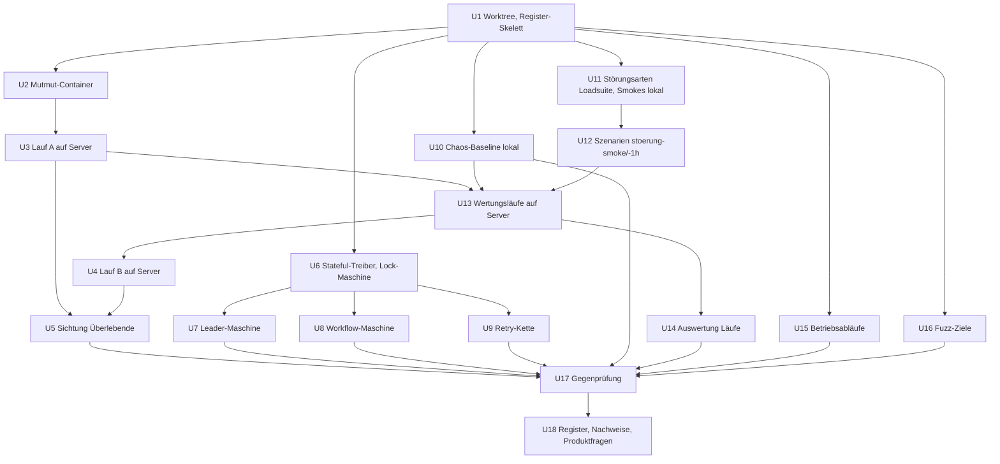
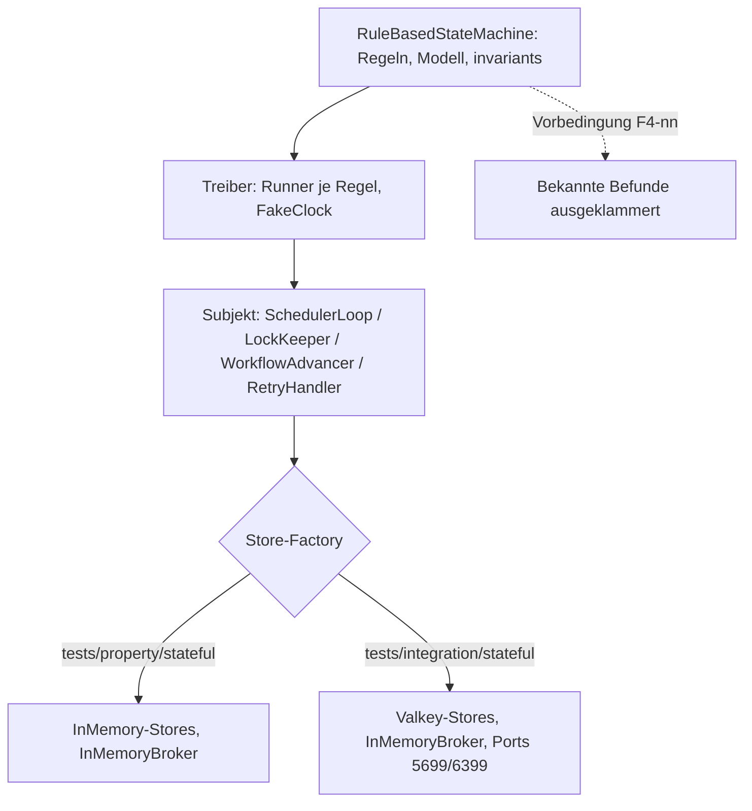
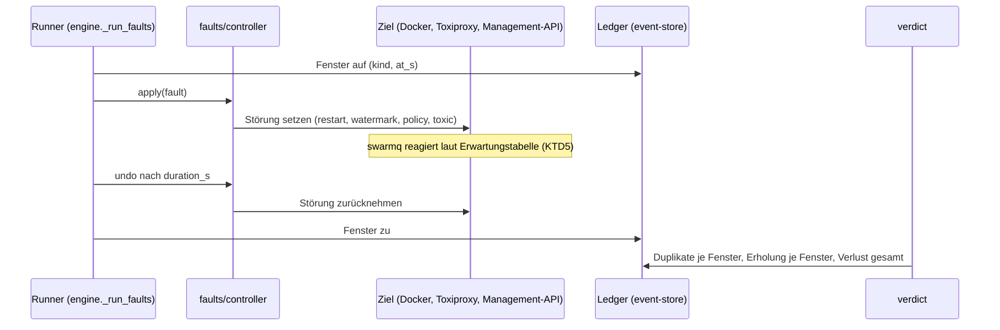

# Fehlersuche Runde 4 - Plan

## Goal Capsule

- **Objective:** Nach Runde 4 weiß Georg, welche Fehler swarmq 0.12.3 noch hat, die drei Lese-Runden nicht finden konnten: Fehler in Verschränkungen von Scheduler-, Lock-, Workflow- und Retry-Zuständen, unter echten Störungen im laufenden Stack, in den nie mutierten Modulen Valkey-Backend, Broker, Client, Prozessmanager und CLI, in den Betriebsabläufen Kontrollkanal, Reload, CLI, Logrotation und Rolling Deploy sowie an den Eingabegrenzen der Parser. Jeder Fehler ist gegengeprüft, hat einen Nachweis-Test und entweder eine Entscheidung oder eine formulierte Produktfrage, sodass ein Fix-Plan für 0.13 direkt darauf aufsetzt.
- **Means:** Fünf Spuren mit neuen Methoden (KD1): Zustandsmodell-Tests mit Hypothesis (KTD1–KTD3), Fehlerinjektion in der Loadsuite (KTD5), Mutation-Testing Welle 2 im Container auf dem Lastserver (KTD4), Betriebsabläufe gegen den Teststack (KTD7), Fuzzing (KTD8).
- **Authority:** Entscheidungsregister `compound-packs/swarmq-entscheidungen/` > `docs/befunde/README.md` > dieser Plan > Rechercheberichte und Loadsuite-Doku. AGENTS.md (TDD, Qualitäts-Gates, Testports, Entscheidungen respektieren) gilt durchgehend. Für Änderungen im Nachbarrepo `swarmq-loadsuite` gilt dessen AGENTS.md.
- **Ausführung:** Autonom während Georgs Abwesenheit (Auftrag vom 2026-10-17): Umsetzung durch Subagenten mit dem Modell Opus 5.5, Review nach jeder Einheit, Entscheidungen nach bestem Wissen im Plan und Register festgehalten statt erfragt; nichts wird gemergt, gepusht oder live genommen.
- **Stop conditions:**
  - Ein Nachweis-Test ließe sich nur schreiben, wenn ein Test mit `@pytest.mark.entscheidung` geändert oder gelöscht würde: stoppen, Verdacht als ENTSCHEIDUNG führen, Georg fragen.
  - Produktionscode unter `src/swarmq/` müsste geändert werden, damit eine Spur läuft (Ausnahme R5): stoppen und Georg fragen; Runde 4 fixt nichts.
  - Der Lastserver ist belegt (Loadsuite-Wertungslauf oder Mutmut-Lauf aktiv) und eine Einheit will ihn mitbenutzen: warten, nicht parallel starten (KTD10).
  - Lauf B der Mutation (U4) bräuchte mehr als Umgebungsvariablen, ein CLI-Argument und den Entrypoint aus U2, um die Integrationstests auf die Compose-Dienste zu lenken: Lauf B melden und auslassen, Lauf A zählt.
  - Lauf A überschreitet 72 h oder Lauf B 48 h: abbrechen, Teilstand holen und sichten.
  - Ein 6-h-Störungslauf wäre nötig, um einen Verdacht zu belegen: nicht selbst starten; Runde 4 fährt höchstens `stoerung-1h`, der 6-h-Lauf steht als Produktfrage im Register (Staffelungsregel der Loadsuite).
- **Execution profile:** Analyse-Runde. In swarmq entstehen nur Tests, Test-Infrastruktur und Doku: Zustandsmaschinen, Fuzz-Ziele, Nachweis-Tests mit `befund`-Marker und `xfail(strict=True)`, Container-Rezepte, das Register. In der Loadsuite entstehen neue Störungsarten und Szenarien test-first nach deren Konventionen. Jede Verdachtsliste durchläuft die Gegenprüfung aus `docs/befunde/README.md`, bevor etwas ins Register kommt. Nach jeder Einheit ein Review mit den Linsen Entscheidungs-Abgleich, Realismus, Testdeterminismus, Ressourcen-Disziplin (Ports, Sperre, Server); jede Einheit prüft ihre Annahmen gegen den Code, nicht gegen Doku oder frühere Berichte.
- **Tail ownership:** Kein Push, kein MR, kein Merge in dieser Runde; beide Branches bleiben in ihren Worktrees, bis Georg zurück ist. PyPI ist nicht betroffen.

---

## Product Contract

### Summary

Runde 4 sucht Fehler mit vier Methoden, die bisher nicht eingesetzt wurden, und in Modulen, die in keinem Register vorkommen. Zustandsmaschinen prüfen Invarianten über zufällige Reihenfolgen, die Loadsuite spielt Neustarts, Speicheralarm und Queue-Limits in Wertungsläufe ein, Mutmut Welle 2 misst die ungetesteten Module, Probe-Skripte fahren Betriebsabläufe gegen den Teststack, und Fuzzing trifft die restlichen Parser. Ergebnis ist das Register `docs/befunde/fehlersuche-runde-4-2026-10.md` mit Nachweis-Tests und Produktfragen; Fixes folgen in einem eigenen Plan.

### Problem Frame

Die Runden „Betrieb über Zeit“, 2 und 3 haben 28, 23 und 27 Fehler gefunden, alle mit derselben Methode: Agenten lesen Code aus einem Blickwinkel, Gegenprüfung, Nachweis-Test. Die Blickwinkel Zustand über Zeit, Regressionen, Absturz, Nebenläufigkeit, Zusammenspiel, Grenzwerte und Doku-Zusagen sind abgearbeitet. Eine vierte Lese-Runde träfe vor allem bekannte Stellen.

Zwei Lücken sind messbar. Erstens die Module: Kontrollkanal und Hot-Reload kommen in keinem Register vor, Logging, Metrics, Health und Progress ein- bis dreimal. Mutiert wurden elf Pfade; das Valkey-Backend außer Schedules und Results, die Broker-Teile Blocked, Consumer-Watch, Redeclare, Header-Guard, Topology, Client-Workflows und -Results, die CLI und der Prozessmanager wurden nie mutiert. Die 512 Mutanten ohne Unit-Test aus Runde 2 liegen im Valkey-Backend. Logging, Metrics, Health und Progress bleiben auch in Runde 4 unbesucht; sie gehören zur zurückgestellten Welle 3. Zweitens die Methoden: Niemand hat Zustandsmaschinen modellbasiert geprüft, Störungen in den echten Stack unter Last injiziert oder Reload, Kontrollkanal und Rolling Deploy unter Last gefahren. Der offene Hänger aus der main-Pipeline vom 16.10. (Unit-Job eine Stunde in einem Scheduler-Test, lokal nicht nachstellbar) ist ein Symptom dieser Lücke; Runde 4 sucht ihn nicht gezielt, die Leader-Maschine und die Chaos-Baseline sind die nächstliegenden Chancen, ihn zu treffen, und die CI beobachtet ihn weiter über `faulthandler_timeout`.

Die Recherche hat ergeben, dass die Werkzeuge schon da sind: Hypothesis mit Profilen und sieben Property-Tests, aber ohne eine einzige `RuleBasedStateMachine`; ein Toxiproxy in der Loadsuite mit Störungsarten für Latenz, Trennung und Worker-Kill, aber ohne Neustart, Speicheralarm und Queue-Limit (diese drei stehen seit dem Pin-Plan 0.12 als Einheit S4 unbegonnen); eine Mutmut-3-Konfiguration für Welle 1; eine Chaos-Suite mit 116 Tests, die nicht in der CI läuft; ein compat-Harness für Mischbetrieb bis 0.12.0.

### Requirements

**Ablauf und Register**

- R1. Jeder Verdacht aus Runde 4 wird nach `docs/befunde/README.md` gegengeprüft und erhält genau eine Einstufung (FEHLER, ENTSCHEIDUNG, LÜCKE, NICHT HALTBAR) mit zitierter Quelle; Gegenprüfer sind Agenten, die den Verdacht nicht gefunden haben.
- R2. Das Register `docs/befunde/fehlersuche-runde-4-2026-10.md` folgt dem Format der Runde 3 (Kopf mit Stand und Commit, Ablauf mit Analyse-Präfixen, Zusammenfassungstabelle, Tabellen je Einstufung, Produktfragen mit Optionen und Empfehlung, Nachweis-Tabelle); IDs sind `F4-nn`.
- R3. Jeder FEHLER hat einen Nachweis-Test mit `@pytest.mark.befund("F4-nn")` und `xfail(strict=True)` neben dem betroffenen Modul; ist er nur unter Last reproduzierbar, nennt das Register den Loadsuite-Lauf und seinen Ledger als Beleg und führt den fehlenden Repo-Nachweis als Testlücke.
- R4. LÜCKEN werden als Produktfragen mit Optionen und Empfehlung gesammelt; die zwölf offenen LÜCKEN aus Runde 2 und 3 (FS-25, FS-26, FS-29, FS-32, F3-32 bis F3-38, F3-41) werden mitgeführt, wenn eine Spur sie berührt.
- R5. Runde 4 ändert keinen Produktionscode unter `src/swarmq/`; erlaubt sind Tests, `tests/support/`, `docker/`, `justfile`, `pyproject.toml` (Mutmut-Konfiguration, Marker), `.dockerignore`, `.gitignore` und Doku. Fixes gehören in den Fix-Plan (KD3).

**Spur 1: Zustandsmodelle**

- R6. Vier Hypothesis-Zustandsmaschinen prüfen Leader und Fire-Index, Unique-Claims mit Locks und Lock-Keeper, Workflow-Orchestrierung mit Chord- und Group-Zählern sowie die Retry- und DLQ-Kette; jede prüft die Invarianten und kennt die akzeptierten Zustände aus KTD3.
- R7. Jede Maschine läuft gegen die In-Memory-Fakes im Profil `quick` unter `just property` und in einer Variante mit wenigen Beispielen gegen die Valkey-Stores ihres Subjekts unter `just integration`; der Broker bleibt in beiden Stufen der In-Memory-Fake. Eine Abweichung zwischen Fake und Valkey ist selbst ein Verdacht.
- R8. Ein gefundenes Gegenbeispiel wird als deterministischer Nachweis-Test mit dem geschrumpften Ablauf festgehalten; die Maschine klammert den bekannten Befund per `@precondition` an der auslösenden Regel mit F4-ID aus und bleibt grün, bis der Fix die Klammer entfernt.

**Spur 2: Fehlerinjektion unter Last**

- R9. Die Loadsuite erhält die Störungsarten `broker_alarm`, `rabbitmq_restart`, `valkey_restart` (mit Option ohne Persistenz), `queue_max_length`, `toxic_bandwidth` und `toxic_slicer`, jede mit Undo, Ledger-Fenster und Doku-Zeile.
- R10. Zwei Szenarien: `stoerung-smoke` (jede Störungsart einmal, weite Budgets, niedrige Evidenzminima) und `stoerung-1h` (Störungen in Spitze und Soak); die Gates bleiben Verlust 0 (außer der erwarteten Kategorie `valkey_data_loss_detected` im Fenster `valkey_restart` ohne Persistenz), Duplikate 0 (außer Folgeläufen nach `PublishIndeterminate` im Störfenster, die der Bericht als „hingenommen (E-041)“ gesondert zählt), Erholung im Budget, Speichertrend.
- R11. Vor dem ersten Wertungslauf steht je Störungsart die erwartete swarmq-Reaktion mit E-ID in einer Tabelle, damit hingenommenes Verhalten (E-025, E-041, E-042, E-047, E-048) nicht als Fehler zählt.
- R12. `tests/chaos` läuft vor den Wertungsläufen von Spur 2 lokal als Baseline und bestätigt den dokumentierten Stand (116 passed, 4 skipped); jede Abweichung ist ein Verdacht.
- R13. Ein swarmq-Befund aus einem Lauf bekommt eine B-Nummer im Loadsuite-Backlog `docs/debug-feature-backlog.md` und eine F4-ID im Register; beide verweisen aufeinander.

**Spur 3: Mutation Welle 2**

- R14. Welle 2 mutiert `src/swarmq/backend/valkey/` ohne `schedules.py` und `results.py`, `src/swarmq/broker/rabbitmq/` ohne `delivery.py` und `publish_phase.py`, `src/swarmq/client/workflows.py` und `results.py`, `src/swarmq/process_manager/` und `src/swarmq/cli/`; `worker/compute` war Teil von Welle 1 und entfällt (KTD4).
- R15. Lauf A bewertet alle Welle-2-Module mit `tests/unit` im Container ohne Dienste; Lauf B bewertet nur `backend/valkey` (dort liegen die 512 Mutanten ohne Unit-Test) zusätzlich mit `tests/integration/backend` gegen RabbitMQ und Valkey im selben Compose-Projekt und läuft erst nach den Störungs-Wertungsläufen.
- R16. Beide Läufe laufen abgekoppelt auf dem Lastserver über den Docker-Kontext `lastserver`, nie parallel zu einem Wertungslauf, mit begrenzter Kindzahl (Lauf A 3, Lauf B 1); Ergebnisse werden mit `docker cp` geholt; alle Docker-Objekte tragen ein Label, und am Ende bleibt nichts auf dem Server.
- R17. Überlebende Mutanten werden nach Vorfilter (Strings, Log-Texte, Typannotationen, `__repr__`) in drei Gruppen durch Agenten gesichtet; je Gruppe ein Bericht im Format von `docs/befunde/fehlersuche-runde-2-recherche/4-mutation-A.md`, jeder Verdacht mit rotem Probe-Test belegt.

**Spur 4: Betriebsabläufe**

- R18. Sechs Abläufe gegen den Teststack auf 5699/6399: Kontrollkanal Ende-zu-Ende unter Last, Hot-Reload unter Last, `swarmq inspect`, `dlq` und `schedule` gegen echte Daten, Logrotate mit `copytruncate` unter Last, Supervisor-Ersatz unter Last (Rolling Deploy gleicher Stand), Mischbetrieb mit der vorhandenen Suite `tests/compat` (0.11.0, 0.11.1 und 0.12.0 von PyPI neben dem Arbeitsstand, der 0.12.3 entspricht).
- R19. Jeder Ablauf endet mit einem Bericht: Erwartung mit Quelle, Beobachtung, Einstufung als Verdacht oder bestätigt; reproduzierbare Verdachte werden e2e-Nachweise.

**Spur 5: Fuzzing**

- R20. Neue Fuzz-Ziele ohne Dienste: `header_text.bounded_header_text`, die Zähler-Header-Leser (`gates/execution_guard.retry_count_of` direkt, Lock- und Delivery-Count-Gate über ihre öffentliche Gate-Schnittstelle mit konstruierten Header-Mappings; keine privaten Funktionen), `worker/error_info`, `config.parse_env_value` und die Konstruktion `SwarmQConfig()` unter gesetzten `SWARMQ_*`-Variablen, Cron-Validierung in `scheduler/definition.py` und `scheduler/cron_time.next_fire_times` samt DST und 6/7-Feld-Ausdrücken (F3-35), Lock-Templates, die leer rendern; jeweils mit Allow-List typisierter Fehler wie in `tests/fuzz/test_parser_fuzz.py`.
- R21. `just fuzz` fährt alle dienstfreien Fuzz-Dateien; die Datei mit `chaos_stack` bleibt bei `just chaos`.

**Betrieb und Ressourcen**

- R22. Integrations-, e2e- und Chaos-Läufe nur über just-Rezepte unter der Testsperre auf 5699/6399, nie gegen 5672/6379; auf dem Laptop keine Wertungsläufe und keine Mutmut-Läufe.
- R23. Lange Läufe laufen abgekoppelt auf dem Server; Laptop-seitige Warteschleifen unter `systemd-inhibit`; während ein Wertungslauf misst, wird keine CI-Pipeline angestoßen.

### Key Decisions

- KD1. **Fünf Spuren mit neuen Methoden statt einer vierten Lese-Runde** (session-settled: user-approved — gewählt gegenüber einer Wiederholung der Code-Lese-Methode: die bisherigen Blickwinkel sind abgearbeitet, die Lücken liegen bei Methoden und unbesuchten Modulen). Governs R6–R21.
- KD2. **Reihenfolge Mutation, Zustandsmodelle, Fehlerinjektion** (session-settled: user-approved — gewählt gegenüber Start mit der Fehlerinjektion: Mutation läuft unbeaufsichtigt, Zustandsmodelle brauchen keinen Server, der Server ist seriell belegt). Governs Sequencing, KTD10. Lauf B der Mutation ist davon ausgenommen und folgt den Störungsläufen (R15), damit der Kern der Spur 2 nicht hinter dem Lauf mit dem geringsten Zusatznutzen wartet.
- KD3. **Runde 4 endet mit Register, Nachweisen und Produktfragen** (session-settled: user-approved — gewählt gegenüber Fix im selben Plan: wie Runde 2 und 3 entscheidet Georg die Produktfragen vor dem Fix-Plan). Governs R5.
- KD4. **Mutmut im Container über den Docker-Kontext** (session-settled: user-directed — gewählt gegenüber Laptop unter `systemd-inhibit`: die Server-Regel „kein Checkout, kein uv, keine Skripte“ bleibt bestehen, und der Laptop bleibt frei). Governs R15, R16.
- KD5. **Fehlerinjektion als Szenario-Familie der Loadsuite** (session-settled: user-approved — gewählt gegenüber Ausbau von `tests/chaos`: nur die Loadsuite hat Gates, Ledger und Referenzen, und ihr Toxiproxy steht bereits im Stack). Governs R9–R13.
- KD6. **Autonome Umsetzung ohne Merge** (session-settled: user-directed — Georg hat am 2026-10-17 angeordnet, Review, Einarbeitung, Umsetzung und Code-Review ohne Rückfragen durchzuführen und nichts zu mergen oder zu pushen; Entscheidungen nach bestem Wissen). Governs Goal Capsule (Ausführung, Tail ownership), Open Questions.

### Scope Boundaries

- Kein Fix, kein Release, kein PyPI-Upload in Runde 4.
- Lua-Skripte (887 Zeilen) werden von Mutmut nicht erfasst; die Valkey-Stufe der Zustandsmaschinen (R7) deckt die Lock-, Schedule-, Chord-, Guard- (`guard_claim.lua`, `guard_finish.lua`) und Rate-Limit-Skripte (`sliding_window_counter.lua`) ab, die übrigen Skripte nur über die bestehenden Integrationstests.
- Logging, Metrics, Health, Progress, Hot-Reload-Modul und Middleware werden in Runde 4 nicht mutiert (Welle 3); Hot-Reload und Kontrollkanal werden nur als Betriebsablauf gefahren (R18).
- Die Chaos-Fixtures in `tests/chaos/conftest.py` binden an `127.0.0.1` und werden nicht auf den Server umgebaut; die Chaos-Suite bleibt ein lokaler Baseline-Lauf.
- Die Zustandsmaschinen modellieren keine Zeitfristen in Echtzeit; Fristen laufen über `FakeClock` beziehungsweise injizierte Uhren.
- Die Loadsuite bekommt keine neuen Archetypen (delay/eta, Cron-Last, Middleware); diese Lücke (S5 des Pin-Plans) bleibt offen.

#### Deferred to Follow-Up Work

- Chaos-Stack von RabbitMQ 3.13.7 auf 4.3.6 heben (`tests/chaos/compose.yml`); laut `docs/testing/test-strategy.md` eine eigene Entscheidung.
- Chaos-Fixtures mit Host-Variable (`SWARMQ_TEST_CHAOS_HOST`) für entfernte Docker-Kontexte.
- Mutation Welle 3: `logging_*`, `health.py`, `metrics.py`, `progress.py`, `hot_reload.py`, `middleware.py`, `signals.py`, `workflow_state/_topology/_enqueue/_failure.py`, `config.py`, `config_validation.py`; dazu der Integrations-bewertete Lauf für `broker/rabbitmq`, den Runde 4 nur Unit-bewertet (R15).
- `scripts/run_mutation.sh` (mutmut-2-Syntax) entfernen, sobald die justfile-Rezepte aus U2 den Lauf abdecken.
- Ein Guard-Test, der `befund`-Marker gegen Register-IDs abgleicht (heute nur für `entscheidung`).
- 6-h-Störungslauf und Server-Referenz 1 h (Loadsuite U9), beides nach Georgs Entscheidung.

### Dependencies

- Lastserver `lastserver` (192.168.100.6) erreichbar, SSH-Schlüssel `skynet` im Agenten (`ssh-add`), Docker-Kontext `lastserver` vorhanden.
- Loadsuite auf Stand 6026d61 (Pin v0.12.3, Konformität auf dem Server bestanden).
- swarmq 0.12.3 auf PyPI für den Mischbetrieb (R18).
- Lokale Testcontainer `swarmq-test-rabbit` und `swarmq-test-valkey` auf 5699/6399.

### Open Questions

Nach KD6 entschieden, jeweils als Produktfrage ins Register übernommen, damit Georg widersprechen kann:

- **Entschieden (deferred für Georg):** Der Chaos-Stack bleibt in Runde 4 auf RabbitMQ 3.13.7; die Baseline gilt für 3.13-Verhalten, Quorum-Unterschiede (`x-delivery-limit`) werden im Register vermerkt. Der Wechsel auf 4.3.6 ist eine eigene Entscheidung laut `docs/testing/test-strategy.md`.
- **Entschieden:** Kein `stoerung-6h` in Runde 4. Fehlerinjektion fällt nach der Staffelungsregel in die 6-h-Klasse; der Lauf steht als Produktfrage im Register, Georg entscheidet nach dem 1-h-Ergebnis.
- **Entschieden:** Liefert Lauf A mehr als etwa 1500 Überlebende nach Vorfilter, wird die CLI-Gruppe auf `parser_ops.py`, `dlq_cmd.py`, `schedule_cmd.py`, `check_cmd.py` begrenzt und der Rest nach Welle 3 verschoben.

### Sources

- Register und Rechercheberichte: `docs/befunde/README.md`, `docs/befunde/fehlersuche-runde-2-2026-10.md` (Abschnitt „Testlücken“: 512 Mutanten ohne Unit-Test, Drain-Frist-0-Mutant), `docs/befunde/fehlersuche-runde-2-recherche/4-mutation-{A,B,C}.md`, `docs/befunde/fehlersuche-runde-3-2026-10.md` (Format, offene LÜCKEN).
- Invarianten: `docs/solutions/patterns/invarianten-der-worker-pipeline-2026-08.md` (Ack-Ordering, Terminal-Outcome, Owner-Checks, publish-then-mark), `docs/solutions/logic-errors/lock-ttl-shorter-than-hard-timeout-duplicate-execution-2026-06-02.md`, `docs/solutions/logic-errors/schedfire-retry-dedup-collision-silent-drop-2026-06-02.md`, `docs/solutions/patterns/r3-5-unique-tasks-implementation-learnings-2026-04-17.md`.
- Störungen: `docs/solutions/spikes/2026-04-17-toxiproxy-reconnect-spike.md` (Publish-Kanal nach Reconnect, Pub/Sub-Resubscribe, Liveness-Probe), `docs/solutions/logic-errors/aiormq-reader-leak-and-stale-connection-recovery-2026-04-16.md`, `docs/befunde/teststrenge-2026-10.md` (TS-01 bis TS-03, bekannte aiormq-Lecks), Loadsuite `docs/plans/2026-10-11-1936-chore-pin-swarmq-0-12-plan.md` (Einheit S4), Loadsuite `docs/betrieb.md` (Staffelung, Server-Regeln).
- Werkzeuge: `pyproject.toml` (`[tool.mutmut]`, Marker, `filterwarnings`), `tests/property/conftest.py` (Profile), `tests/support/inmemory/` (Fakes), `tests/support/services.py` (Host- und Port-Variablen), `tests/contracts/coordination.py`, `tests/unit/test_workflow_advancer.py` (`Driver`, `MultiDriver`), `tests/compat/_harness.py`, `.gitlab-ci.yml` (Basisabbild `ghcr.io/astral-sh/uv:python3.14-bookworm`).
- Entscheidungen, die Erwartungen festlegen, unter anderem: E-001, E-007, E-011, E-013, E-014, E-018, E-022, E-025, E-031, E-034, E-037, E-040, E-041, E-042, E-046, E-047, E-048, E-052, E-058, E-063, E-065, E-071 (pack: swarmq-entscheidungen, jeweils `e0nn-*.md`); die Einheiten zitieren weitere Regeln an Ort und Stelle, maßgeblich ist immer das Register.

---

## Planning Contract

### Key Technical Decisions

- KTD1. **Zustandsmaschinen fahren die echten Orchestrierungsklassen über In-Memory-Stores.** Subjekte sind `SchedulerLoop` mit seinen Mixins (`scheduler/loop.py`, `fire.py`, `stepdown.py`), `LockKeeper` mit `LockStore` (`worker/lock_keeper.py`, `contracts/coordination.py`), `WorkflowAdvancer` (`workflow_orchestration.py`) und `RetryHandler` mit den Gates (`worker/retry.py`, `worker/gates/`). Die Fakes aus `tests/support/inmemory/` sind async; ein Treiber in `tests/support/stateful.py` führt je Regel eine Coroutine über `asyncio.Runner` aus, Zeit läuft über `FakeClock`. Jede Maschine hält ein eigenes, einfaches Modell (Dictionaries) und vergleicht es in `invariants()`. Verworfen: ein synchrones Modell der Lua-Semantik ohne echten Code, weil es nur das Modell testet.
- KTD2. **Zwei Stufen je Maschine über eine Store-Factory.** Die Maschine ist von den Stores entkoppelt; `tests/property/stateful/` bindet die Fakes (Marker `property`, Profil `quick`, `stateful_step_count` 30, `@pytest.mark.timeout(60)`), `tests/integration/stateful/` bindet die Valkey-Stores des jeweiligen Subjekts mit `max_examples` höchstens 8, `deadline=None` (unter `tests/integration/` ist kein Hypothesis-Profil registriert) und eigener vhost und DB je xdist-Prozess: Lock-Maschine `ValkeyLockStore` und Unique-Claims des `ValkeyBackend`, Leader-Maschine `ValkeyScheduleStore` und `ValkeyLockStore`, Workflow-Maschine `ChordManager` (`backend/valkey/chords.py`, über `ValkeyBackend.chords`) und CAS des Backends, Retry-Maschine `ValkeyExecutionGuardStore` und `ValkeyRateLimitStore`; der Broker ist in beiden Stufen `InMemoryBroker`. Jede Maschine implementiert `teardown()`, das in der Valkey-Stufe die Datenbank des xdist-Prozesses über die vorhandene Flush-Hilfe aus `tests/integration/conftest.py` leert und die Stores schließt, damit jedes Hypothesis-Beispiel mit leerem Zustand beginnt (die autouse-Fixture flusht nur je Testfunktion). Die Valkey-Stufe deckt die Lua-Skripte Lock, Schedule, Chord, Guard und Rate-Limit ab, die Mutmut nicht erreicht. Vorbild: `tests/property/test_rate_limiter_properties.py` und die Contract-Bindungen in `tests/unit/test_contracts_inmemory.py` und `tests/integration/test_contracts_valkey.py`. Die Maschinen sind keine Contract-Klassen, damit `test_contract_bindings_are_pure` nicht greift.
- KTD3. **Akzeptierte Zustände stehen vor der ersten Regel fest.** Jede Maschine trägt im Docstring die Invarianten mit Quelle und die Liste der erlaubten Abweichungen mit E-ID: zwei Leader und doppelt publiziertes Fire (E-047), Rücktritt bei kurzer Störung (E-048), kein Fire nach `PublishIndeterminate` bis Sperrablauf (E-011), Lock läuft bei blockiertem Loop ab (E-022), Lock-Wartezeit bis `lock_wait_max_s` (E-007), Rate-Limit-Slot bei Lock-Requeue verbraucht (E-070), transient scheiterndes Fail-Mark wird redelivered (E-040), Recycling verbraucht keinen Retry (E-038), Doppelausführung nach über 65 min Rückstand ohne `max_age` (E-010). Ein Verstoß gegen eine Invariante ist ein Verdacht, nie sofort ein Befund. Bekannte Befunde werden mit `@precondition` (Prüfung des Modellzustands, Kommentar `F4-nn`) an der auslösenden Regel ausgeklammert, nie mit `assume()` über Zustandsfolgen, weil verworfene Beispiele Hypothesis in `filter_too_much` oder `Unsatisfiable` laufen lassen; `assume()` ist nur für Datenwerte innerhalb einer Regel erlaubt (R8).
- KTD4. **Mutmut-Container aus dem swarmq-Repo, Welle-2-Liste ersetzt Welle 1.** `docker/mutation/Dockerfile` auf `ghcr.io/astral-sh/uv:python3.14-bookworm` mit `UV_FROZEN=1`, Extras `test`, Repo-Kopie; `.dockerignore` schließt `.git`, `.venv`, `.mypy_cache`, `.ruff_cache`, `.pytest_cache`, `.hypothesis`, `site`, `dist`, `mutants`, `runs`, `benchmarks`, `prototypes` aus (von 587 MB Repo liegen 457 MB im venv und 49 MB in `.git`; der Kontext bleibt so unter 50 MB). `docker/mutation/compose.yml` mit Dienst `mutmut` und, nur im Profil `b`, `rabbitmq` (4.3.6) und `valkey`, ohne Host-Ports, Label `swarmq-mutation`. Ein Entrypoint-Skript im Abbild setzt aus `MUTMUT_LAUF` (`a` oder `b`) vor `mutmut run` den Schlüssel `pytest_add_cli_args_test_selection` in der `pyproject.toml` des Containers (`a`: `tests/unit`; `b`: zusätzlich `tests/integration/backend`), weil mutmut 3.8 die Selektion nur aus `pyproject.toml` liest; für `b` setzt es `SWARMQ_TEST_RABBITMQ_HOST=rabbitmq`, `SWARMQ_TEST_VALKEY_HOST=valkey`, die Standardports und `SWARMQ_TEST_ALLOW_DEFAULT_PORTS=1` (nur im Container, nie lokal) und übergibt das Muster `swarmq.backend.valkey.*`. `mutmut run` bekommt `--max-children 3` für Lauf A (gleich `--cpus 3`; cgroup-Limits ändern `os.cpu_count()` nicht) und `--max-children 1` für Lauf B, weil alle Kinder ohne `PYTEST_XDIST_WORKER` dieselbe vhost und Valkey-DB nutzen und die autouse-Flush-Fixture sie sonst gegenseitig leert. Lauf B startet in einem frischen Container mit leerem `mutants/`. Drei Rezepte im `justfile`: `mutation-starten LAUF` (baut und startet abgekoppelt), `mutation-holen LAUF`, `mutation-abbauen`, alle mit `--context` aus `SWARMQ_MUTATION_CONTEXT` (Standard `lastserver`); Status liest `docker --context … ps` und `logs`. `[tool.mutmut].source_paths` in `pyproject.toml` wird auf die Welle-2-Module gesetzt; Welle 1 ist gesichtet und dokumentiert. `worker/compute` entfällt, weil `src/swarmq/worker/` schon in Welle 1 lag; stattdessen kommt `process_manager/` dazu, weil der offene E-018-Punkt (`restart_budget.py`, `setpoint.py` rechnen mit alter Budget-Bedeutung) dort liegt.
- KTD5. **Störungsarten bauen auf den vorhandenen Loadsuite-Bausteinen.** Neue Literale in `src/loadsuite/runner/scenario.py` (`FaultKind`), je ein Zweig in `src/loadsuite/faults/controller.py` mit Undo-Coroutine: `broker_alarm` über `DockerKiller.exec_run` mit `rabbitmqctl set_vm_memory_high_watermark 0.0001` und Rücknahme auf den Wert aus `docker/rabbitmq/rabbitmq.conf`; `rabbitmq_restart` und `valkey_restart` über `docker restart` des Containers; `valkey_restart` mit Option `persistenz: false` stoppt den Container, leert das Datenverzeichnis des Volumes über einen Hilfscontainer (wie `driver.holen` arbeitet) und startet ihn wieder, damit kein AOF-Manifest oder Teilstück liegen bleibt; `queue_max_length` über die Management-API als Policy mit `max-length` und `overflow: reject-publish` auf die Haupt-Queue, Undo löscht die Policy; `toxic_bandwidth` und `toxic_slicer` über die vorhandenen Methoden in `faults/toxi.py`. Erwartungstabelle (R11): Speicheralarm → erster Publish je Verbindung endet `PublishIndeterminate`, weitere Publishes warten bis zur Frist und enden `BrokerPublishBlocked`, Acks laufen auf der zweiten Verbindung weiter (E-025); nach jedem `PublishIndeterminate` eines Retry- oder DLQ-Publish läuft die auslösende Nachricht mindestens ein weiteres Mal, ein solcher Folgelauf im Störfenster ist hingenommen (E-041); RabbitMQ-Neustart → `PublishIndeterminate` nur nach gesendetem Frame (E-042), Reconnect mit neuem Publish-Kanal, Redelivery mit `redelivered=True`, keine Doppelausführung außer dem E-041-Folgelauf; Valkey-Neustart mit Persistenz → `task_deferred_backend_unavailable`, Leader-Rücktritt und Rückkehr (E-048), kein Verlust; ohne Persistenz → `valkey_data_loss_detected`, Epoch neu, Ledger erwartet Verlust der offenen Ergebnisse, aber keine Doppelausführung; Queue-Limit → `PublishRejected` als `publish_failed`, kein Verlust im Ledger-Sinn (Producer-Fehler); Bandbreite und Slicer → Latenzanstieg, Erholung im Budget. Die Duplikatprüfung der Loadsuite ordnet Duplikate bereits Störfenstern zu; U11 prüft im Code von `verdict/ledger_check.py`, ob ein Duplikat, dessen Nachricht im Fenster ein `PublishIndeterminate` im Worker-Log trägt, als eigene Kategorie „hingenommen (E-041)“ ausgewiesen werden kann, und ergänzt das sonst, damit das Gate „Duplikate 0“ nicht Entschiedenes rot färbt (R10).
- KTD6. **Die Chaos-Suite bleibt lokal und dient als Baseline.** `just chaos` läuft auf dem Laptop unter der Testsperre, weil `tests/chaos/conftest.py` den Host nur aus `DOCKER_HOST` ableitet und `_free_port()` lokal bindet. Ergebnis ist die Bestätigung von 116 passed, 4 skipped; Abweichungen gehen als Verdachte in die Gegenprüfung. Die Suite läuft auf RabbitMQ 3.13.7 (Open Question).
- KTD7. **Betriebsabläufe als Probe-Skripte mit Bericht, Nachweise nur für Reproduzierbares.** Skripte liegen im Scratchpad der Sitzung, nutzen `tests/support/worker_subprocess.py` (`spawn_worker`, `crash_worker`, `wait_for_scheduler_leader`) und die Teststack-Variablen; Last erzeugt ein kleiner Producer aus `tests/stress/test_concurrency.py`. Reload unter Last misst Drain-Ende gegen E-018 und prüft den Cancel-Teardown (`docs/solutions/patterns/worker-cancel-safe-teardown-detached-tasks-2026-06-01.md`: keine PENDING-Tasks, Broker und Backend nicht vom Worker geschlossen). Mischbetrieb fährt die vorhandene Suite `tests/compat` (Basen 0.11.0, 0.11.1, 0.12.0 von PyPI, Fixtures `python_011`, `python_0110`, `python_0120` in `tests/compat/_harness.py`) seriell unter der Testsperre nach dem Rezept in `docs/testing/test-strategy.md`; eine Basis 0.12.3 brächte nichts, weil der Arbeitsstand unter `src/swarmq/` byte-gleich mit dem Tag v0.12.3 ist und R5 das so lässt. Verdachte mit stabilem Ablauf werden e2e-Nachweise unter `tests/e2e/` oder `tests/integration/`.
- KTD8. **Fuzz-Ziele als je eine Datei ohne Dienste.** `tests/fuzz/test_header_text_fuzz.py`, `test_counter_headers_fuzz.py`, `test_error_info_fuzz.py`, `test_config_env_fuzz.py`, `test_cron_fuzz.py`, `test_lock_template_fuzz.py`; `max_examples` 500 wie `test_parser_fuzz.py`, Allow-List typisierter Fehler (`ValueError`, `ConfigurationError`, `TypeError` nur wo zugesagt), jede andere Ausnahme ist ein Treffer. Cron über croniter 6.2.4 gegen E-065 (5 Felder, kein nächster Termin → `ValueError`) und F3-35 (6/7 Felder). Env gegen E-057, E-062, E-063 (Exit 78 vs. 1, `inf`/`nan`). `just fuzz` wechselt von der Datei auf das Verzeichnis mit `--ignore tests/fuzz/test_external_publish_fuzz.py`.
- KTD9. **Register und Gegenprüfung mit Spur-Präfixen.** Analyse-IDs `R4Z` (Zustandsmodelle), `R4I` (Injektion), `R4M` (Mutation), `R4B` (Betrieb), `R4F` (Fuzz); Gegenprüfer sind gekreuzt (wer R4M fand, prüft R4Z usw.). Die Regeln für Agenten (nur neue Dateien, kein Commit, Ports, Sperre) stehen in einer Datei `nachweis-regeln.md` im Scratchpad wie in Runde 2; der Orchestrator committet. Jede Einheit mit Verdachtsliste endet mit einem Abgleich gegen die Liste der erlaubten Abweichungen in KTD3 (Spur 1), die Erwartungstabelle in KTD5 (Spur 2) und gegen `docs/befunde/README.md`. Berichte liegen unter `docs/befunde/fehlersuche-runde-4-recherche/` mit Spur-Präfix: `0-gesamtliste.md`, `1-zustandsmodelle.md`, `2a-chaos-baseline.md`, `2b-erwartungen.md`, `2c-injektion.md`, `3a-mutation-lauf-a.md`, `3b-mutation-lauf-b.md`, `3c-sichtung-{D,E,F}.md`, `4-betrieb.md`, `5-fuzz.md`, `6-gegenpruefung-{Z,I,M,B,F}.md`.
- KTD10. **Server seriell, Laptop parallel.** Auf dem Lastserver läuft zu jeder Zeit höchstens ein Lauf: erst Mutation A, dann die Störungs-Wertungsläufe, dann Mutation B. Vor jedem Start prüft `docker --context lastserver ps`, dass weder ein Loadsuite-Runner noch ein Container mit Label `swarmq-mutation` läuft; am 2026-10-17 vormittags lief dort ein Loadsuite-Lauf `stufe1-1h-20261017T073808`, der abgewartet wird. Loadsuite-Smokes zur Entwicklung der Störungsarten laufen lokal auf dem Laptop (Docker-Kontext `default`). Spur 1, 4 und 5 arbeiten auf dem Laptop, Integrationsteile unter der Testsperre. Kein CI-Push, während ein Wertungslauf misst.
- KTD11. **Worktrees und Branches.** swarmq: Worktree `../swarmq-fehlersuche4`, Branch `test/fehlersuche-runde-4` von `main` (b424584). Loadsuite: Worktree `../swarmq-loadsuite-stoerungen`, Branch `feat/stoerungsarten` von `main` (6026d61), Submodul `vendor/swarmq` initialisiert. Beide bleiben lokal bis Georg zurück ist (KD6).
- KTD12. **Umsetzung durch Opus-Subagenten.** Jede Einheit wird an einen Subagenten mit Modell Opus 5.5 delegiert (Auftrag KD6, Fable-Kontingent schonen), mit dem Plan, der Einheit, den Agentenregeln und der Pflicht, jede Annahme gegen den Code zu prüfen; ein zweiter Opus-Subagent reviewt die Einheit mit den vier Linsen aus dem Execution profile, bevor der Orchestrator committet. Langläufer (U3, U4, U13) werden abgekoppelt gestartet und über Wartebefehle unter `systemd-inhibit` beobachtet.

### High-Level Technical Design

**Belegung von Laptop und Server über die Runde.** Der Server sieht nur drei Läufe nacheinander; alles andere läuft auf dem Laptop.

**Aufbau einer Zustandsmaschine.** Die Maschine kennt nur Regeln, Modell und Invarianten; der Treiber kapselt den Event-Loop; die Stores kommen aus einer Factory.

**Eine Störung im Loadsuite-Lauf.** Der Runner markiert das Fenster, wendet die Störung an, nimmt sie zurück; die Gates schneiden Duplikate und Erholung an den Fensterrändern.

### Sequencing

1. U1 zuerst, dann U2 und U3 (Server belegt, Lauf A läuft, sobald der laufende Loadsuite-Lauf beendet ist; Deckel 72 h).
2. Parallel auf dem Laptop: U6 bis U9 (ein Agent je Maschine nach U6), U10 (Testsperre), U11 (Loadsuite, lokaler Smoke), U15 (Testsperre), U16 (ohne Dienste).
3. Nach Lauf A, U10 und U12: U13 auf dem Server, U14 danach.
4. Nach U13: U4 (Lauf B, nur Valkey-Backend, Deckel 48 h); U5 sichtet die Lauf-A-Gruppen E und F schon nach U3 und die Gruppe D nach U4.
5. U17 erst, wenn alle Verdachtslisten vorliegen; U18 schließt ab.

### Risks

- **Modell gegen Fakes findet Fake-Fehler.** Eine Invariante, die nur gegen `InMemory*` bricht, kann ein Fehler im Fake sein. Minderung: Valkey-Stufe (R7) entscheidet; Fake-Fehler werden in `tests/support/inmemory/` korrigiert (Testinfrastruktur, kein Produktionscode).
- **Fehlalarme gegen Entscheidungen.** Die Register nennen über 70 Regeln; eine Maschine ohne KTD3-Liste meldet Entschiedenes. Minderung: Liste vor der ersten Regel, Gegenprüfung mit Entscheidungs-Abgleich, kein Nachweis-Test gegen einen `entscheidung`-Test.
- **Mutmut-Laufzeit.** Welle 2 umfasst rund 10 700 Zeilen (Valkey-Backend 1333, Broker 2462, Client 481, Prozessmanager etwa 2900, CLI 3563); Welle 1 mit 13 174 Mutanten lief auf dem Laptop, die Dauer ist nicht dokumentiert. Der Server hat 4 Kerne; Lauf B läuft seriell mit einem Kind und ist je Mutant um ein Vielfaches langsamer. Minderung: Lauf A zuerst mit drei Kindern, Lauf B nur für `backend/valkey`, Zwischenstände über `docker cp` der `mutants/`-Datenbank; Deckel 72 h für Lauf A und 48 h für Lauf B, danach Teilstand sichten (Stop condition).
- **Server-Kontention verfälscht Gates.** Ein Mutmut-Container neben einem Wertungslauf lässt den Sättigungswächter abwerten. Minderung: KTD10, Stop condition.
- **Störung ohne Persistenz braucht Eingriff im Valkey-Volume.** Die Compose-Konfiguration liegt im Abbild; der Schutztest verbietet Bind-Mounts. Minderung: Container stoppen, Volume über Hilfscontainer leeren, Container starten (KTD5); kein Bind-Mount, keine Compose-Variable. Das Fenster gilt nur als gemessen, wenn Valkey nach dem Start leer ist (Runner prüft `DBSIZE` 0 direkt nach dem Neustart).
- **Bekannte Lecks und Flakes.** TS-01 bis TS-03 (aiormq-Lecks bei Neustart) und Zeit-Flakes unter Last sind dokumentiert. Minderung: beim Abgleich zuerst `docs/befunde/teststrenge-2026-10.md` lesen; Zeit-Tests mit Marker `timing`.
- **CI-Runner auf dem Laptop.** Ein Push während lokaler Lastspitzen (U10, U15, Smokes) erzeugt Flakes. Minderung: kein Push vor Georgs Ok; lokale Pipeline nicht anstoßen.

### System-Wide Impact

- `pyproject.toml`: `[tool.mutmut].source_paths` wechselt auf Welle 2; `pytest_add_cli_args_test_selection` bleibt `tests/unit`, der Container-Entrypoint schreibt die Lauf-B-Selektion nur in seine Kopie; Marker unverändert.
- `justfile`: drei neue Rezepte `mutation-starten`, `mutation-holen`, `mutation-abbauen`; `fuzz` auf Verzeichnis.
- Neues Verzeichnis `docker/mutation/` und `.dockerignore` im Repo-Root; `.gitignore` erhält `mutants/`.
- `tests/support/stateful.py` und `tests/property/stateful/`, `tests/integration/stateful/` als neue Testfamilie; `just property` und `just integration` laufen länger (Richtwert: Maschinen unter 60 s je Datei im Profil `quick`).
- Loadsuite: `FaultKind`-Schema, Controller, zwei Szenarien, Doku-Tabelle „Störungsarten“, Backlog B26 ff.
- Betroffen sind nur Georg und die Agenten; keine Nutzer-Doku, kein API-Verhalten.

---

## Implementation Units

| U-ID | Titel | Dateien (Kern) | Hängt ab von |
|---|---|---|---|
| U1 | Worktree, Register-Skelett, Agentenregeln | `docs/befunde/fehlersuche-runde-4-2026-10.md` | – |
| U2 | Mutmut-Container und Rezepte | `docker/mutation/`, `.dockerignore`, `justfile`, `pyproject.toml` | U1 |
| U3 | Lauf A (Unit-bewertet) auf dem Server | `…/3a-mutation-lauf-a.md` | U2 |
| U4 | Lauf B (Integration-bewertet, Valkey-Backend) | `…/3b-mutation-lauf-b.md` | U13 |
| U5 | Sichtung der Überlebenden | `…/3c-sichtung-{D,E,F}.md` | U3 (E, F), U4 (D) |
| U6 | Stateful-Treiber und Lock-Maschine | `tests/support/stateful.py`, `tests/property/stateful/test_lock_machine.py`, `tests/integration/stateful/test_lock_machine_valkey.py`, `…/1-zustandsmodelle.md` | U1 |
| U7 | Leader- und Fire-Index-Maschine | `tests/property/stateful/test_leader_machine.py`, Valkey-Bindung, `…/1-zustandsmodelle.md` | U6 |
| U8 | Workflow-Maschine | `tests/property/stateful/test_workflow_machine.py`, Valkey-Bindung, `…/1-zustandsmodelle.md` | U6 |
| U9 | Retry- und DLQ-Ketten-Maschine | `tests/property/stateful/test_retry_chain_machine.py`, Valkey-Bindung (Guard, Rate-Limit), `…/1-zustandsmodelle.md` | U6 |
| U10 | Chaos-Baseline lokal | `…/2a-chaos-baseline.md` | U1 |
| U11 | Störungsarten in der Loadsuite | Loadsuite `src/loadsuite/runner/scenario.py`, `faults/controller.py`, `tests/faults/`; `…/2b-erwartungen.md` | U1 |
| U12 | Szenarien stoerung-smoke und stoerung-1h | Loadsuite `scenarios/stoerung-smoke.yaml`, `stoerung-1h.yaml`, `docs/betrieb.md` | U11 |
| U13 | Wertungsläufe auf dem Server | Loadsuite `runs/`, `docs/testlauf-stoerung-v0.12.3.md` | U3, U10, U12 |
| U14 | Auswertung der Störungsläufe | `…/2c-injektion.md`, Loadsuite `docs/debug-feature-backlog.md` | U13 |
| U15 | Betriebsabläufe gegen den Teststack | `…/4-betrieb.md` | U1 |
| U16 | Fuzz-Ziele | `tests/fuzz/test_*_fuzz.py`, `justfile`, `…/5-fuzz.md` | U1 |
| U17 | Gegenprüfung | `…/6-gegenpruefung-{Z,I,M,B,F}.md`, `…/0-gesamtliste.md` | U5, U7–U10, U14–U16 |
| U18 | Register, Nachweis-Tests, Produktfragen | Register, `tests/**/test_befund_f4*.py` | U17 |

`…/` steht für `docs/befunde/fehlersuche-runde-4-recherche/`.

### U1. Worktree, Register-Skelett, Agentenregeln

- **Goal:** Arbeitsbasis für beide Repos und das leere Register, damit alle Spuren dieselben Regeln und IDs benutzen.
- **Requirements:** R2, R22, R23; KTD9, KTD11.
- **Dependencies:** –
- **Files:** `docs/befunde/fehlersuche-runde-4-2026-10.md` (Skelett), `docs/befunde/fehlersuche-runde-4-recherche/README.md` (Index der Berichte), Scratchpad `nachweis-regeln.md`; Worktree `../swarmq-fehlersuche4`; Loadsuite-Branch.
- **Approach:**
  1. Worktree und Branch nach KTD11 anlegen; Loadsuite-Branch anlegen.
  2. Register-Skelett mit Kopf, Ablauf (Präfixe aus KTD9), leeren Tabellen und der Erwartungstabelle-Vorlage für Spur 2.
  3. Agentenregeln wie in Runde 2: nur neue Dateien, kein Commit, Integrationstests nur über just-Rezepte, Ports 5699/6399, Server nur über die Rezepte aus U2 und die Loadsuite-CLI mit `--kontext`.
  4. Prüfen, dass `ssh-add -l` den Schlüssel `skynet` zeigt und `docker --context lastserver info` antwortet; sonst Georg um `ssh-add` bitten.
- **Patterns to follow:** `docs/befunde/fehlersuche-runde-3-2026-10.md` (Format), Runde-2-Ablauf laut `docs/befunde/fehlersuche-runde-2-2026-10.md`.
- **Test scenarios:** Test expectation: none -- reine Vorbereitung ohne Verhalten.
- **Verification:** Worktree zeigt den Branch, Register-Skelett liegt im Worktree, Server antwortet über den Kontext.

### U2. Mutmut-Container und Rezepte

- **Goal:** Ein Abbild und Rezepte, mit denen ein Mutmut-Lauf über den Docker-Kontext gebaut, gestartet, beobachtet, geholt und abgebaut wird, ohne Checkout oder uv auf dem Server.
- **Requirements:** R14, R15, R16; KTD4 (session-settled über KD4).
- **Dependencies:** U1
- **Files:** `docker/mutation/Dockerfile`, `docker/mutation/entrypoint.sh`, `docker/mutation/compose.yml`, `docker/mutation/README.md`, `.dockerignore`, `.gitignore` (`mutants/`, `mutants-*/`), `justfile` (Rezepte `mutation-starten`, `mutation-holen`, `mutation-abbauen`), `pyproject.toml` (`[tool.mutmut]` Welle 2).
- **Approach:**
  1. Dockerfile nach KTD4; `uv sync --frozen --extra test` im Build, Arbeitsverzeichnis `/app`. Einstieg ist `entrypoint.sh`: liest `MUTMUT_LAUF` (`a` oder `b`), schreibt `pytest_add_cli_args_test_selection` in die `pyproject.toml` des Containers (`a`: `tests/unit`; `b`: `tests/unit`, `tests/integration/backend`), setzt für `b` die Host- und Port-Variablen samt `SWARMQ_TEST_ALLOW_DEFAULT_PORTS=1`, wartet auf die Dienste und ruft `uv run mutmut run --max-children 3` (a) beziehungsweise `--max-children 1 'swarmq.backend.valkey.*'` (b); mutmut 3.8 liest die Selektion nur aus `pyproject.toml`, und Muster ohne `*` treffen keinen Mutanten (Schlüsselform `swarmq.<modulpfad>.<funktion>__mutmut_N`).
  2. Compose mit Dienst `mutmut` (Label `swarmq-mutation`, `cpus: 3`, `mem_limit: 8g`, kein Port) und Profil `b` mit `rabbitmq` (4.3.6, gleiche Konfiguration wie `docker-compose.yml`) und `valkey`.
  3. Rezepte: `mutation-starten LAUF` = `docker --context $CTX compose -f docker/mutation/compose.yml --profile LAUF up -d --build mutmut` mit `MUTMUT_LAUF=LAUF`; `mutation-holen LAUF` = `docker cp mutmut:/app/mutants ./mutants-LAUF` und `mutmut results` lokal aus der kopierten Datenbank; `mutation-abbauen` = `compose down -v --rmi local`. Status: `docker --context $CTX compose … ps` und `logs --tail 20`.
  4. `pyproject.toml`: `source_paths` auf die Welle-2-Module aus R14; `pytest_add_cli_args_test_selection` bleibt `tests/unit`; Deselects aus Welle 1 bleiben.
  5. Lokaler Rauchtest des Abbilds ohne Server: `MUTMUT_LAUF=a` mit `--max-children 1` auf einem einzelnen kleinen Modul (etwa `backend/valkey/chords.py`, über das Muster `swarmq.backend.valkey.chords.*`) mit Kontext `default`, nur um Build, Entrypoint und Export zu prüfen; das ist kein Mutmut-Lauf im Sinne von R22, weil er Minuten dauert und keine Bewertung liefert. Danach Rauchtest des Profils `b` mit demselben Muster, der zeigt, dass die Integrationstests die Dienste finden.
- **Execution note:** Rezepte, Dockerfile und Compose sind Konfiguration (AGENTS.md-Ausnahme); `entrypoint.sh` ist ein kurzes Shell-Skript ohne eigene Logik außer dem Umschreiben eines TOML-Schlüssels (mit `sed` oder `python -c` über `tomllib`), der Rauchtest ersetzt den Unit-Test.
- **Patterns to follow:** Loadsuite `driver.holen` (Hilfscontainer, `docker cp`, Löschen auf dem Host), Loadsuite-Rezepte `bauen`/`status`/`holen`/`abbauen`; CI-Basisabbild aus `.gitlab-ci.yml`.
- **Test scenarios:**
  - Abbild baut über Kontext `default` in unter 10 min, der Build-Kontext liegt unter 50 MB (`.venv`, `.git`, Caches ausgeschlossen), und das Abbild enthält `uv run mutmut --version`.
  - Rauchtest `a` auf einem Modul schreibt `mutants/` mit Ergebnissen, `mutation-holen` kopiert sie, `mutmut results` liest sie lokal; die `pyproject.toml` im Container nennt nur `tests/unit`.
  - `mutation-abbauen` lässt keine Objekte mit Label `swarmq-mutation` zurück (`docker --context $CTX ps -a --filter label=…` leer, Volumes leer).
  - Lauf-B-Profil: `rabbitmq` und `valkey` werden gesund, der Entrypoint hat `tests/integration/backend` in die Container-`pyproject.toml` geschrieben, und ein `pytest tests/integration/backend -x -q` im Container läuft grün, bevor Mutanten starten.
  - Ein Muster ohne `*` wird vom Entrypoint abgewiesen (klare Fehlermeldung statt mutmut-AssertionError).
- **Verification:** Beide Rauchtests und Abbau bestanden; `uv run just lint` grün; `pyproject.toml` nennt die Welle-2-Module und weiter nur `tests/unit`.

### U3. Lauf A (Unit-bewertet) auf dem Server

- **Goal:** Mutanten aller Welle-2-Module mit `tests/unit` bewerten, Ergebnis mit Überlebenden-Export und Kennzahlen.
- **Requirements:** R15, R16; KTD4, KTD10.
- **Dependencies:** U2
- **Files:** `docs/befunde/fehlersuche-runde-4-recherche/3a-mutation-lauf-a.md`, lokale Kopie `mutants-a/` (nicht committet).
- **Approach:**
  1. Vor dem Start: `docker --context lastserver ps` zeigt keinen Loadsuite-Runner und keinen Container mit Label `swarmq-mutation` (KTD10).
  2. `mutation-starten a`; Wartebefehl auf dem Laptop unter `systemd-inhibit`, Status alle 30 min; Deckel 72 h.
  3. Nach Ende: `mutation-holen a`, Kennzahlen (Mutanten gesamt, getötet, überlebt, timeout, ohne Test) je Modul in den Bericht; Export der Überlebenden nach Modulgruppe; Vorfilter nach R17 als Textfilter über den Export.
  4. `mutation-abbauen`, damit der Server für U13 frei ist; Lauf B (U4) startet später in einem frischen Container mit leerem `mutants/`.
- **Patterns to follow:** Runde-2-Export `mut-gruppe-A/B/C.txt` und Kennzahlen in `docs/befunde/fehlersuche-runde-2-2026-10.md`.
- **Test scenarios:** Test expectation: none -- Messlauf; die Kennzahlen im Bericht sind das Ergebnis.
- **Verification:** Bericht nennt Kennzahlen je Modul und die Zahl der Überlebenden nach Vorfilter; Export liegt lokal vor.

### U4. Lauf B (Integration-bewertet, Valkey-Backend)

- **Goal:** Mutanten in `backend/valkey` zusätzlich mit Integrationstests bewerten, damit Überlebende dort echte Lücken und nicht nur fehlende Unit-Tests zeigen.
- **Requirements:** R15, R16; KTD4, KD2.
- **Dependencies:** U13
- **Files:** `docs/befunde/fehlersuche-runde-4-recherche/3b-mutation-lauf-b.md`, lokale Kopie `mutants-b/`.
- **Approach:**
  1. Vorbedingung wie U3 (Server frei). `mutation-starten b`: frischer Container, Entrypoint schreibt die Selektion und übergibt `--max-children 1 'swarmq.backend.valkey.*'` (KTD4); `source_paths` bleibt unverändert.
  2. Laufzeit-Deckel 48 h (Risks); Zwischenstand alle 6 h holen.
  3. Vergleich je Mutant: in A überlebt, in B getötet → Testlücke der Unit-Ebene, kein Verdacht; in A und B überlebt → Sichtungskandidat für Gruppe D.
  4. `mutation-abbauen`.
- **Execution note:** Zuerst im Rauchtest aus U2 prüfen, dass die Integrations-Fixtures die Dienste nur über `SWARMQ_TEST_RABBITMQ_HOST`/`SWARMQ_TEST_VALKEY_HOST` finden (`tests/support/services.py`); braucht es mehr, greift die Stop condition.
- **Test scenarios:** Test expectation: none -- Messlauf.
- **Verification:** Bericht mit Kennzahlen und der Schnittmenge „in A und B überlebt“ je Modul; Server ohne Objekte mit Label nach `mutation-abbauen`.

### U5. Sichtung der Überlebenden

- **Goal:** Aus den Überlebenden die Verdachte mit Beleg ziehen.
- **Requirements:** R17; KTD9.
- **Dependencies:** U3 (Gruppen E und F), U4 (Gruppe D)
- **Files:** `docs/befunde/fehlersuche-runde-4-recherche/3c-sichtung-D.md` (Valkey-Backend), `3c-sichtung-E.md` (Broker, Client), `3c-sichtung-F.md` (Prozessmanager, CLI); Probe-Tests im Scratchpad.
- **Approach:**
  1. Drei Agenten, je eine Gruppe; Eingabe sind die gefilterten Exporte aus Lauf A und für D die Schnittmenge aus U4. E und F starten direkt nach U3, D nach U4.
  2. Je Mutant: Fundstelle, Mutant-ID, Szenario, Beleg durch roten Probe-Test gegen den unmutierten Code (zeigt, dass das Verhalten untestiert ist) und Einschätzung, ob der Mutant einen echten Fehler oder eine Testlücke zeigt; Konfidenz.
  3. Vorrang laut Learnings: `compute_lock_ttl_ms`, `calculate_backoff` (E-023), `identity.copy_headers` (E-054), Header-Lesen (E-051), `worker/outcome.py` liegen in Welle 1; in Welle 2 entsprechend `locks.py` (Owner-Vergleich, TTL), `execution_guard.py`, `rate_limit.py`, `connection.py` (Reconnect, `BackendConnectionError`-Wrapping), `consumer_watch.py`, `redeclare.py`, `blocked.py`, `restart_budget.py`, `setpoint.py` (E-018-Restpunkt).
  4. Abgleich mit der Testlücken-Liste aus Runde 2 (Drain-Frist 0, `lock_wait_max_s` über Kopien, Keeper-Timeout, `_check_late_cancel` bei Valkey-Ausfall).
- **Patterns to follow:** `docs/befunde/fehlersuche-runde-2-recherche/4-mutation-A.md` (Format; die Dateien der Runde 4 heißen `3c-sichtung-*.md`).
- **Test scenarios:** Test expectation: none -- Analyseeinheit; Probe-Tests bleiben im Scratchpad, Nachweise entstehen in U18.
- **Verification:** Drei Berichte mit Verdachtsliste `R4M-nn`, jeder Verdacht mit Beleg; Zusammenfassung „Fehler / Testlücke / Rauschen“ je Modul.

### U6. Stateful-Treiber und Lock-Maschine

- **Goal:** Die Infrastruktur für Zustandsmaschinen über async Fakes und die erste Maschine für Locks, Unique-Claims und Lock-Keeper.
- **Requirements:** R6, R7, R8; KTD1, KTD2, KTD3.
- **Dependencies:** U1
- **Files:** `tests/support/stateful.py`, `tests/property/stateful/__init__.py`, `tests/property/stateful/conftest.py` (Store-Factory Fake), `tests/property/stateful/test_lock_machine.py`, `tests/integration/stateful/__init__.py`, `tests/integration/stateful/conftest.py` (Store-Factory Valkey, Hypothesis-Settings mit `deadline=None`, Flush je Beispiel), `tests/integration/stateful/test_lock_machine_valkey.py`, `tests/unit/test_stateful_driver.py`, `docs/befunde/fehlersuche-runde-4-recherche/1-zustandsmodelle.md` (gemeinsamer Bericht aller Maschinen, je Einheit ein Abschnitt).
- **Approach:**
  1. Treiber: Klasse, die einen `asyncio.Runner` hält, `run(coro)` je Regel, `FakeClock` mit `advance`, und die Maschine im `teardown()` sauber schließt (keine offenen Tasks, sonst `ResourceWarning` wird Fehler); in der Valkey-Stufe leert `teardown()` zusätzlich die DB des xdist-Prozesses (KTD2).
  2. Lock-Maschine: Subjekte `LockStore` (Fake oder Valkey), `LockKeeper` mit injizierter Uhr und `sleep`, Unique-Claims über `ResultBackend.claim_unique`/`release_unique`. Regeln: acquire(owner, ttl), release(owner), renew, keeper tick, Uhr vorstellen, Owner-Crash (kein Release), Claim/Release für Unique, `unique_until="start"`-Freigabe. Modell: Dictionary Key → (Owner, Ablauf). Invarianten: nur der Owner gibt frei (Pattern 3); nie zwei Owner gleichzeitig; Lease läuft nur ab, wenn kein Tick kam (E-022); Freigabe nach Ausfall ist owner-geprüft (E-052); `start`-Freigabe genau einmal (E-034). Erlaubt: Ablauf bei blockiertem Loop (E-022), Wartezeit (E-007).
  3. Valkey-Bindung mit `max_examples=8`, eigener Key-Präfix je Beispiel.
- **Execution note:** Treiber test-first mit einem Unit-Test (Regel läuft, Teardown schließt den Loop, Warnungen bleiben Fehler); dann die Maschine, zuerst mit einer Regel und einer Invariante, dann erweitern.
- **Patterns to follow:** `tests/property/test_rate_limiter_properties.py` (Valkey mit wenigen Beispielen), `tests/unit/worker/test_lock_keeper.py` (Fake-Uhr), `tests/contracts/coordination.py` (`LockStoreContract`, Regeln als Vorlage für Regeln der Maschine).
- **Test scenarios:**
  - Treiber: eine Regel mit Coroutine läuft und liefert das Ergebnis; Teardown ohne offene Tasks; eine Regel, die eine Exception wirft, lässt die Maschine mit dieser Exception scheitern.
  - Lock-Maschine Fake: 100 Beispiele im Profil `quick` grün; Beispiel mit zwei Ownern und Ablauf dazwischen hält die Invariante „nie zwei Owner“.
  - Lock-Maschine Fake: Keeper-Tick vor Ablauf verlängert, Tick nach Ablauf verlängert nicht und meldet `task_lock_lost`-Pfad (Rückgabe `False`).
  - Lock-Maschine Valkey: 8 Beispiele grün; ein bewusst eingefügter Modellfehler (Owner-Vergleich ausgelassen) lässt die Maschine rot werden (Selbsttest der Invariante, danach entfernt); zwei Beispiele nacheinander sehen keinen Zustand des Vorgängers (Lock aus Beispiel 1 ist in Beispiel 2 nicht vorhanden).
  - Unique: Claim nach Terminal-Ende vor Start frei (FS-13 behoben); `unique_for=None` claimt nie (E-033).
- **Verification:** `uv run just property -k lock_machine` und `uv run just integration -k lock_machine_valkey` grün; Unit-Test des Treibers grün; kein Test über 60 s; Abschnitt der Lock-Maschine im Bericht `1-zustandsmodelle.md` (auch wenn nichts gefunden wurde).

### U7. Leader- und Fire-Index-Maschine

- **Goal:** Zustandsmaschine über `SchedulerLoop` mit zwei bis drei Kandidaten, Fire-Index und Oneshots.
- **Requirements:** R6, R7, R8; KTD1–KTD3.
- **Dependencies:** U6
- **Files:** `tests/property/stateful/test_leader_machine.py`, `tests/integration/stateful/test_leader_machine_valkey.py`, `docs/befunde/fehlersuche-runde-4-recherche/1-zustandsmodelle.md` (Abschnitt Leader).
- **Approach:**
  1. Subjekt: zwei `SchedulerLoop`-Instanzen mit gemeinsamem `ScheduleStore`, `LockStore`, `InMemoryBroker`, `FakeClock`; Publisher ist der Fake-Broker mit schaltbarem Fehler (`BrokerConnectionError`, `PublishIndeterminate`, `UnroutableMessage`).
  2. Regeln: Cron anlegen/entfernen, Oneshot per `schedule(delay=)` (auch byte-gleich doppelt, E-058), Uhr vorstellen, Tick eines Kandidaten, Lock des Leaders ablaufen lassen (Valkey-Ausfall simuliert), Renew scheitern lassen, Publish-Fehler ein/aus, Leader-Übernahme nach Sync (nie vorher, `scheduler-cron-sync-clobber`).
  3. Modell: Menge fälliger Fire-Identitäten; publizierte Fires je Identität; Leader-Zustand je Kandidat.
  4. Invarianten: jedes fällige Fire wird mindestens einmal publiziert (E-046); höchstens ein Commit je Identität (Owner-Check, E-047); kein Fire ohne Fire-Index-Eintrag (F3-01/E-058); Renew `False` → Standby (E-048); unroutbarer Cron-Fire wird auf nächsten Termin festgeschrieben und gezählt (E-003); Oneshot unroutbar → Backoff 60 s, nach 86 400 s Fehlerergebnis (E-004); verwaister Cron zurückgehalten, nie verworfen (E-014). Erlaubt: doppeltes Publish durch zwei Leader (E-047), Rücktritt bei kurzer Störung (E-048), kein Fire nach `PublishIndeterminate` bis Sperrablauf (E-011).
- **Patterns to follow:** `tests/unit/scheduler/test_loop.py`, `test_fire.py`, `test_befund_bz02_bz07_bz09_bz28_scheduler.py` (Fahren von `SchedulerLoop` mit Fakes), `tests/stress/test_concurrency.py` (drei Kandidaten ohne verpasste Fires).
- **Test scenarios:**
  - Zwei Kandidaten, Lock-Ablauf während eines Ticks: Fire wird genau einmal committet, der Verlierer geht in Standby.
  - Oneshot mit verlorener HSETNX-Antwort (Fake liefert `False` beim zweiten gleichen Insert): Fire-Index hat den Eintrag (E-058).
  - Publish-Fehler zweimal über `stepdown_s`: Leader tritt zurück, bewirbt sich 2×TTL nicht (E-013).
  - Cron wird entfernt, während ein Fire fällig ist: kein Fire nach Entfernen, Fire-Index leer.
  - Valkey-Bindung: 8 Beispiele; Divergenz Fake↔Valkey wird als Verdacht `R4Z-nn` berichtet, nicht still angepasst.
- **Verification:** Beide Bindungen grün oder jeder rote Fall als Verdacht mit geschrumpftem Beispiel im Bericht `…/1-zustandsmodelle.md`.

### U8. Workflow-Maschine

- **Goal:** Zustandsmaschine über `WorkflowAdvancer` mit Chord-, Group- und Chain-Zählern unter Redelivery und konkurrierenden Advancern.
- **Requirements:** R6, R7, R8; KTD1–KTD3.
- **Dependencies:** U6
- **Files:** `tests/property/stateful/test_workflow_machine.py`, `tests/integration/stateful/test_workflow_machine_valkey.py`, `docs/befunde/fehlersuche-runde-4-recherche/1-zustandsmodelle.md` (Abschnitt Workflow).
- **Approach:**
  1. Subjekt: `Driver`/`MultiDriver` aus `tests/unit/test_workflow_advancer.py` als Basis, erweitert um Regeln.
  2. Regeln: Workflow bauen (zufällige Topologie aus Chain, Group, Chord bis Tiefe 3), Mitglied fertig (Erfolg), Mitglied terminal gescheitert, Mitglied erneut zugestellt (gleiches Ergebnis), zwei Advancer gleichzeitig auf dasselbe Mitglied, Cancel, CAS-Konflikt einspielen.
  3. Modell: Zähler je Chord, Zustand je Workflow.
  4. Invarianten: Chord-Callback genau einmal, nie vor dem letzten Mitglied; `mark_enqueued` nur mit Receipt (publish-then-mark); terminales Scheitern setzt den Workflow synchron auf `failed` (E-040); FAF-Schritt wird beim Bau abgelehnt (E-039); unroutbarer Advance → failed (E-002). Erlaubt: transient scheiterndes Fail-Mark → Redeliver (E-040); `status()` nach `handle.cancel()` bleibt `running` (FS-32 LÜCKE, als offene Frage führen).
- **Patterns to follow:** `tests/property/test_workflow_advancer_properties.py`, `tests/chaos/test_workflow_chord_idempotency.py`.
- **Test scenarios:**
  - Chord mit drei Mitgliedern, das letzte zweimal zugestellt: Callback einmal.
  - Zwei Advancer auf dasselbe letzte Mitglied: ein CAS gewinnt, Callback einmal.
  - Mitglied scheitert terminal, während ein anderes fertig wird: Workflow failed, kein Callback.
  - Chain in Group in Chord: Zähler stimmen nach beliebiger Reihenfolge.
  - Valkey-Bindung mit `ChordManager` über `ValkeyBackend.chords`: 8 Beispiele grün oder Divergenz als Verdacht.
- **Verification:** Bindungen grün oder Verdachte im Bericht `1-zustandsmodelle.md`; Laufzeit unter 60 s je Datei.

### U9. Retry- und DLQ-Ketten-Maschine

- **Goal:** Zustandsmaschine über die Kopienkette Retry → Delay-Queue → DLQ → Replay mit Zähler-Headern und Ausführungsschutz.
- **Requirements:** R6, R7, R8; KTD1, KTD2, KTD3.
- **Dependencies:** U6
- **Files:** `tests/property/stateful/test_retry_chain_machine.py`, `tests/integration/stateful/test_retry_chain_machine_valkey.py`, `docs/befunde/fehlersuche-runde-4-recherche/1-zustandsmodelle.md` (Abschnitt Retry).
- **Approach:**
  1. Subjekt: `RetryHandler.evaluate` mit `GateDeps`, `DeliveryCountGate`, `ExecutionGuard` (`retry_count_of`, Claim und Finish), Rate-Limit-Gate, `InMemoryBroker` (`retry_later`, `dead_letter`, `list_dead_letters`); die Kette liegt im Broker-Fake, die Valkey-Stufe bindet `ValkeyExecutionGuardStore` und `ValkeyRateLimitStore`, damit `guard_claim.lua`, `guard_finish.lua` und `sliding_window_counter.lua` mitlaufen (KTD2).
  2. Regeln: Zustellung mit Fehler (retry-fähig, permanent, `Retry(delay)`, Soft-Timeout, Hard-Timeout/Kindtod), Header manipulieren (kaputt, String, negativ), Replay aus der DLQ (mit und ohne `replay-id`), `max_retries` 0 bis 3, Backoff-Art wechseln.
  3. Modell: Retry-Zähler je Identität, Kopienkette.
  4. Invarianten: genau ein Vertragsverb je Zustellung (Invariante 1); Hard-Timeout und Kindtod nehmen den Retry-Pfad, nie Nack-Requeue (E-037); `Retry(delay)` zählt gegen `max_retries`, negativ → 0 (E-060); kaputter Header zählt wie keiner, Retry streng (E-051); fixed-Backoff `min(base, max)` ohne Jitter (E-023); nach `max_retries` landet genau eine Kopie in der DLQ mit Fehlerergebnis (E-031); swarmq-Kopien ohne Broker-Zähler (E-054); Replay gleicher Identität ist Duplikat (E-009). Erlaubt: Recycling verbraucht keinen Retry (E-038), UI-Replay mit `"3"` bekommt volles Budget (E-051).
- **Patterns to follow:** `tests/unit/worker/test_befund_fs19_counter_headers.py`, `tests/unit/worker/test_retry*.py`.
- **Test scenarios:**
  - `max_retries=2`, drei retry-fähige Fehler: zwei Retry-Kopien, eine DLQ-Kopie, Zähler 0, 1, 2.
  - Header auf `"abc"` gesetzt: nächste Zustellung zählt als 0, Kette beginnt neu, kein Absturz.
  - `Retry(delay=-5)`: Kopie mit Verzögerung 0, Zähler erhöht.
  - Hard-Timeout bei `max_retries=0`: direkt DLQ mit Fehlerergebnis, kein Requeue.
  - Replay mit neuer Identität läuft, Replay mit gleicher Identität wird als Duplikat verworfen.
  - Valkey-Bindung: Guard-Claim nach Absturz (kein Finish) läuft nach TTL erneut (E-046), Rate-Limit-Fenster zählt über Valkey wie im Fake; 8 Beispiele grün oder Divergenz als Verdacht.
- **Verification:** `uv run just property -k retry_chain` und `uv run just integration -k retry_chain_machine_valkey` grün oder Verdachte mit geschrumpftem Beispiel im Bericht `1-zustandsmodelle.md`.

### U10. Chaos-Baseline lokal

- **Goal:** Den dokumentierten Stand der Chaos-Suite bestätigen und Abweichungen als Verdachte sammeln.
- **Requirements:** R12, R22; KTD6.
- **Dependencies:** U1
- **Files:** `docs/befunde/fehlersuche-runde-4-recherche/2a-chaos-baseline.md`.
- **Approach:**
  1. `uv run just chaos` unter der Testsperre, kein anderer Lauf parallel, Laptop unter `systemd-inhibit`; zweiter Durchgang mit anderem Seed.
  2. Ergebnis gegen `docs/testing/test-strategy.md` (116 passed, 4 skipped) halten; jede rote oder flackernde Datei mit Seed in den Bericht, Abgleich mit TS-01 bis TS-03.
  3. Die vier Skips benennen (Disk-Tests hinter `SWARMQ_RUN_DISK_TESTS=1`); Disk-Tests einmal mit der Variable fahren.
- **Patterns to follow:** `docs/testing/test-strategy.md` (Erwartung und Aufruf).
- **Test scenarios:** Test expectation: none -- Baseline-Lauf bestehender Tests.
- **Verification:** Bericht mit Zahlen beider Durchgänge, Seeds und Verdachtsliste `R4I-0n` (Baseline-Teil).

### U11. Störungsarten in der Loadsuite

- **Goal:** Sechs neue Störungsarten im Runner, test-first nach Loadsuite-Konventionen, mit Erwartungstabelle.
- **Requirements:** R9, R11; KTD5 (session-settled über KD5).
- **Dependencies:** U1
- **Repo:** `swarmq-loadsuite`, Branch `feat/stoerungsarten`.
- **Files:** `src/loadsuite/runner/scenario.py` (`FaultKind`, Optionen), `src/loadsuite/faults/controller.py` (`_apply`, Undo), `src/loadsuite/faults/docker_kill.py` (Neustart, Volume leeren, `exec_run`-Helfer), `src/loadsuite/faults/rabbitmq_api.py` (neu, Policy über Management-API) oder vorhandener API-Zugang im Runner, `src/loadsuite/verdict/ledger_check.py` (Kategorie „hingenommen (E-041)“, falls nötig), `tests/faults/test_broker_alarm.py`, `test_restart.py`, `test_queue_max_length.py`, `test_toxic_bandwidth_slicer.py`, `tests/verdict/` (Duplikat-Kategorie), `docs/betrieb.md` (Tabelle „Störungsarten“), `docs/befunde/fehlersuche-runde-4-recherche/2b-erwartungen.md` in swarmq (Erwartungstabelle R11, auch in `docs/betrieb.md` verlinkt).
- **Approach:**
  1. Schema: Literale `broker_alarm`, `rabbitmq_restart`, `valkey_restart`, `queue_max_length`, `toxic_bandwidth`, `toxic_slicer`; Optionen `persistenz` (bool, nur `valkey_restart`), `max_length` (int), `rate_kbps`, `slice_bytes`.
  2. Controller-Zweige mit Undo nach KTD5; jeder Zweig idempotent im Undo (Phasenende bricht ab). `valkey_restart` ohne Persistenz: Container stoppen, Volume über Hilfscontainer leeren, starten, `DBSIZE` 0 prüfen.
  3. Erwartungstabelle aus KTD5 als Datei; sie ist Eingabe für U14.
  4. Duplikatprüfung: im Code von `verdict/ledger_check.py` prüfen, wie Duplikate Störfenstern zugeordnet werden; wenn ein Folgelauf nach `PublishIndeterminate` (E-041) nicht gesondert ausgewiesen wird, eine Kategorie „hingenommen (E-041)“ ergänzen, die das Gate „Duplikate 0“ nicht verletzt, sondern als eigene Zeile im Bericht steht (R10).
  4. Lokaler Smoke mit Kontext `default`: jede Störungsart einmal in `stoerung-smoke` (U12 liefert das Szenario; für U11 reicht ein Entwicklungsszenario mit einer Störung).
- **Execution note:** Test-first mit gemockten Docker- und Toxiproxy-Clients wie in `tests/faults/`; echte Wirkung prüft `tests/system/test_faults.py` (Latenz nur im Fenster, Reset idempotent) um die neuen Arten ergänzt.
- **Patterns to follow:** Loadsuite `faults/controller.py` (bestehende Zweige `toxic_latency`, `worker_kill`), `tests/faults/`, `tests/system/test_faults.py`.
- **Test scenarios:**
  - `broker_alarm`: apply ruft `rabbitmqctl set_vm_memory_high_watermark` mit dem kleinen Wert, undo setzt den Konfigurationswert zurück; zweimal undo ist harmlos.
  - `rabbitmq_restart`/`valkey_restart`: apply ruft `docker restart` des richtigen Containers (über Label gefunden), undo ist leer; `persistenz: false` stoppt, leert das Volume über einen Hilfscontainer und startet; `persistenz` bei `rabbitmq_restart` ist ein Schemafehler.
  - Duplikat-Kategorie: ein Duplikat im Störfenster mit `PublishIndeterminate`-Log derselben Nachricht zählt als „hingenommen (E-041)“ und nicht gegen das Gate; ein Duplikat ohne diesen Beleg zählt weiter gegen „Duplikate 0“.
  - `queue_max_length`: Policy mit `max-length` und `overflow=reject-publish` auf die Haupt-Queue, undo löscht die Policy; unbekannte Queue → klarer Fehler.
  - `toxic_bandwidth`/`toxic_slicer`: Toxic auf dem richtigen Proxy, Reset entfernt nur eigene Toxics.
  - Systemtest: während `broker_alarm` steigt die Publish-Latenz des Mock-Producers, nach undo fällt sie; Fenster steht im Ledger.
- **Verification:** Loadsuite-Tests grün (deren `just`- oder `uv run pytest`-Aufruf laut Loadsuite-AGENTS.md); lokaler Smoke mit je einer Störung läuft durch und meldet `bestanden` oder `nicht aussagekräftig`, nie Absturz des Runners.

### U12. Szenarien stoerung-smoke und stoerung-1h

- **Goal:** Zwei Szenarien, die alle Störungsarten mit Budgets, Evidenzminima und Fenstern fahren.
- **Requirements:** R10, R11.
- **Dependencies:** U11
- **Repo:** `swarmq-loadsuite`.
- **Files:** `scenarios/stoerung-smoke.yaml`, `scenarios/stoerung-1h.yaml`, `docs/betrieb.md` (Szenariotabelle, Staffelung: Störungsläufe gelten als 6-h-Klasse, 1 h ist der Entwicklungslauf).
- **Approach:**
  1. `stoerung-smoke`: Grundlast, dann je Störungsart ein Fenster mit 30 bis 60 s, `recovery_budget_s` weit, `min_fault_windows` je Art 1, Evidenzminima niedrig, Drain-Budget wie `stufe1-smoke`.
  2. `stoerung-1h`: Profil von `stufe1-1h`, Störungen in Spitze (Trennung 5 s, `broker_alarm` 60 s, `toxic_bandwidth` 120 s, `toxic_slicer` 120 s) und Soak (`rabbitmq_restart`, `valkey_restart` mit Persistenz, `queue_max_length` 120 s, `valkey_restart` ohne Persistenz als letztes Fenster, danach Erholung).
  3. Ledger-Erwartungen: Verlust 0 außer im Fenster ohne Persistenz, dort erwartete Kategorie `valkey_data_loss_detected`; Duplikate 0 in allen Fenstern außer der Kategorie „hingenommen (E-041)“ (R10).
  4. Szenarien ins Abbild (`loadsuite bauen`), SHA-Prüfung.
- **Patterns to follow:** `scenarios/stufe1-backend-smoke.yaml`, `stufe1-1h.yaml`.
- **Test scenarios:**
  - Schema-Validierung beider Dateien grün (Loadsuite `tests/runner`).
  - `stoerung-smoke` lokal auf dem Laptop: Lauf endet mit Label `bestanden` oder `nicht aussagekräftig`, alle Fenster im Ledger, kein Runner-Fehler.
- **Verification:** Beide Szenarien im Abbild, lokaler Smoke durchgelaufen, Doku-Tabelle ergänzt.

### U13. Wertungsläufe auf dem Server

- **Goal:** `stoerung-smoke` und `stoerung-1h` auf dem Lastserver mit Gates fahren.
- **Requirements:** R10, R16, R23; KTD10.
- **Dependencies:** U3, U10, U12
- **Repo:** `swarmq-loadsuite`.
- **Files:** `runs/stoerung-smoke-<ts>/`, `runs/stoerung-1h-<ts>/`, `docs/testlauf-stoerung-v0.12.3.md`.
- **Approach:**
  1. Vorbedingung: kein Mutmut-Container und kein fremder Loadsuite-Runner auf dem Server (`docker --context lastserver ps` ohne Label `swarmq-mutation` und ohne `loadsuite-runner-*`); die Chaos-Baseline (U10) liegt vor.
  2. `loadsuite --kontext lastserver bauen`, dann `run scenarios/stoerung-smoke.yaml`, `status`, `holen --report`, `abbauen`; danach `stoerung-1h` ebenso, Laptop-Wartebefehl unter `systemd-inhibit`.
  3. Bei Label `durchgefallen`: Lauf nicht wiederholen, bevor U14 die Ursache einordnet (Störungsart defekt vs. swarmq-Verhalten).
  4. Testlauf-Doku nach Vorlage `docs/testlauf-v0.12.3rc1.md`.
- **Test scenarios:** Test expectation: none -- Messlauf; Berichte sind das Ergebnis.
- **Verification:** Beide Berichte geholt, Server abgebaut, Testlauf-Doku mit Kennzahlen je Fenster (Erholungszeit, Duplikate, Kategorien).

### U14. Auswertung der Störungsläufe

- **Goal:** Beobachtungen gegen die Erwartungstabelle halten, Verdachte mit Beleg aus Ledger und Logs ziehen, B-Nummern vergeben.
- **Requirements:** R11, R13; KTD5, KTD9.
- **Dependencies:** U13
- **Files:** `docs/befunde/fehlersuche-runde-4-recherche/2c-injektion.md`, Loadsuite `docs/debug-feature-backlog.md` (B26 ff.), `docs/testlauf-stoerung-v0.12.3.md` („Gefundene swarmq-Befunde“).
- **Approach:**
  1. Je Fenster: erwartete Reaktion (KTD5) gegen Ledger-Kategorien, Worker-Logs (`BrokerPublishBlocked`, `PublishIndeterminate`, `task_lock_lost`, Leader-Wechsel), Erholungszeit.
  2. Jede Abweichung als Verdacht `R4I-nn` mit Lauf-ID, Fenster, Logauszug; Abgleich mit Spike-Risiken (Publish-Kanal nach Reconnect, Pub/Sub-Resubscribe, Liveness) und E-013 (403 beim Publish real statt gemockt, falls ein Fenster das erzeugt).
  3. Reproduktion im Repo versuchen: `tests/chaos` oder `tests/integration` mit `tests/support/rabbitmq_faults.py`; gelingt sie, entsteht in U18 ein Nachweis-Test; sonst gilt R3 (Lauf als Beleg).
  4. B-Nummern im Loadsuite-Backlog mit Verweis auf die F4-ID (Vergabe in U18, Platzhalter bis dahin).
- **Test scenarios:** Test expectation: none -- Analyseeinheit.
- **Verification:** Bericht mit Tabelle Fenster × Erwartung × Beobachtung × Einstufung und Verdachtsliste; Backlog-Einträge angelegt.

### U15. Betriebsabläufe gegen den Teststack

- **Goal:** Sechs Betriebsabläufe fahren, Verhalten gegen Zusagen halten, Verdachte sammeln.
- **Requirements:** R18, R19, R22; KTD7.
- **Dependencies:** U1
- **Files:** `docs/befunde/fehlersuche-runde-4-recherche/4-betrieb.md`, Probe-Skripte im Scratchpad.
- **Approach:**
  1. Kontrollkanal unter Last: Supervisor mit Setpoint-Gruppe, Last per Producer, Setpoint hoch/runter/0/zurück, Beobachtung Slots, Drain, Status-Keys (`backend/valkey/control.py`, `process_manager/setpoint.py`); Erwartung aus `tests/integration/test_cli_worker_setpoint.py` und E-018 (Scale-down-Drain gegen F3-41).
  2. Hot-Reload unter Last: `--reload`, Datei ändern während Tasks laufen, Erwartung: Drain bis `finish_by−5 s`, dann `execvpe`, keine Doppelausführung, keine verlorenen Acks; zweimal kurz hintereinander ändern.
  3. CLI gegen echte Daten: 1000 DLQ-Einträge, `dlq list` zweimal parallel (E-028 Teilmengen), `dlq retry` eines Eintrags während ein Worker konsumiert, `inspect` während Last, `schedule add/remove/status/prune` während der Leader feuert; Exitcodes gegen E-006 und `cli.md`.
  4. Logrotate: Logdatei per `copytruncate` rotieren, während 50 Tasks/s loggen; Erwartung: keine Exception, keine Lücke über die Drain-Frist hinaus (`website/reference/logging.md`), Drain beim Abbruch mit SIGTERM vollständig.
  5. Supervisor-Ersatz: zweiten Supervisor auf dieselben Queues starten, ersten mit SIGTERM beenden; Erwartung: Zustellungen gehen weiter, Leader wechselt in `heartbeat_timeout_s`, kein Verlust, keine Doppelausführung; Vergleich mit `tests/e2e/test_worker_shutdown_load.py`.
  6. Mischbetrieb: die vorhandene Suite `tests/compat` (Basen 0.11.0, 0.11.1, 0.12.0 von PyPI gegen den Arbeitsstand, der 0.12.3 entspricht) seriell unter der Testsperre nach dem Rezept in `docs/testing/test-strategy.md` fahren (PyPI nötig; keine neue Constraints-Datei, KTD7); Erwartung aus E-008, E-009, E-011, E-013, E-029 (Leader-Mindestversion); jede Abweichung vom dokumentierten Stand ist ein Verdacht `R4B-nn`.
  7. Jeder Ablauf im Bericht: Erwartung mit Quelle, Beobachtung, Verdacht `R4B-nn` oder bestätigt.
- **Patterns to follow:** `tests/support/worker_subprocess.py`, `tests/integration/test_hot_reload_e2e.py`, `tests/e2e/test_dlq_cli.py`, `tests/compat/_harness.py`.
- **Test scenarios:** Test expectation: none -- Analyseeinheit; reproduzierbare Verdachte werden in U18 e2e-Nachweise.
- **Verification:** Bericht mit sechs Abschnitten, `tests/compat` grün oder Abweichungen als Verdachte; keine Probe gegen 5672/6379.

### U16. Fuzz-Ziele

- **Goal:** Sechs neue Fuzz-Dateien ohne Dienste, Treffer als Verdachte.
- **Requirements:** R20, R21; KTD8.
- **Dependencies:** U1
- **Files:** `tests/fuzz/test_header_text_fuzz.py`, `tests/fuzz/test_counter_headers_fuzz.py`, `tests/fuzz/test_error_info_fuzz.py`, `tests/fuzz/test_config_env_fuzz.py`, `tests/fuzz/test_cron_fuzz.py`, `tests/fuzz/test_lock_template_fuzz.py`, `justfile` (`fuzz`), `docs/befunde/fehlersuche-runde-4-recherche/5-fuzz.md`.
- **Approach:**
  1. Je Datei Strategien aus `hypothesis.strategies` (Bytes, Text mit Surrogaten, Zahlen an Grenzen, Dictionaries mit falschen Typen), Aufruf der Zielfunktion, Allow-List typisierter Fehler; jede andere Ausnahme, jeder Hänger (Deadline über das Profil) und jede Verletzung einer dokumentierten Zusage (Grenze 8 KiB, Exit 78) ist ein Treffer.
  2. Cron: Ausdrücke aus 5, 6 und 7 Feldern, Sonderzeichen `L`, `W`, `#`, Zeitzonen mit DST; Erwartung E-065 (5 Felder, Ablehnung der Sonderzeichen, `ValueError` ohne nächsten Termin) und `next_fire_times` streng monoton.
  3. Env: `SwarmQConfig()` unter zufällig gesetzten `SWARMQ_*`-Variablen (die Anwendung läuft in `__post_init__` über `_ENV_OVERRIDES` und `parse_env_value`; es gibt kein `from_env`), mit `monkeypatch.setenv` je Beispiel; Erwartung `ConfigurationError` mit Feldname (E-063) oder gültige Konfiguration, nie `ValueError`/`OverflowError` roh.
  5. Zähler-Header: `retry_count_of` direkt; Lock- und Delivery-Count-Gate über ihre öffentliche Gate-Schnittstelle mit konstruierten Header-Mappings, nie über die privaten Funktionen `_as_int` und `_count` (AGENTS.md, verbotene Aktion 6).
  4. Treffer mit geschrumpftem Beispiel in den Bericht als `R4F-nn`; Fuzz-Dateien bleiben grün, indem der Treffer über die Strategie (Filter oder eingeschränkter Wertebereich) mit Kommentar `F4-nn` ausgeklammert wird; `assume()` nur, wenn der ausgeklammerte Anteil klein bleibt (Health-Check `filter_too_much`).
- **Execution note:** Jede Datei zuerst mit einem Ziel und einer Strategie rot gegen einen bewusst eingeschränkten Allow-List-Eintrag, dann erweitern.
- **Patterns to follow:** `tests/fuzz/test_parser_fuzz.py`, `tests/unit/test_header_text.py`.
- **Test scenarios:**
  - `bounded_header_text`: Ergebnis nie länger als 8 KiB in UTF-8, Surrogate überleben `surrogateescape`, leere Eingabe bleibt leer.
  - Zähler-Leser: `"3"`, `3`, `"abc"`, `-1`, `2**70`, `None`, Bytes → Retry streng (`int` > 0 sonst 0), Rate-Limit nachsichtig, nie Exception (E-051).
  - `error_info`: beliebige Exception-Typen mit nicht serialisierbaren Attributen → Marker ohne Exception, `error_class_of` liefert String.
  - Env: `inf`, `nan`, `1e400`, Leerzeichen, Unicode-Ziffern, negative Ports → `ConfigurationError` mit Feldname.
  - Cron: `0 0 30 2 *` → `ValueError`; 6-Feld-Ausdruck → Verhalten dokumentiert (F3-35), Treffer als Produktfrage; DST-Rückstellung erzeugt keinen doppelten Termin.
  - Lock-Template: Template, das leer rendert, wird abgelehnt oder als Verdacht geführt (`sq:lock:` als globaler Mutex).
- **Verification:** `uv run just fuzz` fährt alle sechs Dateien grün (Treffer ausgeklammert und im Bericht); Laufzeit unter 2 min gesamt im Profil `quick`.

### U17. Gegenprüfung

- **Goal:** Jeden Verdacht widerlegen lassen und einstufen.
- **Requirements:** R1; KTD3, KTD9.
- **Dependencies:** U5, U7, U8, U9, U10, U14, U15, U16
- **Files:** `docs/befunde/fehlersuche-runde-4-recherche/6-gegenpruefung-Z.md`, `-I.md`, `-M.md`, `-B.md`, `-F.md`; Gesamtliste `0-gesamtliste.md`.
- **Approach:**
  1. Gesamtliste ohne Dubletten aus allen Verdachtslisten, Vorprüfung gegen die erlaubten Abweichungen in KTD3, die Erwartungstabelle in KTD5 und die zwölf offenen LÜCKEN (R4).
  2. Fünf Prüfer gekreuzt (KTD9), Auftrag nach `docs/befunde/README.md`: Entscheidungs-Abgleich, Quelle der Erwartung, Realismus; je Verdacht genau eine Einstufung mit Zitat.
  3. Widersprüche zwischen Prüfer und Finder entscheidet der Orchestrator mit Begründung; „Entscheidung überdenken?“ nur mit neuem Argument.
- **Patterns to follow:** `docs/befunde/fehlersuche-runde-2-recherche/5-gegenpruefung-*.md`, Abschnitt „Gegenprüfung“ in `fehlersuche-runde-3-2026-10.md`.
- **Test scenarios:** Test expectation: none -- Analyseeinheit.
- **Verification:** Jeder Verdacht der Gesamtliste hat Einstufung, Priorität und Quelle; Zusammenfassungstabelle wie in Runde 3.

### U18. Register, Nachweis-Tests, Produktfragen

- **Goal:** Das Register füllen, jeden FEHLER mit Nachweis-Test belegen, Produktfragen für Georg formulieren.
- **Requirements:** R2, R3, R4, R5, R8, R13.
- **Dependencies:** U17
- **Files:** `docs/befunde/fehlersuche-runde-4-2026-10.md`, `tests/unit/**/test_befund_f4nn_*.py`, `tests/integration/**/test_befund_f4nn_*.py`, `tests/e2e/test_befund_f4nn_*.py`, `tests/chaos/test_befund_f4nn_*.py`, Klammern in den Maschinen (`@precondition` mit F4-ID) und Fuzz-Dateien (Strategie-Filter mit F4-ID), Loadsuite `docs/debug-feature-backlog.md` (F4-Verweise).
- **Approach:**
  1. IDs vergeben, Tabellen füllen (P1/P2/P3 FEHLER, ENTSCHEIDUNG, LÜCKE, NICHT HALTBAR, Vor dem Fix zu entscheiden, Nachweis-Tests).
  2. Nachweise: Agenten je Spur schreiben nur neue Dateien nach den Agentenregeln; Zustandsmodell-Befunde als deterministischer Ablauf aus dem geschrumpften Beispiel; Injektions-Befunde als Chaos- oder Integrationstest, sonst Lauf als Beleg (R3); Mutations-Befunde als Unit- oder Integrationstest neben dem Modul; Betriebs-Befunde als e2e; Fuzz-Befunde mit `@example` des Treffers.
  3. Jeder Nachweis scheitert mit `--runxfail` an der fachlichen Assertion und widerspricht keinem `entscheidung`-Test.
  4. Produktfragen mit Optionen und Empfehlung, darunter die in Open Questions entschiedenen Punkte (Chaos-Stack 3.13, kein 6-h-Lauf, CLI-Begrenzung) und die zwölf offenen LÜCKEN, soweit berührt; Vorschlag der Prioritäten für den Fix-Plan.
  5. `uv run just all`, `uv run just lint`, `uv run just types`; Commit im Worktree; kein Push, kein MR (KD6).
- **Patterns to follow:** `tests/unit/worker/test_befund_fs19_counter_headers.py` (Docstring, Marker, Testliste), Register Runde 3.
- **Test scenarios:**
  - Jeder Nachweis: `pytest <datei> --runxfail` rot an der Assertion mit Bezug zur Zusage; ohne `--runxfail` XFAIL.
  - `uv run just all` ohne XPASS, ohne Warnung, ohne Rerun; `uv run just property` und `just fuzz` mit den Klammern grün.
  - Register-Zählung stimmt mit der Nachweis-Tabelle überein (Anzahl FEHLER = Anzahl Nachweise plus als Testlücke geführte Läufe).
- **Verification:** `uv run just all`, `lint`, `types` grün im Worktree; Register vollständig; Produktfragen-Liste für Georg im Register und in der Abschlussnachricht.

---

## Verification Contract

| Prüfung | Befehl | Gilt für | Erwartung |
|---|---|---|---|
| Unit, Property, Fuzz, Integration, e2e | `uv run just all` | U6–U9, U16, U18 | grün, keine Warnung, kein XPASS, kein Rerun |
| Zustandsmaschinen Fake | `uv run just property -k stateful` | U6–U9 | grün im Profil `quick`, unter 60 s je Datei |
| Zustandsmaschinen Valkey | `uv run just integration -k stateful` | U6–U9 | grün mit 8 Beispielen |
| Fuzz | `uv run just fuzz` | U16 | sechs neue Dateien laufen, unter 2 min |
| Chaos-Baseline | `uv run just chaos` (zweimal, Seeds notiert) | U10 | 116 passed, 4 skipped oder Abweichungen im Bericht |
| Mischbetrieb | seriell unter der Testsperre nach dem Rezept in `docs/testing/test-strategy.md` (Marker `compat`) | U15 | grün mit 0.11.0, 0.11.1, 0.12.0 |
| Format, Lint, Typen | `uv run just lint`, `uv run just types` | alle Commits | grün |
| Mutation Container | `uv run just mutation-starten a|b`, `mutation-holen a|b`, `mutation-abbauen` | U2–U4 | Abbild baut, Läufe enden, Ergebnisse lokal, Server leer |
| Loadsuite Tests | Loadsuite-Testbefehl laut deren AGENTS.md (`uv run pytest` im Loadsuite-Repo) | U11, U12 | grün |
| Loadsuite Läufe | `uv run loadsuite --kontext lastserver run scenarios/stoerung-smoke.yaml` und `stoerung-1h.yaml`, `holen --report`, `abbauen` | U13 | Label `bestanden` oder Abweichung in U14 eingeordnet |
| Nachweise | `uv run pytest -m befund --runxfail` je Datei | U18 | rot an der fachlichen Assertion |
| Register-Konsistenz | Sichtprüfung Zusammenfassung vs. Tabellen | U18 | Zahlen stimmen überein |

Coverage-Gate: Runde 4 ändert keine Produktzeilen, das diff-cover-Gate bleibt unberührt; `fail_under` wird nicht angefasst.

---

## Definition of Done

**Global**

- Register `docs/befunde/fehlersuche-runde-4-2026-10.md` vollständig: jeder Verdacht eingestuft mit Quelle, jeder FEHLER mit Nachweis oder als Testlücke mit Lauf-Beleg, LÜCKEN als Produktfragen mit Empfehlung.
- Fünf Analyse-Berichte und fünf Gegenprüfungen unter `docs/befunde/fehlersuche-runde-4-recherche/`.
- `uv run just all`, `lint`, `types` grün im Worktree; Zustandsmaschinen und Fuzz-Dateien dauerhaft in der Suite.
- Loadsuite: Störungsarten, Szenarien, Testlauf-Doku und Backlog-Einträge auf `feat/stoerungsarten`, Tests grün.
- Server leer: keine Objekte mit Label `swarmq-mutation`, Loadsuite-Stack abgebaut; lokale `mutants-*/` nicht committet.
- Kein Produktionscode geändert; keine Abschwächung oder Löschung eines `entscheidung`-Tests.
- Aufräumen: Probe-Skripte bleiben im Scratchpad, abgebrochene Ansätze (etwa ein Lauf-B-Versuch, der die Stop condition riss) sind aus dem Diff entfernt und im Bericht genannt.
- Kein Push, kein MR, kein Merge (KD6); Abschlussnachricht an Georg nennt Zahlen je Einstufung, die Produktfragen, die selbst getroffenen Entscheidungen und den Vorschlag für den Fix-Plan.

**Je Einheit**

- U1–U2: Vorbereitung bestätigt (Worktree, Register-Skelett, Abbild, Rezepte, Rauchtest, Abbau).
- U3–U5: Kennzahlen und Sichtungsberichte mit belegten Verdachten.
- U6–U9: Maschinen grün in beiden Stufen oder Verdachte mit geschrumpftem Beispiel; Treiber mit Unit-Test.
- U10, U14, U15, U16: Bericht mit Erwartung, Beobachtung, Einstufung; Fuzz-Dateien grün.
- U11–U13: Störungsarten getestet, Szenarien im Abbild, Läufe geholt und dokumentiert.
- U17–U18: Gegenprüfung und Register wie oben.
