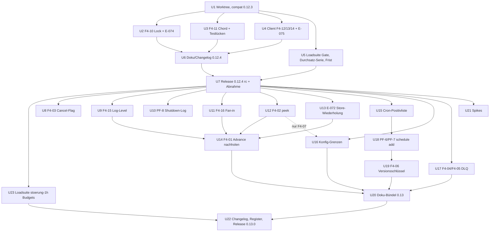
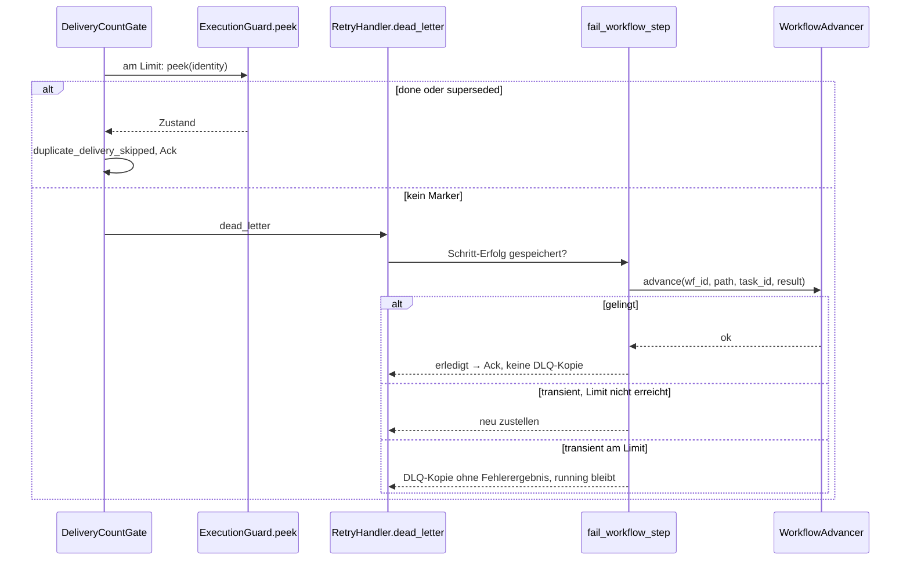
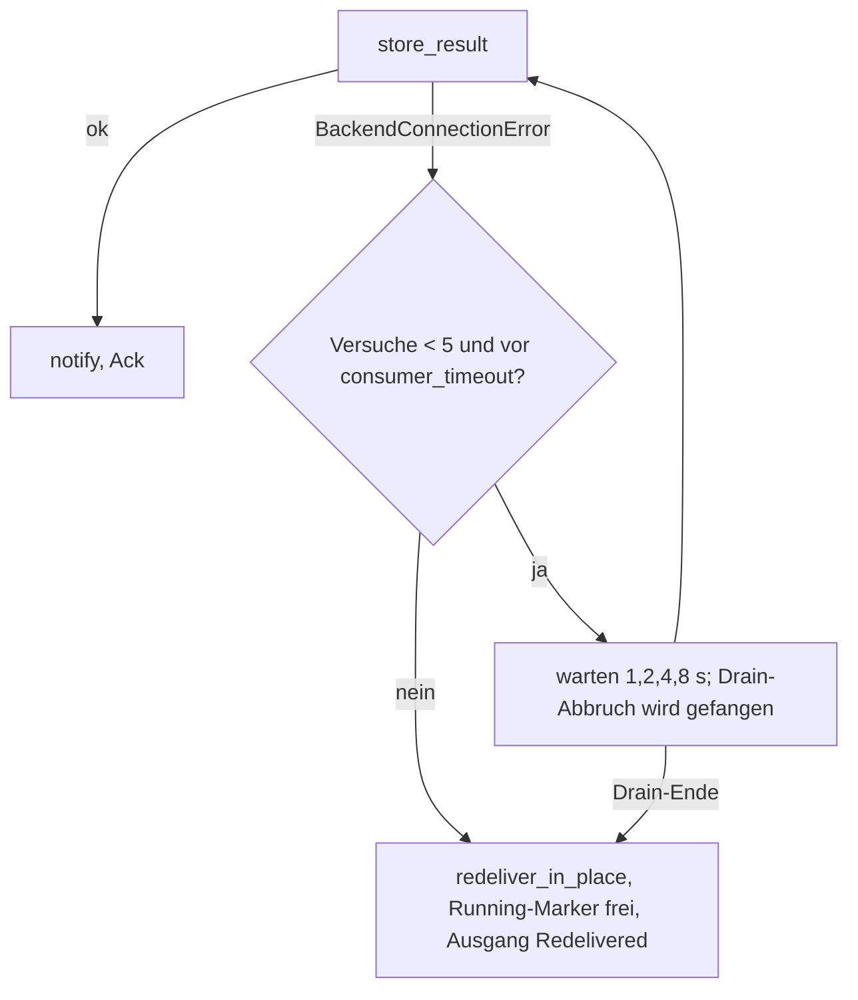

# Fehlersuche Runde 4, Fehlerbehebung 0.12.4 und 0.13.0 - Plan

## Goal Capsule

- **Objective:** Mit swarmq 0.12.4 verlieren Betreiber bei Valkey-Neustarts, Speicheralarm und fehlerhaften Lock-Templates keine Workflows und keine Ergebnisse mehr durch die fünf Befunde F4-10 bis F4-14 der Runde 4: Lock-Render-Fehler gehen in die DLQ statt bis zum Zustelllimit zu hängen, ein Valkey-Aussetzer beim Gruppenglied lässt den Workflow nicht mehr scheitern, und der Valkey-Client meldet jeden Verbindungsfehler als `BackendConnectionError`, hinterlässt nach einem Fehlschlag keinen halb gebauten Client und wiederholt den Neuaufbau im Handshake. Mit 0.13.0 sind alle 16 Befunde des Registers behoben, die 19 Entscheidungen vom 2026-10-17 im Code, und Cron-Syntax, Konfigurationsgrenzen und DLQ-Meldungen entsprechen der Doku.
- **Means:** Zwei Releases (KD1): 0.12.4 mit den Bündeln Lock, Chord und Client (U2–U4) samt Loadsuite-Abnahme (U5, U7); 0.13.0 mit Workflow, Gate, Cron, Konfiguration, CLI, Broker, Log und Doku (U8–U22). Jeder Fix kippt seinen Nachweis von `xfail` auf grün (KTD1).
- **Authority:** Entscheidungsregister `compound-packs/swarmq-entscheidungen/` (E-072 bis E-077 und die Nachträge vom 2026-10-17) > Befundregister `docs/befunde/fehlersuche-runde-4-2026-10.md` > dieser Plan > Fix-Recherchen und Gegenprüfungen unter `docs/befunde/fehlersuche-runde-4-recherche/`. AGENTS.md (TDD, Qualitäts-Gates, Testports) gilt durchgehend; für die Loadsuite deren `docs/betrieb.md`.
- **Stop conditions:**
  - Ein Fix ließe sich nur umsetzen, wenn ein Test mit `@pytest.mark.entscheidung` geändert oder gelöscht wird: stoppen und Georg fragen.
  - Ein Fix bräuchte ein neues Nachrichtenformat, einen neuen Header oder eine Änderung oder Neuanlage von Lua-Skripten (`peek` in U12 bleibt `HMGET` ohne Lua): stoppen (KD5).
  - `src/swarmq/worker/pipeline.py` würde 800 Zeilen erreichen (heute 795): stoppen und auslagern (KTD5).
  - Die Loadsuite-Abnahme verfehlt ein Gate (Verlust > 0, Duplikate außer „hingenommen (E-041)“ > 0, Speichertrend, Erholung außerhalb des Budgets nach der Gate-Korrektur aus U5): kein Release, Ursache einordnen.
  - Ein Spike aus U21 widerspricht einer Entscheidung (E-025, E-075): stoppen, Ergebnis ins Register, Georg fragen.
- **Execution profile:** Strenges TDD je Unit nach AGENTS.md. Für alle 16 Befunde existiert der rote Nachweis (`befund`-Marker, `xfail(strict=True)`); ein Fix gilt erst, wenn sein Nachweis ohne `xfail` grün ist. Zusatzfälle aus den Test-Szenarien werden einzeln zuerst rot geschrieben. Umsetzung durch Subagenten mit Modell Opus 5.5, nach jeder Unit ein Review mit vier Linsen: Entscheidungs-Abgleich, Realismus gegen den Code, Testdeterminismus, Nebenwirkungen auf die Pipeline-Invarianten (KTD6). Jede Annahme wird gegen den Code geprüft, nicht gegen Doku oder frühere Berichte.
- **Tail ownership:** Push, MR und Merge erst nach Georgs Ok. Die Nachweise des Branches `test/fehlersuche-runde-4` gehen als eigener MR vor dem ersten Fix-MR nach `main` (KD2). Der PyPI-Upload bleibt bei Georg.

---

## Product Contract

### Summary

Der Plan behebt die 16 FEHLER der Runde 4 in zwei Releases. 0.12.4 bringt die beiden P2 und das Client-Bündel, danach eine rc-Abnahme in der Loadsuite, deren Erholungs-Gate vorher korrigiert wird. 0.13.0 bringt die übrigen elf Befunde, die neuen Regeln E-072 bis E-076 samt Nachträgen (E-077 ist mit vorhandenen Tests bereits erfüllt), drei Spikes zu offenen Prüfaufträgen und die Doku-Aufgaben. Jeder Fix läuft in beiden Richtungen neben 0.12.0 bis 0.12.3, ohne Formatänderung.

### Problem Frame

Runde 4 hat mit Zustandsmaschinen, Fehlerinjektion, Mutation, Betriebsabläufen und Fuzzing 16 Fehler bestätigt. Zwei sind P2: Lock-Templates mit Index- oder Attributzugriff werfen am Lock-Gate vorbei und lassen die Nachricht bis zum consumer_timeout unbestätigt (F4-10); der Chord-Manager ist der einzige Koordinations-Store, der Valkey-Fehler nicht einwickelt, sodass ein kurzer Aussetzer einen erfolgreichen Workflow auf `failed` setzt (F4-11). Die Störungsläufe zeigten elf Doppelläufe; sechs davon stammen vom Valkey-Client, der den Neuaufbau im Handshake nicht wiederholt (F4-14), fünf vom bewusst kurzen Wiederholfenster beim Ergebnis-Speichern, das Georg mit E-072 verlängert hat.

Georg hat am 2026-10-17 alle 19 Produktfragen und vier Fix-Fragen entschieden, jeweils die Empfehlung. Die Entscheidungen stehen als E-072 bis E-077 und als Nachträge im Register. Die Fix-Recherchen (`docs/befunde/fehlersuche-runde-4-recherche/`, Gegenprüfungen) nennen je Befund Fundstelle, Ansatz, betroffene Tests und Risiken; sie sind in die Einheiten eingearbeitet und werden nicht wiederholt.

Drei Dinge bestimmen den Schnitt: Viele Fixes berühren dieselben Dateien (`worker/results.py`, `worker/retry.py`, `admin.py`, `schedule_cmd.py`, `logging.md`), `pipeline.py` steht bei 795 von 800 Zeilen, und die Loadsuite misst die Erholung der Spitzenfenster ab Fensterende, weshalb ihr 1-h-Störungslauf am Gate riss, ohne dass swarmq versagt hat.

### Requirements

**Release 0.12.4**

- R1. `render_lock_name` meldet jede `Exception` aus Signatur, Binden und `format_map` als `ValueError`; das Lock-Gate schickt die Nachricht mit `x-swarmq-lock-render-error` in die DLQ (F4-10). Ein gerenderter Name, der mit `{sched}` beginnt oder einem internen Lock-Namen gleicht, wird ebenso behandelt (E-074).
- R2. `ChordManager.record_member` und `record_and_check_complete` wandeln Treiberfehler wie die übrigen Stores über `as_backend_error`; ein Valkey-Ausfall oder `OOM` beim Gruppenglied führt zur Neuzustellung statt zur Fail-Markierung (F4-11). Eine dauerhafte Fehlerantwort (`WRONGTYPE`) wird wie bei Lock- und Rate-Limit-Gate bis zum Zustelllimit neu zugestellt (KD7).
- R3. `ValkeyBackend.connect()` wandelt jeden Treiberfehler, auch Zeitablauf und Fehlerantwort auf `PING`, in `BackendConnectionError` (F4-12); setzt `_client` erst nach erfolgreichem `PING` und Eviction-Prüfung und schließt den eigenen Client im Fehlerzweig (F4-13); führt den `PING` unter einer konfigurierbaren Gesamtfrist aus, Vorgabe 30 s (E-075); wiederholt den Neuaufbau einer Pool-Verbindung, wenn der Handshake getrennt wird, im Fenster der Befehls-Retry-Politik (F4-14).
- R4. Die Loadsuite misst die Erholung eines Störfensters in einer Phase mit `recovery_budget_s` ab `max(Fensterende, Phasenende)` gegen das Phasenbudget und zusätzlich eine fensterlokale Durchsatz-Serie, damit ein Hänger im Spitzenfenster sichtbar bleibt; Fenster in Phasen ohne Budget bleiben wie bisher. Die Vorgabe `publish_timeout_s` wird auf `None` zurückgestellt (swarmq-Vorgabe 120 s, Runner-Deckel 30 s, in `docs/betrieb.md` als bewusste Ausnahme beschrieben), die Störungsszenarien setzen 20 s ausdrücklich.
- R5. 0.12.4 erhält einen rc mit Loadsuite-Abnahme (Konformität, vier Smokes, `stufe1-1h`, `stoerung-1h` als Beleg für F4-14) und wird erst nach bestandener Abnahme final. Die compat-Suite bekommt die Basis 0.12.3. Der 0.12.4-Changelog nennt die Lücke bis 0.13.0: eine dauerhafte Fehlerantwort im Chord-Skript führt bis zum Zustelllimit zu Wiederholläufen des Schritts und danach zu `running` bis zur TTL (behoben mit F4-01).
- R21. `stoerung-1h` bekommt nach 0.12.4 ein Queue-Limit-Fenster mit Überlast, Budgets aus zwei Messreihen und ein Spitzen-Backlog-Minimum, das eine fehlende Spitze erkennt.

**Release 0.13.0, Workflow und Pipeline**

- R6. Ein per `app.workflow(id)` wiederaufgenommenes Handle setzt das Cancel-Flag auf dieselbe Lebensdauer wie `apply()`: `max(24 h, result_ttl)` (F4-03, E-020).
- R7. `SettleFailedAfterPublish` beim Publish der Retry-Kopie loggt WARNING `retry_ack_failed_after_publish`, meldet `task_retrying` und stellt nicht neu zu (F4-15, E-043).
- R8. `shutdown_sigterm_escalation` loggt INFO, wenn das SIGTERM das geplante Drain-Ende trifft; `shutdown_sigkill_escalation` bleibt ERROR; beide Events stehen im Katalog (PF-8, E-018).
- R9. Der Fan-in einer Gruppe leitet die Ergebnis-Kennung eines Blatts deterministisch ab; ein fehlendes Ergebnis meldet `_gather_results` als `WorkflowResultExpired`; der Längen-Guard entfällt (F4-16, E-073).
- R10. Erreicht die Neuzustellung einer erledigten oder überholten Ausführung das Zustelllimit, liest das Delivery-Count-Gate den Zustand des Ausführungsschutzes und bestätigt statt Dead-Letter; bei Backend-Ausfall beim Lesen bleibt es beim Dead-Letter (F4-02, E-043, KD5).
- R11. `ResultTail.finish` wiederholt das Speichern jedes terminalen Ergebnisses (Erfolg, Fehler ohne Dead-Letter, Abbruch) für AT_LEAST_ONCE-Tasks mit dem Backoff der Zurückstellung über bis zu fünf Speicherversuche (Wartezeiten 1, 2, 4, 8 s), gedeckelt durch Drain-Ende und `consumer_timeout_s`; ein Drain-Abbruch im Warten wird nie als `CancelledError` propagiert, sondern endet die Wiederholung mit `redeliver_in_place` (E-001); FIRE_AND_FORGET bleibt unverändert (E-072, KD8).
- R12. Ist das Erfolgsergebnis eines Workflow-Schritts gespeichert und endet die Neuzustellung im Dead-Letter, holt `fail_workflow_step` den Advance mit dem gespeicherten Ergebnis nach; gelingt er, wird bestätigt ohne DLQ-Kopie und `TASK_DLQ`, das Unique-Flag wird wie nach einer DLQ-Kopie freigegeben; scheitert er vorübergehend, wird neu zugestellt; am Zustelllimit folgt ein letzter Advance, dann eine DLQ-Kopie ohne Fehlerergebnis. Das Erfolgsergebnis wird nie überschrieben (F4-01, E-040, KD6).

**Release 0.13.0, Cron, Konfiguration, CLI, Broker**

- R13. Eine Positivliste nach crontab(5) prüft Cron-Ausdrücke in `TaskInfo`, im Leader-Sync und in `schedule add --cron`: genau 5 Felder, Zahlen, `*`, `-`, `,`, `/`, Monats- und Tagesnamen ohne Rücksicht auf Groß- und Kleinschreibung, `@`-Aliase einschließlich `@midnight`; `L`, `W`, `#`, `R`, `H`, `?`, `@reboot` und 6 oder 7 Felder sind `ValueError` bzw. `ConfigurationError` in der CLI (F4-09, PF-12, PF-13, PF-15, E-065).
- R14. Jeder Konfigurationswert über der technischen Grenze seines Ziels ist ein `ConfigurationError` mit Feldnamen: Fristen als ms unter der kleineren der gemessenen Grenzen von Valkey `PX` und RabbitMQ-`expiration`, `concurrency` ≤ 65535, Zählfelder ≤ `float_info.max`; die Prüfung läuft vor den Ableitungen in `__post_init__` (PF-10, PF-11, F3-38, E-063). Eine Zeitzone mit überlangem Pfadteil ergibt `ValueError`/`ConfigurationError` statt `OSError` (F4-08). Das Delivery-Count-Gate zählt `inf` wie keinen Header (F4-07, E-051).
- R15. `BrokerAdmin.list_dead_letters`, `inspect_dead_letter`, `retry_dead_letter` und `retry_all_dead_letters` melden über ein Flag `hit_limit`, ob das Lesen am Limit endete; `scanned` zählt weiter keine abgelaufenen Einträge; die CLI leitet `truncated` und `scan_exhausted` daraus ab (F4-05, E-028). `purge_dead_letters` schließt seinen DLQ-Channel in jedem Fall (F4-04).
- R16. `schedule add --unique-for` gibt den eigenen Dedup-Claim nach einem Konflikt nur frei, wenn der gespeicherte Eintrag nicht den eigenen `dedup_hash` trägt, und lässt ihn bei Backend-Ausfall stehen (PF-6, E-059); `already_exists` meldet, ob unter dem Namen ein Eintrag existiert, und ist dokumentiert (PF-7, E-076).
- R17. Der Versionsschlüssel eines Workers trägt zusätzlich das Owner-Token des Prozesses; `schedule status` zeigt jeden lebenden Worker auch bei mehreren Supervisoren je Host und liest alte Schlüssel weiter; ein `SWARMQ_WORKER_ID` mit `|` ist ein `ConfigurationError` (F4-06, E-029).

**Release 0.13.0, Doku und Spikes**

- R18. Doku-Aufgaben, gebündelt in U20, damit parallele Units keine Website-Dateien teilen: copytruncate-Hinweis in `logging.md` (PF-9); Katalogzeilen für `publish_channel_close_incomplete`, die aiormq-Meldung, `retry_ack_failed_after_publish`, `result_store_retrying`/`result_store_recovered`, `scheduler_cron_report_invalid` und beide Shutdown-Events; `publish_channel_close_incomplete` im Alarm ohne Traceback (PF-19 b); E-025-Grenze D-1 in `errors.md`; Slot-Belegung und Konsum im Alarm (PF-18 a); vierte Situation Ack-nach-Store mit Wanduhr-Obergrenze in `delivery-semantics.md` (D-2); die vier E-041-Pfade; Doku-Zeilen zu Cron-Positivliste, Konfig-Grenzen, DLQ-Kürzung, `already_exists`, Versionsschlüssel und Workflow-Failure-modes; Changelog EN und DE je Release. Die liefernden Units (U8–U19) notieren ihre Doku-Zeilen im Commit-Text, U20 schreibt sie.
- R19. Drei Spikes mit Ergebnis unter `docs/solutions/spikes/` und Eintrag im Register: Verbindungs-Retry vom Befehls-Retry trennen (PF-16 b), Retry-Kopie ohne Slot warten lassen (PF-18 b), Kanal-Close bis `unblocked` zurückstellen (PF-19 a). Die Spikes ändern keinen Produktionscode.
- R20. Nach 0.13.0 sind alle 16 Nachweise ohne `xfail` grün, die `@precondition`-Klammern in den Zustandsmaschinen entfernt, das Register führt jeden Befund als behoben.

### Key Decisions

- KD1. **Zwei Releases: 0.12.4 und 0.13.0** (session-settled: user-directed — gewählt gegenüber einem Release 0.13.0 mit allen Fixes: die beiden P2 und das Client-Bündel sollen früh in Produktion, die brechenden Validierungen (Cron, Grenzen) später). Governs R1–R5, R20.
- KD2. **Fix-Branch setzt auf `test/fehlersuche-runde-4` auf** (session-settled: user-directed — gewählt gegenüber „erst Test-Branch mergen“: die Nachweise kippen direkt; der Test-Branch geht als eigener MR voran). Governs Goal Capsule, U1.
- KD3. **Loadsuite-Korrektur als eigene Unit vor dem rc** (session-settled: user-directed — gewählt gegenüber einer getrennten Änderung: ohne tragfähiges Gate ist die rc-Abnahme nicht aussagekräftig). Governs R4, R5.
- KD4. **Testlücken nur mit Befund-Bezug** (session-settled: user-directed — gewählt gegenüber allen ~60 Testlücken: Store-Fehlerpfade, Eviction-INFO-Rückfall, `chords.py` und Retry-Politik kommen mit; der Rest ist Deferred). Governs U3, U4, U12.
- KD5. **F4-02 in der kleinen Variante** (session-settled: user-directed — gewählt gegenüber einem besitzerlosen Done-Marker nach dem Dead-Letter: kein neues Lua, kein Lease vor dem `try`; zwei Restlücken bleiben dokumentiert: die doppelte DLQ-Kopie nach verlorenem Ack und der Fall, dass der Done-Marker vor Erreichen des Limits abläuft, `execution_guard_done_ttl_s`). Governs R10.
- KD9. **Release-Lücke zwischen 0.12.4 und 0.13.0 dokumentieren** (session-settled: user-directed — gewählt gegenüber dem Vorziehen von U12–U14 nach 0.12.4 oder einem Zwischenverhalten im Chord-Fix: dauerhafte Fehlerantworten im Chord-Skript sind praktisch nur durch manuelle Key-Manipulation erreichbar). Governs R5, U6.
- KD6. **F4-01: Bestätigen, wenn der nachgeholte Advance gelingt** (session-settled: user-directed — gewählt gegenüber einer DLQ-Kopie ohne Fehlerergebnis: ein Replay würde den erledigten Schritt erneut ausführen). Governs R12.
- KD7. **F4-11: Fehlerantworten werden wie bei den anderen Gates bis zum Limit neu zugestellt** (session-settled: user-directed — gewählt gegenüber sofortiger Fail-Markierung bei `BackendResponseError`: konsistent, keine neue Regel). Governs R2.
- KD8. **E-072 gilt nur für AT_LEAST_ONCE** (session-settled: user-directed — gewählt gegenüber Wiederholung auch für FIRE_AND_FORGET). Governs R11.

### Scope Boundaries

- Kein neues Nachrichtenformat, kein neuer Header; 0.12.4 und 0.13.0 laufen neben 0.12.0 bis 0.12.3 (Mischbetrieb über `tests/compat`).
- Die Trennung des Verbindungs-Retry (PF-16 b), das Warten ohne Slot (PF-18 b) und das zurückgestellte Close (PF-19 a) werden nur als Spikes untersucht; Umsetzung folgt nach Georgs Entscheidung auf Spike-Basis. Die große Variante von F4-02 bleibt Deferred; über sie entscheidet Georg nach Restlücken-Meldungen, nicht nach einem Spike.
- Keine Änderung des Chaos-Stacks auf RabbitMQ 4.3.6 (PF-1, eigene Änderung), kein 6-h-Störungslauf (PF-2).
- FS-32 (`status()` nach `cancel()` bleibt `running`) wird nicht behoben; der F4-03-Teil „`get()` meldet den Abbruch“ heilt erst damit.

#### Deferred to Follow-Up Work

- Rund 50 Testlücken ohne Befund-Bezug aus `3c-sichtung-D.md`, `-E.md`, `-F.md` (z. B. Consumer-Wächter-Takt, `ClientWorkflows.apply`-Argumente, `_decode_setpoint`, `reconcile_namespace`) als eigene Test-Runde.
- `ValkeyLockStore.force_release` wandelt `exists` pauschal statt über `as_backend_error` (Fund der Fix-Recherche, kein Befund): prüfen und ggf. als Verdacht führen.
- Mutation Welle 3 (Loadsuite-Backlog und Plan der Runde 4).
- Chaos-Stack auf 4.3.6 (PF-1), danach Chaos-Varianten zu PF-18/PF-19.
- Längengrenze für gerenderte Lock-Namen (Härtung, R4F-10) nur mit eigener Regel.

### Dependencies

- Branch `test/fehlersuche-runde-4` @ 5b02301 mit den 16 Nachweisen und den Register-Einträgen E-072 bis E-077.
- Loadsuite-Branch `feat/stoerungsarten` @ 2677543 im Worktree `../swarmq-loadsuite-stoerungen`; Lastserver `lastserver` erreichbar, SSH-Schlüssel geladen.
- swarmq 0.12.3 auf PyPI für die compat-Basis.
- valkey-py 6.1.1 (Pool-Patch in U4 hängt an `get_available_connection`, `ensure_connection`, `valkey_connect_func`).

### Open Questions

Keine blockierenden. Deferred:

- Ob PF-16 (b), PF-18 (b) und PF-19 (a) umgesetzt werden, entscheidet Georg nach den Spike-Ergebnissen aus U21; die Spikes sind kein Release-Gate für 0.13.0.
- Die genaue Sekundenobergrenze für Fristen (R14) wird in U16 gegen Valkey und RabbitMQ gemessen, bevor sie in die Doku kommt.

### Sources

- Register und Entscheidungen: `docs/befunde/fehlersuche-runde-4-2026-10.md` (Abschnitte „Entscheidungen“, „Vor dem Fix zu entscheiden“, „Vorschlag Fix-Plan 0.13“), `compound-packs/swarmq-entscheidungen/e072…e077` und Nachträge (pack: swarmq-entscheidungen, `e0nn-*.md`).
- Fix-Recherchen (Fundstellen, Tests, Risiken je Befund) und Gegenprüfungen: `docs/befunde/fehlersuche-runde-4-recherche/6-gegenpruefung-{Z,M,B,F,I}.md`, `1-zustandsmodelle.md`, `3c-sichtung-{D,E,F}.md`, `2c-injektion.md`.
- Invarianten: `docs/solutions/patterns/invarianten-der-worker-pipeline-2026-08.md`; Client-Retry: `docs/solutions/spikes/2026-04-17-toxiproxy-reconnect-spike.md`; Release-Ablauf: `docs/plans/2026-10-15-1138-fix-fehlersuche-runde-3-plan.md` (U17, U18, KTD18).
- Loadsuite: `src/loadsuite/verdict/recovery.py`, `runner/scenario.py:190`, `docs/betrieb.md`, `docs/testlauf-stoerung-v0.12.3.md`, `docs/baseline.md`.

---

## Planning Contract

### Key Technical Decisions

- KTD1. **Nachweis-Kippregel.** Ein Fix gilt, wenn sein Nachweis ohne `xfail` grün ist; `befund`-Marker bleibt als Rückverweis; die Register-Zeile wird auf „behoben (0.12.4/0.13.0)“ gesetzt; `@precondition`-Klammern und Strategie-Filter mit F4-Verweis werden im selben Zug entfernt. Vorbild: Runde 2 und 3.
- KTD2. **Lock-Render (U2).** `render_lock_name` fängt `Exception` (nicht `BaseException`) und wirft `ValueError(...) from exc`; E-074 prüft den gerenderten Namen gegen `SCHEDULER_LOCK_NAME` und das Präfix `{sched}` aus `keyspace.py:121-125` an derselben Stelle. Keine Längengrenze (Härtung, Deferred).
- KTD3. **Chord-Wrapping (U3)** nach dem Muster `locks.py:59-73`: `except BackendConnectionError: raise`, `except Exception → as_backend_error`. Folge KD7 wird in `logging.md` beim Advance dokumentiert. Im selben Zug: Eviction-INFO-Rückfall (`test_befund_bz04_eviction_policy.py:115-135` verschärfen, `strict` → Exit 78 mit Marker E-005), Store-Fehlerpfad-Matrix (`tests/unit/backend/test_valkey_store_error_paths.py`: Transport, Timeout, OOM, `ResponseError("OOM")`, `WRONGTYPE` je Store-Methode; `current_owner` bleibt nach E4 roh; `force_release` ausnehmen und als Verdacht melden), Unit-Tests für `chords.py`.
- KTD4. **Client-Bündel (U4) in fester Reihenfolge F4-12 → F4-13 → E-075 → F4-14**, alle in `backend/valkey/connection.py`. E-075: Konstruktor-Parameter `connect_timeout_s` an `ValkeyConnection`/`results.py:57`, Feld `backend_connect_timeout_s` in `SwarmQConfig` mit Env `SWARMQ_BACKEND_CONNECT_TIMEOUT_S` (Vorgabe 30 s, in `_POSITIVE_FIELDS`, Obergrenze `threading.TIMEOUT_MAX`), Env-Leser analog `env_valkey_eviction_check` für die CLI-Pfade, die das Backend ohne Config bauen (`cli/worker_cmd.py:102`, `cli/_shared.py:242`); Frist nur um den `PING`, eigener Fehlertext. F4-14: Instanz-Patch des Pools wie `_seal_pool` (keine Pool-Unterklasse, weil rund 30 Tests `Valkey.from_url` patchen): `valkey_connect_func=_handshake` wirft `_HandshakeReset(ValkeyConnectionError)`; die äußere Wiederholung des Handshake-Neuaufbaus ist als Zeitdeckel definiert (Backoff `ExponentialBackoff(cap=2, base=0.05)`, Wiederholung nur, solange seit dem ersten Fehlschlag weniger als die nominelle Summe des Befehls-Retry (≈ 3,1 s) vergangen ist), damit innere TCP-Wiederholungen und äußere Handshake-Wiederholungen sich nicht vervielfachen; Modulkonstanten für beide Fenster; `TimeoutError` im Handshake wird nicht markiert (E-075: Laufzeit bleibt). Nicht idempotente Skripte (`lock_release.lua`, `sliding_window_counter.lua`, `guard_claim.lua`, `workflow_state_cas.lua`, `sched_poll.lua`) bleiben von der Wiederholung unberührt, weil sie vor dem Senden greift (F3-33 unverändert). Pack-Text in U1; `ohne_test` in e075 streicht U4.
- KTD5. **F4-02 kleine Variante (U12).** Neue Vertragsmethode `ExecutionGuardStore.peek(identity, retry_count) → "done" | "superseded" | None` (Valkey: `HMGET` ohne Lua; InMemory nachziehen; Contract-Test); `ExecutionGuard.skip_if_settled(delivery, ctx)` wiederholt den Pfad `duplicate_delivery_skipped` (Metrik, Ack, `Terminal.never_release()`), darf aber `ctx.task_info` nicht voraussetzen, weil das Delivery-Count-Gate vor dem Registry-Lookup läuft: den Zustellmodus wie `RetryHandler.dead_letter` über `deps.registry.get(ctx.task_name).task_info` auflösen, bei `TaskNotFoundError` wie AT_LEAST_ONCE lesen; nur `config.execution_guard` und ein vorhandener Store entscheiden sonst über das Lesen. Das Gate bekommt die Callable spät gebunden aus der Pipeline als Einzeiler (795/800 Zeilen). Backend-Ausfall beim Lesen → Dead-Letter wie heute plus WARNING. Keine Reihenfolgeänderung der Gates (E-070, Absturzschleife). Zweite Restlücke (KD5): ist der Done-Marker bei Erreichen des Limits bereits abgelaufen, liefert `peek` nichts und die Limit-DLQ überschreibt wie heute; im Register als bekannte Grenze führen.
- KTD6. **Review je Unit** durch einen zweiten Opus-Subagenten mit den vier Linsen aus dem Execution profile; Befunde werden vor dem Commit eingearbeitet. Langläufer (Loadsuite-Läufe) abgekoppelt unter `systemd-inhibit`, Server seriell.
- KTD7. **E-072 (U13).** Schleife um `store_result` für jedes terminale Ergebnis eines AT_LEAST_ONCE-Tasks: bis zu fünf Speicherversuche mit Wartezeiten `backend_defer_delay(attempt, base=1 s, cap)` = 1, 2, 4, 8 s (nominelle Wartesumme 15 s; die Wanduhr-Obergrenze liegt mit `backend_op_timeout` je Versuch bei rund 35 s und steht so in D-2 und in der Bewussten Folge von E-072), zusätzlich gedeckelt durch `consumer_timeout_s − (jetzt − received_at)`; `received_at` als Feld im `GateContext`, weil `ResultTail` den Zustellzeitpunkt sonst nicht kennt und der Kontext beim Dekodieren entsteht (keine Pipeline-Zeile). Der Drain-Deckel greift ohne Propagation: die Schleife fängt einen Abbruch im Warten (`CancelledError` aus `task.cancel()` am Drain-Ende) wie E-001 im Executor, beendet die Wiederholung, ruft `redeliver_in_place` und liefert `Redelivered`; so bleibt der Terminal-Default im `finally` unberührt (kein Schedfire-Completed-Marker, keine Unique-Freigabe auf eine unbestätigte Nachricht). Warten über das Muster `wait_unless_shutdown` mit Modul-`_sleep`/`_monotonic` wie `redelivery.py:63-66` für FakeClock-Tests; Events `result_store_retrying` (WARNING, gedrosselt) und `result_store_recovered` (INFO), Katalogzeilen über U20.
- KTD8. **F4-01 (U14).** `_step_succeeded` liefert das gespeicherte Ergebnis; `fail_workflow_step` holt den Advance über eine gemeinsame Funktion aus `ResultTail._advance_workflow` nach (transient → neu zustellen; `UnroutableMessage`/unerwartet → Fehlmarkierung); Rückgabe als Dreifach-Ausgang (markiert / neu zugestellt / Schritt erledigt), `FailWorkflow`-Protokoll und Aufrufer in Cancel-, Expiry-, Lock- und Unknown-Gate anpassen; in `RetryHandler.dead_letter` entfällt `store_result` im Schutzfall; gelungener Advance → Ack ohne DLQ-Kopie (KD6), danach `maybe_release_unique` und Schedfire-Finalisierung genau wie nach einer DLQ-Kopie, Gate-Outcome bleibt `already_released`, damit das Unique-Flag eines Schritts mit `unique_for` nicht bis zur TTL stehen bleibt; dasselbe für die Gate-Aufrufer (Expiry, Lock, Cancel, Unknown); am Limit letzter Advance, danach DLQ-Kopie ohne Fehlerergebnis; Restfall „letzter Advance scheitert transient“ bleibt `running` und wird dokumentiert. Reihenfolge nach U12 (Done-Vorrang) und U13 (`results.py`).
- KTD9. **Cron-Positivliste (U15)** als reines Modul `src/swarmq/cron_syntax.py` mit `validate_cron_syntax(expr) → None` (Tokenizer, je Ablehnung eigene Meldung; Wertebereiche prüft croniter), genutzt von `TaskInfo._validate_scheduling`, `scheduler/sync._validated` und `cli/schedule_cmd._resolve_fire_time` (→ `ConfigurationError`). Mischbetrieb: ein vom 0.12-Worker gemeldeter Cron mit 6 Feldern, der vor dem Leader-Upgrade adoptiert wurde, feuert aus der gespeicherten Definition weiter, Änderungen daran lehnt der 0.13-Leader ab und loggt `scheduler_cron_report_invalid` gedrosselt (einmal je Name und Leaderwechsel, wie `cron_lost` in E-003); die Upgrade notes sagen genau das. `@midnight` wird angenommen und als Klarstellung in E-065 nachgetragen; `@reboot` abgelehnt; Wochentag 7 bleibt.
- KTD10. **Konfig-Grenzen (U16).** `_validate_finite` → `_validate_bounds`: `isfinite` nur auf `float`, dann Vergleich gegen `MAX_DEADLINE_S` (Startwert `MAX_DEADLINE_MS = (2**63−1 − 2**43) // 2`; in U16 gegen Valkey `PX` und gegen RabbitMQ-`expiration` auf einer Delay-/Test-Queue gemessen, weil `retry_max_delay`, `lock_wait_max_s`, `max_age` und `dead_letter_ttl_s` auch als Per-Message-Expiration enden; die kleinere Grenze wird Konstante) bzw. `float_info.max` für Zählfelder, `concurrency ≤ 65535` (AMQP short in `set_qos`); Prüfung vor den Ableitungen in `__post_init__` (`config.py:686-697`); `normalize_timezone` fängt `OSError`; `cron_time._zone` wandelt `OSError` in `ZoneInfoNotFoundError`; `delivery_count._count` fängt `OverflowError`. F4-07 wird nach U12 umgesetzt (gleiche Datei).
- KTD11. **DLQ-Vertrag (U17).** `_drain_dlq_messages` liefert `hit_limit`; Rückgabe als generische Tupel-Unterklasse `class DeadLetterScan(tuple[_T, int], Generic[_T])` mit `__new__(cls, first: _T, scanned: int, *, hit_limit: bool)`, damit die drei Signaturen `tuple[list[dict], int]`, `tuple[bool, int]` und `tuple[int, int]` unter mypy strict und basedpyright gedeckt sind; die Protocol-Signaturen bleiben `tuple[..., int]` (kompatibel zu rund 100 Entpackungen und zu swarmv); CLI liest `getattr(result, "hit_limit", scanned >= limit)`; `retry_all_dead_letters` gleich; InMemory-Broker nachziehen. F4-04: `_dlq_queue` vor dem `try`, `finally: close_channel_quietly`.
- KTD12. **Versionsschlüssel (U19).** `sq:{sched}:worker_version:<worker_identity>|<owner_token>`; `worker_versions()` liefert weiter `Mapping[str, str]` nach rohem Suffix; CLI zeigt `rpartition("|")[0] or suffix` als `worker_id` und ergänzt additiv `process`; alte Schlüssel ohne `|` werden weiter gelesen; `SWARMQ_WORKER_ID` mit `|` wird als `ConfigurationError` abgelehnt, damit die Ableitung eindeutig bleibt; Hinweis in `cli.md`, dass ein alter Eintrag nach Respawn bis zu drei Meldeintervalle sichtbar bleibt.
- KTD13. **schedule add (U18).** `except BaseException` behält den Claim bei `is_backend_outage(exc)`; neue Methode `ScheduleStore.get_definition(name)` mit Vertragstest; `already_exists = not inserted and existing_owner is None`.
- KTD14. **Loadsuite (U5, U23).** U5: Fenster erhalten ihre Phase über die Zeit (`phase_windows`); in Phasen mit Budget gilt für Backlog- und p95-Serie der Bezug `max(Fensterende, Phasenende)`, Budget `max(Fensterbudget, Phasenbudget)`, Band aus dem Vorfenster des Phasenbeginns; zusätzlich eine dritte, fensterlokale Durchsatz-Serie (abgeschlossene Tasks je 15-s-Fenster aus dem Ledger, Band ≥ 0,9 × Vorfenster-Median), die auch in Phasen mit Budget ab Fensterende mit dem Fensterbudget gemessen wird, damit ein spät heilender Hänger sichtbar bleibt; `SeriesRecovery.measured_from` und `bezug` im Report; `publish_timeout_s: float | None = None` mit leerer Compose-Variable, in `docs/betrieb.md` als bewusste Ausnahme (Worker 120 s, Runner-Deckel 30 s) beschrieben; Negativkontrolle `recovery.yaml` muss weiter durchfallen, eine zweite Negativkontrolle „Abschlüsse 300 s bei null, Backlog erholt sich nach Phasenende“ muss durchfallen. U23 (nach 0.12.4): `stoerung-1h` Soak geteilt in `soak-a`, `kurzspitze` (60–120 s Überlast, Queue-Limit-Fenster), `soak-b`; `min_peak_backlog` vorläufig 45 000; Budgets aus zwei Messreihen.
- KTD15. **Release-Ablauf** wie Runde 3 (KTD18 dort): `uv lock --check`, `just all`, Release-Commit mit Version und Lockfile, rc-Tag nach Georgs Ok, Loadsuite auf dem Tag, Merge, finales Tag, Dist für Georg. Changelog-Abschnitte `## [0.12.4] — unreleased` bzw. `## [0.13.0] — unreleased` mit `### Upgrade notes`, `### Fixed` (`**F4-nn: …**`), `### Documentation`, Spiegel in `changelog.de.md`.
- KTD16. **Worktrees.** `../swarmq-fixes4` mit `fix/fehlersuche-runde-4-p1` von `test/fehlersuche-runde-4` für 0.12.4; nach dem 0.12.4-Merge `fix/fehlersuche-runde-4-p2` von `main` für 0.13.0. Loadsuite-Arbeit im bestehenden Worktree `../swarmq-loadsuite-stoerungen`.

### High-Level Technical Design

**Wellen und Abhängigkeiten.** Innerhalb einer Welle sind die Quelldateien disjunkt; Website-Dateien (`logging*.md`, `configuration*.md`, `cli*.md`, `delivery-semantics*.md`, `errors*.md`, Guides) werden in 0.13.0 ausschließlich von U20 geschrieben, die liefernden Units merken ihre Zeilen im Commit-Text vor.

**Zustelllimit mit Vorrang erledigter Ausführungen (U12) und nachgeholter Advance (U14).** Beide greifen an verschiedenen Stellen der Pipeline und sind über den Done-Marker gekoppelt.

**Ergebnis-Speichern mit Wiederholung (U13).** Zeitlich gedeckelt durch drei Grenzen.

### Sequencing

1. U1, dann Welle 0.12.4: U2, U3, U4 parallel (dateidisjunkt), U5 parallel in der Loadsuite.
2. U6 nach U2–U4; U7 nach U5 und U6 (rc, Abnahme, final, Merge nach Georgs Ok).
3. Welle 0.13 A (nach dem 0.12.4-Merge, Branch p2): U8, U9, U10, U11, U12, U13, U15, U16 (ohne F4-07), U17 parallel; U21 (Spikes) und U23 (Loadsuite) laufen daneben, ohne Release-Gate zu sein; keine Website-Dateien in dieser Welle.
4. Welle 0.13 B: F4-07 in U16 nach U12; U18 nach U15; U19 nach U18.
5. Welle 0.13 C: U14 nach U12, U13, U9, U11.
6. Welle 0.13 D: U20 (alle Doku-Zeilen) nach U14, U16, U17, U19; U22 nach U20 und U23; U21-Ergebnisse gehen ins Register, sobald sie vorliegen.

### Risks

- **Pool-Patch an privatem valkey-py-Verhalten (U4).** `get_available_connection`, `ensure_connection` und `valkey_connect_func` sind nicht Teil der öffentlichen API. Minderung: Test der Retry-Politik (`test_valkey.py:123-143` verschärfen), Eintrag in die Upgrade-Checkliste von valkey-py, Chaos-Variante hinter Toxiproxy.
- **`pipeline.py` an der Grenze (U12).** 795 von 800 Zeilen. Minderung: Callable als Einzeiler; wenn mehr nötig ist, Konstruktion der Gates in `worker/gates/wiring.py` auslagern (Stop condition).
- **Mehr rote Tests als das Register nennt (U11).** Die Driver-Fixtures in `test_workflow_advancer.py` vergeben `seed-…`-Kennungen; nach E-073 laufen Gruppen in `WorkflowResultExpired`. Minderung: Fixtures auf `workflow_step_task_id` umstellen, Guard-Tests auf „fehlendes Ergebnis“ umschreiben.
- **Leader verwirft Altmeldungen (U15).** Ein 0.12-Worker mit 6-feldrigem Cron wird vom 0.13-Leader als ungültig gemeldet. Minderung: Changelog-Hinweis, `scheduler_cron_report_invalid` im Katalog, compat-Test.
- **Loadsuite-Gate wird lockerer (U5).** Backlog und p95 eines Spitzenfensters sind nur noch über die Phasen-Erholung sichtbar. Minderung: die fensterlokale Durchsatz-Serie hält einen Hänger sichtbar, zwei Negativkontrollen müssen durchfallen; `stufe1`-Referenzen bleiben gültig, weil Backlog- und p95-Verdikte nur lockerer werden.
- **Release-Lücke bis 0.13.0 (KD9).** Nach 0.12.4 führt eine dauerhafte Fehlerantwort im Chord-Skript bis zu `delivery_limit` Wiederholläufe des Schritts und danach `running` bis zur TTL statt sofort `failed`. Minderung: Upgrade notes 0.12.4 (U6), Realismus sehr gering, behoben mit U14.
- **Nominelle Wartesumme vs. Wanduhr (U13).** Je Speicherversuch kommt `backend_op_timeout` hinzu; die Slot-Belegung kann rund 35 s erreichen. Minderung: Wanduhr-Obergrenze in D-2 und E-072 nennen, Lock-Keeper (TTL `hard_timeout + 30 s`) und Running-Marker (Erneuerung alle 20 s) halten darüber.
- **Done-Marker-TTL (U12).** Läuft `execution_guard_done_ttl_s` vor Erreichen des Limits ab, greift `peek` nicht. Minderung: Restlücke im Register (KD5).
- **Ressourcen.** Loadsuite-Läufe nur auf dem Server, seriell, unter `systemd-inhibit`; keine CI-Pipeline während eines Wertungslaufs; Mutmut-Container und Loadsuite nie gleichzeitig.
- **Alarmregeln bei Nutzern (U10).** Wer auf WARNING `shutdown_sigterm_escalation` filtert, sieht die INFO nicht mehr. Minderung: Changelog unter Upgrade notes.

### System-Wide Impact

- Neue Konfigurationsvariable `SWARMQ_BACKEND_CONNECT_TIMEOUT_S` (0.12.4, Upgrade notes).
- Vertragserweiterungen: `ExecutionGuardStore.peek`, `ScheduleStore.get_definition`, `DeadLetterScan.hit_limit`; alle additiv, InMemory-Fakes und Contract-Tests nachgezogen.
- Validierung wird strenger (Cron-Positivliste, Konfig-Grenzen): Starts mit bisher stillschweigend angenommenen Werten enden mit Exit 78; Changelog unter Upgrade notes, `swarmq check` meldet sie vorher.
- Valkey-Key-Format des Versionsschlüssels ändert sich additiv (`|token`); alte Schlüssel bleiben lesbar.
- Loadsuite: Gate-Semantik und Vorgabe der Publish-Frist ändern sich; Referenzen bleiben gültig.

---

## Implementation Units

| U-ID | Titel | Dateien (Kern) | Hängt ab von |
|---|---|---|---|
| U1 | Worktree, Branch, compat-Basis 0.12.3, Pack-Texte | `tests/compat/`, `compound-packs/…/e074, e075` | – |
| U2 | F4-10 Lock-Render + E-074 | `worker/gates/lock.py`, `tests/fuzz/test_lock_template_fuzz.py`, Guide | U1 |
| U3 | F4-11 Chord-Wrapping + Store-Testlücken | `backend/valkey/chords.py`, `tests/unit/backend/` | U1 |
| U4 | Client-Bündel F4-12, F4-13, E-075, F4-14 | `backend/valkey/connection.py`, `config.py`, `config_validation.py` | U1 |
| U5 | Loadsuite: Gate-Korrektur, Durchsatz-Serie, Publish-Frist | Loadsuite `verdict/recovery.py`, `runner/scenario.py`, `scenarios/negativkontrollen/` | – |
| U6 | Doku und Changelog 0.12.4 | `website/reference/changelog*.md`, `configuration*.md`, `errors*.md` | U2, U3, U4 |
| U7 | Release 0.12.4: rc, Loadsuite-Abnahme, final | `pyproject.toml`, `uv.lock`, Register | U5, U6 |
| U8 | F4-03 Cancel-Flag + E-020 | `app.py`, `client/workflows.py` | U7 |
| U9 | F4-15 Log-Level | `worker/retry.py` | U7 |
| U10 | PF-8 Shutdown-Events + E-018 | `process_manager/supervisor.py` | U7 |
| U11 | F4-16 Fan-in + E-073 | `workflow_orchestration.py`, `tests/unit/test_workflow_advancer.py` | U7 |
| U12 | F4-02 peek am Zustelllimit + E-043 | `gates/delivery_count.py`, `gates/execution_guard.py`, `contracts/coordination.py`, `backend/valkey/execution_guard.py`, `pipeline.py` | U7 |
| U13 | E-072 Store-Wiederholung | `worker/results.py`, `worker/gates/__init__.py` | U7 |
| U14 | F4-01 Advance nachholen + E-040 | `worker/terminal.py`, `worker/retry.py`, `worker/results.py`, `worker/gates/__init__.py` | U9, U11, U12, U13 |
| U15 | Cron-Positivliste + E-065 | `cron_syntax.py` (neu), `task.py`, `scheduler/sync.py`, `cli/schedule_cmd.py` | U7 |
| U16 | Konfig-Grenzen + E-063, F4-07, F4-08 | `config_validation.py`, `config.py`, `scheduler/cron_time.py`, `gates/delivery_count.py` | U7 (F4-07 nach U12) |
| U17 | F4-04, F4-05 DLQ + E-028 | `broker/rabbitmq/admin.py`, `contracts/broker.py`, `cli/dlq_cmd.py` | U7 |
| U18 | PF-6, PF-7 schedule add + E-059, E-076 | `cli/schedule_cmd.py`, `contracts/coordination.py`, `backend/valkey/schedules.py` | U15 |
| U19 | F4-06 Versionsschlüssel + E-029 | `scheduler/loop.py`, `backend/valkey/schedules.py`, `cli/schedule_cmd.py`, `config.py` | U18 |
| U20 | Doku-Bündel 0.13 (alle Website-Dateien, PF-19 b) | `logging*.md`, `errors*.md`, `architecture*.md`, `delivery-semantics*.md`, `configuration*.md`, `cli*.md`, Guides, `broker/rabbitmq/connection.py` | U14, U16, U17, U19 |
| U21 | Spikes PF-16 b, PF-18 b, PF-19 a | `docs/solutions/spikes/`, Register | U7 |
| U22 | Changelog 0.13.0, Register-Abschluss, Release 0.13.0 | `changelog*.md`, Register, `pyproject.toml` | U20, U23 |
| U23 | Loadsuite: stoerung-1h Queue-Limit, Budgets, Wiederholung | Loadsuite `scenarios/stoerung-1h.yaml`, `docs/testlauf-stoerung-*.md` | U7 |

### U1. Worktree, Branch, compat-Basis 0.12.3, Pack-Texte

- **Goal:** Arbeitsbasis für 0.12.4 und Mischbetriebstest gegen 0.12.3.
- **Requirements:** R5; KD2, KTD16.
- **Dependencies:** –
- **Files:** `tests/compat/constraints-0.12.3.txt`, `tests/compat/_harness.py` (Fixture `python_0123`), `tests/compat/test_mixed_operation_0_12.py` (Basis 0.12.3 ergänzen), `compound-packs/swarmq-entscheidungen/e074-*.md`, `e075-*.md` (Text „Fix-Plan 0.13“ → 0.12.4), `docs/plans/` (dieser Plan).
- **Approach:**
  1. `git worktree add ../swarmq-fixes4 -b fix/fehlersuche-runde-4-p1 test/fehlersuche-runde-4`.
  2. Constraints aus dem Lockfile des Tags v0.12.3 nach dem Muster von `constraints-0.12.0.txt`; Fixture und Mischbetriebstest ergänzen (Worker 0.12.3 neben Arbeitsstand: Retry-Übergabe, Leader-Wechsel, DLQ-Replay).
  3. Pack-Texte anpassen; `uv run just lint`.
- **Patterns to follow:** `tests/compat/_harness.py`, Runde-3-Plan U2.
- **Test scenarios:**
  - compat-Lauf mit 0.12.3 grün (Marker `compat`, seriell unter der Testsperre nach `docs/testing/test-strategy.md`).
  - Register-Guard `tests/unit/test_entscheidungsregister.py` grün nach der Textänderung.
- **Verification:** Worktree vorhanden, compat 0.11.0/0.11.1/0.12.0/0.12.3 grün, Guard grün.

### U2. F4-10 Lock-Render + E-074

- **Goal:** Render-Fehler jeder Art und reservierte Namen enden in der DLQ statt unbestätigt.
- **Requirements:** R1; KTD2.
- **Dependencies:** U1
- **Files:** `src/swarmq/worker/gates/lock.py`, `tests/unit/worker/gates/test_lock.py`, `tests/unit/worker/gates/test_befund_f4_10_lock_render_index_attr.py` (xfail entfernen), `tests/fuzz/test_lock_template_fuzz.py` (Filter F4-10 auflösen, `_text_args`-Filter streichen, R4F-10-Filter mit Kommentar behalten), `website/guides/locking-and-dedup.md` und `.de.md`.
- **Approach:**
  1. Rot: Test „`{user.id}` mit Dict → `ValueError` mit Präfix“; dann `except Exception` in `render_lock_name`.
  2. Rot: Test mit Marker `entscheidung("E-074")` „Name `{sched}:leader` → `ValueError`, DLQ mit `x-swarmq-lock-render-error`“; dann Prüfung gegen `SCHEDULER_LOCK_NAME` und Präfix.
  3. Docstring, Guide-Satz („Templates beginnen mit einem Literal“), `ohne_test` in e074 streichen.
- **Patterns to follow:** Leerprüfung `lock.py:229-250`, `test_lock.py:687-691`.
- **Test scenarios:**
  - `"{items[0]}"` mit leerer Liste, `"{user.id}"` mit Dict, `"{user.id}"` mit `None`: `ValueError`, Gate schickt in die DLQ, Unique-Flag freigegeben, kein Requeue.
  - `"{key:{other}}"` mit großer Breite: `ValueError` (R4F-10 mitgedeckt), kein `MemoryError` nach außen.
  - Reservierter Name aus Nutzdaten: DLQ; gewöhnlicher Name, der nur `sched` als Teilstring enthält: erlaubt.
  - `KeyboardInterrupt`/`CancelledError` im Rendern werden nicht in `ValueError` gewandelt.
  - Fuzz-Datei grün ohne F4-10-Filter.
- **Verification:** Nachweis F4-10 grün ohne `xfail`; `uv run just fuzz` grün; Guard grün.

### U3. F4-11 Chord-Wrapping + Store-Testlücken

- **Goal:** Der Chord-Manager wandelt Fehler wie jeder andere Store; die Fehlerpfade aller Stores und der Eviction-INFO-Rückfall sind getestet.
- **Requirements:** R2; KD7, KTD3, KD4.
- **Dependencies:** U1
- **Files:** `src/swarmq/backend/valkey/chords.py`, `tests/unit/backend/test_valkey_chords.py` (neu), `tests/unit/backend/test_valkey_store_error_paths.py` (neu), `tests/unit/backend/test_befund_bz04_eviction_policy.py`, `tests/unit/backend/test_befund_f4_11_*.py`, `tests/unit/worker/test_befund_f4_11_*.py`, `tests/integration/backend/test_befund_f4_11_chord_oom_noeviction.py`, `website/reference/logging.md` (Advance-Zeile: Fehlerantwort → Neuzustellung bis Limit).
- **Approach:**
  1. Zuerst die Eviction-Testlücke (Register Punkt 12): `test_connect_tolerates_forbidden_config_get_but_says_so` verlangt `status == "unsafe"` und Policy; neuer Test `strict` → `ConfigurationError` mit Marker E-005. Rot, dann Fix nur, wenn der Code das heute nicht liefert (laut Recherche liefert der Fake die Policy über `info`).
  2. `chords.py`: `try` mit `except BackendConnectionError: raise`, `except Exception → as_backend_error`.
  3. Store-Matrix und `chords`-Unit-Tests (Skript-Argumente, Key mit Namensraum, Rückgabe 1/0); `force_release` ausnehmen und als Verdacht im Register vermerken.
- **Patterns to follow:** `locks.py:59-73`, `execution_guard.py:56-62`.
- **Test scenarios:**
  - `record_member` bei `ConnectionError`, `TimeoutError`, `OutOfMemoryError`, `ResponseError("OOM …")`: `BackendConnectionError`; bei `WRONGTYPE`: `BackendResponseError`.
  - Worker-Advance mit Ausfall im Chord-Skript: Neuzustellung (`redeliver_in_place`), kein Fail-Mark; nach Rückkehr läuft der Chord-Body genau einmal.
  - Integration (`exclusive`): `maxmemory` klein unter `noeviction` → `BackendConnectionError`, `finally` stellt den alten Wert wieder her.
  - Matrix je Store und Methode wie in KTD3.
- **Verification:** Alle F4-11-Nachweise grün ohne `xfail`; neue Tests grün; `uv run just integration -k "f4_11 or store_error"` grün.

### U4. Client-Bündel F4-12, F4-13, E-075, F4-14

- **Goal:** `connect()` meldet jeden Fehler typisiert, hinterlässt keinen halben Client, hält eine Gesamtfrist und wiederholt den Handshake-Neuaufbau.
- **Requirements:** R3; KTD4, KD4.
- **Dependencies:** U1
- **Files:** `src/swarmq/backend/valkey/connection.py`, `src/swarmq/backend/valkey/results.py` (Parameter), `src/swarmq/config.py`, `src/swarmq/config_validation.py`, `src/swarmq/cli/worker_cmd.py:102` und `src/swarmq/cli/_shared.py:242` (Backend ohne `SwarmQConfig`: Env-Leser durchreichen), `compound-packs/swarmq-entscheidungen/e075-*.md` (`ohne_test` streichen), `tests/unit/backend/test_valkey.py`, `tests/unit/backend/test_befund_f4_12_*.py`, `test_befund_f4_13_*.py`, `test_befund_f4_14_*.py`, `tests/unit/test_config.py` (`_NUMERIC_ENV_VARS`), `tests/unit/test_befund_f3_04_finite_deadlines.py`, neuer Test `tests/unit/backend/test_valkey_connect_timeout.py` (Marker E-075), `tests/chaos/test_backend_restart.py` (Variante: Valkey hinter Toxiproxy neu starten, Ausführungen zählen), `tests/unit/test_cli_schedule*.py` (Variable wirkt in `schedule status`). Doku-Zeilen (`configuration*.md`, `errors*.md`) schreibt U6.
- **Approach:** in der Reihenfolge KTD4.
  1. F4-12: `except (ValkeyError, OSError) → as_backend_error`.
  2. F4-13: Client lokal bauen, pingen, Eviction prüfen, erst dann `self._client = client`; im Fehlerzweig `aclose()` unterdrückt, auch bei `BaseException` (`finally` mit Flag).
  3. E-075: `asyncio.timeout(connect_timeout_s)` um den `PING`, eigener Text; Feld, Env, Env-Leser, `_POSITIVE_FIELDS`, Obergrenze `TIMEOUT_MAX`.
  4. F4-14: Pool-Patch mit `_handshake`/`_HandshakeReset`, äußere Wiederholung als Zeitdeckel (≈ Befehlsfenster 3,1 s seit dem ersten Fehlschlag) mit Modulkonstanten; `TimeoutError` nicht markieren.
  5. Testlücke Nr. 4 (Retry-Politik: Backoff-Deckel, `valkey_connect_func`, Zeitdeckel der Handshake-Wiederholung).
- **Patterns to follow:** `_seal_pool` (`connection.py:110-127`), `_run` (`:313-314`), `env_valkey_eviction_check` (`config.py:164-171`), `valid_drain_timeout`.
- **Test scenarios:**
  - Zeitablauf beim Verbinden, Zeitablauf beim `PING`, `NOPERM` auf `PING`: `BackendConnectionError` mit sprechendem Text.
  - Erster `connect()` scheitert, zweiter wirft erneut (Valkey weiter weg) bzw. verbindet und prüft die Eviction-Policy; `strict` mit `allkeys-lru` → Exit 78 beim zweiten Versuch.
  - Fake-Server, der annimmt und nie antwortet, `connect_timeout_s=0.2`: `BackendConnectionError` nach der Frist, `_client is None`.
  - Zwei Handshake-Resets, dann Erfolg: `store_result` gelingt nach 0,1 + 0,2 s (Marker `timing`); Fenster erschöpft → `BackendConnectionError`.
  - Hängender Handshake: Abbruch nach `socket_timeout`, keine Vervielfachung.
  - TCP-Fehlschläge und Handshake-Resets gemischt (FakeClock): Gesamtdauer unter 2 × Befehlsfenster, dann `BackendConnectionError`.
  - Konfiguration: `SWARMQ_BACKEND_CONNECT_TIMEOUT_S=inf` → `ConfigurationError`; Vorgabe 30 s; Variable wirkt auch in `schedule status` und `worker` (Backend ohne Config).
  - Chaos: Valkey hinter Toxiproxy neu starten, ein Task zählt seine Ausführungen und erwartet 1.
- **Verification:** Nachweise F4-12, F4-13, F4-14 grün ohne `xfail`; E-075-Test grün, `ohne_test` gestrichen; `uv run just chaos -k backend_restart` grün.

### U5. Loadsuite: Gate-Korrektur, Durchsatz-Serie, Publish-Frist

- **Goal:** Ein tragfähiges Erholungs-Gate, das Hänger im Spitzenfenster weiter erkennt, und gültige Referenzen vor der rc-Abnahme.
- **Requirements:** R4; KD3, KTD14.
- **Dependencies:** –
- **Repo:** `swarmq-loadsuite`, Worktree `../swarmq-loadsuite-stoerungen`, Branch `feat/stoerungsarten`.
- **Files:** `src/loadsuite/verdict/recovery.py`, `verdict/reading.py`, `verdict/report.py` (Bezug), `runner/scenario.py` (`publish_timeout_s: float | None = None`), `runner/driver.py`, `runner/engine.py` (Deckel 30 s bei `None`), `docker/compose.yml` (leere Variable), `scenarios/stoerung-smoke.yaml` und `scenarios/stoerung-1h.yaml` (nur `publish_timeout_s: 20` ausdrücklich), `scenarios/negativkontrollen/` (zweite Kontrolle), `tests/verdict/test_recovery_phasenende.py` (neu), `tests/verdict/test_recovery_durchsatz.py` (neu), `tests/verdict/factory.py` (Phase-Ereignisse, Abschlüsse je Fenster), `tests/runner/`, `docs/betrieb.md` (Gate c, Ausnahme Publish-Frist), `docs/baseline.md`.
- **Approach:**
  1. Test-first die Gate-Fälle aus KTD14 (Phasenbezug für Backlog und p95, fensterlokale Durchsatz-Serie), dann Umsetzung; offline `loadsuite report` über `runs/stoerung-1h-20261017T135831` (erwartet Gate c bestanden, Spitze ≈ 540–569 s, Durchsatz-Serie bestanden), über den Smoke `…T123212` und über `kontrolle-c-recovery-*` (muss durchfallen).
  2. Zweite Negativkontrolle anlegen (Abschlüsse 300 s bei null, Backlog erholt sich erst nach Phasenende) und offline prüfen: muss durchfallen.
  3. Publish-Frist auf `None` mit Schema-, Driver- und Engine-Test; `stoerung-*` setzen 20 s; Ausnahme in `docs/betrieb.md` (Worker 120 s, Runner-Deckel 30 s).
  4. Smokes auf dem Server, seriell: `stoerung-smoke` und `stufe1-smoke` (Gegenprobe Frist); Server danach leer. `stoerung-1h`-Umbau und Budgets folgen in U23.
- **Patterns to follow:** `tests/verdict/test_verdict.py`, `docs/betrieb.md` Gate c.
- **Test scenarios:**
  - Spitzenfenster endet 300 s vor Phasenende, Erholung 500 s nach Phasenende, Fensterbudget 120, Phasenbudget 600: bestanden.
  - Soak-Fenster: unverändert ab Fensterende.
  - Fenster über das Phasenende hinaus; Band aus dem Vorfenster der Phase; Report nennt den Bezug.
  - Fenster mit `error` bleibt ausgefiltert; Lauf ohne Phasen fällt auf das alte Verhalten zurück.
  - Durchsatz-Serie: Abschlüsse je 15-s-Fenster fallen im Störfenster auf null und erreichen 0,9 × Vorfenster-Median innerhalb des Fensterbudgets: bestanden; bleiben 300 s bei null, obwohl der Backlog nach Phasenende erholt ist: durchgefallen.
  - Schema: `publish_timeout_s` Vorgabe `None` setzt keine Variable; Engine-Deckel 30 s.
  - Offline: beide Negativkontrollen fallen durch.
- **Verification:** `uv run pytest` der Loadsuite grün, ruff/mypy grün; offline-Reports wie erwartet; Smokes `bestanden`, Server abgebaut.

### U6. Doku und Changelog 0.12.4

- **Goal:** Nutzer-Doku und Changelog beschreiben die drei Bündel.
- **Requirements:** R1–R3, R18 (Teil 0.12.4).
- **Dependencies:** U2, U3, U4
- **Files:** `website/reference/changelog.md`, `changelog.de.md` (`## [0.12.4] — unreleased`: Upgrade notes mit `SWARMQ_BACKEND_CONNECT_TIMEOUT_S` und der Lücke bis 0.13.0 nach KD9: dauerhafte Fehlerantwort im Chord-Skript führt zu Wiederholläufen bis `delivery_limit`, danach `running` bis zur TTL; Fixed F4-10…F4-14, wobei der F4-11-Eintrag die Wirkung auf vorübergehende Valkey-Ausfälle begrenzt; Documentation), `configuration*.md` (neue Variable), `errors*.md` (`BackendConnectionError` „When raised“: Frist, Handshake-Wiederholung), `locking-and-dedup*.md` (aus U2 bestätigen), `logging*.md` (Advance-Zeile aus U3).
- **Approach:** Format nach `changelog.md:1-35`; Einträge `**F4-nn: …**`; DE spiegelt EN.
- **Test scenarios:** Test expectation: none -- Doku; `tests/unit/test_docs_*` (falls Katalog-Guards existieren, prüfen) grün.
- **Verification:** `uv run just lint`; `mkdocs build --strict` grün, falls im Repo üblich (prüfen in `justfile`).

### U7. Release 0.12.4: rc, Loadsuite-Abnahme, final

- **Goal:** 0.12.4 als rc abgenommen und final getaggt.
- **Requirements:** R5; KTD15.
- **Dependencies:** U5, U6
- **Files:** `pyproject.toml` (Version), `uv.lock`, `website/reference/agent/spec/index.json` (neu erzeugen), Register (F4-10…F4-14 behoben), Loadsuite `docs/testlauf-v0.12.4rc1.md`.
- **Approach:**
  1. `uv lock --check`, `uv run just all`, lint, types; Release-Commit 0.12.4rc1 wie `c24cbf5`.
  2. Push, MR, CI grün; rc-Tag nach Georgs Ok; Loadsuite-Pin auf den Tag (`version_pins.py`, Submodul), `bauen` auf dem Server.
  3. Abnahme: Konformität, `stufe1-smoke`, `-cpu-smoke`, `-backend-smoke`, `-kanal-smoke`, `stufe1-1h`, `stoerung-1h` (Erwartung: keine F4-14-Duplikate in Fenstern mit Persistenz).
  4. Final: Version 0.12.4, Changelog-Datum, Merge, Tag auf dem Merge-Commit, Dist nach `~/swarmq-dist-0.12.4` (Upload Georg).
- **Patterns to follow:** Runde-3-Plan U18, `docs/plans/2026-10-11-release-0.12.0rc1-checkliste.md`.
- **Test scenarios:** Test expectation: none -- Release-Unit; die Abnahme-Gates sind die Prüfung.
- **Verification:** Alle Läufe `bestanden`; `pytest -m befund --runxfail` zeigt keinen offenen F4-10…F4-14-Nachweis; Tag v0.12.4 existiert.

### U8. F4-03 Cancel-Flag + E-020

- **Goal:** Beide Workflow-Handles setzen das Cancel-Flag auf `max(24 h, result_ttl)`.
- **Requirements:** R6.
- **Dependencies:** U7
- **Files:** `src/swarmq/app.py` (`_cancel_flag_ttl_ms()`), `src/swarmq/client/workflows.py` (`Client.workflow(…, cancel_ttl_ms=None)`, `apply`), `tests/unit/client/test_befund_f4_03_reattach_cancel_ttl.py`, `tests/unit/test_app*.py`, `tests/unit/client/test_workflow_handle.py`.
- **Approach:** Hilfsmethode aus `app.py:231` ziehen, von `cancel`, `apply` und `workflow` nutzen; reiner Client: `apply` mit `max(24 h, state_ttl_ms)`, `workflow` 24 h.
- **Test scenarios:**
  - `app.workflow(id).cancel()` setzt dieselbe TTL wie das `apply`-Handle (Marker E-020).
  - `result_ttl=60`: Flag 24 h; `result_ttl=7 d`: Flag 7 d.
  - Reiner Client mit `state_ttl_ms` über 24 h.
- **Verification:** Nachweis grün ohne `xfail`; Handle-Tests grün.

### U9. F4-15 Log-Level + Katalog

- **Goal:** Bestätigte Retry-Kopie mit verlorenem Ack loggt WARNING und stellt nicht neu zu.
- **Requirements:** R7, R18 (Teil).
- **Dependencies:** U7
- **Files:** `src/swarmq/worker/retry.py`, `tests/unit/worker/test_befund_f4_15_*.py`, `tests/unit/worker/test_retry.py`. Katalogzeile `retry_ack_failed_after_publish` schreibt U20.
- **Approach:** `except SettleFailedAfterPublish` vor `except Exception`: WARNING mit `_error_fields`, `task_retrying`, `return Redelivered` ohne `redeliver_in_place`; `PublishIndeterminate` bleibt beim Neu-Zustellen.
- **Test scenarios:**
  - `retry_later` wirft `SettleFailedAfterPublish`: WARNING, `task_retrying`, kein `redeliver_in_place`, Ausgang `Redelivered` (Marker E-043).
  - Echter Publish-Fehler: weiter ERROR `retry_publish_failed` (bestehender Test).
  - `PublishIndeterminate`: Neu-Zustellung (E-041-Test bleibt grün).
- **Verification:** Nachweis grün; Katalogzeile in U20 vorgemerkt (Commit-Text).

### U10. PF-8 Shutdown-Events + E-018

- **Goal:** SIGTERM am geplanten Drain-Ende ist INFO, SIGKILL bleibt ERROR, beide im Katalog.
- **Requirements:** R8, R18 (Teil).
- **Dependencies:** U7
- **Files:** `src/swarmq/process_manager/supervisor.py` (`_signal_survivors` mit Stufe), `tests/unit/process_manager/test_shutdown_phases.py`. Katalogzeilen und der Absatz zum Shutdown budget in `delivery-semantics*.md` schreibt U20.
- **Approach:** Phase 2 in `_shutdown_all_workers` loggt INFO; Recycling-Drain jenseits des Budgets als Folge für U20 vormerken.
- **Test scenarios:**
  - Kind läuft über das Drain-Ende: INFO `shutdown_sigterm_escalation` (Marker E-018).
  - Kind überlebt bis `sigkill_at`: ERROR `shutdown_sigkill_escalation`.
- **Verification:** Tests grün; Katalogzeilen und Changelog-Hinweis (Alarmregeln) in U20/U22 vorgemerkt.

### U11. F4-16 Fan-in + E-073

- **Goal:** Der Fan-in braucht keinen persistierten Marker mehr.
- **Requirements:** R9.
- **Dependencies:** U7
- **Files:** `src/swarmq/workflow_orchestration.py` (`_terminal_result_id`, `_ordered_member_ids`, Docstring `_refresh_step_tasks`), `tests/unit/test_workflow_advancer.py` (Fixtures `Driver.seed`/`MultiDriver.seed` auf `workflow_step_task_id`; Guard-Tests `:495-547` umschreiben), `tests/property/stateful/workflow_scenarios.py` (Nachweis F4-16 ohne `xfail`), `tests/property/stateful/workflow_machine.py` (Klammer `deliverable`/`fan_in_above` entfernen). Die Zeile „Failure modes“ in `guides/workflows*.md` schreibt U20.
- **Approach:** Blätter über `self._make_task_id(wf_id, path)`; Längen-Guard entfernen; `_refresh_step_tasks` bleibt (Terminalstatus, CAS-Version, Überspring-Marker).
- **Test scenarios:**
  - Gruppenglied läuft vor der Persistenz des Markers: Workflow `completed` (Nachweis).
  - Fehlendes Ergebnis (abgelaufen): `WorkflowResultExpired`, Body nicht eingereiht.
  - Chord-Header mit verspätetem Marker: Body-Eingabe vollständig.
  - Workflow-Maschine ohne Klammer: Fake und Valkey grün, 12 Seeds.
- **Verification:** Nachweis grün; `uv run just property -k workflow_machine` und `just integration -k workflow_machine_valkey` grün.

### U12. F4-02 peek am Zustelllimit + E-043

- **Goal:** Erledigte oder überholte Ausführungen werden am Limit bestätigt statt dead-lettered.
- **Requirements:** R10; KD5, KTD5.
- **Dependencies:** U7
- **Files:** `src/swarmq/contracts/coordination.py` (`peek`), `src/swarmq/backend/valkey/execution_guard.py`, `tests/support/inmemory/` (Guard-Store), `tests/contracts/coordination.py`, `tests/unit/test_contracts_inmemory.py`, `tests/integration/test_contracts_valkey.py`, `src/swarmq/worker/gates/execution_guard.py` (`skip_if_settled`), `src/swarmq/worker/gates/delivery_count.py`, `src/swarmq/worker/pipeline.py` (Einzeiler), `tests/unit/worker/test_befund_f4_02_*.py`, `tests/unit/worker/gates/test_delivery_count.py`, `tests/property/stateful/retry_chain_machine.py` (Klammer, `predict` am Limit → Ack), `retry_chain_scenarios.py`, `compound-packs/swarmq-entscheidungen/e043-*.md` (zweite Restlücke Done-Marker-TTL). Route 3 in `delivery-semantics*.md` schreibt U20.
- **Approach:**
  1. Vertrag + Valkey + InMemory + Contract-Test für `peek`.
  2. `skip_if_settled`, Gate-Callable, Pipeline-Einzeiler.
  3. Klammern und `predict` in der Retry-Maschine; K7-Ausnahme bleibt mit Kommentar (KD5).
- **Patterns to follow:** `execution_guard.py:136-150` (Skip-Pfad), `delivery_count.py:83-116`.
- **Test scenarios:**
  - Done-Marker, Zähler am Limit: `duplicate_delivery_skipped`, Ack, kein `WorkerHungError`, Erfolgsergebnis unverändert (Nachweis beide Formen).
  - Superseded-Marker am Limit: Ack, Workflow bleibt unberührt.
  - Kein Marker am Limit: Dead-Letter wie heute.
  - Backend-Ausfall beim `peek`: Dead-Letter plus WARNING.
  - `execution_guard=false` oder FIRE_AND_FORGET: kein Lesen; der Zustellmodus kommt aus der Registry, weil `ctx.task_info` am Delivery-Count-Gate noch `None` ist; unbekannter Task: lesen wie AT_LEAST_ONCE.
  - Done-Marker bereits abgelaufen (`execution_guard_done_ttl_s` kurz): Dead-Letter wie heute, Restlücke dokumentiert.
  - Replay-Identität am Limit; Zustellung mit gehaltenem Schedfire-Claim: `_finalize_schedfire` korrekt.
  - Retry-Maschine ohne Klammer grün (Fake und Valkey).
- **Verification:** Nachweise grün; `pipeline.py` < 800 Zeilen; Contract-Tests grün.

### U13. E-072 Store-Wiederholung

- **Goal:** Ein kurzer Valkey-Ausfall beim Ergebnis-Speichern erzeugt keinen Doppellauf mehr.
- **Requirements:** R11, R18 (Teil); KD8, KTD7.
- **Dependencies:** U7
- **Files:** `src/swarmq/worker/results.py`, `src/swarmq/worker/gates/__init__.py` (`received_at`), `tests/unit/conftest.py` (autouse-Patch), `tests/unit/worker/test_results.py` (`test_backend_store_error_is_redelivered` mit FakeClock), `tests/unit/worker/test_result_store_retry.py` (neu), `tests/chaos/test_backend_restart.py` (Ausführungen zählen), `compound-packs/swarmq-entscheidungen/e072-*.md` (Wanduhr-Obergrenze, terminale Ergebnisse). D-2, `architecture*.md:216` und die Katalogzeilen schreibt U20.
- **Approach:** nach KTD7; Modul-`_sleep`/`_monotonic`; Abbruch im Warten fangen wie E-001; Events; Doku-Zeilen vormerken.
- **Test scenarios:**
  - Speichern gelingt beim dritten Versuch: Ack, kein `redeliver`, Summe der Wartezeiten 1+2 s (FakeClock).
  - Fünf Versuche scheitern: `redeliver_in_place` nach 15 s nomineller Wartesumme; mit `backend_op_timeout` je Versuch bleibt die Wanduhr unter 35 s.
  - `consumer_timeout_s` deckelt früher: Abbruch vor der Frist.
  - Drain-Ende während des Wartens: Schleife endet ohne Propagation, `redeliver_in_place`, Ausgang `Redelivered`, kein Schedfire-Completed-Marker, keine Unique-Freigabe, Running-Marker frei.
  - Fehlerergebnis mit `dead_letter=False`, zweiter Speicherversuch gelingt: Ack, kein Doppellauf; Abbruchergebnis ebenso.
  - FIRE_AND_FORGET: keine Wiederholung.
  - Speichern gelingt, Notify scheitert: Ack trotzdem (bestehendes Verhalten, Test).
  - Chaos: Valkey-Neustart 5 s, ein erfolgreicher Task läuft genau einmal.
- **Verification:** Unit-Tests unter 100 ms; `uv run just chaos -k backend_restart` grün; E-072-Pack ergänzt; Katalog und D-2 in U20 vorgemerkt.

### U14. F4-01 Advance nachholen + E-040

- **Goal:** Kein Workflow bleibt nach einem Dead-Letter still `running`, kein Erfolg wird überschrieben.
- **Requirements:** R12, R18 (Teil); KD6, KTD8.
- **Dependencies:** U9, U11, U12, U13
- **Files:** `src/swarmq/worker/terminal.py`, `src/swarmq/worker/retry.py` (`dead_letter`), `src/swarmq/worker/results.py` (gemeinsame Advance-Funktion), `src/swarmq/worker/gates/__init__.py` (`FailWorkflow`-Protokoll), Aufrufer in `gates/cancel.py`, `gates/expiry.py`, `gates/lock.py`, `gates/unknown_task.py`, `tests/unit/test_befund_f4_01_*.py`, `tests/unit/worker/test_terminal.py`, `tests/unit/worker/gates/test_cancel.py`, `tests/property/stateful/workflow_scenarios.py`, `workflow_machine.py` (Klammer `dlq → ok`), `tests/unit/worker/test_unique_release.py` (Schritt mit `unique_for`). `guides/workflows*.md:232` und die Katalogzeilen (`workflow_fail_skipped_step_done`, neues INFO-Event) schreibt U20.
- **Approach:** nach KTD8; Reihenfolge: Protokoll, `terminal.py`, `retry.py`, Gates, Tests, Doku.
- **Test scenarios:**
  - Erfolg gespeichert, Advance scheiterte, Neuzustellung endet terminal: nachgeholter Advance gelingt → Ack, kein `TASK_DLQ`, keine DLQ-Kopie, Workflow `completed` (Nachweis).
  - Nachgeholter Advance scheitert transient unter dem Limit: Neuzustellung.
  - Am Limit: letzter Advance gelingt → Ack; scheitert transient → DLQ-Kopie ohne Fehlerergebnis, `running` dokumentiert (Marker E-040).
  - `UnroutableMessage` im nachgeholten Advance: Fehlmarkierung.
  - Erfolgsergebnis wird in keinem Fall überschrieben; einfache Tasks folgen weiter E-031.
  - Workflow-Schritt mit `unique_for`: nachgeholter Advance gelingt → Ack, Unique-Flag freigegeben, Schedfire finalisiert, kein `TASK_DLQ`.
  - Gate-Pfade (Expiry, Lock, Cancel, Unknown) mit gespeichertem Erfolg, jeweils mit Unique-Freigabe.
- **Verification:** Nachweis grün; Workflow-Maschine ohne Klammer grün in beiden Stufen.

### U15. Cron-Positivliste + E-065

- **Goal:** Cron-Syntax wird überall gleich und nach crontab(5) geprüft.
- **Requirements:** R13; KTD9.
- **Dependencies:** U7
- **Files:** `src/swarmq/cron_syntax.py` (neu), `src/swarmq/task.py`, `src/swarmq/scheduler/sync.py`, `src/swarmq/cli/schedule_cmd.py`, `tests/unit/test_cron_syntax.py` (neu), `tests/unit/test_task.py`, `tests/unit/test_cli_schedule_add_contract.py`, `tests/unit/scheduler/test_sync.py`, `tests/unit/test_befund_f4_09_*.py`, `tests/fuzz/test_cron_fuzz.py`, `compound-packs/swarmq-entscheidungen/e065-*.md` (Klarstellung `@midnight`). `configuration*.md:471`, `cli*.md:313`, `guides/scheduling-and-retries*.md` und die Katalogzeile `scheduler_cron_report_invalid` schreibt U20.
- **Approach:** Tokenizer nach KTD9, test-first je Ablehnungsgrund; Aufrufer umstellen; Fuzz-Klammern auflösen.
- **Test scenarios:**
  - Angenommen: `0 0 * * WED`, `@HOURLY`, `@midnight`, `*/5 1-5 * jan,JUL mon-fri`, `0 0 * * 7`.
  - Abgelehnt mit eigener Meldung: `R * * * *`, `0 0 9 * * *`, `* * * * * * 2020`, `0 3 L * *`, `H * * * *`, `? * * * *`, `@reboot`, 4 Felder.
  - Leader-Sync: Meldung mit 6 Feldern → `scheduler_cron_report_invalid`, Cron nicht übernommen; dieselbe Meldung in drei Sync-Zyklen loggt einmal (Drossel je Name und Leaderwechsel).
  - Mischbetrieb: bereits adoptierte 6-Feld-Definition im Backend feuert weiter, eine Änderung daran wird abgelehnt.
  - CLI: `schedule add --cron "0 0 9 * * *"` → Exit 78 mit Meldung.
  - Fuzz-Datei grün ohne F4-09/PF-Klammern; E-065-Marker-Tests grün.
- **Verification:** Nachweis F4-09 grün; Guard grün; compat-Hinweis und Mischbetrieb-Absatz für die Upgrade notes in U22 vorgemerkt.

### U16. Konfig-Grenzen + E-063, F4-07, F4-08

- **Goal:** Werte über der technischen Grenze enden mit Exit 78 und Feldnamen; `inf`-Header und überlange Zeitzonen stürzen nicht ab.
- **Requirements:** R14, R18 (Teil); KTD10.
- **Dependencies:** U7 (F4-07 nach U12)
- **Files:** `src/swarmq/config_validation.py`, `src/swarmq/config.py`, `src/swarmq/scheduler/cron_time.py`, `src/swarmq/worker/gates/delivery_count.py`, `tests/unit/test_config_bounds.py` (neu, Marker E-063), `tests/unit/test_config_finite.py`, `tests/unit/test_befund_f4_07_*.py`, `test_befund_f4_08_*.py`, `tests/fuzz/test_config_env_fuzz.py`, `tests/integration/backend/test_deadline_bounds_valkey.py` (neu: `PX` an der Grenze), `tests/integration/broker/test_expiration_bounds_rabbitmq.py` (neu: Per-Message-`expiration` an der Grenze). Die Grenze in `configuration*.md` schreibt U20.
- **Approach:** Grenze gegen Valkey und RabbitMQ messen (Integration), kleinere Grenze als Konstante, dann `_validate_bounds`, Reihenfolge in `__post_init__`, `OSError`-Wandlung, `OverflowError` im Gate.
- **Test scenarios:**
  - `SWARMQ_SHUTDOWN_TIMEOUT` mit 310 Stellen, `retry_max_delay=10**400`, `lock_wait_max_s=1e306`, `concurrency=65536`: `ConfigurationError` mit Feldnamen, Exit 78 im Worker.
  - Wert genau an der Grenze gültig; Valkey nimmt `PX` an und RabbitMQ nimmt `expiration` an; ein Wert darüber wird von mindestens einem Ziel abgelehnt.
  - Zeitzone mit 256-Byte-Pfadteil: `ConfigurationError` (Env), `ValueError` (`TaskInfo`), `ZoneInfoNotFoundError` (`next_fire_times`).
  - `x-delivery-count=inf`: `Continue`, keine Exception.
  - Fuzz-Dateien grün ohne F4-07/F4-08-Klammern.
- **Verification:** Nachweise F4-07, F4-08 grün; gemessene Grenze als Konstante mit Kommentar, Doku-Zeile in U20 vorgemerkt.

### U17. F4-04, F4-05 DLQ + E-028

- **Goal:** DLQ-Befehle melden die Kürzung richtig und lecken keinen Channel.
- **Requirements:** R15; KTD11.
- **Dependencies:** U7
- **Files:** `src/swarmq/broker/rabbitmq/admin.py`, `src/swarmq/contracts/broker.py` (`DeadLetterScan`), `src/swarmq/cli/dlq_cmd.py`, `tests/support/inmemory/broker.py`, `tests/unit/broker/test_befund_f4_04_*.py`, `tests/integration/broker/test_befund_f4_05_*.py`, `tests/unit/test_cli.py`. `cli*.md:430-431` und `guides/dead-letter-queues*.md:131-132` schreibt U20.
- **Approach:** F4-04 `try/finally`; F4-05 `hit_limit` in `_drain_dlq_messages`, Tupel-Unterklasse, CLI-Ableitung mit `getattr`-Rückfall, `retry_all_dead_letters` gleich.
- **Test scenarios:**
  - Purge normal und mit Fehler in `purge()`: Channel geschlossen (Nachweis).
  - Abgelaufene Einträge vor lebenden, `--limit` erreicht: `truncated: true`, `scanned` ohne Abgelaufene (Nachweis list/inspect).
  - `retry <id>` nicht gefunden am Limit: `scan_exhausted: false`, Hinweis.
  - Fremde Implementierung ohne `hit_limit`: CLI fällt auf `scanned >= limit` zurück.
  - Bestehende Entpackungen `(entries, scanned)` bleiben gültig; `DeadLetterScan[list[dict]]`, `DeadLetterScan[bool]` und `DeadLetterScan[int]` passen ohne Suppression auf die drei Protocol-Signaturen.
- **Verification:** Nachweise grün; mypy/basedpyright am Protocol grün.

### U18. PF-6, PF-7 schedule add + E-059, E-076

- **Goal:** Die CLI behandelt den Dedup-Claim wie der Client und meldet `already_exists` korrekt.
- **Requirements:** R16; KTD13.
- **Dependencies:** U15
- **Files:** `src/swarmq/cli/schedule_cmd.py`, `src/swarmq/contracts/coordination.py` (`get_definition`), `src/swarmq/backend/valkey/schedules.py`, `tests/support/inmemory/`, `tests/contracts/coordination.py`, `tests/unit/test_cli_schedule_add_contract.py`, `tests/integration/test_cli_schedule.py`. Die `cli*.md`-Zeilen schreibt U20.
- **Test scenarios:**
  - Konflikt mit fremdem Hash: Claim owner-geprüft frei; mit eigenem Hash: bleibt; `BackendConnectionError`: bleibt; Fehlerantwort: frei (Marker E-059).
  - Duplikat: `already_exists: false`, `duplicate_of` gesetzt; Name belegt: `already_exists: true` (Marker E-076).
  - Lesen des Eintrags scheitert: nach Ausfall-/Fehlerantwort-Regel.
- **Verification:** Tests grün; Doku-Zeilen in U20 vorgemerkt.

### U19. F4-06 Versionsschlüssel + E-029

- **Goal:** `schedule status` zeigt jeden lebenden Worker.
- **Requirements:** R17; KTD12.
- **Dependencies:** U18
- **Files:** `src/swarmq/scheduler/loop.py`, `src/swarmq/backend/valkey/schedules.py`, `src/swarmq/contracts/coordination.py` (Docstring), `src/swarmq/cli/schedule_cmd.py` (status), `tests/support/inmemory/backend.py`, `tests/unit/scheduler/test_loop.py:478`, `tests/unit/backend/test_valkey_schedules.py`, `tests/e2e/test_befund_f4_06_*.py`, `tests/compat/` (0.12.3-Worker neben Arbeitsstand sichtbar), `src/swarmq/config.py` und `tests/unit/test_config.py` (`SWARMQ_WORKER_ID` mit `|` → `ConfigurationError`). `cli*.md:377-380` schreibt U20.
- **Test scenarios:**
  - Vier Kinder zweier Supervisoren ohne `SWARMQ_WORKER_ID`: vier Einträge (Nachweis).
  - Alter Schlüssel ohne `|`: unverändert angezeigt (Mischbetrieb).
  - JSON enthält `process`; Respawn: alter Eintrag verschwindet nach drei Intervallen.
  - `SWARMQ_WORKER_ID=a|b`: `ConfigurationError` mit Feldnamen, Exit 78.
- **Verification:** Nachweis grün; compat grün.

### U20. Doku-Bündel 0.13 (alle Website-Dateien, PF-9, PF-19 b, D-1, D-2, PF-18 a, E-041)

- **Goal:** Die Doku beschreibt Alarm, Kanal-Close, copytruncate, Ack-nach-Store und die vier E-041-Pfade und trägt alle in U8–U19 vorgemerkten Zeilen nach; das Close im Alarm loggt ohne Traceback.
- **Requirements:** R18.
- **Dependencies:** U14, U16, U17, U19
- **Files:** `website/reference/logging.md`, `logging.de.md` (Warnbox copytruncate; Katalog `publish_channel_close_incomplete`, aiormq-Zeile, `retry_ack_failed_after_publish`, `result_store_retrying`, `result_store_recovered`, `scheduler_cron_report_invalid`, `workflow_fail_skipped_step_done`, beide Shutdown-Events), `errors*.md` (D-1, PF-18 a), `explanation/architecture*.md:216`, `delivery-semantics*.md` (D-2 mit Wanduhr-Obergrenze, E-041-Pfade, Route 3, Shutdown budget), `configuration*.md` (Cron-Positivliste, gemessene Grenze), `cli*.md` (`already_exists`, DLQ-Kürzung, Versionsschlüssel-Hinweis), `guides/workflows*.md`, `guides/scheduling-and-retries*.md`, `guides/dead-letter-queues*.md`, `src/swarmq/broker/rabbitmq/connection.py:535-548` (ohne `exc_info` bei blockiertem Event, Feld `blocked=True`, Kommentar `:75-76`), `tests/unit/broker/test_rabbitmq.py` (neuer Test mit gestubbtem blockiertem Event).
- **Approach:** Vorgemerkte Zeilen aus den Commit-Texten von U8–U19 sammeln, je Datei EN und DE gleich schreiben; Katalog-Guards (`tests/unit/test_docs_*`, falls vorhanden) grün halten.
- **Test scenarios:**
  - Close läuft im Alarm in die Frist: WARNING ohne Traceback, `blocked=True`; außerhalb des Alarms: wie heute mit `exc_info`.
  - Jedes neue Log-Event aus U9, U10, U13, U14, U15 hat eine Katalogzeile (Guard, falls vorhanden; sonst manuelle Liste im Commit-Text).
- **Verification:** Test grün; Doku-Build grün; keine vorgemerkte Zeile offen.

### U21. Spikes PF-16 b, PF-18 b, PF-19 a

- **Goal:** Drei Prüfaufträge mit Messung beantwortet, ohne Produktionscode.
- **Requirements:** R19.
- **Dependencies:** U7 (parallel zu Welle A, kein Release-Gate)
- **Files:** `docs/solutions/spikes/2026-10-spike-verbindungs-retry.md`, `…-retry-kopie-ohne-slot.md`, `…-kanal-close-nach-unblocked.md`, Register (Abschnitt „Spikes“), Probe-Code nur unter `tests/integration/spikes/` (Marker `spike`) oder im Scratchpad.
- **Approach:** je Spike Frage, Aufbau, Erfolgskriterium aus der Fix-Recherche (Teil A5): Toxiproxy `timeout`-Toxic und Fake-RESP für PF-16 b; `rabbitmqctl set_vm_memory_high_watermark` unter `exclusive` für PF-18 b und PF-19 a; Messgrößen Versuche, Wanduhrzeit, Durchsatz, Kanalnummern.
- **Test scenarios:** Test expectation: none -- Spikes; jeder Spike endet mit Messwerten und Empfehlung.
- **Verification:** Drei Spike-Dokumente; Register nennt je Spike Ergebnis und Empfehlung für Georg.

### U22. Changelog 0.13.0, Register-Abschluss, Release 0.13.0

- **Goal:** 0.13.0 ist dokumentiert, abgenommen und getaggt; das Register führt alle 16 Befunde als behoben.
- **Requirements:** R18, R20, R21; KTD1, KTD15.
- **Dependencies:** U20, U23 (U21-Ergebnisse werden aufgenommen, soweit vorhanden)
- **Files:** `website/reference/changelog*.md` (`## [0.13.0]`: Upgrade notes zu Cron inkl. Mischbetrieb mit 0.12-Workern (adoptierte 6-Feld-Definition feuert weiter, Änderung abgelehnt, gedrosseltes `scheduler_cron_report_invalid`), Grenzen, Shutdown-Log, Versionsschlüssel), Register, `pyproject.toml`, `uv.lock`, `agent/spec/index.json`, Loadsuite `docs/testlauf-v0.13.0rc1.md`.
- **Approach:** wie U7; Abnahme Konformität, vier Smokes, `stufe1-1h`, `stoerung-1h` (E-072, F4-02); `pytest -m befund --runxfail` ohne offenen Nachweis; `@precondition`-Klammern und Fuzz-Filter mit F4-Verweis sind entfernt.
- **Test scenarios:** Test expectation: none -- Release-Unit.
- **Verification:** Alle Läufe `bestanden`; Register vollständig; Tag v0.13.0.

### U23. Loadsuite: stoerung-1h Queue-Limit, Budgets, Wiederholung

- **Goal:** `stoerung-1h` erzeugt eine echte Spitze unter Queue-Limit und trägt Budgets aus zwei Messreihen.
- **Requirements:** R21; KTD14.
- **Dependencies:** U7 (parallel zu Welle A, kein Release-Gate für 0.13.0-Code)
- **Repo:** `swarmq-loadsuite`, Worktree `../swarmq-loadsuite-stoerungen`.
- **Files:** `scenarios/stoerung-1h.yaml` (Soak geteilt in `soak-a`, `kurzspitze`, `soak-b`; Queue-Limit-Fenster mit 60–120 s Überlast; `min_peak_backlog` vorläufig 45 000; Kopfkommentar), `docs/testlauf-stoerung-v0.12.4.md`, `docs/baseline.md`, `tests/runner/` (Schema der Phasenteilung).
- **Approach:**
  1. Szenario umbauen, Schema-Test für die Phasenteilung.
  2. Zwei serielle Läufe `stoerung-1h` auf dem Server gegen 0.12.4 (unter `systemd-inhibit`, Server sonst frei); Budgets setzen (Spitze Maximum + 25 %, Soak 120 s); `min_peak_backlog` aus der kleineren Spitze ableiten.
  3. Doku, Server abbauen.
- **Test scenarios:**
  - Schema: drei Soak-Phasen mit Budget, Queue-Limit-Fenster in `kurzspitze`.
  - Lauf ohne Spitze (Backlog unter `min_peak_backlog`): Label `ungültig`, nicht `bestanden`.
- **Verification:** Loadsuite-Tests grün; beide Läufe `bestanden`; Budgets und Spitzenminimum dokumentiert; Server leer.

---

## Verification Contract

| Prüfung | Befehl | Gilt für | Erwartung |
|---|---|---|---|
| Alle Suiten | `uv run just all` | jede Unit vor dem Commit | grün, kein XPASS, keine Warnung, kein Rerun |
| Nachweise | `uv run --extra test pytest -m befund --runxfail -k f4_nn` | je Fix | vor dem Fix rot an der fachlichen Assertion, danach grün ohne `xfail` |
| Entscheidungen | `uv run --extra test pytest -m entscheidung`, `tests/unit/test_entscheidungsregister.py` | U2–U4, U8–U19 | grün; `ohne_test` nur, wo der Plan es nennt |
| Zustandsmaschinen | `uv run just property -k stateful`, `uv run just integration -k stateful` | U11–U14 | grün ohne Klammern |
| Fuzz | `uv run just fuzz` | U2, U15, U16 | grün ohne F4-Filter |
| Chaos | `uv run just chaos -k backend_restart` | U4, U13 | grün |
| Mischbetrieb | compat seriell nach `docs/testing/test-strategy.md` | U1, U15, U19 | grün mit 0.11.0, 0.11.1, 0.12.0, 0.12.3 |
| Format, Lint, Typen | `uv run just lint`, `uv run just types` | jeder Commit | grün |
| Coverage | CI `coverage-combine` | jeder MR | neue Zeilen 100 % (diff-cover), `fail_under` unverändert |
| Pipeline-Grenze | `tests/unit/test_architecture_guards.py` | U12 | `pipeline.py` < 800 Zeilen |
| Loadsuite-Tests | `uv run pytest` im Loadsuite-Worktree | U5, U23 | grün, ruff/mypy grün |
| Loadsuite-Abnahme | `uv run loadsuite --kontext lastserver conform|run …` | U5, U7, U22, U23 | Label `bestanden` je Lauf |
| Broker-/Backend-Grenzen | `uv run just integration -k bounds` | U16 | Grenzwert angenommen, Wert darüber abgelehnt |
| Doku | Doku-Build laut `justfile` | U6, U20, U22 | grün |

---

## Definition of Done

**Global**

- Alle 16 Nachweise grün ohne `xfail`, `befund`-Marker als Rückverweis; Register nennt je Befund Release und Commit.
- Alle neuen Regeln E-072 bis E-076 und Nachträge haben festschreibende Tests; E-077 ist durch die bestehenden Tests bereits erfüllt und wird nur im Register bestätigt; kein `ohne_test` mehr außer bei Spike-abhängigen Punkten.
- `@precondition`-Klammern in den Zustandsmaschinen und Fuzz-Filter mit F4-Verweis entfernt; `just all`, lint, types grün.
- 0.12.4 und 0.13.0 getaggt nach bestandener Loadsuite-Abnahme; Dist-Dateien für Georg bereitgelegt; PyPI-Upload bei Georg.
- Changelog EN und DE je Release vollständig (Upgrade notes, Fixed, Documentation).
- Drei Spike-Dokumente mit Ergebnis und Empfehlung im Register; fehlen sie beim 0.13.0-Tag, nennt das Register sie als offen (kein Release-Gate).
- Kein toter Code aus verworfenen Ansätzen; Deferred-Liste im Register aktualisiert (Testlücken ohne Befund-Bezug, große F4-02-Variante, `force_release`-Verdacht).

**Je Unit**

- U1–U4, U8–U19: rote Tests zuerst, Nachweis grün, Review mit vier Linsen eingearbeitet, Commit mit Umlauten.
- U5: Gate-Tests grün, beide Negativkontrollen fallen durch, Offline-Reports wie erwartet, Smokes `bestanden`, Server leer.
- U23: Phasenteilung im Schema getestet, zwei `stoerung-1h`-Läufe `bestanden`, Budgets gesetzt, Server leer.
- U6, U20, U22: Doku-Build grün, EN und DE gleich.
- U7, U22: Abnahme-Läufe `bestanden`, Tags gesetzt, Register aktualisiert.
- U21: Messwerte und Empfehlung je Spike dokumentiert, kein Produktionscode geändert.
