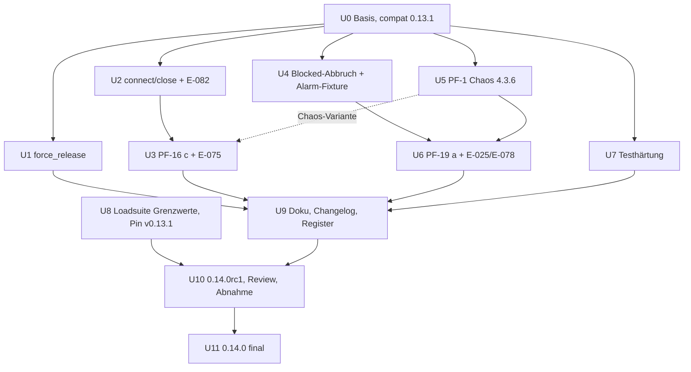

# swarmq 0.14.0 – Plan

Repos: `swarmq` = `/home/georg/Dokumente/Development-Privat/swarmq` (main @ `3bcd74c`, 0.13.1 final), `loadsuite` = `/home/georg/Dokumente/Development-Privat/swarmq-loadsuite-stoerungen`. Pfade im Plan sind relativ zum jeweiligen Repo. Den Code habe ich nur gelesen, keinen Test ausgeführt (CI-Runner läuft).

## Goal Capsule

- **Objective:** Mit 0.14.0 gilt Folgendes:
  - `ValkeyLockStore.force_release` ist atomar und typisiert.
  - `ValkeyBackend.connect()`/`close()` sind nebenläufig sicher.
  - Gegen einen Host, der Pakete verwirft, wartet der Start wirklich bis zur Gesamtfrist. Zur Laufzeit endet ein Befehl nach rund 38 s statt nach 179 s.
  - Wird `schedule()` abgebrochen, während der Broker blockiert ist und nachweislich nichts gesendet wurde, gibt der Client den `unique_for`-Claim frei.
  - Der Chaos-Stack läuft auf RabbitMQ 4.3.6.
  - Das Close eines verworfenen Publish-Kanals wartet im Alarm auf `unblocked`.
  - Die Fork-Kind-Tests sind gegen CI-Last gehärtet, ohne dabei schwächer zu werden.
  - Die Loadsuite sichert die Grenzwerte von 0.13/0.13.1 in der Konformitätsstufe zu.
- **Means:** Ein Release 0.14.0 mit rc1, Review, Loadsuite-Abnahme nach Staffelung und final. Die Loadsuite-Arbeit (U8) läuft parallel gegen den Pin v0.13.1.
- **Authority:** Das Entscheidungsregister geht vor dem Befundregister, das vor diesem Plan. Konkret: E-025, E-041, E-042, E-059, E-075, E-078, E-081 und die neue Regel E-082. AGENTS.md gilt (TDD, Gates, Testports, „Tests nie für Laufzeit opfern“).
- **Stop conditions:**
  - Ein Test mit `entscheidung`-Marker müsste geändert oder gelöscht werden. Betroffen wären vor allem die drei E-075-Tests in `test_valkey_handshake_retry.py` bei der breiten Variante von U3. Dann stoppen und Georg fragen (neue Regel, alte `überholt`).
  - `src/swarmq/client/schedule.py` würde 800 Zeilen erreichen (heute 764, Guard `_MAX_MODULE_LINES = 800` in `tests/unit/test_architecture_guards.py`). Dann in `exceptions.py` auslagern.
  - Neues Lua, neuer Header oder ein neues Nachrichtenformat würde nötig. Dann stoppen; der Mischbetrieb mit 0.13.x muss ohne Formatänderung bleiben.
  - Die Loadsuite-Abnahme verfehlt ein Gate: kein Release.
- **Execution profile:** Strenges TDD je Unit. Nach jeder Unit ein Review mit vier Linsen: Entscheidungs-Abgleich, Realismus gegen den Code, Determinismus, Nebenwirkungen auf die Pipeline-Invarianten.
- **Tail ownership:** Push, MR, Merge und Tags erst nach Georgs Ok. Den PyPI-Upload macht Georg.

---

## Product Contract

### Requirements

- **R1** `ValkeyLockStore.force_release(name, max_concurrency=…)` löscht mit einem einzigen `DEL`.
  - `True` heißt: Zum Zeitpunkt des `DEL` existierte ein Lock-Schlüssel, und er ist jetzt weg.
  - `False` heißt: Es gab keinen Schlüssel.
  - Treiberfehler laufen über `as_backend_error`: Ein Ausfall wird `BackendConnectionError`, jede andere Fehlerantwort `BackendResponseError`.
- **R2** `ValkeyBackend.connect()` und `close()` laufen unter einer gemeinsamen `asyncio.Lock`.
  - Ein zweites `connect()` während eines laufenden Aufbaus wartet und nutzt den gelungenen Client.
  - `close()` wartet ein laufendes `connect()` ab und schließt danach.
  - Es bleibt kein Client ohne `aclose()` übrig.
  - Der Vertrag `ResultBackend.connect/close` (`contracts/backend.py`) beschreibt das (neue Regel E-082).
- **R3** PF-16 (b) in Variante (c), E-075:
  - Ein Zeitablauf beim TCP-Aufbau einer Pool-Verbindung wird innerhalb des Verbindungsaufbaus nicht wiederholt. Die Befehls-Retry bleibt.
  - `connect()` wiederholt den PING nach einem solchen Zeitablauf, bis die Gesamtfrist `SWARMQ_BACKEND_CONNECT_TIMEOUT_S` erreicht ist.
  - Dazu ein Nachtrag zu E-075 und Tests, die das Verhalten festschreiben.
  - Die Doku sagt dann wieder, dass die Frist eine Wartezeit ist, wenn der Host Pakete verwirft.
- **R4** Bricht der Aufrufer ab, bevor der Broker etwas gesendet hat (mindestens im Blocked-Warten von `_wait_while_blocked`), meldet der Broker das über `PublishCancelledUnsent`, eine Unterklasse von `asyncio.CancelledError`. Der Abbruch wird nie verschluckt. Der Client gibt den Claim dann frei, im sofortigen Pfad und in `schedule_many`. Dazu Nachträge zu E-041 und E-059 sowie ein Querverweis in E-042.
- **R5** Der Chaos-Stack (`tests/chaos/compose.yml`) läuft auf `rabbitmq:4.3.6` und gepinntem Toxiproxy. Die Chaos-Suite ist grün, und kein Test wird dafür abgeschwächt.
- **R6** PF-19 (a):
  - `_close_channel_detached` wartet bei blockierter Publish-Verbindung auf `unblocked` oder auf das Ende der aiormq-Verbindung, höchstens die Publish-Frist. Danach schließt es wie heute mit 5 s Frist.
  - Integrationstest unter `exclusive` mit Speicheralarm.
  - Nachtrag (3) zu E-025, Präzisierung von E-078.
  - Katalogzeile für die aiormq-WARNING „Delivery tag %r confirmed %r was ignored“ (`aiormq.channel`).
- **R7** Testhärtung:
  - (a) Ein benannter Test für den Zweig `signal.raise_signal` in `_on_shutdown_signal`.
  - (b) Die Fork-Kind-Tests werden gegen Last gehärtet, ohne schwächer zu werden.
  - (c) Eine Kandidatenliste mit gleichem Flake-Muster.
- **R8** Die Konformitätsstufe der Loadsuite sichert die Grenzwerte von 0.13/0.13.1 zu: `delivery_limit` über 2^63−1, Fristen über zehn Jahre, 6-Feld-Cron, `--at`, `TaskInfo`-Fristen, `delay`/`eta`.
- **R9** Doku, Changelog (EN/DE), Befundregister und Spike-Dokumente sind nachgezogen.
- **R10** 0.14.0rc1 mit Review und Loadsuite-Abnahme, dann 0.14.0 final.

### Scope Boundaries

Nicht in diesem Plan:

- PF-18 (b), die Retry-Kopie ohne Slot.
- PF-2 (`stoerung-6h`).
- Die große Variante von F4-02.
- Eine Schleife bis zur Frist auch für `LOADING` oder einen abweisenden Port beim Start (siehe offene Frage 2).
- Exakte Semaphor-Freigabe (abgelaufene Mitglieder in einem lebenden ZSET, siehe KTD1).
- `current_owner`: E-081 bleibt.
- Die rund 50 Testlücken der eigenen Runde.
- Der als Stub übersprungene Plattenalarm-Test in `tests/chaos/test_disk_pressure.py`. Er wäre nach PF-1 möglich, ist aber eine eigene Änderung.

### Befunde aus der Sichtung (für die Planung wichtig)

1. **Chaos-Stack:** `tests/chaos/compose.yml` nutzt `rabbitmq:3.13.7-management-alpine` und `shopify/toxiproxy:latest`. Das ist ungepinnt, und das Docker-Hub-Repo ist veraltet. Der Hauptstack, CI und die Loadsuite nutzen `rabbitmq:4.3.6-management` und `ghcr.io/shopify/toxiproxy:2.9.0`.
2. **PF-19 (a) hängt nur weich an PF-1:**
   - Der Spike lief auf dem Integrations-Broker 5699, und der ist schon 4.3.6.
   - Die Fixture `memory_alarm` gibt es bereits (`tests/integration/broker/test_befund_bz16_connection_blocked.py`).
   - Nur eine Chaos-Variante (Alarm plus Toxiproxy-Abriss) braucht PF-1.
   - Die Reihenfolge PF-1 vor PF-19a bleibt wie beauftragt.
3. **Toxiproxy kann keinen SYN-Verwurf erzeugen.** Der Proxy nimmt TCP immer selbst an. Ein `timeout`-Toxic erzeugt den Fall „stumm“ (Lesezeitablauf), den die Variante laut Spike nicht ändert. Den Fall, den PF-16 (c) betrifft, reproduziert nur ein echtes Blackhole, im Spike `listen(0)` plus Füllverbindung (siehe offene Frage 3).
4. **E-075-Tests mit Marker:** `test_refused_tcp_is_retried_five_times_without_outer_retry`, `test_handshake_resets_are_retried_until_the_window_is_spent` und `test_handshake_resets_then_refused_tcp_stay_below_twice_the_window` rufen `backend.connect()` und verlangen exakte Backoff-Folgen ohne äußere Wiederholung. Eine Schleife bei jedem Ausfall würde sie rot machen. Eine Schleife nur bei TCP-Zeitablauf lässt sie grün (offene Frage 2).
5. **`stoerung-1h` und PF-19 (a):** Der Alarm dauert dort 60 s, die Publish-Frist ist 20 s. Die Wartegrenze von PF-19 (a) reißt also im Alarm. Danach läuft das Close wie heute in die 5-s-Frist, und die aiormq-ERROR erscheint dort weiter. Der Gewinn zeigt sich nur bei Alarmen, die kürzer sind als die Publish-Frist (Vorgabe 120 s). Das muss in die Abnahme-Erwartung.
6. **Fork-Kind-Deckel:**
   - Kein Aufrufer erwartet `CHILD_TIMED_OUT`; alle prüfen `== 0`.
   - Bei zwei Tests ist der 2-s-Deckel aber der eigentliche Regressionsmelder: `test_logging_configure.py:688` und `test_logging_queue.py:464` mit `run_in_forked_child(shutdown_logging)`.
   - Grund: `shutdown_logging()` im Kind endet nach dem Leer-Timeout von 5 s (`logging_settings.py:43`) und liefert dann trotzdem 0.
   - Ein Deckel über 5 s würde diese Regression verbergen.
7. **Zweig `raise_signal`:** Kein Test setzt `_reexec_holds_signals = True` und ruft dann den Handler. `test_reload.py:318-320` sagt ausdrücklich, dass der Zweig nicht abgedeckt ist.
8. **Loadsuite:** Der Worktree steht auf `chore/pin-swarmq-0-13-1rc1` @ `3ac1624`. Der Merge liegt als `origin/main` @ `412aa37` vor. Das lokale `main` steht noch auf `c56ee5d`. Neue Branches daher von `origin/main` abzweigen.

---

## Planning Contract

### Key Technical Decisions

- **KTD1 `force_release`:**
  - `deleted = await self._client.delete(self._keys.lock(name))`, Rückgabe `int(deleted) >= 1`.
  - Fehler nach dem Muster von `locks.py` `observe`: `except BackendConnectionError: raise`, `except Exception: raise as_backend_error(f"lock force_release failed for {name!r}: {exc}", exc)`.
  - Der Force-Zweig in `lock_release.lua` bleibt für `LockManager.release(…, "__force__")`, das der e2e-Test `test_force_release_recovers_wedged_lock` nutzt. Kein neues Lua.
  - Bekannte Grenze, wie heute mit `EXISTS`: Bei Semaphoren meldet `DEL` `True`, solange der ZSET-Schlüssel lebt, auch wenn alle Mitglieder per Score abgelaufen sind. InMemory meldet dann `False`. Die Lock-Zustandsmaschine bildet keine Semaphoren nach. Das kommt in den Docstring, ohne Fix.
- **KTD2 Lebenszyklus-Sperre (U2):**
  - `self._lifecycle_lock = asyncio.Lock()` in `ValkeyConnection.__init__`. Unter 3.14 bindet die Sperre die Loop erst, wenn jemand warten muss.
  - `connect()` prüft `_client` erneut, nachdem es die Sperre bekommen hat.
  - Kein geteilter Aufbau-Task: Ein Abbruch soll weiter im Task des Aufrufers wirken und den eigenen Client schließen (F4-13).
  - `close()` hält die Sperre nur in `ValkeyConnection.close`. Das Abwarten der Pub/Sub-Closer in `ValkeyResults.close` und `_drop_stores` in `ValkeyBackend.close` bleiben außerhalb.
  - Bewusste Folge: `close()` wartet höchstens die Gesamtfrist eines laufenden `connect()`.
- **KTD3 PF-16 (c):**
  - Erweiterung des bestehenden Instanz-Patches `make_marked_connection` in `_retry_handshake`. Keine Pool-Unterklasse, weil rund 30 Tests `Valkey.from_url` patchen.
  - Je Pool-Verbindung wird `connection._connect` gewickelt: Ein `TimeoutError` (eingebaut, eine `OSError`-Unterklasse) wird zu einem privaten `_TcpConnectTimeout(Exception)`. Diese Klasse ist weder `OSError` noch `ValkeyError`.
  - Damit steht sie nicht in `retry._supported_errors` und wird in `Connection.connect` nicht wiederholt. valkey-py wickelt sie dort in `ConnectionError(exc)`.
  - `get_connection_with_retry` wiederholt sie nicht, weil sie kein `_HandshakeReset` ist.
  - `ValkeyConnection.connect()` wiederholt den PING nur, wenn `_TcpConnectTimeout` in der Ursachenkette steht. Es nutzt die Uhr- und Warte-Hooks `_monotonic`/`_sleep` (FakeClock-Muster wie in `test_valkey_handshake_retry.py`) und einen kurzen Backoff (`ExponentialBackoff(cap=2, base=0.05)`).
  - Ende mit „Valkey connect timed out after {frist}s“. Das äußere `asyncio.timeout` bleibt der harte Deckel.
  - Die Abhängigkeit an privatem valkey-py (`_connect`, 6.1.1) kommt auf die Upgrade-Checkliste.
- **KTD4 Abbruchphase (U4):**
  - `class PublishCancelledUnsent(asyncio.CancelledError)` in `swarmq/exceptions.py`. Nicht in `swarmq.__all__`, damit keine neue öffentliche Oberfläche entsteht und keine neue Loadsuite-Kennung `teilsystem:…`.
  - In `_publish_with_retry` ein `except asyncio.CancelledError as exc` außerhalb des `async with asyncio.timeout`. Er greift nur bei `_is_own_cancel(exc, cancelling_at_entry)` und `not any(maybe_sent)`, dann `raise PublishCancelledUnsent(...) from exc`.
  - Die stdlib verträgt die Unterklasse: `asyncio.timeouts` prüft `issubclass(exc_type, CancelledError)`, ebenso `TaskGroup`. `gather` reicht dieselbe Instanz über `_cancelled_exc` weiter.
  - Im Client ersetzt das Prädikat `is_publish_outcome_unknown(exc)` (in `exceptions.py`, neben `is_backend_outcome_unknown`) das Tupel `_INDETERMINATE_PUBLISH`.
  - Fremde Publisher ohne Markierung behalten das konservative Verhalten: Der Claim bleibt.
  - Umfang (offene Frage 4): Empfohlen ist dasselbe Kriterium wie E-042 (`maybe_sent`). Es umfasst das Blocked-Warten, das Öffnen des Kanals, den Backoff nach nicht gesendeten Versuchen und die Warteschlange der Kanal-Sperre.
- **KTD5 PF-19 (a):**
  - Neuer Helfer in `broker/rabbitmq/blocked.py`. Er liefert `(unblocked_event, closing_future)` derselben aiormq-Verbindung, gelesen beim Verwurf, nicht erst beim Warten.
  - `_close_channel_detached`: Ist die Verbindung blockiert, wird `asyncio.wait({event.wait(), closing}, timeout=self._effective_publish_timeout())` ausgeführt. Danach folgt der bisherige Close-Block mit 5 s.
  - `None` oder `UNREADABLE` heißt „nicht blockiert“ (fail-open, E-025). Damit bleiben die E-025-Tests in `TestChannelCloseDuringAlarm` und der E-078-Test (`transport=None`) unverändert grün.
  - Den Kommentar an `_CHANNEL_CLOSE_TIMEOUT_S` (`connection.py:76-82`) berichtigen.
- **KTD6 Alarm-Fixture:** U4 zieht `memory_alarm` und die Helfer `_rabbitmqctl`, `_eval` und `_container_serves_test_port` nach `tests/integration/broker/conftest.py`. BZ-16, U4 und U6 nutzen sie dann gemeinsam.
- **KTD7 Chaos-Stack:**
  - Image wie im Hauptstack und in CI: `rabbitmq:4.3.6-management`, also dasselbe Abbild statt `-alpine`.
  - Healthcheck mit `gosu rabbitmq rabbitmq-diagnostics -q check_port_connectivity` und `start_period`. Grund: Ein CLI-Aufruf als root vor dem Serverstart hinterlässt eine root-eigene `.erlang.cookie` (Kommentar zu `rabbitmq42` in `docker-compose.yml`).
  - Toxiproxy `ghcr.io/shopify/toxiproxy:2.9.0`.
  - Valkey optional exakt `valkey/valkey:8.1.10-alpine` wie in der Loadsuite.
- **KTD8 Fork-Kinder:**
  - Ein Fehler im Kind muss als Hänger oder eigene Assertion enden, nie als spätes Gelingen. Erst dann ist der Deckel nur noch eine Meldezeit und darf größer werden.
  - Dazu im Kind `faulthandler.dump_traceback_later(...)` kurz vor dem Deckel und die Zeit bis zum Kindstart über ein Pipe-Byte in der Fehlermeldung. So zeigt der nächste CI-Fehler, ob es Last oder ein Fork-Deadlock war.
- **KTD9 Loadsuite-Grenzwerte:**
  - Nur an bestehende Kennungen als neue Aspekte, weil die Registry eine Zusicherung je Kennung erlaubt (`Registrierung._pruefe_frei`).
  - Fristfelder datengetrieben aus `SwarmQConfig._FINITE_FIELDS - _COUNT_FIELDS` des Pins, so wie die Stufe heute schon `_ENV_OVERRIDES` liest.
  - Keine neue Ermittlungskategorie.
- **KTD10 Doku-Bündel:**
  - `website/**`, `changelog*.md` und das Befundregister schreibt nur U9. Die liefernden Units notieren ihre Zeilen im Commit-Text, wie U20 im Plan Runde 4.
  - Die Regeldateien unter `compound-packs/` schreibt jede Unit selbst, ohne Überschneidung: U2 E-082; U3 E-075; U4 E-041, E-059, E-042; U6 E-025, E-078.
- **KTD11 Register:** Neue Regel nur **E-082** (U2). Alles andere sind Nachträge. U1 braucht keine Regel: Es behebt die LÜCKE, ohne neues Verhalten zu entscheiden. Die Register-Zeile setzt U9.
- **KTD12 Version 0.14.0** (minor): Sie bringt Verhaltensänderungen beim Verbindungsaufbau, beim Abbruch und bei den Alarm-Logs, aber kein neues Format.

### Sequencing

**Parallel ohne gemeinsame Dateien**

- **Welle A:** U1, U2, U4, U5 und U7 in swarmq, U8 in der Loadsuite.
  - U1: `locks.py`, `tests/contracts/coordination.py`.
  - U2: `backend/valkey/connection.py`, `contracts/backend.py`, `tests/contracts/result_backend.py`.
  - U4: `broker/rabbitmq/delivery.py`, `exceptions.py`, `client/schedule.py`, `contracts/broker.py`, `tests/integration/broker/conftest.py`.
  - U5: `tests/chaos/**`, `docs/testing/test-strategy.md`, `docs/befunde/teststrenge-2026-10.md`.
  - U7: `tests/unit/_fork_child.py`, Logging-Tests, `tests/unit/process_manager/*`.
  - Falls U1 und U2 beide `tests/support/inmemory/backend.py` ändern müssen, nacheinander.
- **Welle B:** U3 (gleiche Datei wie U2) und U6 (braucht die Fixture aus U4 und den Stack aus U5).
- **Welle C:** U9, dann U10 und U11. U8 muss vor dem Pin-Wechsel in U10 auf Loadsuite-`main` sein.

### Risks

- **Mischbetrieb 0.13.x:**
  - Kein neues Format, kein Header, kein Lua.
  - U1 bis U4 und U6 wirken nur im eigenen Prozess (Backend-Client, Broker-Kanal, Client-Claim). Ein Rollback auf 0.13.1 ist möglich.
  - Die compat-Suite bekommt die Basis 0.13.1 (U0).
  - Der Claim, den ein 0.14-Client nach einem Abbruch freigibt, sieht für einen 0.13.1-Client gleich aus.
- **Nutzer merken (Upgrade notes):**
  1. **Start gegen einen Host, der Pakete verwirft:**
     - `connect()`, `swarmq worker` und `swarmq check` warten jetzt bis zur Frist und melden `Valkey connect timed out after 30.0s`. Bisher kam nach höchstens rund 33 s `Valkey connect failed: Timeout connecting to server`.
     - Bei Fristen über 33 s dauert der Start jetzt wirklich so lange, und das CrashLoop-Budget des Supervisors (6 Starts) verlängert sich entsprechend.
     - Wer auf den alten Fehlertext alarmiert, muss die Regel anpassen.
  2. **Laufzeit:**
     - Ein Befehl, dessen Verbindung mitten im Befehl stirbt, endet gegen einen solchen Host nach rund 38 s statt 179 s (Spike).
     - Ein Befehl, der eine neue Pool-Verbindung braucht, endet nach Code nach rund 5 s statt rund 33 s. Das ist nicht gemessen; der `timing`-Test in U3 misst es.
     - Schleifen, die bei `BackendConnectionError` sofort neu versuchen, takten dadurch schneller: `watch_progress`, Leader-Erneuerung, Ergebnis-Tail und Gates. In U3 je Schleife prüfen, dass sie einen Backoff hat.
  3. **Abbruch im Blocked-Warten:** Er gibt den Claim frei. Ein Wiederholversuch wird nicht mehr bis zur TTL als Duplikat abgewiesen. Das ist eine Lockerung zugunsten der Nutzer.
  4. **Alarm-Logs:**
     - Bei Alarmen, die kürzer sind als die Publish-Frist, entfällt die aiormq-ERROR „Got frame for closed channel“. Neu ist dafür die aiormq-WARNING „Delivery tag … was ignored“. Alarmregeln dazu anpassen.
     - Andere offene Confirms auf dem verworfenen Kanal enden öfter bestätigt, belegen aber ihren Slot bis zur Aufhebung oder bis zu ihrer eigenen Frist (E-078).
  5. **Fremde `ResultBackend`-Implementierungen:** Der Vertrag verlangt jetzt nebenläufige Sicherheit von `connect`/`close`. Die Protocol-Signatur bleibt gleich.
  6. **`force_release`:** Eine Fehlerantwort kommt jetzt als `BackendResponseError`. Das ist eine Unterklasse von `BackendConnectionError`, bestehende Handler fangen sie also weiter.
- **Breaking Changes:** Keine API- oder Formatänderung. Die Verhaltensänderungen 1 und 4 stehen unter Upgrade notes und geben den Ausschlag für Minor statt Patch.
- **Private Bibliotheks-APIs:**
  - valkey-py `Connection._connect` (U3).
  - aiormq `Connection.closing` und `__connection_unblocked` (U6, wie BZ-16).
  - Abhilfe: Unit-Tests gegen die echte Bibliothek, Eintrag in die Upgrade-Checkliste, fail-open bei unlesbarem Zustand.
- **Zeilenbudget:** `client/schedule.py` liegt bei 764/800. Das Prädikat kommt nach `exceptions.py`.
- **PF-1 deckt alte Annahmen auf:** Mögliche Abweichungen von 4.3 gegenüber 3.13 (siehe U5) dürfen nur an das dokumentierte 4.3-Verhalten angepasst werden, nie gelockert.
- **Ressourcen:** Loadsuite-Läufe nur auf dem Server, seriell, unter `systemd-inhibit`, keine CI-Pipeline während eines Wertungslaufs. Chaos- und Integrationsläufe unter der Testsperre.

---

## Implementation Units

| U-ID | Titel | Dateien (Kern) | Hängt ab von | parallel zu |
|---|---|---|---|---|
| U0 | Arbeitsbasis, compat 0.13.1 | `tests/compat/*`, `docs/plans/` | – | – |
| U1 | `force_release` atomar | `backend/valkey/locks.py`, `contracts/coordination.py` | U0 | U2, U4, U5, U7, U8 |
| U2 | `connect`/`close` nebenläufig + E-082 | `backend/valkey/connection.py`, `contracts/backend.py` | U0 | U1, U4, U5, U7, U8 |
| U3 | PF-16 (c) + Nachtrag E-075 | `backend/valkey/connection.py` | U2 (U5 für die Chaos-Variante) | U6 |
| U4 | Blocked-Abbruch gibt Claim frei | `broker/rabbitmq/delivery.py`, `exceptions.py`, `client/schedule.py` | U0 | U1, U2, U5, U7, U8 |
| U5 | PF-1 Chaos-Stack 4.3.6 | `tests/chaos/compose.yml`, `tests/chaos/*` | U0 | U1, U2, U4, U7, U8 |
| U6 | PF-19 (a) + E-025/E-078 | `broker/rabbitmq/connection.py`, `blocked.py` | U4, U5 | U3 |
| U7 | Testhärtung a/b/c | `tests/unit/_fork_child.py`, Logging- und Reload-Tests | U0 | alle |
| U8 | Loadsuite-Grenzwerte | loadsuite `conform/assertions/*`, `abdeckung.yaml` | – | alle |
| U9 | Doku, Changelog, Register | `website/**`, Befundregister, Spikes | U1–U7 | – |
| U10 | 0.14.0rc1 und Abnahme | `pyproject.toml`, `uv.lock`, Loadsuite-Pin | U8, U9 | – |
| U11 | 0.14.0 final | Changelog, Tag, Loadsuite-Pin | U10 | – |

### U0. Arbeitsbasis, compat 0.13.1

- **Goal:** Arbeitsbasis und Nachweis, dass 0.14 neben 0.13.1 läuft.
- **Requirements:** R10, Risiko Mischbetrieb.
- **Dependencies:** –
- **Files:**
  - `tests/compat/constraints-0.13.1.txt` (neu, nach dem Muster `constraints-0.12.3.txt`).
  - `tests/compat/_harness.py` (Fixture für 0.13.1).
  - `tests/compat/test_mixed_operation_0_12.py` oder ein neues `test_mixed_operation_0_13.py`.
  - Dieser Plan unter `docs/plans/2026-10-19-HHMM-feat-swarmq-0-14-plan.md`.
- **Approach:**
  1. Worktree `../swarmq-0-14`, Branch `feat/0-14` von `main` @ `3bcd74c`.
  2. Constraints aus dem Lockfile des Tags v0.13.1.
  3. Mischbetrieb mit Retry-Übergabe, Leader-Wechsel, DLQ-Replay und `unique_for`-Claim über beide Versionen.
- **Test scenarios:** compat seriell unter der Testsperre: Worker 0.13.1 neben dem Arbeitsstand, in beiden Rollen.
- **Verification:** compat ist mit 0.11.0, 0.11.1, 0.12.0, 0.12.3 und 0.13.1 grün.

### U1. `ValkeyLockStore.force_release` atomar

- **Goal:** Ein einziges `DEL`, eine ehrliche Rückgabe, typisierte Fehler.
- **Requirements:** R1; KTD1.
- **Dependencies:** U0
- **Files:**
  - `src/swarmq/backend/valkey/locks.py:174-183`.
  - `src/swarmq/contracts/coordination.py:54` (Docstring: `True` heißt, ein Schlüssel existierte und ist entfernt; Semaphor-Grenze).
  - `tests/unit/backend/test_valkey_locks.py`: `test_force_release_uses_force_owner` prüft heute die Lua-Argumente, also ein Implementierungsdetail ohne Marker. Er wird durch einen Verhaltenstest ersetzt.
  - `tests/unit/backend/test_valkey_store_error_paths.py`: Die Ausnahme im Modul-Docstring (Z. 19-21) entfällt, `force_release` kommt in die Matrix.
  - `tests/contracts/coordination.py` (nach `test_force_release_ignores_owner`, Z. 263).
- **Approach:** Rot zuerst je Fall, dann KTD1. `LockManager` und `lock_release.lua` bleiben unverändert.
- **Test scenarios (rot zuerst):**
  - Der Lock läuft zwischen Prüfen und Freigeben ab: Fake-Client mit `exists` = 1 und `DEL` = 0 erwartet `False`. Heute kommt `True`, weil `EXISTS` vorher gelesen und das Freigabe-Ergebnis ignoriert wird.
  - `ResponseError("ERR …")` ergibt `BackendResponseError`. Heute kommt ein pauschaler `BackendConnectionError`, der Test ist also rot.
  - Matrix: Transport, Timeout, `OutOfMemoryError` und `ResponseError("OOM …")` ergeben einen Ausfall (`BackendConnectionError`, kein `BackendResponseError`).
  - Contract (InMemory und Valkey): Ein abgelaufener Mutex ergibt `False`. Ein gehaltener Mutex ergibt `True`, danach `current_owner` `None`, ein zweiter Aufruf `False`. Der Bestand bleibt grün.
  - Semaphor mit lebendem Halter: `True`, Schlüssel weg (Integration).
  - Zustandsmaschinen: `lock_machine` (Property und `test_lock_machine_valkey`) und `leader_machine` bleiben grün. Die Assertion `released is expected` (`lock_machine.py:571`) wird durch die Atomarität strenger erfüllt.
- **Verification:**
  - `uv run just unit -k "valkey_locks or store_error"`.
  - `uv run just property -k stateful`.
  - `uv run just integration -k "contracts_valkey or lock_machine or leader_election"`.
  - e2e `test_force_release_recovers_wedged_lock` grün.
- **Register:** keine neue Regel. U9 setzt die Deferred-Zeile im Befundregister auf „erledigt in 0.14.0“. E-081 bleibt wahr, weil `BackendResponseError` ⊂ `BackendConnectionError`.

### U2. `connect()`/`close()` nebenläufig sicher (E-082)

- **Goal:** Kein überschriebener Client, kein offener Client nach `close()`.
- **Requirements:** R2; KTD2.
- **Dependencies:** U0
- **Files:**
  - `src/swarmq/backend/valkey/connection.py`: `__init__`, `connect` (ab Z. 371), `close` (ab Z. 431).
  - `src/swarmq/contracts/backend.py:17-21` (Docstrings von `connect`/`close`).
  - `tests/unit/backend/test_valkey_connection.py` oder neu `test_valkey_connect_concurrency.py`.
  - `tests/contracts/result_backend.py` (Lebenszyklus-Abschnitt).
  - `tests/support/inmemory/backend.py`, nur falls der Vertragstest es verlangt.
  - `compound-packs/swarmq-entscheidungen/e082-backend-connect-close-nebenlaeufig.md` (neu).
- **Approach:** Sperre wie KTD2. Der Vertragstext lautet etwa:
  - „Idempotent und nebenläufig sicher: Ein Aufruf während eines laufenden `connect()` wartet ihn ab und nutzt den verbundenen Client.“
  - „`close()` wartet ein laufendes `connect()` ab.“
- **Test scenarios (rot zuerst, Fake-Client über `from_url` mit gegatetem `PING`):**
  - Zwei gleichzeitige `connect()`: `from_url` wird genau einmal gerufen, beide kehren zurück, `ping()` gelingt. Heute baut der Code zwei Clients, und der erste bleibt ohne `aclose`.
  - `close()` während `connect()`: `close()` kehrt erst nach dem Ende von `connect()` zurück. Danach ist `_client is None`, der gebaute Client wurde genau einmal mit `aclose` geschlossen und der Pool versiegelt. Heute bleibt nach `close()` ein offener Client.
  - Der erste `connect()` scheitert (`BackendConnectionError`): Der wartende zweite verhält sich nach offener Frage 1 (Empfehlung: versucht selbst).
  - Abbruch des ersten `connect()` (F4-13) während der zweite wartet: Der Client des ersten wird geschlossen, der zweite verbindet. Die F4-13-Nachweise bleiben grün.
  - `connect`, `close`, `connect` ergibt einen neuen Client. Ein injizierter Client bleibt unverändert.
  - Contract (InMemory und Valkey): gleichzeitige `connect()` hinterlassen eine nutzbare Verbindung; `close()` während `connect()` endet geschlossen (`ping()` wirft `BackendConnectionError`).
  - Die festschreibenden Tests tragen den Marker `entscheidung("E-082")`.
- **Verification:**
  - `uv run just unit -k "valkey_connect or befund_f4_13 or contracts_inmemory"`.
  - `uv run just integration -k contracts_valkey`.
  - Register-Guard grün.

### U3. PF-16 (b) Variante (c) und Nachtrag E-075

- **Goal:** Zur Laufzeit 30 statt 5 TCP-Versuche vermeiden (178,8 s → ≈ 38 s). Beim Start bis zur Gesamtfrist warten.
- **Requirements:** R3; KTD3.
- **Dependencies:** U2 (gleiche Datei). Für die Chaos-Variante U5.
- **Files:**
  - `src/swarmq/backend/valkey/connection.py`: `make_marked_connection` in `_retry_handshake`, `connect`, neue Klasse `_TcpConnectTimeout`.
  - `tests/unit/backend/test_valkey_handshake_retry.py`: neue Tests. Die drei E-075-Tests mit Marker bleiben unverändert.
  - `tests/unit/backend/test_valkey_connect_timeout.py`: neue Tests.
  - Neuer `timing`-Test mit Blackhole.
  - `tests/chaos/test_backend_restart.py` oder ein neues `tests/chaos/test_backend_partition.py` (offene Frage 3).
  - `compound-packs/swarmq-entscheidungen/e075-backend-verbindungsaufbau-gesamtfrist.md` (Nachtrag 0.14, Tests eintragen).
  - `docs/solutions/spikes/2026-10-spike-verbindungs-retry.md` (Abschnitt „Umsetzung 0.14“).
- **Approach:** KTD3. Die Schleife greift nur bei TCP-Zeitablauf (Empfehlung zu offener Frage 2). Danach jede Schleife mit Sofortwiederholung auf einen Backoff prüfen (Risiko 2) und Fundstellen notieren.
- **Test scenarios (rot zuerst):**
  - FakeClock, `_connect` endet mit Zeitablauf (rückt die Uhr um 5 s vor): Ein `GET` nach Verbindungsverlust macht höchstens 6 TCP-Versuche, nicht 30.
  - FakeClock, `connect()` mit Frist 30 s gegen einen Host, der Pakete verwirft: PING-Versuche bis zur Frist, dann `BackendConnectionError` mit „timed out after 30.0s“, `_client is None`, ein `aclose` je gebautem Client. Mit Frist 600 s endet `connect()` nach 600 s statt nach rund 33 s.
  - Abweisender Port (`reset_then_refuse`): unverändert 6 Versuche und 3,1 s, keine äußere Schleife. Die E-075-Marker-Tests sind grün.
  - Handshake-Resets und Anmeldefehler (`test_credential_errors_…`, `test_authentication_error_…`): unverändert, keine Schleife.
  - Abbruch während der Schleife schließt den eigenen Client (F4-13).
  - `timing`, echtes Blackhole auf `127.0.0.1` (`listen(0)` plus Füllverbindung, `_SOCKET_CONNECT_TIMEOUT_S` auf 0,2 s gepatcht): `connect()` mit Frist 1 s endet nach der Frist. Ein Laufzeit-`GET` endet in ≤ `socket_timeout` + 5 × Connect-Timeout + 3,1 s (skaliert).
  - Chaos (nach U5): Toxiproxy-`timeout`-Toxic auf `vkey` („stumm“). Die Grenze bleibt wie heute (rund 6 × `socket_timeout` + 3,1 s), keine Vervielfachung. Das ist der Regressionswächter.
  - Die neuen Tests tragen den Marker `entscheidung("E-075")`.
- **Verification:**
  - `uv run just unit -k "valkey_handshake or valkey_connect_timeout or befund_f4_1"`.
  - `timing`-Durchgang grün.
  - `uv run just chaos -k "backend_restart or backend_partition"`.
- **Doku (über U9):** `configuration.md:80`/`.de.md:83`, `api.md:915-921`/`.de.md:946-950` und `errors.md:198`/`.de.md:210`. Die Sätze „Obergrenze, keine Wartezeit, rund 33 s“ werden ersetzt durch „wartet bis zur Frist, wenn der Host Pakete verwirft; ein abweisender Port endet nach rund 3,1 s“. Die alten Changelog-Einträge bleiben, wie sie sind.

### U4. Abbruch bei blockiertem Broker gibt den Claim frei

- **Goal:** Bei einem Abbruch, bevor etwas gesendet wurde, gibt der Client den Claim frei. Bei jedem anderen Abbruch bleibt der Claim stehen (E-041, 0.13.1).
- **Requirements:** R4; KTD4, KTD6.
- **Dependencies:** U0
- **Files:**
  - `src/swarmq/exceptions.py`: `PublishCancelledUnsent`, `is_publish_outcome_unknown` neben `is_backend_outcome_unknown` (Z. 178).
  - `src/swarmq/broker/rabbitmq/delivery.py`: `_publish_with_retry` (ab Z. 296), `_wait_while_blocked` (Z. 332).
  - `src/swarmq/client/schedule.py`: `_INDETERMINATE_PUBLISH` (Z. 55), `except asyncio.CancelledError` (Z. 351), `_batch_publish_and_finalize` (Z. 484, 501).
  - `src/swarmq/contracts/broker.py:83` (Docstring `Publisher.publish`: eigene Abbruchmarkierung optional, ohne sie gilt ein Abbruch als unbestimmt).
  - `tests/unit/broker/test_publish_blocked.py`, `tests/unit/broker/test_publish_channel_closing.py` (Phasen).
  - `tests/unit/client/test_cancel_keeps_unique_claim.py`.
  - `tests/integration/broker/conftest.py` (Fixture aus BZ-16), `tests/integration/broker/test_befund_bz16_connection_blocked.py` (Fixture-Import).
  - Neu `tests/integration/broker/test_blocked_cancel_releases_claim.py` (`exclusive`).
  - `compound-packs/…/e041-…md`: Nachtrag 0.14. Er löst „Bewusste Folge (Review 0.13.1)“ und „Überdenken für 0.14“ auf und trägt die Tests ein.
  - `e059-…md`: Querverweis. Der verzögerte Pfad und die CLI senden nicht an den Broker, für sie bleibt der Nachtrag 0.13.1.
  - `e042-…md`: Querverweis. Das Kriterium „nachweislich nicht gesendet“ gilt jetzt auch für den eigenen Abbruch.
- **Approach:** KTD4. In `_publish_with_retry` den Zweig für den eigenen Abbruch ergänzen. Im Client in beiden Pfaden `is_publish_outcome_unknown` nutzen. Die Freigabe läuft im abgebrochenen Task wie heute bei `pre_enqueue` über `_rollback_unique_claim`. Ein zweiter Abbruch während der Freigabe lässt den Claim konservativ stehen.
- **Test scenarios (rot zuerst):**
  - Broker, blockierte Verbindung, Aufrufer bricht im Warten ab: Ergebnis ist `PublishCancelledUnsent`, `task.cancelled()` ist `True`, kein Kanal geöffnet. Heute kommt ein unmarkierter `CancelledError`.
  - Abbruch nach dem Einreihen (`hanging_publish`): unmarkierter `CancelledError`.
  - Abbruch in der Warteschlange der Kanal-Sperre und im Backoff nach einem nicht gesendeten Versuch: markiert, falls die breite Variante der offenen Frage 4 gilt.
  - Fremder (aio-pika-interner) `CancelledError` und ein Handler, den der Drain abbricht (`cancelling()` > 0 beim Eintritt): unverändert (KTD9-Tests in `test_publish_channel_closing.py` grün).
  - Eigene Publish-Frist im Warten: weiter `BrokerPublishBlocked`. Der E-025-Test `test_blocked_until_the_deadline_raises_publish_blocked` ist grün.
  - Client, sofortiger Pfad: markierter Abbruch gibt den Claim frei, der `CancelledError` geht weiter, kein `post_enqueue`/`TASK_ENQUEUED`. Ein unmarkierter Abbruch hält den Claim (die bestehenden E-041-Tests sind grün).
  - `schedule_many`: Ein markierter Eintrag gibt seinen Claim frei, ein unmarkierter hält ihn. Der Batch wirft `CancelledError`, nicht den bestimmten Fehler (B24-Regel).
  - Aufrufer mit `asyncio.timeout` um `schedule()`: Der Aufrufer sieht `TimeoutError`, der Claim ist frei.
  - Integration (`exclusive`, `memory_alarm`): `schedule(unique_for=…)` im echten Alarm, Abbruch während des Wartens. Danach ist der Claim weg, die Wiederholung nach dem Alarm gelingt, der Task läuft genau einmal.
  - Die neuen Tests tragen `entscheidung("E-041")`.
- **Verification:**
  - `uv run just unit -k "publish_blocked or cancel_keeps_unique or publish_channel_closing or publish_deadline_rollback"`.
  - `uv run just integration -k "bz16 or blocked_cancel"`.
  - `test_architecture_guards.py` grün (Zeilen).

### U5. PF-1: Chaos-Stack auf RabbitMQ 4.3.6

- **Goal:** Die Chaos-Suite läuft gegen dieselbe Broker-Version wie Integration, CI und die Loadsuite.
- **Requirements:** R5; KTD7.
- **Dependencies:** U0
- **Files:**
  - `tests/chaos/compose.yml` (Images, Healthcheck).
  - `tests/chaos/conftest.py`, falls die Wartezeit des Stacks nicht reicht.
  - Betroffene Chaos-Tests (siehe unten).
  - `tests/support/known_leaks.py` und `docs/befunde/teststrenge-2026-10.md`, falls sich die Lecks TS-02 und TS-03 unter 4.x verschieben.
  - `docs/testing/test-strategy.md:358` (Tabelle „RabbitMQ-Versionen“).
  - Kommentar in `docker-compose.chaos.yml` prüfen.
- **Approach:**
  1. Baseline auf 3.13.7 festhalten: `uv run just chaos` unter der Testsperre mit `SWARMQ_REQUIRE_CHAOS=1`. Erwartet sind 116 passed und 4 skipped (Plan 2026-10-17-0941, KTD6).
  2. Images nach KTD7 umstellen.
  3. Die ganze Suite fahren. Jede Abweichung als Versionsverhalten oder Fehler einstufen. Bei echten Fehlern nach `docs/befunde/README.md` vorgehen (Gegenprüfung, Befund).
  4. Tests nur an dokumentiertes 4.3-Verhalten anpassen, nie lockern.
- **Bekannte Stellen, an denen 4.3 abweichen kann (nach Code, beim Lauf zu bestätigen):**
  - `test_worker_crash.py:381` (`test_segv_panic_redelivers_then_dlqs_after_max_retries`): `x-delivery-limit` zählt in 4.x anders. BZ-29 belegt `x-acquired-count` für `nack(requeue)`. Ob Rückgaben nach einem Verbindungsabbruch zählen, ist zu prüfen.
  - `test_resource_exhaustion.py:264` (`test_channel_limit_exhaustion_typed_error`): hängt am Server-Default `channel_max` 2047 und am Leck-Marker TS-02.
  - `test_broker_restart.py` (`TestBrokerRestart`, Marker `aiormq_restart_leak`): Startdauer, Quorum-Wiederherstellung, Schließcodes.
  - `test_message_corruption.py:198` (beschädigte AMQP-Header): 4.x prüft Header-Typen womöglich strenger.
  - Healthcheck und Startreihenfolge: Eacces durch die root-eigene `.erlang.cookie`.
  - Toxiproxy 2.9.0 statt `latest`: Semantik der Toxics `timeout`, `slicer` und `bandwidth` in `conftest.py:236-310`.
- **Test scenarios:** Die ganze Chaos-Suite ist grün. Die Zahl der Skips ist gleich oder kleiner, und jeder Skip hat eine Ticket-Nummer.
- **Verification:** `uv run just chaos` mit `SWARMQ_REQUIRE_CHAOS=1` grün. Der Testlauf wird in `docs/testing/test-strategy.md` vermerkt. U9 setzt die PF-1-Zeile im Befundregister auf „erledigt“.

### U6. PF-19 (a): Kanal-Close bis `unblocked` zurückstellen

- **Goal:** Im Alarm kein Traceback und keine aiormq-ERROR, kein Leck, keine doppelte Kanalnummer.
- **Requirements:** R6; KTD5, KTD6.
- **Dependencies:** U4 (Fixture), U5 (Chaos-Variante, Vorgabe).
- **Files:**
  - `src/swarmq/broker/rabbitmq/blocked.py`: Helfer für Event und `closing`.
  - `src/swarmq/broker/rabbitmq/connection.py`: `_close_channel_detached` (Z. 542-558), `_discard_publish_channel` (Z. 499; liest Event und `closing` beim Verwurf), Kommentar Z. 76-82.
  - `tests/unit/broker/test_rabbitmq.py`: neue Klasse neben `TestChannelCloseDuringAlarm`.
  - `tests/unit/broker/test_publish_deadline_channel_discard.py`: neuer E-078-Test.
  - Neu `tests/integration/broker/test_pf19_close_after_unblocked.py` (`exclusive`).
  - Optional `tests/chaos/test_publish_deadline.py` (Alarm plus Toxiproxy `down`).
  - `compound-packs/…/e025-…md`: Nachtrag (3), neue Tests.
  - `e078-…md`: Präzisierung, neuer Test.
  - `docs/solutions/spikes/2026-10-spike-kanal-close-nach-unblocked.md`: Umsetzung.
- **Approach:** KTD5. `_drain_pending_channel_closes` bleibt: Beim `close()` des Brokers bricht es ein wartendes Close nach 5 s ab, wie heute.
- **Test scenarios (rot zuerst):**
  - Unit: Verwurf bei blockierter Verbindung. `channel.close` läuft nicht vor dem Setzen von `unblocked`, danach genau einmal. Kein `publish_channel_close_incomplete`.
  - Unit: Verbindung endet während des Wartens (`closing` erledigt): Der Close-Task endet sofort, kein hängender Task, kein Traceback.
  - Unit: Alarm länger als die Publish-Frist: nach der Frist ein Close wie heute, WARNING ohne Traceback, `blocked=True`. Die E-025-Tests sind grün.
  - Unit: Verbindung nicht blockiert oder Zustand unlesbar: sofortiges Close wie heute. Der E-078-Test `test_a_deadline_breach_discards_…` ist grün.
  - Unit: `broker.close()` während des Wartens: Abbruch nach 5 s, keine Meldung „Task was destroyed“.
  - Unit für E-078: zwei offene Confirms auf dem verworfenen Kanal im Alarm, Aufhebung vor ihrer Frist. Beide enden bestätigt. Heute enden sie sofort als `PublishIndeterminate`. Marker E-078.
  - Integration (`exclusive`, `memory_alarm`), Ablauf wie im Spike:
    - `m0`, Alarm, `m1` (`PublishIndeterminate`), `m2` wartet, Aufhebung.
    - Keine aiormq-ERROR „Got frame for closed channel“. Die WARNING „Delivery tag … was ignored“ ist erlaubt.
    - Beim Broker ist am Ende nur der neue Kanal offen (Management-API), seine Nummer ist nicht 1, `m2` ist bestätigt.
  - Integration: Verbindungsende im Alarm über `rabbitmqctl close_connection`. Der Close-Task endet, kein Leck. Falls aiormq nach TS-02 leckt, mit Marker.
- **Verification:**
  - `uv run just unit -k "rabbitmq or publish_deadline_channel_discard or publish_blocked"`.
  - `uv run just integration -k "pf19 or bz16"`.
  - Optional `uv run just chaos -k publish_deadline`.

### U7. Testhärtung

- **Goal:** Den unbenannten Zweig abdecken und die Fork-Flakes beheben, ohne einen Test schwächer zu machen.
- **Requirements:** R7; KTD8.
- **Dependencies:** U0
- **Files:**
  - `tests/unit/process_manager/test_reload.py` (neuer Test zu (a)).
  - `tests/unit/_fork_child.py`.
  - `tests/unit/test_logging_configure.py:688`, `tests/unit/test_logging_queue.py:464`.
  - Die übrigen Aufrufer prüfen: `test_logging_drain.py:1066`, `test_logging_queue.py:306/327/394/853`, `test_logging_optin.py:438`, `test_logging_fork.py` (Marker `timing`), `worker/compute/test_child_logging.py:813/847`.
  - Optional die Kandidaten aus (c).
- **(a) Approach und Test:**
  - Indirekte Abdeckung gibt es nicht (Sichtung, Punkt 7).
  - Aufbau:
    - Ein echter `ProcessManager`, Handler über `pm._setup_signals()`, Fixture `_restore_default_signals`.
    - Ein Hilfs-Thread wird **vor** dem gesperrten Fenster gestartet, damit SIGTERM für ihn nicht blockiert ist.
    - `reexec` läuft mit gepatchtem `os.execvpe`. Dessen Seiteneffekt lässt den Hilfs-Thread `signal.pthread_kill(own_ident, SIGTERM)` senden und wartet, bis `pm._shutdown_signal == "SIGTERM"` gilt.
    - Der Python-Handler läuft im Hauptthread, sieht `_reexec_holds_signals` und ruft `raise_signal`. Dann muss SIGTERM im Hauptthread anhängig sein (`signal.sigpending()`).
    - Nach der Rückgabe stellt `_restore_signal_mask` es zu, und der Handler läuft ein zweites Mal, harmlos.
  - Die Zustellung ist an Threads gerichtet, daher sicher unter xdist.
  - Gegenprobe: Ohne den Zweig ist SIGTERM nach dem Seiteneffekt nicht anhängig, der Test ist rot.
- **(b) Approach:**
  1. **Diagnose:** Im Kind `faulthandler.dump_traceback_later(timeout - 0,2 s)` und ein Pipe-Byte beim Start. Bei `CHILD_TIMED_OUT` nennt die Meldung die Zeit bis zum Start und den Stack des Kinds. Ohne diese Daten ist nicht zu entscheiden, ob es Last oder ein geerbtes Lock ist (Fork mit Threads).
  2. **Regression als Hänger:** In den beiden Tests, deren Deckel tragend ist, ruft das Kind `shutdown_logging(timeout=<groß, z. B. 3600>)` statt der 5-s-Vorgabe. Damit endet ein Kind, das wartet statt den geerbten Listener zu überspringen, nicht mehr nach 5 s mit 0, sondern hängt. Der Test wird dadurch strenger.
  3. **Jeden weiteren Aufrufer einstufen:** Endet jedes Warten im Kind mit eigener Assertion (`written.wait(timeout=1)`) oder als echter Hänger? Wo nicht, wie in Schritt 2 vorgehen.
  4. **Erst dann** den Vorgabe-Deckel von `run_in_forked_child` anheben, z. B. auf 10 s, und `pytest.mark.timeout` der betroffenen Module passend anheben. Der Deckel bestimmt dann nur noch, wann ein Hänger gemeldet wird. Im Erfolgsfall läuft nichts länger, und kein Test erwartet `CHILD_TIMED_OUT`.
  5. **Nicht empfohlen:** Die Tests in den `timing`-Durchgang verschieben. Auch dort riss `test_recycling_sigterm` sein 40-ms-Fenster (Commit `1d34fc6`).
- **(c) Kandidaten mit gleichem Muster** (auflisten; die Fixes sind optional in U7 oder in der Test-Runde):

  | Fundstelle | Muster | Vorschlag |
  |---|---|---|
  | `tests/unit/process_manager/test_supervisor.py:1104` (`test_real_sighup_marks_the_reload_pending_and_busy`) | `os.kill(os.getpid(), SIGHUP)` unter xdist, Assertion direkt danach | `signal.pthread_kill(threading.get_ident(), …)` wie `adf31e5` |
  | `tests/unit/process_manager/test_supervisor.py:1125-1126` (`test_second_sighup_while_busy_is_idempotent`) | wie oben, zweimal | wie oben |
  | `tests/unit/worker/test_recycling_drain_end.py:66-80`, `:177` | echte Fenster von 50 und 100 ms (`timing`) | virtuelle Uhr `tests/support/virtual_time.py` (`run_virtual`) |
  | `tests/unit/worker/test_shutdown_budget_steps.py:76` | `< 0.09` gegen die echte Loop-Uhr (`timing`) | virtuelle Uhr |
  | `tests/unit/worker/test_befund_bz18_cleanup_after_grace.py:43,85-86` | Gnadenfrist 80 ms als echtes Fenster (`timing`) | virtuelle Uhr |
  | `tests/unit/broker/test_publish_channel_closing.py` (`publish_timeout_s = 0.02`, `timing`) | 20-ms-Frist gegen die echte Uhr | prüfen, ob die Assertion an Zeit hängt; sonst virtuelle Uhr |
  | `tests/unit/test_logging_drain.py:155` (`_returns_within`, Vorgabe 2 s, 38 Aufrufe im parallelen Durchgang) | Deckel wie beim Fork-Kind | wie (b) einstufen |
  | `tests/unit/test_logging_fork.py` (Deckel 2 bis 3 s, `timing`) | wie (b) | wie (b) |

- **Verification:**
  - `uv run just unit` mehrfach mit verschiedenen Seeds.
  - Stresslauf unter halber CPU-Last wie am 2026-10-16 (`uv run just stress`, falls das Rezept dafür vorgesehen ist).
  - Gegenprobe zu (b): eine eingebaute Regression, im Kind `shutdown_logging` ohne Überspringen, muss weiter rot sein. Das nur im Scratchpad prüfen.

### U8. Loadsuite: Grenzwert-Zusicherungen in der Konformitätsstufe

- **Goal:** Die Grenzen von 0.13/0.13.1 sind am Pin zugesichert. Ein Pin, der sie lockert, fällt durch.
- **Requirements:** R8; KTD9.
- **Repo:** loadsuite, Branch `feat/grenzwerte-konformitaet` von `origin/main` @ `412aa37`.
- **Dependencies:** keine zu swarmq 0.14. Die Stufe läuft gegen den Pin v0.13.1.
- **Aufbau der Stufe (gelesen):**
  - Die Ermittlung (`conform/introspect.py`) erzeugt Kennungen `kategorie:name`.
  - `conform/register.py` gleicht `abdeckung.yaml` damit ab (`unabgedeckt`/`entfallen`).
  - Je Kennung gibt es genau eine Zusicherung (`assertions/__init__.py`, `Registrierung._pruefe_frei`) mit `aspekte`.
  - R14 vergleicht die geprüften mit den registrierten Aspekten.
  - R24 (`zustand: ungeprueft` mit `grund` und `pin`) ist nur für Bedingungen, die der Stack nicht herstellt. Für Grenzwerte passt es nicht, sie sind ohne Last prüfbar.
  - Grenzwerte passen deshalb als **neue Aspekte an bestehende Kennungen**.
- **Files:**
  - `src/loadsuite/conform/assertions/konfiguration.py`: `delivery_limit` Z. 400-424; Generator `_erzeuge` Z. 682; `_regel` Z. 548.
  - `src/loadsuite/conform/assertions/task_options.py`.
  - `src/loadsuite/conform/assertions/cli_befehle.py`: Durchlauf `schedule` auf DB 3.
  - `src/loadsuite/conform/assertions/oberflaeche.py`: handgeschriebene Zusicherung für `teilsystem:SwarmQ` statt der erzeugten.
  - `src/loadsuite/conform/tasks/ungueltig_taskinfo.py` (neu). Wird **nicht** von `tasks/__init__.py` importiert.
  - `tests/conform/test_assertions_konfiguration.py`, `test_assertions_task_options.py`, `test_assertions_cli.py`, `test_assertions_oberflaeche.py`.
  - `abdeckung.yaml` (Aspekte).
  - `docs/betrieb.md`, Abschnitt Konformitätsstufe (neuer Unterabschnitt „Grenzwerte“).
  - Artefakt unter `conform-runs/`.
- **Zuordnung:**

  | Zusicherung | Kennung | Aspekt | Prüfung |
  |---|---|---|---|
  | `delivery_limit` > 2^63−1 → Exit 78 | `konfiguration:SWARMQ_DELIVERY_LIMIT` | `obergrenze_exit_78` | in-process `2**63-1` angenommen, `2**63` → `ConfigurationError` mit Feldname; Subprozess `swarmq worker --module loadsuite.conform.tasks` mit `SWARMQ_DELIVERY_LIMIT=9223372036854775808` → Exit 78, genau ein Startversuch (Muster `exit_config_error`, `_cli_worker`) |
  | Frist > zehn Jahre → `ConfigurationError` | jede Frist-Env aus `SwarmQConfig._FINITE_FIELDS - _COUNT_FIELDS`, über `_ENV_OVERRIDES` | `obergrenze` | `MAX_DEADLINE_S + 1` → `ConfigurationError` mit Feldname und „must be at most 315360000 seconds“; für Felder mit eigener `_regel` oder Handfunktion dort ergänzen |
  | 6-Feld-Cron abgelehnt | `taskinfo:cron`; `cli:schedule.add/--cron` | `sechs_felder_abgelehnt` | `TaskInfo(cron="0 0 * * * *")` → `ValueError`; `schedule add --cron "0 0 * * * *"` → Exit 1, kein Eintrag |
  | `--at` über zehn Jahre → Exit 1 | `cli:schedule.add/--at` | `obergrenze` | knapp jenseits → Exit 1 vor dem Backend-Aufbau, kein Eintrag; knapp innerhalb angenommen (vorhandene `AT`-Werte liegen fünf Jahre voraus) |
  | `TaskInfo` mit `nan` oder ≤ 0 → Importfehler | `taskinfo:soft_timeout`, `taskinfo:hard_timeout` (zusätzlich `result_ttl`, `max_age`, `unique_for` über zehn Jahre) | `untergrenze_endlich` bzw. `obergrenze` | in-process `ValueError`/`TypeError` mit Feldname; einmal Subprozess `swarmq worker --module loadsuite.conform.tasks.ungueltig_taskinfo` → Exit 1 (E-057), Meldung nennt das Feld |
  | `delay`/`eta` über zehn Jahre → `ValueError` | `teilsystem:SwarmQ` (offene Frage 6) | `schedule_delay_eta_grenze` | `app.schedule(…, delay=MAX+1)`, `delay=nan`, `eta=jetzt+MAX+1 Tag` → `ValueError` mit Parametername; eine Probe-Middleware zeigt: kein `pre_enqueue`, keine Nachricht in der Queue (E-080 „vor jeder Nebenwirkung“) |

- **Approach:**
  1. Test-first in `tests/conform/*` mit Fakes und Pin-Attrappen. Die Zusicherung muss gegen eine Attrappe ohne Grenze rot sein.
  2. Dann umsetzen.
  3. Lokal `uv run loadsuite conform` gegen v0.13.1.
  4. `--schreiben`, Register und Artefakt einchecken.
  5. Auf dem Server `conform --abgekoppelt` als Gegenprobe.
- **Test scenarios:**
  - Jede Zusicherung meldet ihre Aspekte vollständig (R14).
  - Eine Attrappe, die die Grenze annimmt, ergibt `AssertionError` mit klarer Meldung.
  - Das ungültige Task-Modul wird beim Import der Stufe nicht geladen, der Stufen-Worker startet.
  - Prüfen, in welcher Reihenfolge `SwarmQConfig` Ordnungsregeln und Grenze prüft: Eine Ordnungsregel darf die Grenzmeldung nicht verdecken. Je Feld eine Probe, die nur das Feld setzt.
  - `abgleich.json` ohne `unabgedeckt`/`entfallen`.
- **Verification:** Loadsuite `uv run pytest`, ruff und mypy grün. Konformität v0.13.1 `bestanden`, keine Ausnahme. Merge nach Loadsuite-`main` vor U10.

### U9. Doku, Changelog, Register

- **Goal:** Alles Nutzersichtbare ist beschrieben, Register und Spikes sind auf Stand.
- **Requirements:** R9; KTD10.
- **Dependencies:** U1–U7.
- **Files:**
  - `website/reference/changelog.md` und `.de.md`: Abschnitt `## [0.14.0rc1] — unreleased` mit `### Upgrade notes` (Punkte 1 bis 6 aus Risks), `### Fixed`/`### Changed` und `### Documentation`.
  - `website/reference/configuration.md` und `.de.md`: `SWARMQ_BACKEND_CONNECT_TIMEOUT_S`.
  - `website/reference/api.md` und `.de.md`:
    - `connect_timeout_s` (Z. 915-921).
    - `ValkeyBackend` nebenläufig.
    - `ResultBackend`-Vertrag.
    - `LockStore.force_release`: Rückgabe, Semaphor-Grenze.
  - `website/reference/errors.md` und `.de.md`:
    - `BackendConnectionError` (Z. 198).
    - `BrokerPublishBlocked` (Z. 593-640): zurückgestelltes Close, Satz zur aiormq-ERROR, E-078-Präzisierung.
  - `website/reference/logging.md` und `.de.md`:
    - Katalogzeile `Delivery tag %r confirmed %r was ignored` (`aiormq.channel`, WARNING).
    - Die Zeilen `publish_channel_close_incomplete` und „Got frame for closed channel“ berichtigen: nur noch, wenn der Alarm länger dauert als die Publish-Frist (Z. 684-685).
    - Neue swarmq-Events aus U3 und U6, falls welche entstehen.
  - `website/guides/locking-and-dedup.md` und `.de.md`, Z. 256-257: Abbruch im Blocked-Warten gibt frei.
  - `docs/befunde/fehlersuche-runde-4-2026-10.md`:
    - Spikes: PF-16 b und PF-19 a umgesetzt.
    - Deferred: `force_release` und gleichzeitige `connect()` erledigt.
    - PF-1 erledigt.
    - Stand-Vermerk 0.14.
  - `docs/befunde/entscheidungsvorlage-0-13-0-2026-10-19.md`: Stand zu Punkt 7 und 8.
- **Approach:** Die vorgemerkten Zeilen aus den Commit-Texten sammeln. EN und DE gleich halten.
- **Test scenarios:** Test expectation: none, es ist Doku. Der Register-Guard `tests/unit/test_entscheidungsregister.py` ist grün.
- **Verification:** `uv run just lint`, Doku-Build laut `justfile` grün, keine vorgemerkte Zeile offen.

### U10. Release 0.14.0rc1: Review, Abnahme

- **Goal:** 0.14.0rc1 ist reviewt, getaggt und in der Loadsuite abgenommen.
- **Requirements:** R10.
- **Dependencies:** U8, U9.
- **Files:**
  - `pyproject.toml` (`0.14.0rc1`), `uv.lock`.
  - `website/reference/agent/spec/index.json` (neu erzeugen).
  - Loadsuite: `src/loadsuite/version_pins.py`, Submodule, `uv.lock`, `docs/testlauf-v0.14.0rc1.md`, Artefakt der Konformität.
- **Approach:**
  1. `uv lock --check`, `uv run just all`, `lint`, `types`. Zusätzlich `uv run just chaos` (jetzt auf 4.3.6) und compat seriell.
  2. Abschluss-Review des Branches (`ce-code-review`, vier Linsen), Befunde einarbeiten. Release-Commit „chore(release): Version 0.14.0rc1“, MR, CI grün, Merge und Tag `v0.14.0rc1` nach Georgs Ok.
  3. Loadsuite:
     - Branch `chore/pin-swarmq-0-14-0rc1` von `origin/main` (mit U8).
     - Pin, `loadsuite bauen` auf dem Server.
     - Im Abbild prüfen: `__version__`, `_TcpConnectTimeout` vorhanden.
  4. **Ereignis-Store leeren:** Vor der ersten Kette die Schlüssel aller Läufe abräumen, deren Artefakt unter `runs/` liegt (`docker --context lastserver exec loadsuite-event-store-1 …`, `docs/betrieb.md` Z. 513). Die abgeräumten Läufe im Bericht nennen.
  5. **Läufe nach Staffelung**, seriell unter `systemd-inhibit`:

     | Lauf | Grund |
     |---|---|
     | Konformität (`conform --abgekoppelt --schreiben`) | Pin-Wechsel; die neuen Grenzwert-Aspekte aus U8 müssen grün sein; wird kein neuer Export erwartet (KTD4), keine neue Kennung |
     | `stufe1-smoke`, `stufe1-cpu-smoke`, `stufe1-backend-smoke`, `stufe1-kanal-smoke` | Smokes immer |
     | `stufe1-1h` | Laufzeitpfad geändert: Valkey-Verbindungsaufbau zur Laufzeit (U3), Kanalverwurf (U6), Backend-Lebenszyklus (U2) |
     | `stufe1-backend-ausfall-lang-smoke` | Backend-Wiederholungspfad geändert (U3). Der Smoke trennt über Toxiproxy (abweisend), den TCP-Zeitablauf trifft er nicht, er zeigt aber, dass die E-072-Kette unverändert ist |
     | `stoerung-1h` | Broker-Alarm und Kanal-Änderungen (U4, U6) |

  6. **Erwartung `stoerung-1h`, Fenster `broker_alarm`:** Der Alarm (60 s) dauert länger als die Publish-Frist (20 s). Die aiormq-ERROR kann darum weiter erscheinen (Befund 5). Ein Lauf mit ERROR ist dort **kein** Rückschritt. Der Effekt von PF-19 (a) ist am Integrationstest belegt.
  7. Danach `docs/testlauf-v0.14.0rc1.md` schreiben und Server abbauen.
- **Test scenarios:** Test expectation: none, Release-Unit.
- **Verification:** Alle Läufe `bestanden`. Keine Duplikate außer „hingenommen (E-041)“. Kein Verlust. Register vollständig.

### U11. 0.14.0 final

- **Goal:** 0.14.0 ist getaggt und gepinnt.
- **Dependencies:** U10.
- **Approach:**
  - Ohne Code-Änderung: `## [0.14.0]` im Changelog nach dem Muster 0.13.1 (EN/DE), Version, Tag `v0.14.0`, Dist-Dateien für Georg.
  - Loadsuite-Pin auf `v0.14.0` mit Konformitätslauf. Der Pin-Wechsel verlangt nach `docs/betrieb.md` „Beim Pin-Wechsel“ eine Neumessung. Keine weiteren Läufe, da der Code gleich ist wie rc1.
  - Gibt es zwischen rc1 und final eine Code-Änderung: rc2 mit Staffelung nach Änderungsumfang.
- **Verification:** Tag gesetzt, Loadsuite-Konformität `bestanden`.

---

## Register-Regeln je Unit

| Unit | Regel | Art |
|---|---|---|
| U1 | – (E-081 bleibt wahr) | Zeile im Befundregister (U9) |
| U2 | **E-082** (nächste freie ID nach E-081): „`ValkeyBackend.connect()`/`close()` sind serialisiert; ein zweites `connect()` nutzt einen gelungenen laufenden Aufbau; `close()` wartet ein laufendes `connect()` ab“ | neue Regel mit Tests |
| U3 | E-075 | Nachtrag 0.14 (Variante c, Schleife nur bei TCP-Zeitablauf, Fehlertext, Tests); der Nachtrag vom 2026-10-19 „Obergrenze“ gilt für den Fall „Host verwirft Pakete“ nicht mehr |
| U4 | E-041 (Nachtrag 0.14, löst „Bewusste Folge Review 0.13.1“ und „Überdenken für 0.14“ auf), E-059 (Querverweis), E-042 (Querverweis Abbruchkriterium) | Nachträge mit Tests |
| U6 | E-025 (Nachtrag 3, Umsetzung PF-19 a), E-078 (Präzisierung: bis zum Close bleiben die übrigen Confirms offen und enden bestätigt, wenn die Aufhebung vor ihrer eigenen Frist kommt, sonst mit ihrer eigenen Frist als `PublishIndeterminate`; Slot höchstens bis zur eigenen Frist) | Nachträge mit Tests |

## Verification Contract

| Prüfung | Befehl | Gilt für | Erwartung |
|---|---|---|---|
| Alle Suiten | `uv run just all` | jede Unit vor dem Commit | grün, keine Warnung, keine Wiederholung |
| Entscheidungen | `uv run --extra test pytest -m entscheidung`; `tests/unit/test_entscheidungsregister.py` | U1–U4, U6 | grün, kein Test mit Marker geändert |
| Zeitkritisch | `timing`-Durchgang aus `uv run just unit` | U3, U7 | grün über mehrere Seeds |
| Zustandsmaschinen | `uv run just property -k stateful`; `uv run just integration -k stateful` | U1 | grün |
| Integration Alarm | `uv run just integration -k "bz16 or blocked_cancel or pf19"` | U4, U6 | grün, Wasserlinie zurückgesetzt |
| Chaos | `SWARMQ_REQUIRE_CHAOS=1 uv run just chaos` | U3, U5, U6, U10 | grün auf 4.3.6 |
| Mischbetrieb | compat seriell | U0, U10 | grün mit 0.13.1 |
| Format, Lint, Typen | `uv run just lint`, `uv run just types` | jeder Commit | grün |
| Coverage | CI `coverage-combine`, diff-cover | jeder MR | neue Zeilen 100 % |
| Modulgröße | `tests/unit/test_architecture_guards.py` | U4 | `client/schedule.py` < 800 |
| Loadsuite-Tests | `uv run pytest` im Loadsuite-Repo | U8 | grün, ruff und mypy grün |
| Loadsuite-Abnahme | `uv run loadsuite --kontext lastserver conform|run …` | U10, U11 | `bestanden` je Lauf |

## Definition of Done

- R1 bis R10 erfüllt. Jede Unit wurde rot zuerst umgesetzt und mit vier Linsen reviewt.
- E-082 und die Nachträge haben Tests, die das Verhalten festschreiben. Kein `ohne_test`.
- Die Chaos-Suite läuft auf 4.3.6. `docs/testing/test-strategy.md` und das Befundregister sind aktualisiert.
- Changelog EN/DE mit Upgrade notes. Doku-Build grün.
- 0.14.0rc1 abgenommen, 0.14.0 getaggt, Loadsuite auf v0.14.0 gepinnt.

---

## Offene Fragen für Georg

1. **U2: Was passiert, wenn das laufende `connect()` scheitert?**
   - (a) Ein Aufrufer, der wartet, versucht es danach selbst. Das ergibt sich aus der Sperre und verhält sich wie ein späterer Aufruf nach F4-13.
   - (b) Er bekommt denselben Fehler. Das braucht einen geteilten Aufbau-Task mit eigener Abbruchregel.
   - **Empfehlung (a):** Die Abbruchsemantik von F4-13 bleibt einfach. Nebenläufige `connect()` gibt es heute im Code nicht.
2. **U3: Wann soll die Schleife bis zur Frist greifen?**
   - (a) Nur bei TCP-Zeitablauf, also wenn der Host Pakete verwirft.
   - (b) Bei jedem Ausfall, auch bei einem abweisenden Port und bei `LOADING`.
   - **Empfehlung (a):** (b) würde drei E-075-Tests mit Marker rot machen. Dafür bräuchte es eine neue Regel, und E-075 würde `überholt`. Außerdem würde der Start bei „Pod ohne Endpoints“ von 3,1 s auf die volle Frist verlängert.
3. **U3: Der in E-075 beschlossene Toxiproxy-Test kann den betroffenen Fall nicht erzeugen.** Toxiproxy nimmt TCP immer selbst an.
   - **Empfehlung:** Festschreibend wird ein `timing`-Test mit echtem Blackhole (`listen(0)` plus Füllverbindung, wie im Spike). Dazu kommt ein Toxiproxy-Chaos-Test mit `timeout`-Toxic als Regressionswächter für „stumm“. Der Nachtrag zu E-075 nennt beide.
4. **U4: Wie weit reicht „nichts gesendet“?**
   - (a) Nur das Blocked-Warten.
   - (b) Das E-042-Kriterium (`maybe_sent`): auch Öffnen des Kanals, Warteschlange der Kanal-Sperre und Backoff nach einem nachweislich nicht gesendeten Versuch.
   - **Empfehlung (b):** Die Fristpfade nutzen dieselbe Einstufung schon heute für die Freigabe. Sie enden als `BrokerConnectionError`, und der Client gibt dann frei. Mit (a) hinge die Freigabe davon ab, ob ein Abbruch oder die Frist das Warten beendet.
5. **U6: Ist eine Chaos-Variante nötig?** Gemeint ist Alarm plus Toxiproxy-Abriss auf dem 4.3.6-Stack, zusätzlich zum Integrationstest mit `rabbitmqctl close_connection`.
   - **Empfehlung:** ja, klein. Sie ist der Grund für die Reihenfolge PF-1 vor PF-19a. Ohne sie hängt PF-19a nicht an PF-1.
6. **U8: Wohin mit der Zusicherung zu `delay`/`eta`?**
   - (a) Als handgeschriebene Zusicherung an `teilsystem:SwarmQ`, mit den bisherigen Export-Aspekten.
   - (b) Eine neue Ermittlungskategorie für Parameter von `SwarmQ.schedule`, über `inspect.signature`.
   - **Empfehlung (a):** (b) ändert die Ermittlung (R11). Beim Pin-Wechsel kämen dann Kennungen dazu, die nur `delay`/`eta` tragen.

---

### Critical Files for Implementation

- /home/georg/Dokumente/Development-Privat/swarmq/src/swarmq/backend/valkey/connection.py
- /home/georg/Dokumente/Development-Privat/swarmq/src/swarmq/broker/rabbitmq/delivery.py
- /home/georg/Dokumente/Development-Privat/swarmq/src/swarmq/broker/rabbitmq/connection.py
- /home/georg/Dokumente/Development-Privat/swarmq/src/swarmq/client/schedule.py
- /home/georg/Dokumente/Development-Privat/swarmq-loadsuite-stoerungen/src/loadsuite/conform/assertions/konfiguration.py
---

## Entscheide zu den offenen Fragen (2026-10-19)

Georg hat den Umfang mit „mach das alles“ beauftragt; die offenen Fragen sind nach den Empfehlungen des Plans entschieden (Orchestrator), zur Bestätigung durch Georg:

1. U2: (a) – ein wartendes `connect()` versucht nach einem gescheiterten Aufbau selbst.
2. U3: (a) – Schleife bis zur Frist nur bei TCP-Zeitablauf; E-075-Marker-Tests bleiben unverändert.
3. U3: festschreibend ein `timing`-Test mit echtem Blackhole, dazu ein Toxiproxy-`timeout`-Chaos-Test als Regressionswächter; beide im Nachtrag E-075.
4. U4: (b) – „nichts gesendet“ nach dem E-042-Kriterium (`maybe_sent`).
5. U6: ja – kleine Chaos-Variante (Alarm + Toxiproxy-Abriss) auf dem 4.3.6-Stack.
6. U8: (a) – handgeschriebene Zusicherung an `teilsystem:SwarmQ`.

Bestätigt von Georg am 2026-10-20: alle sechs Entscheide wie umgesetzt (0.14.0), dazu die Teilfrage „kein automatisches Herunterfahren“ zu PF-20 (E-083).

Ausführung: Welle A parallel in eigenen Worktrees (A: U0+U1+U2, B: U4, C: U5, D: U7, E: U8 in der Loadsuite), Welle B (U3, U6), dann U9–U11.
