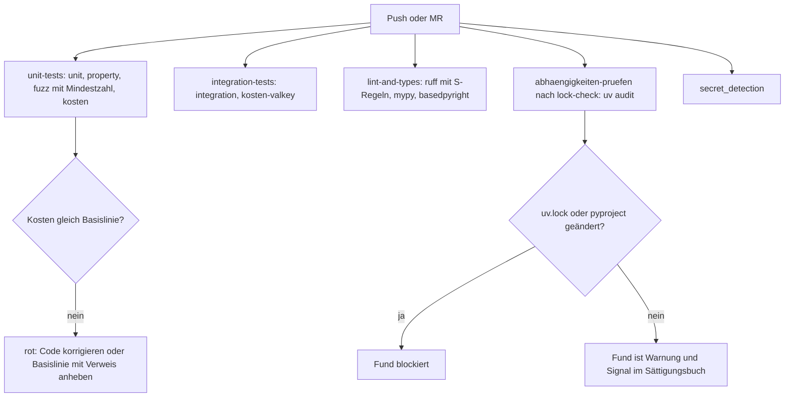
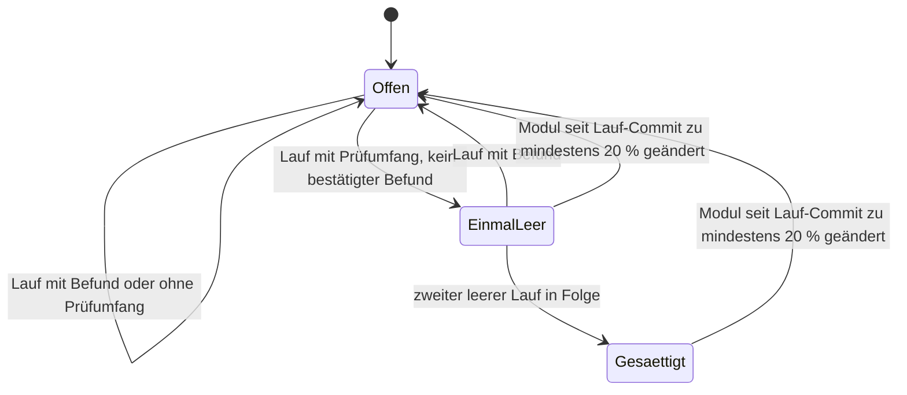

# Dauerhafter Qualitätsablauf - Plan

## Goal Capsule

- **Objective:** swarmq wird dauerhaft und belegbar besser in Fehlerfreiheit, Zuverlässigkeit, Angriffssicherheit und Performance, bis jede Säule nach einer messbaren Regel als gesättigt gilt. Jeder Befund und jede Verbesserung ist im Code bewiesen, bevor Code dafür entsteht. Der öffentliche Vergleich mit Celery, Dramatiq, arq und taskiq zeigt, wo swarmq steht.
- **Means:** Zwei Stufen. Deterministische Prüfungen laufen in jeder Pipeline, tiefe Suchrunden in festem Takt, gesteuert über einen Methodenkatalog mit Sättigungsbuch. Dazu kommt ein Vergleichsaufbau für Performance und Garantien (Key Decisions, KTD4, KTD8, KTD12).
- **Product authority:** Entscheidungsregister `compound-packs/swarmq-entscheidungen/` > `docs/befunde/README.md` > dieser Plan. AGENTS.md (TDD, Qualitäts-Gates, Testports, Entscheidungen respektieren) gilt durchgehend. Dieser Plan legt den Ablauf und seine Werkzeuge fest. Jede einzelne tiefe Runde bekommt einen eigenen Plan.
- **Execution profile:** Umsetzung nur nach Georgs Ok, Unit für Unit im TDD-Zyklus aus AGENTS.md. U1, U2, U5, U7 und U8 sind unabhängig voneinander. U4 setzt U3 voraus, U6 setzt U5 voraus und U9 setzt U8 voraus (Sequencing). Integrations- und e2e-Läufe nur über die `just`-Rezepte mit den Testports 5699/6399.
- **Stop conditions:**
  - Die Allokationszählung ist nicht deterministisch (KTD5). Dann bleibt R7 ohne Allokationen, und Georg entscheidet.
  - `uv audit` läuft im CI-Image nicht (KTD2).
  - Ein Schritt würde einen Test mit `entscheidung`-Marker ändern.
  - Für ein Konkurrenzsystem lässt sich keine stärkste Einstellung benennen, oder die Ersatzeinstellung würde den Vergleich verzerren (R20). Die Werkseinstellung von arq (KTD13) ist erlaubt und wird im Vergleich als solche benannt.
- **Who finishes:** `ce-work` setzt die Units um. Merge, Release und Veröffentlichung des Vergleichs entscheidet Georg.

---

## Product Contract

### Summary

Ein dauerhafter Qualitätsablauf mit vier Säulen: Fehler, Zuverlässigkeit, Angriffssicherheit und Performance. Jede Pipeline prüft deterministisch, ob etwas schlechter wird. Tiefe Runden suchen in festem Takt nach neuen Befunden und wählen ihre Methode aus einem Katalog, der Sättigung misst. Ein öffentlicher, nachstellbarer Vergleich mit den vier wichtigsten Konkurrenten misst Performance bei gleicher Garantie und zählt Verluste unter gleichen Störungen.

### Problem Frame

swarmq soll der Standard für Task-Verarbeitung in professionellen Python-Projekten werden. Bisher entsteht Qualität in einzelnen Suchrunden: "Betrieb über Zeit" und die Runden 2 bis 4 haben zusammen über 78 Fehler gefunden. Eine Runde endet, wenn sie fertig ist. Niemand kann sagen, wann eine Methode oder ein Modul ausgeschöpft ist, und die nächste Runde muss ihre Blickwinkel jedes Mal neu suchen.

Für Fehler gibt es einen harten Beweisstandard: Gegenprüfung und einen Nachweis-Test, der rot wird. Für Performance und Angriffssicherheit fehlt er. In der Pipeline läuft kein Abhängigkeits-Scanner. Auf Sicherheit prüfen dort nur die Secret-Detection und die `S`-Regeln von ruff. Profiling-Werkzeuge gibt es nicht. Der Vergleichsaufbau unter `benchmarks/comparison/` kennt nur taskiq, und seine letzten Ergebnisse stammen vom 17.04.2026. Ohne Beweisstandard drohen Optimierungen auf Verdacht und Sicherheitsmeldungen ohne erreichbaren Pfad, also genau der unnötige Code, den das Projekt vermeiden will.

### Key Decisions

- **Sicherheit sind zwei Säulen.** Zuverlässigkeit meint Zustellgarantien und Wiederherstellung, Angriffssicherheit meint die Angriffsfläche. Beide haben eigene Methoden. Governs R1. (session-settled: user-directed — chosen over "nur Zuverlässigkeit" und "nur Angriffssicherheit": beide sind Teil des Anspruchs, der Standard zu werden)
- **Garantien sind fest.** Performance wird nur innerhalb der geltenden Garantien und Entscheidungen optimiert. Governs R6, R20. (session-settled: user-approved — chosen over wählbare schnellere Profile und Einzelentscheid je Fund: die höhere Sicherheit ist der Kern von swarmq, ihr Preis wird gemessen statt verhandelt)
- **Optimierungen brauchen mindestens 5 % gesicherten Gewinn.** Governs R5. (session-settled: user-approved — chosen over ≥ 10 % und jeden gesicherten Gewinn: Balance zwischen Ausbeute und Codemenge)
- **Zwei Stufen statt Einzelrunden.** Billige Regressionsprüfungen in jeder Pipeline, tiefe Runden im Takt. Governs R7–R18. (session-settled: user-approved — chosen over nur tiefe Runden und einen autonom geplanten Agenten)
- **Die Pipeline misst zählbare Kosten, keine Zeit.** Governs R7, R10. (session-settled: user-approved — chosen over Zeitmessung mit Toleranz und keine Performance in der CI: Zeit auf dem geteilten Runner schwankt und verletzt die Determinismus-Regel)
- **Der Vergleich deckt Performance und Garantien ab und ist öffentlich.** Governs R19–R22. (session-settled: user-approved — chosen over reinen Performance-Vergleich und internen Vergleich: die Garantie ist das stärkste Argument von swarmq)
- **Runden suchen und belegen, fixen erst nach Ok.** Governs R18. (session-settled: user-approved — chosen over Fixen bis MR und nur Register)
- **Katalog mit Sättigungsbuch als Rahmen, signalgetrieben bei Performance und Angriffssicherheit, Konkurrenz-Kataloge als Fehler-Methode.** Governs R12–R17. (session-settled: user-approved — chosen over nur Katalog und nur signalgetrieben: Lese-Runden finden gebrochene Zusagen, die keine Maschine meldet, bei Performance und Sicherheit sind Lese-Vermutungen aber zu schwach belegt)
- **Zuverlässigkeit teilt den Befund-Ablauf mit den Fehlern.** Sie hat eigene Methoden, aber kein eigenes Register. Governs R2.

### Requirements

**Säulen und Beweisstandard**

- R1. Der Ablauf hat vier Säulen: Fehler, Zuverlässigkeit, Angriffssicherheit und Performance. Jede Säule hat einen eigenen Methodenkatalog (R12).
- R2. Jeder Verdacht aus jeder Säule durchläuft den Ablauf aus `docs/befunde/README.md`: Gegenprüfung durch einen Prüfer, der den Verdacht nicht gefunden hat, und genau eine Einstufung mit zitierter Quelle.
- R3. Ein Fehler- oder Zuverlässigkeitsbefund gilt erst mit einem Nachweis-Test (`befund`-Marker, `xfail(strict=True)`) als bewiesen.
- R4. Ein Befund zur Angriffssicherheit gilt erst als bewiesen, wenn ein Nachweis-Test die Schwachstelle über einen erreichbaren Pfad auslöst, also über die öffentliche API, eine eingehende Nachricht, die Konfiguration oder die CLI. Ein Scanner-Treffer oder eine CVE in einer Abhängigkeit ist bis dahin nur ein Signal.
- R5. Eine Performance-Verbesserung gilt erst als bewiesen, wenn vorher und nachher abwechselnd auf derselben Referenzmaschine gemessen wurde, mit mindestens 10 Wiederholungen je Seite. Der Unterschied muss statistisch gesichert sein, und ein Profil muss zeigen, wo eingespart wird. Der Gewinn muss bei Durchsatz, p99-Latenz, CPU oder RAM in einem realistischen Szenario mindestens 5 % betragen. Kleinere Gewinne zählen nur, wenn der Code dabei einfacher wird.
- R6. Eine Verbesserung, die eine Garantie oder Entscheidung aus dem Register schwächen würde, wird nicht umgesetzt. Sie geht als „Entscheidung überdenken?“ mit Messwerten an Georg.

**Stufe 1: jede Pipeline**

- R7. Die Pipeline misst die zählbaren Kosten je Task für die zentralen Pfade (Publish, Ausführung, Retry, Workflow) und vergleicht sie mit einer versionierten Basislinie. Gemessen werden Valkey-Befehle und Roundtrips, AMQP-Frames, Allokationen und die Importzeit, gezählt in Modulen. Ein Anstieg ist rot. Ein gewollter Anstieg ändert die Basislinie im selben MR und nennt den Grund.
- R8. Die Pipeline prüft den Code und die Abhängigkeiten mit Security-Scannern. Die vorhandene Secret-Detection bleibt.
- R9. Der Fuzz-Kurzlauf ohne Dienste bleibt blockierend in der Pipeline. Er meldet nur dann grün, wenn er tatsächlich Fälle ausgeführt hat. Chaos-Tests bleiben lokal vor Releases, wie in `.gitlab-ci.yml` begründet.
- R10. Jede Prüfung der Stufe 1 ist deterministisch im Sinn von AGENTS.md. Zeitmessungen gehören nicht in die Pipeline.

**Stufe 2: tiefe Runden**

- R11. Tiefe Runden laufen in festem Takt (Outstanding Questions). Jede Runde bekommt einen eigenen Plan.
- R12. Ein Methodenkatalog führt je Säule die verfügbaren Methoden. Ein Sättigungsbuch hält je Kombination aus Methode und Modul fest, wann sie lief, was sie geprüft hat und wie viele bestätigte Befunde sie brachte.
- R13. Eine Runde wählt die Kombinationen, die am wenigsten abgedeckt und nicht gesättigt sind, und begründet die Auswahl mit dem Sättigungsbuch.
- R14. Eine Kombination gilt als gesättigt, wenn sie zweimal in Folge keinen bestätigten Befund liefert. Ein Lauf ohne nachgewiesenen Prüfumfang zählt dabei nicht. Eine wesentliche Änderung an einem Modul seit dem letzten Lauf setzt die Sättigung seiner Kombinationen zurück. Eine Säule gilt als gesättigt, wenn alle ihre Kombinationen gesättigt sind.
- R15. In den Säulen Performance und Angriffssicherheit beginnt jede Untersuchung bei einem maschinell erzeugten Signal. Dazu zählen Profiler-Hotspots, Abweichungen in den Zählmetriken, Scanner-Treffer, Fuzz-Gegenbeispiele, Auffälligkeiten der Loadsuite und überlebende Mutanten. Ein Verdacht ohne Signal wird nicht untersucht.
- R16. Der Fehler-Katalog enthält die Methode „Konkurrenz-Katalog“: Bekannte Fehler, CVEs und Performance-Probleme aus den Trackern von Celery, Dramatiq, arq und taskiq werden als Prüffälle gegen swarmq gestellt. Jedes Ergebnis wird festgehalten, auch „nicht anwendbar“.
- R17. Die Lese-Methode, also Agenten, die den Code aus einem Blickwinkel lesen, bleibt den Säulen Fehler und Zuverlässigkeit vorbehalten.
- R18. Jede Runde liefert ein gegengeprüftes Register mit Nachweis-Tests, Produktfragen und einem Fix-Plan. Umgesetzt wird erst nach Georgs Ok. Produktfragen entscheidet Georg, und jede Antwort kommt ins Entscheidungsregister.

**Vergleich mit anderen Systemen**

- R19. Der Vergleichsaufbau umfasst swarmq, Celery, Dramatiq, arq und taskiq.
- R20. Im Performance-Teil läuft jedes System zweimal, einmal ab Werk und einmal mit seiner stärksten Garantie, die sich mit swarmq vergleichen lässt. swarmq läuft mit seinen festen Garantien.
- R21. Im Garantie-Teil bekommen alle Systeme dieselben Störungen: Worker-Abbruch mitten im Task, Broker-Neustart und Netztrennung. Gezählt werden Verluste und Duplikate.
- R22. Methode, Skripte, Konfiguration und Ergebnisse sind öffentlich und nachstellbar. Veröffentlicht wird auch, wo swarmq verliert. Zeitmessungen laufen nur auf einer Referenzmaschine.

### Key Flows

- F1. Tiefe Runde
  - **Trigger:** Der Takt aus R11 ist fällig, oder ein dringendes Sicherheitssignal liegt vor (KTD10).
  - **Steps:** Die Runde liest das Sättigungsbuch und wählt Kombinationen aus (R13). Die Methoden laufen, bei Performance und Angriffssicherheit nur ab einem Signal (R15). Jeder Verdacht wird gegengeprüft und eingestuft (R2), Beweise entstehen nach R3–R5. Register, Produktfragen und Fix-Plan gehen an Georg (R18). Das Sättigungsbuch wird fortgeschrieben (R12, R14).
  - **Outcome:** Bewiesene Befunde mit Fix-Plan, oder eine Sättigungsstufe mehr.
  - **Covered by:** R2–R5, R11–R18
- F2. Regression in der Pipeline
  - **Trigger:** Ein MR verändert eine Zählmetrik oder löst einen Scanner-Treffer aus.
  - **Steps:** Die Pipeline wird rot (R7, R8). Ist die Änderung gewollt, ändert der MR die Basislinie und nennt den Grund. Sonst wird der Code korrigiert. Ein Scanner-Treffer, der sich nicht sofort klären lässt, wird zum Signal für die nächste Runde (R15).
  - **Covered by:** R7–R10, R15

### Acceptance Examples

- AE1. **Covers R4.** **Given** ein Scanner meldet eine unsichere Deserialisierung in einer Hilfsfunktion. **When** keine eingehende Nachricht, keine API und keine Konfiguration diese Funktion mit fremden Daten erreicht. **Then** ist das kein Befund. Der Treffer bleibt als Signal im Sättigungsbuch und wird nicht gefixt.
- AE2. **Covers R5.** **Given** eine Optimierung bringt gesicherte 3 % mehr Durchsatz und fügt einen Cache mit eigener Invalidierung hinzu. **Then** wird sie verworfen. Brächte sie 3 % und machte den Code einfacher, würde sie angenommen.
- AE3. **Covers R6.** **Given** das Bestätigen vor dem Speichern des Ergebnisses brächte 15 % Durchsatz. **When** das die Entscheidung zur Ack-Reihenfolge schwächt (pack: swarmq-entscheidungen, e072-ack-nach-ergebnis-speichern.md). **Then** wird nichts umgesetzt. Der Fund geht mit Messwerten als „Entscheidung überdenken?“ an Georg.
- AE4. **Covers R7.** **Given** ein MR fügt pro Task einen Valkey-Roundtrip hinzu, um eine Garantie zu sichern. **Then** wird die Pipeline rot, bis der MR die Basislinie mit Begründung anhebt.
- AE5. **Covers R14.** **Given** Mutation im Valkey-Backend war zweimal in Folge ohne bestätigten Befund und gilt als gesättigt. **When** ein späterer MR das Valkey-Backend wesentlich umbaut. **Then** ist die Kombination wieder offen und kommt für die nächste Runde infrage.
- AE6. **Covers R14.** **Given** ein Mutationslauf auf dem Broker bricht ab, bevor ein Mutant geprüft wurde. **Then** zählt der Lauf nicht zur Sättigung, auch wenn er keinen Befund liefert.
- AE7. **Covers R9.** **Given** eine Änderung lässt alle Fuzz-Ziele überspringen. **Then** wird der Unit-Job rot, obwohl kein Test fehlschlägt.

### Success Criteria

- Für jede Säule zeigt das Sättigungsbuch, wie weit sie von der Sättigung entfernt ist. „Keine Fehler mehr“ oder „keine Gewinne mehr“ ist damit eine Aussage mit Belegen und kein Gefühl.
- Kein Registereintrag und keine Optimierung ohne Beweis nach R3–R5. Stichprobe: Jede angenommene Optimierung lässt sich mit den hinterlegten Skripten nachmessen.
- Der Vergleich nach R19–R22 ist veröffentlicht, und ein Dritter kann ihn mit den veröffentlichten Skripten nachstellen.
- Die Pipeline-Stufe erzeugt keine Flakes, denn jeder rote Lauf geht auf eine echte Änderung zurück.

### Scope Boundaries

**Deferred for later**

- Ein autonom geplanter Agent, der Runden ohne Anstoß fährt.
- Wählbare schnellere Profile mit schwächeren Garantien über das vorhandene `FIRE_AND_FORGET` hinaus.
- Der Ort der Veröffentlichung, also Website, README oder ein eigenes Repo.
- Telemetrie aus Produktivsystemen (Phoenix) als Signalquelle, solange es keinen geregelten Zugang gibt.
- Lint, Typprüfung und Coverage für `benchmarks/`. Neue reine Logik dort bekommt trotzdem Unit-Tests (KTD12).

**Outside this plan**

- Die Durchführung der ersten tiefen Runde, denn jede Runde hat ihren eigenen Plan (R11).
- Fixes für Befunde, die gehören in die Fix-Pläne der Runden (R18).
- Chaos-Tests in der Pipeline, solange der Runner ohne Privilegien läuft.

### Dependencies / Assumptions

- Referenzmaschine für Zeitmessungen ist celsius (Registered ECC, Docker-Kontext `celsius`), seit 2026-10-24 als Loadsuite-Host abgenommen. lastserver fällt bis zum Riegeltausch aus. Messreihen beider Hosts werden nie miteinander verglichen.
- Der GitLab-Runner läuft ohne Privilegien auf Georgs Rechner, und das Kontingent der SaaS-Runner ist erschöpft. Die Pipeline-Stufe muss damit auskommen.
- Annahme: Celery, Dramatiq und arq lassen sich auf eine Garantie einstellen, die sich mit swarmq vergleichen lässt. Wo das nicht geht, nennt der Vergleich die stärkste verfügbare Einstellung.

### Outstanding Questions

**Resolve Before Planning**

- Keine.

**Deferred to Implementation**

- Der Takt der tiefen Runden (R11): je Minor-Release, monatlich oder beides mit einer Höchstfrist. Georg entscheidet. Bis dahin gilt je Minor-Release.
- Die genaue Modulliste des Sättigungsbuchs (KTD8). Ausgangspunkt sind die Pakete und Module direkt unter `src/swarmq/`.

### Sources / Research

- `docs/befunde/README.md`: Befund-Ablauf, Einstufungen, Nachweis-Tests
- `docs/plans/2026-10-17-0941-test-fehlersuche-runde-4-plan.md`: zuletzt eingesetzte Methoden (Zustandsmodelle, Störungen, Mutation Welle 2, Betriebsabläufe, Fuzzing)
- `docs/befunde/fehlersuche-runde-2-2026-10.md`, `docs/befunde/fehlersuche-runde-3-2026-10.md`, `docs/befunde/fehlersuche-runde-4-2026-10.md`, `docs/befunde/betrieb-ueber-zeit-2026-10.md`: bisherige Register als Grundlage für das Sättigungsbuch
- `benchmarks/comparison/`: vorhandener Vergleichsaufbau, bisher nur swarmq gegen taskiq und taskiq mit RabbitMQ, Ergebnisse vom 17.04.2026
- `benchmarks/bench.py`: vorhandener Benchmark für RabbitMQ und Valkey
- `.gitlab-ci.yml:283`: Begründung, warum Chaos nicht in der Pipeline läuft
- `.gitlab-ci.yml:302-307`: nur Secret-Detection als eigener Sicherheitsjob
- `pyproject.toml:283`: ruff mit `select = ["ALL"]`, inklusive der `S`-Regeln
- `justfile`: Mutation-Rezepte auf dem Docker-Kontext `lastserver`
- `src/swarmq/task.py:50`: `DeliveryMode` mit `AT_LEAST_ONCE` und `FIRE_AND_FORGET`

---

## Planning Contract

### Product Contract preservation

Zwei Anforderungen wurden beim Planen sinngleich geschärft.

- **R9:** Der Brainstorm nahm an, Fuzz laufe nicht in der Pipeline. Tatsächlich läuft `just fuzz` seit Härtung R2 blockierend im Unit-Job (`.gitlab-ci.yml:170-181`). Veraltet sind nur der Kopfkommentar `.gitlab-ci.yml:16` und `docs/testing/test-strategy.md:113-115`. R9 verlangt deshalb den Schutz gegen leere Läufe statt der Aufnahme.
- **R14:** Ergänzt um den Prüfumfang. Ein Lauf, der nichts geprüft hat, darf eine Kombination nicht sättigen.

Außerdem gilt eine Tatsachenänderung: Der Blocker für Zeitmessungen entfällt, weil celsius als Referenzmaschine bereitsteht (Dependencies).

### Key Technical Decisions

**Pipeline-Stufe**

- KTD1. **Fuzz bleibt, wie er ist, und bekommt einen Wächter gegen leere Läufe.** `scripts/run-tests.sh` bekommt eine Option für eine Mindestzahl ausgeführter Tests, die der `fuzz`-Rezeptaufruf in der CI setzt. Ein Lauf mit nur übersprungenen Tests ist rot, wie beim alten Chaos-Job „1 passed, 40 skipped“ (`.gitlab-ci.yml:283-300`). Die Fuzz-Ziele nutzen heute feste `@settings(max_examples=500)` ohne `derandomize`. Ein Profil `ci` mit `derandomize=True` nach dem Vorbild `tests/property/conftest.py:19-31` macht den Kurzlauf deterministisch (R10). Gewählt wird es über eine eigene Variable `SWARMQ_FUZZ_PROFILE`, die die CI nur auf der `just fuzz`-Zeile setzt. `HYPOTHESIS_PROFILE` scheidet aus, weil die Property-Suite im selben Job es liest und `ci` dort nicht kennt. Tiefe Runden fahren das zufällige Profil mit mehr Beispielen.
- KTD2. **Abhängigkeiten prüft `uv audit` gegen `uv.lock`.** Es liest das Lock direkt, braucht keinen Container und nutzt OSV. Verworfen:
  - pip-audit braucht einen `uv export`.
  - GitLab Dependency Scanning gibt es nur in Ultimate.
  - Safety ist im freien Tarif nicht für kommerzielle Nutzung gedacht.

  Der Job `abhaengigkeiten-pruefen` blockiert nur, wenn der Branch `uv.lock` oder `pyproject.toml` gegenüber main ändert (`rules: changes` mit `compare_to: refs/heads/main`). Es gibt nur Branch-Pipelines, und ohne `compare_to` vergliche die Regel mit dem vorigen Push. In jeder anderen Pipeline läuft er mit `allow_failure: true` und erzeugt bei neuen CVEs eine Warnung. Das ist das Signal aus R15, denn main wird so nie ohne eigenes Zutun rot. Ausnahmen stehen als `--ignore <ID>` direkt im Rezept `audit`, je Zeile mit Kommentar aus Grund und Signal-ID wie bei `# noqa`. Ein eigenes Skript kommt erst, wenn die Ausnahmen es verlangen. Der Job hängt mit `needs: [lock-check]` am vorhandenen Job `lock-check` (`.gitlab-ci.yml:148-155`), damit er nie ein veraltetes Lock prüft (`docs/solutions/tooling-decisions/uv-lock-drift-from-pyproject-optional-extras.md`).
- KTD3. **Code prüft weiter nur ruff mit den `S`-Regeln, kein zusätzlicher Scanner.** GitLab SAST im Free-Tier zeigt im MR keine Funde an und deckt sich mit den Bandit-Regeln, die ruff schon blockierend prüft. Die Semgrep-Regeln stehen unter einer einschränkenden Lizenz. Die sechs begründeten `noqa: S` in `src` werden die ersten Signale im Sättigungsbuch (U5):
  - S301 (pickle) in `worker/compute/pool.py:439` und `compute/envelope.py:115`
  - S311 in `backoff.py:35,39`
  - S603 in `logging_file.py:204`
  - S606 in `process_manager/reload.py:178`

  Ein Zusatz-Scanner kommt nur dazu, wenn eine Runde eine Lücke von ruff belegt.
- KTD4. **Die Kostensuite liegt unter `tests/kosten/` mit Marker `kosten` und hat zwei Teile.** Der dienstfreie Teil läuft im Unit-Job (`just kosten`):
  - Vertragsaufrufe je Task über die In-Memory-Fakes. Ein zählender Broker und ein zählendes Backend nach dem Vorbild `ChainBroker` (`tests/property/stateful/retry_chain_machine.py:358-383`) treiben die echte Pipeline über `Worker._handle_message`.
  - AMQP-Frames je Publish über `FakeTransport.write_queue` (`tests/support/aiormq_transport.py`).
  - Geladene Module je Einstieg (`import swarmq`, `swarmq.cli`, Worker-Start) im frischen Subprozess nach `tests/unit/test_cli_import_laziness.py`.
  - Allokationen über `tracemalloc` nach einem Aufwärmlauf, gefiltert auf Frames aus `src/swarmq`.

  Die Suite läuft in der CI ohne Coverage, und die Subprozesse starten ohne `COVERAGE_*`-Variablen. Der Unit-Job setzt sonst `SWARMQ_TEST_COVERAGE`, und Coverage lädt eigene Module in jedes Kind, sodass die Modulzahlen in CI und lokal auseinanderliefen.

  Der Valkey-Teil braucht echtes Valkey und läuft im Integration-Job (KTD6). Szenarien je Pfad aus R7: einfacher Task, Retry, Workflow-Kette, Lock mit Rate-Limit sowie `get_result` auf einen fertigen Task.
- KTD5. **Allokationen kommen nur nach bewiesenem Determinismus ins Gate.** Vorher laufen sie lokal und in der CI 20-mal und liefern identische Zahlen. Die Python-Version wird dafür exakt gepinnt, über `.python-version` mit Patchversion (heute 3.14.4), denn der CI-Image-Tag `python3.14-bookworm-slim` floatet. Lokal und in der CI läuft das von uv verwaltete Python (`UV_PYTHON_PREFERENCE=only-managed`), damit nicht nur die Version, sondern auch der Build gleich ist. Die Basislinie speichert die Python-Version, und eine Abweichung scheitert mit einer klaren Meldung statt mit falschen Zahlen. Bleiben Allokationen trotzdem unstet, fliegen sie aus dem Gate und bleiben Signal für Runden (Stop condition).
- KTD6. **Valkey-Befehle und Roundtrips werden nur für einen Task nacheinander gezählt.** Das Auto-Pipelining in `script_pipeline.py:6-9` bündelt Aufrufe eines Event-Loop-Takts, bei Nebenläufigkeit hängen Roundtrips also vom Scheduling ab. Gezählt wird mit einer Hülle um `send_packed_command` der Verbindung, gegen die echten `Valkey*Store`-Klassen wie in `tests/integration/stateful/conftest.py`, nicht über `SwarmQ.start_worker`, das injizierte Clients ablehnt (`app.py:255-276`). Die Hülle hängt an einer privaten Schnittstelle von valkey-py und bekommt einen Eintrag in `docs/solutions/tooling-decisions/upgrade-checkliste-private-bibliotheks-apis-2026-10-19.md`. `get_result` wird nur auf einen fertigen Task gemessen, denn danach hängt die Zahl von der Taskdauer ab (pack: swarmq-entscheidungen, e030-get-result-polling.md). Die Messung endet erst, wenn das Pub/Sub im Hintergrund geschlossen ist. Sonst fällt das UNSUBSCRIBE mal in die Messung und mal nicht.
- KTD7. **Die Basislinie ist eine Ratsche in beide Richtungen.** Die Datei `tests/kosten/basislinie.toml` enthält den aktuellen Wert je Szenario und Metrik sowie eine Historie, an die nur angehängt wird. Jede Abweichung ist rot, auch eine Senkung, damit die Basislinie nie hinter dem Code zurückbleibt. `just kosten-basislinie` schreibt die neuen Werte und verlangt einen Grund mit Verweis auf eine Entscheidung (`E-nnn`), einen Befund oder einen Plan. Ein Wächtertest prüft, dass jeder Anstieg in der Historie einen auflösbaren Verweis trägt. So wird schleichendes Wachstum in der Historie sichtbar. Die erste Basislinie trägt die Verweise auf die Entscheidungen, die heutige Kosten begründen:
  - zwei Verbindungen je Worker (pack: swarmq-entscheidungen, e025-blockierter-broker-publish-wartet.md)
  - Delay-Stufen (pack: swarmq-entscheidungen, e026-delay-stufen-bis-1h.md)
  - Fortschritt höchstens alle 500 ms (pack: swarmq-entscheidungen, e044-fortschritt-best-effort.md)
  - Rate-Limit vor Lock (pack: swarmq-entscheidungen, e070-rate-limit-vor-lock.md)

**Tiefe Runden**

- KTD8. **Methodenkatalog und Sättigungsbuch liegen als Daten unter `docs/befunde/`, die Sättigung berechnet ein Skript.** Der Katalog `docs/befunde/methodenkatalog.md` führt je Säule die Methoden mit stabiler ID (`M-F-nn`, `M-Z-nn`, `M-A-nn`, `M-P-nn`) und die Modulliste. Das Buch `docs/befunde/saettigungsbuch.toml` speichert Läufe und Signale. `tomllib` liest es ohne neue Abhängigkeit. Jeder Lauf speichert:
  - Datum, Commit, Methode und Modul
  - den Prüfumfang als Zahl mit Einheit (Mutanten, Beispiele, Issues, Dateien)
  - die IDs der bestätigten Befunde

  `scripts/saettigung.py` berechnet den Stand jeder Kombination und daraus den Stand der Säulen, statt ihn zu speichern:
  - Gezählt werden nur Läufe mit Prüfumfang größer 0.
  - Bestätigt sind FEHLER, LÜCKE und VERBESSERUNG nach R5. ENTSCHEIDUNG, NICHT HALTBAR und unbeantwortete „Entscheidung überdenken?“ zählen nicht.
  - Wesentlich ist eine Änderung, wenn `git diff --numstat <Lauf-Commit>..HEAD` für das Modul mindestens 20 % seiner heutigen Zeilen ändert. Ein umbenanntes oder neues Modul und eine neue Methode im Katalog öffnen ihre Kombinationen.

  Ist eine Säule gesättigt, überspringen Runden sie. Sind alle gesättigt, meldet das Skript das, und Georg entscheidet über neue Methoden.
- KTD9. **Ein Wächtertest hält Buch, Katalog und Register konsistent.** `tests/unit/test_saettigungsbuch.py` folgt dem Muster von `tests/unit/test_entscheidungsregister.py` und prüft:
  - das Schema des Buchs
  - dass jede Methoden-ID im Katalog steht
  - dass jede Befund-ID in einem Register unter `docs/befunde/` steht

  Die Verweise der Basislinie prüft der Wächter aus KTD7.

  So kann kein Lauf einen erfundenen Befund melden.
- KTD10. **Signale zwischen den Runden kommen ins Buch, dringende Sicherheitssignale sofort an Georg.** Ein Signal hat Quelle, Säule, Modul und Status: offen, untersucht mit Lauf-ID oder verworfen mit Grund. Ein Sicherheitssignal mit Verdacht auf einen erreichbaren Pfad (R4) wartet nicht auf den Takt. Es löst eine Untersuchung nach F1 für genau dieses Signal aus.
- KTD11. **Der Konkurrenz-Katalog ist ein beschriebenes Vorgehen, kein Werkzeug.** `docs/befunde/README.md` nennt je Tracker die Labels und Suchwörter:
  - Celery: `Issue Type: Bug Report`, `Issue Type: Regression`
  - Dramatiq: `bug`, `rabbitmq`, `redis`
  - taskiq und taskiq-aio-pika: `bug`, `brokers`, `worker`
  - arq hat keine Labels, dort helfen die Suchwörter lost, duplicate, retry, abort und health.

  Dazu kommt eine OSV-Abfrage je PyPI-Paket. Der Prüfumfang eines Laufs ist die Zahl der gesichteten Issues. Jedes Issue wird als anwendbar oder nicht anwendbar festgehalten. Ein anwendbarer Fehler wird ein Verdacht der Säule Fehler oder Zuverlässigkeit. Eine anwendbare CVE oder ein Performance-Problem wird ein Signal der Säule Angriffssicherheit oder Performance und folgt dort R4, R5 und R15.

**Messen und Vergleichen**

- KTD12. **Das A/B-Werkzeug `scripts/ab_messung.py` setzt R5 um und legt die Statistik vor dem Messen fest.** Es baut zwei Refs in getrennten Worktrees und führt den Messbefehl abwechselnd A, B, A, B aus, mindestens 10 Paare. Gesichert ist ein Unterschied bei einem zweiseitigen Mann-Whitney-U-Test mit α = 0,05. Er zählt als Gewinn, wenn die Hodges-Lehmann-Verschiebung mindestens 5 % vom Median der A-Seite beträgt. Liegt p bei 10 Paaren über α, wird einmal auf 30 Paare erweitert, und dieses Ergebnis gilt. Grundlage ist die gemessene Streuung von 4,4 % bei Valkey und 7,1 % bei RabbitMQ (`docs/solutions/patterns/measure-before-planning-variance-claims-2026-04-16.md`), die schon in der Größe der 5-%-Schwelle liegt. Die Statistik ist reines Python, damit keine Abhängigkeit dazukommt, und wird gegen bekannte Referenzwerte getestet. Profile erzeugt py-spy aus einer neuen Gruppe `messung`. Das Urteil „Gewinn“ setzt ein Profil je Seite voraus, denn R5 verlangt den Nachweis, wo eingespart wird. Ohne Profile lautet es „nicht belegt“.
- KTD13. **Der Vergleich erweitert `benchmarks/comparison/`, statt neu zu beginnen.** Das Protokoll `TaskQueueSystem` (`systems/base.py:8-41`) bekommt einen Parameter `profil` mit `ab_werk` und `stark`. Die stärksten vergleichbaren Einstellungen:

  | System | Broker | `stark` |
  |---|---|---|
  | Celery | RabbitMQ, Ergebnisse in Valkey | `task_acks_late`, `task_reject_on_worker_lost`, Quorum-Queues, `confirm_publish`, Prefetch 1 |
  | Dramatiq | RabbitMQ | `confirm_delivery=True`, Prefetch 1 |
  | taskiq | RabbitMQ (taskiq-aio-pika) | `ack_time=when_saved`, Quorum-Queues |
  | arq | nur Valkey | Werkseinstellung, eigener Vergleich auf Valkey |
  | swarmq | RabbitMQ und Valkey | feste Garantien, frische Queues |

  - Versionen sind exakt gepinnt, in `requirements.txt` mit `==` und als Image-Tag. Heute floatet `rabbitmq:4-management-alpine`.
  - Jedes Ergebnis speichert die Versionen. Eine neue Hauptversion eines Systems ist der Anlass für einen neuen Lauf.
  - Der Worker jedes Systems läuft als eigener Prozess über dessen CLI, und das Protokoll liefert seine PID. Heute laufen die Worker von swarmq und taskiq als `asyncio.Task` im Runner (`systems/swarmq_sys.py:156`, `systems/taskiq_sys.py:114`), und ein SIGKILL in U9 träfe den Runner mit.
  - Jede Kombination aus System und Szenario läuft in einem frischen Prozess mit Hänger-Wächter (`docs/solutions/logic-errors/aiormq-reader-leak-and-stale-connection-recovery-2026-04-16.md`).
  - Die Systeme laufen reihum, damit Drift auf der Maschine alle gleich trifft.
  - `benchmarks/docker-compose.yml` belegt heute den Testport 6399 und bekommt einen eigenen Port.
- KTD14. **Verluste und Duplikate zählt ein Hauptbuch des Vergleichsaufbaus, nicht die Systeme selbst.** Jeder Task trägt eine eindeutige ID. Der Erzeuger speichert jeden Publish mit Ausgang (bestätigt, unbestimmt, abgelehnt), jede Ausführung schreibt ihre ID dazu. Das Buch ist eine SQLite-Datei im WAL-Modus auf dem Host, damit keine der gestörten Komponenten es mitreißt. Nach der Ruhephase gilt:
  - Ein Verlust ist ein bestätigter Publish ohne Ausführung.
  - Ein Duplikat ist mehr als eine Ausführung.
  - Unbestimmte Publishes laufen getrennt, denn sie sind kein Verlust (pack: swarmq-entscheidungen, e042-publish-indeterminate-nur-nach-senden.md).
  - Duplikate nach einem Valkey-Neustart ohne Persistenz laufen ebenfalls getrennt (pack: swarmq-entscheidungen, e077-ausfuehrungsschutz-nach-valkey-datenverlust.md).

  swarmq bekommt frische Queues, sonst misst der Vergleich die schwächere Dead-Letter-Strategie (pack: swarmq-entscheidungen, e017-dead-letter-strategie-auto.md). Die Störungen nutzen Toxiproxy in der Version aus `tests/chaos/compose.yml`. Der Garantie-Teil misst keine Zeit und läuft deshalb auch auf dem Laptop.

### High-Level Technical Design

Pipeline-Stufe, neue Teile hervorgehoben:

Stand einer Kombination aus Methode und Modul, wie `scripts/saettigung.py` ihn berechnet:

### Sequencing

- U1 und U2 sind unabhängig und klein. Sie können zuerst oder parallel kommen.
- U3 vor U4, weil U4 Basislinie, Rezepte und Wächter aus U3 nutzt.
- U5 vor U6, weil die README-Ergänzung auf Katalog und Buch verweist.
- U7 ist unabhängig, wirksam aber erst mit Zugriff auf celsius.
- U8 vor U9, weil das Hauptbuch die Adapter aus U8 treibt.

### Risks

- `uv audit` ist eine Vorschaufunktion. Ändert sich die Schnittstelle, scheitert nur das Skript aus U2, und sein Test zeigt es.
- Das gepinnte Python bremst Patch-Updates: Ein Python-Update ist künftig ein MR, der die Basislinie neu erhebt.
- Die Zählhülle für Valkey hängt an einer privaten Schnittstelle (KTD6) und gehört deshalb in die Upgrade-Checkliste.
- Konkurrenzsysteme laufen auf denselben Client-Bibliotheken und treffen dieselben Wiederverbindungslücken (`docs/solutions/spikes/2026-04-17-toxiproxy-reconnect-spike.md`). Solche Ergebnisse sind Befunde über diese Systeme und keine Fehler im Aufbau.

---

## Implementation Units

### U1. Fuzz-Wächter gegen leere Läufe

- **Goal:** Ein Fuzz-Lauf, der nichts ausführt, ist rot, und der Kurzlauf ist deterministisch.
- **Requirements:** R9, R10, AE7
- **Dependencies:** keine
- **Files:**
  - `scripts/run-tests.sh`
  - `justfile`
  - `.gitlab-ci.yml`
  - `tests/fuzz/conftest.py`
  - `tests/unit/test_justfile.py`
  - `docs/testing/test-strategy.md`
- **Approach:**
  - `run-tests.sh` bekommt eine Option für eine Mindestzahl ausgeführter Tests und liest dafür die JUnit-Ausgabe aus (KTD1).
  - Der CI-Aufruf setzt die Mindestzahl.
  - `tests/fuzz/conftest.py` registriert das Profil `ci` mit `derandomize=True`, gewählt über `SWARMQ_FUZZ_PROFILE` (KTD1). Die CI setzt die Variable nur auf der `just fuzz`-Zeile.
  - Der Kopfkommentar `.gitlab-ci.yml:16-17` und `test-strategy.md:113-115` nennen künftig Fuzz als Teil der Pipeline.
- **Test Scenarios:**
  - Mit Stub-`uv` endet ein Lauf mit 0 ausgeführten Tests und gesetzter Mindestzahl mit Exitcode ungleich 0.
  - Ein Lauf mit genug ausgeführten Tests endet mit 0.
  - Ohne Option bleibt das Verhalten unverändert.
  - Zwei Läufe mit Profil `ci` erzeugen dieselbe Beispielfolge, geprüft an einem Testziel, das die Eingaben aufzeichnet.
- **Verification:** `uv run just unit -k justfile` und `uv run just fuzz` sind grün. Lokal gilt: Wenn ein Fuzz-Ziel per `-k` auf nichts eingeschränkt wird, ist der Lauf rot.

### U2. Abhängigkeitsprüfung mit uv audit

- **Goal:** Bekannte Schwachstellen in Abhängigkeiten werden in jeder Pipeline sichtbar und blockieren, wenn der MR die Abhängigkeiten ändert.
- **Requirements:** R4, R8, R10, R15
- **Dependencies:** keine
- **Files:**
  - `justfile` (Rezept `audit`)
  - `tests/unit/test_justfile.py`
  - `.gitlab-ci.yml`
- **Approach:**
  - Das Rezept `audit` ruft `uv audit --frozen` auf. Ausnahmen kommen als kommentierte `--ignore`-Zeilen dazu (KTD2).
  - Der Job `abhaengigkeiten-pruefen` erbt von `.uv`, hängt an `lock-check` und folgt den Regeln aus KTD2.
  - Erst prüfen, ob die uv-Version im CI-Image `uv audit` kennt. Wenn nicht, ist das eine Stop condition.
- **Test Scenarios:**
  - Mit Stub-`uv` ruft `just audit` den Befehl `uv audit --frozen` auf.
  - Der Exitcode des Stubs wird unverändert weitergereicht.
- **Verification:** `uv run just audit` läuft lokal gegen das echte Lock. In der Pipeline erscheint der Job. Ein Branch ohne Lock-Änderung bleibt bei einer Warnung grün, und ein Branch mit Lock-Änderung blockiert auch beim zweiten Push.

### U3. Kostensuite ohne Dienste und Basislinie

- **Goal:** Jede Pipeline vergleicht Vertragsaufrufe, AMQP-Frames, geladene Module und Allokationen je Task exakt mit der Basislinie.
- **Requirements:** R7, R10, AE4
- **Dependencies:** keine
- **Files:**
  - `tests/kosten/` (neu, mit `conftest.py`, zählenden Fakes, Szenarien und `basislinie.toml`)
  - `tests/kosten/test_basislinie_waechter.py`
  - `scripts/kosten_basislinie.py`
  - `tests/unit/test_kosten_basislinie.py`
  - `justfile` (Rezepte `kosten`, `kosten-basislinie`, Eintrag in `_all`)
  - `tests/unit/test_justfile.py`
  - `pyproject.toml` (Marker `kosten`)
  - `.python-version`
  - `.gitlab-ci.yml` (Unit-Job)
- **Approach:**
  - Zuerst die Determinismusprobe aus KTD5: 20 Läufe je Metrik lokal und in der CI. Erst danach geht eine Metrik ins Gate.
  - Die Messarten folgen KTD4, Vergleich und Historie folgen KTD7.
  - `kosten-basislinie` nimmt den Grund als Argument und hängt einen Historieneintrag mit alten und neuen Werten an.
  - Die erste Basislinie trägt die Verweise auf die Entscheidungen aus KTD7.
- **Test Scenarios:**
  - Gleiche Werte: grün.
  - Ein Wert höher: rot mit Szenario, Metrik, alt und neu.
  - Ein Wert niedriger: rot mit Hinweis auf `kosten-basislinie`.
  - Andere Python-Version als in der Basislinie: rot mit beiden Versionen.
  - `kosten-basislinie` ohne Grund: Abbruch.
  - Ein Grund ohne auflösbaren Verweis (`E-nnn`, Befund-ID, Planpfad): Abbruch.
  - Ein neuer Historieneintrag lässt alle alten unverändert.
  - Ein Szenario ohne Basislinienwert: rot statt still neu aufgenommen.
- **Verification:**
  - `uv run just kosten` ist zweimal hintereinander grün.
  - Ein absichtlich eingefügter zusätzlicher `publish` in einem Szenario färbt den Lauf rot. Die Probe wird danach zurückgenommen.

### U4. Valkey-Kosten im Integration-Job

- **Goal:** Befehle und Roundtrips gegen Valkey je Task werden in jeder Pipeline gegen die Basislinie geprüft.
- **Requirements:** R7, R10
- **Dependencies:** U3
- **Files:**
  - `tests/kosten/valkey/` (neu)
  - `justfile` (Rezept `kosten-valkey`, Teil von `_all`)
  - `tests/unit/test_justfile.py`
  - `.gitlab-ci.yml` (Integration-Job)
  - `docs/solutions/tooling-decisions/upgrade-checkliste-private-bibliotheks-apis-2026-10-19.md`
- **Approach:**
  - Die Zählhülle und die Szenarien folgen KTD6. Jedes Szenario nutzt eine eigene Valkey-Datenbank, wie `tests/support/services.py` sie zuteilt.
  - Ein Pipeline-Aufruf zählt als ein Roundtrip mit n Befehlen.
  - Die Werte landen in derselben `basislinie.toml`.
- **Test Scenarios:**
  - Ein einfacher Task erzeugt je Lauf dieselbe Zahl an Befehlen und Roundtrips.
  - `get_result` auf einen fertigen Task braucht genau die Befehle des Pfads vor dem Polling.
  - Ein Retry fügt eine feste Zahl an Befehlen hinzu.
  - Lock mit Rate-Limit zählt in der Reihenfolge aus `pack: swarmq-entscheidungen, e070-rate-limit-vor-lock.md`.
  - Die Hülle zählt einen MULTI-Block als einen Roundtrip.
- **Verification:** `uv run just kosten-valkey` ist zweimal hintereinander grün (Testports, Sperre). Der Eintrag in der Upgrade-Checkliste nennt Fundstelle, Prüfung und Rückfall.

### U5. Methodenkatalog, Sättigungsbuch und Signale

- **Goal:** Für jede Säule lässt sich jederzeit berechnen, welche Kombinationen offen oder gesättigt sind, und jeder Eintrag verweist auf echte Befunde.
- **Requirements:** R1, R12, R13, R14, R15, R16, R17, AE1, AE5, AE6
- **Dependencies:** keine
- **Files:**
  - `docs/befunde/methodenkatalog.md`
  - `docs/befunde/saettigungsbuch.toml`
  - `scripts/saettigung.py`
  - `tests/unit/test_saettigung.py`
  - `tests/unit/test_saettigungsbuch.py`
  - `justfile` (Rezept `saettigung`)
  - `tests/unit/test_justfile.py`
- **Approach:**
  - Der Katalog übernimmt die bisherigen Methoden aus Runde 4 (Zustandsmodelle, Störungen, Mutation, Betriebsabläufe, Fuzzing), aus „Betrieb über Zeit“ und den Konkurrenz-Katalog (KTD11). Die Lese-Methode hat er nur bei Fehler und Zuverlässigkeit (R17).
  - Aus den Runden 2 bis 4 und „Betrieb über Zeit“ übernimmt das Buch nur Läufe, deren Prüfumfang sich aus den Registern belegen lässt, etwa Mutanten- oder Beispielzahlen. Alle anderen bleiben weg, und das Buch beginnt ehrlich mit dem, was belegt ist.
  - Die Signale aus KTD3 kommen als offene Einträge dazu.
  - Das Skript folgt KTD8 und arbeitet mit einem injizierbaren git-Aufruf, damit die Tests ohne Repository-Zustand laufen.
  - Der Wächter folgt KTD9.
- **Test Scenarios:**
  - Eine Kombination ohne Lauf ist offen.
  - Ein leerer Lauf mit Prüfumfang: einmal leer.
  - Zwei leere Läufe in Folge: gesättigt.
  - Ein Befund zwischen zwei leeren Läufen setzt die Folge zurück.
  - Ein Lauf mit Prüfumfang 0 ändert nichts (AE6).
  - Bei 19 % geänderten Zeilen bleibt eine Kombination gesättigt, bei 20 % ist sie offen (AE5).
  - Ein umbenanntes Modul ist offen.
  - ENTSCHEIDUNG und NICHT HALTBAR zählen nicht als Befund.
  - Eine Säule mit allen Kombinationen gesättigt meldet „gesättigt“.
  - Wächter: eine unbekannte Methoden-ID ist rot.
  - Wächter: eine Befund-ID, die in keinem Register steht, ist rot.
  - Wächter: ein Signal ohne Status ist rot.
  - Wächter: das echte Buch ist konsistent.
- **Verification:** `uv run just saettigung` gibt für alle vier Säulen einen Stand aus, und der Wächter ist gegen das echte Buch grün.

### U6. Befund-Ablauf für vier Säulen

- **Goal:** `docs/befunde/README.md` beschreibt den vollständigen Ablauf, nach dem jede künftige Runde arbeitet.
- **Requirements:** R2–R6, R11, R13, R15, R16, R18
- **Dependencies:** U5
- **Files:** `docs/befunde/README.md`
- **Approach:**
  - Die README bindet die Säulen und Beweisstandards an R3–R6 und nennt sie nicht neu.
  - Neue Einstufung: VERBESSERUNG, bewiesen nach R5.
  - Ein Scanner-Treffer ohne erreichbaren Pfad ist NICHT HALTBAR als Befund und bleibt Signal (AE1).
  - Takt nach R11, mit dem Standard aus Outstanding Questions.
  - Auswahl der Kombinationen über `just saettigung` (R13).
  - Das Vorgehen beim Konkurrenz-Katalog (KTD11) und die Eskalation dringender Sicherheitssignale (KTD10).
  - Pflicht am Rundenbeginn: `uv run just audit` fahren und jeden Treffer als offenes Signal ins Buch eintragen (KTD10).
  - Pflicht am Rundenende: Läufe ins Buch, damit der Wächter sie prüft.
- **Test Scenarios:** Test expectation: none, denn es ist reine Doku. Den Bezug sichert der Wächter aus U5, sobald eine Runde Einträge schreibt.
- **Verification:** Jede Regel der README verweist auf ihre R- oder KTD-Quelle, und ein Leser findet von der README aus Katalog, Buch und Rezept.

### U7. A/B-Messwerkzeug

- **Goal:** Eine Performance-Verbesserung lässt sich nach R5 mit einem Befehl beweisen oder verwerfen.
- **Requirements:** R5, AE2
- **Dependencies:** keine. Zeitmessungen mit Wertung laufen nur auf celsius.
- **Files:**
  - `scripts/ab_messung.py`
  - `scripts/ab_statistik.py`
  - `tests/unit/test_ab_statistik.py`
  - `tests/unit/test_ab_messung.py`
  - `pyproject.toml` (Gruppe `messung` mit py-spy)
  - `justfile` (Rezept `ab`)
  - `tests/unit/test_justfile.py`
- **Approach:**
  - Statistik und Ablauf folgen KTD12. `ab_statistik.py` enthält nur reine Funktionen.
  - `ab_messung.py` legt die Worktrees an, ruft den Messbefehl reihum auf, liest je Lauf eine Kennzahl aus JSON und schreibt Rohwerte, Test, Verschiebung und Urteil in eine Ergebnisdatei.
  - Das Urteil ist einer von vier Werten: Gewinn, kein Gewinn, Verschlechterung oder nicht belegt.
  - Je Seite entsteht ein Profil mit `py-spy record`, ohne Profile lautet das Urteil „nicht belegt“ (KTD12).
- **Test Scenarios:**
  - Mann-Whitney U und p-Wert stimmen für drei feste Datensätze mit vorab berechneten Referenzwerten überein, einer davon mit Bindungen.
  - Hodges-Lehmann stimmt für einen festen Datensatz.
  - 10 Paare mit klarer Verschiebung von 8 %: Gewinn.
  - 10 Paare ohne Unterschied: einmalige Erweiterung auf 30, dann kein Gewinn.
  - Gesicherte Verschiebung von 3 %: kein Gewinn (AE2).
  - Gesicherte Verschiebung von 8 % ohne Profile: nicht belegt.
  - Die Reihenfolge der Aufrufe ist A, B, A, B, geprüft mit Stub-Befehl.
  - Weniger als 10 Paare werden abgelehnt.
- **Verification:** `uv run just unit -k ab_` ist grün. Ein Probelauf auf celsius mit zwei gleichen Refs ergibt „kein Gewinn“.

### U8. Vergleichsaufbau mit fünf Systemen

- **Goal:** Der Performance-Teil vergleicht alle fünf Systeme ab Werk und mit stärkster Garantie, nachstellbar mit gepinnten Versionen.
- **Requirements:** R19, R20, R22
- **Dependencies:** keine. Wertungsläufe nur auf celsius.
- **Files:**
  - `benchmarks/comparison/systems/base.py`
  - `benchmarks/comparison/systems/celery_sys.py`
  - `benchmarks/comparison/systems/dramatiq_sys.py`
  - `benchmarks/comparison/systems/arq_sys.py`
  - die passenden `benchmarks/comparison/workers/`
  - `benchmarks/comparison/runner.py`
  - `benchmarks/comparison/requirements.txt`
  - `benchmarks/comparison/docker-compose.yml`
  - `benchmarks/docker-compose.yml`
  - `benchmarks/comparison/profile.py`
  - `tests/unit/test_vergleich_profile.py`
  - `tests/unit/test_vergleich_runner.py`
- **Approach:**
  - Das Profil-Mapping aus KTD13 liegt als Daten in `profile.py`, damit Tests und METHODIK dieselbe Quelle haben.
  - Der Runner startet jede Kombination aus System und Szenario in einem eigenen Prozess, reihum über die Systeme, mit Hänger-Wächter.
  - Worker laufen als eigene Prozesse mit PID im Protokoll (KTD13). Der Docstring in `systems/base.py`, der asynchrone Worker im Prozess vorsieht, wird angepasst.
  - Jede Ergebnisdatei speichert Systemversionen, Image-Tags, Host und Profil.
  - Ports bleiben außerhalb von 5672/6379 und 5699/6399.
- **Test Scenarios:**
  - Jedes System hat beide Profile.
  - Jeder Adapter liefert nach dem Start die PID eines laufenden Worker-Prozesses, die nicht die des Runners ist.
  - `stark` für Celery enthält `task_acks_late`, `task_reject_on_worker_lost`, `confirm_publish` und Prefetch 1.
  - arq ist nur mit Valkey kombinierbar.
  - Die Reihenfolge ist reihum, nicht blockweise.
  - Eine Ergebnisdatei ohne Versionen wird abgelehnt.
  - `benchmarks/docker-compose.yml` nutzt keinen Testport, geprüft durch Lesen der Datei.
- **Verification:**
  - Lokal läuft ein kurzer Durchgang aller Systeme in beiden Profilen durch und schreibt Ergebnisse mit Versionen. Dieser Lauf wird nicht gewertet.
  - Auf celsius folgt der Wertungslauf.

### U9. Garantie-Vergleich unter Störungen

- **Goal:** Alle fünf Systeme bekommen dieselben Störungen, und Verluste und Duplikate werden systemneutral gezählt und veröffentlicht.
- **Requirements:** R21, R22
- **Dependencies:** U8
- **Files:**
  - `benchmarks/comparison/stoerungen/` (neu: Hauptbuch, Toxiproxy-Client, Szenarien, Compose mit Toxiproxy)
  - `benchmarks/comparison/stoerungen/bilanz.py`
  - `tests/unit/test_vergleich_bilanz.py`
  - `benchmarks/comparison/METHODIK.md`
  - `justfile` (Rezept `vergleich-garantie`)
  - `tests/unit/test_justfile.py`
- **Approach:**
  - Hauptbuch und Wertung folgen KTD14.
  - Szenarien:
    - SIGKILL des Workers mitten im Task
    - `docker restart` des Brokers
    - Netztrennung über Toxiproxy
    - Valkey-Neustart je mit und ohne Persistenz
  - `bilanz.py` wertet das Hauptbuch rein funktional aus.
  - `METHODIK.md` nennt Störungen, Profile, Versionen, Wertungsregeln und den Befehl zum Nachstellen.
  - Wo ein System verliert, steht es in den Ergebnissen. Wo swarmq verliert, wird das ein Signal im Sättigungsbuch.
- **Test Scenarios:**
  - Ein bestätigter Publish ohne Ausführung ist ein Verlust.
  - Zwei Ausführungen sind ein Duplikat.
  - Ein unbestimmter Publish ohne Ausführung ist kein Verlust und steht in eigener Spalte.
  - Ein abgelehnter Publish ist kein Verlust.
  - Ein Duplikat nach einem Valkey-Neustart ohne Persistenz steht in eigener Spalte.
  - Ein leeres Hauptbuch ergibt einen Fehler statt „0 Verluste“.
- **Verification:**
  - `uv run just vergleich-garantie` läuft lokal für alle Systeme, Profile und Szenarien durch und schreibt je Kombination eine Bilanz mit allen Spalten aus KTD14.
  - Jede Bilanz zeigt mehr als 0 bestätigte Publishes und mehr als 0 Ausführungen, sonst gilt der Lauf als leer.
  - Ein zweiter Lauf ergibt für jede Kombination dieselben Nullen und Nicht-Nullen bei Verlusten und Duplikaten. Wo das nicht so ist, nennt `METHODIK.md` die Streuung, statt sie zu glätten.

---

## Verification Contract

| Prüfung | Befehl | Gilt für |
|---|---|---|
| Format und Lint | `uv run just lint` | alle Units |
| Typen | `uv run just types` | alle Units mit Python-Code |
| Alle CI-Suiten | `uv run just all` | alle Units, nach jedem GREEN |
| Kosten ohne Dienste | `uv run just kosten` | U3 und jeder spätere MR |
| Kosten gegen Valkey | `uv run just kosten-valkey` | U4 und jeder spätere MR |
| Abhängigkeiten | `uv run just audit` | U2 |
| Sättigung und Wächter | `uv run just saettigung`, `uv run just unit -k saettigung` | U5 |
| Vergleich Garantie | `uv run just vergleich-garantie` | U9, lokal |
| Pipeline | grüne Pipeline auf dem MR über den lokalen Runner | alle Units |

- Neue und geänderte Zeilen unter `src/` und `scripts/` erfüllen das Coverage-Gate aus AGENTS.md.
- Neue Marker sind in `pyproject.toml` registriert.
- Neue Rezepte haben einen Test in `tests/unit/test_justfile.py`.
- Während eine Pipeline auf dem lokalen Runner läuft, laufen keine lokalen Last- oder Vergleichsläufe.
- Wertungsläufe für U7 und U8 nur auf celsius. Laptop-Läufe sind Probeläufe und werden nicht veröffentlicht.

---

## Definition of Done

**Global**

- Alle Units erfüllen ihre Verification, und `uv run just all`, `uv run just lint` und `uv run just types` sind grün.
- Die Pipeline enthält die Jobs und Schritte aus dem Diagramm der Pipeline-Stufe und ist auf main grün.
- Kein Test mit `entscheidung`-Marker wurde geändert.
- Code aus verworfenen Versuchen ist entfernt. Probeänderungen für die Rotprobe in U3 sind zurückgenommen.
- Commits und MRs nutzen echte Umlaute.

**Je Unit**

- U1: Ein Fuzz-Lauf ohne ausgeführte Tests ist rot, und die Doku nennt Fuzz als Teil der Pipeline.
- U2: Der Job blockiert bei Lock-Änderungen gegenüber main und warnt sonst, und jede Ausnahme im Rezept trägt Grund und Signal-ID.
- U3: Jede aufgenommene Metrik ist über 20 Läufe identisch. Die Basislinie trägt die Python-Version und die Entscheidungsverweise. Für Allokationen ist entweder das Gate aktiv, oder Georg hat über die Herausnahme entschieden.
- U4: Valkey-Kosten stehen in der Basislinie, und die Upgrade-Checkliste nennt die Zählhülle.
- U5: Katalog, Buch, Skript und Wächter existieren. Das Buch enthält die bisherigen Runden und die Signale aus KTD3.
- U6: Die README beschreibt den Ablauf für alle vier Säulen.
- U7: Das Werkzeug urteilt nach KTD12 und ist auf celsius erprobt.
- U8: Alle fünf Systeme laufen in beiden Profilen mit gepinnten Versionen, und der Testport-Konflikt ist behoben.
- U9: Die Bilanz zeigt Verluste, Duplikate, unbestimmte Publishes und E-077-Duplikate getrennt, und `METHODIK.md` beschreibt das Nachstellen.
