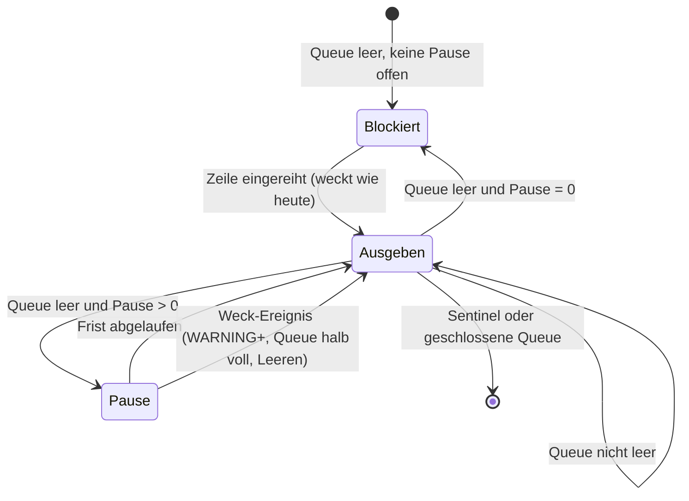

# Bündeln im Log-Listener - Plan

## Goal Capsule

- **Objective:** Ein swarmq-Worker mit kurzen Tasks schafft mehr Tasks pro Sekunde, obwohl er weiter jede Erfolgszeile ausgibt. Warnungen und Fehler erscheinen so schnell wie heute, und bei geordnetem Beenden geht keine Zeile mehr verloren als heute.
- **Means:** Der eingebaute Listener-Thread sammelt Zeilen unter WARNING eine kurze, einstellbare Pause lang und gibt sie dann gemeinsam aus, statt für jede Zeile einzeln aufzuwachen (KTD1, KTD2).
- **Product authority:** Entscheidungsregister `compound-packs/swarmq-entscheidungen/` > Qualitätsablauf-Plan `docs/plans/2026-10-24-1118-chore-qualitaetsablauf-plan.md` (R5, Beweisstandard Performance) > dieser Plan. AGENTS.md (TDD, Qualitäts-Gates, Testports) gilt durchgehend. Die Logging-Pläne `docs/plans/2026-10-06-0831-refactor-logging-haertung-plan.md` und 2026-10-06-1811 (Leeren mit Frist, Fork, Drop-Meldung) bleiben gültig. Dieser Plan ändert ihr Verhalten nur dort, wo R1–R9 es sagen.
- **Execution profile:** Umsetzung nur nach Georgs Ok, Unit für Unit im TDD-Zyklus aus AGENTS.md, immer nur ein roter Test.
  - Vor U1 läuft die vorhandene Messprobe mit 50 ms statt 100 ms auf dem Laptop. Gemessen war bisher nur 100 ms.
  - Abhängigkeiten: U2 setzt U1 voraus, U3 setzt U1 und U2 voraus, U5 misst nach U3.
  - U4 (Register, Marker, Doku, Changelog) kommt erst nach dem Ergebnis auf celsius oder nach Georgs Entscheidung gemäß Stop condition.
- **Stop conditions:**
  - Ein Schritt würde einen Test mit `entscheidung`-Marker ändern.
  - Die Messung auf der Referenzmaschine celsius (U5) zeigt weniger als 5 % Gewinn. Dann entscheidet Georg, ob die Änderung trotzdem kommt (Qualitätsablauf-Plan R5). Die Laptop-Messung ist nur ein Hinweis und löst diese Bedingung nicht aus.
  - Die Probe mit 50 ms vor U1 zeigt keinen gesicherten Gewinn. Dann entscheidet Georg über den Default, bevor Code entsteht.
  - Ein bestehender Logging-Test wird durch die Pause rot oder nur dadurch grün, dass er auf die Pause wartet oder sie abschaltet, obwohl er kein Bündeln prüft. Dann ist die Annahme unter Assumptions falsch, und der Plan muss überarbeitet werden.
- **Who finishes:** `ce-work` setzt U1–U4 um und führt die Laptop-Messung aus U5 durch. Die Messung auf celsius, Merge und Release entscheidet Georg.

---

## Product Contract

### Summary

Der Listener-Thread `swarmq-log-lsnr` gibt Zeilen unter WARNING künftig gebündelt aus, standardmäßig nach höchstens 50 ms. Mit 0 bleibt das heutige Verhalten. WARNING und höher, eine sich füllende Queue und jedes Leeren beim Beenden wecken ihn sofort. Die Pause wird eine neue Einstellung, und die Entscheidung kommt ins Register.

### Problem Frame

Eine Messung vom 26. und 27.10.2026 hat gezeigt, wohin bei kurzen Tasks der Durchsatz geht. Gemessen wurde io_bound mit 10-ms-Tasks auf dem Laptop. Die Rohdaten liegen im Scratchpad der Sitzung und werden in U5 ins Repo übernommen.

- **Was die Zeile kostet:** Die eine Zeile `task_succeeded` je Task kostet rund 13 % Durchsatz (36 Läufe, p < 0,001).
- **Woher die Kosten kommen:** Nicht vom Formatieren, das braucht 14 µs je Zeile. Der Listener-Thread wacht je Zeile auf und nimmt der Event-Loop den GIL. Der Haupt-Thread schläft dadurch je Task einmal zusätzlich, das sind etwa 0,2 ms Wandzeit je Task.
- **Was die Probe zeigt:** Ein Listener, der nach leerer Queue 100 ms wartet und dann gesammelt ausgibt, holte +6,0 % zurück (36 Läufe, p < 0,001), ohne dass eine Zeile fehlte.

Die Erfolgszeile verlangt der Logging-Plan 2026-10-06-0831 (R16). Abschalten können Betreiber sie schon heute mit `--logger-level swarmq.task=WARNING`. Dieser Plan holt einen Teil der Kosten zurück, ohne dass jemand auf die Zeile verzichten muss.

### Key Decisions

- **Bündeln statt Abschalten der Erfolgszeile.** Governs R1. (session-settled: user-directed — chosen over "task_succeeded standardmäßig auf DEBUG": R16 verlangt die Zeile, Abschalten bleibt die Wahl des Betreibers)
- **Standardmäßig an, mit 50 ms; 0 schaltet ab.** Governs R2, R3. (session-settled: user-approved — chosen over "nur auf Wunsch einschalten": Der Gewinn soll jeden Nutzer erreichen, 50 ms Verzögerung einer Logzeile ist für Menschen und Log-Sammler unerheblich)
- **WARNING und höher kommen sofort.** Governs R4. (session-settled: user-approved — chosen over "alle Level bündeln": Fehler dürfen nie verzögert erscheinen)
- **Ein Shutdown wartet nie auf die Pause.** Governs R6. (session-settled: user-approved — chosen over "Pause gilt auch beim Leeren": Die Drain-Frist darf durch das Bündeln nicht kürzer werden)
- **Die Listener des Datei-Modus bleiben, wie sie sind.** Governs R8. (session-settled: user-approved — chosen over "auch dictConfig-Listener bündeln": Dort gehört die Ausgabe der App, die ihr Verhalten selbst konfiguriert)
- **Die Opt-in-Queue bündelt nicht.** Aus demselben Grund wie beim Datei-Modus: Sie schreibt in die Handler der App. Gebündelt erschienen swarmq-Zeilen bis zu einer Pause nach später geloggten App-Zeilen. Governs R8.
- **Free-threaded Python ist kein Teil dieses Plans.** (session-settled: user-directed — chosen over "free-threaded Modus als Lösung": Er wirkt nur bei Nutzern, die 3.14t einsetzen, und kostet dort Einzelthread-Tempo)

### Requirements

**Verhalten**

- R1. Jede Logzeile, die heute ausgegeben wird, wird weiter ausgegeben, in derselben Reihenfolge und mit demselben Zeitstempel (`record.created`).
- R2. Eine Zeile unter WARNING, die in eine leere Queue kommt, erscheint spätestens eine Pause später, standardmäßig 50 ms. Liegen noch Zeilen vor ihr, kommt die Zeit für deren Ausgabe hinzu.
- R3. Bei einer Pause von 0 verhält sich der Listener wie heute: Er gibt jede Zeile aus, sobald sie eingereiht ist.
- R4. Eine Zeile mit WARNING oder höher beendet die Pause sofort. Sie und alle vor ihr eingereihten Zeilen werden ohne Wartezeit ausgegeben.
- R5. Erreicht die Queue 10 % ihrer Kapazität, endet die Pause sofort. Zusätzlich verworfen werden kann eine Zeile nur bei einem Schub, der die Queue um mehr als 80 % der Kapazität füllt, bevor der Listener drankommt. Bis zur Reserve ab 90 % bleiben also 80 % Puffer.

**Beenden, Fork und Zählung**

- R6. Jedes Leeren (`shutdown_logging`, `stop`, Leeren mit Frist) beendet eine laufende Pause sofort. Die Frist aus `log_drain_timeout` steht vollständig für das Ausgeben zur Verfügung. Bei hartem Abbruch ohne Leeren (SIGKILL, Segfault, OOM-Kill, `os._exit`) können bis zu einer Pause INFO- und DEBUG-Zeilen verloren gehen. Das ist eine bewusste Folge, die E-088 und die Doku nennen. WARNING und höher sind davon nicht betroffen (R4), und `--log-batch-delay 0` stellt das heutige Verhalten her.
- R7. Fork-Verhalten, Drop-Zählung, die Meldung `log_records_dropped`, die Reserve ab 90 % und das Aufgeben eines hängenden Ziels bleiben wie in den Logging-Plänen 2026-10-06-0831 und -1811 festgelegt. Ein Kind nach dem Fork übernimmt die eingestellte Pause.

**Geltungsbereich und Einstellung**

- R8. Das Bündeln gilt für den eingebauten Modus (`_configure_builtin`) im Worker und in den Compute-Kindern. Unverändert bleiben:
  - der Datei-Modus, also die Listener, die `logging_file.py` aus einer `log_config`-Datei startet;
  - die Opt-in-Queue am Logger `swarmq`, auch nach einer Übernahme durch die App.
- R9. Die Pause ist einstellbar wie die übrigen Logging-Einstellungen, mit derselben Rangfolge CLI > Env > SwarmQConfig > Default. Gültig sind endliche Werte von 0 bis 1 Sekunde. Alles andere ist ein Konfigurationsfehler mit Exit 78 (pack: swarmq-entscheidungen, e063-fristen-sind-endlich.md).

### Success Criteria

- Auf der Referenzmaschine celsius bringt die Änderung bei io_bound mit Erfolgszeile mindestens 5 % mehr Durchsatz. Gemessen wird abwechselnd, mindestens 10 Läufe je Seite, statistisch gesichert und mit einem Profil, das die Einsparung zeigt (Qualitätsablauf-Plan R5).
- Die Zahl der Zeilen im Messlauf ist mit und ohne Bündeln gleich.

### Scope Boundaries

- Free-threaded Python (3.14t), auch nicht als CI-Variante.
- Keine Änderung an `task_succeeded` oder an anderen Leveln. Das Abschalten bleibt bei `--logger-level`.
- Keine Änderung am Formatter. JSON statt `human` brachte in der Messung zusätzlich nichts.
- Prefetch und Pub/Sub für Ergebnisse gehören nicht in diesen Plan.

#### Deferred to Follow-Up Work

- Nach dem Bündeln bleibt etwa die Hälfte der Kosten. Laut den Gegenproben entfallen davon rund 2 Punkte auf den Logaufruf vor der Queue, auf das Formatieren nichts. Die übrigen rund 5 Punkte liegen im Pfad über Einreihen und Listener. Wo genau, braucht eine eigene Messung.

---

## Planning Contract

### Key Technical Decisions

- KTD1. **Warten auf ein Weck-Ereignis statt Schlafen.** Die Probe hat mit `time.sleep` gemessen. Ein Schlaf lässt sich aber weder durch eine Warnung noch durch ein Leeren unterbrechen, und genau das verlangen R4 und R6. Der Listener wartet deshalb nach leerer Queue mit Frist auf ein Ereignis je Listener (`threading.Event`). Wecken können es nur drei Stellen:
  1. das Einreihen einer Zeile ab WARNING (R4);
  2. das Einreihen, wenn die Queue 10 % ihrer Kapazität erreicht (R5);
  3. jedes Leeren (R6).

  Gewöhnliche Zeilen unter WARNING wecken nichts. So sinkt die Zahl der Aufwachvorgänge von einem je Zeile auf etwa einen je Pause.
- KTD2. **Die Pause beginnt erst, wenn die Queue leer ist.** Der Listener gibt aus, was in der Queue liegt, und wartet erst danach. Kommt während der Pause nichts, wartet er wie heute blockierend auf die nächste Zeile. Das hält R2 ein: Zwischen dem Einreihen einer Zeile und ihrer Ausgabe liegt höchstens eine Pause plus die Zeit für die Ausgabe davor.
- KTD3. **Die Pause wird in Sekunden angegeben wie `log_drain_timeout`.** Name `log_batch_delay`, CLI `--log-batch-delay SECONDS`, Env `SWARMQ_LOG_BATCH_DELAY`, Default 0.05, Bereich 0 bis 1. Einheit und Prüfung folgen dem Muster von `log_drain_timeout` in `src/swarmq/logging_settings.py` und `src/swarmq/config_validation.py`. Die Obergrenze 1 s hält R2 sinnvoll und die Wartezeit klein gegen die Drain-Frist von 5 s.
- KTD4. **Neues Modul `src/swarmq/logging_batch.py`.** `src/swarmq/logging_queue.py` hat 760 Zeilen, und der Architektur-Guard erlaubt 800 (`tests/unit/test_architecture_guards.py`). Das Warten und Wecken kommt daher in ein eigenes Modul ohne Import von `logging_queue`. `_SwarmqQueueListener.dequeue` und `_StructlogQueueHandler.enqueue` binden es an, so wie `logging_drain.py` heute die Fristen bereitstellt.
- KTD5. **Die Pause gehört zum Listener und wandert bei jedem Tausch mit.** `_swap_queue` baut beim Leeren und nach dem Fork einen neuen Listener aus `type(self.listener)(fresh, *handlers)`. Der neue Listener muss die Pause des alten übernehmen, sonst fiele er nach einem Shutdown-Tausch oder im Fork-Kind auf 0 zurück (R7).
- KTD6. **Wartezeit im Test einspeisen, nicht abwarten.** Tests prüfen das Warten über ein eingespeistes Warte-Objekt, das jeden Aufruf mit Frist protokolliert und von außen freigegeben wird. Sie warten nie echte 50 ms ab. Das hält die Regeln aus AGENTS.md ein: deterministisch, kein Schlafen, unter 100 ms.

### High-Level Technical Design

Ablauf im Listener-Thread und wer ihn weckt:

In der Pause wecken gewöhnliche Zeilen unter WARNING den Thread nicht. Sie liegen in der Queue, bis die Frist abläuft oder ein Weck-Ereignis kommt.

### Assumptions

- Kein bestehender Test hängt davon ab, dass eine INFO-Zeile ohne Leeren innerhalb von weniger als 50 ms erscheint. Unit-Tests lesen die Ausgabe nach `shutdown_logging`, Integrations- und e2e-Tests warten mit Fristen im Sekundenbereich. Stimmt das nicht, greift die Stop condition aus der Goal Capsule.

---

## Implementation Units

### U1. Einstellung `log_batch_delay`

- **Goal:** Die Pause ist über CLI, Env und SwarmQConfig einstellbar und wird geprüft (R9).
- **Requirements:** R9, KTD3.
- **Dependencies:** keine.
- **Files:**
  - `src/swarmq/logging_settings.py`
  - `src/swarmq/config.py`
  - `src/swarmq/config_validation.py`
  - `src/swarmq/cli/parser.py`
  - `src/swarmq/cli/check_cmd.py`
  - `src/swarmq/app.py`
  - `tests/unit/test_logging_settings.py`
  - `tests/unit/test_config.py`
  - `tests/unit/test_config_bounds.py`
  - `tests/unit/test_cli_parser.py`
  - `tests/unit/fixtures/cli_help/worker.txt`
  - `website/reference/agent/spec/` und `llms.txt` (neu erzeugt mit `python -m swarmq.agent_spec`)
- **Approach:**
  - Der Weg von `log_drain_timeout` dient als Vorlage, Feld für Feld: Dataclass-Feld, `sources.pick`, Env-Tabelle in `config.py`, `config_validation`, CLI-Argument, Durchreichen in `app.py`.
  - Die Grenzprüfung verwendet dieselben Helfer wie die übrigen Fristfelder (E-063).
  - Die Agent-Spec wird in derselben Unit neu erzeugt. Sonst bleibt `tests/unit/test_agent_spec.py::test_committed_spec_files_match_generators` ab dem neuen Feld rot.
- **Patterns to follow:** `drain_timeout` in `src/swarmq/logging_settings.py`, `log_drain_timeout` in `src/swarmq/config.py` und `src/swarmq/config_validation.py`.
- **Test scenarios:**
  - Ohne Angabe ist die Pause 0.05.
  - `--log-batch-delay 0.2` schlägt `SWARMQ_LOG_BATCH_DELAY=0.1`, und dieses schlägt `log_batch_delay=0.3` aus SwarmQConfig.
  - `0` ist gültig und ergibt 0.
  - `1` ist gültig, `1.0001` ist ein Konfigurationsfehler, der das Feld nennt.
  - `-0.01`, `inf`, `nan` und `abc` sind Konfigurationsfehler mit Exit 78 (E-063).
  - Die Hilfe von `swarmq worker` nennt `--log-batch-delay` (Fixture `worker.txt`).
- **Verification:**
  - Die Pause kommt aufgelöst in `LoggingSettings` an und ist bei falschen Werten ein Konfigurationsfehler wie bei `log_drain_timeout`.
  - `test_committed_spec_files_match_generators` ist grün.

### U2. Bündeln im Listener

- **Goal:** Ein Listener mit Pause > 0 gibt Zeilen unter WARNING gebündelt aus und wird nur von den drei Ereignissen aus KTD1 geweckt (R1–R6).
- **Requirements:** R1–R6, KTD1, KTD2, KTD4, KTD6.
- **Dependencies:** U1, nur für den Default-Wert.
- **Files:**
  - `src/swarmq/logging_batch.py` (neu)
  - `src/swarmq/logging_queue.py`
  - `tests/unit/test_logging_batch.py` (neu)
  - `tests/unit/test_logging_drain.py`
  - `tests/integration/test_logging_robustness.py`
  - `tests/kosten/basislinie.toml` (neu gemessen, nicht von Hand)
- **Approach:**
  1. `logging_batch.py` hält das Weck-Ereignis und die Warte-Logik für einen Listener. Es importiert `logging_queue` nicht (KTD4).
  2. `_SwarmqQueueListener.dequeue` wartet bei leerer Queue und Pause > 0 auf das Ereignis mit Frist und fällt danach in den heutigen blockierenden Abruf zurück (KTD2).
  3. `_StructlogQueueHandler.enqueue` weckt nach dem Einreihen bei `levelno >= WARNING` oder bei einem Füllstand ab 10 % der Kapazität. Den Füllstand liest es so billig wie `_in_reserve`, ohne das Mutex von `qsize`.
  4. `stop`, `enqueue_sentinel` und `_close` wecken vor dem Schließen bzw. nach dem Sentinel (R6).
- **Execution note:** Test-first. Das Warten wird über das eingespeiste Warte-Objekt geprüft (KTD6), nie über echte Wartezeiten.
- **Patterns to follow:** `src/swarmq/logging_drain.py` (eigenes Modul ohne Rückimport), `_in_reserve` in `src/swarmq/logging_queue.py` (billiger Füllstand).
- **Test scenarios:**
  - Bei Pause 0 wartet der Listener nie mit Frist, und jede Zeile geht sofort an den Handler (R3).
  - Bei Pause 0.05 und einer INFO-Zeile wartet der Listener nach dem Ausgeben einmal mit Frist 0.05. Weitere INFO-Zeilen während des Wartens setzen das Ereignis nicht.
  - Nach dem Ende der Frist werden alle in der Pause eingereihten INFO-Zeilen in Reihenfolge ausgegeben (R1).
  - Eine WARNING-Zeile während der Pause setzt das Ereignis. Die INFO-Zeilen davor und die WARNING-Zeile werden ohne weiteres Warten ausgegeben (R4).
  - Eine Queue mit Kapazität 100 weckt beim zehnten Eintrag, nicht beim neunten (R5).
  - `shutdown_logging` während einer Pause beendet sie sofort. Alle Zeilen sind ausgegeben, und die Drain-Frist wurde nicht um die Pause verkürzt (R6).
  - `stop()` während einer Pause kehrt zurück, ohne die Frist abzuwarten (R6).
  - Eine Queue, die per `Queue.shutdown` geschlossen wird, während der Listener wartet, beendet den Thread nach dem Leeren wie heute.
  - Die Reserve ab 90 % verwirft INFO-Zeilen weiter wie heute (R7).
  - Integrationstest in `tests/integration/test_logging_robustness.py`: Ein Schub von INFO-Zeilen in eine kleine Queue (Kapazität 100) ergibt mit Pause 0.05 dieselbe Drop-Zahl wie mit Pause 0, solange der Schub unter 80 % der Kapazität bleibt (R5).
- **Verification:**
  - Die neuen Tests sind grün.
  - Die bestehenden Tests in `tests/unit/test_logging_queue.py`, `tests/unit/test_logging_drain.py` und `tests/integration/test_logging_robustness.py` laufen unverändert grün.
  - `uv run just kosten` meldet genau zwei Abweichungen: `import_swarmq_cli` und `worker_start` zählen je ein Modul mehr, weil `logging_queue` das neue `logging_batch.py` importiert. `import_swarmq` bleibt gleich, denn `import swarmq` lädt `logging_queue` nicht.
  - Die Basislinie wird mit `uv run just kosten-basislinie` und einem Grund mit Verweis auf diesen Plan (KTD4) neu geschrieben. Jede andere Abweichung ist ein Fehler.

### U3. Anbindung in allen eigenen Listenern

- **Goal:** Der eingebaute Modus im Worker, in den Compute-Kindern und im Fork-Kind arbeitet mit der eingestellten Pause. Datei-Modus und Opt-in-Queue bündeln nicht (R7, R8).
- **Requirements:** R7, R8, KTD5.
- **Dependencies:** U1, U2.
- **Files:**
  - `src/swarmq/logging.py`
  - `src/swarmq/logging_queue.py`
  - `src/swarmq/worker/compute/envelope.py`
  - `src/swarmq/worker/compute/child.py`
  - `src/swarmq/worker/compute/executor.py`
  - `tests/unit/test_logging_configure.py`
  - `tests/unit/test_logging_optin.py`
  - `tests/unit/test_logging_fork.py`
  - `tests/unit/worker/compute/test_envelope.py`
  - `tests/unit/worker/compute/test_executor.py`
  - `tests/integration/test_compute_child_logging.py`
- **Approach:**
  1. `_configure_builtin` gibt die Pause an Handler und Listener.
  2. `_install_log_queue` (Opt-in und Übernahme durch die App) baut den Listener mit Pause 0 (R8).
  3. `_swap_queue` übernimmt die Pause in den neuen Listener (KTD5).
  4. Das Compute-Envelope trägt die Pause wie `log_queue_size`.
  5. `logging_file.py` wird nicht geändert (R8).
- **Patterns to follow:** Weitergabe von `queue_size` vom Supervisor bis in `child.py`.
- **Test scenarios:**
  - Nach `configure_logging` mit `batch_delay=0.2` hat der Listener des Root-Handlers die Pause 0.2.
  - Die Opt-in-Queue am Logger `swarmq` hat die Pause 0, auch wenn die Einstellung 0.2 lautet.
  - Nach der Übernahme durch die App (`react_to_app_logging`) hat die neu aufgebaute Opt-in-Queue ebenfalls die Pause 0.
  - Nach `shutdown_logging` hat der frische Listener, der durch den Tausch entsteht, dieselbe Pause (KTD5).
  - Im Kind nach `os.fork` hat der zurückgesetzte Listener dieselbe Pause wie im Elternprozess (R7).
  - Das Compute-Envelope reicht die Pause unverändert ins Kind, und das Kind richtet sein Logging damit ein.
  - Ein dictConfig-Listener aus `log_config` wird weder mit Pause gebaut noch beim Einreihen geweckt (R8).
- **Verification:** Jeder eigene Listener eines Worker-Prozesses und seiner Kinder hat die eingestellte Pause, und dictConfig-Listener sind unverändert.

### U4. Entscheidung, Doku und Changelog

- **Goal:** Das Bündeln ist als Regel festgehalten, durch Tests festgeschrieben und für Nutzer beschrieben.
- **Requirements:** R2, R4, R6, R8, R9.
- **Dependencies:** U3 und U5. U4 beginnt erst nach dem Ergebnis auf celsius oder nach Georgs Entscheidung gemäß Stop condition.
- **Files:**
  - `compound-packs/swarmq-entscheidungen/e088-log-listener-buendelt.md` (neu)
  - `tests/unit/test_logging_batch.py`
  - `website/reference/logging.md`, `website/reference/logging.de.md`
  - `website/reference/configuration.md`, `website/reference/configuration.de.md`
  - `website/reference/cli.md`, `website/reference/cli.de.md`
  - `website/reference/changelog.md`, `website/reference/changelog.de.md`
- **Approach:**
  1. Die Regel E-088 nennt:
     - die Pause und den Default 50 ms;
     - das sofortige Wecken bei WARNING, bei 10 % Füllstand und beim Leeren;
     - den Ausschluss von Datei-Modus und Opt-in-Queue;
     - den möglichen Verlust bis zu einer Pause bei hartem Abbruch.

     Die Tests aus U2 zu R2, R4 und R6 bekommen `@pytest.mark.entscheidung("E-088")`.
  2. Die Doku nennt die Verzögerung und den Verlust bei hartem Abbruch als bewusste Folgen. Als Weg zum heutigen Verhalten nennt sie `--log-batch-delay 0`.
  3. Der Changelog führt die Änderung unter Performance mit dem gemessenen Gewinn aus U5.
- **Patterns to follow:** Format laut `compound-packs/swarmq-entscheidungen/README.md`, Eintrag für `log_drain_timeout` in `website/reference/configuration.md`.
- **Test expectation:** Der Register-Guard `tests/unit/test_entscheidungsregister.py` ist grün, also stimmen Regel und Marker in beiden Richtungen überein. Sonst keine neuen Tests.
- **Verification:**
  - Der Register-Guard ist grün.
  - Englische und deutsche Doku nennen dieselben Werte.
  - Eine Doku-Prüfung in der CI gibt es nicht, deshalb wird das im Review abgeglichen.

### U5. Messnachweis

- **Goal:** Der Gewinn ist nach dem Beweisstandard des Qualitätsablaufs belegt (Success Criteria).
- **Requirements:** Success Criteria, R1.
- **Dependencies:** U3.
- **Files:**
  - `docs/befunde/log-listener-buendeln-messung-2026-10.md` (neu)
  - `docs/befunde/log-listener-buendeln-rohdaten-2026-10.csv` (neu, Rohdaten aus der Sitzung und aus U5, vom Befund zitiert)
  - `benchmarks/comparison/` nur lesend; Messhülle und Auswertung liegen außerhalb des Repos oder werden im Befund beschrieben
- **Approach:**
  1. Auf dem Laptop im Vergleichsaufbau (`docker compose -p vergleich`) abwechselnd messen: `--log-batch-delay 0` gegen den Default, io_bound, mindestens 10 Läufe je Seite. Auswertung mit Median, Hodges-Lehmann-Verschiebung und Mann-Whitney. Dazu die Kontextwechsel je Task aus `/proc/<pid>/task/*/status` als Profil der Einsparung.
  2. Dieselbe Reihe auf celsius, nur in Containern und nach Georgs Ok (Lastserver-Regeln: ECC vor und nach dem Lauf prüfen, Images danach entfernen).
  3. Die Zahl der `task_succeeded`-Zeilen je Lauf mit und ohne Bündeln vergleichen (R1).
- **Execution note:** Keine Messung, während eine GitLab-Pipeline auf dem lokalen Runner läuft.
- **Test expectation:** none -- Messung, kein Produktionscode.
- **Verification:** Der Befund nennt Gewinn, p-Wert, Läufe und Maschine. Auf celsius beträgt der Gewinn mindestens 5 %, sonst greift die Stop condition.

---

## Verification Contract

| Prüfung | Befehl | Wann |
|---|---|---|
| Einzelner roter Test | `uv run --extra test pytest tests/unit/<datei>.py::<test> -x` | jeder RED-Schritt |
| Alle Tests | `uv run just all` (Testports 5699/6399, Sperre) | jeder GREEN- und REFACTOR-Schritt; vorher `pgrep pytest` prüfen |
| Kostensuite | `uv run just kosten`; Basislinie nur per `uv run just kosten-basislinie "<Grund>"` | nach U2 |
| Format und Lint | `uv run just lint` | vor jedem Commit |
| Typen | `uv run just types` | vor jedem Commit |
| Coverage | diff-cover 100 % auf neue und geänderte Zeilen (CI) | im MR |
| Langsame Tests | `slow-unit-tests.json` nach `uv run just unit` ohne neue Einträge aus `test_logging_batch.py` | nach U2 |
| Messnachweis | Reihe aus U5, Laptop und celsius | nach U3 |

## Definition of Done

- U1–U4 umgesetzt, `uv run just all`, `lint` und `types` grün, keine Warnung als Fehler.
- E-088 im Register, Marker an den festschreibenden Tests, Guard grün.
- Doku und Changelog beschreiben die Pause, den Default und `0` als Rückweg.
- Messbefund aus U5 liegt vor. Der Gewinn auf celsius beträgt mindestens 5 %, oder Georg hat nach der Stop condition entschieden.
- Kein Code aus der Messprobe (`sitecustomize`, `time.sleep`-Variante) im Diff.
- Kein Test mit `entscheidung`-Marker geändert.

---

## Sources & Research

- Messreihen vom 26. und 27.10.2026 (Laptop, io_bound, Python 3.14.4 mit uvloop):
  - Logzeile: Basis 614 Tasks/s, ohne Zeile +12,9 %, Bündeln mit 100 ms +6,0 %, je 36 Läufe.
  - Gegenproben: Verwerfen vor der Queue +10,7 %, Formatieren ohne Schreiben ±0, JSON ±0.
  - Kontextwechsel des Haupt-Threads je Task: 2,3–2,7 heute gegen 1,1–1,6 ohne Einreihen.
- Listener und Queue: `src/swarmq/logging_queue.py` (`_SwarmqQueueListener`, `_StructlogQueueHandler`, `_swap_queue`, `_close`, `_after_fork_in_child`).
- Leeren mit Frist: `src/swarmq/logging_drain.py`, `_drain` in `src/swarmq/logging_queue.py`.
- Datei-Modus: `src/swarmq/logging_file.py` (`ListenerReports`, `start_queue_listeners`), bleibt unverändert.
- Stdlib-Schleife: `logging.handlers.QueueListener._monitor` ruft `dequeue(True)` je Eintrag auf. Hier setzt KTD2 an.
- Beweisstandard Performance: `docs/plans/2026-10-24-1118-chore-qualitaetsablauf-plan.md` (R5, Key Decision "mindestens 5 % gesicherter Gewinn").
- Endliche Fristen: (pack: swarmq-entscheidungen, e063-fristen-sind-endlich.md).
