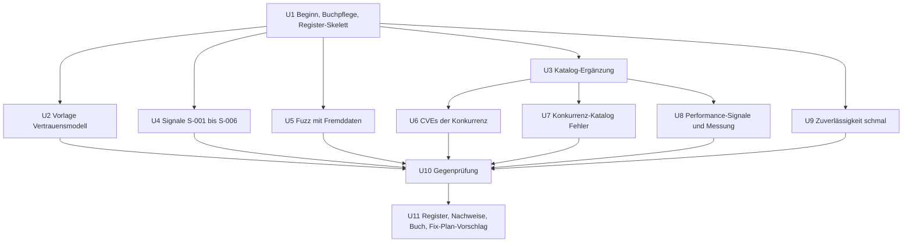

# Fehlersuche Runde 5 - Plan

## Goal Capsule

- **Objective:** Nach Runde 5 weiß Georg, wo swarmq in Angriffssicherheit und Performance steht und welche Fehler der Konkurrenz auch swarmq treffen. Jeder Befund ist gegengeprüft und belegt, jede offene Frage ist als Produktfrage mit Empfehlung formuliert, und ein Fix-Plan kann direkt darauf aufsetzen. Das Sättigungsbuch zeigt danach für alle vier Säulen belegte Läufe statt leerer Spalten.
- **Means:** Die erste tiefe Runde nach dem dauerhaften Qualitätsablauf, mit Schwerpunkt auf Methoden, die noch nie gelaufen sind (KD1), begonnen mit `just audit` und `just saettigung` (R1).
- **Authority:** Entscheidungsregister `compound-packs/swarmq-entscheidungen/` > `docs/befunde/README.md` > `docs/plans/2026-10-24-1118-chore-qualitaetsablauf-plan.md` > dieser Plan > Rechercheberichte. AGENTS.md (TDD, Qualitäts-Gates, Testports, Entscheidungen respektieren) gilt durchgehend.
- **Execution profile:** Analyse-Runde. Es entstehen Fuzz-Ziele, Nachweis-Tests mit `befund`-Marker und `xfail(strict=True)`, Rechercheberichte, das Register und Einträge im Sättigungsbuch. Produktionscode unter `src/swarmq/` ändert die Runde nicht (KD3). Start am 2026-11-04 (KD2).
- **Stop conditions:**
  - Ein Nachweis-Test ließe sich nur schreiben, wenn ein Test mit `@pytest.mark.entscheidung` geändert oder gelöscht würde: Verdacht als ENTSCHEIDUNG führen, nicht weiter verfolgen.
  - Eine Einheit bräuchte eine Änderung unter `src/swarmq/` auf dem Runden-Branch: stoppen und Georg fragen. Ausnahme sind Prototypen für A/B-Messungen auf Wegwerf-Branches (KTD7).
  - Auf celsius läuft ein `runner-*`-Container, eine Pipeline oder ein anderer Wertungslauf: warten, nicht parallel messen.
  - `just audit` findet eine Lücke mit Verdacht auf einen erreichbaren Pfad: dieses Signal sofort nach KTD10 des Qualitätsablaufs untersuchen und Georg direkt melden, die Runde läuft danach weiter.
  - Die Sichtung eines Konkurrenz-Trackers überschreitet die Obergrenze aus KTD4: auf die Obergrenze kürzen und im Bericht nennen, nicht ausweiten.
- **Tail ownership:** Die Runde committet auf ihrem Branch. Push, MR und Merge nur mit Georgs Ok. Fixes laufen über einen eigenen Fix-Plan nach Georgs Ok (R18 des Qualitätsablaufs). PyPI ist nicht betroffen.

---

## Product Contract

### Summary

Runde 5 untersucht swarmq über alle vier Säulen, gewichtet nach dem Sättigungsbuch. Angriffssicherheit beginnt bei den sechs offenen Signalen und prüft dann Eingaben von außen mit Fuzzing sowie die CVEs der Konkurrenz. Die Säule Fehler prüft bekannte Fehler aus den Trackern von Celery, Dramatiq, arq und taskiq gegen swarmq. Performance holt Signale aus denselben Trackern und aus der Vergleichsmethodik und misst nur dort, wo ein Signal einen Gewinn von mindestens 5 % erwarten lässt. Zuverlässigkeit läuft schmal über die seit 0.15.0 geänderten Module. Vorweg legt eine Entscheidungsvorlage Georg die Frage vor, wem swarmq vertraut, weil ohne diese Antwort Funde zur Angriffssicherheit nicht als FEHLER eingestuft werden können.

### Problem Frame

Der Qualitätsablauf ist seit 2026-10-25 beschlossen, eine tiefe Runde danach gab es noch nicht. `just saettigung` zeigt am 2026-10-28 (Stand `43c878d2`): Angriffssicherheit und Performance haben 171 von 171 Kombinationen offen, Fehler 339 von 342, Zuverlässigkeit 169 von 171. Bisher gab es Läufe nur für Mutation, Fuzzing auf Header und Konfiguration, zwei Betriebsabläufe und ein einziges Sicherheitssignal (L-017, F4-29). Die sechs Signale S-001 bis S-006 (begründete `noqa: S` in `src`) sind seit 2026-10-24 offen, S-008 seit 2026-10-28.

Zwei Lücken im Ablauf selbst verhindern eine saubere Runde. Erstens gibt es kein Vertrauensmodell: E-074 sagt ausdrücklich, ein Vertrauensmodell für Nutzdaten sei nicht dokumentiert (pack: swarmq-entscheidungen, e074-reservierte-lock-namen.md). Ein Verdacht zur Angriffssicherheit hat deshalb meist keine Quelle der Erwartung und würde LÜCKE statt FEHLER. Zweitens verlangt das Sättigungsbuch für jeden Lauf genau ein Modul, die Konkurrenz-Methoden M-F-06, M-A-03 und M-P-03 sichten aber Issues und CVEs, nicht ein swarmq-Modul; ohne Regel würde ein Lauf ohne Befund ein beliebiges Modul fälschlich sättigen. M-P-03 hat außerdem keine eigenen Suchwörter.

### Requirements

**Beginn und Auswahl**

- R1. Die Runde beginnt mit `uv run just audit` und `uv run just saettigung`; jeder Audit-Treffer kommt als offenes Signal ins Buch, und die Auswahl der Kombinationen aus Methode und Modul wird mit dem Stand des Buchs begründet.
- R2. Vor den Methoden ist das Buch auf dem Stand des Codes: verschobene Fundstellen der Signale sind nachgezogen, und die bekannten Performance-Kostenstellen aus `benchmarks/comparison/METHODIK.md` stehen als Signale darin.

**Angriffssicherheit**

- R3. Georg bekommt eine Entscheidungsvorlage zum Vertrauensmodell: wer Nachrichten publiziert, wer in Valkey schreibt, wer Konfiguration und CLI bedient, und was der CPU-Pool seinem Kindprozess glaubt.
- R4. Jedes offene Signal der Säule (S-001 bis S-006) ist über einen erreichbaren Pfad nachgewiesen oder mit Grund verworfen (M-A-01).
- R5. Eingaben von außen ohne eigenes Fuzz-Ziel werden mit Fremddaten gefuzzt: eingehende Nachrichten durch die Worker-Pipeline, aus Valkey gelesene Daten und der HTTP-Parser von Metrics und Health (M-A-02).
- R6. Die bekannten CVEs von Celery, Dramatiq, arq, taskiq und taskiq-aio-pika sind gesichtet; jede anwendbare wird ein Signal (M-A-03).

**Fehler und Zuverlässigkeit**

- R7. Bekannte Fehler aus den Trackern der Konkurrenz werden als Prüffälle gegen swarmq gestellt, jedes gesichtete Issue als anwendbar oder nicht anwendbar festgehalten (M-F-06).
- R8. Die seit 0.15.0 geänderten Module werden mit Blick auf Zustellgarantien und Wiederherstellung gelesen (M-Z-01).
- R9. S-008 geht als Produktfrage mit Optionen und Empfehlung ins Register.

**Performance**

- R10. Performance-Probleme aus den Trackern der Konkurrenz werden gesichtet; jedes anwendbare wird ein Signal (M-P-03).
- R11. Gemessen wird nur ab einem Signal, das einen Gewinn von mindestens 5 % erwarten lässt und keine Garantie oder Entscheidung schwächt; der Beweis folgt R5 des Qualitätsablaufs (M-P-01).

**Ergebnis**

- R12. Jeder Verdacht durchläuft die Gegenprüfung nach `docs/befunde/README.md` und bekommt genau eine Einstufung mit zitierter Quelle.
- R13. Jeder FEHLER hat einen Nachweis-Test, der mit `--runxfail` an der fachlichen Assertion rot wird; ein Befund zur Angriffssicherheit löst die Schwachstelle über einen erreichbaren Pfad aus.
- R14. Jede LÜCKE ist als Produktfrage mit Optionen und Empfehlung formuliert, jede VERBESSERUNG mit Messergebnis eingetragen, und ein Vorschlag für den Fix-Plan liegt vor.
- R15. Jeder Lauf steht mit Commit, Prüfumfang und Befund-IDs im Sättigungsbuch, und der Wächter `tests/unit/test_saettigungsbuch.py` ist grün.

### Key Decisions

- KD1. **Schwerpunkt auf nie gelaufenen Methoden.** Die Runde fährt M-A-01, M-A-02, M-A-03, M-F-06 und M-P-03 statt die Mutation und Zustandsmodelle der Runden 2 bis 4 zu wiederholen; Zuverlässigkeit läuft nur schmal. Governs R4–R8, R10. (session-settled: user-approved — chosen over volle Breite über alle Methoden: die Säulen Angriffssicherheit und Performance sind völlig offen, Fehler und Zuverlässigkeit breit abgedeckt)
- KD2. **Start am 2026-11-04.** Gezählt ab dem Ende von Runde 4 am 2026-10-21 im 14-Tage-Takt. Governs R1. (session-settled: user-approved — chosen over Start direkt nach dem Plan-Review: der Takt aus `docs/befunde/README.md` gilt)
- KD3. **Die Runde sucht und belegt, sie fixt nicht.** Fixes nur nach Georgs Ok über einen eigenen Fix-Plan. Governs R12–R14. (Qualitätsablauf, Key Decision „Runden suchen und belegen, fixen erst nach Ok“)
- KD4. **S-008 entscheidet Georg.** Die Runde formuliert die Frage, sie entscheidet sie nicht. Governs R9. (session-settled: user-approved — chosen over Behebung in der Runde: Ergebnisformat ist eine Produktentscheidung)
- KD5. **Performance misst nur ab Signal.** Ohne Signal wird nicht auf Verdacht optimiert. Governs R10, R11. (session-settled: user-approved — chosen over eine breite Messreihe: R15 des Qualitätsablaufs)

### Scope Boundaries

- Keine Änderung an Produktionscode auf dem Runden-Branch, auch nicht für einen offensichtlichen Fehler.
- Keine Mutation, keine neuen Zustandsmodelle, keine Loadsuite-Störungsläufe; diese Methoden sind breit gelaufen, `lastserver` hat zudem defekten RAM.
- Kein Bedrohungsmodell ohne Georg: die Runde legt die Vorlage vor, Georg entscheidet, erst dann wird die Regel ins Register geschrieben.
- Keine Cross-Model-Prüfer; Gegenprüfung nur durch Agenten auf dem Sitzungsmodell.
- Nicht gebaut: eine Säulen-Spalte im Sättigungsbuch-Schema. Die Säule folgt aus der Methode (`saeule_der_methode` in `scripts/saettigung.py`), eine Spalte wäre doppelt.
- Nicht gebaut: ein eigenes Register je Säule. F4-29 hat gezeigt, dass ein Rundenregister mit Abschnitt je Säule reicht; ein zweites Register würde nur die Wächter-Regel verdoppeln.

#### Deferred to Follow-Up Work

- Lernnotizen per `/ce-compound` zu Messpraxis auf celsius (Governor, Runner-Pause) und zu Fuzz-Determinismus; dazu gibt es heute keine Notiz unter `docs/solutions/`.
- Mutations-Rezepte im `justfile` zeigen standardmäßig auf `lastserver`; Umstellung auf celsius gehört in eine eigene Änderung.
- Der Fuzz über den ganzen Stack (`tests/fuzz/test_external_publish_fuzz.py`) läuft nur mit 20 Beispielen und Docker; eine Ausweitung gehört nicht in diese Runde.

### Dependencies

- celsius erreichbar über `docker --context celsius`, Governor `performance` (dauerhaft per `cpu-governor-performance.service`), ECC-Zähler lesbar.
- `gh` für die Tracker-Sichtung (GitHub-Issues von Celery, Dramatiq, arq, taskiq, taskiq-aio-pika) und Netzzugang zu `api.osv.dev`.
- Testports 5699/6399 und die gemeinsame Testsperre für jeden Integrations- oder e2e-Lauf.

### Open Questions

**Blockierend für die Einstufung in der Säule Angriffssicherheit (nicht für den Start der Runde)**

- Das Vertrauensmodell aus R3. U2 legt die Vorlage vor. Bis Georg antwortet, laufen U4 bis U6 weiter; ihre Verdachte warten in U10 auf die Antwort und werden danach eingestuft. Antwortet Georg bis zum Ende der Gegenprüfung nicht, gehen die betroffenen Verdachte als LÜCKE mit Verweis auf die Vorlage ins Register.

### Sources

- `docs/plans/2026-10-24-1118-chore-qualitaetsablauf-plan.md` (R1–R22, KTD1–KTD13), `docs/befunde/README.md` Abschnitt „Dauerhafter Qualitätsablauf“.
- `docs/befunde/methodenkatalog.md`, `docs/befunde/saettigungsbuch.toml`, `scripts/saettigung.py`, `tests/unit/_saettigungsbuch.py`.
- Vorbild: `docs/plans/2026-10-17-0941-test-fehlersuche-runde-4-plan.md`, Register `docs/befunde/fehlersuche-runde-4-2026-10.md`, Ablage `docs/befunde/fehlersuche-runde-4-recherche/`.
- Messvorlage: `docs/befunde/log-listener-buendeln-messung-2026-10.md`, `benchmarks/comparison/METHODIK.md`.

---

## Planning Contract

### Key Technical Decisions

- KTD1. **Ein Rundenregister mit Abschnitt je Säule.** Register `docs/befunde/fehlersuche-runde-5-2026-11.md`, Befund-IDs `F5-nn` für FEHLER, LÜCKE und VERBESSERUNG, Produktfragen `PF5-nn`. Der Wächter liest IDs aus der ersten Tabellenspalte jeder `.md` direkt unter `docs/befunde/`; deshalb braucht jede im Buch genannte ID eine Registerzeile, auch NICHT HALTBAR und ENTSCHEIDUNG. Vorbild ist F4-29 im Register von Runde 4.
- KTD2. **Verdachts-Präfixe je Spur, Prüfer gekreuzt.** `R5A` Angriffssicherheit (U4–U6), `R5K` Konkurrenz-Katalog Fehler (U7), `R5P` Performance (U8), `R5Z` Zuverlässigkeit (U9). Wer eine Spur bearbeitet hat, prüft eine andere (Muster KTD9 aus Runde 4).
- KTD3. **Modulzuordnung für Konkurrenz-Methoden.** Ein Lauf von M-F-06, M-A-03 oder M-P-03 wird je swarmq-Modul gebucht, dessen Gegenstück geprüft wurde. Der Umfang je Modul ist die Zahl der Issues oder CVEs, die auf dieses Modul abgebildet wurden, einschließlich der nicht anwendbaren. Ein Issue ohne Gegenstück in swarmq zählt nur im Bericht, nicht im Buch. Die Regel kommt als Absatz in `docs/befunde/methodenkatalog.md`, damit sie über die Runde hinaus gilt.
- KTD4. **Sichtungsfenster der Tracker.** Runde 5 sichtet Issues, die zwischen 2024-11-01 und 2026-10-31 eröffnet wurden, mit den Labels und Suchwörtern aus dem Katalog; höchstens 150 je Tracker, die neuesten zuerst. Als dauerhafte Regel kommt in den Katalog: Ein späterer Lauf derselben Methode sichtet nur Issues, die nach dem Fensterende des vorigen Laufs eröffnet wurden, und nennt sein Fenster im Kommentar des Buchs; sonst würde ein zweiter Lauf über dieselben Issues die Kombination ohne neue Belege sättigen. Für M-P-03 gelten die Suchwörter performance, slow, memory, leak, throughput, prefetch, latency, CPU; sie kommen mit KTD3 in den Katalog.
- KTD5. **Abgrenzung M-A-02 gegen M-F-05.** M-A-02 zählt nur Fuzz-Ziele, deren Eingang von außen kommt und deren Orakel eine Angriffsfolge prüft: Absturz des Workers, unbegrenzter Speicher oder Zeit, Annahme einer Nachricht, die eine Entscheidung ablehnt. Die bestehenden Header- und Konfigurations-Fuzzer bleiben M-F-05.
- KTD6. **Fuzz-Orakel aus dem Entscheidungsregister.** Header nach E-051 und E-054, Unbekannte Tasks nach E-008, Lock-Namen nach E-074, Ergebnisse nach den `_UNPACK_LIMITS` in `src/swarmq/serialization.py`. Ein Treffer, der einer Regel entspricht, ist kein Verdacht. Tiefe Läufe fahren das zufällige Hypothesis-Profil mit gemeldetem Seed, die Suite das Profil `ci`.
- KTD7. **Performance-Prototypen nur auf Wegwerf-Branches.** Eine Variante B für die A/B-Messung entsteht auf einem lokalen Branch neben dem Runden-Branch, wird mit `scripts/vergleich-entfernt.sh … ab` auf celsius gemessen und nie gemergt. Ins Register kommt das Messergebnis als VERBESSERUNG; der Code der Variante wird im Fix-Plan neu und test-first geschrieben.
- KTD8. **Agenten schreiben nur neue Dateien, der Orchestrator committet.** Agentenregeln wie in Runde 4: keine Commits, Integrations- und e2e-Tests nur über die just-Rezepte, vor e2e `pgrep pytest` und Rabbit-Alarme prüfen, celsius nur nach Prüfung auf `runner-*`-Container.

### Sequencing

U4, U5, U7 und U9 brauchen keinen Server und laufen parallel. U8 misst auf celsius seriell und nur ohne laufende Runner.

### Risks

| Risiko | Folge | Gegenmaßnahme |
|---|---|---|
| Georg beantwortet die Vorlage nicht rechtzeitig | Sicherheitsverdachte bleiben uneingestuft | Open Questions: Einstufung als LÜCKE mit Verweis auf die Vorlage |
| Tracker liefern sehr viele Issues | Runde ufert aus | KTD4: Fenster und Obergrenze je Tracker |
| Konkurrenz-Issues wirken anwendbar, sind aber entschieden | Falsche FEHLER | Gegenprüfung gegen E-008, E-019, E-023, E-026, E-030, E-046, E-047, E-077 zuerst |
| A/B-Messung verrauscht | Scheinbare Gewinne | R5 des Qualitätsablaufs: ≥10 Paare, Mann-Whitney, Hodges-Lehmann, Profil je Seite, Schwelle vor dem Lauf festlegen |
| Neue Fuzz-Ziele sind langsam oder nicht deterministisch | Suite wird flakig | KTD6: Profil `ci` mit `derandomize` in der Suite, tiefe Läufe nur in der Runde |

---

## Implementation Units

### U1. Beginn, Buchpflege, Register-Skelett

- **Goal:** Die Runde auf dem Stand des Codes beginnen und ihre Auswahl begründen.
- **Requirements:** R1, R2, R15; KTD1, KTD2, KTD8.
- **Dependencies:** –
- **Files:** `docs/befunde/fehlersuche-runde-5-2026-11.md` (Skelett), `docs/befunde/fehlersuche-runde-5-recherche/README.md`, `docs/befunde/fehlersuche-runde-5-recherche/0-auswahl.md`, `docs/befunde/saettigungsbuch.toml`.
- **Approach:**
  1. Worktree und Branch von `main` anlegen.
  2. `just audit`; jeder Treffer wird ein Signal (Stop condition bei erreichbarem Pfad).
  3. Fundstellen von S-002 und S-006 nachziehen; die zwei Kostenstellen aus `benchmarks/comparison/METHODIK.md` (sechs serielle Aufrufe je Task in `io_bound`, Confirm der Quorum-Queue in `noop`) als Signale der Säule Performance eintragen.
  4. `just saettigung` und in `0-auswahl.md` begründen, welche Kombinationen die Runde wählt und warum.
  5. Register-Skelett nach dem Format von Runde 4 mit Abschnitten je Säule, Präfixen aus KTD2 und leerer Nachweis-Tabelle.
- **Patterns to follow:** `docs/befunde/fehlersuche-runde-4-2026-10.md`, `docs/befunde/fehlersuche-runde-4-recherche/README.md`.
- **Test scenarios:** Test expectation: none -- Vorbereitung und Buchpflege; der Wächter prüft das Buch.
- **Verification:** Der Wächter `tests/unit/test_saettigungsbuch.py` ist grün, `0-auswahl.md` nennt jede gewählte Kombination mit ihrem Stand im Buch.

### U2. Entscheidungsvorlage Vertrauensmodell

- **Goal:** Georg die Frage vorlegen, wem swarmq vertraut, damit Sicherheitsverdachte eine Quelle der Erwartung bekommen.
- **Requirements:** R3.
- **Dependencies:** U1
- **Files:** `docs/befunde/entscheidungsvorlage-vertrauensmodell-2026-11.md`.
- **Approach:**
  1. Je Eingang (Producer von Nachrichten, Schreiber in Valkey, Betreiber über Konfiguration und CLI, Kindprozess des CPU-Pools) die heutigen Zusagen sammeln: `_UNPACK_LIMITS`, Docstring von `src/swarmq/worker/decode.py`, E-012, E-051, E-069, E-074, E-077.
  2. Je Eingang Optionen mit Folgen für Funde (FEHLER, LÜCKE, NICHT HALTBAR) und eine Empfehlung.
  3. Vorlage an Georg; seine Antwort wird als Regel ins Entscheidungsregister geschrieben (per `/ce-compound`), bevor U10 die Sicherheitsverdachte einstuft.
- **Patterns to follow:** `docs/befunde/entscheidungsvorlage-pf-21-2026-10-21.md`.
- **Test scenarios:** Test expectation: none -- Entscheidungsvorlage; ein festschreibender Test entsteht erst, wenn eine Regel ein Verhalten festlegt.
- **Verification:** Die Vorlage nennt je Eingang mindestens zwei Optionen, ihre Folge für die Einstufung und eine Empfehlung.

### U3. Katalog-Ergänzung

- **Goal:** Konkurrenz-Methoden buchbar machen, ohne Module fälschlich zu sättigen.
- **Requirements:** R6, R7, R10, R15; KTD3, KTD4, KTD5.
- **Dependencies:** U1
- **Files:** `docs/befunde/methodenkatalog.md`.
- **Approach:**
  1. Absatz zur Modulzuordnung nach KTD3.
  2. Suchwörter für M-P-03 und die Fensterregel für spätere Läufe nach KTD4.
  3. Abgrenzung M-A-02 gegen M-F-05 nach KTD5.
- **Patterns to follow:** Kopf und Methodentabellen in `docs/befunde/methodenkatalog.md`.
- **Test scenarios:** Test expectation: none -- Doku; der Wächter prüft weiter Methoden- und Modullisten.
- **Verification:** Der Wächter ist grün, und ein Leser kann aus dem Katalog allein bestimmen, auf welches Modul ein Konkurrenz-Lauf gebucht wird.

### U4. Signale S-001 bis S-006 (M-A-01)

- **Goal:** Jedes offene Sicherheitssignal über einen erreichbaren Pfad nachweisen oder mit Grund verwerfen.
- **Requirements:** R4, R13.
- **Dependencies:** U1
- **Files:** `docs/befunde/fehlersuche-runde-5-recherche/1-signale.md`; Probe-Skripte nur im Scratchpad.
- **Approach:**
  1. Je Signal den Aufrufpfad von einem Eingang aus R4 des Qualitätsablaufs bis zur Fundstelle verfolgen.
  2. pickle im CPU-Pool (S-001, S-002): prüfen, ob Daten eines fremden Prozesses den Leser erreichen können; `reconstruct_exception` in `src/swarmq/worker/compute/envelope.py` gleich mitprüfen.
  3. Jitter (S-003, S-004) gegen E-023 halten; `subprocess` und `execvpe` (S-005, S-006) auf Einfluss von außen auf Argumente und Umgebung prüfen.
  4. Ergebnis je Signal: Verdacht `R5A-nn` mit Pfad oder Verwerfungsgrund.
- **Patterns to follow:** Untersuchung von S-007 (L-017, F4-29 im Register von Runde 4).
- **Test scenarios:** Test expectation: none -- Analyse; Nachweise entstehen in U11.
- **Verification:** Jedes der sechs Signale hat im Bericht einen Pfad oder einen Grund.

### U5. Fuzz mit Fremddaten (M-A-02)

- **Goal:** Eingänge von außen ohne eigenes Fuzz-Ziel mit Angreifer-Eingaben prüfen.
- **Requirements:** R5, R13; KTD5, KTD6.
- **Dependencies:** U1
- **Files:** `tests/fuzz/test_worker_eingang_fuzz.py`, `tests/fuzz/test_header_guard_fuzz.py`, `tests/fuzz/test_valkey_daten_fuzz.py`, `tests/fuzz/test_http_parser_fuzz.py`, `docs/befunde/fehlersuche-runde-5-recherche/2-fuzz-fremddaten.md`.
- **Approach:**
  1. Worker-Eingang: fremde Header und Rümpfe durch die dienstfreie Pipeline aus `tests/kosten/conftest.py` (`baue_pipeline`), mit den Header-Prüfungen in `src/swarmq/worker/decode.py`.
  2. Header-Grenze: `guard_headers` in `src/swarmq/broker/rabbitmq/header_guard.py` direkt; die Pipeline aus Schritt 1 nutzt den `InMemoryBroker`, der weder `frame_max` kennt noch `guard_headers` aufruft.
  3. Valkey-Daten: Ergebnisse mit verschachtelten Ext-Typen über `decode_result`, Sollwerte des Kontrollkanals (`src/swarmq/backend/valkey/control.py`), Workflow-Zustand (`src/swarmq/backend/valkey/results.py`).
  4. HTTP-Parser `parse_http_request` in `src/swarmq/_http.py` mit überlangen, abgeschnittenen und verschachtelten Anfragen.
  5. Speicher-Orakel für Worker-Eingang und Valkey-Daten: Spitze und Zuwachs mit `tracemalloc` je Beispiel messen, ins Verhältnis zur Eingabegröße setzen, ab einem festen Faktor ist es ein Treffer. Der Bericht nennt je Ziel, ob das Orakel wirkte, und dass Lecks unter der Rauschgrenze nicht abgedeckt sind; ein Leck wie F4-29 wurde erst mit vier Werten zu 1 MiB messbar.
  6. Treffer mit geschrumpftem Beispiel als `R5A-nn` in den Bericht; die Suite bleibt grün, indem der Treffer über die Strategie mit Kommentar zur ID ausgeklammert wird.
- **Execution note:** Jede Datei zuerst mit einem Ziel und einer engen Strategie rot gegen einen bewusst falschen Allow-List-Eintrag, dann erweitern.
- **Patterns to follow:** `tests/fuzz/test_counter_headers_fuzz.py`, `tests/fuzz/test_parser_fuzz.py`.
- **Test scenarios:**
  - Worker-Eingang: Rumpf aus beliebigen Bytes, Header mit falschen Typen, `x-swarmq-retry-count` als `"3"` → kein Absturz der Pipeline, Nachricht endet in einem definierten Ausgang (Ack, DLQ oder Rückstellung nach E-008), Retry-Budget nach E-051.
  - Header-Grenze: beliebige Header-Mappings und `frame_max` zwischen 4096 und 131072 → die zurückgegebenen Header passen kodiert in `frame_max // 2`, oder es fliegt der dokumentierte Fehler aus `src/swarmq/exceptions.py`; nie eine andere Ausnahme.
  - Valkey-Daten: Ext-Typ set mit 50-fach verschachteltem Inhalt → `ResultSerializationError` oder Wert, nie `RecursionError` oder ungebremster Speicher.
  - Kontrollkanal: Sollwert-JSON mit negativen, riesigen und nicht numerischen Werten → Sollwert verworfen, Worker-Zahl unverändert.
  - HTTP-Parser: Anfrage ohne Zeilenende, mit 1 MiB Header, mit `\0` im Pfad, Reader mit `feed_eof` → `parse_http_request` liefert `(method, path)`, `None`, `BadRequest` oder `RequestTimeout`, nie eine andere Ausnahme, und endet ohne Hänger; der Server antwortet damit 400, 404, 405 oder 408 oder schließt die Verbindung.
- **Verification:** `SWARMQ_FUZZ_PROFILE=ci uv run just fuzz` fährt die vier neuen Dateien grün; der Bericht nennt Seed, Beispielzahl und Treffer je Ziel.

### U6. CVEs der Konkurrenz (M-A-03)

- **Goal:** Bekannte Schwachstellen der Konkurrenz gegen swarmq stellen.
- **Requirements:** R6; KTD3.
- **Dependencies:** U3
- **Files:** `docs/befunde/fehlersuche-runde-5-recherche/3-cves.md`.
- **Approach:**
  1. OSV-Abfrage je PyPI-Paket Celery, Dramatiq, arq, taskiq, taskiq-aio-pika.
  2. Je CVE: Gegenstück in swarmq bestimmen, anwendbar oder nicht mit Begründung; Celery CVE-2021-23727 gegen `reconstruct_exception` als bekannter Prüffall.
  3. Anwendbare CVE wird Signal und geht über M-A-01 weiter (in U4 oder als Nachtrag dort).
- **Test scenarios:** Test expectation: none -- Sichtung.
- **Verification:** Jede gefundene CVE steht im Bericht mit Gegenstück und Urteil; die Buchung folgt KTD3.

### U7. Konkurrenz-Katalog Fehler (M-F-06)

- **Goal:** Fehler, die die Konkurrenz hatte, als Prüffälle gegen swarmq stellen.
- **Requirements:** R7; KTD3, KTD4.
- **Dependencies:** U3
- **Files:** `docs/befunde/fehlersuche-runde-5-recherche/4-konkurrenz-fehler.md`; Probe-Skripte nur im Scratchpad.
- **Approach:**
  1. Issues je Tracker nach Katalog und KTD4 sammeln.
  2. Je Issue: Gegenstück in swarmq, anwendbar oder nicht; anwendbar heißt, der Ablauf ist in swarmq möglich und keine Entscheidung deckt ihn.
  3. Anwendbare Issues als Verdacht `R5K-nn` mit Probe oder Codepfad.
- **Patterns to follow:** Berichtskopf der Runde-4-Recherche („Dieser Bericht enthält Verdachte, keine Befunde“).
- **Test scenarios:** Test expectation: none -- Sichtung.
- **Verification:** Jeder Tracker hat eine Zeile mit Zahl der gesichteten, anwendbaren und nicht anwendbaren Issues.

### U8. Performance-Signale und Messung (M-P-03, M-P-01)

- **Goal:** Performance-Signale sammeln und nur die aussichtsreichen auf celsius belegen.
- **Requirements:** R10, R11; KTD4, KTD7.
- **Dependencies:** U3
- **Files:** `docs/befunde/fehlersuche-runde-5-recherche/5-performance.md`, je Messung `docs/befunde/<thema>-messung-2026-11.md`, Rohdaten unter `benchmarks/comparison/wertung/`.
- **Approach:**
  1. Tracker nach KTD4 sichten; anwendbare Probleme werden Signale.
  2. Je Signal (auch die zwei aus U1) prüfen, ob eine Variante eine Garantie oder Entscheidung schwächen würde; dann nur „Entscheidung überdenken?“ mit Begründung (R6 des Qualitätsablaufs).
  3. Für höchstens zwei Signale mit erwartetem Gewinn ≥5 %: Variante auf Wegwerf-Branch (KTD7), Schwelle vor dem Lauf festlegen, Messung auf celsius erst nach Prüfung auf `runner-*`-Container.
- **Execution note:** Vor dem ersten Lauf Governor und ECC-Zähler auf celsius prüfen und im Messdokument festhalten.
- **Patterns to follow:** `docs/befunde/log-listener-buendeln-messung-2026-10.md`.
- **Test scenarios:** Test expectation: none -- Messung; Prototypen werden nicht gemergt.
- **Verification:** Jedes Signal hat ein Urteil (gemessen, Entscheidung überdenken, nicht weiter verfolgt mit Grund); jede Messung hat Median je Seite, U, p, Hodges-Lehmann, Profil je Seite, ECC vor und nach.

### U9. Zuverlässigkeit schmal (M-Z-01)

- **Goal:** Die seit 0.15.0 geänderten Module auf Zustellgarantien und Wiederherstellung lesen.
- **Requirements:** R8.
- **Dependencies:** U1
- **Files:** `docs/befunde/fehlersuche-runde-5-recherche/6-zuverlaessigkeit.md`.
- **Approach:**
  1. Geänderte Module seit dem Tag `v0.15.0` bestimmen; erwartet sind mindestens das Logging (Bündeln im Listener) und `src/swarmq/worker/lifecycle.py` (F4-28).
  2. Lesen mit Blick auf Verlust von Logzeilen beim Beenden, Abbruch im Start und Fork.
  3. Verdachte als `R5Z-nn` mit Probe.
- **Test scenarios:** Test expectation: none -- Lese-Methode.
- **Verification:** Bericht nennt gelesene Dateien (Prüfumfang) und je Verdacht Pfad und Probe.

### U10. Gegenprüfung

- **Goal:** Jeden Verdacht widerlegen lassen und genau einmal einstufen.
- **Requirements:** R12; KTD2.
- **Dependencies:** U2, U4, U5, U6, U7, U8, U9
- **Files:** `docs/befunde/fehlersuche-runde-5-recherche/7-gegenpruefung-{A,K,P,Z}.md`, `docs/befunde/fehlersuche-runde-5-recherche/0-gesamtliste.md`.
- **Approach:**
  1. Gesamtliste ohne Dubletten.
  2. Gekreuzte Prüfer nach KTD2, Auftrag nach `docs/befunde/README.md`: Entscheidungs-Abgleich, Quelle der Erwartung, Realismus.
  3. Sicherheitsverdachte erst nach Georgs Antwort auf U2 einstufen, sonst nach Open Questions.
- **Patterns to follow:** `docs/befunde/fehlersuche-runde-4-recherche/6-gegenpruefung-*.md`.
- **Test scenarios:** Test expectation: none -- Analyse.
- **Verification:** Jeder Verdacht hat Einstufung, Priorität und Zitat.

### U11. Register, Nachweise, Buch, Fix-Plan-Vorschlag

- **Goal:** Ergebnisse belegen, eintragen und Georg zur Entscheidung vorlegen.
- **Requirements:** R9, R13, R14, R15; KTD1.
- **Dependencies:** U10
- **Files:** `docs/befunde/fehlersuche-runde-5-2026-11.md`, `tests/**/test_befund_f5_<nn>_<thema>.py`, `docs/befunde/saettigungsbuch.toml`.
- **Approach:**
  1. IDs nach KTD1 vergeben, Tabellen je Säule füllen, S-008 als `PF5-nn`.
  2. Nachweis-Tests für jeden FEHLER; Sicherheitsbefunde über einen erreichbaren Pfad.
  3. Läufe ins Buch mit Commit, Umfang und Befund-IDs, Konkurrenz-Läufe nach KTD3; ein Lauf aus U9, der von einem Paket-Modul (etwa `worker`) nur einzelne Dateien gelesen hat, bekommt `umfang = 0` und die gelesenen Dateien im Kommentar, damit er das Paket nicht sättigt; untersuchte Signale auf `untersucht` mit Lauf, verworfene mit Grund.
  4. Vorschlag für den Fix-Plan mit Prioritäten.
- **Execution note:** Jeden Nachweis zuerst mit `--runxfail` rot an der fachlichen Assertion sehen.
- **Patterns to follow:** `tests/unit/client/test_befund_f4_29_msgpack_speicherleck.py`, Register von Runde 4.
- **Test scenarios:**
  - Jeder Nachweis: mit `--runxfail` rot an der Assertion mit Bezug zur Zusage, ohne `--runxfail` XFAIL.
  - `uv run just all` ohne XPASS, ohne Warnung.
  - Register-Zählung stimmt mit der Nachweis-Tabelle überein.
  - Der Wächter des Buchs findet jede im Buch genannte Befund-ID im Register.
- **Verification:** `uv run just all`, `lint`, `types` grün; Register vollständig; Produktfragen für Georg im Register und in der Abschlussnachricht.

---

## Verification Contract

| Prüfung | Befehl | Gilt für | Erwartung |
|---|---|---|---|
| Alle Tests | `uv run just all` | U5, U11 | grün, keine Warnung, kein XPASS |
| Fuzz | `SWARMQ_FUZZ_PROFILE=ci uv run just fuzz` | U5 | neue Dateien grün im Profil `ci` |
| Format, Lint, Typen | `uv run just lint`, `uv run just types` | alle Commits | grün |
| Sättigungsbuch | `uv run just saettigung`, Wächter `tests/unit/test_saettigungsbuch.py` | U1, U3, U11 | Wächter grün, Stand nach der Runde im Abschlussbericht |
| Abhängigkeiten | `uv run just audit` | U1 | Treffer als Signal eingetragen |
| A/B-Messung | `scripts/vergleich-entfernt.sh starten celsius ab …`, `abholen` | U8 | Ergebnis nach R5 des Qualitätsablaufs, ECC 0 vor und nach |
| Nachweise ohne Dienste | `uv run pytest -m befund --runxfail <datei>` | U11 | rot an der fachlichen Assertion |
| Nachweise mit Diensten | `uv run just integration <datei> -m befund --runxfail` bzw. `just e2e` | U11 | rot an der fachlichen Assertion, unter Testsperre und Testports |

Coverage-Gate: Die Runde ändert keine Produktzeilen; `fail_under` bleibt unberührt.

---

## Definition of Done

**Global**

- Register `docs/befunde/fehlersuche-runde-5-2026-11.md` vollständig: jeder Verdacht eingestuft mit Quelle, jeder FEHLER mit Nachweis, jede LÜCKE als Produktfrage mit Empfehlung, jede VERBESSERUNG mit Messergebnis.
- Entscheidungsvorlage zum Vertrauensmodell liegt bei Georg; ist sie beantwortet, steht die Regel im Entscheidungsregister.
- Jeder Lauf steht im Sättigungsbuch, das Buch enthält Läufe mit `umfang > 0` in allen vier Säulen (Wächter grün), und die Ausgabe von `just saettigung` steht im Abschlussbericht.
- `uv run just all`, `lint`, `types` grün auf dem Runden-Branch.
- Kein Produktionscode geändert, kein `entscheidung`-Test geändert; Prototypen-Branches gelöscht, celsius ohne Lauf-Container, Runner wieder gestartet.
- Probe-Skripte bleiben im Scratchpad; abgebrochene Ansätze sind aus dem Diff entfernt und im Bericht genannt.
- Abschlussnachricht an Georg: Zahlen je Säule und Einstufung, Produktfragen, Vorschlag für den Fix-Plan, Stand des Sättigungsbuchs.

**Je Einheit**

- U1: Buch auf Stand, Auswahl begründet, Register-Skelett.
- U2: Vorlage bei Georg.
- U3: Katalog ergänzt, Wächter grün.
- U4–U9: Bericht mit Prüfumfang und Verdachten.
- U10: Gesamtliste eingestuft.
- U11: Register, Nachweise, Buch, Fix-Plan-Vorschlag.
