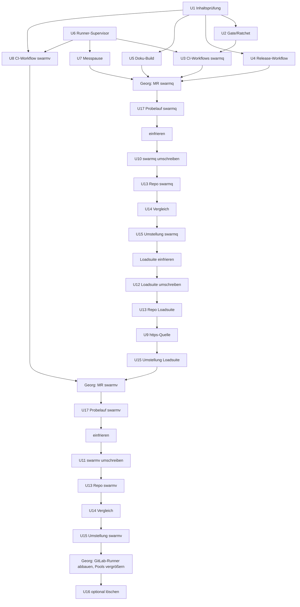
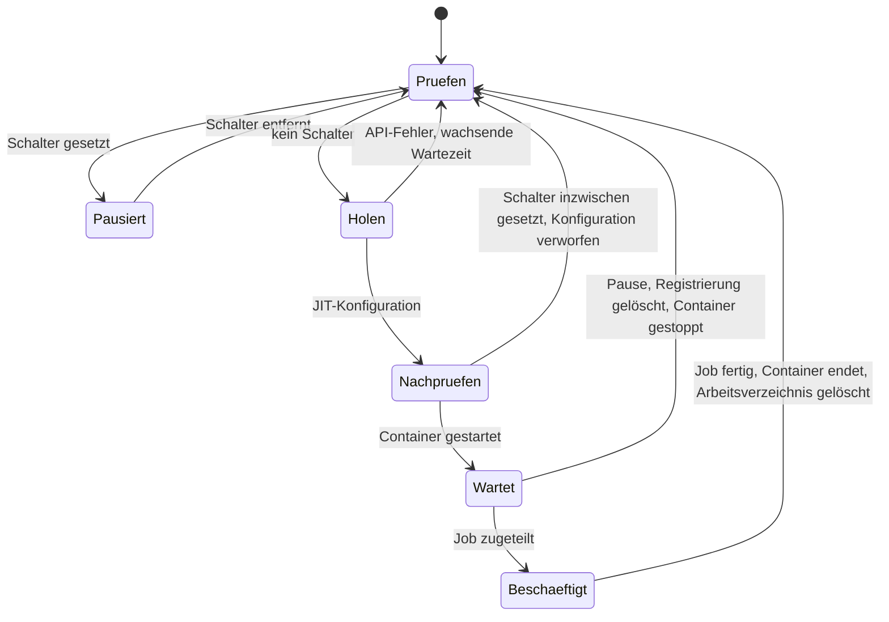

# Umzug von swarmq, swarmv und swarmq-loadsuite nach GitHub - Plan

**Ziel-Repos:** swarmq (dieses Repo), swarmv (`../swarmv`), swarmq-loadsuite (`../swarmq-loadsuite`). Pfade in Units sind relativ zum jeweils genannten Repo.

## Goal Capsule

- **Objective:** Die drei Projekte werden 1:1 von GitLab nach GitHub umgezogen, unter `Schorschofwill`. swarmq und swarmv sind öffentlich, die Loadsuite ist privat. CI und Releases prüfen und liefern dasselbe wie heute, die CI-Jobs laufen auf eigenen Runnern auf celsius. Danach hat GitLab mit den Projekten nichts mehr zu tun: Kein Remote, keine Git-Quelle, kein Submodule und kein Runner zeigt noch dorthin.
- **Means:**
  - Die Historie wird mit `git filter-repo` umgeschrieben (KTD2, KTD3).
  - Die CI wird Job für Job als GitHub Actions nachgebaut (KTD7).
  - Die Jobs laufen auf ephemeren Runnern auf celsius, mit einem eigenen Docker ohne Root-Rechte (KTD4–KTD6).
  - Die Workflows laufen vor dem Einfrieren einmal in einem privaten Probe-Repo (KTD12).
  - Umgestellt wird Repo für Repo, jeweils nach einem Vergleichslauf (KTD10).
- **Authority:** Bei Widersprüchen gilt zuerst dieser Plan, dann `AGENTS.md` des jeweiligen Repos. Was nach außen sichtbar ist, entscheidet Georg.
- **Ausführung:**
  - Claude bereitet die Units U2–U8 lokal auf Branches vor, ohne zu pushen. Georg merged sie vor dem Einfrieren über GitLab-MRs.
  - U9 entsteht nach dem Umzug der Loadsuite als Branch auf GitHub.
  - Die Umschreib-Units U10–U12 führt Claude in frischen Klonen außerhalb der Arbeitsverzeichnisse aus, ohne zu pushen.
  - Georg übernimmt alles, was nach außen wirkt:
    - Repos anlegen und pushen
    - Einstellungen bei GitHub, PyPI und Read the Docs
    - Runner auf celsius in Betrieb nehmen
    - GitLab archivieren
  - Container auf celsius startet oder ersetzt Claude nur auf Georgs ausdrückliche Anweisung.
- **Stop conditions:**
  - Die Inhaltsprüfung (U1) findet ein echtes Secret, Kundendaten oder eine Alt-Adresse Georgs in einem Blob oder einer Nachricht der Historie eines öffentlichen Repos.
  - Nach dem Umschreiben steht in einem Autor-, Committer- oder Tagger-Feld noch eine andere Adresse von Georg als `48103694+Schorschofwill@users.noreply.github.com`. Oder ein umgeschriebener Commit hat einen anderen Tree als sein Original. Ausgenommen sind die Loadsuite (KTD3) und die ergänzten Commits aus KTD2.
  - Auf celsius läuft kein `container:`-Job mit `services:`, Checkout und JavaScript-Action, auch nicht über den Ausweg aus KTD4.
  - Die GitHub-CI meldet auf dem Gegenstück eines Commits andere Testzahlen als die GitLab-CI auf dem Original.
- **Tail ownership:** Georg. Dazu gehören jeder Push, das Archivieren und optionale Löschen der GitLab-Projekte und der erste Release über Trusted Publishing.

---

## Product Contract

### Summary

swarmq, swarmv und swarmq-loadsuite ziehen von `gitlab.com/schorsch-dev/…` nach `github.com/Schorschofwill/…` um. Die Historie geht vollständig mit. In Autor-, Committer- und Tagger-Feldern steht danach nur noch die noreply-Adresse. Die CI läuft auf ephemeren GitHub-Runnern auf celsius, mit denselben Jobs, Gates und Auslösern wie heute. Releases von swarmq gehen über Trusted Publishing, die Doku liegt auf Read the Docs. Jedes Repo wird erst nach einem Vergleichslauf beider CIs umgestellt. Am Ende sind die GitLab-Projekte archiviert, und der GitLab-Runner ist abgebaut.

Dieser Plan ersetzt `docs/plans/2026-10-10-1156-chore-umzug-github-plan.md`. Der alte Plan betraf nur swarmq, und sein Stand ist veraltet (siehe Sources).

### Problem Frame

- **Kein Code sichtbar:** swarmq ist MIT-lizenziert auf PyPI, aber niemand sieht den Code. `[project.urls]` in 0.15.1 zeigt bereits auf `github.com/Schorschofwill/swarmq`, und dieses Repo gibt es nicht. swarmv ist ebenfalls MIT-lizenziert und genauso unsichtbar.
- **CI hängt an GitLab-Resten:** Das Kontingent der Shared Runner ist seit 2026-09-15 erschöpft. Alle Jobs laufen auf einem `gitlab-runner`-Container auf celsius. Drei Skripte sind direkt an GitLab gekoppelt: `scripts/coverage_gate.py` liest `CI_COMMIT_*`, `scripts/coverage_ratchet.py` ruft `glab api` auf, und `scripts/vergleich-entfernt.sh` hält den Container `gitlab-runner` an.
- **Token im Klartext:** Releases brauchen ein PyPI-Token, das im Klartext auf der Platte liegt.
- **SSH-Pflicht für die Loadsuite:** Sie holt swarmq per SSH von gitlab.com, als Git-Quelle, als Submodule und im Docker-Build. Jeder Lasthost braucht dafür einen GitLab-Schlüssel.

Ein früherer Anlauf mit GitHub-Workflows scheiterte daran, dass sie nie liefen (Commit `099f6af`). Deshalb laufen die neuen Workflows schon vor dem Einfrieren in einem Probe-Repo (KTD12). Die alte CI ersetzen sie erst, wenn nachgewiesen ist, dass sie dasselbe prüfen (R10).

### Requirements

**Repositories und Historie**

- R1. Auf GitHub liegen die vollständigen Historien von `main` mit allen Tags: swarmq 45 Tags (`v0.1.2` bis `v0.15.1`), swarmv 3 Tags, die Loadsuite ohne Tags. Für swarmq und swarmv gleicht jeder umgeschriebene Commit seinem GitLab-Original in Tree, Zeitstempeln und Platz in der Historie. Auch die Nachricht ist gleich, bis auf Commit-Verweise, die auf die neuen Hashes umgesetzt sind. Obenauf kommen nur die ergänzten Commits aus KTD2. Die Loadsuite unterscheidet sich zusätzlich nur in den Umschreibungen aus R13.
- R12. Von Georg ist als Mailadresse nur `48103694+Schorschofwill@users.noreply.github.com` sichtbar. Das gilt in allen drei Repos, für die umgeschriebene Historie und für künftige Commits von jedem Rechner. Seine anderen Adressen stehen in keinem Commit und in keinem Dateitext, auch nicht in diesem Plan.
- R13. Jeder Stand der Loadsuite verweist nur auf GitHub: Submodule-Zeiger, `.gitmodules`, Git-Quelle in `pyproject.toml`/`uv.lock` und volle swarmq-Hashes in Dateien. Ältere Stände lassen sich ohne GitLab auflösen.
- R2. Vor dem ersten öffentlichen Push ist die Historie von swarmq und swarmv auf Secrets und interne Daten geprüft. Bei der privaten Loadsuite genügt der Secret-Scan.
- R3. Kein Code, kein Skript, keine Konfiguration und keine Abhängigkeit in den drei Repos verweist danach noch auf GitLab. Doku und Pläne, die historische GitLab-Vorgänge beschreiben, sind ausgenommen. Werkzeuge, die Hashes lesen, funktionieren weiter. Beispiel: `just saettigung`.

**CI**

- R4. Jeder GitLab-Job hat ein GitHub-Gegenstück mit denselben Befehlen, Services, Gates und Auslösern. Blockierend bleibt, was heute blockiert, manuell bleibt, was heute manuell ist. Es gibt keine Reruns und einen Seed je Lauf. Kein Lauf bricht einen älteren ab.
- R5. Stress und Soak laufen wie heute nur auf Knopfdruck.
- R6. Wird ein Test übersprungen, weil ein Dienst nicht erreichbar ist, darf daraus kein grüner Lauf entstehen.
- R14. Die CI-Jobs von swarmq und swarmv laufen auf celsius. Jeder Job beginnt in einem frischen Runner, und Code aus einem Fork läuft erst nach Georgs Freigabe. Die einzige Ausnahme ist `release.yml`, das auf Runnern von GitHub läuft (KTD9).
- R15. Ein Messlauf auf celsius hält die Runner an, ohne laufende Jobs abzubrechen. Nach dem Lauf nehmen die Runner ihre Arbeit wieder auf, außer Georg hat sie absichtlich angehalten.

**Doku und Releases**

- R7. Die swarmq-Doku ist unter `https://swarmq.readthedocs.io/` öffentlich. Es gibt `latest` und eine Version je Release-Tag ab dem ersten Release nach dem Umzug. Ältere Tags verweisen auf ein fremdes Konto und haben den `mike`-Versionswähler, deshalb werden sie nicht aktiviert.
- R8. Ein Tag-Push `v*` in swarmq veröffentlicht nach Georgs Freigabe auf PyPI, ohne gespeichertes Token.
- R9. Passt ein Tag nicht zur Version in `pyproject.toml`, wird nicht veröffentlicht.

**Übergang**

- R10. Ein Repo wird erst umgestellt, wenn zwei Läufe je Job dieselben Zahlen `passed`/`skipped`/`failed` liefern:
  - die GitHub-CI auf dem umgeschriebenen Gegenstück des letzten GitLab-Commits
  - die GitLab-CI auf dem Original
- R11. Nach der Umstellung aller drei Repos sind die GitLab-Projekte archiviert, und ihre Beschreibung verweist auf GitHub. Der GitLab-Runner auf celsius ist entfernt. Die Projekte zu löschen ist ein späterer, optionaler Schritt von Georg (U16).

### Key Decisions

- **1:1-Umzug** (session-settled: user-directed — chosen over Umzug mit Verbesserungen: Georg will denselben Funktionsumfang an neuem Ort). Governs R4, R5. Stress bleibt deshalb manuell, obwohl der alte Plan „nachts“ vorsah. Es kommen keine neuen Gates wie Chaos in der CI dazu und keine GitHub-Releases.
- **Runner auf celsius, GitLab-Runner abschalten** (session-settled: user-directed — chosen over die kostenlosen GitHub-Runner). Governs R14, R11.
- **swarmq und swarmv öffentlich, Loadsuite privat** (session-settled: user-approved — chosen over alle öffentlich oder nur swarmq öffentlich). Governs R1, R2.
- **GitLab hat danach nichts mehr mit den Projekten zu tun** (session-settled: user-directed). Governs R3, R11, R13. Daraus folgt, dass auch die Loadsuite umgeschrieben wird, obwohl sie privat bleibt (KTD3).
- **Volle Historie, nur die noreply-Adresse öffentlich** (session-settled: user-approved, übernommen aus dem Plan vom 2026-10-10 — chosen over Neustart mit einem Commit oder Historie mit Firmenadresse). Governs R1, R12.
- **Read the Docs statt GitHub Pages; keine Issues und MRs übernehmen; Trusted Publishing mit Freigabe** (session-settled: user-approved, übernommen aus dem Plan vom 2026-10-10). Governs R7, R8, R11.

### Scope Boundaries

- Übertragen werden `main`, alle Tags und die Branches, die Georg vor dem Einfrieren als offen benennt (KTD11). Issues, MRs, Wiki und Pipeline-Historien bleiben zurück.
- Der Inhalt der Doku ändert sich nicht. Angepasst wird nur, was der Build, die CI-Beschreibung und hash-lesende Werkzeuge brauchen. Hash-Verweise im Fließtext bleiben stehen und lassen sich über die Zuordnungstabelle auflösen (KTD2).
- Die Loadsuite hat heute keine CI und bekommt auch keine.
- Die Worktree-Verzeichnisse neben den Repos (`swarmq-befunde-loadsuite`, `swarmq-loadsuite-merkmale`, `swarmq-untersuchung`) werden nicht migriert. Ihre Branches folgen der Regel aus KTD11. Die Verzeichnisse selbst stellt Georg in U15 beiseite.

**Geprüft und nicht gebaut:**

- *Fork-PRs auf Runnern von GitHub* statt auf celsius: Das wäre sicherer, widerspricht aber Georgs Vorgabe. Die Freigabe-Pflicht und der Docker ohne Root-Rechte (KTD4, KTD5) begrenzen das Risiko. Neu zu entscheiden wäre das, wenn Fremd-PRs häufig werden.
- *Wartezeit-Grenze für pausierte Runner:* Während einer Pause warten Jobs bis zu 24 h und brechen dann ab. Messläufe dauern höchstens einen Tag, und ein abgebrochener Job ist auf GitHub sichtbar.

#### Deferred to Follow-Up Work

- **Chaos-Gate in der CI:** Ein eigener Runner könnte privilegierte Container fahren. Das ist eine eigene Sicherheitsentscheidung und kein Teil eines 1:1-Umzugs.
- **GitHub-Releases mit Wheel und sdist:** Das wäre neu gegenüber heute.
- **Messpause für die Loadsuite:** Heute hält die Loadsuite den GitLab-Runner nicht an. Der nächste Schritt wäre, dass sie den Schalter aus KTD6 setzt.
- **Tailscale-ACL für celsius:** Wer über einen freigegebenen Fork-PR auf celsius Code ausführt, erreicht das Tailnet. Ob ACLs das begrenzen sollen, ist eine eigene Netzentscheidung (siehe Risks).
- **Dateien für Beiträge:** `CONTRIBUTING.md`, `SECURITY.md`, Issue-Vorlagen, Dependabot.
- **PyPI-README:** Der Kommentar „Das Repo ist privat“ in `pyproject.toml` ist danach veraltet. Offen ist, ob es noch eine eigene PyPI-README braucht.
- **Altes PyPI-Token widerrufen und 1Password-Migration**, sobald der erste Release über Trusted Publishing durch ist.

### Sources

- Alter Plan `docs/plans/2026-10-10-1156-chore-umzug-github-plan.md`. Seit diesem Plan hat sich geändert:
  - swarmq hat 1255 statt rund 610 Commits und 45 Tags.
  - Die CI läuft über `just`, mit Coverage-Gate und Ratchet, `uv audit` und ohne Reruns.
  - Der Runner steht auf celsius.
  - `mkdocs.yml` und `[project.urls]` zeigen schon auf GitHub.
- `docs/solutions/tooling-decisions/feste-testports-und-testsperre-2026-10-14.md`: In der CI gibt es weder Sperre noch feste Ports.
- `docs/solutions/tooling-decisions/uv-lock-drift-from-pyproject-optional-extras.md`: `lock-check` läuft mit `UV_FROZEN=0`.
- `docs/solutions/logic-errors/scheduler-cron-sync-clobber-test-flake-2026-06-01.md`: Begründung, warum e2e ohne Reruns läuft.
- GitHub, Secure use of self-hosted runners (https://docs.github.com/en/actions/reference/security/secure-use): Abraten bei öffentlichen Repos, Freigabe-Stufen für Fork-PRs.
- GitHub, Runner-Verwaltung und Limits:
  - Ein persönliches Konto kann Runner nur je Repo registrieren. Runner-Gruppen gibt es nur in Organisationen.
  - Ein Step darf höchstens 360 Minuten laufen.
  - Wartende Jobs brechen nach 24 h ab.
  - Runner mit veralteter Version bekommen keine Jobs mehr.
- `actions/runner`: SIGINT und SIGTERM brechen einen laufenden Job ab, einen eingebauten Drain gibt es nicht. Bei `container:`-Jobs werden Arbeitsverzeichnis und externals über den Docker-Daemon eingebunden.
- `actions/upload-artifact` v4.4 und neuer: Versteckte Dateien sind standardmäßig ausgeschlossen.
- `git-filter-repo`-Doku: `--mailmap` schreibt auch die Tagger um. Commit-Verweise in Nachrichten werden standardmäßig auf die neuen Hashes umgesetzt. Für Gitlinks gibt es kein fertiges Rezept, wohl aber `--commit-callback`.
- Read the Docs, Konfiguration v2: Python 3.14 ist verfügbar.
- `pypa/gh-action-pypi-publish`: Auf eigenen Runnern nur „best effort“ und nicht in Jobs mit `container:`.

---

## Planning Contract

### Key Technical Decisions

- KTD1. **Ziele und Reihenfolge.** Die Ziele sind `github.com/Schorschofwill/swarmq` und `…/swarmv`, beide öffentlich, sowie `…/swarmq-loadsuite`, privat.
  - **Reihenfolge:** swarmq → Loadsuite → swarmv.
    - Die Loadsuite braucht die Zuordnung alt→neu und die https-Quelle von swarmq. Sie zieht direkt danach um, damit die Zeit kurz bleibt, in der sie kein neues swarmq-Release pinnen kann.
    - swarmv hängt nur über PyPI an swarmq.
    - Es ist immer nur ein Repo im Übergang.
  - **Kein Release in der Lücke:** Zwischen U15 swarmq und U9 entsteht kein swarmq-Release-Tag.
  - **Stichtag:** Jedes Repo hat einen eigenen Stichtag, ab dem auf GitLab nichts mehr gemerged wird (KTD10).
  - **Grundlage:** Umgeschrieben wird jeweils `origin/main` von GitLab, nicht das lokale `main`. Das lokale `main` von swarmv hängt zum Beispiel drei Commits zurück.
- KTD2. **Adressen umschreiben mit `git filter-repo --mailmap`, in frischen Klonen.**
  - **Mailmap:**
    - Sie ordnet alle drei Alt-Adressen Georgs dem Eintrag `Georg Stricker <48103694+Schorschofwill@users.noreply.github.com>` zu, für Autor, Committer und Tagger.
    - Die dritte Adresse kommt nur in der Loadsuite vor.
    - Die Mailmap liegt außerhalb jedes Repos, weil sie die Alt-Adressen im Klartext enthält.
  - **Nachrichten und Tags:**
    - Commit-Verweise in Nachrichten setzt `filter-repo` wie standardmäßig auf die neuen Hashes um, also ohne `--preserve-commit-hashes`. So bleiben sie auf GitHub auflösbar.
    - Alles andere in den Nachrichten bleibt unverändert, auch die Zeilen `Co-Authored-By: Claude …`.
    - Die vier leichten Tags von swarmq (`v0.2.0`, `v0.11.1`, `v0.12.0rc1`, `v0.15.1`) bleiben leicht.
  - **Ergänzte Commits obenauf** (je Repo, nach dem Umschreiben):
    - Zuordnungstabelle `docs/historie/gitlab-commit-map.txt` mit der commit-map, nur Hashes. Damit lassen sich die Hash-Verweise im Fließtext und die MR-Verweise `!NN` ohne GitLab nachschlagen.
    - nur swarmq: `.git-blame-ignore-revs` auf den neuen Hash.
    - nur swarmq: die `commit`-Felder in `docs/befunde/saettigungsbuch.toml` auf die neuen Kurzhashes, weil `scripts/saettigung.py` sie an `git diff` übergibt.
- KTD3. **Die Loadsuite wird nach der swarmq-Umschreibung auch inhaltlich umgeschrieben, damit R13 gilt.** Neben der Mailmap macht ein einziger `filter-repo`-Lauf drei Dinge:
  1. **Gitlinks:** Die Gitlinks (Modus `160000` unter `vendor/swarmq`) setzt ein `--commit-callback` über die swarmq-commit-map auf die neuen Hashes um.
  2. **Text in Blobs:** `--replace-text` ersetzt in allen Blobs:
     - die beiden GitLab-Schreibweisen der swarmq-URL (`ssh://git@gitlab.com/schorsch-dev/swarmq.git` und `git@gitlab.com:schorsch-dev/swarmq.git`) durch `https://github.com/Schorschofwill/swarmq.git`
     - jeden vollen 40-stelligen swarmq-Hash aus der commit-map durch seinen neuen Hash. Das betrifft `uv.lock`, `src/loadsuite/version_pins.py`, `conform-runs/**/meta.json` und die Doku.
  3. **Kurzhashes** bleiben unverändert, weil eine Ersetzung mehrdeutig wäre.

  Fehlt ein Gitlink oder voller Hash in der commit-map, gehört er zu einem swarmq-Commit außerhalb von `main` und Tags. Er wird nicht geraten, sondern bleibt stehen und kommt auf eine Liste an Georg.

  Danach kommt die Loadsuite-commit-map als Zuordnungstabelle ins Repo, wie in KTD2.

  Die Messdaten behalten ihren Sinn, denn der neue Hash bezeichnet denselben Tree wie der alte.
- KTD4. **Runner-Betrieb auf celsius: ephemere Runner als Host-Prozess unter `ghrunner`, auf einem eigenen Docker ohne Root-Rechte.**
  - *Geändert bei der Umsetzung (U6, 2026-10-28):* Ursprünglich waren Runner-Container geplant, der Host-Prozess war nur der Ausweg. Bei Jobs mit `container:` bindet der Runner aber seine externals über den Docker-Daemon ein, und im Runner-Container stimmen diese Pfade auf dem Host nicht. Deshalb ist der Host-Prozess jetzt der Hauptweg. Die Rechte sind dieselben: In beiden Fällen hat ein Job den Socket des rootless Docker.
  - **Docker der CI:** Die CI bekommt einen eigenen rootless Docker-Daemon unter einem eigenen Nutzer `ghrunner`. Runner, Job-Container und Services laufen dort, nicht auf dem Docker des Hosts.
    - Ein freigegebener bösartiger Job erreicht so den Nutzer `ghrunner`, aber nicht root.
    - Er sieht weder das PAT noch die Messcontainer auf dem Host-Docker.
  - **Supervisor und Token:**
    - Ein Supervisor unter systemd läuft als root und hält das fine-grained PAT. Es gilt nur für swarmq und swarmv und hat die Rechte „Administration: read and write“. Weniger reicht für die Runner-Registrierung nicht.
    - Das PAT liegt in einer Datei, die nur root lesen darf, und hat ein Ablaufdatum.
    - Der Runner-Prozess bekommt nur die JIT-Konfiguration, in einer leeren Umgebung. Sie gilt für genau diesen einen Runner.
  - **Slots:**
    - Ein persönliches Konto kann Runner nur je Repo registrieren. Deshalb hat swarmq einen eigenen Pool mit dem Label `celsius-swarmq` und swarmv einen mit `celsius-swarmv`. Die Loadsuite bekommt keinen Pool, weil sie keine CI hat.
    - Ein Slot führt einen Job aus.
    - Endgröße: swarmq 8 Slots (sieben gleichzeitige Test-Jobs plus einer), swarmv 5.
    - In der Übergangszeit hat jeder Pool höchstens zwei Slots (KTD10).
  - **Ablauf je Slot:**
    1. Den Schalter prüfen (KTD6).
    2. Eine JIT-Konfiguration holen.
    3. Den Schalter unter der Sperre aus KTD6 erneut prüfen.
    4. Den Runner als `ghrunner` aus einer frischen Kopie der gepinnten Distribution starten und auf sein Ende warten.
    5. Die Kopie samt Arbeitsverzeichnis löschen und von vorn beginnen. Endet der Runner ungestoppt mit Fehler, folgt erst die wachsende Wartezeit.
  - **Kopie und Besitz:** root legt nur das Slot-Verzeichnis frisch in seinem eigenen Verzeichnis an und gibt es `ghrunner`. Die Kopie legt `ghrunner` selbst an. root ändert im Baum von `ghrunner` nie einen Besitzer, denn ein überdauernder `ghrunner`-Prozess könnte dort Symlinks legen (Code-Review #1).
  - **Netz:**
    - Jobs laufen mit `container:` und `services:`, jeder Job hat damit sein eigenes Docker-Netz.
    - Services sind unter ihren Hostnamen erreichbar, wie die Aliasse in `.gitlab-ci.yml`.
    - Services veröffentlichen keine Host-Ports.
  - **uv-Cache:** Benannte Volumes im Docker der CI, eingebunden über `container.volumes` und getrennt nach Vertrauensstufe: `swarmq-uv-cache-eigen` für Pushes und Last-Läufe, `swarmq-uv-cache-fork` für freigegebene Fork-PRs (Code-Review #3). Releases bauen nicht damit (KTD9).
  - **Image und Updates:**
    - Die Runner-Distribution ist gepinnt; ihr Verzeichnisname ist die Version.
    - Der Status-Befehl warnt, wenn es ein neueres Release von `actions/runner` gibt oder das PAT in weniger als 14 Tagen abläuft. Das Ablaufdatum steht in der API-Antwort.
    - Die Distribution hebt Georg monatlich an, die README beschreibt den Handgriff.
  - **Ablage:** Code und Units liegen öffentlich in swarmq unter `ops/github-runner/`, ohne Secrets.
- KTD5. **Fork-Schutz für die öffentlichen Repos** (session-settled: user-approved — chosen over GitHub-eigene Runner für Fork-PRs).
  - **Einstellungen:**
    - Die Freigabe für Fork-PR-Workflows steht auf „Require approval for all external contributors“.
    - Kein Workflow nutzt `pull_request_target`.
    - Die CI-Workflows laufen mit `permissions: contents: read` und bekommen keine Secrets. `release.yml` erhöht nur, was KTD9 nennt.
    - Drittanbieter-Actions sind auf einen Commit-SHA gepinnt.
  - **Regel für die Freigabe:**
    - Vor jeder Freigabe liest Georg den vollständigen Diff des PRs.
    - Jede Änderung an Tests, `conftest.py`, `justfile`, `pyproject.toml`, `uv.lock`, Dockerfiles, Skripten und `.github/` gilt als ausführbarer Code auf celsius.
    - Neue Pushes auf einen freigegebenen PR werden erneut geprüft.
  - *Konflikt:* GitHub rät von selbst gehosteten Runnern an öffentlichen Repos ab. Nach KTD4 erreicht ein freigegebener bösartiger PR den Nutzer `ghrunner` und das Netz von celsius, aber nicht root und nicht das PAT.
- KTD6. **Messpause über einen Schalter in `/var/lib/github-runner/`.**
  - **Schalter und Status:**
    - Solange die Datei `pause` existiert, holt kein Slot eine Konfiguration.
    - Jeder Slot meldet seinen Zustand in `status.json` daneben: wartend, beschäftigt oder pausiert.
    - Schalter und Statusänderungen laufen unter einer gemeinsamen Dateisperre.
  - **Wartende Runner beenden:**
    1. Der Supervisor löscht die Registrierung eines wartenden Runners per API. Die API lehnt das für einen beschäftigten Runner ab.
    2. Erst wenn das gelingt, stoppt er den Container. Ein abgelehnter Runner gilt als beschäftigt und läuft zu Ende.

    So kann zwischen Abfrage und Stopp kein Job zugeteilt werden.
  - **Befehl:** `ops/github-runner/` stellt einen Befehl zum Pausieren, Fortsetzen und Abfragen bereit. Pausieren kehrt erst zurück, wenn kein Slot mehr beschäftigt ist.
  - **Vergleichsskript:**
    - `scripts/vergleich-entfernt.sh` erreicht Schalter und Status über einen kurzlebigen Helfer-Container auf dem Host-Docker mit Bind-Mount auf `/var/lib/github-runner/`. Das ist derselbe Docker-Kontext wie heute, ohne PAT und ohne SSH.
    - Die Regel „nur fortsetzen, was der Lauf selbst pausiert hat“ bleibt erhalten.
- KTD7. **CI-Abbildung Job für Job** (Tabelle unten).
  - **Images, Befehle, Seed:**
    - Image und Befehle kommen unverändert aus `.gitlab-ci.yml`: `ghcr.io/astral-sh/uv:0.11.6-python3.14-trixie(-slim)` und die `just`-Rezepte.
    - `SWARMQ_TEST_SEED` kommt aus `github.run_id`.
  - **Coverage-Artefakte:**
    - Die drei Test-Jobs laden `.coverage.*` und JUnit-Berichte auch bei Rot hoch.
    - Einstellungen: `if: always()`, `include-hidden-files: true`, `if-no-files-found: error` und ein eigener Artefaktname je Job.
    - `coverage-combine` lädt sie mit `merge-multiple: true`. Er läuft nur, wenn alle drei Test-Jobs grün sind, und braucht `fetch-depth: 0`.
    - Er lädt die Gesamtquote aus `coverage report --format=total` als eigenes Artefakt für den Ratchet hoch.
  - **Weitere Jobs:**
    - `abhaengigkeiten-pruefen` blockiert wie heute nur, wenn `uv.lock` oder `pyproject.toml` gegenüber `main` geändert sind. Sonst läuft er mit `continue-on-error`.
    - Den Secret-Scan übernimmt die gitleaks-CLI mit `.gitleaks.toml`. Dazu kommen Secret Scanning und Push Protection von GitHub.
  - **Auslöser:**
    - Jobs laufen bei `push` oder bei einem `pull_request` aus einem Fork, wie im heutigen `workflow:`-Block. Das verhindert Doppelläufe.
    - Es gibt kein `concurrency` mit Abbruch, weil GitLab heute keinen Lauf abbricht (R4).
- KTD8. **GitLab-Kopplung im Code durch GitHub-Kopplung ersetzen, test-first.**
  - `scripts/coverage_gate.py` erkennt `main` und Tags über `GITHUB_REF_TYPE`/`GITHUB_REF_NAME`.
  - `scripts/coverage_ratchet.py` lädt das Quoten-Artefakt der letzten drei erfolgreichen `main`-Läufe per `gh api`.
  - Bis zur Umstellung laufen beide CIs. In dieser Zeit liest das Gate beide Variablensätze. U15 entfernt die GitLab-Variablen.
- KTD9. **Releases und Doku.**
  - **`release.yml` läuft komplett auf `ubuntu-latest`, ohne `container:` und ohne das uv-Cache-Volume:**
    1. Ein Build-Job prüft die Tag-Version gegen `pyproject.toml` und baut mit `uv build`.
    2. Ein Publish-Job in der Umgebung `pypi` mit Pflicht-Freigabe durch Georg lädt hoch, mit `id-token: write`.
  - *Abweichung von „alles auf celsius“:*
    - Weder Inhalt noch OIDC-Token eines Releases sollen auf einem Host entstehen, der Fremdcode ausführt.
    - Die Publish-Action ist auf eigenen Runnern außerdem nur „best effort“.
    - `uv build` braucht keine Services.
  - **swarmv:** Es ist nicht auf PyPI und bekommt keinen Release-Workflow (1:1).
  - **Read the Docs:**
    - `.readthedocs.yaml` bleibt bei Python 3.14.
    - Der `mike`-Versionswähler fliegt aus `mkdocs.yml`.
    - `site_url` kommt aus `READTHEDOCS_CANONICAL_URL`, mit `https://swarmq.readthedocs.io/en/latest/` als Rückfallwert.
    - Aktiviert werden nur `latest` und neue Tags (R7).
- KTD10. **Einfrieren und Umstellen je Repo.**
  1. Die vorbereitenden Units des Repos landen über einen GitLab-MR auf `main`. Workflow-Dateien und `ops/` stören GitLab nicht.
  2. Probelauf im privaten Probe-Repo bis grün (KTD12). Korrekturen gehen wieder über GitLab-MRs.
  3. Einfrieren. Danach wird auf GitLab nichts mehr gemerged. Der letzte Stand von `origin/main` ist die Grundlage der Umschreibung.
  4. Für den Vergleich (U14) pusht Georg zusätzlich den Branch `vergleich/gitlab-stichtag` auf das umgeschriebene Gegenstück des letzten GitLab-Commits. Dieser Commit hat denselben Tree wie das Original, im Gegensatz zur Spitze von `main` mit den ergänzten Commits. Verglichen wird dieser Lauf mit der GitLab-Pipeline auf dem Original.
  5. Ab dem Push wird nur noch auf GitHub gearbeitet, in frischen Klonen (U15).

  Der GitLab-Runner auf celsius bleibt, bis der letzte Vergleichslauf durch ist. In dieser Zeit teilen sich beide Runner-Arten den Host, und die Pools bleiben klein.
- KTD11. **Offene Branches.**
  - `filter-repo` schreibt alle Remote-Branches des frischen Klons mit um.
  - Gepusht werden `main`, die Tags und die Branches, die Georg vor dem Einfrieren als weiterzuführen benennt. Kandidaten sind heute:
    - swarmq `docs/befunde-loadsuite-b43-b45`
    - Loadsuite `feat/merkmale-unter-last`
    - swarmv `feat/workflow-diagramm` (gepusht, nicht gemergt)
  - Lokale, nie gepushte Branches kommen per Cherry-Pick in den frischen Klon, bevor sie zum ersten Mal nach GitHub gehen.
- KTD12. **Probelauf vor dem Einfrieren.**
  - Georg legt ein privates Wegwerf-Repo an und pusht einen Probe-Umschreib-Klon dorthin. Das ist eine Testumschreibung des aktuellen `origin/main`, mit derselben Mailmap.
  - Auf celsius bekommt das Repo einen Probe-Slot, auf dem `ci.yml` und `load.yml` laufen.
  - Fehler in den Workflows werden über den normalen GitLab-MR-Weg korrigiert, bis alle Jobs grün sind und die Testzahlen zur GitLab-Pipeline desselben Trees passen.
  - Erst danach wird eingefroren. Das Probe-Repo und sein Slot werden danach gelöscht.
  - So muss nach dem Einfrieren nicht neu umgeschrieben werden, nur weil ein Workflow einen Fehler hatte.

### High-Level Technical Design

Ablauf und Zuständigkeiten:

Ein Runner-Slot auf celsius (KTD4, KTD6):

Zuordnung der Jobs:

| Repo | GitLab-Job | GitHub (Workflow / Job) | Runner | Auslöser | blockierend |
|---|---|---|---|---|---|
| swarmq | `lint-and-types` | `ci.yml` / `lint-and-types` | celsius | push, Fork-PR | ja |
| swarmq | `lock-check` | `ci.yml` / `lock-check` | celsius | push, Fork-PR | ja |
| swarmq | `abhaengigkeiten-pruefen` | `ci.yml` / `abhaengigkeiten-pruefen` | celsius | push, Fork-PR | nur bei Lock-Änderung |
| swarmq | `unit-tests` | `ci.yml` / `unit-tests` | celsius | push, Fork-PR | ja |
| swarmq | `integration-tests` | `ci.yml` / `integration-tests` | celsius | push, Fork-PR | ja |
| swarmq | `e2e-tests` | `ci.yml` / `e2e-tests` | celsius | push, Fork-PR | ja |
| swarmq | `coverage-combine` | `ci.yml` / `coverage-combine` | celsius | push, Fork-PR | ja |
| swarmq | `secret_detection` | `ci.yml` / `secret-scan` (gitleaks) | celsius | push, Fork-PR | ja |
| swarmq | `stress-tests` | `load.yml` / `stress` | celsius | workflow_dispatch | nein |
| swarmq | `soak-tests` | `load.yml` / `soak` | celsius | workflow_dispatch | nein |
| swarmq | (manueller `uv publish`) | `release.yml` / `build`, `publish` | GitHub | Tag `v*` | Umgebung `pypi` |
| swarmv | `lint-und-typen`, `sperrdatei`, `unit-tests`, `integration-tests`, `abbild` | `ci.yml` / gleichnamige Jobs | celsius | push, Fork-PR, Tags | ja |

### Assumptions

- celsius hat genug Kapazität für 13 Slots. Heute laufen dort bis zu 16 GitLab-Jobs gleichzeitig.
- Rootless Docker mit cgroup v2 läuft auf celsius. Die Probe in U13 bestätigt das. Scheitert sie, greift die Stop condition, nicht der Host-Docker.
- Das GitHub-Konto `Schorschofwill` hat die noreply-Adresse `48103694+Schorschofwill@users.noreply.github.com`. U13 prüft das vor jedem Push.
- `gstricker` ist nicht Georgs Konto. Für dieses Konto wird nie ein Trusted Publisher eingetragen, und seine noreply-Adresse wird nie verwendet.
- Die Inhaltsprüfung der Repo-Recherche hat in Nachrichten und Dateien keine Alt-Adresse gefunden. U1 bestätigt das über alle Refs.

### Risks

| Risiko | Gegenmaßnahme |
|---|---|
| Ein freigegebener Fork-PR führt Code auf celsius aus | Freigabe-Pflicht mit Prüfung des vollen Diffs (KTD5). Rootless Docker ohne Zugriff auf root, PAT und Host-Docker (KTD4). Ephemere Runner. Bei Verdacht: PAT widerrufen, Umgebung `pypi` und Repo-Einstellungen prüfen, `ghrunner`-Daemon neu aufsetzen. |
| Aus einem kompromittierten Job ist das Tailnet erreichbar | Rest-Risiko, die Freigabe ist die Schutzschicht. Eine Tailscale-ACL ist eine Folgeentscheidung (Deferred). |
| Ein Release wird manipuliert | Build und Upload laufen auf Runnern von GitHub, ohne Cache von celsius (KTD9). |
| Die GitHub-CI ist grün, prüft aber weniger (Fehler aus `099f6af`) | Probelauf vor dem Einfrieren (KTD12) und Vergleich der Testzahlen je Job (R10, U14). Erst danach fällt `.gitlab-ci.yml`. |
| CI-Jobs verfälschen Messläufe auf celsius | Messpause ohne Wettlauf (KTD6, U7). In der Übergangszeit kleine Pools (KTD10). |
| Ein Runner bekommt keine Jobs mehr (alte Version, abgelaufenes PAT) | Status-Warnung und monatliches Anheben der gepinnten Distribution (KTD4). |
| Die Loadsuite-Umschreibung trifft einen Hash, der kein swarmq-Hash ist | Ersetzt werden nur volle 40-stellige Hashes aus der commit-map. Fehlende kommen auf eine Liste (KTD3). Dazu Stichproben alter Stände in U12. |
| Der erste Trusted-Publishing-Release scheitert | Manueller `uv publish` bleibt möglich, bis ein Workflow-Release gelungen ist. Erst dann wird das Token widerrufen. |

---

## Implementation Units

| U-ID | Titel | Repo / Hauptdateien | Abhängig von |
|---|---|---|---|
| U1 | Inhaltsprüfung der Historien | alle; `.gitleaks.toml` | – |
| U2 | Coverage-Gate und Ratchet auf GitHub | swarmq `scripts/coverage_gate.py`, `scripts/coverage_ratchet.py` | U1 |
| U3 | CI- und Last-Workflows swarmq | swarmq `.github/workflows/ci.yml`, `load.yml` | U2, U6 |
| U4 | Release-Workflow swarmq | swarmq `.github/workflows/release.yml` | U1 |
| U5 | Doku-Build für Read the Docs | swarmq `mkdocs.yml`, `.readthedocs.yaml` | U1 |
| U6 | Runner-Supervisor für celsius | swarmq `ops/github-runner/` | – |
| U7 | Messpause im Vergleichsskript | swarmq `scripts/vergleich-entfernt.sh` | U6 |
| U8 | CI-Workflow swarmv | swarmv `.github/workflows/ci.yml` | U1, U6 |
| U17 | Probelauf vor dem Einfrieren | Probe-Repo | gemergte Units des Repos |
| U10 | swarmq-Historie umschreiben | swarmq (Klon) | U17 swarmq, eingefroren |
| U12 | Loadsuite-Historie umschreiben | Loadsuite (Klon) | U10, U15 swarmq |
| U11 | swarmv-Historie umschreiben | swarmv (Klon) | U17 swarmv, U15 Loadsuite |
| U13 | Repos anlegen und einrichten (Georg) | – | U10 / U12 / U11 |
| U9 | Loadsuite auf GitHub-Quelle | Loadsuite `tests/test_pins.py`, `docker/worker/Dockerfile` | U12, U13 |
| U14 | Vergleichslauf und Abnahme | – | U13 |
| U15 | Umstellung je Repo | alle; `.gitlab-ci.yml`, `docs/testing/test-strategy.md` | U14 (Loadsuite: U9) |
| U16 | GitLab-Projekte löschen (optional, Georg) | – | U15 aller Repos |

### U1. Inhaltsprüfung der Historien

- **Goal:** Belegen, dass die vollen Historien von swarmq und swarmv veröffentlicht werden können, und die Loadsuite auf Secrets prüfen.
- **Requirements:** R2, R12
- **Dependencies:** keine
- **Files:** swarmq `.gitleaks.toml` (neu), swarmv `.gitleaks.toml` (neu). Bei Funden zusätzlich die betroffenen Dateien unter `docs/`.
- **Approach:**
  1. gitleaks über alle Refs der drei Repos laufen lassen. Der bekannte Fehlalarm (`_owner_token` in `src/swarmq/scheduler/loop.py`) kommt als Allowlist-Eintrag nach Pfad und Muster in die Konfiguration. Ein Fingerprint wäre nach dem Umschreiben ungültig.
  2. swarmq und swarmv nach Mustern durchsuchen:
     - interne Hostnamen und IP-Adressen (lastserver, celsius, workstation, Tailscale-Namen)
     - Kundenbezüge (Phoenix, Shirtee)
     - jede Mailadresse, auch die Alt-Adressen Georgs in Blobs und Nachrichten
     - `.env`-artige Dateien
  3. Die Funde einteilen in „unkritisch“, „im aktuellen Stand bereinigen“ und „Stop condition“. Das Ergebnis geht als Tabelle an Georg, nicht ins Repo.
- **Test expectation:** none -- reine Prüfung. Nachweis ist ein gitleaks-Lauf mit 0 Funden.
- **Verification:** gitleaks meldet über alle Refs 0 Funde. Jeder Musterfund ist eingeordnet, keiner ist eine Stop condition.

### U2. Coverage-Gate und Ratchet auf GitHub

- **Goal:** Gate und Ratchet funktionieren unter GitHub Actions (KTD8).
- **Requirements:** R3, R4
- **Dependencies:** U1
- **Files:** `scripts/coverage_gate.py`, `scripts/coverage_ratchet.py`, `justfile` (Rezept `ratchet` und Kommentare), `tests/unit/test_coverage_gate.py`, `tests/unit/test_coverage_ratchet.py`, `tests/unit/test_justfile.py`
- **Approach:**
  - Das Gate erkennt `main` und Tags über die GitHub-Variablen. In der Übergangszeit liest es zusätzlich die GitLab-Variablen.
  - Der Ratchet lädt per `gh api` das Quoten-Artefakt aus `coverage-combine` (KTD7) aus den letzten drei erfolgreichen `main`-Läufen. Es liefert dieselbe kombinierte Quote wie heute der Regex auf `TOTAL`.
- **Execution note:** test-first nach `AGENTS.md`, je Verhalten ein roter Test.
- **Patterns to follow:** bestehende Tests in `tests/unit/test_coverage_gate.py` (Umgebung per monkeypatch) und `tests/unit/test_coverage_ratchet.py` (gemockter API-Aufruf).
- **Test scenarios:**
  - Mit `GITHUB_REF_TYPE=tag` entfällt der Merge-Base-Vergleich.
  - Mit `GITHUB_REF_TYPE=branch` und `GITHUB_REF_NAME=main` entfällt er ebenso.
  - Auf einem anderen Branch vergleicht das Gate gegen den Merge-Base mit `main`.
  - Ohne GitHub-Variablen, aber mit `CI_COMMIT_TAG`, verhält sich das Gate wie heute (Übergangszeit).
  - Der Ratchet bildet aus drei gemockten Artefakten mit `96.4`/`96.7`/`96.5` denselben Wert wie heute aus GitLab-Jobs.
  - Liefert die API weniger als drei erfolgreiche Läufe oder fehlt ein Artefakt, hebt der Ratchet nicht an und meldet das.
  - Das Rezept `ratchet` ruft `gh` statt `glab` auf.
- **Verification:** Die Unit-Tests und `uv run just all` sind grün.

### U3. CI- und Last-Workflows swarmq

- **Goal:** Alle GitLab-Jobs von swarmq laufen als GitHub Actions auf celsius, mit derselben Abdeckung (KTD7).
- **Requirements:** R4, R5, R6, R14
- **Dependencies:** U2, U6 (Label `celsius-swarmq`)
- **Files:** `.github/workflows/ci.yml` (neu), `.github/workflows/load.yml` (neu)
- **Approach:**
  - Jeder Job entspricht einer Zeile der Tabelle im High-Level Technical Design. `runs-on` ist `[self-hosted, celsius-swarmq]`.
  - Image, Variablen, Service-Namen und -Versionen sowie das Cache-Volume kommen aus `.gitlab-ci.yml`. Dazu gehört `RABBITMQ_SERVER_ADDITIONAL_ERL_ARGS`, das nur am Service `rabbitmq42` steht.
  - Der Readiness-Gate aus `.with-services` wird ein Schritt vor den Tests (R6).
  - Die Kommentare mit dem Warum aus `.gitlab-ci.yml` wandern mit, gekürzt auf das, was für GitHub gilt. Der Chaos-Hinweis gehört dazu.
  - Artefakte, Rechte, Pins und Auslöser folgen KTD5 und KTD7.
  - `load.yml` hat nur `workflow_dispatch` mit der Auswahl `stress` oder `soak`. Soak bekommt eine Laufzeitgrenze über einer Stunde und unter 360 Minuten je Step.
- **Patterns to follow:** `.gitlab-ci.yml` (`.uv`, `.uv-git`, `.with-services`, `.coverage-data`)
- **Test scenarios:**
  - Ein Push auf einen Branch startet alle acht Jobs aus `ci.yml`. Ein PR aus demselben Repo startet keinen zweiten Lauf.
  - Zwei schnell aufeinanderfolgende Pushes auf `main` erhalten beide einen vollständigen Lauf.
  - Ein absichtlich falscher Service-Hostname lässt den Readiness-Gate nach 120 s rot werden.
  - Eine Extras-Änderung ohne neues `uv.lock` macht `lock-check` rot und `abhaengigkeiten-pruefen` blockierend.
  - `coverage-combine` startet nicht, wenn ein Test-Job rot ist. Die Rohdaten sind trotzdem als Artefakt da.
  - Ein Test-Job, der keine `.coverage.*`-Datei erzeugt, wird schon beim Upload rot.
  - Der Scan-Schritt schlägt lokal auf einem Wegwerf-Commit mit Muster-Secret an. Push Protection würde den Push zu GitHub ablehnen.
  - Ein manueller Start von `stress` meldet mehr als 0 passed. `soak` läuft die Stunde durch.
- **Verification:** Alle Jobs sind im Probelauf (U17) und auf dem Vergleichs-Branch (U14) grün. `actionlint` ist sauber.

### U4. Release-Workflow swarmq

- **Goal:** Ein Tag-Push veröffentlicht nach Georgs Freigabe auf PyPI, ohne Token (KTD9).
- **Requirements:** R8, R9
- **Dependencies:** U1
- **Files:** `.github/workflows/release.yml` (neu)
- **Approach:** Zwei Jobs auf `ubuntu-latest`:
  1. `build` prüft die Tag-Version, baut mit `uv build` und lädt Wheel und sdist einzeln als Artefakt hoch. `dist/*` scheidet aus, weil dort eine `.gitignore` liegt.
  2. `publish` in der Umgebung `pypi` lädt hoch. Er hat nur `id-token: write` und `contents: read`.
- **Test scenarios:**
  - Ein Tag `v9.9.9` auf einem Commit mit anderer Version bricht im Build-Job ab, bevor eine Freigabe angefordert wird.
  - Ein passender Tag wartet in der Umgebung `pypi` auf die Freigabe und veröffentlicht erst danach.
  - Danach installiert `uv run --refresh-package swarmq --with swarmq==<version> --no-project` die neue Version.
- **Verification:** Der erste Release nach dem Umzug läuft vollständig über den Workflow. Die Umstellung wartet nicht darauf.

### U5. Doku-Build für Read the Docs

- **Goal:** Die Doku baut auf Read the Docs (KTD9).
- **Requirements:** R7
- **Dependencies:** U1
- **Files:** `mkdocs.yml`, `.readthedocs.yaml`
- **Approach:**
  - `extra.version.provider: mike` entfernen.
  - `site_url` aus `READTHEDOCS_CANONICAL_URL` setzen.
  - `edit_uri` auf `edit/main/website/` setzen.
  - `repo_url` und `[project.urls]` sind schon richtig.
- **Test scenarios:**
  - `mkdocs build --strict` mit dem Extra `docs` läuft ohne Warnung für beide Sprachen.
  - Mit `READTHEDOCS_CANONICAL_URL=https://swarmq.readthedocs.io/en/latest/` zeigt der Sprachumschalter im gebauten `site/` auf `/en/latest/de/`.
- **Verification:** Der strikte Build ist lokal grün.

### U6. Runner-Supervisor für celsius

- **Goal:** celsius führt Jobs von swarmq und swarmv in ephemeren Runnern auf dem Docker ohne Root-Rechte aus und lässt sich ohne Wettlauf pausieren (KTD4, KTD6).
- **Requirements:** R14, R15
- **Dependencies:** keine
- **Files:**
  - `ops/github-runner/` (neu):
    - Slot-Schleife
    - Befehl zum Pausieren, Fortsetzen und Abfragen
    - systemd-Template-Unit
    - Beispiel-Umgebungsdatei ohne Werte
    - `README.md` mit Einrichtung von `ghrunner`, rootless Docker, PAT und dem Anheben der gepinnten Distribution
  - `tests/unit/ops/test_github_runner.py` (neu)
- **Approach:**
  - Eine Template-Unit erzeugt je Repo und Slot eine Instanz. Pool-Größe und Label kommen aus KTD4.
  - Die Slot-Schleife folgt dem Zustandsdiagramm. Sie startet den Runner als `ghrunner` aus einer frischen Kopie, mit `DOCKER_HOST` auf dessen rootless Docker.
  - Bei API-Fehlern wartet sie mit wachsender Pause.
  - Pausieren, Fortsetzen und Status folgen KTD6. Die Status-Warnungen kommen aus KTD4.
  - Den Host-Prozess-Ausweg aus KTD4 baut diese Unit nur, wenn die Probe in U13 scheitert. Dann kommt er als eigener Zyklus mit eigenen Tests dazu.
- **Execution note:** test-first. API-Aufrufe und `docker` werden an der Prozessgrenze gefälscht, wie in `tests/unit/test_vergleich_entfernt.py`. Ob `container:`-Jobs wirklich laufen, zeigt erst U13.
- **Patterns to follow:** `scripts/vergleich-entfernt.sh` mit seinen Tests (Shell-Skript mit gefälschtem `docker` im `PATH`).
- **Test scenarios:**
  - Ohne Schalter holt ein Slot eine JIT-Konfiguration und startet genau einen Runner-Prozess als `ghrunner` auf dessen rootless Docker, nie auf dem Host-Socket.
  - Die Kopie legt `ghrunner` selbst an, root ändert nur den Besitz des Slot-Verzeichnisses. Nach dem Ende ist alles gelöscht.
  - Mit gesetztem Schalter holt ein Slot keine Konfiguration.
  - Wird der Schalter zwischen Holen und Start gesetzt, verwirft der Slot die Konfiguration und startet nichts.
  - Pausieren löscht die Registrierung eines wartenden Runners und stoppt dann seinen Container.
  - Lehnt die API das Löschen ab, weil der Runner beschäftigt ist, bleibt der Container laufen. Pausieren kehrt erst zurück, wenn dieser Slot fertig ist.
  - Pausieren bei gesetztem Schalter ändert nichts und meldet „schon pausiert“. Fortsetzen ohne Schalter ist ein No-op.
  - Ein API-Fehler führt zu Wartezeit und erneutem Versuch, nicht zum Absturz der Unit.
  - Der Status warnt bei veraltetem Runner-Release und bei einem PAT, das in weniger als 14 Tagen abläuft.
  - Das PAT erscheint in keiner Ausgabe, keinem Prozessargument und keiner Umgebung des Runner-Prozesses.
- **Verification:** Die Unit-Tests sind grün. Auf celsius nimmt ein Probe-Slot in U13 einen Job an und endet danach.

### U7. Messpause im Vergleichsskript

- **Goal:** Ein Vergleichslauf auf celsius pausiert die GitHub-Runner statt den GitLab-Runner (KTD6).
- **Requirements:** R15, R3
- **Dependencies:** U6
- **Files:** `scripts/vergleich-entfernt.sh`, `tests/unit/test_vergleich_entfernt.py`, `benchmarks/comparison/METHODIK.md`
- **Approach:**
  - `starten` setzt den Schalter über einen Helfer-Container mit Bind-Mount auf `/var/lib/github-runner/`. Danach wartet es, bis `status.json` keinen beschäftigten Slot mehr meldet.
  - Nur wenn vorher kein Schalter gesetzt war, vermerkt es das am Lauf-Container.
  - `abholen` entfernt den Schalter nur mit Vermerk.
  - In der Übergangszeit hält das Skript zusätzlich den `gitlab-runner` an, solange es den Container gibt. Diesen Zweig entfernt erst U15 nach dem letzten Repo.
- **Execution note:** test-first. Die bestehenden Tests zu `gitlab-runner` werden für die Übergangszeit erweitert, nicht gelöscht.
- **Test scenarios:**
  - `starten` ohne Schalter setzt ihn, wartet auf „kein Slot beschäftigt“ und setzt den Vermerk.
  - `starten` mit bereits gesetztem Schalter, weil Georg absichtlich pausiert hat, setzt keinen Vermerk.
  - `abholen` mit Vermerk entfernt den Schalter, ohne Vermerk nicht.
  - Fehlt auf dem Host `/var/lib/github-runner/`, bricht `starten` mit klarer Meldung ab, statt ungeschützt zu messen.
- **Verification:** Die Unit-Tests sind grün. Ein Probelauf auf celsius pausiert und setzt sichtbar fort (U14).

### U8. CI-Workflow swarmv

- **Goal:** Die fünf GitLab-Jobs von swarmv laufen als GitHub Actions auf celsius.
- **Requirements:** R4, R6, R14, R3
- **Dependencies:** U1, U6 (Label `celsius-swarmv`)
- **Files:** swarmv `.github/workflows/ci.yml` (neu), `README.md`, `docs/reference/swarmq-ankerpunkte.md`, `docs/reference/kontrollkanal-schnittstelle.md`
- **Approach:**
  - Jobs, Images, Services und Kommentare kommen aus `.gitlab-ci.yml` von swarmv. Gleitende Tags bleiben gleitend (1:1).
  - `unit-tests` bekommt Valkey und node, sonst überspringt sich `tests/unit/web/test_live_js.py` stillschweigend.
  - `abbild` läuft im kaniko-Debug-Image ohne privilegierten Modus und ohne Push. Das Image enthält kein node, deshalb gibt es kein `actions/checkout`. kaniko bekommt den Kontext als Git-Quelle mit Ref und SHA des Laufs. Bei Fork-PRs ist das die Merge-Ref des PRs.
  - Rechte, Pins und Auslöser folgen KTD5 und KTD7.
  - Die swarmq-Links zeigen auf GitHub. Verweise wie `merge_requests/60` zeigen auf die Zuordnungstabelle (KTD2).
- **Patterns to follow:** swarmv `.gitlab-ci.yml`
- **Test scenarios:**
  - Ein Push startet alle fünf Jobs.
  - `unit-tests` meldet für `test_live_js.py` passed, nicht skipped.
  - `abbild` baut auf einem Push und auf einem Fork-PR.
  - Die Testzahlen je Job gleichen GitLab (U14).
- **Verification:** Alle Jobs sind im Probelauf und auf dem Vergleichs-Branch grün.

### U17. Probelauf vor dem Einfrieren

- **Goal:** Die Workflows eines Repos sind grün und zählen wie GitLab, bevor eingefroren wird (KTD12).
- **Requirements:** R10, R4
- **Dependencies:** Die vorbereitenden Units des Repos sind gemergt. Für swarmq sind das U2–U7, für swarmv U8. Der Supervisor aus U6 läuft auf celsius (U13, Schritt 4).
- **Files:** keine im Repo. Der Probe-Klon liegt außerhalb.
- **Approach:**
  1. Claude erzeugt den Probe-Klon wie in U10, gegen das aktuelle `origin/main`.
  2. Georg legt ein privates Wegwerf-Repo an, pusht und registriert einen Probe-Slot.
  3. Rote Jobs korrigiert Claude über einen GitLab-MR, dann folgt ein neuer Probe-Klon.
  4. Am Ende löscht Georg Probe-Repo und Slot.
- **Test expectation:** none -- Probebetrieb. Nachweis ist die Vergleichstabelle.
- **Verification:** Alle Jobs sind grün. Die Testzahlen je Job gleichen der GitLab-Pipeline desselben Trees. Das Probe-Repo ist gelöscht.

### U10. swarmq-Historie umschreiben

- **Goal:** Ein lokaler Klon, dessen Historie in allen Adressfeldern nur die noreply-Adresse trägt und sonst GitLab gleicht (KTD2).
- **Requirements:** R1, R12, R3
- **Dependencies:** U17 für swarmq, swarmq ist eingefroren (KTD10). Die noreply-Adresse ist bestätigt (U13, Schritt 0).
- **Files:** im Klon `docs/historie/gitlab-commit-map.txt`, `.git-blame-ignore-revs`, `docs/befunde/saettigungsbuch.toml`. Das sind die ergänzten Commits aus KTD2. Die Mailmap liegt außerhalb.
- **Approach:**
  1. Frischen Klon von GitLab mit allen Branches und Tags anlegen.
  2. `git filter-repo --mailmap` ausführen.
  3. Die commit-map sichern.
  4. Die ergänzten Commits anlegen.
  5. Die Nachweise erheben.
- **Execution note:** Werkzeugarbeit ohne Produktionscode. Nachweis sind die Prüfungen am Ergebnis.
- **Test scenarios:**
  - Alle Autor-, Committer- und Tagger-Adressen über alle Refs ergeben von Georg nur die noreply-Adresse.
  - Für jeden der 45 Tags hat der neue Commit denselben Tree wie das Original. Die vier leichten Tags bleiben leicht.
  - Die Commit-Zahl bis zum Gegenstück des Stichtag-Commits ist gleich. Ebenso die Zeitstempel.
  - Die Nachrichten sind gleich, nachdem die Hashes über die commit-map abgebildet sind.
  - Kein Blob und keine Nachricht enthält eine Alt-Adresse.
  - gitleaks mit `.gitleaks.toml` meldet 0 Funde.
  - `git blame` mit `blame.ignoreRevsFile` überspringt den Umformatierungs-Commit.
  - `uv run just saettigung` läuft im umgeschriebenen Klon ohne Fehler.
- **Verification:** Alle Prüfungen sind bestanden. Das Ergebnis geht als Tabelle an Georg, bevor er pusht.

### U12. Loadsuite-Historie umschreiben

- **Goal:** Ein lokaler Klon der Loadsuite, dessen Stände nur auf GitHub verweisen (KTD3, R13).
- **Requirements:** R1, R12, R13
- **Dependencies:** U10 (commit-map von swarmq) und U15 für swarmq. Die Loadsuite ist eingefroren.
- **Files:** im Klon `docs/historie/gitlab-commit-map.txt` (ergänzter Commit). Mailmap, Ersetzungsliste und Callback liegen außerhalb.
- **Approach:**
  1. Frischen Klon von GitLab anlegen.
  2. Aus der swarmq-commit-map die Ersetzungsliste bauen.
  3. Einen `filter-repo`-Lauf mit Mailmap, `--replace-text` und dem Gitlink-Callback ausführen.
  4. Die Zuordnungstabelle anlegen.
  5. Die Liste der nicht zugeordneten Gitlinks und Hashes an Georg geben.
- **Execution note:** Den Callback zuerst an einer Wegwerfkopie mit drei Commits prüfen.
- **Test scenarios:**
  - Kein Blob enthält eine GitLab-URL von swarmq. Fließtext über historische GitLab-Vorgänge ist ausgenommen und steht auf einer Liste.
  - Jeder Gitlink unter `vendor/swarmq` zeigt auf einen Commit im umgeschriebenen swarmq oder steht auf der Liste.
  - `conform-runs/**/meta.json` enthält keinen vollen swarmq-Hash mehr, den es nur auf GitLab gibt.
  - Stichprobe am ältesten Pin-Stand, an einem mittleren und am aktuellen: `git submodule update --init` und `uv lock --check` gelingen gegen GitHub ohne SSH-Agent.
  - Die Adressfelder enthalten nur die noreply-Adresse.
- **Verification:** Alle Prüfungen sind bestanden, die Liste ist bei Georg.

### U11. swarmv-Historie umschreiben

- **Goal:** Wie U10, für swarmv.
- **Requirements:** R1, R12
- **Dependencies:** U17 für swarmv, swarmv ist eingefroren, U15 für die Loadsuite.
- **Files:** im Klon `docs/historie/gitlab-commit-map.txt`.
- **Approach:** wie U10, ohne `.git-blame-ignore-revs` und Sättigungsbuch. `feat/workflow-diagramm` wird mit umgeschrieben (KTD11).
- **Execution note:** wie U10.
- **Test scenarios:**
  - Die Adressfelder enthalten nur die noreply-Adresse.
  - Die drei annotierten Tags zeigen auf Commits mit demselben Tree wie im Original.
  - Kein Blob enthält eine Alt-Adresse.
  - gitleaks meldet 0 Funde.
- **Verification:** wie U10.

### U13. Repos anlegen und einrichten (Georg)

- **Goal:** Die drei Repos existieren mit Historie. Dienste und Runner sind verbunden.
- **Requirements:** R1, R7, R8, R12, R14
- **Dependencies:** U10, U12 bzw. U11 für das jeweilige Repo. Schritt 4 läuft schon vor U17.
- **Files:** keine
- **Approach:** Georgs Handgriffe:
  0. **Einmalig:**
     - Im Browser als `Schorschofwill` anmelden und `gh auth switch -u Schorschofwill` ausführen. Standardmäßig ist `georg-xprint` aktiv.
     - Unter Settings → Emails „Keep my email addresses private“ und „Block command line pushes that expose my email“ einschalten und die noreply-Adresse prüfen.
     - Alle drei Alt-Adressen als private Mailadressen ins Konto aufnehmen. Die Push-Sperre erkennt sie dann. Georg hat am 2026-10-28 entschieden, dass GitHub die Firmenadresse dafür kennen darf. Verworfen wurde eine Absicherung nur auf den Rechnern.
     - Auf jedem Rechner mit Klonen in der globalen Git-Konfiguration einen `includeIf "hasconfig:remote.*.url:https://github.com/Schorschofwill/**"`-Eintrag mit der noreply-Adresse als `user.email` setzen. Das betrifft Georgs Rechner, celsius, workstation und den Lastserver.
     - Probe: Ein Wegwerf-Commit mit Alt-Adresse wird beim Push abgelehnt.
  1. **Repo anlegen**, ohne README und Lizenz. swarmq und swarmv werden öffentlich, die Loadsuite privat.
  2. **Pushen** aus dem umgeschriebenen Klon: `main`, die Tags, die benannten Branches (KTD11) und `vergleich/gitlab-stichtag` (KTD10).
  3. **Für swarmq und swarmv:**
     - Secret Scanning und Push Protection einschalten.
     - Die Fork-PR-Freigabe auf „all external contributors“ stellen.
     - Die Standardrechte für Workflows auf „read“ setzen.
  4. **Runner auf celsius**, beim ersten Repo vor U17:
     - Nutzer `ghrunner` mit rootless Docker einrichten.
     - Das PAT mit Ablaufdatum anlegen und ablegen.
     - `ops/github-runner/` installieren.
     - Probe auf einem Wegwerf-Branch: ein `container:`-Job mit `services:`, `actions/checkout` und einer JavaScript-Action. Außerdem prüfen, ob die API das Löschen eines beschäftigten Runners ablehnt.
     - Scheitert die Probe, folgt der Ausweg aus KTD4 (U6).

     Für jedes weitere Repo das PAT um dieses Repo erweitern und dessen Pool mit zwei Slots starten.
  5. **Nur swarmq:**
     - Die Umgebung `pypi` mit Georg als Pflicht-Reviewer und nur für Tags `v*` anlegen.
     - Auf PyPI den Trusted Publisher eintragen: Owner `Schorschofwill`, Repo `swarmq`, Workflow `release.yml`, Umgebung `pypi`.
     - Read the Docs aus GitHub importieren, Slug `swarmq`. Alte Tags nicht aktivieren, die Automationsregel gilt nur für neue Tags (R7).
- **Test expectation:** none -- Einstellungen bei externen Diensten. Die Abnahme ist U14.
- **Verification:**
  - Das Repo zeigt alle Tags.
  - Die Probe in Schritt 4 ist bestanden.
  - Der Push mit Alt-Adresse wird abgelehnt.
  - Bei swarmq liefert `swarmq.readthedocs.io` die Startseite.

### U9. Loadsuite auf GitHub-Quelle

- **Goal:** Die Loadsuite bezieht swarmq über https von GitHub, ohne SSH-Schlüssel (R3, R13).
- **Requirements:** R3, R13
- **Dependencies:** U12, U13. Die Unit entsteht als Branch im frischen GitHub-Klon und wird dort gemergt.
- **Files:** `tests/test_pins.py`, `docker/worker/Dockerfile`, `docker/worker/Dockerfile.lokal-pin`, `README.md`, `docs/betrieb.md`. Nach U12 tragen `pyproject.toml`, `uv.lock`, `.gitmodules` und `src/loadsuite/version_pins.py` schon URL und Hash von GitHub.
- **Approach:**
  - Nach U12 ist `tests/test_pins.py` rot, weil sein Muster `ssh://` verlangt. Der Test wird auf die https-Quelle umgestellt.
  - Der Docker-Build verliert `ssh-keyscan` und `--mount=type=ssh`.
  - Die Doku verliert die Hinweise auf `--ssh default`.
- **Execution note:** test-first. Der erste Zyklus ist der Pin-Test, der eine `ssh://`- oder `gitlab.com`-Quelle ablehnt.
- **Test scenarios:**
  - Der Pin-Test akzeptiert `git+https://github.com/Schorschofwill/swarmq.git?tag=v0.15.1#<neuer Hash>` und lehnt `ssh://` und `gitlab.com` ab.
  - Tag in `pyproject.toml`, `SWARMQ_TAG`, Submodule-HEAD und `SWARMQ_SUBMODULE_SHA` stimmen mit dem neuen Hash überein.
  - `docker build` des Worker-Images gelingt ohne `--ssh`.
- **Verification:** Die Suite der Loadsuite ist grün. `uv sync` und `git submodule update --init` gelingen in einem frischen Klon ohne SSH-Agent.

### U14. Vergleichslauf und Abnahme

- **Goal:** Nachweisen, dass GitHub dasselbe prüft wie GitLab (R10).
- **Requirements:** R10, R6, R15
- **Dependencies:** U13 für das jeweilige Repo.
- **Files:** keine
- **Approach:**
  - Verglichen wird der Lauf von `vergleich/gitlab-stichtag` mit der GitLab-Pipeline auf dem Original. Danach wird der Branch gelöscht.
  - Bei der Loadsuite ersetzt die grüne lokale Suite nach U9 den Vergleich.
  - Bei swarmq zusätzlich:
    - ein manueller Stress-Lauf
    - `latest` auf Read the Docs mit funktionierendem Sprachumschalter
    - ein Probelauf von `scripts/vergleich-entfernt.sh`, der die Runner pausiert und wieder fortsetzt
- **Test scenarios:**
  - Je Job ist die Abweichung bei `passed`/`skipped`/`failed` 0.
  - Ein Push erzeugt genau einen Lauf. Ein Wegwerf-PR aus dem eigenen Repo erzeugt keinen zweiten.
  - Ein PR von einem Zweitkonto, falls vorhanden, wartet auf Freigabe.
  - Während der Pause startet kein neuer Job auf celsius. Ein Job, der schon läuft, endet regulär.
- **Verification:** Die Vergleichstabelle hat keine Abweichung und geht an Georg.

### U15. Umstellung je Repo

- **Goal:** GitHub ist für das Repo die einzige Heimat, und nichts im Repo verweist noch auf GitLab (R3, R11).
- **Requirements:** R3, R11
- **Dependencies:** U14 für das jeweilige Repo, für die Loadsuite U9.
- **Files:**
  - swarmq:
    - `.gitlab-ci.yml` (löschen)
    - `README.md`
    - `docs/testing/test-strategy.md` (Abschnitt CI-Stufen)
    - `tests/chaos/conftest.py` (nur Docstring)
    - Kommentare in `docker/mutation/Dockerfile`, `benchmarks/comparison/Dockerfile` und `justfile`
    - `scripts/coverage_gate.py` (GitLab-Zweig entfernen) mit Test
  - swarmv: `.gitlab-ci.yml` (löschen)
  - Nach dem letzten Repo: `scripts/vergleich-entfernt.sh` (GitLab-Zweig entfernen) mit Test
- **Approach:**
  1. Die CI-Texte beschreiben GitHub Actions auf celsius, mit Jobtabelle, Messpause und Freigabe-Regel.
  2. Die GitLab-Zweige entfallen test-first: Zuerst fordert der Test den Wegfall.
  3. Georg:
     - Jedes Repo frisch von GitHub klonen.
     - Altes Arbeitsverzeichnis und Worktrees beiseitestellen.
     - Auf celsius, workstation und dem Lastserver die Loadsuite neu klonen, mit `git submodule update --init` über https.
     - Die GitLab-Beschreibung auf „Umgezogen nach github.com/Schorschofwill/<repo>“ setzen und das Projekt archivieren.
     - Den Branch-Schutz für `main` mit den Pflicht-Checks einschalten, ohne Admin-Ausnahme.
       - Pflicht-Checks in swarmq (Jobnamen aus `ci.yml`): `lint-and-types`, `lock-check`, `abhaengigkeiten-pruefen`, `unit-tests`, `integration-tests`, `e2e-tests`, `coverage-combine`, `secret-scan`.
       - Pflicht-Checks in swarmv: `lint-und-typen`, `sperrdatei`, `unit-tests`, `integration-tests`, `abbild`.
       - Bei PRs aus demselben Repo überspringen die Jobs den `pull_request`-Lauf; die Checks des `push`-Laufs auf demselben Commit erfüllen die Regel. Ein Check-Name muss mindestens einmal gelaufen sein, bevor GitHub ihn zur Auswahl anbietet.
  4. Nach dem letzten Repo stoppt Georg den `gitlab-runner` auf celsius und entfernt ihn samt Registrierung. Danach hebt er die Pools auf die Endgröße aus KTD4. Claude entfernt den GitLab-Zweig aus `scripts/vergleich-entfernt.sh`.
- **Test scenarios:**
  - `coverage_gate.py` ignoriert `CI_COMMIT_TAG`.
  - `vergleich-entfernt.sh starten` ruft kein `docker stop gitlab-runner` mehr auf.
- **Verification:**
  - Außerhalb von `docs/plans/`, `docs/befunde/`, `docs/historie/` und historischen Abschnitten findet `grep -ri gitlab` in Code, Skripten und Konfiguration nichts mehr.
  - Das GitLab-Projekt ist archiviert.
  - Ein PR mit rotem Check lässt sich nicht mergen.

### U16. GitLab-Projekte löschen (optional, Georg)

- **Goal:** Die GitLab-Projekte existieren nicht mehr.
- **Requirements:** R11
- **Dependencies:** U15 für alle drei Repos, dazu eine Wartezeit nach Georgs Wahl.
- **Files:** keine
- **Approach:** Vor dem Löschen prüft Georg:
  - Die drei Zuordnungstabellen liegen in den GitHub-Repos.
  - Ein frischer Klon jedes Repos von GitHub baut.
  - Die Loadsuite-Stichproben aus U12 laufen ohne GitLab.

  Erst dann löscht er die Projekte.
- **Test expectation:** none -- Verwaltungsschritt.
- **Verification:** Die drei Projekt-URLs auf GitLab antworten mit 404.

---

## Verification Contract

| Gate | Befehl oder Prüfung | Gilt für |
|---|---|---|
| Unit-Test je Zyklus | `uv run --extra test pytest tests/unit/<datei>::<test> -x` (swarmq) bzw. `uv run pytest tests/test_pins.py` (Loadsuite) | U2, U6, U7, U9, U15 |
| Volle Suite swarmq | `uv run just all` (setzt Testports 5699/6399 und Sperre) | U2, U6, U7, U15 |
| Lint und Typen | `uv run just lint` und `uv run just types` | U2, U6, U7, U15 |
| Workflow-Syntax | `actionlint` über `.github/workflows/` | U3, U4, U8 |
| Probelauf | alle Jobs grün im Probe-Repo, Testzahlen wie GitLab | U17 |
| Doku | `mkdocs build --strict` mit dem Extra `docs` | U5 |
| Secret-Scan | gitleaks über alle Refs, 0 Funde, vor und nach dem Umschreiben | U1, U10–U12 |
| Umschreibung | Adressmenge, Tree-Gleichheit je Tag, `just saettigung`, Stichproben alter Loadsuite-Stände | U10–U12 |
| CI-Gleichwertigkeit | Testzahlen je Job auf `vergleich/gitlab-stichtag` gegen GitLab, Abweichung 0 | U14 |
| Release | Installation der neuen Version von PyPI mit `--refresh-package` | U4 |

Integrationstests auf Georgs Rechner laufen nur über die `just`-Rezepte mit den Ports 5699/6399, nie gegen 5672/6379.

## Definition of Done

- R1–R15 sind erfüllt, und jede Unit hat ihre Verification bestanden.
- `.gitlab-ci.yml` ist in swarmq und swarmv entfernt. Die Workflows sind mindestens einmal grün gelaufen.
- Auf celsius läuft kein `gitlab-runner` mehr. Die Slots von swarmq und swarmv laufen unter systemd auf dem rootless Docker von `ghrunner` und lassen sich pausieren.
- Kein Remote, keine Git-Quelle, kein Submodule und kein Skript in den drei Repos zeigt auf GitLab. Die drei Zuordnungstabellen liegen in den Repos.
- Kein Commit auf GitHub trägt eine andere Adresse von Georg als `48103694+Schorschofwill@users.noreply.github.com`. Ein Push mit Alt-Adresse wird abgelehnt.
- `swarmq.readthedocs.io` zeigt `latest`.
- Ein Release kam über Trusted Publishing auf PyPI. Das darf nach der Umstellung passieren.
- Die GitLab-Projekte sind archiviert. Gelöscht werden sie nur, wenn Georg U16 ausführt.
- Im Diff ist nichts Verworfenes übrig: keine verworfenen Workflow-Varianten, keine Test-Secrets. Probe-Repo, Wegwerf-Branches, `vergleich/gitlab-stichtag` und Wegwerf-Klone sind gelöscht.
