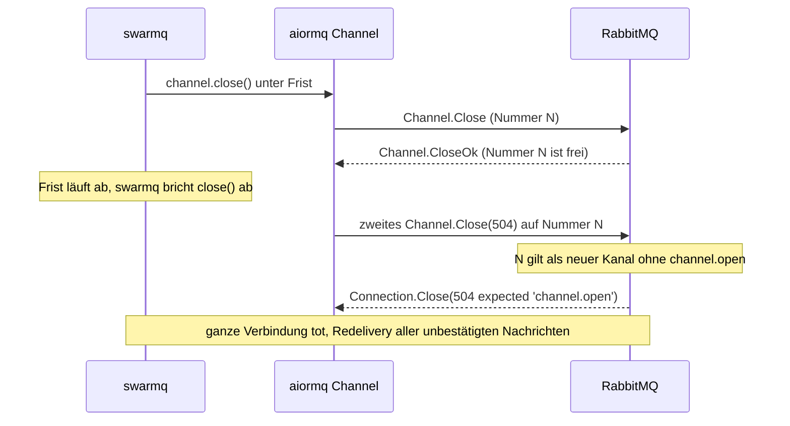
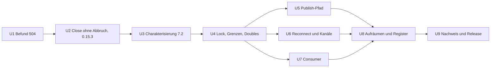

# aiormq 7.2 und aio-pika 10.2 anheben - Plan

## Goal Capsule

- **Objective:** Wer swarmq installiert, bekommt die aktuellen Versionen von aiormq und aio-pika mit deren Korrekturen. Dabei gehen keine Nachrichten verloren, keine Verbindung bricht unerwartet ab, und der Speicher eines lange laufenden Workers wächst nicht.
- **Means:** Zuerst ein Fehler, der schon heute mit aiormq 7.0 besteht, als eigenes Patch-Release (KTD1). Danach das Anheben auf aiormq 7.2.4 und aio-pika 10.2.1. Jede swarmq-Umgehung um aiormq wird einzeln gegen die neuen Versionen bewertet und überflüssige werden entfernt (KTD2 bis KTD7). Am Ende stehen eine neue Untergrenze, ein Release Candidate mit Loadsuite-Lauf und das finale Release (KTD8, KTD9).
- **Product authority:** Entscheidungsregister `compound-packs/swarmq-entscheidungen/` > dieser Plan > Plan `docs/plans/2026-10-29-1700-chore-abhaengigkeiten-anheben-plan.md` (KTD1, KTD5 dort). AGENTS.md (TDD, Qualitäts-Gates, Testports 5699/6399, `just`-Rezepte) gilt durchgehend. Befunde nach `docs/befunde/README.md`.
- **Execution profile:** Umsetzung nur nach Georgs Freigabe dieses Plans. Unit für Unit im TDD-Zyklus aus AGENTS.md, immer nur ein roter Test. U1 und U2 laufen auf `main` mit den heutigen Versionen; U3 bis U9 auf einem eigenen Branch mit den neuen Versionen.
- **Stop conditions:**
  - U1 reproduziert den 504 auf aiormq 7.0 nicht: U2 und 0.15.3 entfallen, Georg erfährt das Ergebnis, der Plan läuft ab U3 weiter.
  - Das Leck in aio-pika 10.2.1 (KTD6) bestätigt sich und keiner der beiden Wege aus KTD6 schließt es: anhalten, Georg berichten, die Obergrenze bleibt.
  - Die neue Consumer-Wiederherstellung von aio-pika widerspricht E-083 oder E-053 und lässt sich nicht abschalten (KTD7): anhalten, Georg entscheidet.
  - Eine mit `entscheidung` markierte Assertion müsste sich ändern, damit ein Test grün wird: anhalten, Georg entscheidet (AGENTS.md, „Entscheidungen respektieren“).
- **Who finishes:** Claude setzt um und öffnet die PRs. Georg gibt diesen Plan frei, entscheidet die offenen Fragen, gibt die PyPI-Uploads frei und wertet den Loadsuite-Lauf mit ab.

---

## Product Contract

### Summary

Der Plan behebt zuerst einen Verbindungsabbruch, den swarmq schon heute auslösen kann, und liefert das als 0.15.3 aus. Danach hebt er aiormq auf 7.2.4 und aio-pika auf 10.2.1 an. Er bewertet jede Umgehung um aiormq einzeln, schließt zwei neue Speicherlecks und zieht Test-Doubles, Entscheidungen und die Upgrade-Checkliste nach. Ein Release Candidate mit Loadsuite-Lauf auf celsius geht dem finalen Release voraus.

### Problem Frame

swarmq 0.15.2 begrenzt `aiormq>=7,<7.1` und `aio-pika>=9,<10.1`, weil aiormq 7.1 und 7.2 das Senden und Schließen von Kanälen umgebaut haben und swarmq dagegen nicht getestet ist. Mit aiormq 7.2.4 und aio-pika 10.2.1 sind 50 Unit-Tests rot, und `bench.py` sah einen Abbruch der ganzen Verbindung (`504 CHANNEL_ERROR - expected 'channel.open'`).

Die Grenze schützt Nutzer, hat aber Kosten. aiormq hat seit 7.1 rund 25 Korrekturen rund um Abbruch, Kanal-Schließen und Verbindungsverlust gebracht. Mehrere davon treffen genau die Fehler, gegen die swarmq eigene Umgehungen trägt (FS-08, F4-20, F4-24, F4-28). Solange die Grenze steht, bekommen Nutzer diese Korrekturen nicht, und jede künftige Sicherheitskorrektur in aio-pika oder aiormq landet hinter ihr.

Die Recherche hat drei Dinge gezeigt, die über ein reines Anheben hinausgehen:

- Den 504-Abbruch gibt es schon in aiormq 7.0. Er entsteht, wenn ein laufendes `Channel.Close` abgebrochen wird; aiormq schickt dann ein zweites Close auf dieselbe Kanalnummer. swarmq bricht `channel.close()` an mehreren Stellen per Frist ab, darunter beim Verwerfen des Publish-Kanals nach einem Fristriss (E-078).
- In aiormq 7.2 ist `Channel.closing` eine Property, die bei jedem Zugriff einen neuen Future an den Kanal hängt. swarmq liest sie bei jedem Publish; das wäre ein Speicherleck je Publish.
- aio-pika 10.2.1 entfernt seinen Callback an `connection.closing` beim Schließen eines Kanals nicht mehr. Die Verbindung hielte dann jeden je geöffneten Kanal bis zu ihrem Ende fest.

### Key Decisions

- **Erst eine Obergrenze als Sofortschutz, dann die gründliche Prüfung.** Umgesetzt mit 0.15.2. (session-settled: user-approved — chosen over sofort anheben oder Grenze dauerhaft lassen: getesteter Stand für Nutzer sofort, Korrekturen danach.) Governs R1, R10.
- **Plan zuerst, Umsetzung erst nach Georgs Freigabe.** (session-settled: user-approved — chosen over direkt umsetzen: Eingriff in Code, den Entscheidungen festschreiben.)

### Requirements

**Verbindung und Kanäle**

- R1. Ein abgebrochenes oder verspätetes Schließen eines Kanals beendet nie die ganze Verbindung, mit den heutigen und mit den neuen Versionen.
- R2. Ein Kanal, den swarmq verwirft oder schließt, kommt nach einem Reconnect nicht wieder (E-078, F4-20, F4-22, F4-24).

**Speicher**

- R3. Ein Worker mit langlebigen Publish- und Consume-Kanälen behält über viele Publishes, Kanalwechsel und Reconnects einen flachen Speicherverlauf.

**Publish-Semantik**

- R4. Die Einstufung eines fehlgeschlagenen Publish bleibt wie entschieden: nicht gesendet, gesendet oder unbestimmt (E-041, E-042, B24).
- R5. Ein Publish, der auf einen toten Kanal wartet, endet ohne Hängen und mit der entschiedenen Fehlerart (FS-08, FS-02).
- R6. Fehler, die aiormq 7.2 neu meldet, kommen als die dokumentierten swarmq-Fehler beim Aufrufer an, nicht roh.

**Consumer**

- R7. Ein vom Broker beendeter Consumer wird wie entschieden wieder angemeldet, und eine gelöschte konsumierte Queue wird nicht neu angelegt (U6/KTD3 des Plans 2026-10-08-1541, E-083).

**Versionen und Pflege**

- R8. Eine frische Installation löst genau die getesteten Versionen auf: aiormq 7.2.x ab 7.2.4, aio-pika 10.2.x ab 10.2.1.
- R9. Eine Umgehung, die ein Upstream-Fix nachweislich überflüssig macht, verschwindet mit ihrer Rückfall-Warnung. Ihre Entscheidung bekommt einen Nachtrag.
- R10. Dependabot schlägt Updates für aio-pika und aiormq wieder vor.

### Success Criteria

- Der Release Candidate besteht den Loadsuite-Lauf auf celsius, ohne Speichertrend und ohne Verbindungsabbrüche.
- In Integration, Chaos und Loadsuite erscheint keine der Rückfall-Warnungen, die nach U5 und U6 noch existieren (heute u. a. `publish_blocked_state_unreadable`, `robust_channel_release_unavailable`, `robust_queue_release_unavailable`).
- Der swarmq-eigene Nachweis aus U1 läuft je Version 20-mal ohne `Connection.Close(504)`.

### Scope Boundaries

- Kein Wechsel der RabbitMQ- oder Valkey-Version. Die Spikes und Befunde hängen an RabbitMQ 4.3.6 und 4.2.9.
- Keine neuen Funktionen und keine Änderung an der öffentlichen API.
- Keine Meldung an aiormq oder aio-pika ohne Georgs Entscheidung (Open Questions).
- Nicht gebaut: eine Unterstützung von aiormq 7.0 und 7.2 nebeneinander. Zwei Semantiken für `closing` und `basic_publish` hießen doppelte Pfade und doppelte Tests für eine Übergangszeit, die Nutzer nicht brauchen; das ändert sich nur, wenn ein Nutzer 7.0 nachweislich braucht.

#### Deferred to Follow-Up Work

- Test-Doubles grundsätzlich von `aiormq.Channel` ableiten statt Attribute nachzubauen (Muster für künftige Upgrades). Dieser Plan zieht die bestehenden Doubles nur nach.
- Prüfen, ob `_SafeProcessorFormatter` (`src/swarmq/logging_format.py`) mit aio-pika 10.2 noch nötig ist. Kein Upstream-Fix ist dafür benannt; er schadet nicht.

---

## Planning Contract

### Key Technical Decisions

- KTD1. **Ein Kanal-Close, dessen `Channel.Close` schon gesendet ist, wird nie abgebrochen; nur das Warten darauf wird begrenzt.** swarmq startet `channel.close()` als eigenen Task und wartet mit Frist darauf, ohne den Task abzubrechen. Läuft die Frist ab, sammelt `_pending_channel_closes` den Task ein. aiormqs eigene Frist (Heartbeat) begrenzt den Rest. Ein Close, das im Alarm noch auf `unblocked` wartet, hat nichts gesendet; es darf wie im E-025-Nachtrag (PF-19 a) nach 5 s abgebrochen werden, der markierte Test dazu bleibt unverändert. (pack: swarmq-entscheidungen, e025-blockierter-broker-publish-wartet.md) Das Muster stammt aus E-053 (Consumer-RPCs nie abbrechen). Betroffen sind `src/swarmq/broker/rabbitmq/connection.py` (Verwurf nach Fristriss, `_drain_pending_channel_closes`), `src/swarmq/worker/shutdown.py` (`broker_close`), `src/swarmq/broker/rabbitmq/arg_conflict.py` und `src/swarmq/broker/rabbitmq/robust_channels.py`. Die Korrektur gilt unabhängig von der aiormq-Version und geht deshalb vorab als 0.15.3 raus. (pack: swarmq-entscheidungen, e053-consumer-rpcs-nicht-abbrechen.md)
- KTD2. **Der FS-08-Wächter fällt weg, `closing` wird höchstens einmal je Kanal gelesen.** aiormq 7.2 prüft nach dem Erwerb der Kanal-Sperre erneut, ob der Kanal zu ist, und `FutureStore` lehnt nach dem Schließen neue Futures sofort ab (#240). Damit ist die Ursache von FS-08 upstream behoben, und der Wächter in `src/swarmq/broker/rabbitmq/delivery.py` (`_closing_of`, `_CHILDREN_BY_CLOSING`) wäre unter 7.2 ein Leck je Publish. Er wird entfernt, sobald ein Test gegen das echte aiormq 7.2 zeigt, dass ein Publish in der Warteschlange der Sperre nach einem Abriss sofort endet (R5). `src/swarmq/broker/rabbitmq/blocked.py` bricht seinen `closing`-Beobachter nach jedem Warten ab.
- KTD3. **B24 liest „eingereiht oder nicht“ aus dem neuen Local `sent`, „geschrieben oder nicht“ weiter aus `drain_future`.** aiormq 7.2 setzt `sent` in `basic_publish`, sobald der Frame in der `write_queue` liegt, also noch nicht auf dem Socket. `src/swarmq/broker/rabbitmq/publish_phase.py` ersetzt damit nur die Prüfung vor dem Einreihen (`_before_enqueue`, `enqueued_before_failure`). Ist `sent` wahr, entscheidet weiter `drain_future`: ohne Fehler beendet heißt geschrieben und damit unbestimmt, sonst nicht gesendet und damit Wiederholung (E-042). `drain_future = None` heißt nicht eingereiht. `sent` steht in `co_varnames`, ist aber noch nicht gebunden (Publish wartete auf die Sperre): nicht gesendet. Nur ein `basic_publish`-Rahmen ganz ohne `sent` gilt als unlesbar und damit unbestimmt. `collect_orphaned_confirm` fällt weg, weil aiormq abgelehnte Futures jetzt selbst abholt (#253). (pack: swarmq-entscheidungen, e042-publish-indeterminate-nur-nach-senden.md)
- KTD4. **`InvalidFrameError` zählt als Kanal- bzw. Verbindungsfehler.** aiormq 7.2 meldet pamqp-Fehler als `aiormq.exceptions.InvalidFrameError`. Die Klasse kommt in `_CHANNEL_TRANSIENT_ERRORS` (`connection.py`) und in die Fehlerabbildung auf `BrokerConnectionError` (R6).
- KTD5. **Test-Doubles folgen aiormq 7.2, Assertionen markierter Tests bleiben.** `tests/support/aiormq_transport.py` (`FakeTransport`) bekommt `_raise_on_channel_close`, `_closing`, `_close_exception`, Beobachter-Semantik für `closing` und die Sperre als Async-Contextmanager. Die F4-20-Fakes bekommen `on_consumer_cancel_callbacks`. Ein Test, der ein upstream behobenes Fehlverhalten nachbaut (`tests/unit/broker/test_befund_fs08_publish_lock_waiter.py`), wird nicht still angepasst; Georg entscheidet (Open Questions).
- KTD6. **Das Leck in aio-pika 10.2.1 wird vor dem Anheben gemessen und auf swarmq-Seite geschlossen.** `UnderlayChannel.create` hängt einen Callback an einen frischen Beobachter von `connection.closing`, speichert den Beobachter nicht, und `close` entfernt den Callback nicht mehr. Die Verbindung hält so jeden geschlossenen Kanal fest. swarmq öffnet laufend kurzlebige Kanäle: Argumentprüfung, Queue-Existenzprüfung des Consumer-Wächters, Tiefen- und Statusabfragen (`admin.py`, `connection.py`) und die Probe-Kanäle der Wiederherstellung. Gemessen wird am inneren Future `connection.transport.connection._closing`, nicht an `closing` (das liefert je Zugriff einen neuen Beobachter). Zwei Wege zum Schließen, U3 prüft beide:
  1. `open_throwaway_channel` (`robust_channels.py`) liefert eine swarmq-Unterklasse von `aio_pika.Channel`, die den Beobachter selbst hält und beim Schließen abbricht.
  2. Nach dem Schließen sucht swarmq unter den Callbacks von `_closing` den Beobachter, der den `close_callback` dieses Kanals trägt, und bricht ihn ab.

  Beide fail-open mit einer Warnung je Verbindung. Die Stop condition greift erst, wenn beide scheitern.
- KTD7. **Der Consumer-Wächter wird gegen die neue Wiederherstellung von aio-pika abgeglichen, nicht ersetzt.** aio-pika 10.2 meldet einen vom Broker beendeten Consumer selbst mit demselben Tag neu an. Dabei deklariert es die Queue mit ihren Original-Parametern neu, also auch eine gelöschte (widerspricht E-083). Es ruft `consume` und `basic_cancel` mit `timeout=5` auf dem Consume-Kanal auf; läuft so ein RPC in die Frist, schließt aiormq den Kanal mit 504 und alle Consumer des Workers fallen weg (widerspricht E-053). Und `recovery.cancel()` kann ein laufendes `probe.close()` abbrechen, was den zweiten Close aus U1 auf swarmqs Verbindung erzeugt (R1). aiormq beantwortet einen Broker-Cancel nur mit `CancelOk`, wenn der Server `accept_consumer_cancel_ok` meldet, also ab RabbitMQ 4.3.7; auf den Testbrokern 4.3.6 und 4.2.9 ist das nicht prüfbar. Darum bleiben die „Zombie“-Prämisse der Settle-Regel und das eigene Abmelden des Wächters. Erst halten Charakterisierungstests auf 4.3.6 und 4.2.9 das Verhalten fest; danach entscheidet Georg, welche Seite die Wiederanmeldung übernimmt. (pack: swarmq-entscheidungen, e083-geloeschte-konsumierte-queue.md; pack: swarmq-entscheidungen, e053-consumer-rpcs-nicht-abbrechen.md)
- KTD8. **Vorschlag für die Grenzen: `aiormq>=7.2.4,<7.3` und `aio-pika>=10.2.1,<10.3`; die Obergrenzen entscheidet Georg vor U4 (Open Questions).** Die Untergrenzen folgen aus R8. aio-pika 10.2.1 verlangt ohnehin `aiormq>=7.2.4`. Für Obergrenzen beim nächsten Minor spricht, dass swarmq an privaten Interna hängt und zwei Minors von aiormq sie geändert haben. Dependabot schlägt Anhebungen über die Grenze vor, die Tests entscheiden.
- KTD9. **Nachweis: Integration, e2e und Chaos, dann ein Release Candidate mit Loadsuite auf celsius, dann final.** (session-settled: user-approved — chosen over final ohne Release Candidate: Laufzeitpfad betroffen.) Konflikt-Hinweis: Diese Änderung betrifft Speicherverhalten über Zeit. Nach Georgs Staffelung (6 h bei Langzeitverhalten) spricht das für 6 h statt 1 h; die Wahl steht unter Open Questions.

### High-Level Technical Design

Wie der 504 entsteht, wenn swarmq ein laufendes Close abbricht (heute schon mit aiormq 7.0):

Mit KTD1 bricht swarmq nicht mehr ab, sondern lässt das erste Close zu Ende laufen. Das zweite Close entfällt.

Reihenfolge der Units:

### Assumptions

- Die Ursache des 504 aus der Code-Analyse trifft zu: Ein abgebrochenes `Channel.Close` sendet ein zweites Close, und RabbitMQ beendet daraufhin die Verbindung. U1 belegt das, bevor U2 etwas ändert.
- `sent` ist in `aiormq.Channel.basic_publish` von 7.2.4 bis zum nächsten Minor ein stabiles Local. Ein Versionsschutz-Test hält das fest.

---

## Implementation Units

### U1. Befund: abgebrochenes Kanal-Close beendet die Verbindung

**Goal:** Den 504-Abbruch als Befund nach `docs/befunde/README.md` erfassen und mit einem roten Nachweis belegen, auf den heutigen Versionen.

**Requirements:** R1

**Dependencies:** keine

**Files:**
- `docs/befunde/saettigungsbuch.toml` (Signal, wie S-009)
- Register nach `docs/befunde/README.md`, voraussichtlich `docs/befunde/fehlersuche-runde-4-2026-10.md` neben F4-28
- `tests/integration/broker/test_befund_<id>_close_abort_kills_connection.py`

**Approach:**
1. Gegenprüfung zuerst: E-025 und E-078 dulden im Alarmfall ein doppeltes Close („Got frame for closed channel“). Prüfen, ob der Abbruch der Verbindung dort schon entschieden ist.
2. Nachweis gegen echtes RabbitMQ auf den Testports, deterministisch auf der Client-Seite: Der Test hält aiormqs Verarbeitung des eingehenden `Channel.CloseOk` an (Patch auf die CloseOk-Behandlung des Kanals, der auf ein Event wartet), bricht das Close in dieser Zeit ab und gibt die Verarbeitung dann frei. Das zweite Close kommt so sicher an, nachdem der Broker die Nummer freigegeben hat. Ein Speicheralarm taugt dafür nicht: Dort liegen beide Closes im Puffer, und es entsteht nur das harmlose „Got frame for closed channel“.
3. Einstufung und Eintrag mit Wirkung (Redelivery unbestätigter Nachrichten, Verbindung des Aufrufers auf dem injizierten Pfad).

**Execution note:** Erst den Nachweis rot sehen, mit `xfail(strict=True)` und `befund`-Marker, dann einstufen. Bleibt er auf aiormq 7.0 grün, greift die Stop condition für U2.

**Patterns to follow:** `tests/integration/broker/test_befund_f4_24_aborted_channel_open.py` (patcht eine aiormq-Kanalmethode gegen echtes RabbitMQ).

**Test scenarios:**
- Close eines offenen Kanals, Abbruch, nachdem der Broker das erste Close beantwortet hat: Die Verbindung schließt mit 504 (Nachweis, heute rot).
- Abbruch, bevor das erste Close geschrieben ist: Die Verbindung bleibt offen (Abgrenzung).

**Verification:** Signal und Befund sind eingetragen, der Nachweis schlägt reproduzierbar fehl, und der Wächter `tests/unit/test_saettigungsbuch.py` ist grün.

---

### U2. Kanal-Close ohne Abbruch, Release 0.15.3

**Goal:** swarmq bricht kein laufendes `channel.close()` mehr ab (KTD1) und liefert das als 0.15.3 aus.

**Requirements:** R1, R2

**Dependencies:** U1

**Files:**
- `src/swarmq/broker/rabbitmq/connection.py`
- `src/swarmq/worker/shutdown.py`
- `src/swarmq/broker/rabbitmq/arg_conflict.py`
- `src/swarmq/broker/rabbitmq/robust_channels.py`
- `tests/unit/broker/test_publish_deadline_channel_discard.py`, `tests/unit/broker/test_robust_channels.py`, neue Unit-Tests je Stelle
- `tests/unit/broker/test_rabbitmq.py`: der mit E-025 markierte `test_closing_the_broker_during_the_wait_cancels_the_close_without_leftovers` bleibt unverändert und grün
- Nachweis aus U1 (ohne `xfail`)
- `benchmarks/bench.py` (`_bench_channel` schließt nach demselben Muster)
- `website/reference/changelog.md`, `website/reference/changelog.de.md`, Version wie bei 0.15.2

**Approach:**
1. Ein gemeinsamer Helfer startet das Close als Task und wartet mit Frist, ohne abzubrechen.
2. Alle Stellen aus KTD1 nutzen ihn.
3. Abgelaufene Close-Tasks landen in `_pending_channel_closes`. Beim Schließen des Brokers gilt KTD1: Ein Task, der noch auf `unblocked` wartet, wird nach 5 s abgebrochen (E-025-Nachtrag). Ein Task, dessen `Channel.Close` schon läuft, wird nicht abgebrochen; auf dem eigenen Pfad beendet ihn das folgende Verbindungs-Close, auf dem injizierten Pfad läuft er bis `CloseOk` oder bis zu aiormqs Frist.
4. `bench.py` bekommt dasselbe Muster, damit Szenario 6 als Benchmark sauber läuft. Als Nachweis für KTD1 zählt er nicht; `bench.py` ruft swarmq dort nicht auf.
5. Release 0.15.3 wie 0.15.2 (Tag, Freigabe `pypi`).

**Patterns to follow:** E-053 im Consumer-Wächter (`src/swarmq/broker/rabbitmq/consumer_watch.py`, RPC ohne `wait_for`), `_close_channel_detached` in `connection.py`.

**Test scenarios:**
- Verwurf nach Fristriss, Broker antwortet nach Ablauf der Frist: Der Publish-Pfad kehrt zur Frist zurück, das Close läuft weiter, die Verbindung bleibt offen (U1-Nachweis grün).
- Eigener Pfad, Broker antwortet nie: Der Close-Task bleibt in `_pending_channel_closes` und endet mit dem Schließen der Verbindung.
- Injizierter Pfad, Broker antwortet nie: Der Broker schließt, ohne den laufenden Close-Task abzubrechen; die Verbindung des Aufrufers bleibt offen.
- Broker schließt, während ein Close im Alarm noch auf `unblocked` wartet: Abbruch nach 5 s wie bisher (markierter E-025-Test unverändert grün).
- Argumentkonflikt-Prüfung mit langsamem Close: Die gemeinsame Verbindung bleibt offen.
- Abbruch des Aufrufers während des Wartens: `CancelledError` kommt beim Aufrufer an, der Close-Task läuft weiter.

**Verification:** `just all` grün; der U1-Nachweis läuft auf aiormq 7.0.0 20-mal ohne 504; 0.15.3 auf PyPI.

---

### U3. Charakterisierung von aiormq 7.2 und aio-pika 10.2

**Goal:** Die Annahmen über die neuen Versionen mit Tests gegen die echten Bibliotheken festhalten, bevor Code sich ändert.

**Requirements:** R3, R4, R7

**Dependencies:** U2

**Files:**
- `tests/unit/broker/test_aiormq_7_2_semantics.py` (Versionsschutz)
- `tests/integration/broker/test_channel_callbacks_flat.py` (Leckmessung)
- `tests/integration/broker/test_consumer_cancel_recovery.py` (Charakterisierung 4.3.6 und 4.2.9)

**Approach:**
1. Auf dem Upgrade-Branch zunächst nur `uv.lock` anheben, Grenzen vorläufig weit.
2. Versionsschutz-Tests zur Semantik, nicht nur zum Typ: Identität zweier `closing`-Zugriffe, Local `sent` in `basic_publish`, `InvalidFrameError`-Hierarchie.
3. Leckmessungen nach KTD2 und KTD6.
4. Consumer-Charakterisierung nach KTD7.

**Execution note:** Charakterisierung vor jeder Änderung; die Leckmessungen sind auf 7.2.4/10.2.1 zunächst rot.

**Test scenarios:**
- 10 000 Publishes auf einem Kanal: Die Zahl der Callbacks an `_closing` des Kanals bleibt konstant (heute rot mit dem FS-08-Wächter).
- 10 000 Wegwerf-Kanäle öffnen und schließen: Die Zahl der Callbacks an `connection.transport.connection._closing` bleibt konstant (prüft das aio-pika-Leck; zunächst rot, danach mit beiden Wegen aus KTD6).
- Broker beendet einen Consumer (Queue-Policy auf 4.3.6): aio-pika meldet mit demselben Tag neu an, und es entsteht kein zweiter Consumer neben dem des Wächters.
- Konsumierte Queue wird gelöscht: Ob aio-pika sie neu deklariert, wird festgehalten (Grundlage für KTD7).
- Wiederanmeldung durch aio-pika, deren `consume` in die Frist läuft: Ob aiormq den Consume-Kanal mit 504 schließt, wird festgehalten (E-053).
- Kanal schließt, während aio-pikas Wiederherstellung einen Probe-Kanal schließt: Ob die Verbindung mit 504 stirbt, wird festgehalten (R1).
- `closing` zweimal gelesen: zwei verschiedene Futures (Versionsschutz).

**Verification:** Jede Annahme aus KTD2, KTD3, KTD6 und KTD7 hat einen Test gegen die echte Bibliothek; die Ergebnisse stehen im Befund- bzw. Plan-Nachtrag.

---

### U4. Lock, Grenzen und Test-Doubles

**Goal:** Die neuen Versionen sind gesperrt, die Grenzen gesetzt, und die Test-Doubles bilden aiormq 7.2 nach (KTD5, KTD8).

**Requirements:** R8, R10

**Dependencies:** U3

**Files:**
- `pyproject.toml`, `uv.lock`
- `benchmarks/requirements.txt`, `benchmarks/comparison/requirements-swarmq.txt`
- `tests/support/aiormq_transport.py`
- `tests/unit/broker/test_befund_f4_20_restore_closed_channels.py` (Fakes, auch genutzt von F4-22 und F4-24)
- `tests/kosten/conftest.py`, ggf. `tests/kosten/basislinie.toml`
- `tests/unit/test_project_metadata.py`
- `.github/dependabot.yml`

**Approach:**
1. Grenzen nach KTD8, Metadaten-Test zuerst rot auf die neue Untergrenze.
2. Doubles um die neuen Attribute ergänzen; Assertionen mit `entscheidung`-Marker unverändert.
3. Benchmark- und Vergleichs-Pins nachziehen (Befehle im Dateikopf).
4. Die `ignore`-Regel für aio-pika und aiormq in Dependabot entfernen.

**Test scenarios:**
- Metadaten: Die Grenzen schließen 7.2.3 und 7.3.0 aus und enthalten die gesperrte Version.
- Kosten-Suite: Frames je Publish bleiben gleich; Modulzahlen werden nur mit Verweis auf diesen Plan nachgeführt.
- Test expectation für die Doubles: Die 50 roten Unit-Tests sind grün oder stehen auf der Liste der Fälle für U5 bis U7 bzw. für Georgs Entscheidung (KTD5).

**Verification:** `just unit`, `just types` und `just lint` grün bis auf die bewusst offenen Fälle aus U5 bis U7.

---

### U5. Publish-Pfad auf aiormq 7.2

**Goal:** Publish-Semantik und Speicher stimmen unter aiormq 7.2 (KTD2, KTD3, KTD4).

**Requirements:** R3, R4, R5, R6, R9

**Dependencies:** U4

**Files:**
- `src/swarmq/broker/rabbitmq/delivery.py`
- `src/swarmq/broker/rabbitmq/publish_phase.py`
- `src/swarmq/broker/rabbitmq/blocked.py`
- `src/swarmq/broker/rabbitmq/connection.py`, `declarations.py`, `admin.py`, `arg_conflict.py` (Fehlerabbildung)
- `tests/unit/broker/test_publish_channel_closing.py`, `test_publish_connection_loss.py`, `test_publish_phase.py`
- `tests/unit/worker/test_fs08_drain_cancel_publish.py`, `tests/unit/worker/test_befund_fs02_recycling_publish_deadline.py`
- `tests/integration/broker/test_publish_closing_guard.py`, `tests/integration/broker/test_befund_b24_publish_connection_loss.py`

**Approach:**
1. Nachweis gegen echtes aiormq 7.2: Ein Publish in der Warteschlange der Sperre endet nach einem Abriss sofort. Danach den FS-08-Wächter samt Warnung entfernen.
2. `publish_phase.py` nach KTD3 umstellen: `sent` für „eingereiht“, `drain_future` für „geschrieben“, `collect_orphaned_confirm` entfernen.
3. `blocked.py` bricht seinen Beobachter nach dem Warten ab.
4. `InvalidFrameError` einordnen.
5. FS-02-Annahme prüfen: Der Frame wird vor dem ersten Suspend eingereiht. aiormq 7.2 betritt vorher `asyncio.timeout` und die Sperre als Async-Contextmanager.

**Execution note:** Jede entfernte Umgehung erst nach einem grünen Test gegen die echte Bibliothek, der zeigt, dass die Entscheidung weiter gilt.

**Test scenarios:**
- Abriss, während ein zweiter Publish auf die Sperre wartet: Beide enden mit `BrokerConnectionError`, der zweite als nicht gesendet (R5, Integration).
- Abriss, nachdem der Frame eingereiht, aber bevor er geschrieben ist: nicht gesendet, Wiederholung auf neuem Kanal (E-042; der markierte `test_connection_lost_before_the_frame_was_written_retries_on_a_new_channel` bleibt unverändert grün).
- Abriss, nachdem der Frame geschrieben ist: unbestimmt (R4).
- Abriss vor dem Einreihen: `PublishCancelledUnsent` bzw. nicht gesendet, wie E-041 (R4).
- pamqp-Fehler beim Schreiben vor dem Einreihen: Wiederholung auf neuem Kanal wie B24 (R6).
- 10 000 Publishes: Callback-Zahl flach (U3-Messung grün, R3).
- Endfrist während des Recycling-Drains abgelaufen: Publish geht nicht auf die Leitung (FS-02).

**Verification:** Die U3-Messung für Publishes ist grün; die B24- und FS-08-Integrationstests sind grün; die Warnungen des entfernten Wächters sind auch aus dem Event-Katalog `website/reference/logging.md` und `logging.de.md` entfernt.

---

### U6. Reconnect, Restore und Kanäle unter aio-pika 10.2

**Goal:** Verworfene, ersetzte und abgebrochen geöffnete Kanäle bleiben weg, und das aio-pika-Leck ist geschlossen (KTD6).

**Requirements:** R2, R3, R9

**Dependencies:** U4

**Files:**
- `src/swarmq/broker/rabbitmq/robust_channels.py`
- `src/swarmq/broker/rabbitmq/connection.py` (`_ensure_channel_tracked`, `_retire_replaced_channel`, `_close_after_restore`)
- `tests/unit/broker/test_befund_f4_20_restore_closed_channels.py`, `test_befund_f4_22_channel_replaced_in_restore_window.py`, `test_befund_f4_24_aborted_channel_open.py`, `test_robust_channels.py`
- Integration: die F4-20-, F4-22- und F4-24-Tests, `tests/integration/broker/test_channel_callbacks_flat.py`

**Approach:**
1. Restore-Zeitannahmen von F4-22 gegen die neue Rückstell-Schleife von `_on_connected` prüfen.
2. `release_channel` bleibt (verworfene, ersetzte und abgebrochen geöffnete Kanäle kommen sonst wieder). Die Annahme aus `close_channel_quietly` passt sich an: Ein per `close()` geschlossener Kanal kommt nicht mehr zurück.
3. Das aio-pika-Leck nach KTD6 schließen; den Weg nimmt, der in U3 gemessen funktioniert hat. Scheitern beide, Stop condition.

**Test scenarios:**
- Reconnect nach Verwurf eines Kanals im Alarm: Beim Broker ist nach jedem Reconnect nur der lebende Kanal offen (F4-20, Integration).
- Ersatzkanal im Restore-Fenster: ein Kanal nach jedem Reconnect (F4-22).
- Öffnen per Frist abgebrochen: Der Kanal kommt nicht wieder (F4-24).
- 10 000 Wegwerf-Kanäle: Callback-Zahl an der Verbindung flach (KTD6).

**Verification:** F4-20-, F4-22- und F4-24-Nachweise grün; die Leckmessung für Kanäle ist grün oder die Stop condition ist ausgelöst und berichtet.

---

### U7. Consumer unter aio-pika 10.2

**Goal:** Consumer-Wächter, Settle-Regel und E-083 stimmen mit der neuen Wiederherstellung von aio-pika und dem `CancelOk` von aiormq überein (KTD7).

**Requirements:** R7, R9

**Dependencies:** U4

**Files:**
- `src/swarmq/broker/rabbitmq/consumer_watch.py`
- `src/swarmq/broker/rabbitmq/delivery.py` (`_may_settle`)
- `src/swarmq/broker/rabbitmq/robust_channels.py` (`release_queue`, `readmit_queue`)
- `tests/unit/broker/test_consumer_watch*.py`, `tests/integration/broker/test_consumer_timeout.py`, `tests/integration/broker/test_consumed_queue_deleted.py`, `tests/integration/broker/test_rabbitmq_settle.py`

**Approach:**
1. Aus den U3-Charakterisierungen Georg vorlegen, wer die Wiederanmeldung übernimmt. Die naheliegende Lösung „aio-pika meldet an, der Wächter prüft nur noch“ kollidiert mit E-053, weil aio-pika seine RPCs auf dem Consume-Kanal mit Frist aufruft; sie ist nur tragbar, wenn U3 zeigt, dass das in der Praxis keinen 504 auslöst, oder wenn swarmq aio-pikas Wiederherstellung für seine Consumer abschaltet.
2. Verhindern, dass aio-pika eine gelöschte Queue neu deklariert (E-083), über die vorhandene `release_queue`-Mechanik.
3. Die „Zombie“-Prämisse der Settle-Regel und das eigene Abmelden des Wächters bleiben (KTD7). Der Register-Nachtrag hält nur fest, dass sie ab RabbitMQ 4.3.7 entfallen könnten.

**Execution note:** Weicht das Ergebnis von E-053, E-083 oder von KTD3/KTD4 des Plans 2026-10-08-1541 ab, entscheidet Georg, bevor Code sich ändert (Stop condition).

**Test scenarios:**
- Consumer-Timeout auf 4.3.6: genau ein Consumer nach der Wiederanmeldung, keine doppelte Zustellung.
- Dasselbe auf 4.2.9 (Charakterisierung, wie in `test_consumer_timeout.py`).
- Konsumierte Queue gelöscht: Sie wird nicht neu angelegt, der Worker meldet den Fehler wie entschieden (PF-20, E-083).
- Settle nach Broker-Cancel: verhält sich wie U7/KTD4 des Plans 2026-10-08-1541 festlegt.

**Verification:** `test_consumer_timeout.py` (beide Versionen), `test_consumed_queue_deleted.py` und `test_rabbitmq_settle.py` grün.

---

### U8. Aufräumen, Register und Checkliste

**Goal:** Überflüssige Ausnahmen und Umgehungen sind weg, und Register, Checkliste und Doku entsprechen aiormq 7.2 (R9).

**Requirements:** R9, R10

**Dependencies:** U5, U6, U7

**Files:**
- `tests/support/known_leaks.py` (TS-01 bis TS-03 probeweise entfernen)
- `src/swarmq/worker/lifecycle.py` (F4-28 gegen `TaskWrapper` mit #239 prüfen)
- `compound-packs/swarmq-entscheidungen/` (Nachträge zu E-001, E-025, E-053, E-078 und den Entscheidungen der entfernten Umgehungen)
- `docs/befunde/fehlersuche-runde-2-2026-10.md`, `docs/befunde/fehlersuche-runde-4-2026-10.md` (FS-08, F4-28 und weitere: Stand unter 7.2)
- `docs/solutions/tooling-decisions/upgrade-checkliste-private-bibliotheks-apis-2026-10-19.md` (Stand 7.2.4/10.2.1, neue Einträge: Frame-Locals in `basic_publish`, `_raise_on_channel_close`, `closing`-Beobachter, `TaskWrapper`, Consumer-Wiederherstellung)
- `website/reference/logging.md`, `website/reference/logging.de.md` (geänderte aiormq-Logzeilen)
- `src/swarmq/broker/rabbitmq/robust_channels.py` und Tests (Kommentare „aio-pika 10.0.1“)
- `website/reference/changelog.md`, `website/reference/changelog.de.md`

**Approach:**
1. Je Ausnahme in `known_leaks.py`: entfernen, Suiten laufen lassen, bei Rot zurück mit Begründung.
2. Nachträge mit Datum und Quelle, alter Text bleibt stehen.
3. Alle Kommentare mit „aio-pika 10.0“ oder „aiormq 7.0“ nachziehen.

**Test scenarios:**
- Test expectation: keine neue Verhaltensprüfung. Die bestehenden Suiten mit `filterwarnings = error` sind der Nachweis für entfernte Leck-Ausnahmen; `tests/unit/test_entscheidungsregister.py` prüft die Nachträge.

**Verification:** `just all` grün ohne die entfernten Ausnahmen; Register-Wächter grün; `mkdocs build --strict` grün.

---

### U9. Nachweis und Release

**Goal:** Release Candidate, Loadsuite-Abnahme und finales Release (KTD9).

**Requirements:** R1 bis R10

**Dependencies:** U8

**Files:**
- `pyproject.toml`, `uv.lock`, `website/reference/agent/spec/index.json`, `.github/ISSUE_TEMPLATE/bug_report.yml`, Changelog en/de (Version)
- Loadsuite-Repo: Pin auf den Release Candidate

**Approach:**
1. `just all`, dann das Chaos-Gate nach `docs/testing/test-strategy.md`.
2. Den U1-Nachweis 20-mal mit den neuen Versionen.
3. Release Candidate taggen, nach Georgs Freigabe auf PyPI.
4. Loadsuite auf celsius mit geleertem Ereignis-Store, Dauer nach Georgs Wahl (KTD9), dabei auf die Rückfall-Warnungen achten.
5. Finales Release ohne weiteren Lauf.

**Test scenarios:**
- Test expectation: keine neuen Tests; die Abnahme besteht aus den Läufen oben.

**Verification:** Success Criteria erfüllt; finale Version auf PyPI; GitHub-Release mit SBOM und Nachweisen.

---

## Verification Contract

- Alle Tests nur über `uv run just …` auf den Testports 5699/6399, nie gegen 5672/6379. Vor Integration und e2e prüfen, ob eine andere Sitzung Tests fährt.
- Vor jedem Commit: `uv run just lint` und `uv run just types` (mypy über `src/swarmq` und `tests`).
- Je Unit: die genannten Tests; je PR: `uv run just all`.
- Vor jedem Release: Chaos-Gate nach `docs/testing/test-strategy.md`, `uv run --extra docs mkdocs build --strict`.
- Leckmessungen (U3) laufen als Integrationstests in jeder CI.
- Loadsuite: Smokes, dann der Lauf nach KTD9 auf celsius, Ereignis-Store vorher leeren.

## Definition of Done

- Alle Units erledigt, jede mit grünem Nachweis; keine `xfail` aus U1 übrig.
- Kein Code abgebrochener Versuche im Diff, keine auskommentierten Umgehungen.
- Die Grenzen sind gesetzt, Dependabot schlägt beide Pakete wieder vor.
- Register, Upgrade-Checkliste, Event-Katalog und Changelog entsprechen dem neuen Stand.
- 0.15.3 und die finale Version mit aiormq 7.2 sind auf PyPI.

## Open Questions

Alle für Georg; keine blockiert U1 und U2.

- **FS-08-Nachbau** (`tests/unit/broker/test_befund_fs08_publish_lock_waiter.py`): Er bildet ein Fehlverhalten nach, das aiormq 7.2 behoben hat. Ersetzen durch einen Integrationstest gegen echtes aiormq 7.2 (Vorschlag) oder streichen? Blockiert U5.
- **Meldungen an Upstream:** (a) das zweite `Channel.Close` nach einem abgebrochenen Close in aiormq, auch aus aio-pikas eigener Wiederherstellung heraus, (b) das Leck in `UnderlayChannel.close` von aio-pika 10.2.1, (c) die offene F4-28-Meldung, die #239 vermutlich erledigt. Melden oder nicht?
- **Obergrenzen** (KTD8): `<7.3`/`<10.3` (Vorschlag, Interna-Kopplung) oder `<8`/`<11` (Nutzer bekommen Minors ohne swarmq-Release)? Blockiert U4.
- **Loadsuite-Dauer** (KTD9): 1 h wie besprochen oder 6 h wegen Speicherverhalten?
- **Wiederanmeldung von Consumern** (KTD7): erst nach den U3-Ergebnissen entscheidbar, mit Blick auf E-053 und E-083. Blockiert U7.

## Risks & Dependencies

| Risiko | Wirkung | Gegenmaßnahme |
|---|---|---|
| Rückfall-Warnungen statt roter Tests | Eine geänderte Interna-Stelle fällt still auf den Rückfall zurück | Success Criterion: Warnungen in Integration, Chaos und Loadsuite prüfen |
| Doubles bilden altes Verhalten nach | Grüne Unit-Tests beweisen nichts über 7.2 | Jede entfernte Umgehung braucht einen Test gegen die echte Bibliothek (U5, U6) |
| aio-pika-Leck nicht schließbar | Anheben unmöglich | Stop condition; Obergrenze bleibt |
| Consumer-Wiederherstellung widerspricht E-083 | Gelöschte Queues kommen wieder | Charakterisierung in U3, Entscheidung vor U7 |
| Statistik bei 504 | „2 von 3“ trennt Versionen nicht | Deterministischer U1-Nachweis, 20 Läufe je Version (U2, U9) |
| Close ohne Abbruch bei `heartbeat=0` | Auf dem injizierten Pfad begrenzt aiormq ein hängendes Close nicht; der Task bleibt in `_pending_channel_closes` | Hingenommen: ein einzelner wartender Task je verworfenem Kanal, nur bei abgeschaltetem Heartbeat und totem Broker; die Konfigurations-Doku nennt es |
| 504 aus aio-pikas Wiederherstellung | `recovery.cancel()` bricht ein `probe.close()` ab, außerhalb von swarmqs Helfer aus KTD1 | U3 hält es fest; Abhilfe nach KTD7, sonst Meldung (a) |

## Sources & Research

- Upstream-Releases aiormq 7.1.0 bis 7.2.4 (github.com/mosquito/aiormq/releases), insbesondere #235, #237, #239, #240, #245, #249, #250, #253, #265, #266, #268.
- Quellen aiormq 7.0.0/7.2.4 und aio-pika 10.0.4/10.2.1: `aiormq/channel.py` (`rpc`, `basic_publish`, `_raise_on_channel_close`), `aiormq/base.py` (`closing`, `FutureStore`), aio-pika `abc.py` (`UnderlayChannel`), `robust_channel.py` (`_on_consumer_cancel`, `restore`), `robust_connection.py`.
- Upgrade-Checkliste `docs/solutions/tooling-decisions/upgrade-checkliste-private-bibliotheks-apis-2026-10-19.md`: Gerüst für U4 bis U8.
- Vorgänger `docs/plans/2026-10-29-1700-chore-abhaengigkeiten-anheben-plan.md` (KTD1, KTD5).
- Entscheidungen (pack: swarmq-entscheidungen): e001, e025, e041, e042, e053, e078, e083.
- Befunde: FS-02, FS-08 (`docs/befunde/fehlersuche-runde-2-2026-10.md`), F4-20 bis F4-24, F4-28 (`docs/befunde/fehlersuche-runde-4-2026-10.md`), B24, BZ-16.
