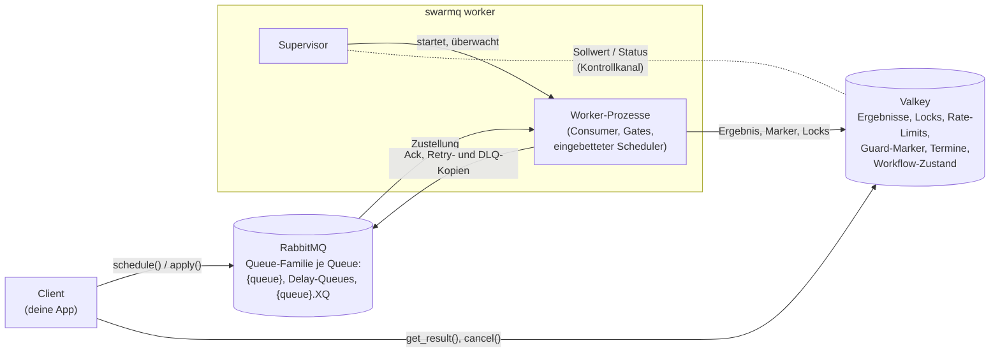
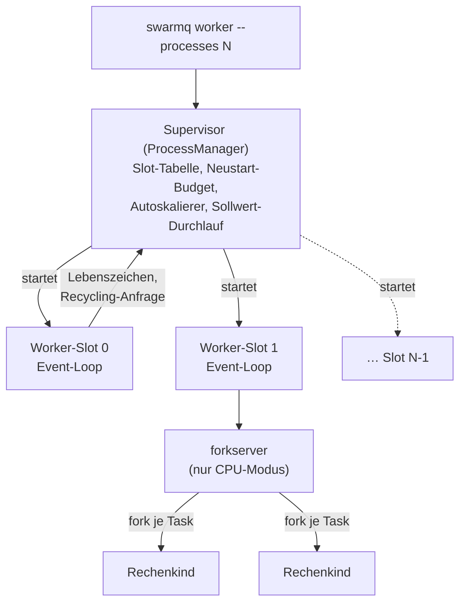
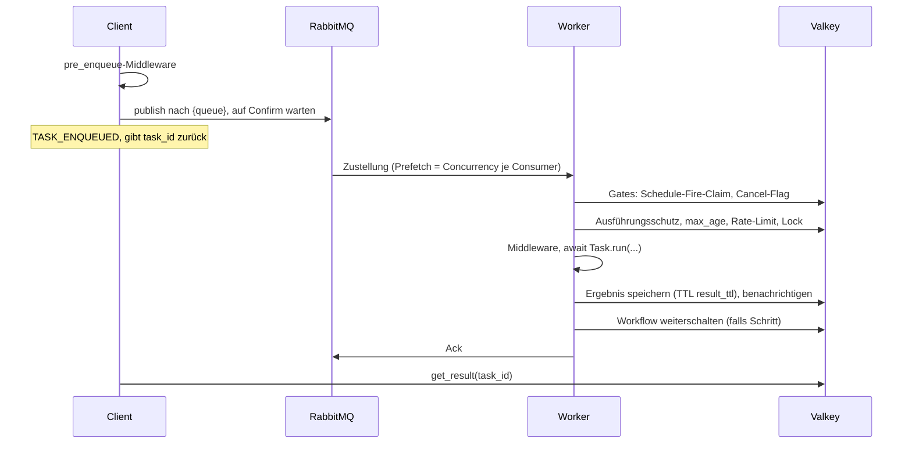
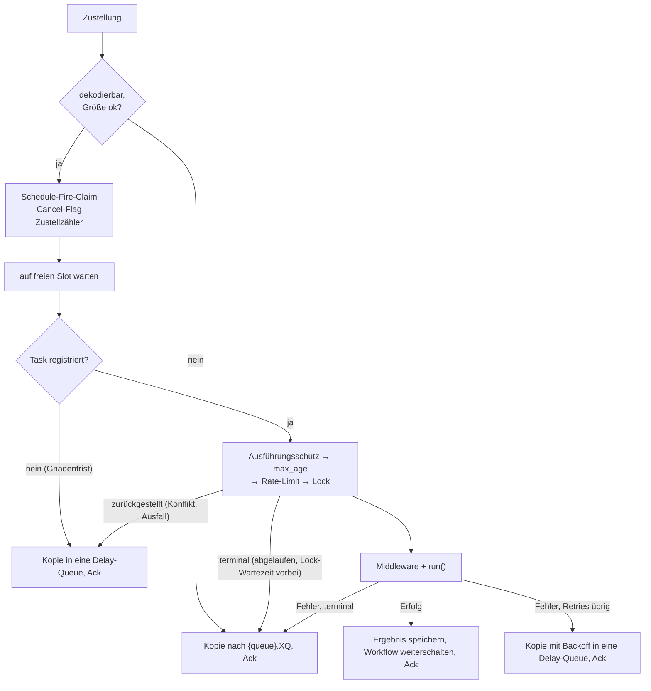
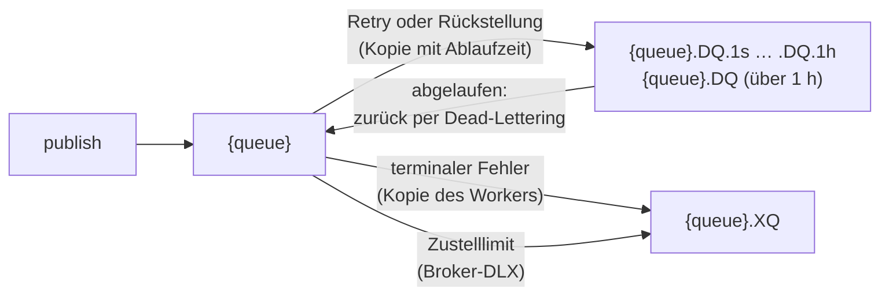

# Architektur

SwarmQ verbindet deinen Code mit zwei Infrastruktur-Diensten. Ein
**Client** plant Arbeit ein. Ein **Broker** (RabbitMQ) trägt diese
Arbeit zu einem **Worker**. Ein **Backend** (Valkey) hält Ergebnisse,
Locks, Rate-Zähler, Cancel-Flags, Workflow-Zustand und den Scheduler.
Jeder `swarmq worker` läuft unter einem **Supervisor**, der seine
Worker-Prozesse am Leben hält. Middleware, Signale, Retries, Workflows
und der Scheduler bauen auf diesen Beteiligten auf.

## Die Rollen

- **Client.** Jeder Prozess, der auf einer `SwarmQ`-App `schedule()`,
  `run()`, `apply()`, `cancel()` oder `get_result()` aufruft: deine
  Web-App, ein Cron-Job, ein anderer Task. Ein Client braucht die
  importierten Task-Klassen, um Queue und Voreinstellungen jedes Tasks
  aufzulösen.
- **Broker.** RabbitMQ. SwarmQ deklariert per Default
  [Quorum-Queues](https://www.rabbitmq.com/docs/quorum-queues),
  publiziert mit Publisher-Confirms und verlässt sich für die
  Neuzustellung nach einem Absturz auf den Broker. Jede Queue kommt als
  Familie: die Haupt-Queue `{queue}`, die Delay-Queues `{queue}.DQ` und
  `{queue}.DQ.<stufe>` für Retries und Rückstellungen und die
  Dead-Letter-Queue `{queue}.XQ` ([Queue-Topologie](#queue-topologie)).
- **Worker.** Ein oder mehrere Worker-Prozesse, gestartet mit
  `swarmq worker --module myapp.tasks`. Jeder importiert dein
  Task-Modul, registriert die gefundenen `Task`-Subklassen und
  konsumiert die angegebenen Queues. Im Default-IO-Pool laufen Tasks als
  Koroutinen in einer Event-Loop, begrenzt durch `--concurrency`; im
  CPU-Modus laufen sie in Rechenkindern ([Prozessmodell](#prozessmodell)).
- **Backend.** Valkey (ab 8) für jeden geteilten Zustand: Ergebnisse und
  Fortschritt, [Lua](https://www.lua.org/)-gesteuerte Rate-Limits und
  Locks, Cancel-Flags, Dedup-Claims, die Marker des
  [Ausführungsschutzes](delivery-semantics.md#ausfuhrungsschutz),
  Scheduler-Einträge, Leader-Wahl, Workflow-Zustand und den
  Kontrollkanal.

Ein Deployment besteht aus diesen Kästen und sonst nichts: kein
zusätzlicher Überwachungsprozess, keine Datenbank, keine Migrationen.

## Prozessmodell

Jeder `swarmq worker` läuft unter dem **Supervisor**, auch mit nur einem
Worker-Prozess. Er startet die Worker-Prozesse per
`multiprocessing`-spawn, sodass jeder eigene Broker- und
Backend-Verbindungen hat, und gibt jedem eine feste Slot-Nummer
(`0..N-1`), die Ersetzungen überdauert und Metriken und Ports
kennzeichnet.

- **Neustart nach Absturz.** Ein gestorbener Worker wird in seinem Slot
  neu gestartet, höchstens fünfmal je Slot binnen einer Stunde. Danach
  ist der Slot eine Stunde gesperrt und startet dann wieder (E-024). Ein
  Konfigurationsfehler (Exit 78) wird nicht neu gestartet (E-057).
- **Hänger erkennen.** Jeder Worker schreibt alle
  `SWARMQ_HEARTBEAT_INTERVAL_S` (5 s) ein Lebenszeichen. Bleibt es
  `SWARMQ_HEARTBEAT_TIMEOUT_S` (60 s) aus, ersetzt der Supervisor den
  Worker (SIGTERM, dann SIGKILL).
- **Recycling.** Mit `SWARMQ_RECYCLE_RSS_MB` oder
  `SWARMQ_RECYCLE_MAX_TASKS` bittet ein Worker den Supervisor um Ersatz.
  Der Ersatz startet zuerst, dann drainiert der alte Worker ohne
  erzwungenen Abbruch; das Recycling verbraucht keinen Retry eines
  laufenden Tasks (E-038).
- **Autoskalierung.** `--autoscale MIN,MAX` misst alle 10 s die Tiefe
  der Haupt-Queues und startet Worker oder hält sie sanft an.
  Drainierende Worker zählen nicht mit (E-084); siehe
  [Autoskalierung](../reference/cli.md#autoskalierung-und-drainende-worker).
- **Kontrollkanal.** Mit `--max-processes N` kann ein steuernder Dienst
  Prozesszahl oder Autoskalierungsgrenzen einer Worker-Gruppe zur
  Laufzeit ändern, indem er einen Sollwert in Valkey schreibt; jeder
  Supervisor meldet daneben seinen Status
  ([Kontrollkanal](../reference/cli.md#kontrollkanal)).
- **Herunterfahren.** `SIGTERM` startet einen Drain im Gesamtbudget
  `SWARMQ_SHUTDOWN_TIMEOUT` (E-018,
  [Shutdown-Budget](delivery-semantics.md#shutdown-budget)). `SIGHUP`
  führt den Supervisor mit seinen ursprünglichen Argumenten neu aus;
  [`--reload`](../guides/hot-reload.md) löst das in der Entwicklung bei
  Dateiänderungen aus.

Im **CPU-Modus** (`--pool cpu`) wird der Worker-Prozess zum
Loop-Prozess, der nie rechnet. Task-Körper laufen in Rechenkindern aus
einem vorgewärmten `forkserver`; ein `hard_timeout` oder ein Cancel ist
damit ein echter Kill der Prozessgruppe des Kinds, und ein Speicherleck
überlebt seinen Task nicht. Gates, Middleware, Signale und der Ack
bleiben im Loop-Prozess. Siehe [CPU-Modus](../guides/cpu-mode.md).

## Nachrichten-Lifecycle

Ein Task nimmt einen von zwei Wegen in seine Queue. **Sofort**:
`schedule()` publiziert die Nachricht nach `{queue}` und kehrt nach dem
Confirm des Brokers zurück. **Verzögert**: `schedule(delay=...)` oder
`schedule(eta=...)` legt die Nachricht im Scheduler-Speicher in Valkey
ab; der Scheduler-Leader publiziert sie, sobald sie fällig ist
([Scheduler](#scheduler-und-leader)). Ab der Queue sind beide Wege
gleich.

Im Worker durchläuft jede Zustellung dieselbe Pipeline:

Allen Ausgängen gemeinsam ist eine Regel: Das Original wird erst
bestätigt, wenn sein Nachfolger sicher ist, also wenn der Broker die
Kopie bestätigt oder Valkey das Ergebnis gespeichert hat. Scheitert
das, geht das Original an den Broker zurück und läuft erneut. Die
Einzelheiten, mit jedem Grund für eine Rückstellung, stehen unter
[Zustellungssemantik](delivery-semantics.md).

## Scheduler und Leader

Jeder Worker bettet einen Scheduler ein (je Worker abschaltbar mit
`SWARMQ_SCHEDULER=off` oder `--no-scheduler`). Einer davon ist
**Leader**: Er hält den Leader-Lock in Valkey (TTL 30 s, alle 10 s
erneuert), liest einmal pro Sekunde die fälligen Einträge aus dem
Scheduler-Speicher, publiziert jedes Fire mit dem Header
`x-swarmq-schedfire` in seine Queue und schreibt den nächsten Termin mit
einem owner-geprüften Lua-Skript fest. Einträge sind Cron-Definitionen
und einmalige `delay`/`eta`-Tasks.

- **Fires laufen mindestens einmal.** Der Worker, der ein Fire abholt,
  beansprucht es in Valkey; ein zweiter Publish desselben Fires wird
  verworfen, und ein Fire, dessen Worker abstürzte, läuft erneut
  (E-046). Ein kurzer Doppel-Leader wird hingenommen: Seine doppelten
  Publishes fängt der Fire-Claim ab, seine Commits der Owner-Check
  (E-047).
- **Worker melden ihre Crons.** Statische Crons kommen aus `TaskInfo` in
  den Task-Modulen. Jeder Worker meldet sie, der Leader übernimmt sie,
  hält einen Cron zurück, den kein lebender Worker mehr meldet (E-014),
  und entfernt ihn nach `SWARMQ_SCHEDULER_PRUNE_AFTER_S` (E-049).
- **Übergabe.** Ein Leader, der herunterfährt, übergibt sauber; einen
  abgestürzten ersetzt ein anderer, sobald sein Lock abläuft. Ein
  Leader, dessen Broker-Publishes wiederholt scheitern, tritt zurück
  (E-013).

Die Sicht des Betreibers steht unter
[Scheduling und Retries](../guides/scheduling-and-retries.md#cron-meldungen-und-leader).

## Workflows

`chain`, `group` und `chord` fassen Tasks zu einer Arbeitseinheit
zusammen ([Workflows](../guides/workflows.md)). Einen
Orchestrator-Prozess gibt es nicht. `app.apply()` schreibt den
Workflow-Zustand nach Valkey und publiziert die ersten Schritte. Jeder
Schritt ist eine gewöhnliche Task-Nachricht mit Workflow-Headern. Hat
ein Schritt sein Ergebnis gespeichert, schaltet der Worker, der ihn
ausgeführt hat, den Workflow vor dem Ack weiter: Er aktualisiert den
Zustand per Compare-and-Set und publiziert die nächsten Schritte. Ein
Chord zählt seine fertigen Mitglieder mit einem Lua-Skript, sodass genau
ein Worker den Body publiziert. Ein Schritt, der endgültig scheitert,
markiert den ganzen Workflow im selben Pfad als `failed` (E-040).

## Queue-Topologie

- **Haupt-Queue** `{queue}`: Quorum-Queue mit `x-delivery-limit`
  (`SWARMQ_DELIVERY_LIMIT`, 20) und, bei Queues ab 0.12, Dead-Lettering
  at-least-once (E-017).
- **Delay-Queues** `{queue}.DQ.<stufe>` (sieben Stufen von 1 s bis 1 h)
  und `{queue}.DQ`: ohne Consumer. Eine Nachricht wartet dort mit eigener
  Ablaufzeit und kehrt dann nach `{queue}` zurück (E-026,
  [Delay-Stufen](delivery-semantics.md#delay-stufen)).
- **Dead-Letter-Queue** `{queue}.XQ`: terminale Fehler mit
  Diagnose-Headern, aufbewahrt für `SWARMQ_DEAD_LETTER_TTL_S` (7 Tage).
  Ansehen und erneut einspielen mit
  [`swarmq dlq`](../guides/dead-letter-queues.md).
- **Prioritäten** (`SWARMQ_PRIORITIES=true`): Jede Queue wird zum Tripel
  `{queue}.high`, `{queue}` und `{queue}.low`, jede mit eigener Familie.

Der Worker deklariert beim Start die Familien der Queues, die er
konsumiert. Producer deklarieren nie Queues: Worker vor Producern
starten.

## Verträge und Pakete

Der Kern programmiert gegen Protokolle in `swarmq.contracts`, nicht
gegen konkrete Klassen:

- **Broker-Verträge:** `Publisher`, `Consumer` und `Broker` (connect,
  declare, publish, consume und die vier Zustellungsverben `ack`,
  `redeliver`, `retry_later`, `dead_letter`), dazu die optionale
  Erweiterung `BrokerAdmin` (Queue-Tiefen, DLQ-Operationen,
  `route_via_dlx`). `RabbitMQBroker` implementiert beide.
- **Backend-Verträge:** `ResultBackend` (Ergebnisse, Fortschritt,
  Cancel-Flags, Workflow-Zustand, Dedup-Claims) und die
  Koordinationsspeicher `LockStore`, `RateLimitStore`, `ChordStore`,
  `ScheduleStore` und `ExecutionGuardStore`. `ValkeyBackend`
  implementiert sie und stellt die Speicher als `backend.locks`,
  `.rate_limit`, `.chords`, `.schedules` und `.execution_guard` bereit.

Ein In-Memory-Stub in der Testsuite implementiert dieselben Verträge,
und eine Vertragstest-Suite läuft gleichermaßen gegen den Stub, RabbitMQ
und Valkey. Das hält die Verträge broker-neutral.

Der Code ist in Pakete gegliedert, eine Pipeline-Stufe je Modul:
`worker/` (Dekodieren, `gates/`, Ausführung, Retry, Ergebnis-Tail,
Lebenszyklus, `compute/` für den CPU-Modus), `client/` (Schedule,
Ergebnisse, Workflows), `scheduler/` (Schleife, Fire, Meldungen, Prune,
Rücktritt) und `process_manager/` (Supervisor, Slots, Neustart-Budget,
Autoskalierung, Sollwert, Reload). Alle Valkey-Key-Namen stammen aus
einem Modul, `keyspace.py`.

## Wo State lebt

SwarmQ-Prozesse halten keinen Zustand, auf den es ankommt: Starte einen
Worker neu oder beende einen Client, und nichts geht verloren, solange
RabbitMQ und Valkey ihre Daten behalten. Für Valkey heißt das
`maxmemory-policy noeviction`, AOF-Persistenz und kein Cluster-Modus
(siehe [Valkey-Anforderungen](../reference/configuration.md#valkey-anforderungen)
und die Valkey-Restart-Zeile unter [Fehlerdomänen](#fehlerdomanen)).

`[<namensraum>:]` steht für das Präfix, das `SWARMQ_NAMESPACE` setzt;
ohne Namensraum beginnen die Keys mit `sq:`. Queue-Namen bekommen nie
ein Präfix; Apps auf einem RabbitMQ trennt der vhost (E-012). Teile in
geschweiften Klammern wie `{sched}` sind Hash-Tags und gehören zum
Key-Namen.

| State | Lebt in | Lebensdauer |
|---|---|---|
| Task-Nachrichten | RabbitMQ-Queue-Familie | Bis Ack oder Dead-Lettering; in `{queue}.XQ` höchstens `SWARMQ_DEAD_LETTER_TTL_S` (Default 7 Tage) |
| Ergebnisse | Valkey-Key `[<namensraum>:]sq:result:{task_id}` | `result_ttl` Sekunden (Default 24 h) |
| Fortschritts-Updates | Valkey-HASH `[<namensraum>:]sq:progress:{task_id}` | Gleiche TTL wie Ergebnisse |
| Abschluss- und Fortschrittsmeldungen | Pub/Sub-Kanäle `[<namensraum>:]sq:notify:{task_id}`, `sq:progress:channel:{task_id}`, `sq:wf:notify:{workflow_id}` | Nicht gespeichert |
| Rate-Limit-Zähler | Valkey-Keys `[<namensraum>:]sq:rl:{<task_name>}:<fensterbeginn>` (zwei Zähler je Task, aktuelles und vorheriges Fenster) | Zweifache Fensterlänge |
| Locks | Valkey-Key `[<namensraum>:]sq:lock:{name}` | `hard_timeout + 30 s`; in Fenstern verlängert, solange der Handler länger läuft |
| Cancel-Flags | Valkey-Key `[<namensraum>:]sq:cancel:{task_id}` | `max(24 h, result_ttl)` plus die Wartezeit, bis ein verzögerter Task feuert, und dessen `max_age` + 300 s; höchstens 1 h, sobald der Worker die abgebrochene Zustellung behandelt hat (E-020) |
| Workflow-Zustand | Valkey-Key `[<namensraum>:]sq:wf:{workflow_id}` | `result_ttl` |
| Chord-Zähler | Valkey-Key `[<namensraum>:]sq:wf:chord:{workflow_id}:{chord_id}` | `result_ttl` |
| Workflow-Cancel-Flags | Valkey-Key `[<namensraum>:]sq:wf:cancel:{workflow_id}` | `max(24 h, result_ttl)`, für Handles aus `apply()` und `app.workflow(id)` gleichermaßen |
| Dedup-Marker | Valkey-Key `[<namensraum>:]sq:unique:{hash}` | `unique_for` Sekunden |
| Scheduler-Einträge | Valkey-ZSET `[<namensraum>:]sq:{sched}:zset` + HASH `[<namensraum>:]sq:{sched}:defs` | Bis gefeuert oder entfernt |
| Schedule-Fire-Claims | Valkey-Key `[<namensraum>:]sq:sched:inflight:{fire}` (Owner-Token) | `SWARMQ_SCHEDULER_INFLIGHT_TTL`, mindestens `hard_timeout` + 30 s |
| Erledigte Schedule-Fires | Valkey-Key `[<namensraum>:]sq:sched:fired:{fire}` | `SWARMQ_SCHEDULER_DEDUP_TTL`, länger, je länger das Fire in der Queue wartete (`2 × Wartezeit + 300`, gedeckelt auf `max_age + 300` und `SWARMQ_EXECUTION_GUARD_BACKLOG_TTL_S`) |
| Leader-Wahl | Valkey-Key `[<namensraum>:]sq:lock:{sched}:leader` | `SWARMQ_SCHEDULER_LOCK_TTL` (30 s), vom Heartbeat des Leaders erneuert |
| Leader-Version | Valkey-Key `[<namensraum>:]sq:{sched}:leader_version` (Owner-Token und Version) | Lock-TTL, mit dem Lock erneuert |
| Leader-Übergabe-Marker | Valkey-Key `[<namensraum>:]sq:{sched}:handover` | Wenige Sekunden |
| Cron-Meldungen | Valkey-HASHes `[<namensraum>:]sq:{sched}:report:first_seen`, `:report:last_seen`, `:report:def` (ein Feld je Cron-Name und Fingerprint) | Nach 7 Tagen ohne Meldung gelöscht (bzw. doppelte `SWARMQ_SCHEDULER_PRUNE_AFTER_S`, falls länger) |
| Je von einem Worker ab 0.12 gemeldete Crons | Valkey-SET `[<namensraum>:]sq:{sched}:report:known` | Mit der Definition entfernt |
| Beim Prune abgeschaltete Crons | Valkey-SET `[<namensraum>:]sq:{sched}:disabled` | Bis ein Worker den Cron wieder meldet |
| Konsumierte Queues | Valkey-HASH `[<namensraum>:]sq:{sched}:report:queues` (Queue auf letzte Meldung) | 7 Tage nach der letzten Meldung; Einträge verschwundener oder leerer Queues nach 7 Tagen entfernt |
| Worker-Versionen | Valkey-Key `[<namensraum>:]sq:{sched}:worker_version:<worker_id>` | 3 × `SWARMQ_SCHEDULER_SEEN_INTERVAL_S` |
| Datenverlust-Epoche | Valkey-Key `[<namensraum>:]sq:{sched}:epoch` | Ohne TTL (ein Key) |
| Ausführungsschutz | Valkey-Keys `[<namensraum>:]sq:guard:{<task_id>[\|<replay_id>][#<deaths>]}:run` (Laufmarker) und `:state` (done, superseded, Waisen) | `SWARMQ_EXECUTION_GUARD_TTL_S`, erneuert während der Task läuft; Zustand `SWARMQ_EXECUTION_GUARD_DONE_TTL_S`, mindestens `SWARMQ_EXECUTION_GUARD_BACKLOG_TTL_S`, sobald eine Neuzustellung zurückgestellt wurde oder ein Ack scheiterte, mindestens `SWARMQ_DEAD_LETTER_TTL_S` bei Replays |
| Sollwerte des Kontrollkanals | Valkey-Key `[<namensraum>:]sq:control:setpoint:<gruppe>` (JSON) | Ohne TTL; vom steuernden Dienst geschrieben und gelöscht |
| Status des Kontrollkanals | Valkey-Key `[<namensraum>:]sq:control:status:<gruppe>:<supervisor>` (JSON) | Bei jeder Meldung erneuert; verfällt kurz nach dem Ende des Supervisors |

In-Process-Zustand (Task-Registry, Middleware-Stack, Signal-Handler)
wird bei jedem Worker-Start aus deinem Task-Modul und dem
`--configure`-Hook neu aufgebaut. Deshalb ist `--module` Pflicht: Es
ist die deklarative Eingabe, die den generischen Worker zu *deinem*
Worker macht.

## Warum diese Wahlen

### Warum RabbitMQ?

RabbitMQ mit Quorum-Queues gibt SwarmQ die Zustellungssemantik, die
eine Task-Queue braucht:

- **Publisher-Confirms.** `schedule()` kehrt erst zurück, wenn der
  Broker die Nachricht auf einem Quorum von Knoten gespeichert hat.
  SwarmQ schaltet sie immer ein.
- **Neuzustellung mit Limit.** Eine unbestätigte Nachricht geht in die
  Queue zurück, wenn ihr Consumer stirbt. `x-delivery-limit` (20)
  begrenzt eine Absturzschleife: Der Worker schickt die Nachricht eine
  Zustellung vor dem Limit mit Fehlerergebnis in die DLQ; das
  Dead-Lettering des Brokers ist das Sicherheitsnetz
  ([effektives Delivery-Limit](delivery-semantics.md#effektives-delivery-limit)).
- **Natives Dead-Letter-Routing.** Jede Queue hat einen
  Dead-Letter-Exchange. Delay-Queues bringen abgelaufene Nachrichten
  darüber nach `{queue}` zurück, und eine Nachricht am Zustelllimit
  landet ohne Worker-Code in `{queue}.XQ`. Für jeden anderen terminalen
  Fehler (Retries erschöpft, `NoRetry`, `max_age`, Ende einer
  Lock-Wartezeit, unregistrierter Task nach
  `SWARMQ_UNKNOWN_TASK_GRACE_S`, nicht dekodierbare oder zu große
  Nachricht) publiziert der Worker die Kopie selbst nach `{queue}.XQ`,
  mit Diagnose-Headern wie `x-swarmq-traceback`, und bestätigt das
  Original erst, wenn der Broker die Kopie bestätigt hat.
- **Prefetch je Consumer.** Concurrency ist eine client-seitige
  AMQP-Einstellung; ein Flag ändert die In-Flight-Tiefe, ohne die
  Topologie zu berühren (mit einer bekannten Grenze:
  [Prefetch je Consumer](delivery-semantics.md#prefetch-je-consumer)).

Geprüfte Alternativen: Redis Streams (kein Zustelllimit, DLQ müsste
client-seitig gebaut werden), Kafka (Log-Semantik, keine
Task-Semantik), SQS (Roundtrip-Latenz, Obergrenzen des
Visibility-Timeouts), Postgres-Queues (gut bei kleiner Last, brüchig
bei größeren Prefetch-Tiefen).

### Warum Valkey?

Valkey bedient Rate-Limiter, Lock-Manager, Ausführungsschutz, Scheduler
und Ergebnisspeicher zugleich:

- **Atomare Lua-Skripte.** Sliding-Window-Rate-Limit, owner-geprüfte
  Lock-Freigabe, Guard-Claims, der Chord-Zähler und Scheduler-Commits
  laufen je als ein Skriptaufruf.
- **Sorted Sets.** Der Scheduler liest fällige Einträge mit einer
  Bereichsabfrage auf `sq:{sched}:zset` pro Sekunde, ohne alle Einträge
  zu scannen.
- **Pub/Sub.** `get_result(timeout=...)` abonniert
  `sq:notify:{task_id}` und kehrt zurück, sobald der Worker den
  Abschluss meldet. Kommt etwa eine Sekunde lang keine Meldung, fällt es
  auf Polling alle 5 ms zurück (E-030).
- **Redis-Protokoll.** SwarmQ spricht über valkey-py das einfache
  Redis-Protokoll; getestet und unterstützt wird Valkey.

Geprüfte Alternativen: Postgres nur für Ergebnisse (`LISTEN/NOTIFY`
kostet Latenz und bietet kein atomares Lua für Rate-Limits), ein
Cluster-Aufbau (SwarmQ braucht einen einzelnen Primary; Replikas sind
in Ordnung).

## Fehlerdomänen

| Fehler | Radius | Behebung |
|---|---|---|
| Worker-Prozess stürzt ab | Laufende Tasks stellt RabbitMQ neu zu, sobald Kanal oder Verbindung des Workers schließen; der [Ausführungsschutz](delivery-semantics.md#ausfuhrungsschutz) hält die Neuzustellung zurück, bis der Marker des abgestürzten Laufs abläuft | Der Supervisor startet den Worker in seinem Slot neu (höchstens 5-mal je Stunde, dann pausiert der Slot eine Stunde) |
| Worker hängt (blockierte Event-Loop) | Seine Tasks stehen; das Lebenszeichen bleibt aus | Nach `SWARMQ_HEARTBEAT_TIMEOUT_S` ersetzt ihn der Supervisor |
| Worker verliert Broker-Verbindung | Dieser Worker konsumiert nicht mehr; andere laufen weiter | Die Verbindung baut sich selbst neu auf; unbestätigte Tasks werden neu zugestellt |
| Ressourcenalarm des Brokers (Speicher, Platte) | RabbitMQ liest von keiner publizierenden Verbindung mehr; Publishes warten. Ein Worker konsumiert und bestätigt über eine eigene zweite Verbindung (`SWARMQ_BROKER_PUBLISH_CONNECTION=separate`), Acks und das Lesen der Queue-Tiefen laufen also weiter; eine Retry- oder Dead-Letter-Kopie wartet bis `SWARMQ_PUBLISH_TIMEOUT_S` in ihrem Task-Slot, dann geht die Nachricht zurück (`BrokerPublishBlocked`), und der Task läuft erneut. Bei jeder Fehlerrate über null sinkt der Konsum des Workers, solange der Alarm dauert, auf etwa Slots / (Taskdauer + Fehlerrate × Publish-Frist) (E-025, [Details](../reference/errors.md#brokerpublishblocked)) | Speicher oder Platte am Broker freimachen; blockierte Publishes laufen von selbst weiter, sobald RabbitMQ freigibt |
| Worker verliert Backend-Verbindung | Prüfungen vor der Ausführung (Schedule-Fire-Dedup, Cancel, Ausführungsschutz, Rate-Limit, Lock) stellen die Nachricht mit wachsendem Backoff in eine Delay-Queue zurück; ein gescheitertes Speichern des Ergebnisses wird etwa 30 s (Verbindung abgewiesen) bis 40 s (jeder Versuch läuft in `SWARMQ_BACKEND_OP_TIMEOUT`) wiederholt, der Slot bleibt belegt; danach geht die Nachricht zurück, und der Task läuft erneut | valkey-py verbindet sich neu; zurückgestellte Nachrichten kommen spätestens nach `SWARMQ_BACKEND_DEFER_MAX_DELAY` (± 20 %) zurück |
| RabbitMQ-Neustart | Alle Worker verbinden sich neu; unbestätigte Nachrichten werden neu zugestellt | Quorum-Queues überstehen den Verlust eines einzelnen Knotens |
| Valkey-Neustart | Mit AOF (`appendonly yes`): Aktive Locks, Rate-Zähler und der Leader-Lock laufen ab. Ohne Persistenz bzw. seit dem letzten RDB-Snapshot: Verzögerte Tasks, CLI-Crons, abgeschaltete Crons, Workflow-Zustand, Ergebnisse sowie Guard- und Fired-Marker gehen verloren; Neuzustellungen können doppelt laufen (E-077) | Clients und Worker erwerben bei ihrer nächsten Operation neu; jeder Worker loggt `valkey_data_loss_detected`, wenn der Epoch-Key fehlt. Valkey wie unter [Valkey-Anforderungen](../reference/configuration.md#valkey-anforderungen) betreiben |
| Konsumierte Queue wird bei laufendem Worker gelöscht | Diese Queue steht; die anderen Queues des Workers konsumieren weiter | Der Worker loggt `consumer_queue_missing`, hält `/ready` rot und konsumiert wieder, sobald die Queue existiert (E-083, [Details](delivery-semantics.md#konsumierte-queue-loschen)) |
| Client stürzt nach dem Publish ab | Der Task läuft trotzdem; sein Ergebnis bleibt `result_ttl` in Valkey | Wer die `task_id` hat, kann weiterhin `get_result()` aufrufen |

Die tragende Annahme: **RabbitMQ und Valkey überleben jeden einzelnen
SwarmQ-Prozess.** Betreibe beide als externe, gepflegte Dienste, nicht
eingebettet und nicht In-Memory.

## Siehe auch

- [Zustellungssemantik](delivery-semantics.md): was at-least-once für
  Task-Autoren bedeutet
- [Designentscheidungen](design-decisions.md): die Abwägungen hinter der
  Architektur
- [Deployment](../guides/deployment.md): Worker und Producer ausrollen
  und aktualisieren
- [Schnellstart](../getting-started.md): das ganze Setup auf deiner
  Maschine
