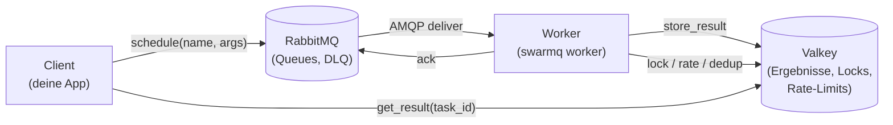
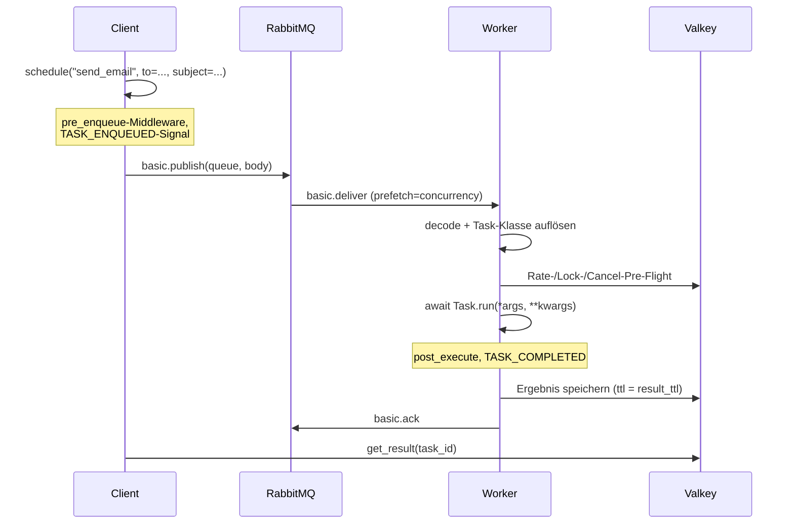

# Architektur

SwarmQ besteht aus drei Prozessen, verbunden durch zwei
Infrastruktur-Komponenten. Ein **Client** plant Arbeit ein. Ein
**Broker** (RabbitMQ) reicht diese Arbeit an einen **Worker**.
Ein **Backend** (Valkey) hält Ergebnisse, Locks, Rate-Counter und
Cancel-Flags. Alles Weitere — Middleware, Signals, Retries, der
Scheduler — baut auf diesen vier Beteiligten auf.

## Die Rollen

- **Client.** Jeder Prozess, der `SwarmQ.schedule()`, `.run()`,
  `.cancel()` oder `.get_result()` aufruft. Üblicherweise deine
  Web-App, ein Cron-Job oder ein anderer Worker.
- **Broker.** RabbitMQ, von SwarmQ per Default als
  [Quorum-Queue](https://www.rabbitmq.com/quorum-queues.html)
  deklariert. Trägt Task-Nachrichten, erzwingt Redelivery bei
  Worker-Crash und routet fehlgeschlagene Nachrichten automatisch
  in eine DLQ pro Queue (`{queue}.XQ`).
- **Worker.** Ein oder mehrere `swarmq worker`-Prozesse. Jeder
  importiert dein Task-Modul, registriert die gefundenen
  `Task`-Subklassen und konsumiert aus den angegebenen Queues.
  Die Concurrency ist semaphor-beschränkt innerhalb einer
  Event-Loop; der Multi-Process-Modus (`--processes N`) ergänzt
  einen Supervisor, der N solcher Worker nebeneinander ausführt.
- **Backend.** Valkey (Redis-kompatibel) für alles, was geteilten,
  schnellen, hinreichend dauerhaften State braucht: Task-Ergebnisse,
  [Lua](https://www.lua.org/)-gesteuerte Rate-Limiter, Locks,
  Cancel-Flags, Dedup-Keys, Scheduler-State und Leader-Election.

Ein SwarmQ-Deployment sind nur diese vier Kästen. Kein Celery
Flower, kein kombu, keine Django-Integration, keine
Datenbank-Migrationen.

## Verträge und Pakete

Seit 0.2.0 programmiert der Kern gegen explizite Protokolle in
`swarmq.contracts` statt gegen konkrete Klassen:

- **Broker-Verträge** — `Publisher`/`Consumer`/`Broker` (connect,
  declare, publish, consume und die vier Zustellungs-Verben `ack`,
  `redeliver`, `retry_later`, `dead_letter`) plus die optionale
  `BrokerAdmin`-Erweiterung (Queue-Tiefen, DLQ-Operationen,
  `route_via_dlx`). `RabbitMQBroker` implementiert beide.
- **Backend-Verträge** — `ResultBackend` (Ergebnisse, Fortschritt,
  Cancel-Flags, Workflow-Zustand, Dedup-Claims) und die
  Koordinations-Stores `LockStore` (Token-basiertes
  acquire/renew/release), `RateLimitStore`, `ChordStore` und
  `ScheduleStore`. `ValkeyBackend` implementiert sie und reicht die
  Stores als `backend.locks`, `.rate_limit`, `.chords` und
  `.schedules` heraus.

Ein In-Memory-Stub in der Test-Suite implementiert dieselben Verträge,
und eine Contract-Test-Suite läuft identisch gegen Stub, RabbitMQ und
Valkey — der Litmus-Test, der die Verträge broker-neutral hält.

Die früheren Monolith-Module sind heute Pakete, eine Pipeline-Stufe pro
Modul: `worker/` (Gates, Execution, Retry, Ergebnis-Tail, Lifecycle),
`client/` (Schedule, Results, Workflows), `scheduler/` (Definition,
Loop, Cron-Sync) und `process_manager/` (Supervisor, Sampler, Check,
Entry, Run).

## Nachrichten-Lifecycle

Ein einzelner Task durchläuft einen von zwei Pfaden: **immediate**
oder **deferred**. Beide enden im selben Terminalzustand.

Der Deferred-Pfad (`schedule(delay=..., eta=...)`) schreibt den
Task stattdessen in den Scheduler-Store in Valkey. Ein Leader-
Worker pollt diesen Store und publisht die Nachricht zum Fire-Zeitpunkt
genau einmal an RabbitMQ. Von da an ist der Pfad identisch mit dem
Immediate-Fall.

## Wo State lebt

Die kurze Antwort: **nirgendwo in SwarmQ selbst**. Die Library ist
zustandslos — starte einen Worker neu, kille einen Client, und
nichts geht verloren, solange RabbitMQ und Valkey noch da sind.

`[<namensraum>:]` steht für das Präfix, das `SWARMQ_NAMESPACE` setzt; ohne Namensraum beginnen die Keys mit `sq:`.

| State | Lebt in | Lebensdauer |
|---|---|---|
| Task-Nachrichten | RabbitMQ-Queue | Bis zum Ack oder DLQ-Route; in `{queue}.XQ` höchstens `SWARMQ_DEAD_LETTER_TTL_S` (Standard 7 Tage) |
| Ergebnisse | Valkey-Key `[<namensraum>:]sq:result:{task_id}` | `result_ttl` Sekunden (Default 24h) |
| Progress-Updates | Valkey HASH `[<namensraum>:]sq:progress:{task_id}` | Dieselbe TTL wie Ergebnisse |
| Rate-Limit-Counter | Valkey Sorted Set | Sliding Window |
| Locks | Valkey-Key `[<namensraum>:]sq:lock:{name}` | `hard_timeout + 30 s`; läuft der Handler länger, fensterweise verlängert |
| Cancel-Flags | Valkey-Key `[<namensraum>:]sq:cancel:{task_id}` | `max(24 h, result_ttl)` plus Wartezeit bis zum Fire eines verzögerten Tasks und dessen `max_age` + 300 s; höchstens 1 h, sobald der Worker die stornierte Zustellung abgeschlossen hat |
| Dedup-Marker | Valkey-Key `[<namensraum>:]sq:unique:{hash}` | `unique_for` Sekunden |
| Scheduler-Einträge | Valkey ZSET `[<namensraum>:]sq:{sched}:zset` + HASH `[<namensraum>:]sq:{sched}:defs` | Bis gefeuert oder entfernt |
| Claims von Schedule-Fires | Valkey-Key `[<namensraum>:]sq:sched:inflight:{fire}` (Owner-Token) | `SWARMQ_SCHEDULER_INFLIGHT_TTL`, mindestens `hard_timeout` + 30 s |
| Erledigte Schedule-Fires | Valkey-Key `[<namensraum>:]sq:sched:fired:{fire}` | `SWARMQ_SCHEDULER_DEDUP_TTL`, länger, je länger das Fire in der Queue wartete (`2 × Wartezeit + 300`, gedeckelt bei `max_age + 300` und `SWARMQ_EXECUTION_GUARD_BACKLOG_TTL_S`) |
| Leader-Election | Valkey-Key `[<namensraum>:]sq:lock:{sched}:leader` | Per Heartbeat erneuert |
| Leader-Version | Valkey-Key `[<namensraum>:]sq:{sched}:leader_version` (Owner-Token und Version) | Lock-TTL, mit dem Lock erneuert |
| Cron-Meldungen | Valkey-HASHes `[<namensraum>:]sq:{sched}:report:first_seen`, `:report:last_seen`, `:report:def` (ein Feld je Cron-Name und Fingerabdruck) | Gelöscht nach 7 Tagen ohne Meldung (oder nach dem Doppelten von `SWARMQ_SCHEDULER_PRUNE_AFTER_S`, falls länger) |
| Beim Aufräumen deaktivierte Crons | Valkey-SET `[<namensraum>:]sq:{sched}:disabled` | Bis ein Worker den Cron wieder meldet |
| Ausführungsschutz | Valkey-Keys `[<namensraum>:]sq:guard:{<task_id>[\|<replay_id>][#<Tode>]}:run` (Running-Marker) und `:state` (Done, Superseded, Waisen) | `SWARMQ_EXECUTION_GUARD_TTL_S`, verlängert, solange der Task läuft; Zustand `SWARMQ_EXECUTION_GUARD_DONE_TTL_S`, mindestens `SWARMQ_EXECUTION_GUARD_BACKLOG_TTL_S`, sobald eine Neuzustellung zurückgestellt wurde oder ein Ack scheiterte, mindestens `SWARMQ_DEAD_LETTER_TTL_S` für Wiederholungen |
| Worker-Versionen | Valkey-Key `[<namensraum>:]sq:{sched}:worker_version:<worker_id>` | 3 × `SWARMQ_SCHEDULER_SEEN_INTERVAL_S` |

In-Process-State — die Task-Registry, der Middleware-Stack, der
Signal-Dispatcher — wird bei jedem Worker-Start aus deinem
Task-Modul neu aufgebaut. Das ist der Grund, warum `--module
myapp.tasks` zwingend ist: es ist der deklarative Input, der ein
Worker-Binary zu *deinem* Worker macht.

## Warum diese Wahlen

### Warum RabbitMQ?

RabbitMQ mit Quorum-Queues gibt SwarmQ die Zustellungssemantik, die
eine Task-Queue tatsächlich braucht:

- **Publisher-Confirms.** `publish()` kehrt erst zurück, wenn der
  Broker die Nachricht quorum-weit auf Platte committet hat. SwarmQ
  schaltet sie unbedingt ein.
- **Quorum-Queue-Redelivery-Limits.** `x-delivery-limit=20` kappt
  den Schaden einer pathologischen Redelivery-Schleife, ohne die
  Nachricht zu verlieren — der 21. Versuch landet in der DLQ.
- **Natives DLQ-Routing.** Jede Queue wird mit einem
  Dead-Letter-Exchange deklariert: Eine Nachricht, die der Worker
  ablehnt (nicht dekodierbar, unregistrierter Task) oder die das
  Zustelllimit erreicht, landet ohne Worker-Code in `{queue}.XQ`. Bei
  Retry-Erschöpfung, `NoRetry`, `max_age` und Lock-Fehlern publiziert
  der Worker selbst nach `{queue}.XQ`, mit Diagnose-Headern
  (`x-swarmq-traceback` u. a.), und bestätigt das Original erst, wenn
  der Broker die Kopie bestätigt hat.
- **Per-Consumer-Prefetch.** Concurrency ist eine client-seitige
  AMQP-Einstellung, kein Server-Feature. Ein Flag ändert die
  In-Flight-Tiefe, ohne die Queue-Topologie zu berühren.

Geprüfte Alternativen: Redis Streams (kein Delivery-Limit-Konzept,
DLQ muss client-seitig gefaked werden), Kafka (Log-Semantik, nicht
Task-Semantik), SQS (Round-Trip-Latenz + 15-Minuten-
Visibility-Timeout-Deckel), Postgres-Queues (fein bei kleinem
Scale, brüchig bei größeren Prefetch-Tiefen).

### Warum Valkey?

Valkey ist das, was Rate-Limiter, Lock-Manager, Scheduler und
Result-Backend gleichzeitig brauchen:

- **Atomare Lua-Skripte.** Sliding-Window-Rate-Limiting,
  owner-checked Lock-Release und Dedup-SETNX sind jeweils ein
  einzelner `EVALSHA`-Roundtrip.
- **Sorted Sets mit O(log n)-Reads.** Der Scheduler pollt
  `ZRANGEBYSCORE sq:sched:fire 0 <now>` einmal pro Sekunde, ohne
  alle Einträge zu scannen.
- **Pub/Sub auf derselben Verbindung.** `get_result(timeout=...)`
  abonniert `sq:notify:{task_id}` und wacht sofort auf, sobald der
  Worker den Completion-Marker publisht — kein Polling bei
  niedriger Latenz, Polling-Fallback bei höherer.
- **Drop-in-Redis-Protokoll.** Stattdessen Redis laufen zu lassen
  ist ein URL-Wechsel. SwarmQ ruft nichts Valkey-Spezifisches auf.

Geprüfte Alternativen: ein vollständiger Redis-Cluster (dieselbe
API, schwererer Ops-Footprint), Postgres nur für Ergebnisse
(`LISTEN/NOTIFY` fügt Latenz hinzu und bietet keine Lua-Atomizität
für Rate-Limiting).

## Prozess-Topologie seit 0.5.0

Jeder `swarmq worker` läuft unter dem **Supervisor** (`ProcessManager`), auch
mit einem einzelnen Worker: Er startet Abstürze innerhalb eines Budgets neu,
ersetzt einen Worker ohne Lebenszeichen, bestätigt die Recycling-Absicht eines
Workers (rollierender Ersatz, kein verlorener Slot) und endet sauber, wenn ein
`--burst`-Worker leergelaufen ist. Im **CPU-Modus** (`--pool cpu`) wird der
Worker zum Loop-Prozess, der nie rechnet: Task-Körper laufen in Rechenkindern
aus einem vorgewärmten `forkserver`, ein `hard_timeout` wird zum echten Kill,
und kein Leak überlebt einen Task. Gates, Middleware, Signale und der Ack
bleiben im Loop-Prozess. Siehe [CPU-Modus](../guides/cpu-mode.md).

## Fehlerdomänen

| Fehler | Radius | Recovery |
|---|---|---|
| Worker-Prozess-Crash | In-Flight-Tasks stellt RabbitMQ neu zu, sobald Kanal oder Verbindung des Workers schließen | Supervisor startet Worker neu (`--processes N` Default) |
| Worker verliert Broker-Verbindung | Dieser Worker konsumiert nicht mehr; andere laufen weiter | `connect_robust()` reconnected; unacknowledgte Tasks redelivern |
| Ressourcenalarm des Brokers (Speicher, Platte) | RabbitMQ liest von keiner publizierenden Verbindung mehr; Publishes warten. Seit 0.12 konsumiert und bestätigt ein Worker über eine eigene zweite Verbindung (`SWARMQ_BROKER_PUBLISH_CONNECTION=separate`), Acks und das Lesen der Queue-Tiefen laufen also weiter; eine Retry- oder Dead-Letter-Kopie wartet bis `SWARMQ_PUBLISH_TIMEOUT_S`, dann geht die Nachricht zurück (`BrokerPublishBlocked`) | Speicher oder Platte am Broker freimachen; blockierte Publishes laufen von selbst weiter, sobald RabbitMQ freigibt |
| Worker verliert Backend-Verbindung | Prüfungen vor der Ausführung (Schedule-Fire-Dedup, Cancel, Rate-Limit, Lock) stellen die Nachricht mit wachsendem Backoff über die Delay-Queue zurück; ein gescheiterter Result-Write reiht die Nachricht neu ein, und der Task läuft erneut | `valkey-py` verbindet sich neu; zurückgestellte Nachrichten kommen spätestens nach `SWARMQ_BACKEND_DEFER_MAX_DELAY` (± 20 %) zurück |
| RabbitMQ-Restart | Alle Worker reconnecten; unacknowledgte Nachrichten redelivern | Quorum-Queues überleben einzelnen Node-Verlust nativ |
| Valkey-Restart | Aktive Locks, Rate-Counter und Leader-Lock laufen ab | Clients und Worker erwerben sie bei nächster Operation neu |
| Client crasht nach Publish | Task läuft trotzdem; Ergebnis liegt `result_ttl` in Valkey | Wer die `task_id` hat, kann weiterhin `get_result()` aufrufen |

Die tragende Annahme ist: **RabbitMQ und Valkey überleben jeden
einzelnen SwarmQ-Prozess.** Beide werden als externe, operable
Services deployt — nicht eingebettet, nicht In-Memory.

## Siehe auch

- [Zustellungssemantik](delivery-semantics.md) — was at-least-once
  für Task-Autoren bedeutet
- [Designentscheidungen](design-decisions.md) — die weiteren
  Trade-offs hinter der Architektur
- [Schnellstart](../getting-started.md) — die Drei-Kästen-Architektur
  in unter fünf Minuten auf deiner Maschine
