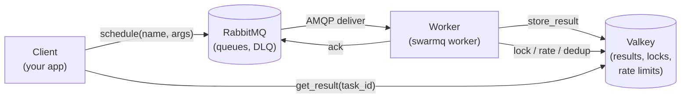
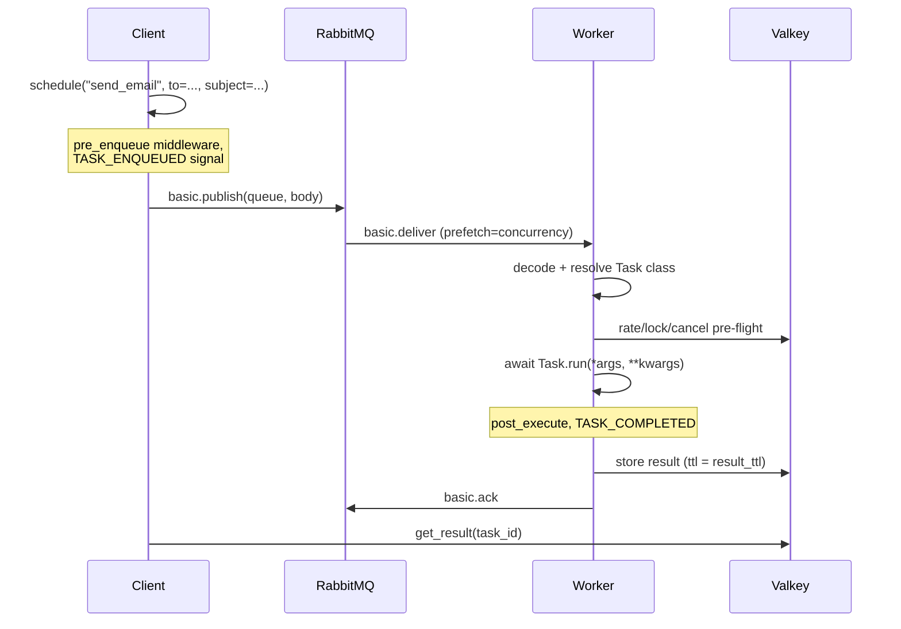

# Architecture

SwarmQ is three processes connected by two pieces of infrastructure.
A **client** schedules work. A **broker** (RabbitMQ) hands that work
to a **worker**. A **backend** (Valkey) holds results, locks, rate
counters, and cancel flags. Everything else — middleware, signals,
retries, the scheduler — is built on top of these four participants.

## The roles

- **Client.** Any process that calls `SwarmQ.schedule()`, `.run()`,
  `.cancel()`, or `.get_result()`. Usually your web app, a cron job,
  or another worker.
- **Broker.** RabbitMQ, declared by SwarmQ as
  [Quorum queues](https://www.rabbitmq.com/quorum-queues.html) by
  default. Carries task messages, enforces redelivery on worker
  crash, and routes failed messages to a per-queue DLQ (`{queue}.XQ`).
- **Worker.** One or more `swarmq worker` processes. Each one imports
  your task module, registers the `Task` subclasses it finds, and
  consumes from the queues you listed. Concurrency is semaphore-
  bounded inside one event loop; multi-process mode (`--processes N`)
  adds a supervisor that runs N of those workers side-by-side.
- **Backend.** Valkey (Redis-compatible) for everything that needs
  shared, fast, durable-enough state: task results,
  [Lua](https://www.lua.org/)-driven rate limiters, locks, cancel
  flags, dedup keys, scheduler state, and leader election.

A SwarmQ deployment is just these four boxes. No Celery Flower, no
kombu, no Django integration, no database migrations.

## Contracts and packages

Since 0.2.0 the core programs against explicit protocols in
`swarmq.contracts` instead of concrete classes:

- **Broker contracts** — `Publisher`/`Consumer`/`Broker` (connect,
  declare, publish, consume, and the four delivery verbs `ack`,
  `redeliver`, `retry_later`, `dead_letter`) plus the optional
  `BrokerAdmin` extension (queue depths, DLQ operations,
  `route_via_dlx`). `RabbitMQBroker` implements both.
- **Backend contracts** — `ResultBackend` (results, progress, cancel
  flags, workflow state, dedup claims) and the coordination stores
  `LockStore` (token-based acquire/renew/release), `RateLimitStore`,
  `ChordStore`, and `ScheduleStore`. `ValkeyBackend` implements them
  and exposes the stores as `backend.locks`, `.rate_limit`, `.chords`,
  and `.schedules`.

An in-memory stub in the test suite implements the same contracts, and
one contract-test suite runs against the stub, RabbitMQ, and Valkey
alike — the litmus test that keeps the contracts broker-neutral.

The former monolith modules are packages now, one pipeline stage per
module: `worker/` (gates, execution, retry, result tail, lifecycle),
`client/` (schedule, results, workflows), `scheduler/` (definition,
loop, cron-sync), and `process_manager/` (supervisor, sampler, check,
entry, run).

## Message lifecycle

A single task takes one of two paths through the system: **immediate**
or **deferred**. Both end at the same terminal state.

The deferred path (`schedule(delay=..., eta=...)`) inserts the task
into the scheduler store in Valkey instead. A leader worker polls that
store and publishes the message to RabbitMQ exactly once at fire time.
From there the path is identical to the immediate case.

## Where state lives

The short answer: **nowhere inside SwarmQ itself**. The library is
stateless — restart a worker, kill a client, and nothing is lost as
long as RabbitMQ and Valkey keep their data. For Valkey that means
`maxmemory-policy noeviction` and AOF persistence (see
[Valkey requirements](../reference/configuration.md#valkey-requirements)
and the Valkey restart row under [failure domains](#failure-domains)).

`[<namespace>:]` stands for the prefix `SWARMQ_NAMESPACE` sets; without a namespace the keys start with `sq:`.

| State | Lives in | Lifetime |
|---|---|---|
| Task messages | RabbitMQ queue | Until ack'd or DLQ'd; in `{queue}.XQ` at most `SWARMQ_DEAD_LETTER_TTL_S` (default 7 days) |
| Results | Valkey key `[<namespace>:]sq:result:{task_id}` | `result_ttl` seconds (default 24h) |
| Progress updates | Valkey HASH `[<namespace>:]sq:progress:{task_id}` | Same TTL as results |
| Rate-limit counters | Valkey sorted set | Sliding window |
| Locks | Valkey key `[<namespace>:]sq:lock:{name}` | `hard_timeout + 30 s`; extended in windows while the handler runs longer |
| Cancel flags | Valkey key `[<namespace>:]sq:cancel:{task_id}` | `max(24 h, result_ttl)` plus the wait until a deferred task fires and its `max_age` + 300 s; at most 1 h once the worker has handled the cancelled delivery |
| Workflow cancel flags | Valkey key `[<namespace>:]sq:wf:cancel:{workflow_id}` | `max(24 h, result_ttl)`, for handles from `apply()` and `app.workflow(id)` alike (since 0.13.0) |
| Dedup markers | Valkey key `[<namespace>:]sq:unique:{hash}` | `unique_for` seconds |
| Scheduler entries | Valkey ZSET `[<namespace>:]sq:{sched}:zset` + HASH `[<namespace>:]sq:{sched}:defs` | Until fired or removed |
| Schedule-fire claims | Valkey key `[<namespace>:]sq:sched:inflight:{fire}` (owner token) | `SWARMQ_SCHEDULER_INFLIGHT_TTL`, at least `hard_timeout` + 30 s |
| Completed schedule fires | Valkey key `[<namespace>:]sq:sched:fired:{fire}` | `SWARMQ_SCHEDULER_DEDUP_TTL`, longer the longer the fire waited in the queue (`2 × wait + 300`, capped at `max_age + 300` and `SWARMQ_EXECUTION_GUARD_BACKLOG_TTL_S`) |
| Leader election | Valkey key `[<namespace>:]sq:lock:{sched}:leader` | Heartbeat-renewed |
| Leader version | Valkey key `[<namespace>:]sq:{sched}:leader_version` (owner token and version) | Lock TTL, renewed with the lock |
| Cron reports | Valkey HASHes `[<namespace>:]sq:{sched}:report:first_seen`, `:report:last_seen`, `:report:def` (one field per cron name and fingerprint) | Deleted after 7 days without a report (or twice `SWARMQ_SCHEDULER_PRUNE_AFTER_S`, if longer) |
| Crons disabled when pruned | Valkey SET `[<namespace>:]sq:{sched}:disabled` | Until a worker reports the cron again |
| Execution guard | Valkey keys `[<namespace>:]sq:guard:{<task_id>[\|<replay_id>][#<deaths>]}:run` (running marker) and `:state` (done, superseded, orphans) | `SWARMQ_EXECUTION_GUARD_TTL_S`, renewed while the task runs; state `SWARMQ_EXECUTION_GUARD_DONE_TTL_S`, at least `SWARMQ_EXECUTION_GUARD_BACKLOG_TTL_S` once a redelivery was deferred or an ack failed, at least `SWARMQ_DEAD_LETTER_TTL_S` for replays |
| Worker versions | Valkey key `[<namespace>:]sq:{sched}:worker_version:<worker_id>` | 3 × `SWARMQ_SCHEDULER_SEEN_INTERVAL_S` |
| Crons ever reported by a 0.12 worker | Valkey SET `[<namespace>:]sq:{sched}:report:known` | Removed together with the definition |
| Consumed queues | Valkey HASH `[<namespace>:]sq:{sched}:report:queues` (queue to last report) | 7 days after the last report; entries of gone or empty queues removed after 7 days |
| Leader handover marker | Valkey key `[<namespace>:]sq:{sched}:handover` | A few seconds |
| Data-loss epoch | Valkey key `[<namespace>:]sq:{sched}:epoch` | No TTL (one key) |

In-process state — the task registry, the middleware stack, the signal
dispatcher — is rebuilt on every worker start from your task module.
This is the reason `--module myapp.tasks` is mandatory: it is the
declarative input that turns a worker binary into *your* worker.

## Why these choices

### Why RabbitMQ?

RabbitMQ with quorum queues gives SwarmQ the delivery semantics a task
queue actually needs:

- **Publisher confirms.** `publish()` returns only after the broker has
  persisted the message to disk across a quorum of nodes. SwarmQ enables
  them unconditionally.
- **Quorum-queue redelivery limits.** `x-delivery-limit=20` caps the
  damage from a pathological redelivery loop without losing the
  message: the worker dead-letters it one delivery before the limit,
  with an error result; the broker's own dead-lettering is the safety
  net ([effective delivery limit](delivery-semantics.md#effective-delivery-limit)).
- **Native DLQ routing.** Every queue is declared with a dead-letter
  exchange: a message that hits the delivery limit, or whose
  dead-letter copy failed, lands in `{queue}.XQ` without any worker
  code. For retry exhaustion, `NoRetry`, `max_age`, lock failures,
  unregistered tasks (after `SWARMQ_UNKNOWN_TASK_GRACE_S`) and messages
  it rejects (undecodable, too large) the worker
  publishes to `{queue}.XQ` itself, with
  diagnostic headers (`x-swarmq-traceback` and others), and acks the
  original only after the broker confirmed the copy.
- **Per-consumer prefetch.** Concurrency is a client-side AMQP
  setting, not a server-side feature. One flag changes the in-flight
  depth without touching the queue topology.

Alternatives considered: Redis Streams (no delivery-limit concept,
DLQ must be faked client-side), Kafka (log semantics, not task
semantics), SQS (round-trip latency + 15-minute visibility timeout
ceilings), Postgres queues (fine at small scale, brittle at larger
prefetch depths).

### Why Valkey?

Valkey is what the rate limiter, lock manager, scheduler, and result
backend all need at once:

- **Atomic Lua scripts.** Sliding-window rate limiting, owner-checked
  lock release, and dedup SETNX are each a single `EVALSHA` round-trip.
- **Sorted sets with O(log n) reads.** The scheduler polls
  `ZRANGEBYSCORE [<namespace>:]sq:{sched}:zset 0 <now>` once per second without
  scanning all entries.
- **Pub/Sub on the same connection.** `get_result(timeout=...)`
  subscribes to `[<namespace>:]sq:notify:{task_id}` and wakes up the instant the
  worker publishes the completion marker — no polling required at
  low latency, polling fallback at higher latency.
- **Drop-in Redis protocol.** Running on Redis instead is a URL
  change. SwarmQ calls nothing Valkey-specific.

Alternatives considered: a full Redis cluster (same API, heavier ops
footprint), Postgres for results only (`LISTEN/NOTIFY` adds latency
and does not give you Lua atomicity on rate limiting).

## Process topology since 0.5.0

Every `swarmq worker` runs under the **supervisor** (`ProcessManager`), also
with a single worker: it restarts crashes within a budget, replaces a worker
whose heartbeat stops, acknowledges a worker's own recycling request (rolling
replacement, no lost slot) and exits cleanly when a `--burst` worker drains.
In **CPU mode** (`--pool cpu`) the worker becomes a loop process that never
computes: task bodies run in compute children forked from a pre-warmed
`forkserver`, so a `hard_timeout` becomes a real kill and a leak never
survives a task. Gates, middleware, signals and the ack stay in the loop
process. See the [CPU mode guide](../guides/cpu-mode.md).

## Failure domains

| Failure | Blast radius | Recovery |
|---|---|---|
| Worker process crash | In-flight tasks get redelivered by RabbitMQ as soon as the worker's channel or connection closes | Supervisor restarts the worker (`--processes N` default) |
| Worker loses broker connection | That worker stops consuming; others continue | `connect_robust()` reconnects; unacked tasks redeliver |
| Broker resource alarm (memory, disk) | RabbitMQ stops reading from every connection that publishes; publishes wait. Since 0.12 a worker consumes and acknowledges over its own second connection (`SWARMQ_BROKER_PUBLISH_CONNECTION=separate`), so acks and queue-depth reads keep working; a retry or dead-letter copy waits up to `SWARMQ_PUBLISH_TIMEOUT_S` in its task slot, then the message is handed back (`BrokerPublishBlocked`) and the task runs again. With any failure rate above zero the worker's consumption drops while the alarm lasts, roughly to slots / (task duration + failure rate × publish deadline) ([details](../reference/errors.md#brokerpublishblocked)) | Free memory or disk on the broker; blocked publishes continue on their own once RabbitMQ unblocks |
| Worker loses backend connection | Checks before execution (schedule-fire dedup, cancel, rate limit, lock) defer the message to the delay queue with growing backoff; a failed result write is retried for ~30 s (connection refused) to ~40 s (every attempt runs into `SWARMQ_BACKEND_OP_TIMEOUT`), the slot stays taken, before the message is requeued and the task runs again | `valkey-py` reconnects; deferred messages return after at most `SWARMQ_BACKEND_DEFER_MAX_DELAY` (± 20 %) |
| RabbitMQ restart | All workers reconnect; unacked messages redeliver | Quorum queues survive single-node loss natively |
| Valkey restart | With AOF (`appendonly yes`): active locks, rate counters and the leader lock expire. Without persistence, or since the last RDB snapshot: delayed tasks, CLI crons, disabled crons, workflow state, results and the execution-guard and fired markers are lost; redeliveries can run twice | Clients and workers re-acquire on next operation; each worker logs `valkey_data_loss_detected` when the epoch key is gone. Run Valkey as in [Valkey requirements](../reference/configuration.md#valkey-requirements) |
| Client crashes after publish | Task runs anyway; result sits in Valkey for `result_ttl` | Whoever holds `task_id` can still `get_result()` |

The load-bearing assumption is that **RabbitMQ and Valkey outlive any
single SwarmQ process**. Both are deployed as external, operable
services — not embedded, not in-memory.

## See also

- [Delivery semantics](delivery-semantics.md) — what at-least-once
  means for task authors
- [Design decisions](design-decisions.md) — the other trade-offs
  behind the architecture
- [Getting Started](../getting-started.md) — run the three-box
  architecture on your machine in under five minutes
