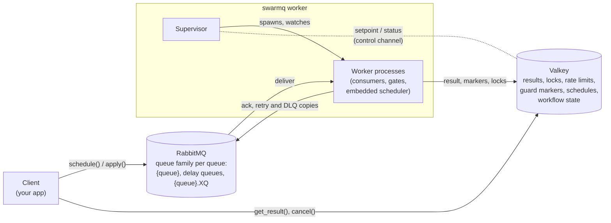
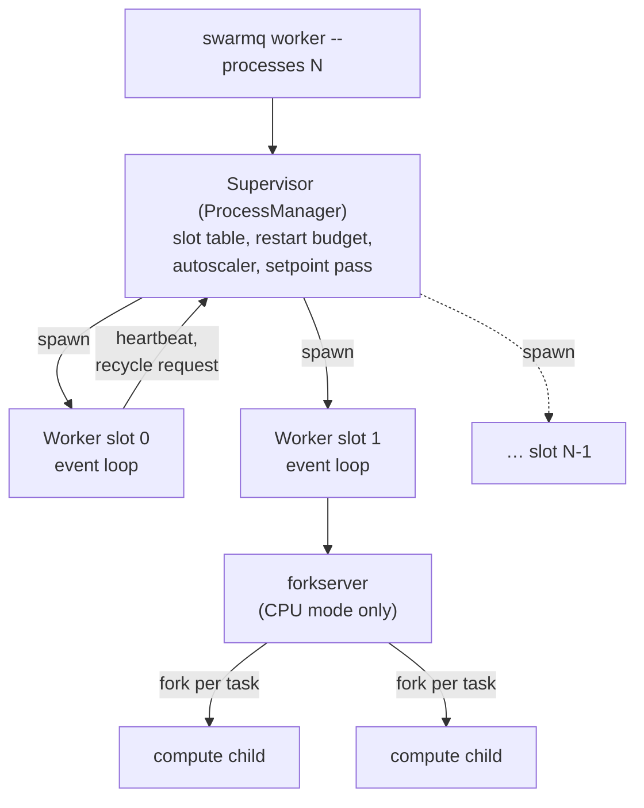
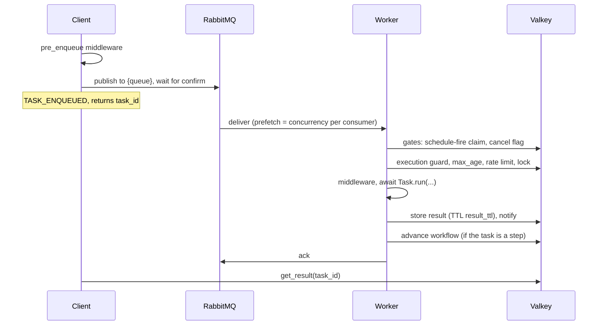
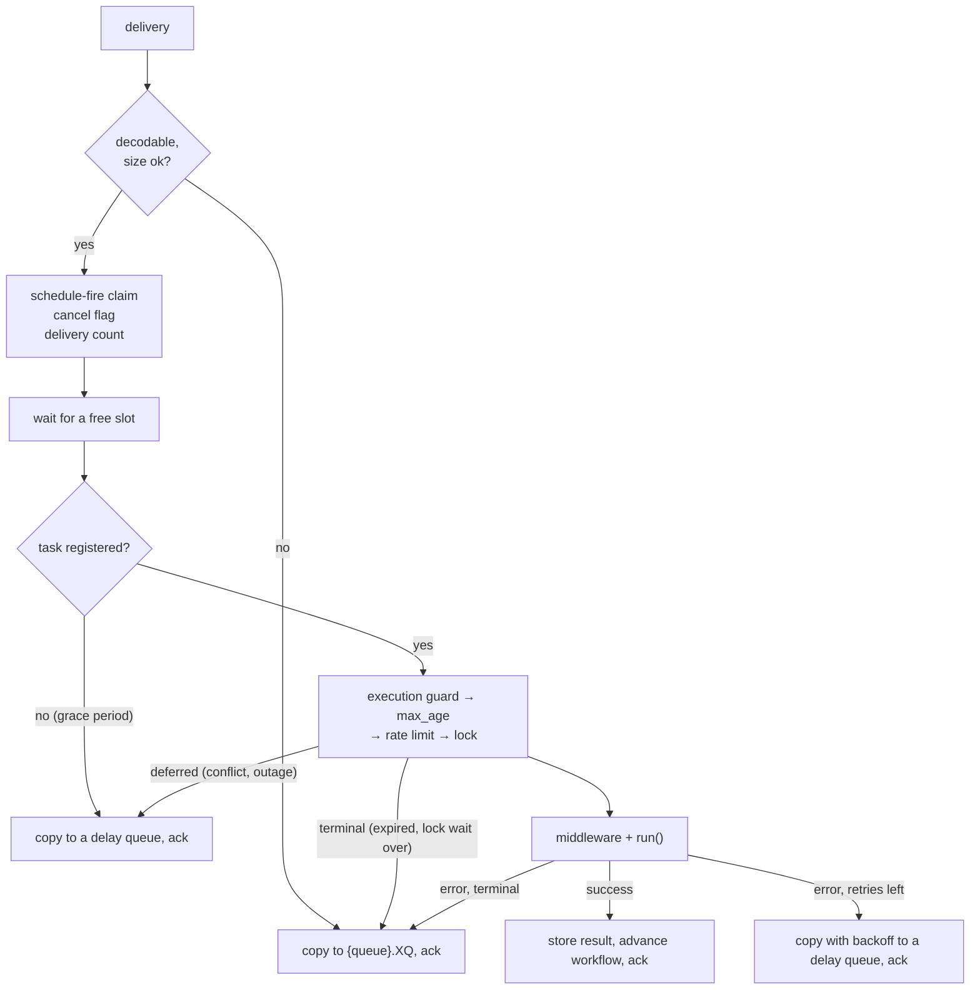
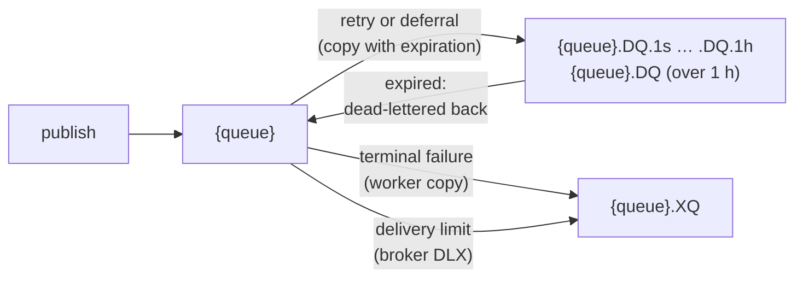

# Architecture

SwarmQ connects your code to two pieces of infrastructure. A **client**
schedules work. A **broker** (RabbitMQ) carries that work to a
**worker**. A **backend** (Valkey) holds results, locks, rate counters,
cancel flags, workflow state and the scheduler. Every `swarmq worker`
runs under a **supervisor** that keeps its worker processes alive.
Middleware, signals, retries, workflows and the scheduler are built on
top of these participants.

## The roles

- **Client.** Any process that calls `schedule()`, `run()`, `apply()`,
  `cancel()` or `get_result()` on a `SwarmQ` app: your web app, a cron
  job, another task. A client needs the task classes imported so it can
  resolve each task's queue and defaults.
- **Broker.** RabbitMQ. SwarmQ declares
  [quorum queues](https://www.rabbitmq.com/docs/quorum-queues) by
  default, publishes with publisher confirms and relies on the broker
  for redelivery after a crash. Every queue comes as a family: the main
  queue `{queue}`, the delay queues `{queue}.DQ` and `{queue}.DQ.<tier>`
  for retries and deferrals, and the dead-letter queue `{queue}.XQ`
  ([queue topology](#queue-topology)).
- **Worker.** One or more worker processes started by `swarmq worker
  --module myapp.tasks`. Each one imports your task module, registers the
  `Task` subclasses it finds and consumes the queues you list. In the
  default IO pool, tasks run as coroutines in one event loop, bounded by
  `--concurrency`; in CPU mode they run in compute children
  ([process model](#process-model)).
- **Backend.** Valkey (8 or later) for every piece of shared state:
  results and progress, [Lua](https://www.lua.org/)-driven rate limits
  and locks, cancel flags, dedup claims, the markers of the
  [execution guard](delivery-semantics.md#execution-guard), scheduler
  entries, leader election, workflow state and the control channel.

A deployment is these boxes and nothing else: no extra monitor process,
no database, no migrations.

## Process model

Every `swarmq worker` runs under the **supervisor**, also with a single
worker process. It starts the worker processes with `multiprocessing`
spawn, so each one has its own broker and backend connections, and
assigns each a stable slot number (`0..N-1`) that survives
replacements and labels metrics and ports.

- **Crash restarts.** A worker that dies is restarted in its slot, at
  most five times per slot within an hour. After that the slot is
  locked for an hour, then it starts again (E-024). A configuration
  error (exit 78) is not restarted (E-057).
- **Hang detection.** Each worker writes a heartbeat every
  `SWARMQ_HEARTBEAT_INTERVAL_S` (5 s). After `SWARMQ_HEARTBEAT_TIMEOUT_S`
  (60 s) without one, the supervisor replaces the worker (SIGTERM, then
  SIGKILL).
- **Recycling.** With `SWARMQ_RECYCLE_RSS_MB` or
  `SWARMQ_RECYCLE_MAX_TASKS`, a worker asks the supervisor to replace it.
  The replacement starts first, then the old worker drains without
  forced cancellation; recycling uses up no retry of a running task
  (E-038).
- **Autoscaling.** `--autoscale MIN,MAX` samples the depth of the main
  queues every 10 s and starts or gently stops workers. Draining workers
  do not count (E-084); see
  [autoscaling](../reference/cli.md#autoscaling-and-draining-workers).
- **Control channel.** With `--max-processes N`, a controlling service
  can change the process count or the autoscale bounds of a worker
  group at runtime by writing a setpoint to Valkey; every supervisor
  reports its status next to it
  ([control channel](../reference/cli.md#control-channel)).
- **Shutdown.** `SIGTERM` starts a drain within the total budget
  `SWARMQ_SHUTDOWN_TIMEOUT` (E-018,
  [shutdown budget](delivery-semantics.md#shutdown-budget)). `SIGHUP`
  re-executes the supervisor with its original arguments;
  [`--reload`](../guides/hot-reload.md) triggers that on file changes
  during development.

In **CPU mode** (`--pool cpu`) the worker process becomes a loop process
that never computes. Task bodies run in compute children forked from a
pre-warmed `forkserver`, so a `hard_timeout` or a cancel is a real kill
of the child's process group, and a memory leak does not outlive its
task. Gates, middleware, signals and the ack stay in the loop process.
See the [CPU mode guide](../guides/cpu-mode.md).

## Message lifecycle

A task takes one of two paths into its queue. **Immediate**:
`schedule()` publishes the message to `{queue}` and returns after the
broker's confirm. **Deferred**: `schedule(delay=...)` or
`schedule(eta=...)` stores the message in the scheduler store in
Valkey; the scheduler leader publishes it once it is due
([scheduler](#scheduler-and-leader)). From the queue on, both paths are
the same.

Inside the worker every delivery passes the same pipeline:

Every exit has one rule in common: the original message is acked only
after its successor is safe, that is after the broker confirmed the
copy or Valkey stored the result. If that fails, the original goes
back to the broker and runs again. The details, including every reason
for a deferral, are in [delivery semantics](delivery-semantics.md).

## Scheduler and leader

Every worker embeds a scheduler (switch it off per worker with
`SWARMQ_SCHEDULER=off` or `--no-scheduler`). One of them is the
**leader**: it holds the leader lock in Valkey (TTL 30 s, renewed every
10 s), reads due entries from the scheduler store once per second,
publishes each fire to its queue with an `x-swarmq-schedfire` header and
commits the next fire time with an owner-checked Lua script. The
entries are cron definitions and one-shot `delay`/`eta` tasks.

- **Fires run at least once.** The worker that picks up a fire claims
  it in Valkey; a second publish of the same fire is dropped, and a fire
  whose worker crashed runs again (E-046). A short double leader is
  accepted: the fire claim catches its duplicate publishes, the owner
  check its commits (E-047).
- **Workers report their crons.** Static crons come from `TaskInfo` in
  the task modules. Each worker reports them, the leader adopts them,
  holds a cron that no live worker reports any more (E-014) and removes
  it after `SWARMQ_SCHEDULER_PRUNE_AFTER_S` (E-049).
- **Handover.** A leader that shuts down hands over cleanly; one that
  crashes is replaced once its lock expires. A leader whose broker
  publishes keep failing steps down (E-013).

See [scheduling and retries](../guides/scheduling-and-retries.md#cron-reports-and-the-leader)
for the operator's view.

## Workflows

`chain`, `group` and `chord` compose tasks into one unit of work
([workflows guide](../guides/workflows.md)). There is no orchestrator
process. `app.apply()` writes the workflow state to Valkey and
publishes the first steps. Each step is an ordinary task message with
workflow headers. When a step has stored its result, the worker that
ran it advances the workflow before it acks: it updates the state with
a compare-and-set and publishes the next steps. A chord counts its
finished members with a Lua script, so exactly one worker publishes the
body. A step that fails terminally marks the whole workflow `failed` in
the same path (E-040).

## Queue topology

- **Main queue** `{queue}`: quorum queue with `x-delivery-limit`
  (`SWARMQ_DELIVERY_LIMIT`, 20) and, for queues created since 0.12,
  at-least-once dead-lettering (E-017).
- **Delay queues** `{queue}.DQ.<tier>` (seven tiers from 1 s to 1 h) and
  `{queue}.DQ`: no consumers. A message waits there with its own
  expiration and then returns to `{queue}` (E-026,
  [delay tiers](delivery-semantics.md#delay-tiers)).
- **Dead-letter queue** `{queue}.XQ`: terminal failures, with
  diagnostic headers, kept for `SWARMQ_DEAD_LETTER_TTL_S` (7 days).
  Inspect and replay with [`swarmq dlq`](../guides/dead-letter-queues.md).
- **Priorities** (`SWARMQ_PRIORITIES=true`): each queue becomes the
  triplet `{queue}.high`, `{queue}` and `{queue}.low`, each with its own
  family.

The worker declares the families of the queues it consumes at start.
Producers never declare queues: start workers before producers.

## Contracts and packages

The core programs against protocols in `swarmq.contracts`, not against
concrete classes:

- **Broker contracts:** `Publisher`, `Consumer` and `Broker` (connect,
  declare, publish, consume and the four delivery verbs `ack`,
  `redeliver`, `retry_later`, `dead_letter`), plus the optional
  `BrokerAdmin` extension (queue depths, DLQ operations,
  `route_via_dlx`). `RabbitMQBroker` implements both.
- **Backend contracts:** `ResultBackend` (results, progress, cancel
  flags, workflow state, dedup claims) and the coordination stores
  `LockStore`, `RateLimitStore`, `ChordStore`, `ScheduleStore` and
  `ExecutionGuardStore`. `ValkeyBackend` implements them and exposes
  the stores as `backend.locks`, `.rate_limit`, `.chords`, `.schedules`
  and `.execution_guard`.

An in-memory stub in the test suite implements the same contracts, and
one contract-test suite runs against the stub, RabbitMQ and Valkey
alike. That keeps the contracts broker-neutral.

The code is organised in packages, one pipeline stage per module:
`worker/` (decode, `gates/`, execution, retry, result tail, lifecycle,
`compute/` for CPU mode), `client/` (schedule, results, workflows),
`scheduler/` (loop, fire, reports, prune, stepdown) and
`process_manager/` (supervisor, slots, restart budget, autoscale,
setpoint, reload). All Valkey key names come from one module,
`keyspace.py`.

## Where state lives

SwarmQ processes keep no state that matters: restart a worker or kill a
client, and nothing is lost as long as RabbitMQ and Valkey keep their
data. For Valkey that means `maxmemory-policy noeviction`, AOF
persistence and no cluster mode (see
[Valkey requirements](../reference/configuration.md#valkey-requirements)
and the Valkey restart row under [failure domains](#failure-domains)).

`[<namespace>:]` stands for the prefix that `SWARMQ_NAMESPACE` sets;
without a namespace the keys start with `sq:`. Queue names never get a
prefix; separate apps on one RabbitMQ by vhost (E-012). Parts in curly
braces such as `{sched}` are hash tags and part of the key name.

| State | Lives in | Lifetime |
|---|---|---|
| Task messages | RabbitMQ queue family | Until acked or dead-lettered; in `{queue}.XQ` at most `SWARMQ_DEAD_LETTER_TTL_S` (default 7 days) |
| Results | Valkey key `[<namespace>:]sq:result:{task_id}` | `result_ttl` seconds (default 24 h) |
| Progress updates | Valkey HASH `[<namespace>:]sq:progress:{task_id}` | Same TTL as results |
| Completion and progress notifications | Pub/Sub channels `[<namespace>:]sq:notify:{task_id}`, `sq:progress:channel:{task_id}`, `sq:wf:notify:{workflow_id}` | Not stored |
| Rate-limit counters | Valkey keys `[<namespace>:]sq:rl:{<task_name>}:<window start>` (two counters per task, current and previous window) | Twice the window |
| Locks | Valkey key `[<namespace>:]sq:lock:{name}` | `hard_timeout + 30 s`; extended in windows while the handler runs longer |
| Cancel flags | Valkey key `[<namespace>:]sq:cancel:{task_id}` | `max(24 h, result_ttl)` plus the wait until a deferred task fires and its `max_age` + 300 s; at most 1 h once the worker has handled the cancelled delivery (E-020) |
| Workflow state | Valkey key `[<namespace>:]sq:wf:{workflow_id}` | `result_ttl` |
| Chord counters | Valkey key `[<namespace>:]sq:wf:chord:{workflow_id}:{chord_id}` | `result_ttl` |
| Workflow cancel flags | Valkey key `[<namespace>:]sq:wf:cancel:{workflow_id}` | `max(24 h, result_ttl)`, for handles from `apply()` and `app.workflow(id)` alike |
| Dedup markers | Valkey key `[<namespace>:]sq:unique:{hash}` | `unique_for` seconds |
| Scheduler entries | Valkey ZSET `[<namespace>:]sq:{sched}:zset` + HASH `[<namespace>:]sq:{sched}:defs` | Until fired or removed |
| Schedule-fire claims | Valkey key `[<namespace>:]sq:sched:inflight:{fire}` (owner token) | `SWARMQ_SCHEDULER_INFLIGHT_TTL`, at least `hard_timeout` + 30 s |
| Completed schedule fires | Valkey key `[<namespace>:]sq:sched:fired:{fire}` | `SWARMQ_SCHEDULER_DEDUP_TTL`, longer the longer the fire waited in the queue (`2 × wait + 300`, capped at `max_age + 300` and `SWARMQ_EXECUTION_GUARD_BACKLOG_TTL_S`) |
| Leader election | Valkey key `[<namespace>:]sq:lock:{sched}:leader` | `SWARMQ_SCHEDULER_LOCK_TTL` (30 s), renewed by the leader's heartbeat |
| Leader version | Valkey key `[<namespace>:]sq:{sched}:leader_version` (owner token and version) | Lock TTL, renewed with the lock |
| Leader handover marker | Valkey key `[<namespace>:]sq:{sched}:handover` | A few seconds |
| Cron reports | Valkey HASHes `[<namespace>:]sq:{sched}:report:first_seen`, `:report:last_seen`, `:report:def` (one field per cron name and fingerprint) | Deleted after 7 days without a report (or twice `SWARMQ_SCHEDULER_PRUNE_AFTER_S`, if longer) |
| Crons ever reported by a worker since 0.12 | Valkey SET `[<namespace>:]sq:{sched}:report:known` | Removed together with the definition |
| Crons disabled when pruned | Valkey SET `[<namespace>:]sq:{sched}:disabled` | Until a worker reports the cron again |
| Consumed queues | Valkey HASH `[<namespace>:]sq:{sched}:report:queues` (queue to last report) | 7 days after the last report; entries of gone or empty queues removed after 7 days |
| Worker versions | Valkey key `[<namespace>:]sq:{sched}:worker_version:<worker_id>` | 3 × `SWARMQ_SCHEDULER_SEEN_INTERVAL_S` |
| Data-loss epoch | Valkey key `[<namespace>:]sq:{sched}:epoch` | No TTL (one key) |
| Execution guard | Valkey keys `[<namespace>:]sq:guard:{<task_id>[\|<replay_id>][#<deaths>]}:run` (running marker) and `:state` (done, superseded, orphans) | `SWARMQ_EXECUTION_GUARD_TTL_S`, renewed while the task runs; state `SWARMQ_EXECUTION_GUARD_DONE_TTL_S`, at least `SWARMQ_EXECUTION_GUARD_BACKLOG_TTL_S` once a redelivery was deferred or an ack failed, at least `SWARMQ_DEAD_LETTER_TTL_S` for replays |
| Control-channel setpoints | Valkey key `[<namespace>:]sq:control:setpoint:<group>` (JSON) | No TTL; written and deleted by the controlling service |
| Control-channel status | Valkey key `[<namespace>:]sq:control:status:<group>:<supervisor>` (JSON) | Renewed on every report; expires shortly after the supervisor is gone |

In-process state (the task registry, the middleware stack, the signal
handlers) is rebuilt on every worker start from your task module and
the `--configure` hook. That is why `--module` is mandatory: it is the
declarative input that turns the generic worker into *your* worker.

## Why these choices

### Why RabbitMQ?

RabbitMQ with quorum queues gives SwarmQ the delivery semantics a task
queue needs:

- **Publisher confirms.** `schedule()` returns only after the broker
  has stored the message on a quorum of nodes. SwarmQ always enables
  them.
- **Redelivery with a limit.** An unacknowledged message goes back to
  the queue when its consumer dies. `x-delivery-limit` (20) caps a
  crash loop: the worker dead-letters the message one delivery before
  the limit, with an error result; the broker's own dead-lettering is
  the safety net ([effective delivery limit](delivery-semantics.md#effective-delivery-limit)).
- **Native dead-letter routing.** Every queue has a dead-letter
  exchange. Delay queues use it to return expired messages to
  `{queue}`, and a message at the delivery limit lands in `{queue}.XQ`
  without worker code. For every other terminal failure (retries
  exhausted, `NoRetry`, `max_age`, end of a lock wait, unregistered
  task after `SWARMQ_UNKNOWN_TASK_GRACE_S`, undecodable or oversized
  message) the worker publishes the copy to `{queue}.XQ` itself, with
  diagnostic headers such as `x-swarmq-traceback`, and acks the original
  only after the broker confirmed the copy.
- **Per-consumer prefetch.** Concurrency is a client-side AMQP setting;
  one flag changes the in-flight depth without touching the topology
  (with a known limit: [prefetch per consumer](delivery-semantics.md#prefetch-per-consumer)).

Alternatives considered: Redis Streams (no delivery limit, DLQ must be
built client-side), Kafka (log semantics, not task semantics), SQS
(round-trip latency, visibility-timeout ceilings), Postgres queues (fine
at small scale, brittle at larger prefetch depths).

### Why Valkey?

Valkey serves the rate limiter, lock manager, execution guard,
scheduler and result store at once:

- **Atomic Lua scripts.** The sliding-window rate limit, owner-checked
  lock release, guard claims, the chord counter and scheduler commits
  each run as one script call.
- **Sorted sets.** The scheduler reads due entries with one range query
  on `sq:{sched}:zset` per second, without scanning all entries.
- **Pub/Sub.** `get_result(timeout=...)` subscribes to
  `sq:notify:{task_id}` and returns as soon as the worker publishes the
  completion. After about one second without a notification it falls
  back to polling every 5 ms (E-030).
- **Redis protocol.** SwarmQ speaks the plain Redis protocol through
  valkey-py; it is tested and supported against Valkey.

Alternatives considered: Postgres for results only (`LISTEN/NOTIFY`
adds latency and gives no atomic Lua for rate limits), a cluster setup
(SwarmQ needs a single primary; replicas are fine).

## Failure domains

| Failure | Blast radius | Recovery |
|---|---|---|
| Worker process crash | In-flight tasks are redelivered by RabbitMQ as soon as the worker's channel or connection closes; the [execution guard](delivery-semantics.md#execution-guard) holds the redelivery back until the crashed run's marker expires | The supervisor restarts the worker in its slot (at most 5 times per hour, then the slot pauses for an hour) |
| Worker hangs (blocked event loop) | Its tasks stall; heartbeat stops | After `SWARMQ_HEARTBEAT_TIMEOUT_S` the supervisor replaces it |
| Worker loses broker connection | That worker stops consuming; others continue | The connection reconnects by itself; unacked tasks are redelivered |
| Broker resource alarm (memory, disk) | RabbitMQ stops reading from every connection that publishes; publishes wait. A worker consumes and acknowledges over its own second connection (`SWARMQ_BROKER_PUBLISH_CONNECTION=separate`), so acks and queue-depth reads keep working; a retry or dead-letter copy waits up to `SWARMQ_PUBLISH_TIMEOUT_S` in its task slot, then the message is handed back (`BrokerPublishBlocked`) and the task runs again. With any failure rate above zero the worker's consumption drops while the alarm lasts, roughly to slots / (task duration + failure rate × publish deadline) (E-025, [details](../reference/errors.md#brokerpublishblocked)) | Free memory or disk on the broker; blocked publishes continue on their own once RabbitMQ unblocks |
| Worker loses backend connection | Checks before execution (schedule-fire dedup, cancel, execution guard, rate limit, lock) defer the message to a delay queue with growing backoff; a failed result write is retried for about 30 s (connection refused) to 40 s (every attempt runs into `SWARMQ_BACKEND_OP_TIMEOUT`) while the slot stays taken, then the message is requeued and the task runs again | valkey-py reconnects; deferred messages return after at most `SWARMQ_BACKEND_DEFER_MAX_DELAY` (± 20 %) |
| RabbitMQ restart | All workers reconnect; unacked messages are redelivered | Quorum queues survive the loss of a single node |
| Valkey restart | With AOF (`appendonly yes`): active locks, rate counters and the leader lock expire. Without persistence, or since the last RDB snapshot: delayed tasks, CLI crons, disabled crons, workflow state, results and the execution-guard and fired markers are lost; redeliveries can run twice (E-077) | Clients and workers re-acquire on their next operation; each worker logs `valkey_data_loss_detected` when the epoch key is gone. Run Valkey as in [Valkey requirements](../reference/configuration.md#valkey-requirements) |
| Consumed queue deleted while the worker runs | That queue stops; the worker's other queues keep consuming | The worker logs `consumer_queue_missing`, keeps `/ready` red and consumes again once the queue exists (E-083, [details](delivery-semantics.md#deleting-a-consumed-queue)) |
| Client crashes after publish | The task runs anyway; its result stays in Valkey for `result_ttl` | Whoever holds the `task_id` can still call `get_result()` |

The load-bearing assumption: **RabbitMQ and Valkey outlive every single
SwarmQ process.** Run both as external, operated services, not embedded
and not in-memory.

## See also

- [Delivery semantics](delivery-semantics.md): what at-least-once
  means for task authors
- [Design decisions](design-decisions.md): the trade-offs behind the
  architecture
- [Deployment](../guides/deployment.md): rolling out and upgrading
  workers and producers
- [Getting started](../getting-started.md): run the whole setup on your
  machine
