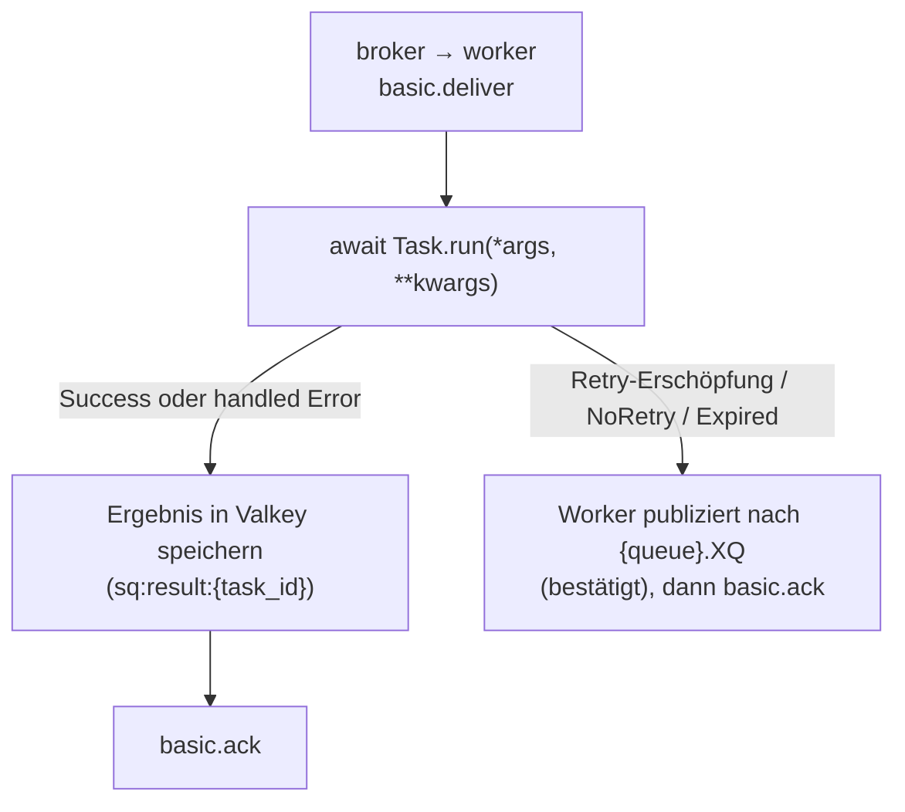

# Zustellungssemantik

SwarmQ ist per Default **at-least-once**. Jeder Task, den du planst,
läuft mindestens einmal; unter widrigen Bedingungen kann er
mehrfach laufen. Einen Exactly-Once-Modus bietet die Library nicht
— dieser Vertrag wird nicht angeboten, weil kein Queue-plus-Worker-
System ihn ohne Anwendungsunterstützung einhalten kann.

Diese Seite beschreibt, was das für deinen Code bedeutet, wo
Duplikate herkommen und wie SwarmQ den Schaden bei Duplikaten
begrenzt.

## Der Vertrag

Wenn `await app.schedule("send_email", to="a@example.com")` eine
task_id zurückgibt, verspricht SwarmQ:

1. Die Nachricht wurde von RabbitMQ mit Publisher-Confirm akzeptiert.
2. Ein Worker wird `SendEmail.run(to="a@example.com")` mindestens
   einmal ausführen.
3. Das Ergebnis des Tasks — Success, Exception oder Cancellation —
   wird nach Valkey unter `sq:result:{task_id}` mit konfigurierter
   TTL geschrieben.

Es verspricht **nicht**:

- Dass der Task genau einmal läuft.
- Dass der Task im Prozess läuft, der ihn geplant hat.
- Dass der Task läuft, bevor dein `get_result(timeout=...)`
  zurückkehrt, falls das Timeout zu kurz ist.

Alles auf der „verspricht nicht"-Liste folgt aus der Art, wie
at-least-once-Zustellung auf Broker-Ebene funktioniert.

## Wann eine Nachricht als zugestellt gilt

RabbitMQ routet die Nachricht in die Queue, sobald
`basic.publish` ein Confirm zurückgibt. Der Worker sieht die
Nachricht nicht, bis:

1. Sein Consumer die Queue abonniert hat (`basic.consume`).
2. Er freie Prefetch-Kapazität hat — `--concurrency N` minus
   In-Flight.
3. Der Broker einen `basic.deliver`-Frame an diesen Consumer sendet.

Ab diesem Punkt ist die Nachricht **in-flight**: von RabbitMQ als
unacknowledged gehalten, nur an diesen einen Consumer committet.
Der Broker gibt sie keinem anderen Worker, solange der aktuelle
Consumer nicht verschwindet.

## Wann Acks passieren

SwarmQ ack't, nachdem der Terminalzustand des Tasks dauerhaft
gespeichert wurde, nicht vorher:

Die Ack-nach-Store-Sequenz ist der Grund für die Zustellungsgarantie:
Crasht der Worker zwischen `Run` und `Store`, hält RabbitMQ die
Nachricht noch und wird sie redeliveren. Crasht er zwischen `Store`
und `Ack`, ist das Ergebnis bereits dauerhaft, die Redelivery führt
den Task aber erneut aus (siehe
[Redelivery-Szenarien](#1-worker-crash-zwischen-store-und-ack)).

## Was den Ack abbricht

Jedes hier genannte Szenario bricht den Ack ab und retry't die
Nachricht entweder oder routet sie in die DLQ:

| Abbruchquelle | Ziel |
|---|---|
| Worker-Prozess gekillt (`SIGKILL`, OOM, Node-Crash) | RabbitMQ stellt neu zu, sobald Kanal oder Verbindung des Workers schließen |
| Worker mitten im Task neu gestartet (graceful `SIGTERM`) | Drain der In-Flight-Tasks läuft; pending Messages redelivern an neuen Worker |
| `Task.run()` raist eine retry-bare Exception, Retries verbleiben | Neue Nachricht in die Delay-Queue, Original bestätigt (`TASK_RETRYING`) |
| `Task.run()` raist, nachdem `max_retries` erreicht ist | Worker publiziert nach `{queue}.XQ`, Original bestätigt (`TASK_DLQ`) |
| `raise NoRetry("reason")` | Worker publiziert sofort nach `{queue}.XQ`, Original bestätigt (`TASK_DLQ`) |
| RabbitMQs `x-delivery-limit=20` erreicht | Broker-native DLQ-Route |
| Backend nicht erreichbar bei einer Prüfung vor der Ausführung (Schedule-Fire-Dedup, Cancel-Check, Rate-Limit, Lock) | Neue Nachricht in die Delay-Queue mit wachsendem Backoff, Original bestätigt (`task_deferred_backend_unavailable`); kein Retry |
| Task-Alter übersteigt `max_age` bei Pickup | `TASK_EXPIRED`-Signal + DLQ |
| Lock-Render-Fehler oder Conflict-Cap erreicht | DLQ-Route mit Header `x-swarmq-lock-render-error` (Render-Fehler) bzw. `x-swarmq-lock-name` (Conflict-Cap) |
| Dieselbe Ausführung ist bereits abgeschlossen, von einem Retry überholt oder läuft anderswo ([Ausführungsschutz](#ausfuhrungsschutz)) | Bestätigt und übersprungen (`duplicate_delivery_skipped`) oder neue Nachricht in die Delay-Queue mit wachsendem Backoff (`execution_guard_deferred`); kein Retry |
| `Task.run()` scheitert terminal bei abgeschaltetem Dead-Lettering (`TaskInfo(dead_letter=False)`) | Fehlerergebnis gespeichert, Original bestätigt; keine DLQ |

Der Worker ruft auf dem Primär-Retry-Pfad nie `basic.nack(requeue=True)`
auf. Ein Requeue-an-Ort-und-Stelle würde das Retry-Backoff umgehen
und den Broker in einer Hot-Loop ausbeuten. Alle Retries gehen
durch die Delay-Queue.

Dasselbe gilt für einen Backend-Ausfall vor der Ausführung. Erreicht
eine Prüfung, die vor dem Task läuft (Schedule-Fire-Dedup,
Cancel-Check, Rate-Limit, Lock), Valkey nicht, publiziert der Worker
eine Kopie der Nachricht in die Delay-Queue und bestätigt das Original
erst, wenn der Broker die Kopie bestätigt hat. Die Kopie behält alle
SwarmQ-Header (Retry-Zähler, Workflow-Kontext, Unique-Hash,
Enqueue-Zeit), aber nicht die Zustellzähler des Brokers; sie beginnt
also mit frischem Zustellbudget. Eine Prüfung gilt auch dann als
gescheitert, wenn Valkey nicht innerhalb von `SWARMQ_BACKEND_OP_TIMEOUT`
(5 s) antwortet; ein Backend, das Verkehr stumm verwirft, stellt die
Nachricht also zurück, statt sie bis zum Socket-Timeout des Clients
festzuhalten. Die Wartezeit beginnt bei
`SWARMQ_BACKEND_DEFER_BASE_DELAY` (1 s) und verdoppelt sich je
Zurückstellung in Folge bis `SWARMQ_BACKEND_DEFER_MAX_DELAY` (60 s);
jede Wartezeit streut um ±20 %, damit gemeinsam zurückgestellte
Nachrichten das sich erholende Backend nicht gemeinsam treffen.
Zurückgestellt wird nur bei einem Ausfall: Antwortet Valkey einer
Prüfung mit einem Fehler (`BackendResponseError`, etwa `WRONGTYPE`),
hilft Warten nicht, und die Nachricht geht an derselben Stelle in die
Queue zurück; ein bleibender Fehler landet so über das Zustelllimit in
`{queue}.XQ`. Fehlerantworten, die durch Warten heilen (`OOM`,
`READONLY` während eines Failovers, `LOADING`, `TRYAGAIN`,
`CLUSTERDOWN`, `MASTERDOWN`, `MISCONF`), gelten als Ausfall und werden
zurückgestellt. Sobald das Backend geantwortet hat, beginnt die Zählung neu:
Retry-, Rate-Limit- und Lock-Kopien tragen
`x-swarmq-backend-defer-count` nicht, und eine Nachricht, die der Broker
nach einer Zustellung zurückgibt, die die Prüfungen bestanden hat (auf
Quorum-Queues an ihrem Zustellzähler erkannt), wartet wieder die
Basiswartezeit. Jede
Zurückstellung loggt eine Zeile, `task_deferred_backend_unavailable`
(WARNING), deren Felder `gate` und `stage` die gescheiterte Prüfung
nennen. Das ist kein Retry: `max_retries` bleibt unberührt,
`TASK_RETRYING` feuert nicht. Nur wenn auch der Broker die Kopie nicht
annimmt, fällt der Worker auf `basic.nack(requeue=True)` zurück.
Fire-and-forget-Tasks werden genauso zurückgestellt, denn diese
Prüfungen laufen vor ihrem frühen Ack.

Vor einer Rückgabe an Ort und Stelle (`basic.nack(requeue=True)`:
Fehlerantwort von Valkey, gescheiterter Kopie- oder
Dead-Letter-Publish, kein freier Rechen-Slot) wartet der Worker
`min(0,1 s × 2^k, 5 s)`; k ist die Zahl der bisherigen Zustellungen
(der größere Wert aus `x-delivery-count` und `x-acquired-count`). Der
Task-Slot bleibt dabei belegt; ein Shutdown beendet die Wartezeit
sofort. Die rund 20 Runden des Default-Zustelllimits dauern damit mehr
als eine Minute, und eine kurze Störung verbraucht das Budget nicht.
RabbitMQ 4.3 zählt eine solche Rückgabe nur in `x-acquired-count`,
nicht in `x-delivery-count`. Die Zustellzähler-Prüfung des Workers
zählt beide und schickt die Zustellung eine Runde vor dem Limit in die
DLQ, als `RedeliveryLimitError`, wenn nur `x-acquired-count` es
erreicht hat.

Retry-Kopien und die Kopien nach einem Rate-Limit-Treffer oder
Lock-Konflikt lassen die Zustellzähler des Brokers genauso weg; ein
geerbter `x-delivery-count` kann sie also nicht als hängende Nachricht
nach `{queue}.XQ` schicken.

Ein Schedule-Fire (`x-swarmq-schedfire`) wird vor dem Lauf in Valkey
beansprucht, damit ein zweites Publish desselben Fires verworfen wird.
Eine Kopie eines beanspruchten Fires (Zurückstellung, Retry, Requeue)
trägt das Owner-Token des Claims in `x-swarmq-schedfire-claim`. Konnte
der Worker den Claim nicht freigeben, etwa weil Valkey direkt nach dem
Claim ausfiel, erkennt die Kopie den Claim als ihren und übernimmt ihn,
statt sich als Duplikat zu bestätigen. Das Token wechselt bei jeder
Übernahme, eine Redelivery derselben Kopie bleibt also ein Duplikat.
Geht die Antwort auf den Claim selbst verloren (Valkey kann ihn
geschrieben haben oder nicht), trägt die Kopie das neue Token zusammen
mit den angebotenen und übernimmt den Claim in beiden Fällen. Ein
Neueinreihen an derselben Stelle (`nack(requeue=True)`) kann kein Token
tragen; der Worker gibt den Claim deshalb vorher frei. Scheitert diese
Freigabe, publiziert der Worker stattdessen eine Kopie mit dem Token in
die Delay-Queue (mit dem Backoff einer Zurückstellung) und bestätigt
das Original, sobald der Broker die Kopie bestätigt hat. Nur wenn auch
der Broker diese Kopie nicht annimmt, reiht er an derselben Stelle neu
ein; die Redelivery findet den Claim dann noch vor und wird als
Duplikat bestätigt, bis der Claim abläuft
(`SWARMQ_SCHEDULER_INFLIGHT_TTL`) -- dieser Fire geht verloren. Der Claim-Schutz
setzt voraus, dass alle Worker mindestens 0.9.0 laufen: ein Worker
älterer Version schreibt das Token weder noch erkennt er es.

## Redelivery-Szenarien

Duplikate entstehen in drei Situationen, absteigend nach Häufigkeit.

### 1. Worker-Crash zwischen Store und Ack

Der Task lief, das Ergebnis ist in Valkey, aber RabbitMQ hat den
Ack nie bekommen. Wenn der Worker ersetzt wird, redelivert die
Nachricht. Ab 0.11.0 fängt der [Ausführungsschutz](#ausfuhrungsschutz)
die meisten dieser Fälle ab: Ein Ack, das an einem verlorenen Kanal
scheitert, setzt trotzdem den Done-Marker, die Neuzustellung wird
übersprungen. Ein Worker, der nach dem Seiteneffekt, aber vor dem Ack
getötet wird, hinterlässt nur einen Running-Marker; sobald der abläuft
(`SWARMQ_EXECUTION_GUARD_TTL_S`, Standard 60 s), führt die
Neuzustellung den Task **erneut** aus.

**Was dein Task sieht.** Einen zweiten Aufruf von `run()` mit
denselben Args, frühestens `SWARMQ_EXECUTION_GUARD_TTL_S` nach dem
Start des ersten.

**Mitigation.** Schreibe idempotente Task-Bodies (siehe unten).

### 2. Redelivery nach Netzwerk-Partition

Ein Worker in einem Broken-Network-Pod beendet den Task, kann aber
den Broker zum Ack'n nicht mehr erreichen. RabbitMQ schließt die
Verbindung oder der [Consumer-Timeout](#consumer-timeout) feuert, und
die Nachricht geht an einen anderen Worker. Solange der erste Worker
seinen Running-Marker in Valkey noch verlängert, stellt der
[Ausführungsschutz](#ausfuhrungsschutz) die zweite Zustellung zurück,
statt sie auszuführen. Erreicht der erste Worker auch Valkey nicht,
läuft sein Marker ab, und beide Worker führen den Task aus.

**Was dein Task sieht.** Meist einen `run()`-Aufruf; im schlimmsten
Fall zwei nebenläufige, möglicherweise auf verschiedenen Worker-Hosts.

**Mitigation.** Idempotenter Task-Body + `TaskInfo(lock="name")`
für Serialisierung, wenn die Business-Logik nebenläufige Ausführung
nicht verträgt.

### 3. Absichtliche Redelivery beim Graceful Shutdown

Auf `SIGTERM` stoppt der Worker das Fetchen neuer Nachrichten,
beendet seine In-Flight-Tasks und schließt dann den Channel. Alle
Messages, die der Broker zugestellt, der Worker aber noch nicht
begonnen hatte, werden requeued — und redelivern an einen
Geschwister-Worker. Das ist Absicht: So rollst du ein Deploy aus,
ohne Arbeit zu verlieren.

**Was dein Task sieht.** Einen frischen `run()`-Aufruf auf einem
anderen Worker mit demselben Nachrichten-Body.

**Mitigation.** Keine nötig. So ist das Design.

## Ausführungsschutz

Ab 0.11.0 prüft der Worker jede Zustellung gegen einen Marker in
Valkey, bevor er den Task ausführt (`SWARMQ_EXECUTION_GUARD`,
standardmäßig an). Eine erneut zugestellte Nachricht läuft nicht,
solange dieselbe Ausführung anderswo läuft, nachdem sie abgeschlossen
ist oder nachdem ein Retry sie überholt hat.

**Identität.** Eine Ausführung ist die Task-ID plus der Header
`x-swarmq-replay-id`, falls vorhanden. `swarmq dlq retry` und
`dlq retry --all` setzen eine neue Replay-ID, damit eine bewusste
Wiederholung erneut läuft, auch solange der Marker des ersten Laufs
steht.

**Ablauf.** Nach dem Task-Lookup und vor der Expiry-Prüfung setzt der
Worker einen Running-Marker mit eigenem Owner-Token und einer TTL von
`SWARMQ_EXECUTION_GUARD_TTL_S` (Standard 60 s). Während der Task läuft,
verlängert der Worker alle seine Marker gesammelt in jedem Drittel der
TTL; im [CPU-Modus](../guides/cpu-mode.md) verlängert sie der
Hauptprozess, ein ausgelastetes Rechenkind hält die Verlängerung also
nicht auf. Was danach kommt, entscheidet das Broker-Verb, das der
Worker tatsächlich ausführt:

| Ausgeführtes Verb | Marker |
|---|---|
| `ack` nach dem Task, Dead-Lettering, Routing zum Dead-Letter-Exchange | Done-Marker, Running-Marker gelöscht |
| Retry mit höherem `x-swarmq-retry-count` (Publish bestätigt, auch wenn das Ack danach scheitert) | Superseded-Marker mit dem neuen Retry-Zähler, Running-Marker gelöscht |
| Requeue, `nack`, Zurückstellung, kein Verb, Exception | nur der Running-Marker wird gelöscht |

Ein `ack`, das scheitert, weil der Kanal weg ist (RabbitMQ bis 4.2
nach einem Consumer-Timeout), setzt trotzdem den Done-Marker. Ein
Retry- oder Dead-Letter-Publish, den der Broker bestätigt hat, dessen
Ack aber scheitert, wirft `SettleFailedAfterPublish` und setzt seinen
Marker wie nach Erfolg; das neu zugestellte Original wird dann
übersprungen.

**Bei einer Neuzustellung** entscheidet der Claim:

- **Abgeschlossen oder von einem Retry mit höherem Zähler überholt:**
  Die Zustellung wird bestätigt und übersprungen
  (`duplicate_delivery_skipped`).
- **Läuft anderswo:** Die Zustellung geht als neue Nachricht über die
  Delay-Queue zurück (`execution_guard_deferred`), mit dem Backoff aus
  `SWARMQ_BACKEND_DEFER_BASE_DELAY`/`_MAX_DELAY`, gezählt im Header
  `x-swarmq-guard-defer-count`. Das verbraucht weder `max_retries` noch
  das Delivery-Limit.
- **Valkey nicht erreichbar:** zurückgestellt wie bei den anderen
  Prüfungen vor der Ausführung (`task_deferred_backend_unavailable`,
  `gate=execution_guard`).

**Abgestürzte Worker.** Stirbt ein Worker mitten im Task, läuft sein
Running-Marker nach `SWARMQ_EXECUTION_GUARD_TTL_S` ab; die nächste
Zustellung läuft dann normal. Ein ohne Freigabe abgelaufener Marker
zählt als Waise. Ist dieselbe Ausführung
`SWARMQ_EXECUTION_GUARD_MAX_ORPHANS`-mal (Standard 3) abgelaufen, geht
die Zustellung als `WorkerHungError` nach `{queue}.XQ`
(`execution_guard_orphan_limit`). Ohne diese Grenze wäre jede
Zurückstellung eine neue Nachricht und hebelte das Delivery-Limit aus.

**Die Erholung dauert bis zu einer TTL oder länger.** Bis der Marker
eines abgestürzten Workers abläuft, werden seine Neuzustellungen
zurückgestellt, nicht ausgeführt. Der Marker wurde höchstens ein Drittel
der TTL vor dem Absturz zuletzt verlängert; er läuft also zwischen zwei
Dritteln von `SWARMQ_EXECUTION_GUARD_TTL_S` und der vollen TTL nach dem
Absturz ab. Die in diesem Moment laufende Zurückstellung fügt ihre
restliche Wartezeit hinzu (bis zu `SWARMQ_BACKEND_DEFER_MAX_DELAY`). Mit
den Standardwerten (je 60 s) läuft ein Task eines per SIGKILL oder
OOM-Killer beendeten Workers etwa ein bis zwei Minuten nach dem Absturz
erneut. Eine kürzere TTL beschleunigt die Erholung, lässt aber einen
blockierten Event-Loop seinen Marker früher verlieren (siehe unten).

**Kurze Valkey-Ausfälle.** Ein laufender Worker, der nach dem
Broker-Verb einen Marker nicht setzen kann
(`execution_guard_finish_failed`: Done nach dem Ack, Superseded nach
einem Retry oder die Freigabe), holt ihn im Hintergrund nach: nur den
eigenen Marker, mit dem Backoff von
`SWARMQ_BACKEND_DEFER_BASE_DELAY`/`_MAX_DELAY`, etwa
`SWARMQ_EXECUTION_GUARD_TTL_S` lang. Ein nachgeholter Done-Marker
kennzeichnet die Ausführung weiterhin als abgeschlossen, ihre
Neuzustellung wird übersprungen. Ist Valkey wieder da, wartet die
Neuzustellung deshalb nicht auf den Ablauf des Markers, und es zählt
keine Waise (`execution_guard_finish_recovered`). Beim Shutdown macht
der Worker sofort einen letzten Versuch, bevor er die
Valkey-Verbindung schließt; der Versuch ist durch
`SWARMQ_BACKEND_OP_TIMEOUT` begrenzt. Erst wenn Valkey länger
unerreichbar bleibt, läuft der Marker nach seiner TTL ab und zählt als
Waise (`execution_guard_finish_gave_up`); ohne seinen Done-Marker führt
die Neuzustellung den Task dann erneut aus.

**Aufbewahrung der Marker.** Done- und Superseded-Marker leben
`SWARMQ_EXECUTION_GUARD_DONE_TTL_S`; Standard ist
`max(SWARMQ_RETRY_MAX_DELAY, SWARMQ_CONSUMER_TIMEOUT_S) + 300` Sekunden,
mindestens `SWARMQ_EXECUTION_GUARD_TTL_S`. Zurückgestellte Kopien
können hinter langen Retry-Verzögerungen stecken, und ab RabbitMQ 4.3
bleiben Zustellungen bis zum Consumer-Timeout ausgecheckt. Keys:
`sq:guard:{<identity>}:run` (Running-Marker) und
`sq:guard:{<identity>}:state` (Done, Superseded, Waisen), beide unter
demselben Hash-Tag.

**Restrisiken.** Der Schutz verringert Duplikate, er macht SwarmQ
nicht exactly-once:

- **Ein blockierter Event-Loop stoppt die Verlängerung.** Synchroner
  Code, der den Loop eines IO-Workers länger als die TTL blockiert,
  lässt den Running-Marker ablaufen; eine Neuzustellung kann dann
  parallel laufen. Der Worker loggt `execution_guard_lease_lost`,
  sobald er es bemerkt. Blockierende Arbeit in den
  [CPU-Modus](../guides/cpu-mode.md) oder einen Thread legen oder
  `SWARMQ_EXECUTION_GUARD_TTL_S` anheben.
- **Ein hängender Task hält seine Neuzustellung unbegrenzt auf.** Ein
  Task, der ewig wartet, während der Event-Loop weiterläuft, verlängert
  seinen Marker; jede Neuzustellung wird darum immer wieder
  zurückgestellt. Überschreiten die Zurückstellungen zusammen
  `SWARMQ_CONSUMER_TIMEOUT_S` (nominelles Backoff, ohne Jitter), loggt
  der Worker einmal je Nachricht `execution_guard_defer_stalled`
  (WARNING) und zählt `event="defer_stalled"`. Er stellt weiter zurück;
  die Nachricht geht nicht in die DLQ. Lange Tasks mit einem eigenen
  Timeout versehen.
- **Ältere Worker im Mischbetrieb schützen nicht.** Worker vor 0.11.0
  setzen und prüfen keine Marker. Bis jeder Worker einer Queue 0.11.0
  läuft, ist eine Zustellung, die ein älterer Worker bearbeitet, nicht
  geschützt.
- `FIRE_AND_FORGET`-Tasks werden vor der Ausführung bestätigt und
  nicht geschützt. Ein eigenes Backend ohne `execution_guard`-Store
  schaltet den Schutz ab.

**Kosten.** Jeder geschützte Task kostet zwei Lua-Aufrufe an Valkey
plus die gesammelte Verlängerung. In der Loadsuite zeigte realistische
Last keinen messbaren Durchsatzverlust. Der ungünstigste Fall — ein
Worker, nur Tasks von etwa 0,3 ms, CPU-gesättigt — verlor 7,4 %
Durchsatz; die CPU je Task stieg um 11–12 %, die Latenz schneller
Tasks um 0,15–0,2 ms.

**Abschalten.** `SWARMQ_EXECUTION_GUARD=false`
(`SwarmQConfig(execution_guard=False)`) stellt das Verhalten vor
0.11.0 wieder her. Beobachten mit
`swarmq_execution_guard_events_total{event}` (`duplicate_skipped`,
`deferred`, `orphan_limit`, `lease_lost`, `defer_stalled`) und den
[Log-Events](../reference/logging.md#event-katalog).

## Consumer-Timeout

RabbitMQs `consumer_timeout` (Standard 30 Minuten;
`SWARMQ_CONSUMER_TIMEOUT_S` teilt dem Worker den Wert mit) begrenzt,
wie lange eine Zustellung unbestätigt bleiben darf. Was passiert, wenn
ein Task länger läuft, hängt von der RabbitMQ-Version ab:

- **Bis 4.2 (und 3.13):** Der Broker schließt den Channel. aio-pika
  stellt den Consumer wieder her, und der Broker stellt die Nachricht
  erneut zu, während das Original noch läuft. Vor 0.11.0 lief der Task
  doppelt; jetzt stellt der [Ausführungsschutz](#ausfuhrungsschutz) die
  Neuzustellung zurück, bis das Original fertig ist, und überspringt
  sie dann. Das späte Ack des Originals scheitert am geschlossenen
  Channel (`delivery_settle_failed`) und ist harmlos.
- **Ab 4.3 (Quorum-Queues):** Der Broker sendet `basic.cancel`, der
  Channel bleibt offen, und die Nachricht geht zurück in die Queue. Der
  Consumer bleibt am Broker als Zombie bestehen: Ein spätes Ack weckt
  ihn, und der Broker stellt an einen Tag zu, den der Client nicht mehr
  kennt, sodass diese Nachrichten still verworfen wurden. Vor 0.11.0
  hörte der Worker unbemerkt auf zu konsumieren. Auf 4.3.6 haben
  Classic-Queues keinen Consumer-Timeout.

Ab 0.11.0 prüft ein **Consumer-Wächter** alle
`SWARMQ_CONSUMER_WATCH_INTERVAL_S` (Standard 5 s), ob jede konsumierte
Queue, einschließlich der Prioritäts-Queues, noch ihren Consumer auf
dem aktuellen Channel hat:

- Einen Consumer, der auf einem offenen, unveränderten Channel fehlt
  (4.3), meldet der Worker selbst ab und danach mit neuem Tag wieder
  an.
- Fehlt ein Consumer, weil der Channel geschlossen oder ersetzt wurde
  (bis 4.2), bekommt aio-pikas Restore zwei Takte; erst danach meldet
  der Wächter ihn neu an.
- Jede Neuanmeldung loggt `consumer_reregistered` (Feld `reason`:
  `broker_cancel` oder `channel_replaced`) und zählt
  `swarmq_consumer_reregistrations_total{queue}`. Der Worker konsumiert
  binnen zwei Takten wieder, ohne Neustart, und am Broker bleibt kein
  Zombie zurück.

Auf 4.3 wartet ein Ack oder Nack für eine Zustellung, deren Consumer
der Broker beendet hat, bis der Wächter sein eigenes Cancel gesendet
hat (`delivery_settle_deferred`), denn erst dann ist es harmlos.
Dauert das länger als 10 s, wird das Settle verworfen
(`delivery_settle_withheld`), und der Aufruf kehrt normal zurück; der
Broker hatte die Nachricht mit seinem Cancel bereits zurückgenommen.
Hat der Wächter den Tag noch nie gesehen (erster Takt nach `consume`),
kann das Cancel zwei Takte brauchen, ein spätes Settle wird dann
eventuell nach 10 s verworfen — sicher. Dasselbe gilt beim
Herunterfahren für Settles auf Tags, die der Broker beendet hat.

**Readiness.** `/ready` bekommt einen Eintrag `consumers`. Er ist vor
dem ersten `consume` nicht bereit (`not consuming: <queues>`) und
sobald eine Queue länger als `SWARMQ_CONSUMER_READY_GRACE_S` (Standard
30 s) keinen aktiven Consumer hatte: `no active consumer for more than
30.0s: <queues>`. **`/ready` nie als Liveness-Probe nutzen**: Ein
Broker-Ausfall würde dann alle Worker gleichzeitig neu starten, und ein
Neustart hilft nicht — der Wächter meldet den Consumer von selbst neu
an. Für Liveness `/health` nutzen.

`SWARMQ_CONSUMER_TIMEOUT_S` zusammen mit dem `consumer_timeout` des
Brokers anheben, wenn Jobs länger als 30 Minuten laufen; der Worker
warnt beim Start, wenn ein `hard_timeout` ihn übersteigt.

## Idempotenz-Erwartungen

Behandle jeden `run()`-Aufruf so, als könnte es die zweite, dritte
oder dreißigste Ausführung derselben Nachricht sein. Konkret:

- **Vor dem externen Seiteneffekt: prüfen, ob er bereits passiert ist.**
  Schau nach: „Habe ich diese E-Mail gesendet", „Existiert diese
  Rechnung", „Habe ich dieses Konto bereits belastet".
- **Upserts statt Inserts bevorzugen.** `INSERT ... ON CONFLICT DO
  NOTHING` in SQL, `SET NX` in Valkey, Idempotency-Keys bei
  Third-Party-APIs (Stripe, SendGrid, PayPal akzeptieren sie alle).
- **Nicht-idempotente Operationen nie ohne Wrapper.** Webhook
  versenden, Karte belasten, nach Slack posten — alle brauchen
  einen Idempotency-Key, der an die task_id oder an eine
  Business-Identität gebunden ist, die du als Argument übergibst.
- **`lock="user-{user_id}"` nutzen**, wenn zwei nebenläufige
  Ausführungen desselben logischen Tasks den State beschädigen
  würden. Per Default ist der Lock ein Mutex; `max_concurrency=N`
  macht daraus einen Semaphor.

SwarmQs eigenes Unique-Task-Feature (`unique_for=...`) dreht sich
um Dedup *beim schedule-Aufruf*, nicht um Dedup beim Run-Aufruf.
Zwei `schedule()`-Aufrufe innerhalb der TTL geben dieselbe
task_id zurück; ein Run. Das ist nicht dasselbe wie Wieder-Ausführung
nach einer Broker-Redelivery zu verhindern — dafür schreibe
idempotente Task-Bodies.

## Wie DLQ-Routing mit Retries interagiert

Retries sind ein Primärpfad. Die DLQ ist der Terminalpfad. Ein Task
erreicht die DLQ über einen von fünf Wegen:

1. **Retry-Erschöpfung.** Der letzte Retry raiste. Der Worker
   publiziert die Nachricht nach `{queue}.XQ` (mit
   `x-swarmq-traceback`) und bestätigt das Original, sobald der Broker
   sie bestätigt hat.
2. **`NoRetry`.** Der Task-Body raiste `NoRetry("reason")`. Das
   überspringt den Retry-Entscheid komplett — direkt in die DLQ.
3. **Delivery-Limit.** Die Nachricht wurde `limit - 1`-mal zugestellt,
   ohne dass ein Ack gelandet ist ([effektives Delivery-Limit](#effektives-delivery-limit);
   standardmäßig 20). Das ist der
   Pathologischer-Loop-Schutz; er schirmt den Broker gegen einen
   buggy Worker ab. Ein Backend-Ausfall zählt nicht dagegen: Die
   Prüfungen vor der Ausführung stellen die Nachricht als neue
   Nachricht zurück, statt sie neu einzureihen (siehe oben).
4. **Expiry / Lock-Render / Conflict-Cap.** `max_age` überschritten,
   Lock-Key kann nicht gerendert werden (z. B. fehlender kwarg),
   Lock-Conflict-Budget getroffen. Die DLQ trägt die Nachricht mit
   Diagnostik-Headern.
5. **Waisen-Grenze des Ausführungsschutzes.** Dieselbe Ausführung ist
   `SWARMQ_EXECUTION_GUARD_MAX_ORPHANS`-mal ohne Freigabe abgelaufen;
   die Zustellung geht als `WorkerHungError` in die DLQ.

Die Wege 1 und 2 (und eine Exception außerhalb von `retry_exceptions`)
lassen sich pro Task (`TaskInfo(dead_letter=False)`) oder global
(`SWARMQ_DEAD_LETTER_TERMINAL_FAILURES=false`) abschalten; dann wird
das Fehlerergebnis gespeichert und die Nachricht bestätigt.
Dead-gelettete Nachrichten verfallen nach `SWARMQ_DEAD_LETTER_TTL_S`
(Standard 7 Tage); siehe
[Dead-Letter-Queues](../guides/dead-letter-queues.md#aufbewahrungsfrist-dead-gelettete-nachrichten-verfallen).

DLQ'te Nachrichten sind per `swarmq dlq list | inspect | retry`
wiederherstellbar. Der Retry-Count-Header wird beim `dlq retry`
zurückgesetzt, sodass der Task sein volles Retry-Budget zurückbekommt,
und eine neue Replay-ID lässt ihn am Ausführungsschutz vorbei.
Der Original-Traceback bleibt in den Headern für die Post-Mortem.

## Delay-Stufen

Ein Retry mit Backoff und jede Rückstellung (Lock- oder
Rate-Limit-Konflikt, Backend-Ausfall, Ausführungsschutz) wartet in einer
Delay-Queue: Die Nachricht trägt ihre eigene Ablaufzeit, und nach Ablauf
leitet RabbitMQ sie per Dead-Lettering zurück nach `{queue}`. RabbitMQ
lässt eine Nachricht aber nur am **Kopf** einer Queue verfallen. Bis 0.11
teilten sich alle Wartezeiten einer Queue `{queue}.DQ`; ein Retry, der
vorne eine Stunde wartete, hielt jede kürzere Rückstellung dahinter fest.

Seit 0.12 nutzt der Worker sieben Delay-Stufen je Queue:

| Stufe | Wartezeiten |
|---|---|
| `{queue}.DQ.1s` | bis 1 s |
| `{queue}.DQ.4s` | bis 4 s |
| `{queue}.DQ.15s` | bis 15 s |
| `{queue}.DQ.1m` | bis 1 min |
| `{queue}.DQ.4m` | bis 4 min |
| `{queue}.DQ.15m` | bis 15 min |
| `{queue}.DQ.1h` | bis 1 h |
| `{queue}.DQ` | über 1 h |

Eine Wartezeit kommt in die kleinste Stufe, deren Grenze sie erreicht.
Innerhalb einer Stufe kann eine kürzere Wartezeit weiter hinter einer
längeren warten, benachbarte Stufen liegen aber höchstens Faktor vier
auseinander: Eine Wartezeit dauert höchstens das Vierfache, mindestens
aber bis zu einer Sekunde. Wartezeiten über einer Stunde behalten das
Head-of-Line-Blocking von `{queue}.DQ`.

**Anlage:** Der Worker, der `{queue}` konsumiert, legt die sieben
Stufen beim Start an, direkt nach der Queue-Familie, mit den Argumenten
von `{queue}.DQ` und über dieselbe Kette (siehe [vorhandene
Queue-Argumente](#vorhandene-queue-argumente)): Im Modus `auto`
dead-lettert eine neue Stufe at-least-once; im Modus `at-least-once` ist
eine vorhandene Stufe ohne at-least-once-Dead-Lettering ein
Konfigurationsfehler (Exit 78), wie bei jeder vorhandenen Queue. Eine Queue
hat höchstens sieben Stufen, mit `SWARMQ_PRIORITIES` höchstens 21 (sieben
je Band). Nur `retry_later` eines Prozesses, der die Queue-Familie selbst
deklariert hat, also des Workers, nutzt die Stufen; Producer und der
Scheduler publizieren nie an eine Delay-Queue. Ein Worker, der die
Familie nicht deklariert hat, nutzt `{queue}.DQ` wie in 0.11.

**Ablehnung:** Lehnt der Broker eine Stufe ab (Queue-Limit des vhosts,
fehlendes Recht, eine vorhandene Queue gleichen Namens mit anderen
Argumenten), läuft der Worker weiter. Seine Wartezeiten dieser Stufe
gehen für den Rest des Prozesses an `{queue}.DQ`; er loggt die WARNING
`delay_tier_unavailable` einmal je Stufe und meldet die Gauge
`swarmq_delay_tiers_unavailable{queue}`. Ursache beheben und den Worker
neu starten. Eine Stufe, die während des Laufs gelöscht wird, legt der
nächste unroutbare Publish an sie einmal für sich allein neu an;
scheitert das, gilt `{queue}.DQ`.

**Rechte und Policies:** Die configure- und write-Rechte des
swarmq-Benutzers müssen `{queue}.DQ.<stufe>` abdecken. Eine Policy für die
Delay-Queues, etwa die at-least-once-Policy, braucht das Muster
`\.DQ(\.\w+)?$` statt `\.DQ$`.

**Mischbetrieb und Rollback:** Eine Stufe leitet wie `{queue}.DQ` zurück
nach `{queue}`; ein 0.11-Worker auf derselben Queue konsumiert also
Nachrichten, die ein 0.12-Worker zurückgestellt hat. Nach einem Rollback
auf 0.11.1 bleiben die Stufen bestehen; ihre Nachrichten kehren weiter
zur Fälligkeit nach `{queue}` zurück. Eine Stufe erst löschen, wenn sie
leer ist.

**Duplikate:** At-least-once-Dead-Lettering kann eine Nachricht doppelt
zustellen; der [Ausführungsschutz](#ausfuhrungsschutz) überspringt ein
solches Duplikat, außer bei Tasks ohne ihn (`FIRE_AND_FORGET`,
`execution_guard=False`).

**Autoscaling** (`swarmq worker --autoscale`) zählt seit 0.12 nur die
Nachrichten, die in `{queue}` selbst bereitliegen. Lange Rückstellungen
in den Stufen skalieren keine Worker hoch; kurze Retries kehren binnen
Sekunden nach `{queue}` zurück und werden dort gezählt. Die Gauge
`swarmq_queue_depth{kind="pending"}` behält ihre Bedeutung (`{queue}` plus
alle Delay-Queues); das neue `kind="delayed"` zählt nur die Delay-Queues.

## Vorhandene Queue-Argumente

Der Worker deklariert beim Start `{queue}`, `{queue}.DQ` und
`{queue}.XQ`. RabbitMQ ändert die Argumente einer bestehenden Queue nie;
eine Deklaration mit anderen Argumenten wird abgelehnt
(`PRECONDITION_FAILED - inequivalent arg`). Seit 0.12 läuft jede
Deklaration auf einem eigenen kurzlebigen Channel, nie auf dem
Publish-Channel; eine Ablehnung kann so keine laufenden Publishes
abreißen. Je Queue geht der Worker so vor:

1. Ein passives Declare prüft, ob die Queue existiert.
   - Sie existiert: Der Worker deklariert sie mit den Argumenten aus
     0.11 und `SWARMQ_DELIVERY_LIMIT`. Queues, die 0.11 angelegt hat,
     bekommen so nie eine Ablehnung.
   - Sie existiert nicht: Der Worker legt sie mit den Zielargumenten an,
     siehe [Garantie beim Dead-Lettering](#garantie-beim-dead-lettering).
2. Für drei Argumente übernimmt er den vorhandenen Wert und deklariert
   erneut:
   - `x-dead-letter-strategy` und `x-overflow`, ob die Queue einen Wert
     hat oder keinen. Ein zuerst übernommenes `x-overflow` bleibt, wenn
     die Strategy folgt. Nur die erste Übernahme je Prozess kommt als
     INFO `queue_argument_adopted`, jede weitere als DEBUG; eine von 0.12
     angelegte Queue kostet je Start eine, höchstens zwei Ablehnungen.
   - `x-delivery-limit`, auch wenn die Queue keines hat: WARNING
     `queue_argument_adopted` je Queue. Der Worker nutzt dann das
     [effektive Delivery-Limit](#effektives-delivery-limit).
3. Jeder andere erkannte Konflikt, etwa ein geänderter
   `SWARMQ_QUEUE_TYPE`, endet mit `QueueArgumentsMismatch`
   (`swarmq worker`: Exit 78, keine Neustartschleife). Die Meldung nennt
   das Argument, den deklarierten und den vorhandenen Wert
   ([Migration](#queue-argumente-andern)). Jede andere Ablehnung
   (Queue-Limit des vhosts, fehlendes Recht, exklusive Queue) bleibt ein
   `BrokerConnectionError`.

Jedes Argument wird höchstens einmal übernommen; eine Deklaration
braucht also höchstens vier Versuche. Das passive Declare hat keine
eigene Frist, wie schon die Deklaration in 0.11: Das Anlegen einer
Quorum-Queue kann unter Last lange dauern. Das Ergebnis wird je Prozess
gecacht. Kommt ein Publish als unroutbar zurück (`UnroutableMessage`)
oder findet ein Consumer die Queue nicht, wird der Eintrag verworfen,
und die nächste Deklaration legt die Queue neu an. Das effektive
Delivery-Limit bleibt dabei erhalten, bis wieder eine Deklaration
gelingt. Fehlt einem Worker seine eigene `{queue}.DQ` oder `{queue}.XQ`,
deklariert er die Queue-Familie auf dieselbe Weise neu, mit Übernahme,
und publiziert dann ein zweites Mal.

**Betrieb:** Jeder Worker-Prozess, auch jedes Kind eines Supervisors,
durchläuft diese Kette bei seinem eigenen Start. Er schreibt seine
eigene INFO `queue_argument_adopted` und seine eigene WARNING
`queue_dead_letter_at_most_once`. Für eine von 0.12 angelegte Queue
kostet jeder Prozessstart bis zu zwei Ablehnungen je Queue. RabbitMQ
protokolliert jede Ablehnung als Channel-Fehler
(`PRECONDITION_FAILED`); diese aus Alarmen auf Channel-Fehler
ausnehmen oder dort erwarten. Ein Verbindungsabriss mitten in der Kette
beendet die Deklaration als `BrokerConnectionError`.

Nur ohne eigene Verbindung, etwa in Unit-Tests und im
Golden-Generator, deklariert der Broker wie in 0.11.0 direkt auf dem
Publish-Channel, ohne Kette. Ein verbundener Broker nimmt diesen Weg
nie.

### Garantie beim Dead-Lettering

Rückstellungen (`{queue}.DQ` zurück nach `{queue}`) und das
Delivery-Limit des Brokers (`{queue}` nach `{queue}.XQ`) bewegen
Nachrichten per Dead-Lettering. Bei Quorum-Queues tut RabbitMQ das
standardmäßig **at-most-once**: Bei einem Leaderwechsel oder einem nicht
verfügbaren Ziel kann eine solche Nachricht verloren gehen.
`SWARMQ_QUEUE_DEAD_LETTER_STRATEGY` legt fest, was swarmq deklariert:

| Wert | Neue Queues | Bestandsqueues |
|---|---|---|
| `auto` (Standard) | `x-dead-letter-strategy=at-least-once` und `x-overflow=reject-publish` auf `{queue}` und `{queue}.DQ` (nicht `{queue}.XQ`) | behalten ihre Argumente; eine WARNING `queue_dead_letter_at_most_once` je Prozess listet die ohne at-least-once |
| `at-least-once` | wie `auto` | ohne at-least-once und `reject-publish`: `QueueArgumentsMismatch` (Exit 78) |
| `legacy` | Argumente aus 0.11 (at-most-once) | behalten ihre Argumente, keine Warnung |

At-least-once wirkt nur zusammen mit `x-overflow=reject-publish`; mit
jedem anderen Overflow dead-lettert RabbitMQ at-most-once. swarmq zählt
eine Queue mit `at-least-once` und etwa `drop-head` deshalb als
at-most-once: Sie steht in der Warnung, und im Modus `at-least-once`
endet sie mit `QueueArgumentsMismatch` auf `x-overflow`.

Für Bestandsqueues eine Policy mit `dead-letter-strategy=at-least-once`
und `overflow=reject-publish` setzen oder die Queues migrieren (siehe
unten). Eine Policy sieht swarmq nicht; die Policy beendet die Warnung
deshalb nicht, das tut nur `SWARMQ_QUEUE_DEAD_LETTER_STRATEGY=legacy`.
Auf eine Queue wirkt nur eine Policy, die mit der höchsten Priorität:
Eine neue Policy verdrängt eine bestehende, etwa eine mit `max-length`.
Alle Schlüssel, die die Queue braucht, gehören in diese eine Policy.
Eine Operator-Policy mit `max-length` hat unter `reject-publish`
dieselbe Folge wie eine `max-length`-Policy (siehe unten). Klassische
Queues sind nicht betroffen.

`reject-publish` ändert ein Verhalten: Mit einer `max-length`-Policy
bekommt ein Publish auf eine volle Queue ein Nack, statt dass die
älteste Nachricht verworfen wird (drop-head), und scheitert nach fünf
Versuchen mit `BrokerConnectionError`. At-least-once-Dead-Lettering kann
eine Nachricht auch doppelt zustellen; der
[Ausführungsschutz](#ausfuhrungsschutz) überspringt das Duplikat, außer
bei Tasks ohne ihn (`FIRE_AND_FORGET`, `execution_guard=False`).

**Rollback:** Von 0.12 angelegte Queues kann erst 0.11.1 deklarieren.
Erst alle Apps als eigenes Deployment auf 0.11.1 ausrollen, dann auf
0.12.

### Effektives Delivery-Limit

Der Worker dead-lettert eine Nachricht ab dem vorletzten Zustellversuch
selbst, mit Fehlerergebnis: bei `limit - 1` Zustellungen. `limit` ist
das kleinere aus `SWARMQ_DELIVERY_LIMIT` und dem effektiven Limit der
Queue, aus der die Zustellung kam. Das effektive Limit ist das
`x-delivery-limit` der Queue; fehlt es, nimmt RabbitMQ 4 den Wert 20,
`-1` heißt unbegrenzt (dann gilt `SWARMQ_DELIVERY_LIMIT`), und `0` heißt
keine Wiederzustellung (der Worker dead-lettert bei der ersten
Wiederzustellung). Beispiel: Eine Queue mit Limit 20 bei
`SWARMQ_DELIVERY_LIMIT=50` dead-lettert der Worker bei 19 Zustellungen.

Eine `delivery-limit`-Policy deckelt das Limit ebenfalls, ist für swarmq
ohne Management-API aber unsichtbar. Auf swarmq-Queues keine setzen.

### Queue-Argumente ändern

`SWARMQ_DELIVERY_LIMIT` lässt sich jederzeit ändern: Neue Queues
bekommen den neuen Wert, bestehende behalten ihren, und der Worker nutzt
den kleineren (siehe oben). Um `SWARMQ_QUEUE_TYPE` zu ändern oder einer
bestehenden Queue ohne Policy at-least-once-Dead-Lettering zu geben,
die Queue migrieren:

1. Die Producer der Queue stoppen (auch die Crons des Schedulers, die
   an sie publizieren).
2. Die Worker `{queue}`, `{queue}.DQ` und die
   [Delay-Stufen](#delay-stufen) `{queue}.DQ.*` leeren lassen. Sie
   enthalten ausstehende Rückstellungen und verzögerte Tasks
   (`delay`/`eta`), die womöglich erst viel später fällig sind: auf sie
   warten oder sie per Shovel in eine Zwischen-Queue verschieben. Eine
   Delay-Queue mit Nachrichten nie einfach löschen; die Nachrichten
   gingen verloren.
3. Die Worker stoppen.
4. Den Inhalt von `{queue}.XQ` verschieben oder behalten.
5. Die Queues der Familie löschen (`{queue}`, `{queue}.DQ`, die Stufen
   und `{queue}.XQ`) und die Worker mit der neuen Einstellung starten.
   Sie legen die Queues neu an; danach die verschobenen Nachrichten per
   Shovel zurückholen.

## Was SwarmQ nicht tut

- **`schedule()` blockiert nicht bis zur Task-Vollendung.** Nutze
  `app.run()` oder `schedule()` + `get_result()` explizit.
- **Ordering garantiert.** RabbitMQ garantiert FIFO pro Queue pro
  Consumer, aber mit `--concurrency > 1` wird daraus eine
  partielle Ordnung.
- **Exactly-once laufen.** Der Ausführungsschutz verringert Duplikate,
  aber schreibe deinen Task-Body so, als könnte er zweimal laufen.
- **Ergebnisse durch den Broker routen.** Ergebnisse gehen zu
  Valkey; der Broker trägt nur die Task-Nachricht.

## Siehe auch

- [Architektur](architecture.md) — die Drei-Rollen-Topologie, die
  diese Semantik ermöglicht
- [Scheduling und Retries](../guides/scheduling-and-retries.md) —
  Retry-Backoff-Policies und Per-Task-Deaktivierung
- [Locking und Deduplizierung](../guides/locking-and-dedup.md) —
  die zwei Dedup-Geschmäcker (schedule-seitig und execution-seitig)
- [Dead-Letter-Queues](../guides/dead-letter-queues.md) —
  Operator-Recovery-Workflow für DLQ'te Tasks
