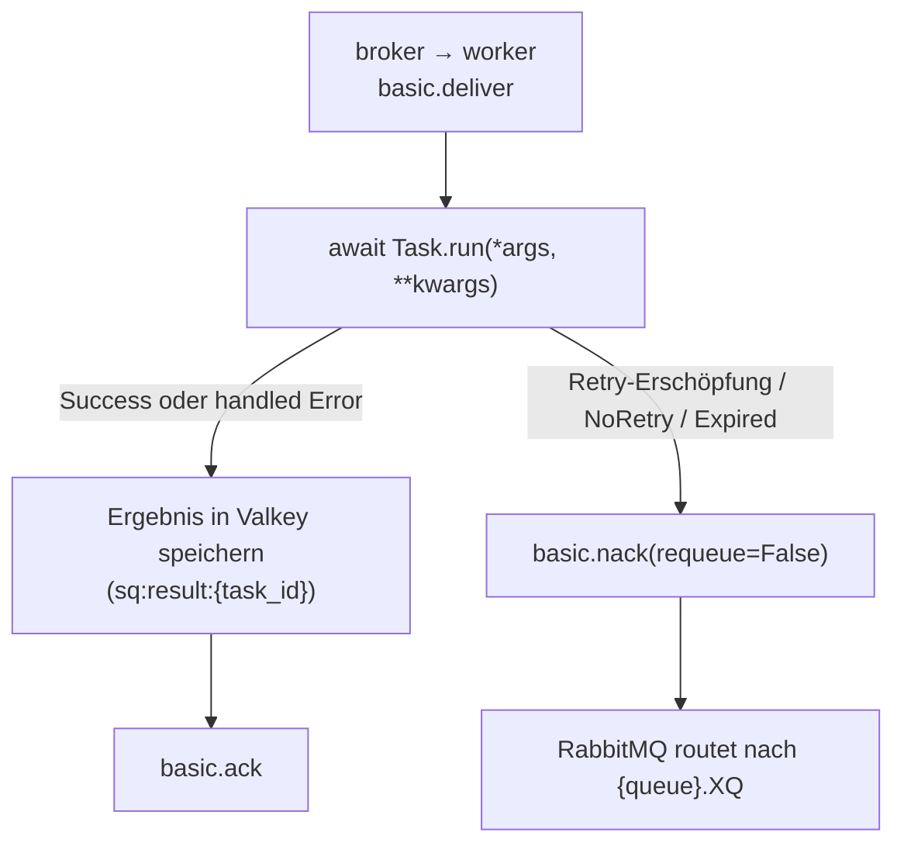

# Zustellungssemantik

SwarmQ ist per Default **at-least-once**. Jeder Task, den du planst,
läuft mindestens einmal; unter widrigen Bedingungen kann er
mehrfach laufen. Einen Exactly-Once-Modus bietet die Library nicht
— dieser Vertrag wird nicht angeboten, weil kein Queue-plus-Worker-
System ihn ohne Anwendungsunterstützung einhalten kann.

Diese Seite beschreibt, was das für deinen Code bedeutet, wo
Duplikate herkommen und wie SwarmQ den Schaden bei Duplikaten
begrenzt.

## Der Vertrag

Wenn `await app.schedule("send_email", to="a@example.com")` eine
task_id zurückgibt, verspricht SwarmQ:

1. Die Nachricht wurde von RabbitMQ mit Publisher-Confirm akzeptiert.
2. Ein Worker wird `SendEmail.run(to="a@example.com")` mindestens
   einmal ausführen.
3. Das Ergebnis des Tasks — Success, Exception oder Cancellation —
   wird nach Valkey unter `sq:result:{task_id}` mit konfigurierter
   TTL geschrieben.

Es verspricht **nicht**:

- Dass der Task genau einmal läuft.
- Dass der Task im Prozess läuft, der ihn geplant hat.
- Dass der Task läuft, bevor dein `get_result(timeout=...)`
  zurückkehrt, falls das Timeout zu kurz ist.

Alles auf der „verspricht nicht"-Liste folgt aus der Art, wie
at-least-once-Zustellung auf Broker-Ebene funktioniert.

## Wann eine Nachricht als zugestellt gilt

RabbitMQ routet die Nachricht in die Queue, sobald
`basic.publish` ein Confirm zurückgibt. Der Worker sieht die
Nachricht nicht, bis:

1. Sein Consumer die Queue abonniert hat (`basic.consume`).
2. Er freie Prefetch-Kapazität hat — `--concurrency N` minus
   In-Flight.
3. Der Broker einen `basic.deliver`-Frame an diesen Consumer sendet.

Ab diesem Punkt ist die Nachricht **in-flight**: von RabbitMQ als
unacknowledged gehalten, nur an diesen einen Consumer committet.
Der Broker gibt sie keinem anderen Worker, solange der aktuelle
Consumer nicht verschwindet.

## Wann Acks passieren

SwarmQ ack't, nachdem der Terminalzustand des Tasks dauerhaft
gespeichert wurde, nicht vorher:

Die Ack-nach-Store-Sequenz ist der Grund für die Zustellungsgarantie:
Crasht der Worker zwischen `Run` und `Store`, hält RabbitMQ die
Nachricht noch und wird sie redeliveren. Crasht er zwischen `Store`
und `Ack`, ist das Ergebnis bereits dauerhaft — die Redelivery
sieht den beendeten Zustand und überspringt den Re-Run.

## Was den Ack abbricht

Jedes hier genannte Szenario bricht den Ack ab und retry't die
Nachricht entweder oder routet sie in die DLQ:

| Abbruchquelle | Ziel |
|---|---|
| Worker-Prozess gekillt (`SIGKILL`, OOM, Node-Crash) | Redelivery von RabbitMQ nach Visibility-Timeout |
| Worker mitten im Task neu gestartet (graceful `SIGTERM`) | Drain der In-Flight-Tasks läuft; pending Messages redelivern an neuen Worker |
| `Task.run()` raist eine retry-bare Exception, Retries verbleiben | Neue Nachricht in die Delay-Queue, Original bestätigt (`TASK_RETRYING`) |
| `Task.run()` raist, nachdem `max_retries` erreicht ist | Worker publiziert nach `{queue}.XQ`, Original bestätigt (`TASK_DLQ`) |
| `raise NoRetry("reason")` | Worker publiziert sofort nach `{queue}.XQ`, Original bestätigt (`TASK_DLQ`) |
| RabbitMQs `x-delivery-limit=20` erreicht | Broker-native DLQ-Route |
| Backend nicht erreichbar bei einer Prüfung vor der Ausführung (Schedule-Fire-Dedup, Cancel-Check, Rate-Limit, Lock) | Neue Nachricht in die Delay-Queue mit wachsendem Backoff, Original bestätigt (`task_deferred_backend_unavailable`); kein Retry |
| Task-Alter übersteigt `max_age` bei Pickup | `TASK_EXPIRED`-Signal + DLQ |
| Lock-Render-Fehler oder Conflict-Cap erreicht | DLQ-Route mit Header `x-swarmq-lock-render-error` (Render-Fehler) bzw. `x-swarmq-lock-name` (Conflict-Cap) |

Der Worker ruft auf dem Primär-Retry-Pfad nie `basic.nack(requeue=True)`
auf. Ein Requeue-an-Ort-und-Stelle würde das Retry-Backoff umgehen
und den Broker in einer Hot-Loop ausbeuten. Alle Retries gehen
durch die Delay-Queue.

Dasselbe gilt für einen Backend-Ausfall vor der Ausführung. Erreicht
eine Prüfung, die vor dem Task läuft (Schedule-Fire-Dedup,
Cancel-Check, Rate-Limit, Lock), Valkey nicht, publiziert der Worker
eine Kopie der Nachricht in die Delay-Queue und bestätigt das Original
erst, wenn der Broker die Kopie bestätigt hat. Die Kopie behält alle
SwarmQ-Header (Retry-Zähler, Workflow-Kontext, Unique-Hash,
Enqueue-Zeit), aber nicht die Zustellzähler des Brokers; sie beginnt
also mit frischem Zustellbudget. Die Wartezeit beginnt bei
`SWARMQ_BACKEND_DEFER_BASE_DELAY` (1 s) und verdoppelt sich je
Zurückstellung bis `SWARMQ_BACKEND_DEFER_MAX_DELAY` (60 s). Jede
Zurückstellung loggt `task_deferred_backend_unavailable` (WARNING).
Das ist kein Retry: `max_retries` bleibt unberührt, `TASK_RETRYING`
feuert nicht. Nur wenn auch der Broker die Kopie nicht annimmt, fällt
der Worker auf `basic.nack(requeue=True)` zurück. Fire-and-forget-Tasks
werden genauso zurückgestellt, denn diese Prüfungen laufen vor ihrem
frühen Ack.

## Redelivery-Szenarien

Duplikate entstehen in drei Situationen, absteigend nach Häufigkeit.

### 1. Worker-Crash zwischen Store und Ack

Der Task lief, das Ergebnis ist in Valkey, aber RabbitMQ hat den
Ack nie bekommen. Wenn der Worker ersetzt wird, redelivert die
Nachricht. Der neue Worker führt den Task **erneut** aus — in v1
gibt es für diesen Fall keinen Per-Message-Marker „bereits gelaufen"
auf Consumer-Seite.

**Was dein Task sieht.** Einen zweiten Aufruf von `run()` mit
denselben Args.

**Warum akzeptiert.** Einen Claim-Check-Key zu jeder Ausführung auf
den Hot Path zu setzen, wäre ein Valkey-Roundtrip für ein seltenes
Ereignis. In der Praxis sind Worker-Crashes im Store-zu-Ack-Fenster
selten und meist harmlos — die zweite Ausführung schreibt dasselbe
Ergebnis in denselben Key.

**Mitigation.** Schreibe idempotente Task-Bodies (siehe unten).

### 2. Redelivery nach Netzwerk-Partition

Ein Worker in einem Broken-Network-Pod beendet den Task, kann aber
den Broker zum Ack'n nicht mehr erreichen. RabbitMQs
Delivery-Timeout feuert, es nackt stellvertretend für den toten
Consumer, und die Nachricht geht an einen anderen Worker. Beide
Worker führen den Task aus.

**Was dein Task sieht.** Zwei nebenläufige `run()`-Aufrufe,
möglicherweise auf verschiedenen Worker-Hosts.

**Mitigation.** Idempotenter Task-Body + `TaskInfo(lock="name")`
für Serialisierung, wenn die Business-Logik nebenläufige Ausführung
nicht verträgt.

### 3. Absichtliche Redelivery beim Graceful Shutdown

Auf `SIGTERM` stoppt der Worker das Fetchen neuer Nachrichten,
beendet seine In-Flight-Tasks und schließt dann den Channel. Alle
Messages, die der Broker zugestellt, der Worker aber noch nicht
begonnen hatte, werden requeued — und redelivern an einen
Geschwister-Worker. Das ist Absicht: So rollst du ein Deploy aus,
ohne Arbeit zu verlieren.

**Was dein Task sieht.** Einen frischen `run()`-Aufruf auf einem
anderen Worker mit demselben Nachrichten-Body.

**Mitigation.** Keine nötig. So ist das Design.

## Idempotenz-Erwartungen

Behandle jeden `run()`-Aufruf so, als könnte es die zweite, dritte
oder dreißigste Ausführung derselben Nachricht sein. Konkret:

- **Vor dem externen Seiteneffekt: prüfen, ob er bereits passiert ist.**
  Schau nach: „Habe ich diese E-Mail gesendet", „Existiert diese
  Rechnung", „Habe ich dieses Konto bereits belastet".
- **Upserts statt Inserts bevorzugen.** `INSERT ... ON CONFLICT DO
  NOTHING` in SQL, `SET NX` in Valkey, Idempotency-Keys bei
  Third-Party-APIs (Stripe, SendGrid, PayPal akzeptieren sie alle).
- **Nicht-idempotente Operationen nie ohne Wrapper.** Webhook
  versenden, Karte belasten, nach Slack posten — alle brauchen
  einen Idempotency-Key, der an die task_id oder an eine
  Business-Identität gebunden ist, die du als Argument übergibst.
- **`lock="user-{user_id}"` nutzen**, wenn zwei nebenläufige
  Ausführungen desselben logischen Tasks den State beschädigen
  würden. Per Default ist der Lock ein Mutex; `max_concurrency=N`
  macht daraus einen Semaphor.

SwarmQs eigenes Unique-Task-Feature (`unique_for=...`) dreht sich
um Dedup *beim schedule-Aufruf*, nicht um Dedup beim Run-Aufruf.
Zwei `schedule()`-Aufrufe innerhalb der TTL geben dieselbe
task_id zurück; ein Run. Das ist nicht dasselbe wie Wieder-Ausführung
nach einer Broker-Redelivery zu verhindern — dafür schreibe
idempotente Task-Bodies.

## Wie DLQ-Routing mit Retries interagiert

Retries sind ein Primärpfad. Die DLQ ist der Terminalpfad. Ein Task
erreicht die DLQ über einen von vier Wegen:

1. **Retry-Erschöpfung.** Der letzte Retry raiste. Der Worker nackt
   mit `requeue=False`, der Broker routet via DLX nach `{queue}.XQ`.
2. **`NoRetry`.** Der Task-Body raiste `NoRetry("reason")`. Das
   überspringt den Retry-Entscheid komplett — direkt in die DLQ.
3. **Broker-native Delivery-Limit.** RabbitMQ hat die Nachricht
   20-mal redelivered, ohne dass ein Ack gelandet ist. Das ist der
   Pathologischer-Loop-Schutz; er schirmt den Broker gegen einen
   buggy Worker ab. Ein Backend-Ausfall zählt nicht dagegen: Die
   Prüfungen vor der Ausführung stellen die Nachricht als neue
   Nachricht zurück, statt sie neu einzureihen (siehe oben).
4. **Expiry / Lock-Render / Conflict-Cap.** `max_age` überschritten,
   Lock-Key kann nicht gerendert werden (z. B. fehlender kwarg),
   Lock-Conflict-Budget getroffen. Die DLQ trägt die Nachricht mit
   Diagnostik-Headern.

DLQ'te Nachrichten sind per `swarmq dlq list | inspect | retry`
wiederherstellbar. Der Retry-Count-Header wird beim `dlq retry`
zurückgesetzt, sodass der Task sein volles Retry-Budget zurückbekommt.
Der Original-Traceback bleibt in den Headern für die Post-Mortem.

## Was SwarmQ nicht tut

- **`schedule()` blockiert nicht bis zur Task-Vollendung.** Nutze
  `app.run()` oder `schedule()` + `get_result()` explizit.
- **Ordering garantiert.** RabbitMQ garantiert FIFO pro Queue pro
  Consumer, aber mit `--concurrency > 1` wird daraus eine
  partielle Ordnung.
- **Exactly-once laufen.** Schreibe deinen Task-Body so, als könnte
  er zweimal laufen.
- **Ergebnisse durch den Broker routen.** Ergebnisse gehen zu
  Valkey; der Broker trägt nur die Task-Nachricht.

## Siehe auch

- [Architektur](architecture.md) — die Drei-Rollen-Topologie, die
  diese Semantik ermöglicht
- [Scheduling und Retries](../guides/scheduling-and-retries.md) —
  Retry-Backoff-Policies und Per-Task-Deaktivierung
- [Locking und Deduplizierung](../guides/locking-and-dedup.md) —
  die zwei Dedup-Geschmäcker (schedule-seitig und execution-seitig)
- [Dead-Letter-Queues](../guides/dead-letter-queues.md) —
  Operator-Recovery-Workflow für DLQ'te Tasks
