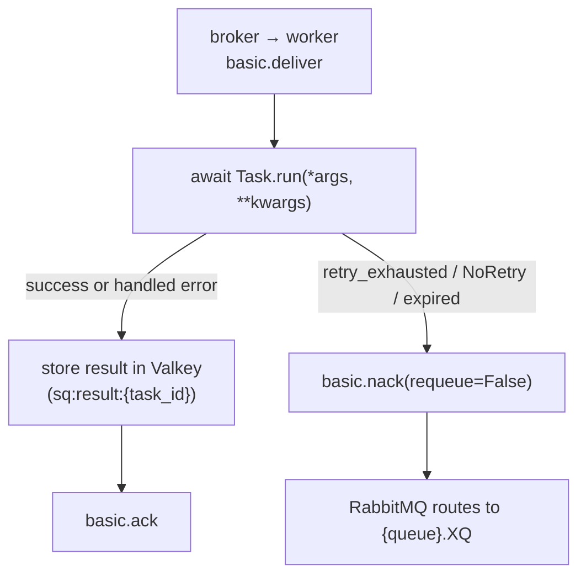

# Delivery semantics

SwarmQ is **at-least-once** by default. Every task you schedule runs
at least one time; under adverse conditions it may run more than once.
There is no exactly-once mode in the library — that contract is not
offered, because no queue-plus-worker system can honour it without
application-level help.

This page describes what that means for the code you write, where
duplicates come from, and how SwarmQ bounds the damage when they
happen.

## The contract

When `await app.schedule("send_email", to="a@example.com")` returns a
task_id, SwarmQ promises:

1. The message was accepted by RabbitMQ with a publisher confirm.
2. A worker will run `SendEmail.run(to="a@example.com")` at least once.
3. The task's result — success, exception, or cancellation — will be
   written to Valkey at `sq:result:{task_id}` with the configured TTL.

It does **not** promise:

- That the task runs exactly once.
- That the task runs inside the process that scheduled it.
- That the task runs before your `get_result(timeout=...)` returns,
  if the timeout is too short.

Everything on the "does not promise" list is a consequence of how
at-least-once delivery works at the broker level.

## When a message is considered delivered

RabbitMQ routes the message into the queue the moment `basic.publish`
returns a confirm. The worker does not see the message until:

1. Its consumer is subscribed to the queue (`basic.consume`).
2. It has free prefetch capacity — `--concurrency N` minus in-flight.
3. The broker sends a `basic.deliver` frame to that consumer.

From that point the message is **in-flight**: held by RabbitMQ as
unacknowledged, committed to only that consumer. The broker will not
hand it to another worker unless the current consumer disappears.

## When acks happen

SwarmQ acks after the task's terminal state is durably stored, not
before:

The ack-after-store sequence is the reason for the delivery
guarantee: if the worker crashes between `Run` and `Store`, RabbitMQ
still holds the message and will redeliver it. If the worker crashes
between `Store` and `Ack`, the result is already durable — the
redelivery will see the finished state and skip the rerun.

## What aborts the ack

Any of these aborts the ack and either retries the message or routes
it to the DLQ:

| Abort source | Where it goes |
|---|---|
| Worker process killed (`SIGKILL`, OOM, node crash) | Redelivered by RabbitMQ after visibility timeout |
| Worker restarted mid-task (graceful `SIGTERM`) | Drained in-flight tasks finish; pending messages redeliver to a new worker |
| `Task.run()` raises a retryable exception, retries remaining | New message to the delay queue, original acked (`TASK_RETRYING`) |
| `Task.run()` raises after `max_retries` reached | Worker publishes to `{queue}.XQ`, original acked (`TASK_DLQ`) |
| `raise NoRetry("reason")` | Worker publishes to `{queue}.XQ` immediately, original acked (`TASK_DLQ`) |
| RabbitMQ's `x-delivery-limit=20` reached | Broker-native DLQ route |
| Backend unreachable for a check before execution (schedule-fire dedup, cancel check, rate limit, lock) | New message to the delay queue with growing backoff, original acked (`task_deferred_backend_unavailable`); not a retry |
| Task age exceeds `max_age` at pickup | `TASK_EXPIRED` signal + DLQ |
| Lock render-fail or conflict cap reached | DLQ route with `x-swarmq-lock-render-error` (render failure) or `x-swarmq-lock-name` (conflict cap) header |

The worker never calls `basic.nack(requeue=True)` with the primary
retry path. Requeue-in-place would bypass the retry backoff and hot-
loop the broker. All retries go through the delay queue.

The same holds for a backend outage before execution. When a check
that runs before the task (schedule-fire dedup, cancel check, rate
limit, lock) cannot reach Valkey, the worker publishes a copy of the
message to the delay queue and acks the original only after the
broker confirmed the copy. The copy keeps every SwarmQ header (retry
count, workflow context, unique hash, enqueue time) but not the
broker's delivery counters, so it starts with a fresh delivery budget.
A check also counts as failed when Valkey does not answer within
`SWARMQ_BACKEND_OP_TIMEOUT` (5 s), so a backend that silently drops
traffic defers the message instead of holding it until the client's
socket timeout. The wait starts at `SWARMQ_BACKEND_DEFER_BASE_DELAY`
(1 s) and doubles per consecutive deferral up to
`SWARMQ_BACKEND_DEFER_MAX_DELAY` (60 s); each wait varies by ±20 %, so
messages deferred together do not hit the recovering backend together.
Only an outage defers: when Valkey answers a check with an error
(`BackendResponseError`, for example `WRONGTYPE`), waiting does not
help, and the message goes back to the queue in place, so a persistent
error reaches `{queue}.XQ` through the delivery limit. Error replies
that heal by waiting (`OOM`, `READONLY` during a failover, `LOADING`,
`TRYAGAIN`, `CLUSTERDOWN`, `MASTERDOWN`, `MISCONF`) count as an outage
and defer. Once the backend has answered,
the count starts over: retry, rate-limit and lock copies do not carry
`x-swarmq-backend-defer-count`, and a message the broker hands back
after a delivery that got past the checks (on quorum queues recognised
by its delivery counter) waits the base delay again. Each
deferral logs one line, `task_deferred_backend_unavailable` (WARNING),
whose fields `gate` and `stage` name the check that failed. It is not
a retry: `max_retries` is untouched and no `TASK_RETRYING` fires. Only
if the broker cannot take the copy either does the worker fall back to
`basic.nack(requeue=True)`. Fire-and-forget tasks are deferred the
same way, because these checks run before their early ack.

Retry copies and the copies after a rate-limit hit or a lock conflict
drop the broker's delivery counters the same way, so an inherited
`x-delivery-count` cannot send them to `{queue}.XQ` as a hung message.

A schedule fire (`x-swarmq-schedfire`) is claimed in Valkey before it
runs, so a second publish of the same fire is dropped. A copy of a
claimed fire (deferral, retry, requeue) carries the claim's owner token
in `x-swarmq-schedfire-claim`. If the worker could not release the
claim, for example because Valkey went down right after the claim, the
copy recognises the claim as its own and takes it over instead of
acking itself as a duplicate. The token changes on each takeover, so a
redelivery of the same copy is still a duplicate. When the reply to the
claim itself is lost (Valkey may or may not have written it), the copy
carries the new token together with the ones it was offered, and takes
the claim over either way. A requeue in place (`nack(requeue=True)`)
cannot carry a token, so the worker releases the claim before it
requeues. If that release fails, the worker publishes a copy carrying
the token to the delay queue instead (with the backoff of a deferral)
and acks the original once the broker confirmed the copy. Only if the
broker cannot take that copy either does it requeue in place; the
redelivery then finds the claim still held and is acked as a duplicate
until the claim expires (`SWARMQ_SCHEDULER_INFLIGHT_TTL`), so that fire
is lost. The claim
protection needs every worker on 0.9.0 or later: a worker of an older
version neither writes nor recognises the token.

## Redelivery scenarios

Duplicates appear in three situations, in descending order of
frequency.

### 1. Worker crash between Store and Ack

The task ran, the result is in Valkey, but RabbitMQ never got the ack.
When the worker is replaced, the message redelivers. The new worker
runs the task **again** — there is no per-message "already ran" marker
on the consumer side for this case in v1.

**What your task sees.** A second call to `run()` with the same args.

**Why it is accepted.** Adding a claim-check key to gate every
execution would be a Valkey round-trip on the hot path for a rare
event. In practice, worker crashes during the Store-to-Ack window are
rare and usually benign — the second execution writes the same result
to the same key.

**Mitigation.** Write idempotent task bodies (see below).

### 2. Redelivery after network partition

A worker running in a broken-network pod finishes the task but cannot
reach the broker to ack. RabbitMQ's delivery timeout fires, it nacks
on the dead consumer's behalf, and the message goes to another
worker. Both workers run the task.

**What your task sees.** Two concurrent `run()` calls, possibly on
different worker hosts.

**Mitigation.** Idempotent task body + `TaskInfo(lock="name")` for
serialization when the business logic cannot tolerate concurrent
execution.

### 3. Deliberate redelivery during graceful shutdown

On `SIGTERM`, the worker stops fetching new messages, finishes its
in-flight tasks, then closes the channel. Any messages the broker
delivered but the worker had not started yet get requeued — they
redeliver to a sibling worker. This is intentional: it is how you
roll a deploy without losing work.

**What your task sees.** A fresh `run()` call on a different worker
with the same message body.

**Mitigation.** Nothing required. This is the design.

## Idempotency expectations

Treat every `run()` call as if it might be the second, third, or
thirtieth execution of the same message. Concretely:

- **Before the external side effect, check if it already happened.**
  Look up "did I send this email", "does this invoice exist", "did I
  already debit this account".
- **Prefer upserts over inserts.** `INSERT ... ON CONFLICT DO NOTHING`
  in SQL, `SET NX` in Valkey, idempotency keys on third-party APIs
  (Stripe, SendGrid, PayPal all accept them).
- **Avoid non-idempotent operations without a wrapper.** Sending a
  webhook, charging a card, posting to Slack — all need an
  idempotency key keyed on the task_id or on a business identifier
  you pass as an argument.
- **Use `lock="user-{user_id}"`** when two concurrent executions of
  the same logical task would corrupt state. The lock is mutex by
  default; `max_concurrency=N` turns it into a semaphore.

SwarmQ's own unique-task feature (`unique_for=...`) is about dedup
*on the schedule call*, not dedup on the run call. Two `schedule()`
calls within the TTL return the same task_id; one run. That is not
the same as preventing re-execution after a broker redelivery — for
that, write idempotent task bodies.

## How DLQ routing interacts with retries

Retries are a first-class path. The DLQ is the terminal path. A task
reaches the DLQ by one of four routes:

1. **Retry exhaustion.** The last retry raised. The worker nacks with
   `requeue=False`, the broker routes via DLX to `{queue}.XQ`.
2. **`NoRetry`.** The task body raised `NoRetry("reason")`. This
   skips the retry decision entirely — straight to DLQ.
3. **Broker-native delivery-limit.** RabbitMQ has redelivered the
   message 20 times without an ack landing. This is the pathological-
   loop guard; it protects the broker from a buggy worker. A backend
   outage does not count against it: the checks before execution defer
   the message as a new message instead of requeuing it (see above).
4. **Expiry / lock-render / conflict-cap.** `max_age` exceeded,
   lock key cannot be rendered (e.g. missing kwarg), or lock
   conflict budget hit. DLQ carries the message with diagnostic
   headers.

DLQ'd messages are recoverable via `swarmq dlq list | inspect |
retry`. The retry count header is reset on `dlq retry`, so the task
gets its full retry budget back. The original traceback stays in the
headers for post-mortem.

## What SwarmQ will not do

- **Block `schedule()` until the task completes.** Use `app.run()` or
  `schedule()` + `get_result()` explicitly.
- **Guarantee ordering.** RabbitMQ guarantees FIFO per queue per
  consumer, but with `--concurrency > 1` that becomes partial order.
- **Run exactly-once.** Write your task body as if it can run twice.
- **Move results through the broker.** Results go to Valkey; the
  broker only carries the task message.

## See also

- [Architecture](architecture.md) — the three-role topology that
  makes these semantics possible
- [Scheduling and retries](../guides/scheduling-and-retries.md) —
  the retry backoff policies and how to disable them per task
- [Locking and deduplication](../guides/locking-and-dedup.md) —
  the two flavours of dedup (schedule-side and execution-side)
- [Dead letter queues](../guides/dead-letter-queues.md) — operator
  recovery workflow for DLQ'd tasks
