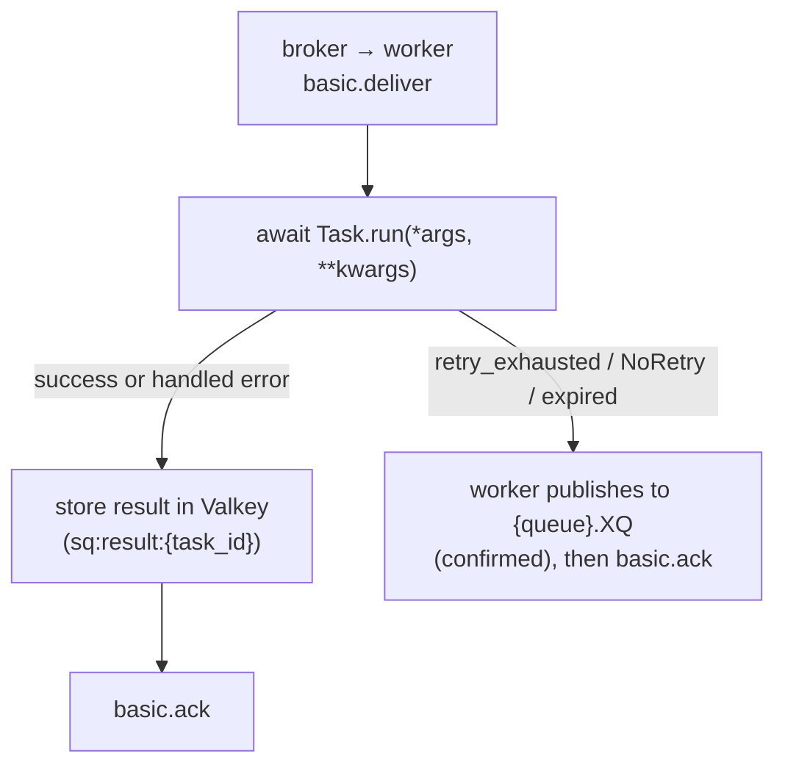

# Delivery semantics

SwarmQ is **at-least-once** by default. Every task you schedule runs
at least one time; under adverse conditions it may run more than once.
There is no exactly-once mode in the library — that contract is not
offered, because no queue-plus-worker system can honour it without
application-level help.

This page describes what that means for the code you write, where
duplicates come from, and how SwarmQ bounds the damage when they
happen.

## The contract

When `await app.schedule("send_email", to="a@example.com")` returns a
task_id, SwarmQ promises:

1. The message was accepted by RabbitMQ with a publisher confirm.
2. A worker will run `SendEmail.run(to="a@example.com")` at least once.
3. The task's result — success, exception, or cancellation — will be
   written to Valkey at `sq:result:{task_id}` with the configured TTL.

It does **not** promise:

- That the task runs exactly once.
- That the task runs inside the process that scheduled it.
- That the task runs before your `get_result(timeout=...)` returns,
  if the timeout is too short.

Everything on the "does not promise" list is a consequence of how
at-least-once delivery works at the broker level.

## When a message is considered delivered

RabbitMQ routes the message into the queue the moment `basic.publish`
returns a confirm. The worker does not see the message until:

1. Its consumer is subscribed to the queue (`basic.consume`).
2. It has free prefetch capacity — `--concurrency N` minus in-flight.
3. The broker sends a `basic.deliver` frame to that consumer.

From that point the message is **in-flight**: held by RabbitMQ as
unacknowledged, committed to only that consumer. The broker will not
hand it to another worker unless the current consumer disappears.

## When acks happen

SwarmQ acks after the task's terminal state is durably stored, not
before:

The ack-after-store sequence is the reason for the delivery
guarantee: if the worker crashes between `Run` and `Store`, RabbitMQ
still holds the message and will redeliver it. If the worker crashes
between `Store` and `Ack`, the result is already durable, but the
redelivery runs the task again (see
[Redelivery scenarios](#1-worker-crash-between-store-and-ack)).

## What aborts the ack

Any of these aborts the ack and either retries the message or routes
it to the DLQ:

| Abort source | Where it goes |
|---|---|
| Worker process killed (`SIGKILL`, OOM, node crash) | Redelivered by RabbitMQ as soon as the worker's channel or connection closes |
| Worker restarted mid-task (graceful `SIGTERM`) | Drained in-flight tasks finish; pending messages redeliver to a new worker |
| `Task.run()` raises a retryable exception, retries remaining | New message to the delay queue, original acked (`TASK_RETRYING`) |
| `Task.run()` raises after `max_retries` reached | Worker publishes to `{queue}.XQ`, original acked (`TASK_DLQ`) |
| `raise NoRetry("reason")` | Worker publishes to `{queue}.XQ` immediately, original acked (`TASK_DLQ`) |
| RabbitMQ's `x-delivery-limit=20` reached | Broker-native DLQ route |
| Backend unreachable for a check before execution (schedule-fire dedup, cancel check, rate limit, lock) | New message to the delay queue with growing backoff, original acked (`task_deferred_backend_unavailable`); not a retry |
| Task age exceeds `max_age` at pickup | `TASK_EXPIRED` signal + DLQ |
| Lock render-fail or conflict cap reached | DLQ route with `x-swarmq-lock-render-error` (render failure) or `x-swarmq-lock-name` (conflict cap) header |
| Same execution already finished, superseded by a retry, or running elsewhere ([execution guard](#execution-guard)) | Acked and skipped (`duplicate_delivery_skipped`), or new message to the delay queue with growing backoff (`execution_guard_deferred`); not a retry |
| `Task.run()` fails terminally with dead-lettering switched off (`TaskInfo(dead_letter=False)`) | Error result stored, original acked; no DLQ |

The worker never calls `basic.nack(requeue=True)` with the primary
retry path. Requeue-in-place would bypass the retry backoff and hot-
loop the broker. All retries go through the delay queue.

The same holds for a backend outage before execution. When a check
that runs before the task (schedule-fire dedup, cancel check, rate
limit, lock) cannot reach Valkey, the worker publishes a copy of the
message to the delay queue and acks the original only after the
broker confirmed the copy. The copy keeps every SwarmQ header (retry
count, workflow context, unique hash, enqueue time) but not the
broker's delivery counters, so it starts with a fresh delivery budget.
A check also counts as failed when Valkey does not answer within
`SWARMQ_BACKEND_OP_TIMEOUT` (5 s), so a backend that silently drops
traffic defers the message instead of holding it until the client's
socket timeout. The wait starts at `SWARMQ_BACKEND_DEFER_BASE_DELAY`
(1 s) and doubles per consecutive deferral up to
`SWARMQ_BACKEND_DEFER_MAX_DELAY` (60 s); each wait varies by ±20 %, so
messages deferred together do not hit the recovering backend together.
Only an outage defers: when Valkey answers a check with an error
(`BackendResponseError`, for example `WRONGTYPE`), waiting does not
help, and the message goes back to the queue in place, so a persistent
error reaches `{queue}.XQ` through the delivery limit. Error replies
that heal by waiting (`OOM`, `READONLY` during a failover, `LOADING`,
`TRYAGAIN`, `CLUSTERDOWN`, `MASTERDOWN`, `MISCONF`) count as an outage
and defer. Once the backend has answered,
the count starts over: retry, rate-limit and lock copies do not carry
`x-swarmq-backend-defer-count`, and a message the broker hands back
after a delivery that got past the checks (on quorum queues recognised
by its delivery counter) waits the base delay again. Each
deferral logs one line, `task_deferred_backend_unavailable` (WARNING),
whose fields `gate` and `stage` name the check that failed. It is not
a retry: `max_retries` is untouched and no `TASK_RETRYING` fires. Only
if the broker cannot take the copy either does the worker fall back to
`basic.nack(requeue=True)`. Fire-and-forget tasks are deferred the
same way, because these checks run before their early ack.

Retry copies and the copies after a rate-limit hit or a lock conflict
drop the broker's delivery counters the same way, so an inherited
`x-delivery-count` cannot send them to `{queue}.XQ` as a hung message.

A schedule fire (`x-swarmq-schedfire`) is claimed in Valkey before it
runs, so a second publish of the same fire is dropped. A copy of a
claimed fire (deferral, retry, requeue) carries the claim's owner token
in `x-swarmq-schedfire-claim`. If the worker could not release the
claim, for example because Valkey went down right after the claim, the
copy recognises the claim as its own and takes it over instead of
acking itself as a duplicate. The token changes on each takeover, so a
redelivery of the same copy is still a duplicate. When the reply to the
claim itself is lost (Valkey may or may not have written it), the copy
carries the new token together with the ones it was offered, and takes
the claim over either way. A requeue in place (`nack(requeue=True)`)
cannot carry a token, so the worker releases the claim before it
requeues. If that release fails, the worker publishes a copy carrying
the token to the delay queue instead (with the backoff of a deferral)
and acks the original once the broker confirmed the copy. Only if the
broker cannot take that copy either does it requeue in place; the
redelivery then finds the claim still held and is acked as a duplicate
until the claim expires (`SWARMQ_SCHEDULER_INFLIGHT_TTL`), so that fire
is lost. The claim
protection needs every worker on 0.9.0 or later: a worker of an older
version neither writes nor recognises the token.

## Redelivery scenarios

Duplicates appear in three situations, in descending order of
frequency.

### 1. Worker crash between Store and Ack

The task ran, the result is in Valkey, but RabbitMQ never got the ack.
When the worker is replaced, the message redelivers. From 0.11.0 the
[execution guard](#execution-guard) catches most of these cases: an
ack that failed on a lost channel still sets the done marker, so the
redelivery is skipped. A worker killed after the side effect but
before the ack leaves only a running marker; once it expires
(`SWARMQ_EXECUTION_GUARD_TTL_S`, default 60 s) the redelivery runs the
task **again**.

**What your task sees.** A second call to `run()` with the same args,
at least `SWARMQ_EXECUTION_GUARD_TTL_S` after the first one started.

**Mitigation.** Write idempotent task bodies (see below).

### 2. Redelivery after network partition

A worker running in a broken-network pod finishes the task but cannot
reach the broker to ack. RabbitMQ closes the connection or the
[consumer timeout](#consumer-timeout) fires, and the message goes to
another worker. While the first worker still renews its running
marker in Valkey, the [execution guard](#execution-guard) defers the
second delivery instead of running it. If the first worker cannot
reach Valkey either, its marker expires and both workers run the task.

**What your task sees.** Usually one `run()` call; in the worst case
two concurrent calls, possibly on different worker hosts.

**Mitigation.** Idempotent task body + `TaskInfo(lock="name")` for
serialization when the business logic cannot tolerate concurrent
execution.

### 3. Deliberate redelivery during graceful shutdown

On `SIGTERM`, the worker stops fetching new messages, finishes its
in-flight tasks, then closes the channel. Any messages the broker
delivered but the worker had not started yet get requeued — they
redeliver to a sibling worker. This is intentional: it is how you
roll a deploy without losing work.

**What your task sees.** A fresh `run()` call on a different worker
with the same message body.

**Mitigation.** Nothing required. This is the design.

## Execution guard

From 0.11.0 the worker checks every delivery against a marker in
Valkey before it runs the task (`SWARMQ_EXECUTION_GUARD`, on by
default). A redelivered message does not run while the same execution
runs elsewhere, after it finished, or after a retry superseded it.

**Identity.** An execution is the task id plus the header
`x-swarmq-replay-id`, if present. `swarmq dlq retry` and
`dlq retry --all` set a new replay id, so a deliberate replay runs
again even while the marker of the first run exists.

**How it works.** After the task lookup and before the expiry check,
the worker claims a running marker with its own owner token and a TTL
of `SWARMQ_EXECUTION_GUARD_TTL_S` (default 60 s). While the task runs,
the worker renews all its markers in one batch every third of the TTL;
in [CPU mode](../guides/cpu-mode.md) the main process renews them, so a
busy compute child does not stop the renewal. The broker verb that the
worker actually executes decides what comes next:

| Executed verb | Marker |
|---|---|
| `ack` after the task, dead-lettering, routing to the dead-letter exchange | done marker, running marker deleted |
| retry with a higher `x-swarmq-retry-count` (publish confirmed, even if the ack afterwards fails) | superseded marker with the new retry count, running marker deleted |
| requeue, `nack`, deferral, no verb, exception | only the running marker is deleted |

An `ack` that fails because the channel is gone (RabbitMQ up to 4.2
after a consumer timeout) still sets the done marker. A retry or
dead-letter publish that the broker confirmed but whose ack failed
raises `SettleFailedAfterPublish` and sets its marker as after
success; the redelivered original is then skipped.

**On redelivery** the claim decides:

- **Done, or superseded by a retry with a higher count:** the delivery
  is acknowledged and skipped (`duplicate_delivery_skipped`).
- **Running elsewhere:** the delivery goes back through the delay queue
  as a new message (`execution_guard_deferred`), with the backoff of
  `SWARMQ_BACKEND_DEFER_BASE_DELAY`/`_MAX_DELAY` counted in the header
  `x-swarmq-guard-defer-count`. This uses neither `max_retries` nor the
  delivery limit.
- **Valkey unreachable:** deferred like the other checks before
  execution (`task_deferred_backend_unavailable`, `gate=execution_guard`).

**Crashed workers.** If a worker dies mid-task, its running marker
expires after `SWARMQ_EXECUTION_GUARD_TTL_S`; the next delivery then
runs normally. A marker that expired without release counts as an
orphan. When the same execution has expired
`SWARMQ_EXECUTION_GUARD_MAX_ORPHANS` times (default 3), the delivery
goes into `{queue}.XQ` as `WorkerHungError`
(`execution_guard_orphan_limit`). Without this limit every deferral
would be a new message and bypass the delivery limit.

**Retention of the markers.** Done and superseded markers live
`SWARMQ_EXECUTION_GUARD_DONE_TTL_S`; the default is
`max(SWARMQ_RETRY_MAX_DELAY, SWARMQ_CONSUMER_TIMEOUT_S) + 300` seconds
and at least `SWARMQ_EXECUTION_GUARD_TTL_S`. Deferred copies can sit
behind long retry delays, and from RabbitMQ 4.3 deliveries stay checked
out until the consumer timeout. Keys: `sq:guard:{<identity>}:run` (the
running marker) and `sq:guard:{<identity>}:state` (done, superseded,
orphans), both under the same hash tag.

**Remaining risks.** The guard narrows duplicates, it does not make
SwarmQ exactly-once:

- **A blocked event loop stops the renewal.** Synchronous code that
  blocks the loop of an IO worker for longer than the TTL lets the
  running marker expire; a redelivery can then run in parallel. The
  worker logs `execution_guard_lease_lost` once it notices. Keep
  blocking work in [CPU mode](../guides/cpu-mode.md) or in a thread, or
  raise `SWARMQ_EXECUTION_GUARD_TTL_S`.
- **A hung task blocks its redelivery without limit.** A task that
  awaits forever while the event loop keeps running renews its marker,
  so every redelivery of it is deferred again and again. Once the
  deferrals add up to more than `SWARMQ_CONSUMER_TIMEOUT_S` (nominal
  backoff, without jitter), the worker logs
  `execution_guard_defer_stalled` (WARNING) once per message and counts
  `event="defer_stalled"`. It keeps deferring; the message does not go
  to the DLQ. Give long tasks a timeout of their own.
- **Older workers in mixed operation do not protect.** Workers before
  0.11.0 neither set nor check markers. Until every worker consuming a
  queue runs 0.11.0, a delivery handled by an older worker is not
  guarded.
- `FIRE_AND_FORGET` tasks are acknowledged before they run and are not
  guarded. A backend of your own without an `execution_guard` store
  switches the guard off.

**Cost.** Each guarded task costs two Lua calls to Valkey plus the
batched renewal. In the load suite, realistic load showed no
measurable throughput loss. The worst case — one worker, only tasks
of about 0.3 ms, CPU-saturated — lost 7.4 % throughput; CPU per task
rose by 11–12 % and the latency of fast tasks by 0.15–0.2 ms.

**Switching it off.** `SWARMQ_EXECUTION_GUARD=false`
(`SwarmQConfig(execution_guard=False)`) restores the behaviour before
0.11.0. Observe it with `swarmq_execution_guard_events_total{event}`
(`duplicate_skipped`, `deferred`, `orphan_limit`, `lease_lost`,
`defer_stalled`) and the
[log events](../reference/logging.md#event-catalog).

## Consumer timeout

RabbitMQ's `consumer_timeout` (default 30 minutes;
`SWARMQ_CONSUMER_TIMEOUT_S` tells the worker the value) bounds how long
a delivery may stay unacknowledged. What happens when a task runs
longer depends on the RabbitMQ version:

- **Up to 4.2 (and 3.13):** the broker closes the channel. aio-pika
  restores the consumer, and the broker redelivers the message while
  the original still runs. Before 0.11.0 the task ran twice; now the
  [execution guard](#execution-guard) defers the redelivery until the
  original finished and then skips it. The late ack of the original
  fails on the closed channel (`delivery_settle_failed`) and is
  harmless.
- **From 4.3 (quorum queues):** the broker sends `basic.cancel`, the
  channel stays open, and the message goes back to the queue. The
  consumer remains at the broker as a zombie: a late ack wakes it, and
  the broker delivers to a tag the client no longer knows, so those
  messages were silently dropped. Before 0.11.0 the worker stopped
  consuming without notice. On 4.3.6 classic queues have no consumer
  timeout.

From 0.11.0 a **consumer watch** checks every
`SWARMQ_CONSUMER_WATCH_INTERVAL_S` (default 5 s) that each consumed
queue, including priority queues, still has its consumer on the
current channel:

- A consumer missing on an open, unchanged channel (4.3) is cancelled
  by the worker itself and then registered again with a new tag.
- A consumer missing because the channel was closed or replaced (up to
  4.2) gets two ticks for aio-pika's restore; only then the watch
  registers it again.
- Each re-registration logs `consumer_reregistered` (field `reason`:
  `broker_cancel` or `channel_replaced`) and counts
  `swarmq_consumer_reregistrations_total{queue}`. The worker consumes
  again within two intervals, without a restart, and no zombie stays
  at the broker.

On 4.3 an ack or nack for a delivery whose consumer the broker
cancelled waits until the watch has sent its own cancel
(`delivery_settle_deferred`), because only then is it harmless. If
that takes longer than 10 s, the settle is dropped
(`delivery_settle_withheld`) and the call returns normally; the broker
had already taken the message back with its cancel. If the watch has
never seen the tag (first tick after `consume`), the cancel can take
two ticks, so a late settle may be dropped after 10 s — safely. The
same applies during shutdown for settles on tags the broker cancelled.

**Readiness.** `/ready` gets a `consumers` entry. It is not ready
before the first `consume` (`not consuming: <queues>`) and once a
queue has had no active consumer for more than
`SWARMQ_CONSUMER_READY_GRACE_S` (default 30 s): `no active consumer for
more than 30.0s: <queues>`. **Never use `/ready` as a liveness probe**:
a broker outage would then restart every worker at once, and a restart
does not help — the watch registers the consumer again by itself. Use
`/health` for liveness.

Raise `SWARMQ_CONSUMER_TIMEOUT_S` together with the broker's
`consumer_timeout` for jobs that run longer than 30 minutes; the
worker warns at start when a `hard_timeout` exceeds it.

## Idempotency expectations

Treat every `run()` call as if it might be the second, third, or
thirtieth execution of the same message. Concretely:

- **Before the external side effect, check if it already happened.**
  Look up "did I send this email", "does this invoice exist", "did I
  already debit this account".
- **Prefer upserts over inserts.** `INSERT ... ON CONFLICT DO NOTHING`
  in SQL, `SET NX` in Valkey, idempotency keys on third-party APIs
  (Stripe, SendGrid, PayPal all accept them).
- **Avoid non-idempotent operations without a wrapper.** Sending a
  webhook, charging a card, posting to Slack — all need an
  idempotency key keyed on the task_id or on a business identifier
  you pass as an argument.
- **Use `lock="user-{user_id}"`** when two concurrent executions of
  the same logical task would corrupt state. The lock is mutex by
  default; `max_concurrency=N` turns it into a semaphore.

SwarmQ's own unique-task feature (`unique_for=...`) is about dedup
*on the schedule call*, not dedup on the run call. Two `schedule()`
calls within the TTL return the same task_id; one run. That is not
the same as preventing re-execution after a broker redelivery — for
that, write idempotent task bodies.

## How DLQ routing interacts with retries

Retries are a first-class path. The DLQ is the terminal path. A task
reaches the DLQ by one of five routes:

1. **Retry exhaustion.** The last retry raised. The worker publishes
   the message to `{queue}.XQ` (with `x-swarmq-traceback`) and acks
   the original once the broker confirmed it.
2. **`NoRetry`.** The task body raised `NoRetry("reason")`. This
   skips the retry decision entirely — straight to DLQ.
3. **Broker-native delivery-limit.** RabbitMQ has redelivered the
   message 20 times without an ack landing. This is the pathological-
   loop guard; it protects the broker from a buggy worker. A backend
   outage does not count against it: the checks before execution defer
   the message as a new message instead of requeuing it (see above).
4. **Expiry / lock-render / conflict-cap.** `max_age` exceeded,
   lock key cannot be rendered (e.g. missing kwarg), or lock
   conflict budget hit. DLQ carries the message with diagnostic
   headers.
5. **Orphan limit of the execution guard.** The same execution expired
   `SWARMQ_EXECUTION_GUARD_MAX_ORPHANS` times without release; the
   delivery goes to the DLQ as `WorkerHungError`.

Routes 1 and 2 (and an exception outside `retry_exceptions`) can be
switched off per task (`TaskInfo(dead_letter=False)`) or globally
(`SWARMQ_DEAD_LETTER_TERMINAL_FAILURES=false`); the error result is
then stored and the message acknowledged. Dead-lettered messages
expire after `SWARMQ_DEAD_LETTER_TTL_S` (default 7 days); see
[Dead letter queues](../guides/dead-letter-queues.md#retention-dead-lettered-messages-expire).

DLQ'd messages are recoverable via `swarmq dlq list | inspect |
retry`. The retry count header is reset on `dlq retry`, so the task
gets its full retry budget back, and a new replay id lets it pass the
execution guard. The original traceback stays in the
headers for post-mortem.

## What SwarmQ will not do

- **Block `schedule()` until the task completes.** Use `app.run()` or
  `schedule()` + `get_result()` explicitly.
- **Guarantee ordering.** RabbitMQ guarantees FIFO per queue per
  consumer, but with `--concurrency > 1` that becomes partial order.
- **Run exactly-once.** The execution guard narrows duplicates, but
  write your task body as if it can run twice.
- **Move results through the broker.** Results go to Valkey; the
  broker only carries the task message.

## See also

- [Architecture](architecture.md) — the three-role topology that
  makes these semantics possible
- [Scheduling and retries](../guides/scheduling-and-retries.md) —
  the retry backoff policies and how to disable them per task
- [Locking and deduplication](../guides/locking-and-dedup.md) —
  the two flavours of dedup (schedule-side and execution-side)
- [Dead letter queues](../guides/dead-letter-queues.md) — operator
  recovery workflow for DLQ'd tasks
