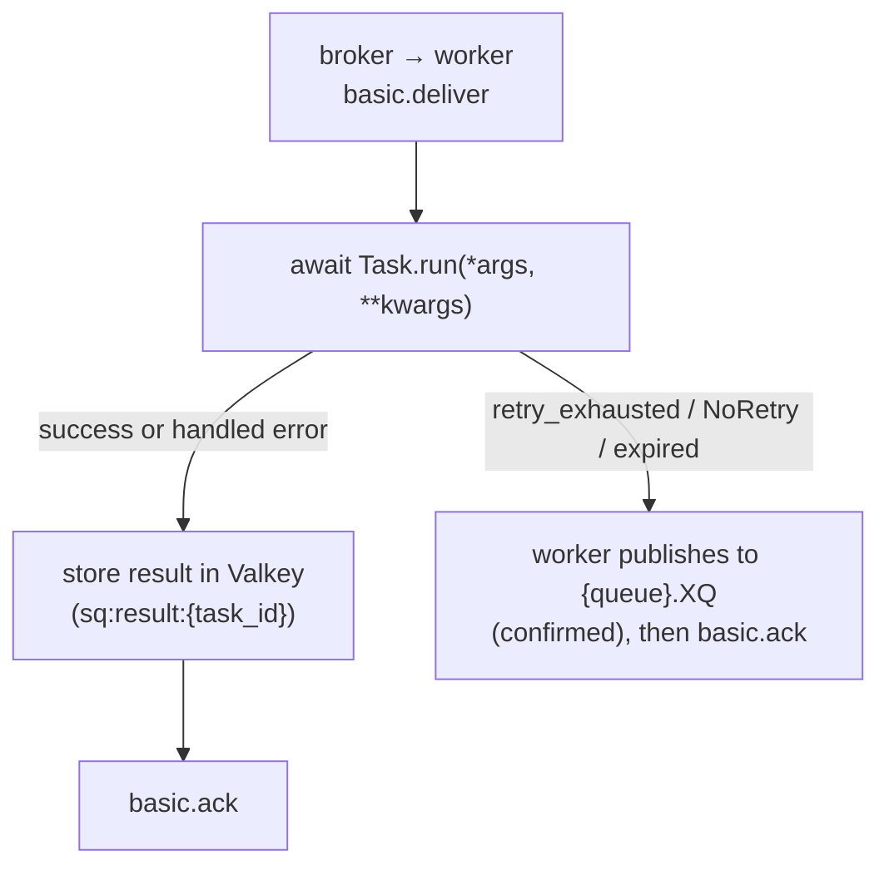

# Delivery semantics

SwarmQ is **at-least-once** by default. Every task you schedule runs
at least one time; under adverse conditions it may run more than once.
There is no exactly-once mode in the library — that contract is not
offered, because no queue-plus-worker system can honour it without
application-level help.

This page describes what that means for the code you write, where
duplicates come from, and how SwarmQ bounds the damage when they
happen.

## The contract

When `await app.schedule("send_email", to="a@example.com")` returns a
task_id, SwarmQ promises:

1. The message was accepted by RabbitMQ with a publisher confirm.
2. A worker will run `SendEmail.run(to="a@example.com")` at least once,
   unless the task is cancelled, expires through `max_age` or is
   dead-lettered before it runs. On quorum queues that still
   dead-letter at-most-once (created before 0.12, or
   `SWARMQ_QUEUE_DEAD_LETTER_STRATEGY=legacy`) a retry or deferral can
   be lost on a leader change
   ([dead-lettering guarantee](#dead-lettering-guarantee)).
3. The task's result — success, exception, or cancellation — will be
   written to Valkey at `[<namespace>:]sq:result:{task_id}` with the
   configured TTL.

It does **not** promise:

- That the task runs exactly once.
- That the task runs inside the process that scheduled it.
- That the task runs before your `get_result(timeout=...)` returns,
  if the timeout is too short.

Everything on the "does not promise" list is a consequence of how
at-least-once delivery works at the broker level.

### When `schedule()` raises

A failed publish ends in one of two ways, depending on whether the
message had already been sent:

- `BrokerConnectionError` (and its other subclasses): nothing was sent,
  retrying is safe. A connection loss before the message reached the
  socket is retried internally first.
- `PublishIndeterminate`: the message was sent, but the publish deadline
  ran out or the connection broke while waiting for the broker's
  confirm. The broker may hold the message, so a retry can run the task
  twice. swarmq never resends in this case; a `unique_for` claim stays
  in place ([error reference](../reference/errors.md#publishindeterminate)).

## When a message is considered delivered

RabbitMQ routes the message into the queue the moment `basic.publish`
returns a confirm. The worker does not see the message until:

1. Its consumer is subscribed to the queue (`basic.consume`).
2. It has free prefetch capacity — `--concurrency N` minus in-flight.
3. The broker sends a `basic.deliver` frame to that consumer.

From that point the message is **in-flight**: held by RabbitMQ as
unacknowledged, committed to only that consumer. The broker will not
hand it to another worker unless the current consumer disappears.

## When acks happen

SwarmQ acks after the task's terminal state is durably stored, not
before:

The ack-after-store sequence is the reason for the delivery
guarantee: if the worker crashes between `Run` and `Store`, RabbitMQ
still holds the message and will redeliver it. If the worker crashes
between `Store` and `Ack`, the result is already durable, but the
redelivery runs the task again (see
[Redelivery scenarios](#1-worker-crash-between-store-and-ack)). If
storing the result fails (Valkey unreachable), the worker retries the
store for a bounded time before it hands the message back; only then
does the task run again
([scenario 4](#4-result-store-fails-after-the-task-ran)).

## What aborts the ack

Any of these aborts the ack and either retries the message or routes
it to the DLQ:

| Abort source | Where it goes |
|---|---|
| Worker process killed (`SIGKILL`, OOM, node crash) | Redelivered by RabbitMQ as soon as the worker's channel or connection closes |
| Worker restarted mid-task (graceful `SIGTERM`) | Drained in-flight tasks finish; pending messages redeliver to a new worker |
| `Task.run()` raises a retryable exception, retries remaining | New message to the delay queue, original acked (`TASK_RETRYING`) |
| `Task.run()` raises after `max_retries` reached | Worker publishes to `{queue}.XQ`, original acked (`TASK_DLQ`) |
| `raise NoRetry("reason")` | Worker publishes to `{queue}.XQ` immediately, original acked (`TASK_DLQ`) |
| RabbitMQ's `x-delivery-limit=20` reached | Broker-native DLQ route |
| Backend unreachable for a check before execution (schedule-fire dedup, cancel check, rate limit, lock) | New message to the delay queue with growing backoff, original acked (`task_deferred_backend_unavailable`); not a retry |
| Task age exceeds `max_age` at pickup | `TASK_EXPIRED` signal + DLQ |
| Lock render-fail, or the wait for a lock ended (stalled holder, `SWARMQ_LOCK_WAIT_MAX_S`) | DLQ route with `x-swarmq-lock-render-error` (render failure) or `x-swarmq-lock-name` (`LockWaitExceeded`) header |
| Same execution already finished, superseded by a retry, or running elsewhere ([execution guard](#execution-guard)) | Acked and skipped (`duplicate_delivery_skipped`), or new message to the delay queue with growing backoff (`execution_guard_deferred`); not a retry |
| `Task.run()` fails terminally with dead-lettering switched off (`TaskInfo(dead_letter=False)`) | Error result stored, original acked; no DLQ |

The worker never calls `basic.nack(requeue=True)` with the primary
retry path. Requeue-in-place would bypass the retry backoff and hot-
loop the broker. All retries go through the delay queue.

The same holds for a backend outage before execution. When a check
that runs before the task (schedule-fire dedup, cancel check, rate
limit, lock) cannot reach Valkey, the worker publishes a copy of the
message to the delay queue and acks the original only after the
broker confirmed the copy. The copy keeps every SwarmQ header (retry
count, workflow context, unique hash, enqueue time) but not the
broker's delivery counters, so it starts with a fresh delivery budget.
A check also counts as failed when Valkey does not answer within
`SWARMQ_BACKEND_OP_TIMEOUT` (5 s), so a backend that silently drops
traffic defers the message instead of holding it until the client's
socket timeout. The wait starts at `SWARMQ_BACKEND_DEFER_BASE_DELAY`
(1 s) and doubles per consecutive deferral up to
`SWARMQ_BACKEND_DEFER_MAX_DELAY` (60 s); each wait varies by ±20 %, so
messages deferred together do not hit the recovering backend together.
Only an outage defers: when Valkey answers a check with an error
(`BackendResponseError`, for example `WRONGTYPE`), waiting does not
help, and the message goes back to the queue in place, so a persistent
error reaches `{queue}.XQ` through the delivery limit. Error replies
that heal by waiting (`OOM`, `READONLY` during a failover, `LOADING`,
`TRYAGAIN`, `CLUSTERDOWN`, `MASTERDOWN`, `MISCONF`, `BUSY`,
`NOREPLICAS`) count as an outage
and defer. Once the backend has answered,
the count starts over: retry, rate-limit and lock copies do not carry
`x-swarmq-backend-defer-count`, and a message the broker hands back
after a delivery that got past the checks (on quorum queues recognised
by its delivery counter) waits the base delay again. Each
deferral logs one line, `task_deferred_backend_unavailable` (WARNING),
whose fields `gate` and `stage` name the check that failed. It is not
a retry: `max_retries` is untouched and no `TASK_RETRYING` fires. Only
if the broker cannot take the copy either does the worker fall back to
`basic.nack(requeue=True)`. Fire-and-forget tasks are deferred the
same way, because these checks run before their early ack.

A hand-back in place (`basic.nack(requeue=True)`: a Valkey error
reply, a failed copy or dead-letter publish, no free compute slot)
first waits `min(0.1 s × 2^k, 5 s)`, where k is the number of earlier
deliveries (the larger of `x-delivery-count` and `x-acquired-count`).
The task slot stays taken while it waits; a shutdown ends the wait at
once. The roughly 20 rounds of the default delivery limit therefore
take more than a minute, and a short outage does not use up the
budget. RabbitMQ 4.3 counts such a requeue only in `x-acquired-count`,
not in `x-delivery-count`. The worker's delivery-count check counts
both and dead-letters the delivery one round before the limit, as
`RedeliveryLimitError` when only `x-acquired-count` reached it.

**Copies with an indeterminate outcome.** The worker publishes a copy
on four paths: the retry copy, the dead-letter copy, the deferral copy
during a backend outage and the dead-letter copy of an expired task
(`max_age`). If such a publish fails, also when its outcome is unknown
(`PublishIndeterminate`: the broker may hold the copy), the original
stays unacknowledged and is handed back (`retry_publish_failed`,
`dlq_publish_failed`, `task_defer_failed_redelivered`,
`task_expired_dlq_publish_failed`). An extra run of the task, or an
extra copy next to the run, is then accepted on every one of these
paths; it is not a fault.

Retry copies, the copies after a rate-limit hit or a lock conflict and
the worker's DLQ copies drop the broker's delivery counters the same
way, so an inherited `x-delivery-count` cannot send them to
`{queue}.XQ` as a hung message. A DLQ copy can therefore also be
replayed with "Move messages" in the RabbitMQ UI or with a shovel. The
exceptions are messages the broker itself put into `.XQ` through the
dead-letter exchange (`route_via_dlx`) and DLQ copies made by workers
up to 0.12.1: they may still carry the counters, and a replay at the
delivery limit then goes straight back to the DLQ. Use `swarmq dlq retry`
for them; it drops the counters.

A schedule fire (`x-swarmq-schedfire`) is claimed in Valkey before it
runs, so a second publish of the same fire is dropped. A copy of a
claimed fire (deferral, retry, requeue) carries the claim's owner token
in `x-swarmq-schedfire-claim`. If the worker could not release the
claim, for example because Valkey went down right after the claim, the
copy recognises the claim as its own and takes it over instead of
acking itself as a duplicate. The token changes on each takeover, so a
second publish of the same copy is still a duplicate. When the reply to the
claim itself is lost (Valkey may or may not have written it), the copy
carries the new token together with the ones it was offered, and takes
the claim over either way. A requeue in place (`nack(requeue=True)`)
cannot carry a token, so the worker releases the claim before it
requeues. If that release fails, the worker publishes a copy carrying
the token to the delay queue instead (with the backoff of a deferral)
and acks the original once the broker confirmed the copy. Only if the
broker cannot take that copy either does it requeue in place; the
redelivery then finds the claim still held and is deferred like any
redelivery (next paragraph). The claim
protection needs every worker on 0.9.0 or later: a worker of an older
version neither writes nor recognises the token.

If the worker holding the claim dies (SIGKILL, OOM) before it acks, the
broker redelivers the fire while the claim still belongs to the dead
worker. Since 0.12.1 a redelivery of a fire whose claim is held
elsewhere is not acked as a duplicate. The worker defers it to the delay
queue with a growing backoff (`schedfire_redelivery_deferred`) and marks
the copy with `x-swarmq-schedfire-defer-count`. The copy is acked once
the fire has completed, and it runs once the claim has expired
(`SWARMQ_SCHEDULER_INFLIGHT_TTL`, or `hard_timeout + 30` s if larger). If
the original is still running (only its channel was lost), the copy
waits instead of running alongside; once the claim has expired during a
long run, the execution guard (on by default) holds the copy back. The
guard only covers copies of the same message (same `task_id`, the same
execution). A copy
that the worker defers because the backend is unreachable keeps the
defer counter (0 on the first redelivery). A second publish of the same fire by
the leader carries neither marker and is still acked as a duplicate. The
deferral is capped at
`max(SWARMQ_SCHEDULER_DEDUP_TTL, in-flight TTL + SWARMQ_BACKEND_DEFER_MAX_DELAY)`
(with `max_age`, `max_age + 300` replaces the dedup TTL if larger),
summed over the waits the defer counter implies; past it the worker logs
`schedfire_defer_stalled` and acks the copy. `swarmq dlq retry` drops the
defer counter.

Limits: the worker recognises a redelivery by the broker's delivery
counters (`x-delivery-count`, `x-acquired-count`), which only quorum
queues carry (the default). On a classic queue the first redelivery after
a crash still finds the foreign claim and is acked as a duplicate, so
that fire is lost as before. A 0.12.0 worker acks a deferred copy as a
duplicate while the claim is held; roll out 0.12.1 with a surge deploy
so that redeliveries reach new workers. One case remains in which a fire
can run twice at the same time. It needs a crash, a late second publish
by the leader and a long run without `hard_timeout`, all at once. The
second publish (a new message with its own `task_id`) holds the claim and runs longer than
`SWARMQ_SCHEDULER_INFLIGHT_TTL`. Once the claim has expired, a deferred
redelivery of the crashed fire wins it and runs next to the second
publish; the execution guard does not stop it, because the two have
different `task_id`s. Give cron tasks a `hard_timeout`: the claim then
lives for `hard_timeout + 30` s and outlasts every run.

## Redelivery scenarios

Duplicates appear in four situations, in descending order of
frequency.

### 1. Worker crash between Store and Ack

The task ran, the result is in Valkey, but RabbitMQ never got the ack.
When the worker is replaced, the message redelivers. From 0.11.0 the
[execution guard](#execution-guard) catches most of these cases: an
ack that failed on a lost channel still sets the done marker, so the
redelivery is skipped. A worker killed after the side effect but
before the ack leaves only a running marker; once it expires
(`SWARMQ_EXECUTION_GUARD_TTL_S`, default 60 s) the redelivery runs the
task **again**.

**What your task sees.** A second call to `run()` with the same args,
at least `SWARMQ_EXECUTION_GUARD_TTL_S` after the first one started.

**Mitigation.** Write idempotent task bodies (see below).

### 2. Redelivery after network partition

A worker running in a broken-network pod finishes the task but cannot
reach the broker to ack. RabbitMQ closes the connection or the
[consumer timeout](#consumer-timeout) fires, and the message goes to
another worker. While the first worker still renews its running
marker in Valkey, the [execution guard](#execution-guard) defers the
second delivery instead of running it. If the first worker cannot
reach Valkey either, its marker expires and both workers run the task.

**What your task sees.** Usually one `run()` call; in the worst case
two concurrent calls, possibly on different worker hosts.

**Mitigation.** Idempotent task body + `TaskInfo(lock="name")` for
serialization when the business logic cannot tolerate concurrent
execution.

### 3. Deliberate redelivery during graceful shutdown

On `SIGTERM`, the worker stops fetching new messages, finishes its
in-flight tasks, then closes the channel. Any messages the broker
delivered but the worker had not started yet get requeued — they
redeliver to a sibling worker. This is intentional: it is how you
roll a deploy without losing work.

**What your task sees.** A fresh `run()` call on a different worker
with the same message body.

**Mitigation.** Nothing required. This is the design.

### 4. Result store fails after the task ran

The task succeeded (or failed terminally without dead-lettering, or was
cancelled), but Valkey does not take its result. Ack-after-store means
the worker must not ack yet. Since 0.13.0 it retries the store itself
for `AT_LEAST_ONCE` tasks: up to five attempts with waits of nominally
1, 2, 4 and 8 s (±20 %, the backoff of `SWARMQ_BACKEND_DEFER_BASE_DELAY`),
each attempt bounded by `SWARMQ_BACKEND_OP_TIMEOUT` (5 s). How long the
retry takes after the first failed attempt depends on the outage: if
Valkey refuses the connection at once, each attempt ends after the
Valkey client's connect retry of 3.1 s, nominally about 27 s (24 to 30 s
with jitter, about 30 s counted from the first attempt); if every attempt
runs into `SWARMQ_BACKEND_OP_TIMEOUT`, nominally about 35 s, with jitter
at most 38 s (about 40 s, at most 43 s, from the first attempt). An
outage that ends right at the end of this chain can still cause a
second run for some tasks. The next attempt only starts if it ends before
`SWARMQ_CONSUMER_TIMEOUT_S`, counted from the delivery, and the drain
end of a shutdown stops the retry. The task slot stays taken meanwhile.
The worker logs `result_store_retrying` and, on success,
`result_store_recovered`; the message is then acked without a second
run. Only if every attempt fails does the worker log
`backend_connection_error` and hand the message back, and the task runs
**again**. `FIRE_AND_FORGET` tasks store once and lose the result.

**What your task sees.** Usually nothing; after a Valkey outage longer
than the retry, a second `run()` call with the same args.

**Mitigation.** Idempotent task body; run Valkey so that restarts and
failovers stay well below half a minute.

### Shutdown budget

`SWARMQ_SHUTDOWN_TIMEOUT` (default 30 s) is the total budget from
`SIGTERM` (since 0.12). Kubernetes sends `SIGKILL` after
`terminationGracePeriodSeconds` (default 30 s), Docker after
`stop_grace_period` (default 10 s); everything has to be done by then.
Before 0.12 the drain alone used the whole budget, so lock release,
scheduler handover and execution-guard markers came after the
orchestrator's `SIGKILL`.

| Phase | Embedded worker | Under the supervisor (`swarmq worker`) |
|---|---|---|
| Drain of in-flight tasks, publish deadline | until `T - 5 s` | until `T - 7 s` |
| Cancel left-over tasks, release locks, stop the scheduler (handover), close connections | until `T` | until `T - 2 s` |
| Supervisor: `SIGTERM` to workers still alive | -- | at `T - 7 s` |
| Supervisor: `SIGKILL`, collect the processes | -- | at `T - 2 s`, done by `T` |

`T` is `SWARMQ_SHUTDOWN_TIMEOUT`; with a short budget each reserve is at
most half of the rest (`T = 5` embedded: drain 2.5 s). The supervisor's
`SIGTERM` at the drain end is a regular step of the budget: a worker
whose task runs until then gets it and logs nothing alarming
(`shutdown_sigterm_escalation`, INFO since 0.13.0). Only a worker that
still lives at `T - 2 s` hangs; it is killed with
`shutdown_sigkill_escalation` (ERROR), the event to alert on. The drain counts
from `SIGTERM`, so a slow `WORKER_SHUTDOWN` handler (at most 10 s)
shortens it. Every cleanup step has a time limit (the rest of the budget,
at least 1 s); a step that exceeds it is logged
(`shutdown_step_timeout`) and skipped, the lock TTL and the leader-lock
TTL heal what it left.

**Recycling.** A recycling worker (`SWARMQ_RECYCLE_*`) keeps its own
drain without forced cancellation: the largest `hard_timeout` of all
registered tasks plus 30 s (a task sent with `schedule(..., queue=...)`
can run on any worker). If a task without `hard_timeout` can run on this
worker (declared on a queue it consumes, or already started there), it
waits at least `SWARMQ_CONSUMER_TIMEOUT_S` (default 30 min); otherwise,
with no `hard_timeout` anywhere, the drain falls back to
`SWARMQ_SHUTDOWN_TIMEOUT`. By then RabbitMQ has taken back every delivery the worker held,
so waiting longer could not ack anything. A task that runs past that
limit is cancelled like a drain cancellation on shutdown. Keep
`SWARMQ_CONSUMER_TIMEOUT_S` equal to the broker's `consumer_timeout`;
on a broker without a consumer timeout a healthy long runner is still
cancelled after `SWARMQ_CONSUMER_TIMEOUT_S`. A `SIGTERM` during a
recycling drain (deploy, supervisor shutdown) puts the shutdown budget
into force from that signal: the drain ends at the latest at the drain
deadline of the table above, counted from the `SIGTERM`, and locks,
leader handover and connections are done within the budget. A second
`SIGTERM` (the supervisor's escalation) does not restart that clock.

**Set the orchestrator's grace period to at least
`SWARMQ_SHUTDOWN_TIMEOUT + 15 s`**: Kubernetes
`terminationGracePeriodSeconds`, Docker/Compose `stop_grace_period`.
The margin covers `preStop` hooks and signal delivery.
`swarmq check` prints the value (`min_grace_period_s`). A task that
runs longer than the drain is cancelled and redelivered (see above);
raise `SWARMQ_SHUTDOWN_TIMEOUT` together with the grace period if
long tasks should finish during a deploy.

## Execution guard

From 0.11.0 the worker checks every delivery against a marker in
Valkey before it runs the task (`SWARMQ_EXECUTION_GUARD`, on by
default). A redelivered message does not run while the same execution
runs elsewhere, after it finished, or after a retry superseded it.

**Identity.** An execution is the task id, plus the header
`x-swarmq-replay-id` if present, plus the number of times the broker
dead-lettered the message outside the delay queues (from 0.12). That
number is `x-swarmq-xdeath-base` plus the `count` values in `x-death`
whose queue is neither `{queue}.DQ` nor a delay tier; with none of
them the identity is byte-identical to 0.11 (`task_id` or
`task_id|<replay id>`). Every copy SwarmQ publishes itself (retry,
deferral, dead-lettering, `dlq retry`) moves `x-death` into
`x-swarmq-xdeath-base`, because the broker rebuilds `x-death` on the
next dead-lettering. When the worker dead-letters a message, the copy
in `{queue}.XQ` already carries the replay id of the next generation
(`x-swarmq-replay-id`, derived from the current identity, with
`x-swarmq-dlq-gen` equal to `x-swarmq-dead-lettered-at`). A replay that
keeps the headers -- `swarmq dlq retry`, "Move messages" in the
RabbitMQ UI, a shovel, an older CLI -- is therefore a new execution
and runs, even while the done marker of the first run exists. A message
the broker dead-lettered itself (delivery limit, `route_via_dlx`) gets a
new identity from `x-death` the same way. Two deliveries of the same
replay (at-least-once duplicate, `dlq retry` run twice on the same
message) share the identity, so the second one is skipped. A scheduler
fire replayed this way runs too: its completed and in-flight markers
use the key `<fire>|<identity suffix>`.

**How it works.** After the task lookup and before the expiry check,
the worker claims a running marker with its own owner token and a TTL
of `SWARMQ_EXECUTION_GUARD_TTL_S` (default 60 s). While the task runs,
the worker renews all its markers in one batch every third of the TTL;
in [CPU mode](../guides/cpu-mode.md) the main process renews them, so a
busy compute child does not stop the renewal. The broker verb that the
worker actually executes decides what comes next:

| Executed verb | Marker |
|---|---|
| `ack` after the task, dead-lettering, routing to the dead-letter exchange | done marker, running marker deleted |
| retry with a higher `x-swarmq-retry-count` (publish confirmed, even if the ack afterwards fails) | superseded marker with the new retry count, running marker deleted |
| requeue, `nack`, deferral, no verb, exception | only the running marker is deleted |

An `ack` that fails because the channel is gone (RabbitMQ up to 4.2
after a consumer timeout) still sets the done marker. A retry or
dead-letter publish that the broker confirmed but whose ack failed
raises `SettleFailedAfterPublish` and sets its marker as after
success; the redelivered original is then skipped. Every dead-letter
path of the worker, including the one for expired tasks (`max_age`),
treats this case as terminal: warning `dlq_ack_failed_after_publish`,
unique release, no `nack`.

**On redelivery** the claim decides:

- **Done, or superseded by a retry with a higher count:** the delivery
  is acknowledged and skipped (`duplicate_delivery_skipped`).
- **Running elsewhere:** the delivery goes back through the delay queue
  as a new message (`execution_guard_deferred`), with the backoff of
  `SWARMQ_BACKEND_DEFER_BASE_DELAY`/`_MAX_DELAY` counted in the header
  `x-swarmq-guard-defer-count`. This uses neither `max_retries` nor the
  delivery limit.
- **Valkey unreachable:** deferred like the other checks before
  execution (`task_deferred_backend_unavailable`, `gate=execution_guard`).

**Crashed workers.** If a worker dies mid-task, its running marker
expires after `SWARMQ_EXECUTION_GUARD_TTL_S`; the next delivery then
runs normally. A marker that expired without release counts as an
orphan. When the same execution has expired
`SWARMQ_EXECUTION_GUARD_MAX_ORPHANS` times (default 3), the delivery
goes into `{queue}.XQ` as `WorkerHungError`
(`execution_guard_orphan_limit`). Without this limit every deferral
would be a new message and bypass the delivery limit.

**Recovery takes up to a TTL or more.** Until the marker of a crashed
worker expires, its redeliveries are deferred, not run. The marker was
last renewed at most a third of the TTL before the crash, so it expires
between two thirds of `SWARMQ_EXECUTION_GUARD_TTL_S` and the full TTL
after the crash; the deferral that is pending at that moment adds its
remaining backoff (up to `SWARMQ_BACKEND_DEFER_MAX_DELAY`). With the
defaults (60 s each) a task of a SIGKILLed or OOM-killed worker runs
again roughly one to two minutes after the crash. A shorter TTL speeds
up recovery but makes a blocked event loop lose its marker sooner (see
below).

**Short Valkey outages.** A running worker that cannot set a marker
after the broker verb (`execution_guard_finish_failed`: done after the
ack, superseded after a retry, or the release) retries it in the
background: only its own marker, with the backoff of
`SWARMQ_BACKEND_DEFER_BASE_DELAY`/`_MAX_DELAY`, for about
`SWARMQ_EXECUTION_GUARD_TTL_S`. A retried done marker still marks the
execution finished, so its redelivery is skipped. Once Valkey is back,
the redelivery therefore does not wait for the marker to expire, and
no orphan is counted (`execution_guard_finish_recovered`). On shutdown
the worker makes one last attempt right away before it closes the
Valkey connection; the attempt is bounded by
`SWARMQ_BACKEND_OP_TIMEOUT`. Only if Valkey stays unreachable longer
does the marker expire by its TTL and count as an orphan
(`execution_guard_finish_gave_up`); without its done marker the
redelivery then runs the task again.

**Retention of the markers.** Done and superseded markers live
`SWARMQ_EXECUTION_GUARD_DONE_TTL_S`; the default is
`max(SWARMQ_RETRY_MAX_DELAY, SWARMQ_CONSUMER_TIMEOUT_S) + 300` seconds
and at least `SWARMQ_EXECUTION_GUARD_TTL_S`. Deferred copies can sit
behind long retry delays, and from RabbitMQ 4.3 deliveries stay checked
out until the consumer timeout. A deferred copy, however, can come back
far later than that -- behind the backlog of a queue that is catching
up after an outage. From 0.12 the claim that defers a redelivery
therefore extends the execution's state to
`SWARMQ_EXECUTION_GUARD_BACKLOG_TTL_S` (default 7 days) or `max_age +
300`, whichever is longer, and the done or superseded marker written
afterwards never shortens it; an ack that fails on the channel, or a
retry or dead-letter copy whose ack failed, marks the execution for
the same backlog because the broker will redeliver the original. For
a task with `max_age`, the done and superseded markers live at least
`max_age + 300` seconds in any case: a duplicate (at-least-once, a
second fire of the scheduler) can wait up to `max_age` in the queue,
even when the original ran at once. The completed marker of a schedule
fire follows the same rule, capped at
`SWARMQ_EXECUTION_GUARD_BACKLOG_TTL_S`. This costs one small hash per
execution for `max_age + 300` seconds -- about 100 MB of Valkey memory
at one million tasks a day with `max_age` of 24 h; `max_age` is the
knob. A backlog that builds up only after the run is not covered for
tasks without `max_age`, so set `max_age` on cron tasks and on tasks
that must not run twice. The done marker of a replay (replay id
set, or dead-lettered by the broker before) lives at least
`SWARMQ_DEAD_LETTER_TTL_S` -- a second `dlq retry` of the same `.XQ`
message days later carries the same identity and must still be
skipped; with `SWARMQ_DEAD_LETTER_TTL_S=none` it lives
`SWARMQ_EXECUTION_GUARD_BACKLOG_TTL_S` (default 7 days) instead. Keys:
`sq:guard:{<identity>}:run` (the running marker) and
`sq:guard:{<identity>}:state` (done, superseded, orphans), both under
the same hash tag.

**Remaining risks.** The guard narrows duplicates, it does not make
SwarmQ exactly-once:

- **A blocked event loop stops the renewal.** Synchronous code that
  blocks the loop of an IO worker for longer than the TTL lets the
  running marker expire; a redelivery can then run in parallel. The
  worker logs `execution_guard_lease_lost` once it notices. Keep
  blocking work in [CPU mode](../guides/cpu-mode.md) or in a thread, or
  raise `SWARMQ_EXECUTION_GUARD_TTL_S`.
- **A hung task blocks its redelivery without limit.** A task that
  awaits forever while the event loop keeps running renews its marker,
  so every redelivery of it is deferred again and again. Once the
  deferrals add up to more than `SWARMQ_CONSUMER_TIMEOUT_S` (nominal
  backoff, without jitter), the worker logs
  `execution_guard_defer_stalled` (WARNING) once per message and counts
  `event="defer_stalled"`. It keeps deferring; the message does not go
  to the DLQ. Give long tasks a timeout of their own.
- **Older workers in mixed operation do not protect.** Workers before
  0.11.0 neither set nor check markers. Until every worker consuming a
  queue runs 0.11.0, a delivery handled by an older worker is not
  guarded.
- **Replays in mixed operation with 0.11.** A 0.11 worker ignores
  `x-swarmq-xdeath-base` and `x-death`: a replay after a broker
  dead-lettering (delivery limit, `route_via_dlx`) that reaches a 0.11
  worker is skipped as before, and so is a replayed scheduler fire
  (loss, no double run). A replay in flight during the version switch
  can run twice (identity with and without the death count). After
  "Move messages"
  in the RabbitMQ UI the first execution counts the raw `x-death`
  (no base). A UI replay of a task with `max_age` can expire at once:
  only `dlq retry` restarts `x-swarmq-enqueued-at`.
- **Repeated UI moves after another broker dead-lettering are skipped.**
  When the broker dead-letters a UI replay again (`route_via_dlx`,
  delivery limit), it rebuilds `x-death` with a count of 1, and a UI
  move sets no base, so a second "Move messages" of that message has
  the identity of the first replay and is skipped. Use `swarmq dlq
  retry` for it: it sees the new `x-death` and gives the message a new
  replay id. The same message keeps the `x-swarmq-dead-lettered-at` of
  its first dead-lettering, so `swarmq dlq list` drops it as expired
  once the retention counted from then has passed. A replay id longer
  than 64 characters (a foreign producer) is not read by the worker;
  `dlq retry` replaces it.
- `FIRE_AND_FORGET` tasks are acknowledged before they run and are not
  guarded. A backend of your own without an `execution_guard` store
  switches the guard off.

**Cost.** Each guarded task costs two Lua calls to Valkey plus the
batched renewal. In the load suite, realistic load showed no
measurable throughput loss. The worst case — one worker, only tasks
of about 0.3 ms, CPU-saturated — lost 7.4 % throughput; CPU per task
rose by 11–12 % and the latency of fast tasks by 0.15–0.2 ms.

**Switching it off.** `SWARMQ_EXECUTION_GUARD=false`
(`SwarmQConfig(execution_guard=False)`) restores the behaviour before
0.11.0. Observe it with `swarmq_execution_guard_events_total{event}`
(`duplicate_skipped`, `deferred`, `orphan_limit`, `lease_lost`,
`defer_stalled`) and the
[log events](../reference/logging.md#event-catalog).

## Consumer timeout

RabbitMQ's `consumer_timeout` (default 30 minutes;
`SWARMQ_CONSUMER_TIMEOUT_S` tells the worker the value) bounds how long
a delivery may stay unacknowledged. What happens when a task runs
longer depends on the RabbitMQ version:

- **Up to 4.2 (and 3.13):** the broker closes the channel. aio-pika
  restores the consumer, and the broker redelivers the message while
  the original still runs. Before 0.11.0 the task ran twice; now the
  [execution guard](#execution-guard) defers the redelivery until the
  original finished and then skips it. The late ack of the original
  fails on the closed channel (`delivery_settle_failed`) and is
  harmless.
- **From 4.3 (quorum queues):** the broker sends `basic.cancel`, the
  channel stays open, and the message goes back to the queue. The
  consumer remains at the broker as a zombie: a late ack wakes it, and
  the broker delivers to a tag the client no longer knows, so those
  messages were silently dropped. Before 0.11.0 the worker stopped
  consuming without notice. On 4.3.6 classic queues have no consumer
  timeout.

From 0.11.0 a **consumer watch** checks every
`SWARMQ_CONSUMER_WATCH_INTERVAL_S` (default 5 s) that each consumed
queue, including priority queues, still has its consumer on the
current channel:

- A consumer missing on an open, unchanged channel (4.3) is cancelled
  by the worker itself and then registered again with a new tag.
- A consumer missing because the channel was closed or replaced (up to
  4.2) gets two ticks for aio-pika's restore; only then the watch
  registers it again.
- Each re-registration logs `consumer_reregistered` (field `reason`:
  `broker_cancel` or `channel_replaced`) and counts
  `swarmq_consumer_reregistrations_total{queue}`. The worker consumes
  again within two intervals, without a restart, and no zombie stays
  at the broker.

On 4.3 an ack or nack for a delivery whose consumer the broker
cancelled waits until the watch has sent its own cancel
(`delivery_settle_deferred`), because only then is it harmless. If
that takes longer than 10 s, the settle is dropped
(`delivery_settle_withheld`) and the call returns normally; the broker
had already taken the message back with its cancel. If the watch has
never seen the tag (first tick after `consume`), the cancel can take
two ticks, so a late settle may be dropped after 10 s — safely. The
same applies during shutdown for settles on tags the broker cancelled.

**Readiness.** `/ready` gets a `consumers` entry. It is not ready
before the first `consume` (`not consuming: <queues>`) and once a
queue has had no active consumer for more than
`SWARMQ_CONSUMER_READY_GRACE_S` (default 30 s): `no active consumer for
more than 30.0s: <queues>`. A consumed queue that no longer exists at
the broker makes it not ready at once, without the grace period:
`consumed queue missing at the broker: <queues>`
([deleting a consumed queue](#deleting-a-consumed-queue)). **Never use `/ready` as a liveness probe**:
a broker outage would then restart every worker at once, and a restart
does not help — the watch registers the consumer again by itself. Use
`/health` for liveness.

Raise `SWARMQ_CONSUMER_TIMEOUT_S` together with the broker's
`consumer_timeout` for jobs that run longer than 30 minutes; the
worker warns at start when a `hard_timeout` exceeds it.

### Prefetch per consumer

`--concurrency N` is the prefetch of **each** consumer, not of the
worker: a worker that consumes K queues (with priorities each band
counts) holds up to K × N unacknowledged messages but runs only N at a
time. Other workers cannot take the held messages, and the last of
them waits up to K × `hard_timeout` for its ack, which counts against
`consumer_timeout`. One limit for all consumers of a channel (global
QoS) does not work with quorum queues: RabbitMQ 4.2 closes the
connection, 4.3 ignores it. This is a known limit (BZ-20). Since 0.12
the worker warns at start with `prefetch_exceeds_consumer_timeout`
when K ≥ 2 and a task's `hard_timeout` × K exceeds
`SWARMQ_CONSUMER_TIMEOUT_S`, and reports K × N as the gauge
`swarmq_worker_prefetch_limit{worker_id}`. Remedies: fewer queues per
worker (separate deployments per queue), a lower `hard_timeout`, or a
higher `consumer_timeout`.

## Idempotency expectations

Treat every `run()` call as if it might be the second, third, or
thirtieth execution of the same message. Concretely:

- **Before the external side effect, check if it already happened.**
  Look up "did I send this email", "does this invoice exist", "did I
  already debit this account".
- **Prefer upserts over inserts.** `INSERT ... ON CONFLICT DO NOTHING`
  in SQL, `SET NX` in Valkey, idempotency keys on third-party APIs
  (Stripe, SendGrid, PayPal all accept them).
- **Avoid non-idempotent operations without a wrapper.** Sending a
  webhook, charging a card, posting to Slack — all need an
  idempotency key keyed on the task_id or on a business identifier
  you pass as an argument.
- **Use `lock="user-{user_id}"`** when two concurrent executions of
  the same logical task would corrupt state. The lock is mutex by
  default; `max_concurrency=N` turns it into a semaphore.

SwarmQ's own unique-task feature (`unique_for=...`) is about dedup
*on the schedule call*, not dedup on the run call. Two `schedule()`
calls within the TTL return the same task_id; one run. That is not
the same as preventing re-execution after a broker redelivery — for
that, write idempotent task bodies.

## How DLQ routing interacts with retries

Retries are a first-class path. The DLQ is the terminal path. A task
reaches the DLQ by one of five routes:

1. **Retry exhaustion.** The last retry raised. The worker publishes
   the message to `{queue}.XQ` (with `x-swarmq-traceback`) and acks
   the original once the broker confirmed it.
2. **`NoRetry`.** The task body raised `NoRetry("reason")`. This
   skips the retry decision entirely — straight to DLQ.
3. **Delivery limit.** The message was delivered `limit - 1` times
   without an ack landing ([effective delivery limit](#effective-delivery-limit);
   20 by default). This is the pathological-
   loop guard; it protects the broker from a buggy worker. A backend
   outage does not count against it: the checks before execution defer
   the message as a new message instead of requeuing it (see above).
   Since 0.13.0 the delivery-count check first reads the
   [execution guard](#execution-guard): if the execution is already done
   or superseded by a retry, the delivery is acknowledged and skipped
   (`duplicate_delivery_skipped`) -- no `WorkerHungError` or
   `RedeliveryLimitError`, no error result, no `TASK_DLQ`, no unique
   release and no failed workflow. Without a marker, with
   `SWARMQ_EXECUTION_GUARD=false`, for `FIRE_AND_FORGET` tasks or when
   reading fails (`execution_guard_peek_failed`), the message is
   dead-lettered as before. Remaining gaps: this route sets no done
   marker, so a lost ack after the DLQ copy can produce a second DLQ
   copy; and once the done marker has expired
   (`SWARMQ_EXECUTION_GUARD_DONE_TTL_S`), the message is dead-lettered as
   before 0.13 and the stored result is overwritten by the error result.
4. **Expiry / lock-render / lock wait.** `max_age` exceeded,
   lock key cannot be rendered (e.g. missing kwarg), or the wait for
   a lock ended (stalled holder, `SWARMQ_LOCK_WAIT_MAX_S`). DLQ carries the message with diagnostic
   headers.
5. **Orphan limit of the execution guard.** The same execution expired
   `SWARMQ_EXECUTION_GUARD_MAX_ORPHANS` times without release; the
   delivery goes to the DLQ as `WorkerHungError`.

Routes 1 and 2 (and an exception outside `retry_exceptions`) can be
switched off per task (`TaskInfo(dead_letter=False)`) or globally
(`SWARMQ_DEAD_LETTER_TERMINAL_FAILURES=false`); the error result is
then stored and the message acknowledged. Dead-lettered messages
expire after `SWARMQ_DEAD_LETTER_TTL_S` (default 7 days); see
[Dead letter queues](../guides/dead-letter-queues.md#retention-dead-lettered-messages-expire).

DLQ'd messages are recoverable via `swarmq dlq list | inspect |
retry`. The retry count header is reset on `dlq retry`, so the task
gets its full retry budget back, and a new replay id lets it pass the
execution guard. The original traceback stays in the
headers for post-mortem.

## Delay tiers

A retry with backoff and every deferral (lock or rate-limit conflict,
backend outage, execution guard) waits in a delay queue: the message
carries its own expiration, and when it expires RabbitMQ dead-letters it
back to `{queue}`. RabbitMQ only expires the message at the **head** of a
queue. Up to 0.11 all delays of a queue shared `{queue}.DQ`, so a retry
waiting an hour at the head held back every shorter deferral behind it.

Since 0.12 the worker uses seven delay tiers per queue:

| Tier | Delays |
|---|---|
| `{queue}.DQ.1s` | up to 1 s |
| `{queue}.DQ.4s` | up to 4 s |
| `{queue}.DQ.15s` | up to 15 s |
| `{queue}.DQ.1m` | up to 1 min |
| `{queue}.DQ.4m` | up to 4 min |
| `{queue}.DQ.15m` | up to 15 min |
| `{queue}.DQ.1h` | up to 1 h |
| `{queue}.DQ` | over 1 h |

A delay goes to the smallest tier whose bound reaches it. Inside a tier
a shorter delay can still wait behind a longer one, but neighbouring
tiers are at most a factor of four apart: a delay takes at most four
times as long as asked, and at least up to one second. Delays over one
hour keep the head-of-line blocking of `{queue}.DQ`.

**Creation:** the worker that consumes `{queue}` creates the seven
tiers at start, right after the queue family, with the arguments of
`{queue}.DQ` and through the same chain (see [existing queue
arguments](#existing-queue-arguments)): in mode `auto` a new tier
dead-letters at-least-once; in mode `at-least-once` an existing tier
without at-least-once dead-lettering is a configuration error (exit
78), as for any existing queue. A queue has at most seven
tiers, with `SWARMQ_PRIORITIES` at most 21 (seven per band). Only
`retry_later` of a process that has declared the queue family itself,
that is the worker, uses the tiers; producers and the scheduler never
publish to a delay queue. A worker that has not declared the family
uses `{queue}.DQ` as in 0.11.

**Refusal:** if the broker refuses a tier (queue limit of the vhost,
missing permission, an existing queue of that name with other
arguments), the worker keeps running. Its delays of that tier go to
`{queue}.DQ` for the rest of the process, it logs the WARNING
`delay_tier_unavailable` once per tier and reports the gauge
`swarmq_delay_tiers_unavailable{queue}`. Fix the cause and restart the
worker. A tier deleted while the worker runs is declared again, by
itself, on the next unroutable publish to it, once; if that fails,
`{queue}.DQ` is used.

**Permissions and policies:** the configure and write permissions of
the swarmq user must cover `{queue}.DQ.<tier>`. A policy written for the
delay queues, for example the at-least-once policy, needs the pattern
`\.DQ(\.\w+)?$` instead of `\.DQ$`.

**Mixed operation and rollback:** a tier dead-letters back to
`{queue}` like `{queue}.DQ`, so a 0.11 worker on the same queue consumes
messages that a 0.12 worker deferred. After a rollback to 0.11.1 the
tiers stay; their messages still return to `{queue}` when due. Delete a
tier only when it is empty.

**Duplicates:** at-least-once dead-lettering can deliver a message
twice; the [execution guard](#execution-guard) skips such a duplicate,
except for tasks without it (`FIRE_AND_FORGET`, `execution_guard=False`).

**Autoscaling** (`swarmq worker --autoscale`) counts only the messages
ready in `{queue}` itself (since 0.12). Long deferrals in the tiers do
not scale workers up; short retries return to `{queue}` within seconds
and are counted there. The gauge `swarmq_queue_depth{kind="pending"}`
keeps its meaning (`{queue}` plus all delay queues); the new
`kind="delayed"` counts the delay queues only.

## Existing queue arguments

The worker declares `{queue}`, `{queue}.DQ` and `{queue}.XQ` at
startup. RabbitMQ never changes the arguments of an existing queue; a
declaration with different arguments is refused
(`PRECONDITION_FAILED - inequivalent arg`). Since 0.12 every
declaration runs on a separate short-lived channel, never on the
publish channel, so a refusal cannot break publishes in flight. Per
queue the worker:

1. Checks with a passive declaration whether the queue exists.
   - It exists: the worker declares it with the arguments of 0.11 and
     `SWARMQ_DELIVERY_LIMIT`. Queues created by 0.11 thus never see a
     refusal.
   - It does not exist: the worker creates it with the target
     arguments; see [dead-lettering guarantee](#dead-lettering-guarantee).
2. Adopts the existing value of three arguments and declares again:
   - `x-dead-letter-strategy` and `x-overflow`, whether the queue has a
     value or none. An `x-overflow` adopted first is kept when the
     strategy follows. Only the first adoption per process is logged as
     INFO `queue_argument_adopted`, every further one as DEBUG; a queue
     that 0.12 created costs one, at most two, refusals per start.
   - `x-delivery-limit`, also when the queue has none: WARNING
     `queue_argument_adopted` per queue. The worker then uses the
     [effective delivery limit](#effective-delivery-limit).
3. Fails on every other recognised conflict, for example a changed
   `SWARMQ_QUEUE_TYPE`, with `QueueArgumentsMismatch` (`swarmq worker`:
   exit 78, no restart loop). The message names the argument, the
   declared and the existing value
   ([migration](#changing-queue-arguments)). Any other refusal (queue
   limit of the vhost, missing permission, exclusive queue) stays a
   `BrokerConnectionError`.

Each argument is adopted at most once, so a declaration takes at most
four attempts. The passive declaration has no deadline of its own, as
the declaration in 0.11 had none: creating a quorum queue can take long
under load. The result is cached per process; a publish that comes
back unroutable (`UnroutableMessage`) or a consumer that finds the queue
missing drops the cache entry, and the next declaration creates the
queue again. The effective delivery limit stays until a declaration
succeeds again. A worker whose own `{queue}.DQ` or `{queue}.XQ` is
missing declares the queue family again the same way, with adoption,
and then publishes once more.

**Operations:** every worker process, each child of a supervisor
included, runs this chain on its own start. It logs its own INFO
`queue_argument_adopted` and its own WARNING
`queue_dead_letter_at_most_once`. For a queue that 0.12 created, every
start of a process costs up to two refusals per queue. RabbitMQ logs
each refusal as a channel error (`PRECONDITION_FAILED`); exclude them
from alerts on channel errors, or expect them there. A connection loss
during the chain ends the declaration as `BrokerConnectionError`.

Only without a connection of its own, as in unit tests and the golden
generator, does the broker declare on the publish channel without the
chain, as in 0.11.0. A connected broker never takes this path.

### Dead-lettering guarantee

Retries (`{queue}.DQ` back to `{queue}`) and the broker's delivery
limit (`{queue}` to `{queue}.XQ`) move messages by dead-lettering. For
quorum queues RabbitMQ does this **at-most-once** by default: on a
leader change or an unavailable target such a message can be lost.
`SWARMQ_QUEUE_DEAD_LETTER_STRATEGY` decides what swarmq declares:

| Value | New queues | Existing queues |
|---|---|---|
| `auto` (default) | `x-dead-letter-strategy=at-least-once` and `x-overflow=reject-publish` on `{queue}` and `{queue}.DQ` (not `{queue}.XQ`) | keep their arguments; one WARNING `queue_dead_letter_at_most_once` per process lists those without at-least-once |
| `at-least-once` | as `auto` | without at-least-once and `reject-publish`: `QueueArgumentsMismatch` (exit 78) |
| `legacy` | arguments of 0.11 (at-most-once) | keep their arguments, no warning |

At-least-once only takes effect together with `x-overflow=reject-publish`;
with any other overflow RabbitMQ dead-letters at-most-once. swarmq
therefore counts a queue with `at-least-once` and, for example,
`drop-head` as at-most-once: it is listed in the warning, and in mode
`at-least-once` it fails with `QueueArgumentsMismatch` on `x-overflow`.

For existing queues set a policy with
`dead-letter-strategy=at-least-once` and `overflow=reject-publish`, or
migrate the queues (see below). A policy is not visible to swarmq, so
the policy does not end the warning; only
`SWARMQ_QUEUE_DEAD_LETTER_STRATEGY=legacy` does. Only one policy applies
to a queue, the one with the highest priority: a new policy displaces an
existing one, for example one that sets `max-length`. Put every key the
queue needs into the one policy. An operator policy with `max-length`
has the same effect as a `max-length` policy under `reject-publish`
(see below). Classic queues are not affected.

`reject-publish` changes one behaviour: with a `max-length` policy, a
publish to a full queue gets a nack instead of dropping the oldest
message (drop-head), and fails with `BrokerConnectionError` after five
attempts. At-least-once dead-lettering can also deliver a message
twice; the [execution guard](#execution-guard) skips such a duplicate,
except for tasks without it (`FIRE_AND_FORGET`, `execution_guard=False`).

**Rollback:** queues that 0.12 created can only be declared by 0.11.1
or later. Roll out 0.11.1 to every app first, as a deployment of its
own, and only then move to 0.12.

### Effective delivery limit

The worker dead-letters a message itself, with an error result, from
the second-to-last delivery: at `limit - 1` deliveries, where `limit`
is the smaller of `SWARMQ_DELIVERY_LIMIT` and the effective limit of
the queue the delivery came from. The effective limit is the queue's
`x-delivery-limit`; RabbitMQ 4 uses 20 when the argument is missing,
`-1` means unlimited (then `SWARMQ_DELIVERY_LIMIT` applies), and `0`
means no redelivery (the worker dead-letters on the first redelivery).
Example: a queue with limit 20 and `SWARMQ_DELIVERY_LIMIT=50` is
dead-lettered by the worker at 19 deliveries.

A `delivery-limit` policy also caps the limit, but swarmq cannot see
it without the management API. Do not set one on swarmq queues.

### Changing queue arguments

`SWARMQ_DELIVERY_LIMIT` can change at any time: new queues get the new
value, existing ones keep theirs and the worker uses the smaller one
(see above). To change `SWARMQ_QUEUE_TYPE`, or to give an existing
queue at-least-once dead-lettering without a policy, migrate it:

1. Stop the producers of the queue (including the scheduler crons that
   publish to it). Deferred tasks (`delay=`/`eta=`) are not in the
   queue: they wait in the Valkey scheduler store, and the scheduler
   leader keeps publishing them when they fall due, also during the
   migration. One that falls due while the queue is deleted is retried
   every 60 s and dropped after
   `SWARMQ_SCHEDULER_UNROUTABLE_ONESHOT_MAX_S` (default one day; see
   [missing queues](../guides/scheduling-and-retries.md#missing-queues)).
   Keep the gap between deleting and recreating the queue short, or
   raise that limit on the workers for the migration.
2. Let the workers drain `{queue}`, `{queue}.DQ` and the
   [delay tiers](#delay-tiers) `{queue}.DQ.*`. They hold pending
   retries and deferrals (lock conflicts, rate limits, an unavailable
   backend) that may be due only much later: wait for them, or move
   them to a temporary queue with a shovel. Never delete a delay queue
   that still holds messages; they would be lost.
3. Stop the workers that consume the queue. Never delete a queue while
   a worker consumes it: the worker stops consuming it and stays not
   ready until it restarts or the queue exists again
   ([deleting a consumed queue](#deleting-a-consumed-queue)).
4. Move or keep what is in `{queue}.XQ`.
5. Right before deleting, check that `{queue}` is empty. The scheduler
   leader also runs in workers of other queues, so deferred tasks that
   fell due after the drain still land in `{queue}`; the scheduler store
   counts them as delivered. Move them to the temporary queue with a
   shovel, like the content of `{queue}.XQ`.
6. Delete the queues of the family (`{queue}`, `{queue}.DQ`, the tiers
   and `{queue}.XQ`) and start the workers with the new setting.
   They create the queues anew; then shovel the moved messages back.

Alternatively, run every worker on the same Valkey and namespace with
[`SWARMQ_SCHEDULER=off`](../guides/scheduling-and-retries.md#turning-the-scheduler-off-on-single-workers)
(or `--no-scheduler`) for the migration. Then there is no leader: no
deferred task reaches `{queue}`, but no cron, oneshot or
`delay`/`eta` task fires for any queue either until a worker with the
scheduler on starts again. Due tasks wait in the scheduler store until
then.

### Deleting a consumed queue

Never delete a queue while a worker consumes it, not even to recreate
it right away. Stop the workers of the queue first (step 3 above), also
when you delete a queue that looks orphaned. Since 0.14.0 a worker
fences a deleted consumed queue off and reports it, but it does not
create it again (E-083):

- The broker ends the consumer with `basic.cancel`. Before the consumer
  watch registers the consumer again, it checks passively on a
  throwaway channel whether the queue exists. The queue is missing, so
  the worker logs the ERROR `consumer_queue_missing` (field `queue`)
  once and sends no `basic.consume` for it. It also takes the queue out
  of aio-pika's restore, so a reconnect does not declare it again.
- The other queues of the worker keep consuming. The consume channel
  and the connection stay up, a reconnect succeeds, and publishing
  keeps working, with `SWARMQ_BROKER_PUBLISH_CONNECTION=separate`
  (default) and with `shared`.
- `/ready` turns red at once, without `SWARMQ_CONSUMER_READY_GRACE_S`.
  Its `consumers` entry reads
  `consumed queue missing at the broker: <queue>`.
- The worker does not shut down. On every tick the watch checks again.
  When the queue exists again, because another worker with that queue
  started or an operator declared it, the watch registers the consumer
  and logs `consumer_reregistered` with `reason=queue_recreated`, and
  `/ready` turns green. A queue that an operator declares by hand is
  consumed as declared, without swarmq's arguments; a restarted worker
  declares the queue with them.

Otherwise the worker runs without that queue until it restarts. A
restarted worker declares its queues again and consumes normally.

Limits: the check and the `basic.consume` that follows are two steps.
A queue deleted exactly between them, while the connection is already
down, or right before a reconnect that comes before the next tick of
the watch, still makes the `basic.consume` or aio-pika's restore fail
with `NOT_FOUND`, as before 0.14.0: every queue of the worker stops,
and a reconnect fails every 5 s. Then only a restart helps. Should a
later aio-pika release no longer expose the queue list of a channel,
swarmq logs the WARNING `robust_queue_release_unavailable` once per
channel, and a reconnect fails the same way.

## What SwarmQ will not do

- **Block `schedule()` until the task completes.** Use `app.run()` or
  `schedule()` + `get_result()` explicitly.
- **Guarantee ordering.** RabbitMQ guarantees FIFO per queue per
  consumer, but with `--concurrency > 1` that becomes partial order.
- **Run exactly-once.** The execution guard narrows duplicates, but
  write your task body as if it can run twice.
- **Move results through the broker.** Results go to Valkey; the
  broker only carries the task message.

## See also

- [Architecture](architecture.md) — the three-role topology that
  makes these semantics possible
- [Scheduling and retries](../guides/scheduling-and-retries.md) —
  the retry backoff policies and how to disable them per task
- [Locking and deduplication](../guides/locking-and-dedup.md) —
  the two flavours of dedup (schedule-side and execution-side)
- [Dead letter queues](../guides/dead-letter-queues.md) — operator
  recovery workflow for DLQ'd tasks
