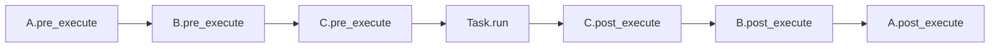

# Middleware

Wrappe jedes Task-Lifecycle-Event — Enqueue, Execute, Error,
Retry — mit deiner eigenen Logik. Middleware ist der richtige Ort
für Logging, Tracing, Metriken, Correlation-IDs und jede andere
Sorge, die uniform über Tasks hinweg wirken soll.

## Wann Middleware

Greife zu Middleware, wenn:

- Das Verhalten für **jeden** Task laufen muss und du es nicht in
  jedem `run()` wiederholen willst.
- Das Verhalten **querschnittlich** ist: Logging, Tracing, Timing,
  Auditing, Auth-Context, Per-Request-Correlation-IDs.
- Du sowohl Before- als auch After-Hook mit Shared State brauchst
  (z. B. Startzeit → elapsed Time).

Greife zu einem [Signal-Handler](signals.md), wenn du nur ein
spezifisches Event interessiert (z. B. `TASK_FAILED`) und nicht
jeden Task wrappen musst.

## Die sechs Hooks

| Hook | Wo er läuft | Wird aufgerufen | Exception-Verhalten |
|---|---|---|---|
| `pre_enqueue` | Client | Vor `broker.publish` | Propagiert — bricht das Enqueue ab |
| `post_enqueue` | Client | Nach Broker-Confirm | Geschluckt — auf ERROR geloggt |
| `pre_execute` | Worker | Nach Zustellung, vor `Task.run()` | Geschluckt — auf ERROR geloggt |
| `post_execute` | Worker | Nach `run()`-Erfolg | Geschluckt — auf ERROR geloggt |
| `on_error` | Worker | Wenn `run()` raist | Geschluckt — auf ERROR geloggt |
| `on_retry` | Worker | Wenn Retry geplant wird | Geschluckt — auf ERROR geloggt |

Nur `pre_enqueue` kann die Operation vetoen. Jeder andere Hook ist
beobachtend: Er kann aufzeichnen, loggen oder State erweitern,
aber Raisen dort ändert den Task-Pfad nicht.

### Workflow-Schritte

`pre_enqueue` und `post_enqueue` laufen auch für jeden
Workflow-Schritt — aus `app.apply()` für die Anfangsfront und aus dem
Advancer im Worker für jeden Folgeschritt. Der Kontext eines solchen
Schritts hat `delivery_mode="at_least_once"` unabhängig von der
Deklaration des Tasks und zwei zusätzliche Schlüssel, `workflow_id` und
`step_path`, die gewöhnliche `schedule()`-Aufrufe nicht tragen.
`pre_enqueue` läuft für alle Schritte einer Front, bevor der erste
publiziert wird; wirft es, wird kein Schritt dieser Front publiziert,
der Workflow mit dem Klassennamen der Ausnahme als gescheitert markiert
und die auslösende Nachricht bestätigt.

Eine `pre_enqueue`, die Client-Kontext voraussetzt (eine Request-ID,
ein Auth-Token), muss dessen Fehlen deshalb tolerieren — oder
`message.get("workflow_id")` prüfen und die Durchsetzung für
Workflow-Schritte überspringen.

## Eine Middleware schreiben

```python title="myapp/middleware.py"
import time

from swarmq import Middleware, MessageContext
from swarmq.logging import get_logger

log = get_logger("myapp.timing")


class TimingMiddleware(Middleware):
    """Loggt Wall-Clock-Dauer für jede Task-Ausführung."""

    def __init__(self) -> None:
        # Per-Task-Startzeiten, gekeyt auf task_id. Middleware-Instanzen
        # sind über Tasks geteilt, daher task_id für Isolation nutzen.
        self._starts: dict[str, float] = {}

    async def pre_execute(self, message: MessageContext) -> None:
        self._starts[message["task_id"]] = time.perf_counter()

    async def post_execute(
        self, message: MessageContext, result=None,
    ) -> None:
        start = self._starts.pop(message["task_id"], None)
        if start is not None:
            log.info(
                "myapp_task_finished",
                task_id=message["task_id"],
                task_name=message["task_name"],
                duration_ms=(time.perf_counter() - start) * 1000,
            )

    async def on_error(
        self, message: MessageContext, exception: BaseException,
    ) -> None:
        start = self._starts.pop(message["task_id"], None)
        if start is not None:
            log.warning(
                "myapp_task_errored",
                task_id=message["task_id"],
                task_name=message["task_name"],
                duration_ms=(time.perf_counter() - start) * 1000,
                error_type=type(exception).__name__,
                error=str(exception),
            )
```

Das Beispiel zeigt nur ein Hook-Paar mit geteiltem State: SwarmQ
loggt selbst bereits `task_succeeded` und `task_failed` mit
`duration_ms` auf dem Logger `swarmq.task` (siehe
[Lebenszyklus-Events der Tasks](../reference/logging.md#lebenszyklus-events-der-tasks)).
Gib deinen eigenen Events eigene Namen (`myapp_…`), damit sie nicht mit
den eingebauten kollidieren.

`swarmq.logging.get_logger(name)` übergibt Events unter `name` an das
Standard-`logging`, mit den Keyword-Argumenten als Record-Felder, in
jedem Setup. `structlog.get_logger()` funktioniert auch, aber nur das
eingebaute Setup von `swarmq worker` leitet es über den Formatter des
Workers. Mit `--log-config`, mit `--no-configure-logging` oder
eingebettet in eine App, die structlog nicht konfiguriert hat, umgehen
seine Events `logging` und landen mit den structlog-Defaults auf stdout
(siehe [Worker-Prozesse](../reference/logging.md#worker-prozesse)).

`MessageContext` ist ein `TypedDict`; zur Laufzeit ein einfaches
`dict`. Greife auf Felder mit `message["task_id"]`,
`message["task_name"]` usw. zu. Siehe die
[API-Referenz](../reference/api.md#typeddict-messagecontext) für die
volle Feldliste.

## Middleware registrieren

Rufe `app.add_middleware(instance)` auf. Reihenfolge zählt — die
Kette läuft vorwärts auf `pre_*`-Hooks und rückwärts auf
`post_*`, `on_error`, `on_retry` (klassische „around"-Semantik).

```python
app = SwarmQ(broker, backend)
app.add_middleware(TracingMiddleware())    # äußerste
app.add_middleware(TimingMiddleware())
app.add_middleware(AuthContextMiddleware())  # innerste
```

Registrierung ist jederzeit safe — vor oder nach `start_worker()`
und vor oder nach `schedule()`. Die Kette wird pro Operation
aufgelöst, neu hinzugefügte Middleware ist ab dem nächsten Aufruf
sichtbar.

## Ausführungsreihenfolge



Bei Fehler läuft die Vorwärtskette trotzdem (`pre_execute` jeweils),
`run` raist, dann läuft `on_error` in Rückwärtsreihenfolge für
jede Middleware.

## State zwischen Hooks teilen

Drei Idiome, in Präferenzreihenfolge:

1. **Keyed Dict auf der Middleware-Instanz**, wie im Timing-Beispiel
   oben. Cleanup bei `post_execute` und `on_error`. Funktioniert,
   weil Middleware singleton pro `SwarmQ`-App ist.
2. **Context Vars.** Nutze `contextvars.ContextVar` für Werte, die
   über `await`-Grenzen in den Task-Body selbst propagieren sollen
   — OpenTelemetry-Trace-IDs, Request-IDs.
3. **Eine Subklasse von `Middleware`**, die ihren eigenen State
   besitzt und ihn nicht nach außen exponiert.

Vermeide, mutablen State auf dem `MessageContext`-Dict abzulegen —
es ist als spezifische Form typisiert, und Ad-hoc-Keys driften
still vom Vertrag ab.

## Task-Argumente in `pre_execute` ändern

`message["kwargs"]` und `message["args"]` sind in `pre_execute` dasselbe
Dict und dieselbe Liste, die der Worker an `run()` übergibt. Eine
Änderung daran erreicht den Task, auch im CPU-Modus (`--pool cpu`
kopiert die Argumente für das Rechenkind erst nach `pre_execute`):

```python
class TenantMiddleware(Middleware):
    async def pre_execute(self, message):
        message["kwargs"]["tenant"] = current_tenant()  # run() erhält tenant=
```

Ein neues Objekt zuzuweisen (`message["kwargs"] = {...}` oder
`message["args"] = [...]`) wirkt nicht: Der Worker behält seine eigene
Referenz. Die Änderung gilt nur für den laufenden Versuch. Ein Retry
stellt den ursprünglichen Nachrichtentext erneut zu, und `pre_execute`
läuft noch einmal; der Hook muss die Änderung also bei jedem Versuch
machen.

## Was Middleware **nicht** tun soll

- **`message["args"]` oder `message["kwargs"]` in `pre_execute` neu
  zuweisen.** Der Worker behält seine eigene Referenz; ein neues Objekt
  sieht `run()` nicht. Stattdessen das bestehende Dict bzw. die Liste
  ändern (siehe oben).
- **Neue Nachrichten via `broker.publish` emittieren.** Nutze
  stattdessen `app.schedule()`, damit Middleware-Stack und Signals
  korrekt feuern.
- **Schlafen oder langsames I/O in `pre_execute`.** Jeder
  `pre_execute`-Hook läuft auf dem Hot Path vor dem Start von
  `run()`. Halt ihn Mikrosekunden-schnell.
- **Task-Exceptions fangen und schlucken.** Lass sie propagieren.
  Der Worker entscheidet Retry-vs-DLQ nach Exception-Klasse und
  Retry-Budget — die Exception zu unterdrücken zerbricht diesen
  Vertrag.

## Verifizieren

Füge deine Middleware hinzu, starte den Worker mit `--log-level
DEBUG` und `--log-format human`, und plane einen Task:

```bash
swarmq worker --module myapp.tasks --log-level DEBUG --log-format human
```

Du solltest bei jedem Task Log-Einträge des Hooks sehen. Wenn
nichts erscheint, prüfe, ob die Middleware-Klasse an derselben
`SwarmQ`-Instanz registriert ist, die der Worker nutzt (normalerweise
die `app` in `myapp/tasks.py`).

## Siehe auch

- [`Middleware`-API](../reference/api.md#class-middleware) — volle
  Hook-Liste und Signaturen
- [Signals](signals.md) — für Per-Event-Handler, die nicht jeden
  Task wrappen müssen
- [Tasks definieren](defining-tasks.md) — wo `TaskInfo`-Optionen
  sitzen
