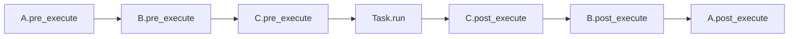

# Middleware

Umschließe jedes Ereignis im Lebenszyklus eines Tasks (Enqueue,
Ausführung, Fehler, Retry) mit eigener Logik. Middleware ist der
richtige Ort für Logging, Tracing, Metriken, Correlation-IDs und alles
andere, das einheitlich für alle Tasks gelten soll.

## Wann Middleware

Greife zu Middleware, wenn:

- das Verhalten für **jeden** Task laufen muss und du es nicht in
  jedem `run()` wiederholen willst,
- das Verhalten **querschnittlich** ist: Logging, Tracing, Timing,
  Auditing, Weitergabe von Auth-Kontext, Correlation-IDs je Anfrage,
- du einen Hook davor und einen danach mit gemeinsamem Zustand
  brauchst (etwa Startzeit → verstrichene Zeit).

Greife zu einem [Signal-Handler](signals.md), wenn dich nur ein
bestimmtes Ereignis interessiert (etwa `TASK_FAILED`) und du nicht
jeden Task umschließen musst.

## Die sechs Hooks

| Hook | Läuft in | Aufgerufen | Wenn er wirft |
|---|---|---|---|
| `pre_enqueue` | Einreihender Prozess | Vor dem Publish oder bevor ein `delay`/`eta`-Task gespeichert wird | Propagiert und bricht das Enqueue ab |
| `post_enqueue` | Einreihender Prozess | Nachdem der Broker den Publish bestätigt hat oder ein `delay`/`eta`-Task gespeichert ist | Geloggt, die Kette läuft weiter |
| `pre_execute` | Worker | Nach den Prüfungen des Workers (Rate-Limit, Lock, …), vor `pre_execution()` und `run()` | Geloggt, die Kette läuft weiter |
| `post_execute` | Worker | Nachdem `run()` und `post_execution()` erfolgreich waren | Geloggt, die Kette läuft weiter |
| `on_error` | Worker | Nach jedem gescheiterten Versuch: `run()`, `pre_execution()` oder `post_execution()` hat geworfen, oder Soft- bzw. Hard-Timeout | Geloggt, die Kette läuft weiter |
| `on_retry` | Worker | Wenn ein Retry beschlossen ist, bevor die Retry-Kopie publiziert wird | Geloggt, die Kette läuft weiter |

Nur `pre_enqueue` kann ein Veto einlegen. Alle anderen Hooks
beobachten nur: Eine Ausnahme dort wird als `middleware_hook_failed`
geloggt (ERROR, Logger `swarmq.middleware`, mit `hook`, `middleware`
und Traceback), die übrigen Middlewares laufen trotzdem, und der Weg
des Tasks ändert sich nicht.

Worker-Hooks laufen nur für eine Zustellung, die bis zur Ausführung
kommt. Eine Nachricht, die zurückgestellt wird (Rate-Limit,
Lock-Konflikt, unbekannter Task), über `max_age` abläuft, vor dem
Start abgebrochen oder abgewiesen wird, sieht keinen Worker-Hook.
`on_retry` erhält `retry_count` (die Nummer des kommenden Retrys, auch
als `message["retry_count"]` gesetzt) und `delay` in Sekunden.

Bei einem sofortigen `schedule()` mit `unique_for` wird das Dedup-Flag
vor `pre_enqueue` gesetzt: Ein Duplikat liefert die vorhandene Task-ID,
ohne dass ein Enqueue-Hook läuft. `schedule_many()` ruft `pre_enqueue`
für jedes Element vor dem ersten Publish auf; ein Veto bricht den
ganzen Batch ab.

### Verzögerte Tasks (`delay`/`eta`)

Bei `schedule(..., delay=...)` und `schedule(..., eta=...)` laufen die
Enqueue-Hooks beim Aufruf von `schedule()`, nicht erst, wenn der
Scheduler-Leader den Task später feuert. Ein Veto in `pre_enqueue`
bricht den Aufruf ab, bevor etwas gespeichert oder ein Unique-Flag
gesetzt wird. Änderungen, die eine Middleware in place an
`message["kwargs"]` macht, werden mit dem Task gespeichert und vom
Leader beim Fire publiziert. Cron-Fires laufen ohne die Enqueue-Hooks.

Anders als bei einem sofortigen `schedule()` hat ein verzögerter
Aufruf, der sich als Duplikat herausstellt (`unique_for`), `pre_enqueue`
schon durchlaufen: Die Middleware sieht `pre_enqueue` ohne folgendes
`post_enqueue`. Räume Zustand je Aufruf deshalb nicht allein in
`post_enqueue` auf. Der Dedup-Hash entsteht aus den Argumenten vor der
Middleware; ein `kwargs`-Wert, den die Middleware bei jedem Aufruf
ergänzt, hebelt die Dedup also nicht aus.

### Workflow-Schritte

`pre_enqueue` und `post_enqueue` laufen auch für jeden
Workflow-Schritt: aus `app.apply()` für die Anfangsfront und aus dem
Advancer im Worker für jeden Folgeschritt. Der Kontext eines solchen
Schritts hat `delivery_mode="at_least_once"` unabhängig von der
Deklaration des Tasks und zwei zusätzliche Schlüssel, `workflow_id` und
`step_path`, die gewöhnliche `schedule()`-Aufrufe nicht tragen.
`pre_enqueue` läuft für alle Schritte einer Front, bevor der erste
publiziert wird. Wirft es in `apply()`, erreicht die Ausnahme den
Aufrufer, und nichts wird gespeichert oder publiziert. Wirft es im
Worker, wird kein Schritt dieser Front publiziert, der Workflow wird
mit Typ und Text der Ausnahme als `failed` markiert (`get()` wirft
`TaskError`), und die auslösende Nachricht wird bestätigt
([Fehlerfälle](workflows.md#fehlerfalle)).

Ein `pre_enqueue`, das Client-Kontext voraussetzt (eine Request-ID,
ein Auth-Token), muss dessen Fehlen deshalb tolerieren oder
`message.get("workflow_id")` prüfen und die Durchsetzung für
Workflow-Schritte überspringen.

## Eine Middleware schreiben

```python title="myapp/middleware.py"
import time

from swarmq import Middleware, MessageContext
from swarmq.logging import get_logger

log = get_logger("myapp.timing")


class TimingMiddleware(Middleware):
    """Loggt die Laufzeit jeder Task-Ausführung."""

    def __init__(self) -> None:
        # Startzeiten je task_id. Eine Middleware-Instanz gilt für alle
        # Tasks, daher über task_id trennen.
        self._starts: dict[str, float] = {}

    def forget(self, task_id: str) -> None:
        # Ein abgebrochener Task bekommt weder post_execute noch on_error.
        self._starts.pop(task_id, None)

    async def pre_execute(self, message: MessageContext) -> None:
        self._starts[message["task_id"]] = time.perf_counter()

    async def post_execute(
        self, message: MessageContext, result=None,
    ) -> None:
        start = self._starts.pop(message["task_id"], None)
        if start is not None:
            log.info(
                "myapp_task_finished",
                task_id=message["task_id"],
                task_name=message["task_name"],
                duration_ms=(time.perf_counter() - start) * 1000,
            )

    async def on_error(
        self, message: MessageContext, exception: BaseException,
    ) -> None:
        start = self._starts.pop(message["task_id"], None)
        if start is not None:
            log.warning(
                "myapp_task_errored",
                task_id=message["task_id"],
                task_name=message["task_name"],
                duration_ms=(time.perf_counter() - start) * 1000,
                error_type=type(exception).__name__,
                error=str(exception),
            )
```

Das Beispiel zeigt nur ein Hook-Paar mit gemeinsamem Zustand: SwarmQ
loggt selbst bereits `task_succeeded` und `task_failed` mit
`duration_ms` auf dem Logger `swarmq.task` (siehe
[Lebenszyklus-Events der Tasks](../reference/logging.md#lebenszyklus-events-der-tasks)).
Gib deinen eigenen Events eigene Namen (`myapp_…`), damit sie nicht mit
den eingebauten kollidieren.

`swarmq.logging.get_logger(name)` übergibt Events unter `name` an das
Standard-`logging`, mit den Keyword-Argumenten als Record-Felder, in
jedem Setup. `structlog.get_logger()` funktioniert auch, aber nur das
eingebaute Setup von `swarmq worker` leitet es über den Formatter des
Workers. Mit `--log-config`, mit `--no-configure-logging` oder
eingebettet in eine App, die structlog nicht konfiguriert hat, umgehen
seine Events `logging` und landen mit den structlog-Defaults auf stdout
(siehe [Worker-Prozesse](../reference/logging.md#worker-prozesse)).

`MessageContext` ist ein `TypedDict`, zur Laufzeit ein einfaches
`dict`. Greife auf Felder mit `message["task_id"]`,
`message["task_name"]` usw. zu. Die vollständige Feldliste steht in der
[API-Referenz](../reference/api.md#typeddict-messagecontext).

## Middleware registrieren

Rufe `app.add_middleware(instance)` auf. Die Reihenfolge zählt: Die
Kette läuft vorwärts bei `pre_*`-Hooks und rückwärts bei `post_*`,
`on_error` und `on_retry` (klassische „around“-Semantik).

```python
app = SwarmQ(broker, backend)
app.add_middleware(TracingMiddleware())    # äußerste
app.add_middleware(TimingMiddleware())
app.add_middleware(AuthContextMiddleware())  # innerste
```

Registrieren ist jederzeit möglich, vor oder nach `start_worker()` und
vor oder nach `schedule()`. Die Kette wird je Vorgang aufgelöst; neu
hinzugefügte Middleware gilt ab dem nächsten Aufruf.

**Welche App.** Hooks laufen an der App, die die Arbeit macht:
`pre_enqueue` und `post_enqueue` an der App, die `schedule()` aufruft,
`pre_execute`, `post_execute`, `on_error` und `on_retry` an der App des
Workers. Workflow-Folgeschritte stellt der Advancer im Worker ein;
deren `pre_enqueue` und `post_enqueue` laufen deshalb ebenfalls an der
App des Workers. `swarmq worker` baut seine eigene App; Middleware an
einer modulweiten `app` in `myapp/tasks.py` läuft im Worker also nie.
Füge sie in einem `--configure`-Hook hinzu, auch Enqueue-Middleware,
die jeden Workflow-Schritt sehen muss:

```python title="myapp/hooks.py"
from swarmq import Signal, SwarmQ

from myapp.middleware import TimingMiddleware


def setup(app: SwarmQ) -> None:
    timing = TimingMiddleware()
    app.add_middleware(timing)

    @app.on_signal(Signal.TASK_CANCELLED)
    async def forget_cancelled(task_id, **kwargs):
        timing.forget(task_id)  # siehe „State zwischen Hooks teilen“
```

```bash
swarmq worker --module myapp.tasks --configure myapp.hooks:setup
```

## Ausführungsreihenfolge



Bei einem Fehler läuft die Vorwärtskette trotzdem (`pre_execute`
jeweils), der Versuch scheitert, dann läuft `on_error` rückwärts für
jede Middleware, gefolgt von `on_retry` (ebenfalls rückwärts), wenn ein
Retry beschlossen ist.

Ein Cancel (`app.cancel()`) ist kein Fehler. Ein Task, der während der
Ausführung abgebrochen wird, bekommt `pre_execute`, aber weder
`on_error` noch `post_execute`; ein Task, der vor dem Start abgebrochen
wird, bekommt gar keinen Worker-Hook. In beiden Fällen feuert nur das
Signal `TASK_CANCELLED`.

## State zwischen Hooks teilen

Drei Muster, in dieser Reihenfolge zu bevorzugen:

1. **Dict auf der Middleware-Instanz, nach `task_id` getrennt**, wie im
   Timing-Beispiel oben. Aufräumen in `post_execute` und `on_error`,
   für abgebrochene Tasks zusätzlich beim Signal `TASK_CANCELLED`
   (siehe den Hook unter
   [Middleware registrieren](#middleware-registrieren)); sonst bleibt
   je abgebrochenem Task ein Eintrag liegen. Das funktioniert, weil
   jede Middleware-Instanz von allen Tasks ihrer `SwarmQ`-App geteilt
   wird.
2. **Context Vars.** Nutze `contextvars.ContextVar` für Werte, die über
   `await`-Grenzen bis in den Task-Body wirken sollen, etwa
   OpenTelemetry-Trace-IDs oder Request-IDs.
3. **Eine Unterklasse von `Middleware`**, die ihren Zustand selbst hält
   und nicht nach außen gibt.

Lege keinen veränderlichen Zustand im `MessageContext`-Dict ab: Es hat
eine feste, typisierte Form, und zusätzliche Schlüssel entfernen sich
still vom Vertrag.

## Task-Argumente in `pre_execute` ändern

`message["kwargs"]` und `message["args"]` sind in `pre_execute` dasselbe
Dict und dieselbe Liste, die der Worker an `run()` übergibt. Eine
Änderung daran erreicht den Task, auch im CPU-Modus (`--pool cpu`
kopiert die Argumente für das Rechenkind erst nach `pre_execute`):

```python
class TenantMiddleware(Middleware):
    async def pre_execute(self, message):
        message["kwargs"]["tenant"] = current_tenant()  # run() erhält tenant=
```

Ein neues Objekt zuzuweisen (`message["kwargs"] = {...}` oder
`message["args"] = [...]`) wirkt nicht: Der Worker behält seine eigene
Referenz. Die Änderung gilt nur für den laufenden Versuch. Ein Retry
stellt den ursprünglichen Nachrichtentext erneut zu, und `pre_execute`
läuft noch einmal; der Hook muss die Änderung also bei jedem Versuch
machen.

In `pre_enqueue` gilt dasselbe für `message["kwargs"]` eines
`schedule()`- oder `schedule_many()`-Aufrufs: Eine Änderung in place wird
mit dem Task publiziert (bei `delay`/`eta` gespeichert und beim Fire
publiziert; `schedule_many()` publizierte vor 0.15 die unveränderten
`kwargs`).
Eine Änderung an `message["args"]` erreicht die Nachricht nicht.

## Was Middleware **nicht** tun soll

- **`message["args"]` oder `message["kwargs"]` in `pre_execute` neu
  zuweisen.** Der Worker behält seine eigene Referenz; ein neues Objekt
  sieht `run()` nicht. Ändere stattdessen das bestehende Dict bzw. die
  Liste (siehe oben).
- **Neue Nachrichten über `broker.publish` senden.** Nutze
  `app.schedule()`, damit Middleware und Signals korrekt feuern.
- **In `pre_execute` schlafen oder auf langsames I/O warten.** Jeder
  `pre_execute`-Hook liegt auf dem heißen Pfad vor dem Start von
  `run()` und belegt einen Concurrency-Slot. Halte ihn schnell.
- **Von `on_error` erwarten, den Ausgang zu ändern.** Die Ausnahme ist
  bereits festgehalten; der Worker entscheidet Retry oder DLQ nach
  Exception-Klasse und Retry-Budget, unabhängig vom Hook.

## Verifizieren

Füge deine Middleware in einem `--configure`-Hook hinzu, starte den
Worker mit `--log-level DEBUG` und `--log-format human` und plane
einen Task:

```bash
swarmq worker --module myapp.tasks --configure myapp.hooks:setup \
  --log-level DEBUG --log-format human
```

Bei jedem Task sollten Log-Einträge des Hooks erscheinen. Erscheint
nichts, prüfe, ob der Worker mit `--configure` startet und der Hook
die Middleware hinzufügt. Middleware an einer modulweiten `app` in
`myapp/tasks.py` hängt nicht an der App des Workers.

## Siehe auch

- [`Middleware`-API](../reference/api.md#class-middleware): alle Hooks
  und Signaturen
- [Signals](signals.md): Handler je Ereignis, die nicht jeden Task
  umschließen müssen
- [Tasks definieren](defining-tasks.md): wo `TaskInfo`-Optionen stehen
