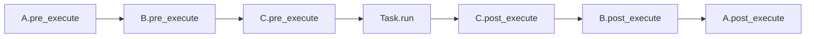

# Middleware

Wrap every task lifecycle event — enqueue, execute, error, retry —
with your own logic. Middleware is the right place for logging,
tracing, metrics, correlation IDs, and any other concern you want to
apply uniformly across tasks.

## When to use middleware

Reach for a middleware when:

- The behaviour must run for **every** task, and you do not want to
  repeat it inside each `run()`.
- The behaviour is **cross-cutting**: logging, tracing, timing,
  auditing, auth context propagation, per-request correlation IDs.
- You need both a before-hook and an after-hook with shared state
  (e.g. start time → elapsed time).

Reach for a [signal handler](signals.md) when you only care about a
specific event class (e.g. `TASK_FAILED`) and do not need to wrap
every task.

## The six hooks

| Hook | Where it runs | Called | Exception behaviour |
|---|---|---|---|
| `pre_enqueue` | Client | Before `broker.publish`, or before a `delay`/`eta` task is stored | Propagates — aborts the enqueue |
| `post_enqueue` | Client | After the broker confirms, or after a `delay`/`eta` task is stored | Swallowed — logged at ERROR |
| `pre_execute` | Worker | After delivery, before `Task.run()` | Swallowed — logged at ERROR |
| `post_execute` | Worker | After `run()` succeeds | Swallowed — logged at ERROR |
| `on_error` | Worker | When `run()` raises | Swallowed — logged at ERROR |
| `on_retry` | Worker | When a retry is scheduled | Swallowed — logged at ERROR |

Only `pre_enqueue` can veto the operation. Every other hook is
observational: it can record, log, or augment state, but raising
there will not change the task's path.

### Deferred tasks (`delay`/`eta`)

For `schedule(..., delay=...)` and `schedule(..., eta=...)` the enqueue
hooks run when you call `schedule()`, not when the scheduler leader
fires the task later. A veto in `pre_enqueue` aborts the call before
anything is stored or a unique flag is claimed. Changes a middleware
makes to `message["kwargs"]` in place are stored with the task and
published by the leader at fire time. Cron fires run without the
enqueue hooks.

Unlike an immediate `schedule()`, a deferred call that turns out to be
a duplicate (`unique_for`) has already passed `pre_enqueue`: the
middleware sees `pre_enqueue` without a following `post_enqueue`. Do
not rely on `post_enqueue` alone to clean up state you keep per call.

### Workflow steps

`pre_enqueue` and `post_enqueue` also run for every workflow step —
from `app.apply()` for the initial front and from the advancer inside
the worker for every following step. The context of such a step has
`delivery_mode="at_least_once"` regardless of the task's declaration
and two extra keys, `workflow_id` and `step_path`, that ordinary
`schedule()` calls do not carry. `pre_enqueue` runs for all steps of a
front before the first one is published; if it raises, no step of that
front is published, the workflow is marked failed with the exception's
class name and the triggering message is acked.

A `pre_enqueue` that assumes client-side context (a request id, an
auth token) therefore has to tolerate its absence, or check
`message.get("workflow_id")` and skip the enforcement for workflow
steps.

## Writing a middleware

```python title="myapp/middleware.py"
import time

from swarmq import Middleware, MessageContext
from swarmq.logging import get_logger

log = get_logger("myapp.timing")


class TimingMiddleware(Middleware):
    """Log wall-clock duration for every task execution."""

    def __init__(self) -> None:
        # Per-task start times keyed by task_id. Middleware instances
        # are shared across tasks, so use task_id for isolation.
        self._starts: dict[str, float] = {}

    def forget(self, task_id: str) -> None:
        # A cancelled task gets neither post_execute nor on_error.
        self._starts.pop(task_id, None)

    async def pre_execute(self, message: MessageContext) -> None:
        self._starts[message["task_id"]] = time.perf_counter()

    async def post_execute(
        self, message: MessageContext, result=None,
    ) -> None:
        start = self._starts.pop(message["task_id"], None)
        if start is not None:
            log.info(
                "myapp_task_finished",
                task_id=message["task_id"],
                task_name=message["task_name"],
                duration_ms=(time.perf_counter() - start) * 1000,
            )

    async def on_error(
        self, message: MessageContext, exception: BaseException,
    ) -> None:
        start = self._starts.pop(message["task_id"], None)
        if start is not None:
            log.warning(
                "myapp_task_errored",
                task_id=message["task_id"],
                task_name=message["task_name"],
                duration_ms=(time.perf_counter() - start) * 1000,
                error_type=type(exception).__name__,
                error=str(exception),
            )
```

The example only illustrates a hook pair with shared state: SwarmQ
itself already logs `task_succeeded` and `task_failed` with
`duration_ms` on the `swarmq.task` logger (see
[task lifecycle events](../reference/logging.md#task-lifecycle-events)).
Give your own events names of their own (`myapp_…`) so they do not
collide with the built-in ones.

`swarmq.logging.get_logger(name)` hands events to stdlib `logging`
under `name`, with the keyword arguments as record fields, in every
setup. `structlog.get_logger()` also works, but only the built-in setup
of `swarmq worker` routes it through the worker's formatter. With
`--log-config`, with `--no-configure-logging`, or embedded in an app
that has not configured structlog, its events bypass `logging` and go
to stdout with structlog's defaults (see
[worker processes](../reference/logging.md#worker-processes)).

`MessageContext` is a `TypedDict`; at runtime it is a plain `dict`.
Access fields with `message["task_id"]`, `message["task_name"]`, and
so on. See the [API reference](../reference/api.md#typeddict-messagecontext)
for the full field list.

## Registering middleware

Call `app.add_middleware(instance)`. Order matters — the chain runs
forward on `pre_*` hooks and in reverse on `post_*`, `on_error`,
`on_retry` (classic "around" semantics).

```python
app = SwarmQ(broker, backend)
app.add_middleware(TracingMiddleware())    # outermost
app.add_middleware(TimingMiddleware())
app.add_middleware(AuthContextMiddleware())  # innermost
```

Registration is safe at any time — before or after `start_worker()`
and before or after `schedule()`. The chain is resolved per
operation, so newly added middleware is visible from the next call.

**Which app.** Hooks run on the app that does the work:
`pre_enqueue` and `post_enqueue` on the app that calls `schedule()`,
`pre_execute`, `post_execute`, `on_error` and `on_retry` on the
worker's app. `swarmq worker` builds its own app, so middleware added
to a module-level `app` in `myapp/tasks.py` never runs in the worker.
Add it in a `--configure` hook:

```python title="myapp/hooks.py"
from swarmq import Signal, SwarmQ

from myapp.middleware import TimingMiddleware


def setup(app: SwarmQ) -> None:
    timing = TimingMiddleware()
    app.add_middleware(timing)

    @app.on_signal(Signal.TASK_CANCELLED)
    async def forget_cancelled(task_id, **kwargs):
        timing.forget(task_id)  # see "Sharing state between hooks"
```

```bash
swarmq worker --module myapp.tasks --configure myapp.hooks:setup
```

## Execution order



On error, the forward chain still runs (`pre_execute` each), `run`
raises, then `on_error` runs in reverse for every middleware.

A cancel (`app.cancel()`) is not an error: after `pre_execute`,
neither `on_error` nor `post_execute` runs; only the `TASK_CANCELLED`
signal fires.

## Sharing state between hooks

Three idioms, in order of preference:

1. **Keyed dict on the middleware instance**, as in the timing
   example above. Clean up on `post_execute` and `on_error`, and on
   the `TASK_CANCELLED` signal for cancelled tasks (see the hook under
   [registering middleware](#registering-middleware)); otherwise every
   cancelled task leaves an entry behind. Works because middleware is
   singleton per `SwarmQ` app.
2. **Context vars.** Use `contextvars.ContextVar` for values that
   should propagate across `await` boundaries into the task body
   itself — OpenTelemetry trace IDs, request IDs.
3. **A subclass of `Middleware`** that owns its own state and does
   not expose it externally.

Avoid stashing mutable state on the `MessageContext` dict — it is
typed as a specific shape and adding ad-hoc keys will silently drift
from the contract.

## Changing task arguments in `pre_execute`

`message["kwargs"]` and `message["args"]` in `pre_execute` are the
same dict and list the worker passes to `run()`. A change to them in
place reaches the task, also in CPU mode (`--pool cpu` copies the
arguments for the compute child only after `pre_execute`):

```python
class TenantMiddleware(Middleware):
    async def pre_execute(self, message):
        message["kwargs"]["tenant"] = current_tenant()  # run() sees tenant=
```

Assigning a new object (`message["kwargs"] = {...}` or
`message["args"] = [...]`) has no effect: the worker keeps its own
reference. The change lives only in the current attempt. A retry
delivers the original message body again and `pre_execute` runs again,
so the hook must make the same change on every attempt.

## What middleware should **not** do

- **Reassign `message["args"]` or `message["kwargs"]` in
  `pre_execute`.** The worker keeps its own reference; a new object is
  invisible to `run()`. Change the existing dict or list instead (see
  above).
- **Emit new messages via `broker.publish`.** Use `app.schedule()`
  instead so the middleware stack and signals fire correctly.
- **Sleep or block on slow I/O inside `pre_execute`.** Every
  `pre_execute` hook runs on the hot path before `run()` starts.
  Keep it microseconds-fast.
- **Catch and swallow task exceptions.** Let them propagate. The
  worker decides retry-vs-DLQ based on the exception class and the
  retry budget — suppressing the exception breaks that contract.

## Verify

Add your middleware in a `--configure` hook, start the worker with
`--log-level DEBUG` and `--log-format human`, and schedule one task:

```bash
swarmq worker --module myapp.tasks --configure myapp.hooks:setup \
  --log-level DEBUG --log-format human
```

You should see the hook emit log entries on every task. If nothing
appears, check that the worker starts with `--configure` and that the
hook adds the middleware. Middleware added to a module-level `app` in
`myapp/tasks.py` is not on the worker's app.

## See also

- [`Middleware` API](../reference/api.md#class-middleware) — full
  hook list and signatures
- [Signals](signals.md) — for per-event handlers that do not need to
  wrap every task
- [Defining tasks](defining-tasks.md) — where `TaskInfo` options sit
