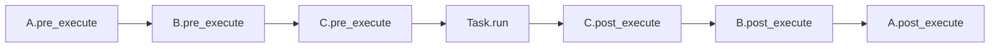

# Middleware

Wrap every task lifecycle event — enqueue, execute, error, retry —
with your own logic. Middleware is the right place for logging,
tracing, metrics, correlation IDs, and any other concern you want to
apply uniformly across tasks.

## When to use middleware

Reach for a middleware when:

- The behaviour must run for **every** task, and you do not want to
  repeat it inside each `run()`.
- The behaviour is **cross-cutting**: logging, tracing, timing,
  auditing, auth context propagation, per-request correlation IDs.
- You need both a before-hook and an after-hook with shared state
  (e.g. start time → elapsed time).

Reach for a [signal handler](signals.md) when you only care about a
specific event class (e.g. `TASK_FAILED`) and do not need to wrap
every task.

## The six hooks

| Hook | Where it runs | Called | Exception behaviour |
|---|---|---|---|
| `pre_enqueue` | Client | Before `broker.publish` | Propagates — aborts the enqueue |
| `post_enqueue` | Client | After the broker confirms | Swallowed — logged at ERROR |
| `pre_execute` | Worker | After delivery, before `Task.run()` | Swallowed — logged at ERROR |
| `post_execute` | Worker | After `run()` succeeds | Swallowed — logged at ERROR |
| `on_error` | Worker | When `run()` raises | Swallowed — logged at ERROR |
| `on_retry` | Worker | When a retry is scheduled | Swallowed — logged at ERROR |

Only `pre_enqueue` can veto the operation. Every other hook is
observational: it can record, log, or augment state, but raising
there will not change the task's path.

## Writing a middleware

```python title="myapp/middleware.py"
import time
import structlog

from swarmq import Middleware, MessageContext

log = structlog.get_logger("myapp.timing")


class TimingMiddleware(Middleware):
    """Log wall-clock duration for every task execution."""

    def __init__(self) -> None:
        # Per-task start times keyed by task_id. Middleware instances
        # are shared across tasks, so use task_id for isolation.
        self._starts: dict[str, float] = {}

    async def pre_execute(self, message: MessageContext) -> None:
        self._starts[message["task_id"]] = time.perf_counter()

    async def post_execute(
        self, message: MessageContext, result=None,
    ) -> None:
        start = self._starts.pop(message["task_id"], None)
        if start is not None:
            log.info(
                "task_finished",
                task_id=message["task_id"],
                task_name=message["task_name"],
                duration_ms=(time.perf_counter() - start) * 1000,
            )

    async def on_error(
        self, message: MessageContext, exception: BaseException,
    ) -> None:
        start = self._starts.pop(message["task_id"], None)
        if start is not None:
            log.warning(
                "task_failed",
                task_id=message["task_id"],
                task_name=message["task_name"],
                duration_ms=(time.perf_counter() - start) * 1000,
                error=repr(exception),
            )
```

`MessageContext` is a `TypedDict`; at runtime it is a plain `dict`.
Access fields with `message["task_id"]`, `message["task_name"]`, and
so on. See the [API reference](../reference/api.md#typeddict-messagecontext)
for the full field list.

## Registering middleware

Call `app.add_middleware(instance)`. Order matters — the chain runs
forward on `pre_*` hooks and in reverse on `post_*`, `on_error`,
`on_retry` (classic "around" semantics).

```python
app = SwarmQ(broker, backend)
app.add_middleware(TracingMiddleware())    # outermost
app.add_middleware(TimingMiddleware())
app.add_middleware(AuthContextMiddleware())  # innermost
```

Registration is safe at any time — before or after `start_worker()`
and before or after `schedule()`. The chain is resolved per
operation, so newly added middleware is visible from the next call.

## Execution order



On error, the forward chain still runs (`pre_execute` each), `run`
raises, then `on_error` runs in reverse for every middleware.

## Sharing state between hooks

Three idioms, in order of preference:

1. **Keyed dict on the middleware instance**, as in the timing
   example above. Clean up on `post_execute` and `on_error`. Works
   because middleware is singleton per `SwarmQ` app.
2. **Context vars.** Use `contextvars.ContextVar` for values that
   should propagate across `await` boundaries into the task body
   itself — OpenTelemetry trace IDs, request IDs.
3. **A subclass of `Middleware`** that owns its own state and does
   not expose it externally.

Avoid stashing mutable state on the `MessageContext` dict — it is
typed as a specific shape and adding ad-hoc keys will silently drift
from the contract.

## What middleware should **not** do

- **Modify `message["args"]` or `message["kwargs"]` in
  `pre_execute`.** The worker already unpacked them for `run()`;
  your changes are invisible.
- **Emit new messages via `broker.publish`.** Use `app.schedule()`
  instead so the middleware stack and signals fire correctly.
- **Sleep or block on slow I/O inside `pre_execute`.** Every
  `pre_execute` hook runs on the hot path before `run()` starts.
  Keep it microseconds-fast.
- **Catch and swallow task exceptions.** Let them propagate. The
  worker decides retry-vs-DLQ based on the exception class and the
  retry budget — suppressing the exception breaks that contract.

## Verify

Add your middleware, start the worker with `--log-level DEBUG` and
`--log-format human`, and schedule one task:

```bash
swarmq worker --module myapp.tasks --log-level DEBUG
```

You should see the hook emit log entries on every task. If nothing
appears, confirm the middleware class was registered on the same
`SwarmQ` instance the worker uses (usually the `app` in
`myapp/tasks.py`).

## See also

- [`Middleware` API](../reference/api.md#class-middleware) — full
  hook list and signatures
- [Signals](signals.md) — for per-event handlers that do not need to
  wrap every task
- [Defining tasks](defining-tasks.md) — where `TaskInfo` options sit
