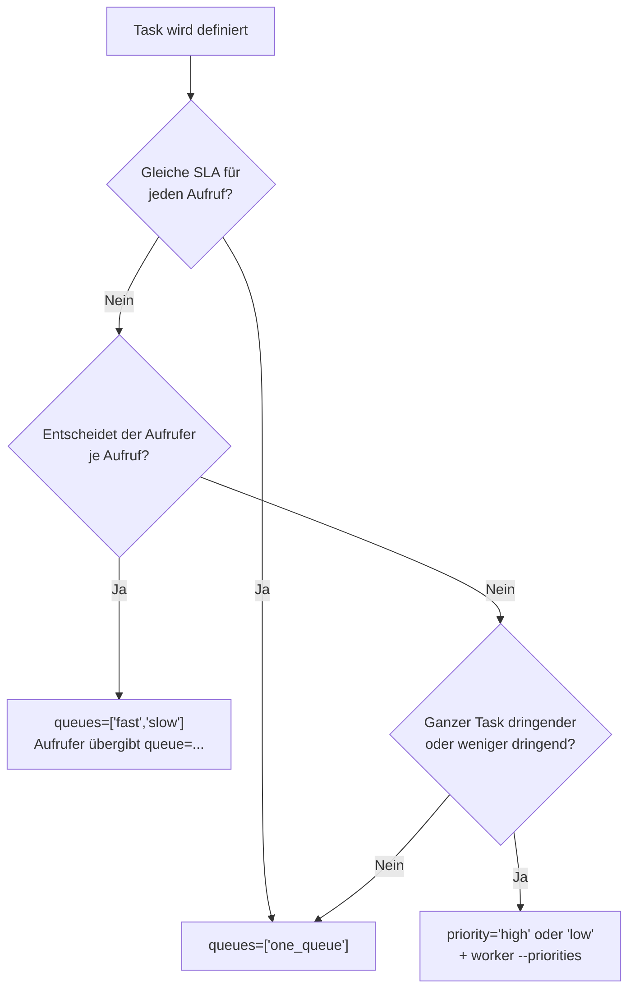
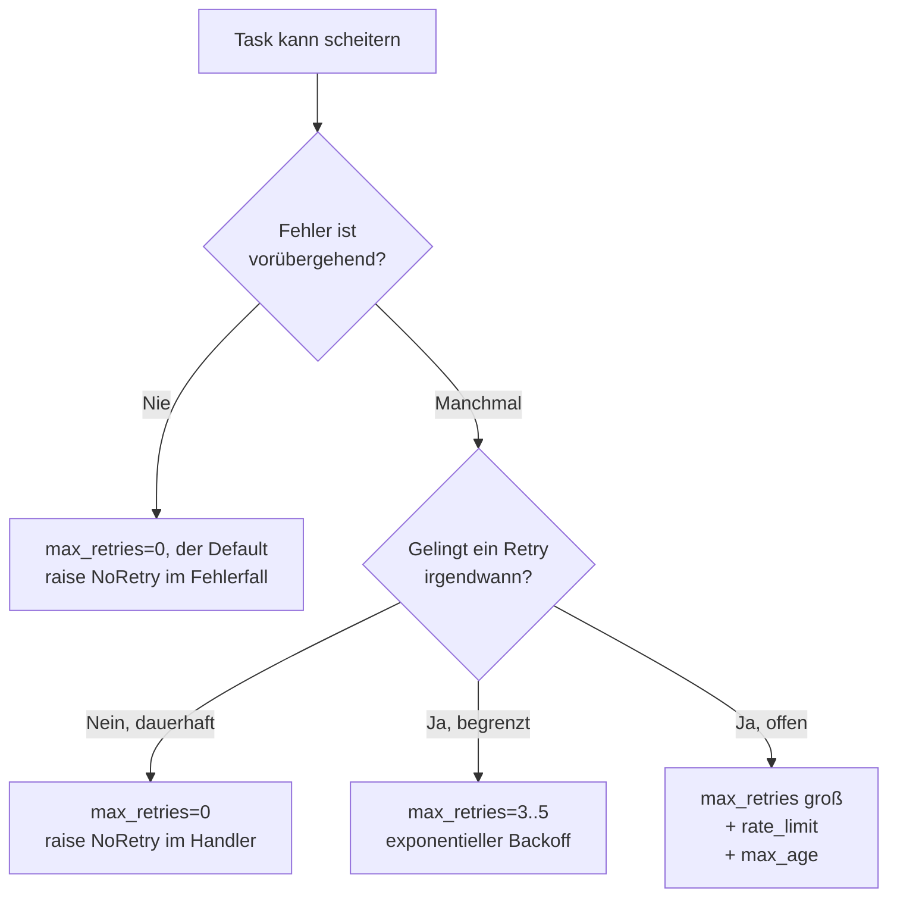
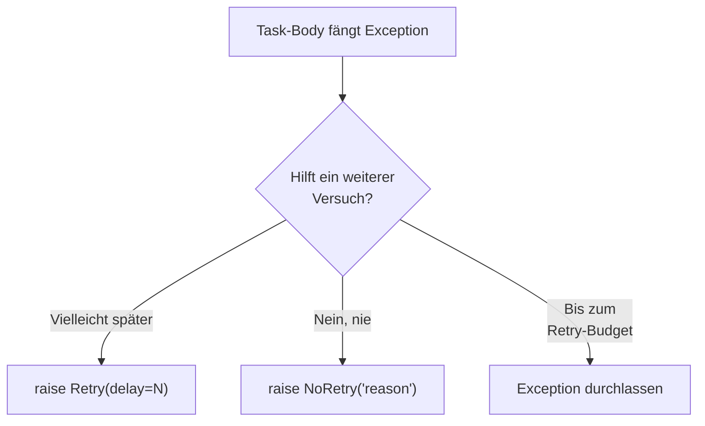
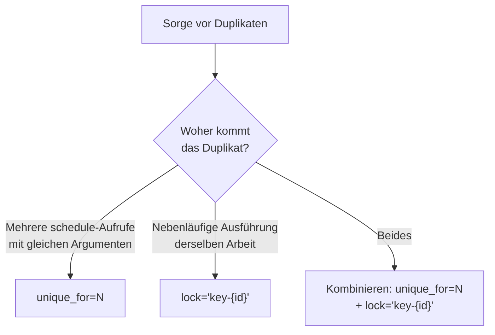
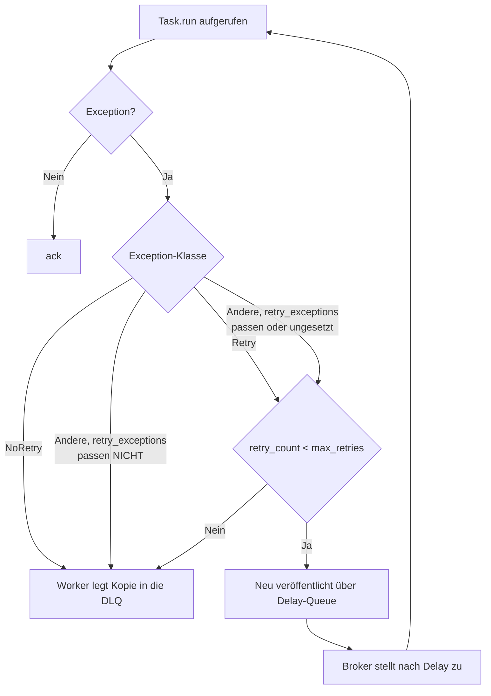
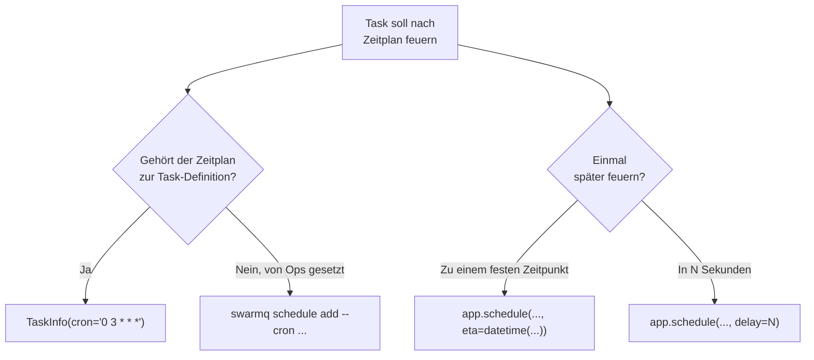
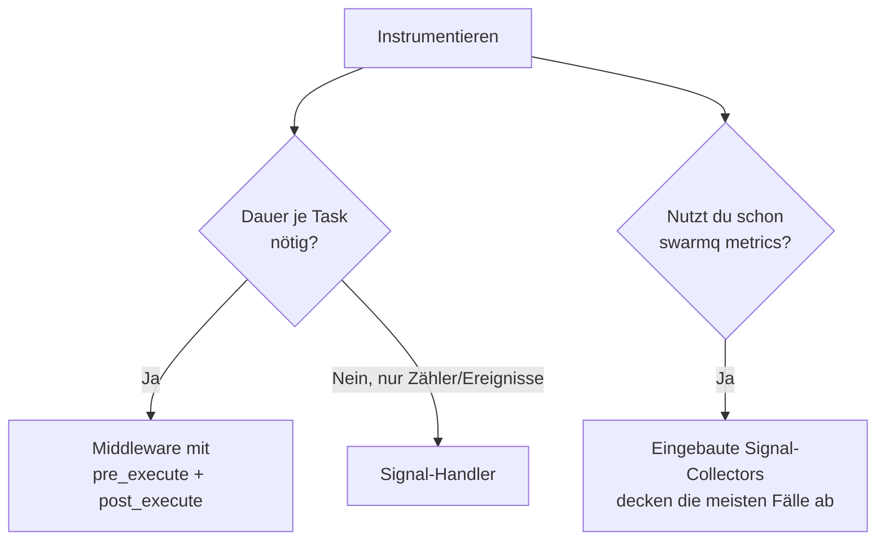

# Entscheidungsbäume

Mermaid-Flowcharts, die die nicht offensichtlichen Wahlen in SwarmQ in
eindeutige Pfade übersetzen. Sie gelten als verbindlich, wenn du
zwischen Features wählst.

## Welche Queue soll dieser Task nutzen?



Regeln:

- `TaskInfo.queues[0]` ist das Standardziel. `schedule(..., queue=...)`
  überschreibt es je Aufruf; der Client prüft den Namen nicht gegen
  `queues`. Existiert die Queue nicht, wirft der Publish
  `UnroutableMessage`; ein Worker muss also jedes Ziel konsumieren.
- `priority` gehört zur Task-Definition, nicht zum Aufruf: Jede
  Nachricht eines Tasks mit `priority="high"` geht nach
  `<queue>.high` (`"low"` nach `<queue>.low`, `"normal"` nach
  `<queue>`). Worker brauchen `--priorities` (oder
  `SWARMQ_PRIORITIES`), um die drei Queues zu deklarieren und zu
  konsumieren; ohne das wirft der Publish `UnroutableMessage`.
- Das Suffix kommt auf die aufgelöste Queue, auch auf ein explizites
  `queue=`. Kombiniere beides nur, wenn du beide Dimensionen brauchst
  (etwa `emails` fast/slow × high/normal/low).

## Soll ich `max_retries` setzen?



Faustregeln:

- Der Default ist `max_retries=0`: Schon der erste Fehlschlag ist
  endgültig. Die meisten echten Workloads passen zu `max_retries=3`,
  `retry_backoff="exponential"` (auch `"linear"` oder `"fixed"`) und
  `retry_base_delay=1.0`. Fang dort an und erhöhe nur, wenn Metriken
  ein reales Retry-Fenster zeigen, das länger ist.
- Tasks mit offenen Retries brauchen `max_age`. Sonst stauen sie sich
  nach einem Ausfall eines Drittdienstes in der Queue. `max_age` zählt
  ab dem ersten Einreihen; Retry-Kopien behalten
  `x-swarmq-enqueued-at`.

## `Retry` vs `NoRetry`



- `Retry(delay=N)` überschreibt den konfigurierten Backoff für diesen
  Versuch. Nutze es, wenn du die richtige Wartezeit kennst (etwa HTTP
  `Retry-After: 60`).
- `Retry()` ohne Delay nutzt den konfigurierten Backoff.
- `Retry` gilt unabhängig davon, ob `retry_exceptions` ihn nennt, und
  verbraucht das Retry-Budget: Bei `max_retries=0` endet er endgültig.
- `NoRetry(reason)` beendet den Task sofort endgültig. Nutze es für
  harte Fehler (4xx-Antworten, Validierungsfehler, Schema-Drift).
- Die Exception durchzulassen ist der Standardweg; `retry_exceptions`
  und das Retry-Budget entscheiden.

## Lock vs Unique-Task: welches?



- **Unique-Task** dedupliziert beim Einplanen: Mehrere
  `schedule()`-Aufrufe mit gleichem Namen und gleichen Argumenten
  innerhalb von `unique_for` Sekunden ergeben eine Nachricht, die
  Duplikate liefern deren Task-ID.
- **Lock** serialisiert bei der Ausführung: Zwei Worker führen
  dieselbe Arbeit nie parallel aus (`max_concurrency` Halter, Default
  1). Ein Konflikt stellt die Nachricht zurück und wartet, bis der
  Lock frei wird, höchstens `SWARMQ_LOCK_WAIT_MAX_S`.

Beides lässt sich kombinieren: Unique sperrt das Einreihen, der Lock
den Lauf. Beispiele stehen unter
[Locking und Deduplizierung](../../guides/locking-and-dedup.md).

## `unique_until="start"` vs `"completion"`?

```mermaid
flowchart TD
    A[Dedup gewünscht] --> B{Ist nebenläufige<br/>Ausführung ok?}
    B -->|Ja, nur Client-Retries<br/>abfangen| C['unique_until="start"']
    B -->|Nein, zweiter Aufruf<br/>muss auf den ersten warten| D['unique_until="completion"<br/>Default']
```

- `"start"` gibt das Flag einmal frei, unmittelbar bevor der Task läuft
  (nach Rate-Limit- und Lock-Prüfung; eine Zurückstellung davor behält
  es). Gut für „Client-Retries abfangen, Folgeaufträge aber
  durchlassen“.
- `"completion"` hält das Flag bis zum Endzustand. Gut für Muster mit
  „einer in Arbeit“, bei denen ein zweiter Aufruf die Task-ID des
  ersten bekommen soll.

## Wann geht eine Nachricht in die DLQ?



Jeder Pfeil nach `DLQ` speichert ein Fehlerergebnis (ein
Workflow-Schritt, dessen Erfolg schon gespeichert ist, behält ihn),
löst `TASK_DLQ` aus und loggt `task_sent_to_dlq`.

Weitere DLQ-Pfade:

- `TaskInfo.max_age` bei der Abholung überschritten: `TASK_EXPIRED`,
  Fehlerergebnis, DLQ-Kopie. Der Task läuft nie.
- Lock-Template lässt sich nicht rendern (etwa ein fehlendes Kwarg):
  DLQ mit `x-swarmq-lock-render-error: <Grund>`.
- Wartezeit auf einen Task-Lock zu Ende (derselbe Halter länger als
  seine TTL + 60 s, oder `SWARMQ_LOCK_WAIT_MAX_S` seit dem ersten
  Konflikt): DLQ mit `x-swarmq-lock-name`,
  `error_type=LockWaitExceeded`, Fehlerergebnis und `TASK_DLQ`.
- Zustelllimit erreicht (das kleinere von `SWARMQ_DELIVERY_LIMIT`,
  Default 20, und dem `x-delivery-limit` der Queue): Das
  Delivery-Count-Gate des Workers dead-lettert eine Zustellung vor dem
  Broker, mit `error_type=WorkerHungError` (der `x-delivery-count` des
  Brokers erreichte das Limit) oder `RedeliveryLimitError` (der Worker
  gab die Zustellung zurück, bis `x-acquired-count` es erreichte). Das
  Dead-Lettering des Brokers bleibt die letzte Stufe. Seit 0.13 wird
  eine Zustellung am Limit, deren Ausführung schon abgeschlossen ist,
  stattdessen bestätigt (F4-02).
- Waisen-Grenze des Ausführungsschutzes
  (`SWARMQ_EXECUTION_GUARD_MAX_ORPHANS`, Default 3 Abläufe derselben
  Ausführung ohne Freigabe): DLQ als `WorkerHungError`
  (`execution_guard_orphan_limit`).
- Task auf dem Worker nicht registriert: mit Backoff zurückgestellt
  (`TASK_UNKNOWN_DEFERRED`), bis `SWARMQ_UNKNOWN_TASK_GRACE_S`
  (Default 900 s) abläuft, dann DLQ mit Fehlerergebnis
  (`TaskNotFoundError`), `TASK_DLQ` und `TASK_REJECTED`
  (`reason="unregistered_task"`).
- Nachricht, die der Worker gar nicht ausführen kann
  (`body_too_large`, `undecodable`, `middleware_chain_factory`):
  DLQ-Kopie mit `x-swarmq-traceback: <reason>: <error>` und
  `TASK_REJECTED`, ohne Fehlerergebnis.

Mit `TaskInfo(dead_letter=False)` oder
`SWARMQ_DEAD_LETTER_TERMINAL_FAILURES=false` speichern die drei
`DLQ`-Pfeile des Diagramms stattdessen das Fehlerergebnis und
bestätigen; die weiteren Pfade bleiben. Dead-gelettete Nachrichten
verfallen nach `SWARMQ_DEAD_LETTER_TTL_S` (Default 7 Tage, `none` für
unbegrenzt).

Kein DLQ-Pfad: Eine Prüfung vor der Ausführung (Schedule-Fire-Dedup,
Cancel-Prüfung, Ausführungsschutz, Rate-Limit, Lock), die Valkey nicht
erreicht, stellt die Nachricht mit Backoff über die Delay-Queue als
neue Nachricht zurück (`task_deferred_backend_unavailable`). Das
verbraucht weder `max_retries` noch das Zustelllimit; ein Ausfall
beliebiger Dauer schickt also keinen Task in die DLQ. Eine
Fehlerantwort von Valkey (`BackendResponseError`) geht dagegen an Ort
und Stelle zurück in die Queue und erreicht die DLQ über das
Zustelllimit, wenn sie anhält.

## Wann Signal-Handler, wann Middleware?


- Signal-Handler sind einfacher zu schreiben und zu durchschauen.
- Middleware ist nötig für gepaarte Vorher-/Nachher-Hooks, Zustand über
  mehrere Hooks oder ein Veto beim Einreihen.

## Eingebetteter Scheduler oder Cron?



Nutze Code (`TaskInfo.cron`, wahlweise mit `timezone`), wenn der
Zeitplan Teil des Task-Vertrags ist (etwa „die Abrechnung läuft
täglich um 03:00 UTC“). Nutze die CLI (`swarmq schedule`), wenn Ops
Zeitpläne ohne Code-Deploy anlegen oder ändern muss.
Cron-Ausdrücke haben genau 5 Felder (crontab(5)-Syntax seit 0.13).

## Middleware oder Signale für Metriken?



Nimm den eingebauten Exporter `swarmq[metrics]`, wenn er reicht. Eigene
Middleware lohnt sich nur für eine Dimension, die der Exporter nicht
liefert (eigene Labels, Laufzeiten je Mandant). `post_execute` läuft
nur nach einer erfolgreichen Ausführung.

## Siehe auch

- [Nachrichtenformate](message-formats.md): die Payload-Schemata dieser
  Entscheidungspunkte
- [Scheduling und Retries](../../guides/scheduling-and-retries.md):
  Retry-Entscheidungen in Prosa
- [Locking und Deduplizierung](../../guides/locking-and-dedup.md):
  Lock oder Unique in Prosa
