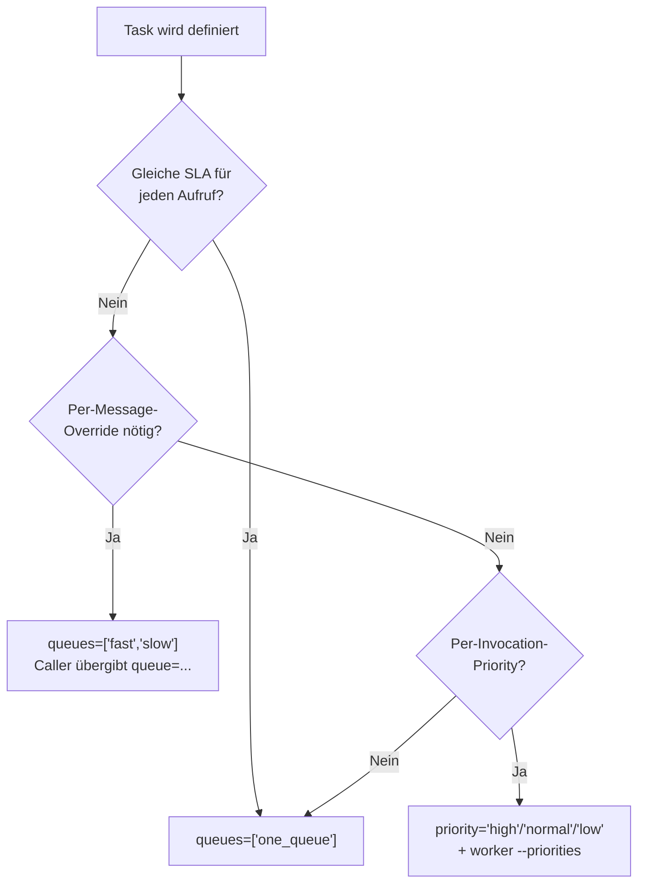
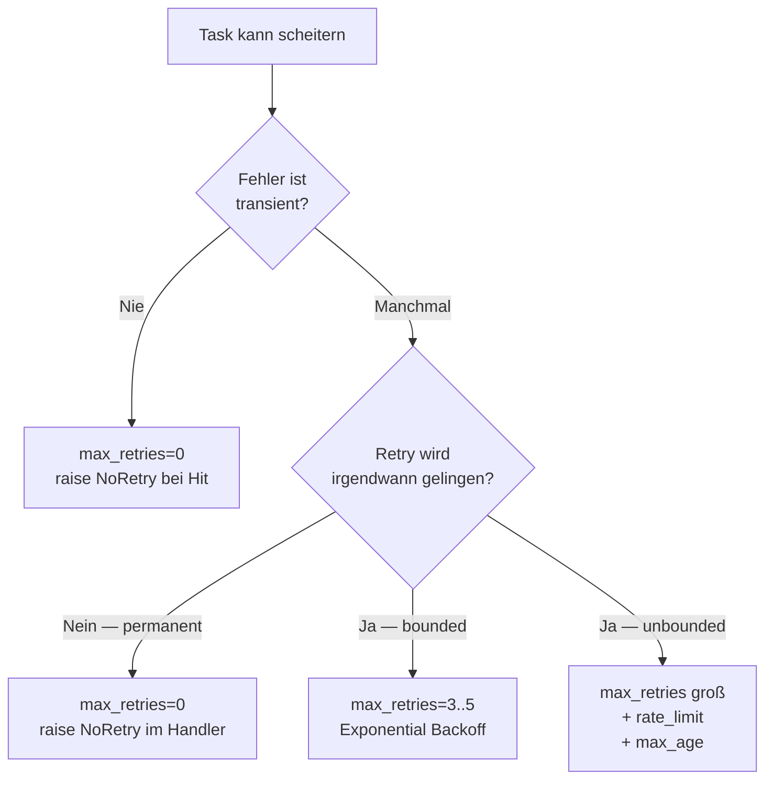
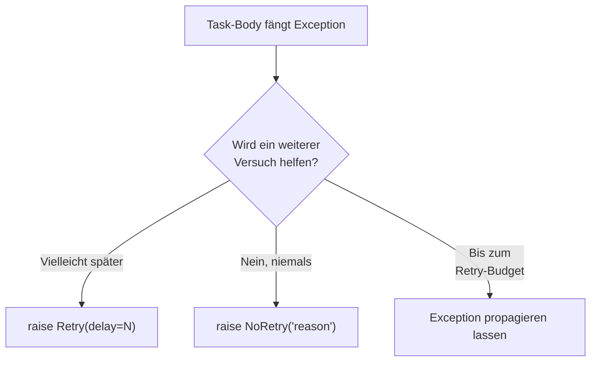
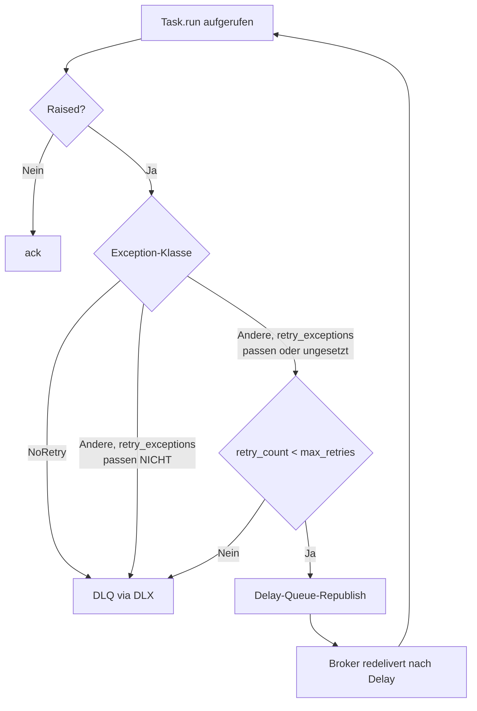
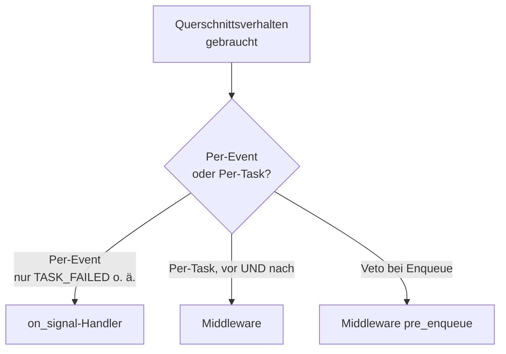
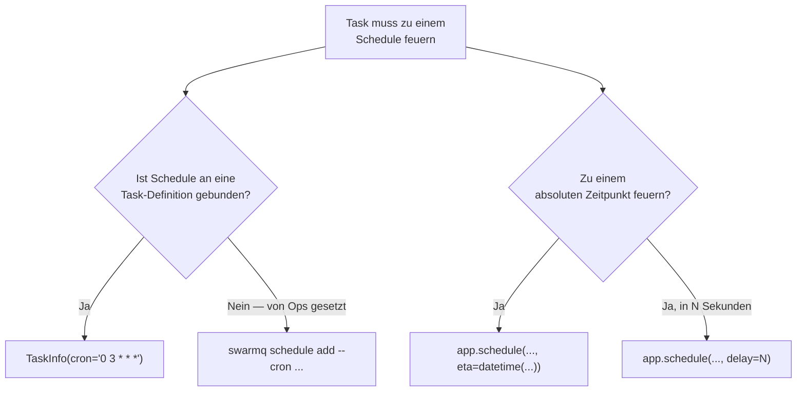
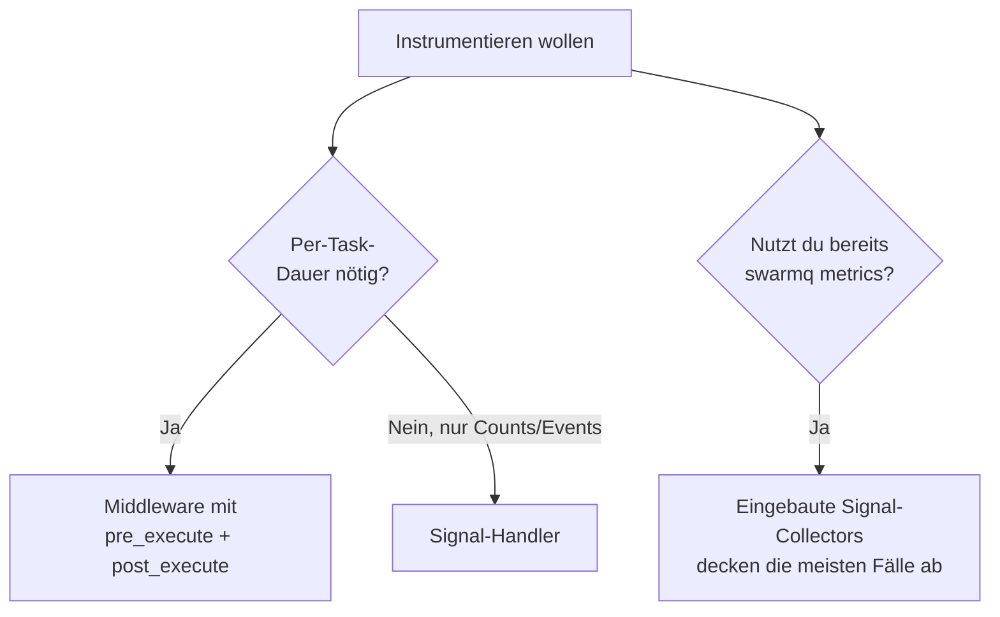

# Entscheidungsbäume

Mermaid-Flowcharts, die die nicht-offensichtlichen SwarmQ-Wahlen
in deterministische Pfade verwandeln. Nutze sie als Ground Truth,
wenn du zwischen Features wählst.

## Welche Queue soll dieser Task nutzen?



Regeln:

- Multi-Queue-Routing ist ein client-seitiger Override.
  `TaskInfo.queues` deklariert die *gültigen* Ziele; der Client
  wählt eines.
- Priority-Suffixe sind eine **Alternative** zum Multi-Queue-
  Routing, kein Komplement. Kombiniere sie nur, wenn du beide
  Dimensionen brauchst (z. B. `emails` fast/normal/slow × high/
  normal/low).

## Soll ich `max_retries` setzen?



Faustregeln:

- Die meisten echten Workloads passen zu `max_retries=3`,
  `retry_backoff="exponential"`, `retry_base_delay=1.0`. Beginne
  dort, erhöhe nur, wenn Metriken ein reales Retry-Fenster
  zeigen, das länger ist als der Default.
- Tasks mit unbounded Retries müssen `max_age` gesetzt haben,
  sonst akkumulieren sie nach einem Third-Party-Ausfall für immer
  in der Queue.

## `Retry` vs `NoRetry`



- `Retry(delay=N)` — überschreibt den konfigurierten Backoff für
  diesen Versuch. Nutze, wenn du die exakte korrekte Wartezeit
  kennst (z. B. HTTP `Retry-After: 60`).
- `Retry()` ohne Delay — nutze die konfigurierte Backoff-Formel.
- `NoRetry(reason)` — Short-Circuit zur DLQ. Nutze für harte
  Fehler (4xx-Responses, Validierungsfehler, Schema-Drift).
- Exception entweichen lassen — Default-Pfad; das Retry-Budget
  entscheidet.

## Lock vs Unique Task — welches?

```mermaid
flowchart TD
    A[Duplikat-Safety-Sorge] --> B{Wo kommt die<br/>Duplikation her?}
    B -->|Mehrere schedule()-Aufrufe<br/>mit gleichen Args| C[unique_for=N]
    B -->|Nebenläufige Ausführung<br/>derselben logischen Arbeit| D[lock='key-{id}']
    B -->|Beides| E[Kombinieren: unique_for=N<br/>+ lock='key-{id}']
```

- **Unique Task** = Dedup zur Schedule-Zeit. Kollabiert mehrere
  `schedule()`-Aufrufe zu einer Nachricht.
- **Lock** = Serialisierung zur Execute-Zeit. Verhindert, dass
  zwei Worker dieselbe logische Arbeit parallel ausführen.

Sie komponieren. Unique gattert das Enqueue; Lock gattert den
Run. Siehe
[Locking und Deduplizierung](../../guides/locking-and-dedup.md)
für Beispiele.

## `unique_until="start"` vs `"completion"`?

```mermaid
flowchart TD
    A[Dedup gewünscht] --> B{Ist nebenläufige<br/>Ausführung ok?}
    B -->|Ja — will nur Client-Retries<br/>absorbieren| C['unique_until="start"']
    B -->|Nein — zweiter Schedule<br/>muss auf den ersten warten| D['unique_until="completion"<br/>Default']
```

- `"start"` gibt das Flag bei Worker-Pickup frei — gut für
  „Absorb Client-Retries, aber lass Follow-ups weiterlaufen"-
  Muster.
- `"completion"` hält das Flag durch den Terminalzustand — gut
  für „eine in Flight, eine pending"-Muster, bei denen der zweite
  Schedule die task_id des ersten sehen soll.

## Wann geht eine Nachricht in die DLQ?



Zusätzliche DLQ-Pfade:

- `TaskInfo.max_age` bei Pickup überschritten → `TASK_EXPIRED`-
  Signal + DLQ. Der Task läuft nie.
- Lock-Render schlägt fehl (fehlender Kwarg für Template) → DLQ
  mit `x-swarmq-lock-render-error: <Grund>`.
- Lock-Konflikt-Grenze erreicht (10. Konflikt) → DLQ mit
  `x-swarmq-lock-conflict-count` und `x-swarmq-lock-name`
  (`task_sent_to_dlq` mit `error_type=LockConflictLimitError`,
  Fehlerergebnis gespeichert, `TASK_DLQ`).
- Zustell-Limit erreicht (`delivery_limit`, Default 20) → DLQ über das
  Delivery-Count-Gate des Workers (`task_sent_to_dlq` mit
  `error_type=WorkerHungError`), broker-native DLQ als letzte Stufe.
- Waisen-Grenze des Ausführungsschutzes (`execution_guard_max_orphans`,
  Default 3 Abläufe derselben Ausführung ohne Freigabe) → DLQ als
  `WorkerHungError` (`execution_guard_orphan_limit`).

Mit `TaskInfo(dead_letter=False)` oder
`SWARMQ_DEAD_LETTER_TERMINAL_FAILURES=false` speichern die drei
`DLQ`-Pfeile des Diagramms oben stattdessen das Fehlerergebnis und
bestätigen; die zusätzlichen Pfade bleiben. Dead-gelettete Nachrichten
verfallen nach `SWARMQ_DEAD_LETTER_TTL_S` (Default 7 Tage).

Kein DLQ-Pfad: Eine Prüfung vor der Ausführung (Schedule-Fire-Dedup,
Cancel-Check, Rate-Limit, Lock), die Valkey nicht erreicht, stellt die
Nachricht mit Backoff über die Delay-Queue als neue Nachricht zurück
(`task_deferred_backend_unavailable`). Das verbraucht weder
`max_retries` noch das Zustell-Limit; ein Ausfall beliebiger Dauer
schickt also keinen Task in die DLQ. Eine Fehlerantwort von Valkey
(`BackendResponseError`) geht dagegen an Ort und Stelle zurück in die
Queue und erreicht die DLQ über das Zustell-Limit, wenn sie anhält.

## Wann Signal-Handler vs Middleware?



- Signal-Handler sind einfacher zu schreiben und durchdenken.
- Middleware ist nötig, wenn du gepaarte Before-/After-Hooks
  brauchst, Shared State über Hooks oder ein Veto bei Enqueue.

## Soll ich den eingebetteten Scheduler oder Cron nutzen?



Nutze Code (`TaskInfo.cron`), wenn der Schedule Teil des Task-
Vertrags ist (z. B. „Daily Billing läuft um 03:00 UTC"). Nutze
die CLI (`swarmq schedule`), wenn Ops Schedules ohne Code-Deploy
hinzufügen oder ändern muss.

## Wann Middleware vs Signals für Metriken?



Bevorzuge den eingebauten `swarmq[metrics]`-Exporter, wenn er
deine Bedürfnisse deckt. Füge eigene Middleware nur hinzu, wenn du
eine Dimension brauchst (Custom Labels, Per-Tenant-Timings), die
der Exporter nicht exponiert.

## Siehe auch

- [Nachrichtenformate](message-formats.md) — Payload-Schemata
  dieser Entscheidungspunkte
- [Scheduling und Retries](../../guides/scheduling-and-retries.md)
  — Retry-bezogene Entscheidungen in Prosa
- [Locking und Deduplizierung](../../guides/locking-and-dedup.md)
  — Lock-vs-Unique-Entscheidungen in Prosa
