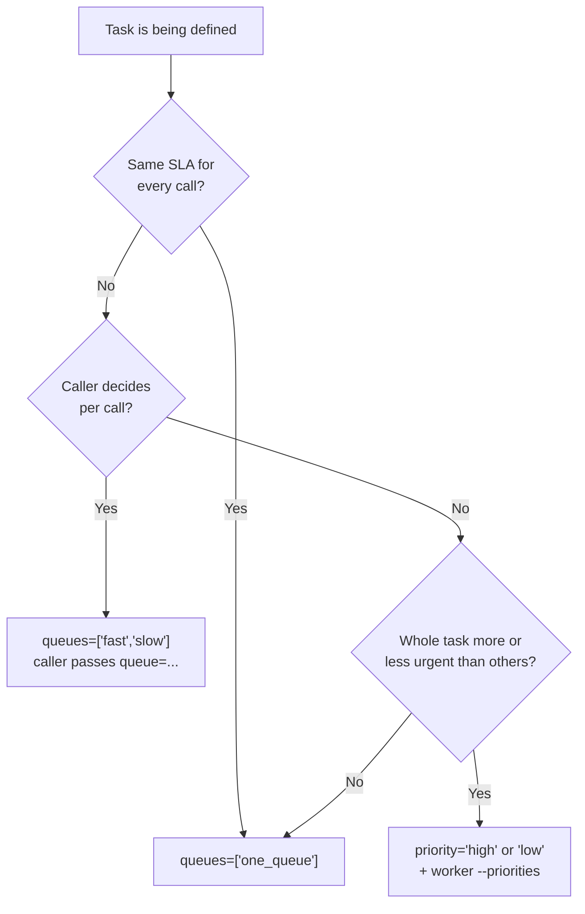
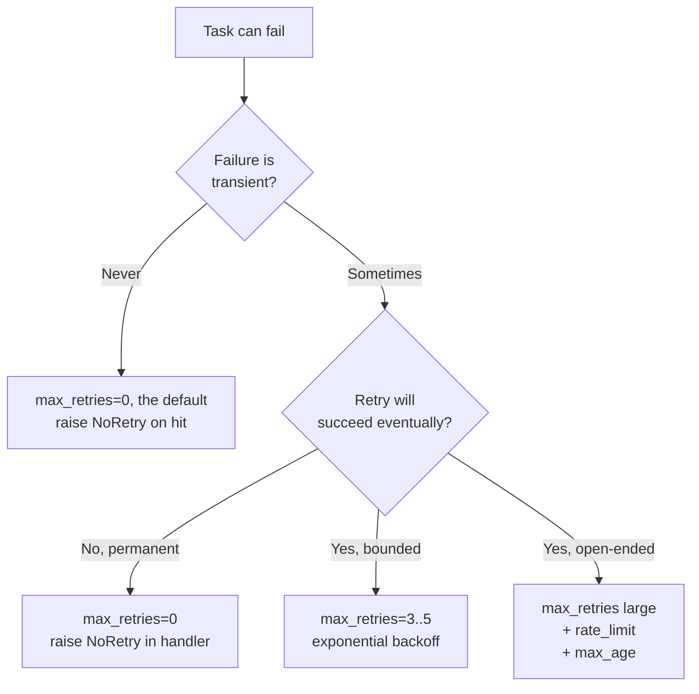
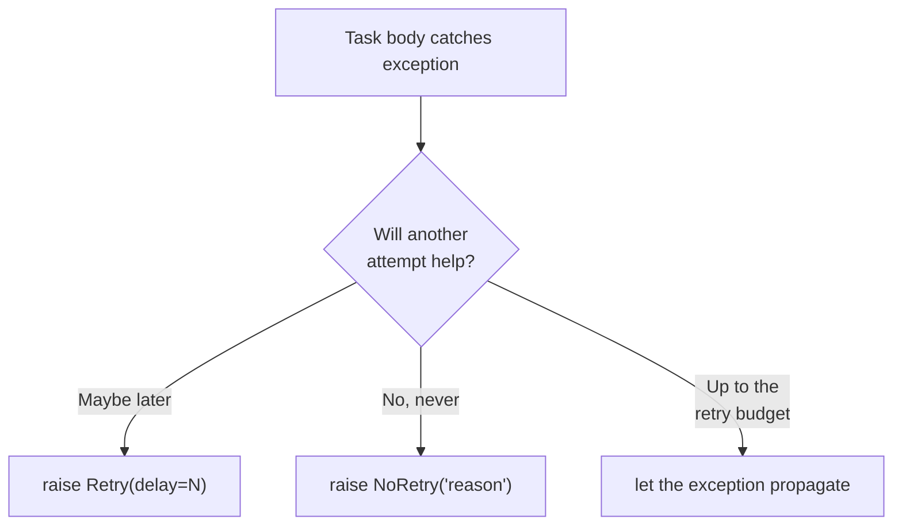
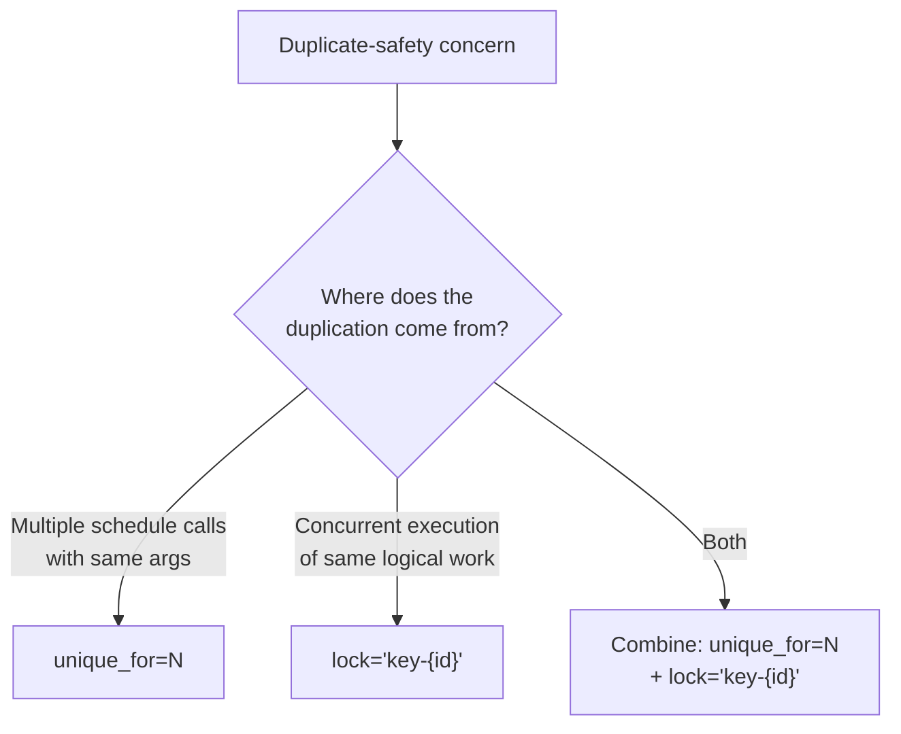
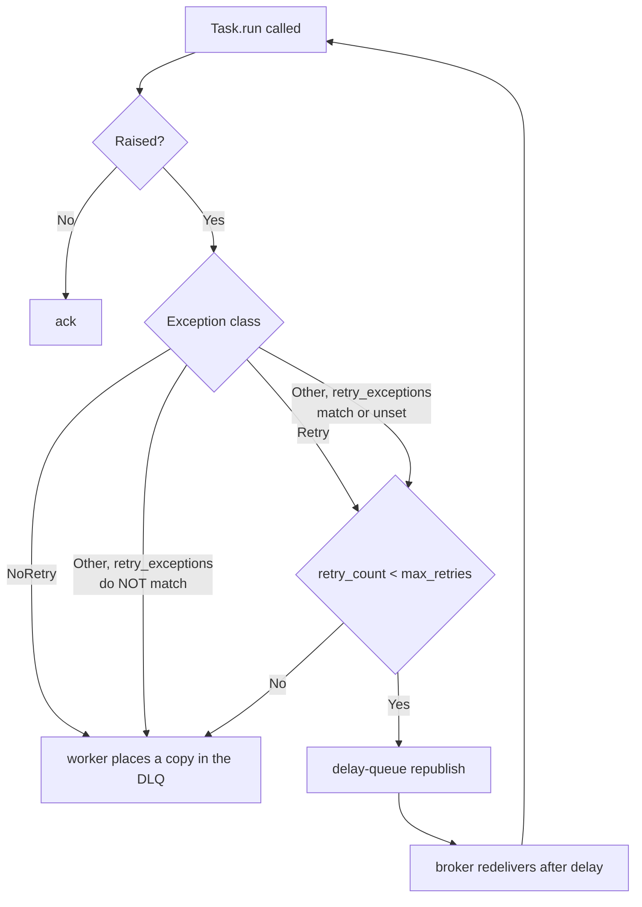
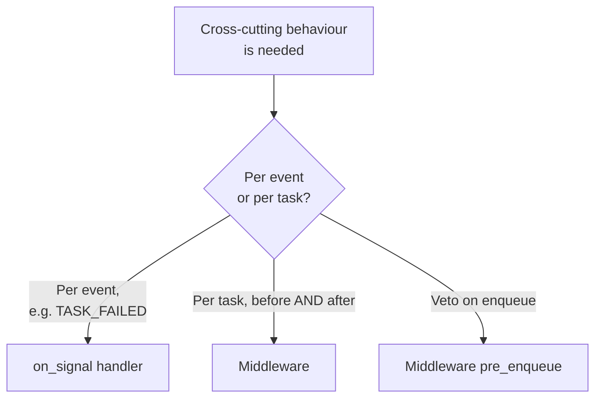
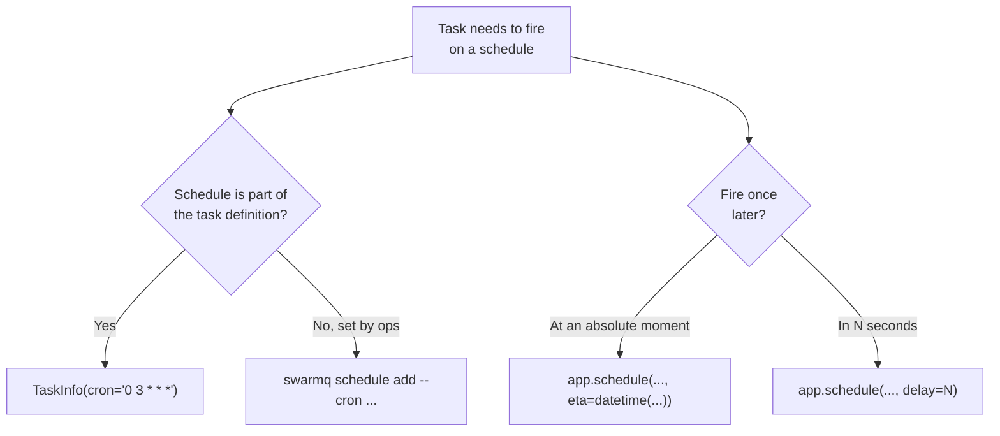
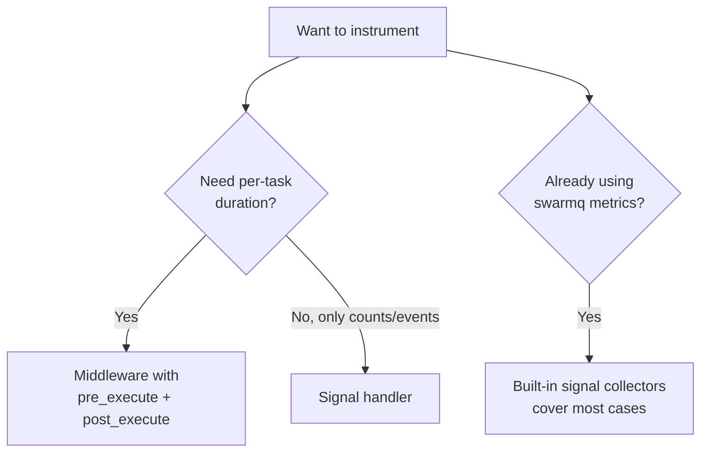

# Decision trees

Mermaid flowcharts that turn the non-obvious SwarmQ choices into
deterministic paths. Treat them as ground truth when choosing between
features.

## Which queue should this task use?



Rules:

- `TaskInfo.queues[0]` is the default target. `schedule(..., queue=...)`
  overrides it per call; the client does not check the name against
  `queues`. A queue that does not exist makes the publish raise
  `UnroutableMessage`, so a worker has to consume every target.
- `priority` belongs to the task definition, not to a call: every
  message of a task with `priority="high"` goes to `<queue>.high`
  (`"low"` to `<queue>.low`, `"normal"` to `<queue>`). Workers need
  `--priorities` (or `SWARMQ_PRIORITIES`) to declare and consume the
  three queues; without it the publish raises `UnroutableMessage`.
- The suffix applies on top of the resolved queue, also to an explicit
  `queue=`. Combine both only when you need both dimensions (for
  example `emails` fast/slow × high/normal/low).

## Should I set `max_retries`?



Rules of thumb:

- The default is `max_retries=0`: the first failure is terminal.
  Most real workloads fit `max_retries=3`,
  `retry_backoff="exponential"` (also `"linear"` or `"fixed"`) and
  `retry_base_delay=1.0`. Start there and raise it only when metrics
  show a real retry window longer than that.
- Tasks with open-ended retries need `max_age`. Otherwise they pile up
  in the queue after a third-party outage. `max_age` is measured from
  the first enqueue; retry copies keep `x-swarmq-enqueued-at`.

## `Retry` vs `NoRetry`



- `Retry(delay=N)` overrides the configured backoff for this attempt.
  Use it when you know the right wait (for example HTTP
  `Retry-After: 60`).
- `Retry()` without a delay uses the configured backoff.
- `Retry` applies whether or not `retry_exceptions` lists it, and it
  consumes the retry budget: with `max_retries=0` it ends terminally.
- `NoRetry(reason)` ends the task terminally at once. Use it for hard
  errors (4xx responses, validation failures, schema drift).
- Letting the exception escape is the default path; `retry_exceptions`
  and the retry budget decide.

## Lock vs unique task: which one?



- **Unique task** deduplicates at schedule time: several `schedule()`
  calls with the same name and arguments within `unique_for` seconds
  produce one message, and the duplicates return its task ID.
- **Lock** serialises at execution time: two workers never run the
  same logical work in parallel (`max_concurrency` holders, default 1).
  A conflict defers the message and waits until the lock frees, at
  most `SWARMQ_LOCK_WAIT_MAX_S`.

They compose: unique gates the enqueue, the lock gates the run. See
[Locking and deduplication](../../guides/locking-and-dedup.md) for
worked examples.

## `unique_until="start"` vs `"completion"`?

```mermaid
flowchart TD
    A[Dedup is desired] --> B{Is concurrent<br/>execution OK?}
    B -->|Yes, only absorb<br/>client retries| C['unique_until="start"']
    B -->|No, a second schedule<br/>must wait for the first| D['unique_until="completion"<br/>default']
```

- `"start"` releases the flag once, right before the task runs (after
  the rate-limit and lock checks; a deferral before that keeps it).
  Good for "absorb client retries, but let follow-ups proceed".
- `"completion"` holds the flag until the terminal state. Good for
  "one in flight" patterns where a second schedule should get the
  first one's task ID.

## When does a message go to the DLQ?



Every arrow into `DLQ` stores an error result (a workflow step whose
success is already stored keeps it), fires `TASK_DLQ` and logs
`task_sent_to_dlq`.

Additional DLQ paths:

- `TaskInfo.max_age` exceeded at pickup: `TASK_EXPIRED`, error result,
  DLQ copy. The task never runs.
- Lock template does not render (for example a missing kwarg): DLQ
  with `x-swarmq-lock-render-error: <reason>`.
- Wait for a task lock ended (same holder longer than its TTL + 60 s,
  or `SWARMQ_LOCK_WAIT_MAX_S` since the first conflict): DLQ with
  `x-swarmq-lock-name`, `error_type=LockWaitExceeded`, error result
  and `TASK_DLQ`.
- Delivery limit reached (the smaller of `SWARMQ_DELIVERY_LIMIT`,
  default 20, and the queue's `x-delivery-limit`): the worker's
  delivery-count gate dead-letters one delivery before the broker
  would, with `error_type=WorkerHungError` (the broker's
  `x-delivery-count` reached the limit) or `RedeliveryLimitError` (the
  worker handed the delivery back until `x-acquired-count` reached
  it). The broker's own dead-lettering stays the last resort. Since
  0.13, a delivery at the limit whose execution already completed is
  acknowledged instead (F4-02).
- Execution guard orphan limit (`SWARMQ_EXECUTION_GUARD_MAX_ORPHANS`,
  default 3, expirations of the same execution without release): DLQ
  as `WorkerHungError` (`execution_guard_orphan_limit`).
- Task not registered on the worker: deferred with backoff
  (`TASK_UNKNOWN_DEFERRED`) until `SWARMQ_UNKNOWN_TASK_GRACE_S`
  (default 900 s) runs out, then DLQ with an error result
  (`TaskNotFoundError`), `TASK_DLQ` and `TASK_REJECTED`
  (`reason="unregistered_task"`).
- Message the worker cannot run at all (`body_too_large`,
  `undecodable`, `middleware_chain_factory`): DLQ copy with
  `x-swarmq-traceback: <reason>: <error>` and `TASK_REJECTED`, no
  error result.

With `TaskInfo(dead_letter=False)` or
`SWARMQ_DEAD_LETTER_TERMINAL_FAILURES=false`, the three `DLQ` arrows of
the chart store the error result and ack instead; the additional paths
stay. Dead-lettered messages expire after `SWARMQ_DEAD_LETTER_TTL_S`
(default 7 days, `none` for unlimited).

Not a DLQ path: a check before execution (schedule-fire dedup, cancel
check, execution guard, rate limit, lock) that cannot reach Valkey
defers the message with backoff through the delay queue as a new
message (`task_deferred_backend_unavailable`). This uses neither
`max_retries` nor the delivery limit, so an outage of any length never
dead-letters a task. An error reply from Valkey (`BackendResponseError`)
is requeued in place instead and reaches the DLQ through the delivery
limit if it persists.

## When should I use a signal handler vs middleware?



- Signal handlers are simpler to write and to reason about.
- Middleware is required for paired before/after hooks, state shared
  across hooks, or a veto on enqueue.

## Should I use the embedded scheduler or cron?



Use code (`TaskInfo.cron`, optionally with `timezone`) when the
schedule is part of the task's contract (for example "daily billing
runs at 03:00 UTC"). Use the CLI (`swarmq schedule`) when ops needs to
add or change schedules without a code deploy. Cron expressions have
exactly 5 fields (crontab(5) syntax since 0.13).

## When to install middleware versus signals for metrics?



Prefer the built-in `swarmq[metrics]` exporter when it covers your
needs. Add custom middleware only for a dimension the exporter does not
expose (custom labels, per-tenant timings). `post_execute` runs only
after a successful execution.

## See also

- [Message formats](message-formats.md): payload schemas used by these
  decision points
- [Scheduling and retries](../../guides/scheduling-and-retries.md):
  retry decisions in prose
- [Locking and deduplication](../../guides/locking-and-dedup.md):
  lock-vs-unique decisions in prose
