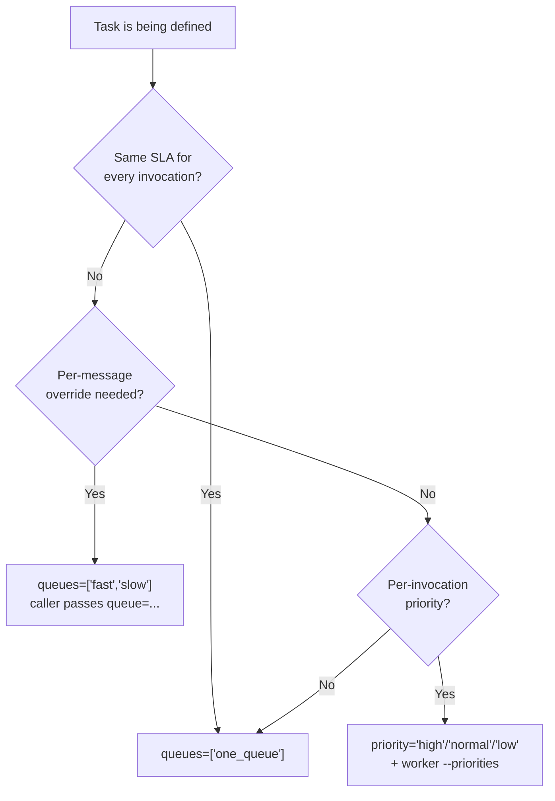
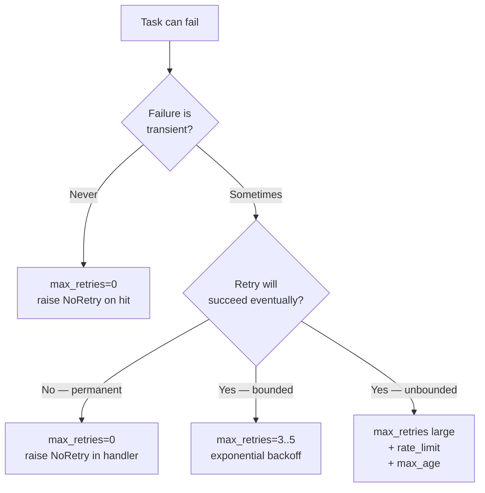
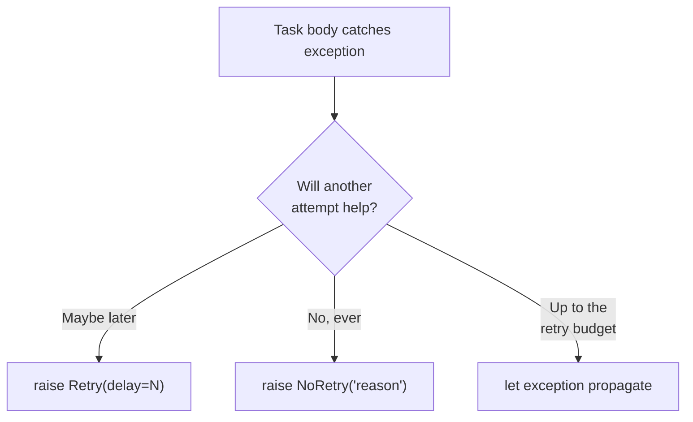
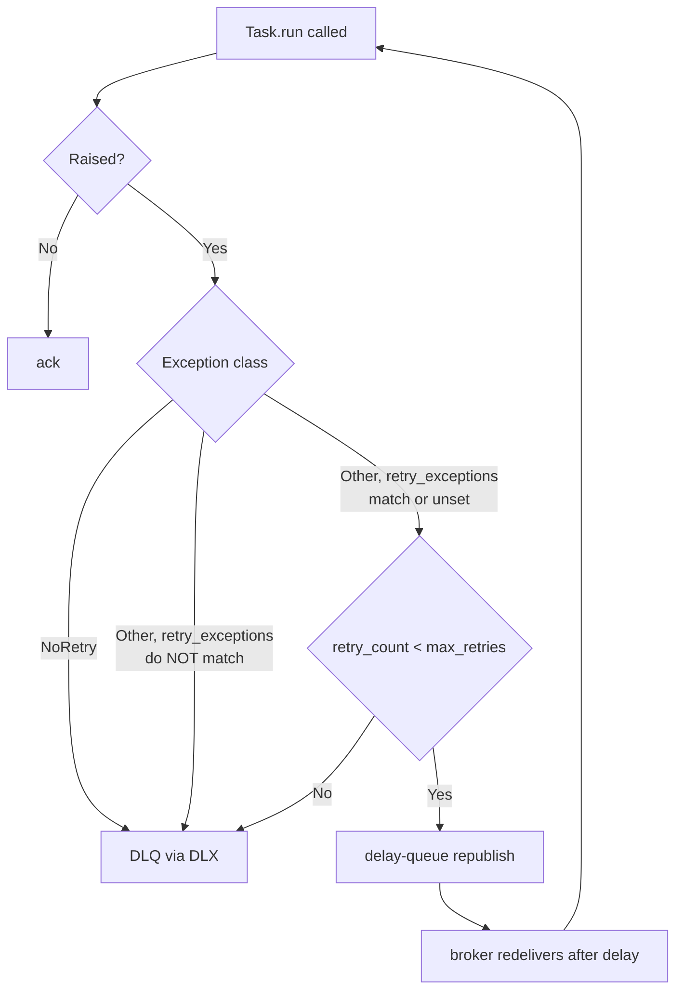
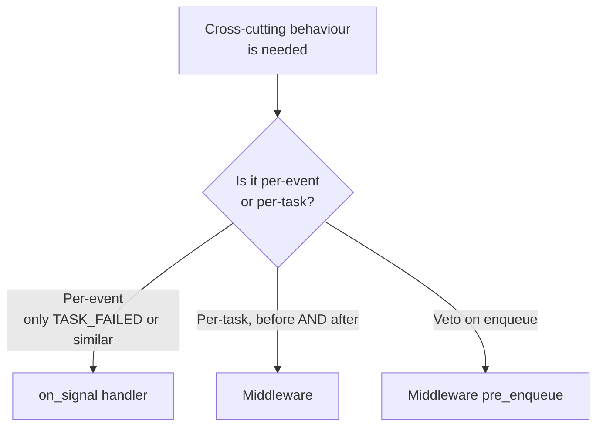
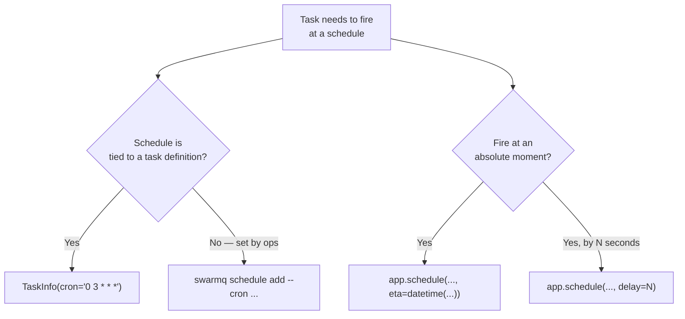

# Decision trees

Mermaid flowcharts that turn the non-obvious SwarmQ choices into
deterministic paths. Use these as ground truth when picking between
features.

## Which queue should this task use?



Rules:

- Multi-queue routing is a client-side override. `TaskInfo.queues`
  declares the *valid* targets; the client picks one.
- Priority suffixes are an **alternative** to multi-queue
  routing, not a complement. Mix them only when you need both
  dimensions (e.g. `emails` fast/normal/slow × high/normal/low).

## Should I set `max_retries`?



Rules of thumb:

- Most real workloads fit `max_retries=3`, `retry_backoff="exponential"`,
  `retry_base_delay=1.0`. Start there, raise only if metrics show a
  real retry window longer than the default.
- Unbounded-retry tasks must have `max_age` set, or they will
  accumulate in the queue forever after a third-party outage.

## `Retry` vs `NoRetry`



- `Retry(delay=N)` — override the configured backoff for this
  attempt. Use when you know the exact correct wait (e.g. HTTP
  `Retry-After: 60`).
- `Retry()` with no delay — use the configured backoff formula.
- `NoRetry(reason)` — short-circuit to DLQ. Use for hard errors
  (4xx responses, validation failures, schema drift).
- Letting the exception escape — default path; the retry budget
  decides.

## Lock vs unique task — which one?

```mermaid
flowchart TD
    A[Duplicate-safety concern] --> B{Where does the<br/>duplication come from?}
    B -->|Multiple schedule() calls<br/>with same args| C[unique_for=N]
    B -->|Concurrent execution<br/>of same logical work| D[lock='key-{id}']
    B -->|Both| E[Combine: unique_for=N<br/>+ lock='key-{id}']
```

- **Unique task** = dedup at schedule time. Collapses multiple
  `schedule()` calls into one message.
- **Lock** = serialisation at execute time. Prevents two workers
  from running the same logical task in parallel.

They compose. Unique gates the enqueue; lock gates the run. See
[Locking and deduplication](../../guides/locking-and-dedup.md) for
worked examples.

## `unique_until="start"` vs `"completion"`?

```mermaid
flowchart TD
    A[Dedup is desired] --> B{Is concurrent<br/>execution OK?}
    B -->|Yes — only want to<br/>absorb client retries| C['unique_until="start"']
    B -->|No — second schedule<br/>must wait for the first| D['unique_until="completion"<br/>default']
```

- `"start"` releases the flag at worker pickup — good for "absorb
  client retries but let follow-ups proceed" patterns.
- `"completion"` holds the flag through terminal state — good for
  "one in flight, one pending" patterns where the second schedule
  should see the first's task_id.

## When does a message go to the DLQ?



Additional DLQ paths:

- `TaskInfo.max_age` exceeded at pickup → `TASK_EXPIRED` signal +
  DLQ. The task never runs.
- Lock render fails (missing kwarg for template) → DLQ with
  `x-swarmq-lock-render-error: <reason>`.
- Lock conflict cap reached (10th conflict) → DLQ with
  `x-swarmq-lock-conflict-count` and `x-swarmq-lock-name`.
- Delivery limit reached (`delivery_limit`, default 20) → DLQ via the
  worker's delivery-count gate (`task_sent_to_dlq` with
  `error_type=WorkerHungError`), broker-native DLQ as the last resort.

## When should I use a signal handler vs middleware?



- Signal handlers are simpler to write and reason about.
- Middleware is required if you need paired before/after hooks,
  shared state across hooks, or a veto on enqueue.

## Should I use the embedded scheduler or cron?



Use code (`TaskInfo.cron`) when the schedule is part of the task's
contract (e.g. "daily billing runs at 03:00 UTC"). Use the CLI
(`swarmq schedule`) when ops needs to add or change schedules
without a code deploy.

## When to install middleware versus signals for metrics?

```mermaid
flowchart TD
    A[Want to instrument] --> B{Need per-task<br/>duration?}
    B -->|Yes| C[Middleware with<br/>pre_execute + post_execute]
    B -->|No, only counts/events| D[Signal handler]
    A --> E{Already using<br/>swarmq metrics]?}
    E -->|Yes| F[Built-in signal collectors<br/>cover most cases]
```

Prefer the built-in `swarmq[metrics]` exporter when it covers your
needs. Add custom middleware only when you need a dimension
(custom labels, per-tenant timings) the exporter does not expose.

## See also

- [Message formats](message-formats.md) — payload schemas used by
  these decision points
- [Scheduling and retries](../../guides/scheduling-and-retries.md)
  — retry-related decisions in prose
- [Locking and deduplication](../../guides/locking-and-dedup.md) —
  lock-vs-unique decisions in prose
